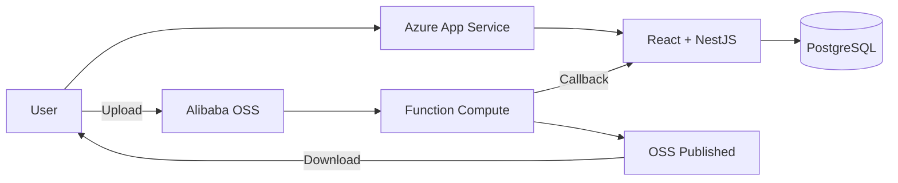

# EduCenter Cloud

Nền tảng SaaS quản lý trung tâm giáo dục theo kiến trúc Multi-Cloud, kết hợp Microsoft Azure và Alibaba Cloud.

> Bài tập lớn môn Điện toán đám mây — VNU-UET.


## Features

- Quản lý nhiều trung tâm giáo dục (Multi-tenant).
- Quản lý học viên, giáo viên, lớp học và khóa học.
- Quản lý điểm danh, điểm số, học phí và thống kê.
- Lưu trữ và xử lý tài liệu học tập trên Multi-Cloud.
- Phân quyền Admin, Teacher và Student.

## Architecture



- **Microsoft Azure:** Application, Database, Security.
- **Alibaba Cloud:** Object Storage, Serverless Processing.

## Getting Started

```bash
git clone https://github.com/ThanhDuc1712/EduCenter-Cloud---BTL-Cloud.git
cd EduCenter-Cloud---BTL-Cloud
pnpm install
```

## Branches

| Branch | Description |
|--------|-------------|
| `main` | Integration & Release |
| `front-backend` | Application Development |
| `azure` | Azure Infrastructure |
| `aliyun` | Alibaba Cloud Infrastructure |

## Team

Đức · Doanh · Anh · Hà · Dương · Giang

## Documentation

- [Project Roadmap](ROADMAP.md)
- [API Contract](packages/api-contract/openapi.yaml)

---

**Status:** In Development 🚀
