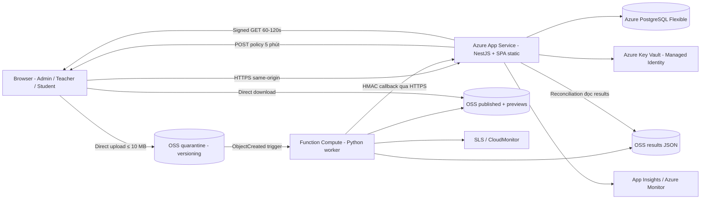
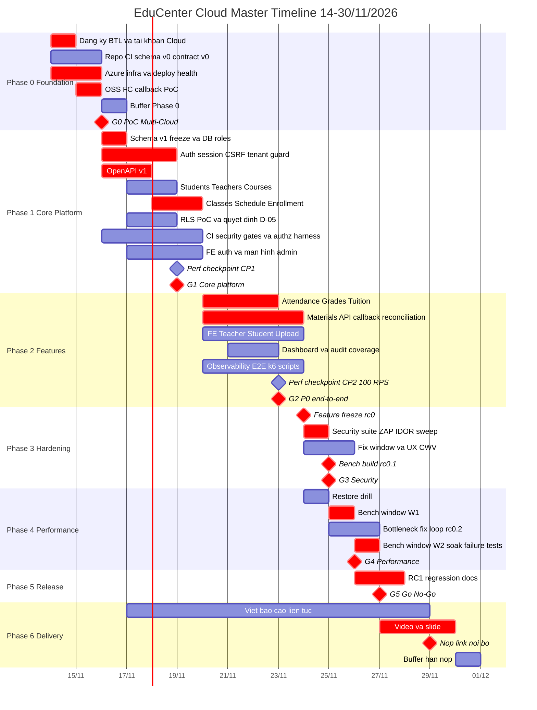
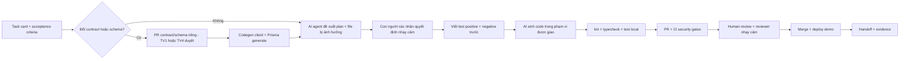
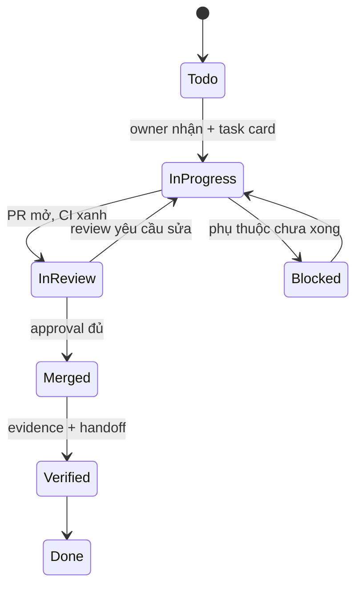

# EDUCENTER CLOUD — ENGINEERING ROADMAP

**Phiên bản roadmap:** 1.2 (bỏ gán tên thành viên cụ thể — nhóm tự phân công theo vai trò TV1–TV6) · **Ngày lập:** 13/11/2026 · **Source of Truth:** `EduCenter_Cloud_Ban_Thiet_Ke_2.md` (Version 2.0) + `BTL CK 1.pdf`
**Thay đổi so với v1.0:** 34 phát hiện review (2 Critical, 12 High, 15 Medium, 5 Low) — chi tiết và trạng thái xử lý ở **Phụ lục A**. Các quyết định đã chốt trong V2 được giữ nguyên; mọi thay đổi kiến trúc được đề xuất qua ADR-021…ADR-027 (D-23…D-33).
**Tổ hợp Cloud:** Microsoft Azure + Alibaba Cloud (tổ hợp số 9 — được tô vàng, +1 điểm theo đề)
**Hạn nộp:** 30/11/2026 · **Mục tiêu nộp nội bộ:** 29/11/2026 22:00 (giữ 30/11 làm buffer)
**Trạng thái:** PLAN — chưa có dòng code, chưa có bằng chứng triển khai. Mọi chỉ số trong tài liệu là mục tiêu (SLO), không phải kết quả.

> Quy ước: **S** = task tuần tự / nằm trên critical path · **P** = có thể chạy song song · **h** = giờ làm việc tập trung · `→` Owner → Reviewer.
> Toàn bộ cột "Owner → Reviewer" trong roadmap này (mục 5, 6, 7...) dùng **mã vai trò TV1–TV6** (định nghĩa ở §6.1), không ghi tên thành viên thật trực tiếp vào từng task. Mapping tên thật ↔ vai trò **đã được trưởng nhóm chốt (D-01, Accepted)** — xem **§15 "Phân việc"** để biết TV nào là ai và phân công các deliverable BTL (slide/báo cáo/video).

---

## Mục lục

1. Executive Summary và Architecture Baseline
2. Scope, Assumptions và Decision Log (kèm Design Audit)
3. Master Timeline và Critical Path
4. Phase-by-Phase Roadmap
5. Task Backlog có ID và dependency
6. Team Assignment Matrix
7. AI Coding Workflow và Context Handoff
8. Quality Gates cho từng Phase
9. Security, Performance và Reliability Test Plan
10. Risk Register và Contingency Plan
11. BTL Deliverables và Final Release Checklist
12. Danh sách task đầu tiên của Phase 0
13. Self-Audit roadmap và kết luận GO/NO-GO
14. Phụ lục A — Independent Review Findings (v1.0 → v1.1)
15. Phân việc — Mapping thành viên thật vào vai trò TV1–TV6 (Accepted)

---

# 1. Executive Summary và Architecture Baseline

## 1.1. Tóm tắt

| Hạng mục | Nội dung |
|---|---|
| Sản phẩm | B2B SaaS quản lý trung tâm giáo dục, multi-tenant, 3 vai trò chính Admin / Teacher / Student |
| Mục tiêu BTL | Ứng dụng chạy thật trên Azure + Aliyun, có luồng nghiệp vụ xuyên 2 Cloud, đủ P0 (F01–F11), báo cáo Word + video ≤ 5 phút + slide ≤ 20 trang |
| Mục tiêu kỹ thuật | Security-by-design (tenant isolation, RBAC, session/CSRF, HMAC callback), SLO hiệu năng V2, benchmark có phương pháp tới 1.200 concurrent users / 100 RPS / spike 200 RPS |
| Thời gian thực tế | 16 ngày làm việc (14/11 → 29/11) + 1 ngày buffer (30/11) |
| Chiến lược | Contract-first + schema-first → nền tảng auth/tenant trước → module nghiệp vụ song song → feature freeze 24/11 → hardening + benchmark → RC 27/11 → deliverables |
| Critical path | Repo/CI (repo visibility D-23) → Schema v1 freeze + Contract (login có tenant D-24) → Auth/Tenant guard + TenantTx → Classroom/Enrollment → Attendance/Grades/Tuition → E2E → Security suite → Benchmark trên bench build → Bằng chứng → Báo cáo/Video |
| Perf checkpoints sớm (v1.1) | CP1 19/11 (30 RPS đọc, cấu hình demo) · CP2 23/11 (100 RPS mix, cấu hình demo) — phát hiện nút thắt kiến trúc **trước** feature freeze |
| Critical path thứ hai (Multi-Cloud) | Tài khoản Aliyun → OSS + RAM → FC PoC → Callback HMAC → Materials API → ST11–ST19 → LT09/LT12 |
| Nguyên tắc cắt phạm vi | Cắt P1/P2 và phần "đẹp" trước; **không bao giờ cắt** tenant isolation, authorization tests, HMAC callback, secret scanning, idempotent payment |

## 1.2. Architecture Baseline (đã chốt trong V2 — không đổi nếu chưa có ADR được duyệt)

| Lớp | Baseline | BTL / Demo | Production Candidate (chỉ thiết kế, không deploy trong BTL) |
|---|---|---|---|
| Frontend | React + TS + Vite, Tailwind, shadcn/ui, TanStack Query, RHF + schema | Phục vụ cùng origin với API (D-03) | Front Door Premium + WAF |
| Backend | NestJS + TS, Express adapter, Modular Monolith | App Service 1–2 instance | ≥ 2 instance, autoscale tối đa 6 |
| ORM / DB | Prisma (khóa version) + PostgreSQL Flexible Server | Burstable/nhỏ, scale tạm thời khi benchmark (D-08) | General Purpose 4 vCPU, private networking, HA |
| Auth | Opaque session cookie, `auth_sessions` trong PostgreSQL, Argon2id | Bắt buộc | + MFA cho admin |
| AuthZ | RBAC + Tenant Scope + Resource Ownership (+ RLS defense-in-depth) | App-level scope bắt buộc; RLS theo D-05 | RLS bắt buộc |
| Secrets | Key Vault + Managed Identity | Bắt buộc | Bắt buộc + rotation định kỳ |
| Material pipeline | OSS quarantine → FC (Python) → OSS published + results → HMAC callback → Azure | Bắt buộc (điểm nhấn Multi-Cloud) | + malware scanning fail-closed |
| CI/CD | GitHub Actions, build-once, security gates | 1 môi trường cloud "demo" (D-02) | staging + production tách biệt |
| Observability | App Insights + Azure Monitor; SLS + CloudMonitor; correlation ID | Bắt buộc mức cơ bản | Đầy đủ alerting |
| Không dùng | Microservices, Kubernetes, service mesh, Kafka, active-active DB | — | — |



---

# 2. Scope, Assumptions và Decision Log

## 2.1. Design Audit — kết quả rà soát Version 2

### 2.1.1. Yêu cầu đã chốt (dùng làm baseline, không thảo luận lại)

| Nhóm | Đã chốt | Nguồn V2 |
|---|---|---|
| Phạm vi | P0 = F01–F11; P1 sau khi P0 + security gate đạt; P2 là roadmap | §6.1 |
| Stack | NestJS/Express, Prisma, PostgreSQL, React/Vite, Python FC, GitHub Actions | §4 |
| Kiến trúc | Modular Monolith + event-driven serverless worker; critical path chỉ Azure | §5.1, §5.3 |
| Bảo mật | Opaque session, `__Host-` cookie, CSRF, Argon2id, deny-by-default, HMAC callback, quarantine/published | §10, §11 |
| Dữ liệu | `tenant_id` mọi bảng nghiệp vụ, composite FK, unique constraints §9.4, optimistic locking grades, idempotent payments | §9 |
| SLO | PERF-01..09; 1.000 (dư địa 1.200) concurrent; 100 RPS; spike 200 RPS 5 phút; soak 60 phút | §3.1, §3.2, §15 |
| Hard gates | 6 hard gates → vi phạm là NO-GO | §23 |
| BTL | Word 20–50 trang, TNR 12, ≤ 15 hình (≤ nửa trang); video ≤ 5 phút; slide ≤ 20; nộp link public trước 30/11 | BTL CK |

### 2.1.2. Giả định chưa kiểm chứng

| ID | Giả định | Cách kiểm chứng | Task | Hạn |
|---|---|---|---|---|
| A-01 | Nhóm đã đăng ký hợp lệ tổ hợp 9 trước 12/11 | Ảnh chụp sheet đăng ký | P0-01 | 14/11 sáng |
| A-02 | Có Azure subscription đủ credit, cho phép tạo App Service + PG Flexible ở Southeast Asia | Tạo thử resource, kiểm tra quota | P0-02 | 14/11 |
| A-03 | Tài khoản Aliyun quốc tế hoàn tất xác minh danh tính và thanh toán kịp, region Singapore khả dụng cho OSS + FC | Tạo bucket + function thử | P0-03 | 14/11 |
| A-04 | OSS trigger → FC hoạt động với versioning bật và cung cấp version ID trong event | PoC thực tế | P0-15 | 15/11 |
| A-05 | `pypdf` + `pypdfium2` chạy được trên runtime FC Python | Deploy PoC | P0-15 | 15/11 |
| A-06 | GitHub Actions → Azure dùng OIDC được (có quyền tạo app registration/federated credential) | Thử cấu hình | P0-12 | 15/11 |
| A-07 | Prisma interactive transaction + `set_config` cho RLS có overhead chấp nhận được | Benchmark RLS PoC | P1-05 | 18/11 |
| A-08 | Mỗi thành viên có ~5 h/ngày tập trung (cuối tuần ~7 h) | Daily standup theo dõi burn-down | — | liên tục |
| A-09 | Ngân sách credit đủ cho cửa sổ benchmark scale-up ngắn (≤ 6 h) | Pricing Calculator + budget hiện còn | P4-01 / D-08 | 22/11 |
| A-10 | 1 máy tạo tải đủ năng lực cho 1.200 VU / 200 RPS JSON | k6 tự giám sát CPU máy tạo tải, `dropped_iterations` | P2-18 | 23/11 |
| A-11 | Mạng từ Việt Nam tới Azure SEA/Aliyun SG đủ ổn định cho demo + đo latency | P0-18 đo p50/p95 | P0-18 | 15/11 |

### 2.1.3. Mâu thuẫn / khoảng trống kỹ thuật phát hiện được → đề xuất ADR (không tự sửa kiến trúc)

| # | Vấn đề trong V2 | Tác động | Đề xuất | Decision/ADR |
|---|---|---|---|---|
| 1 | Cookie `__Host-` + `SameSite=Lax` + CSRF theo mô hình same-origin, nhưng V2 không nói SPA được host ở đâu trong BTL (chỉ có Front Door ở production) | Nếu SPA và API khác origin → cookie/CSRF hỏng, phải đổi sang CORS + credentials | NestJS phục vụ build tĩnh của SPA trên cùng App Service (cùng origin); production đặt sau Front Door | D-03 / ADR-015 |
| 2 | Bảng lịch học tên `sessions` song song với `auth_sessions` | Dễ nhầm lẫn cho AI agent/Prisma model, rủi ro query sai bảng | Đổi tên thành `class_sessions` (model `ClassSession`) ngay từ schema v0; API path giữ nguyên `/sessions/:id/attendance` | D-04 / ADR-016 |
| 3 | Pipeline §13.1 có Staging + Production, nhưng §5.4 BTL chỉ đủ ngân sách 1 môi trường | Không thể tách 2 môi trường cloud trong credit | BTL dùng 1 môi trường cloud "demo" đóng vai staging, có approval gate; "Production" chỉ là thiết kế | D-02 / ADR-017 |
| 4 | §8.5 yêu cầu rate limit chia sẻ giữa instance, nhưng Redis là optional | Không có Redis thì in-memory limiter không đạt yêu cầu | Login limiter lưu ở PostgreSQL (bảng counter + window), limiter chung in-memory chỉ là lớp phụ; Redis chỉ thêm khi đo thấy cần | D-06 / ADR-018 |
| 5 | §9.3 RLS với Prisma bắt buộc interactive transaction mỗi request → giữ connection lâu hơn, pool 10 conn/instance | Có thể nghẽn pool khi 100–200 RPS | PoC + benchmark trước khi rollout; nếu overhead p95 > 20% hoặc pool wait tăng → RLS chỉ trên các bảng nhạy cảm nhất, app-level scope + negative tests vẫn bắt buộc | D-05 / ADR-020 |
| 6 | §10.3 chưa chốt PUT hay POST upload | PUT không giới hạn được kích thước trước khi upload | Dùng OSS PostObject policy với `content-length-range` ≤ 10 MB + kiểm tra lại size trong worker | D-21 |
| 7 | Thư viện PDF chưa chốt; PyMuPDF dùng giấy phép AGPL | Rủi ro giấy phép cho sản phẩm thương mại | `pypdf` (BSD) + `pypdfium2` (Apache/BSD) — cần xác nhận khi PoC | D-10 / ADR-019 |
| 8 | Có cả `idempotency_keys` (chung) và `payments.idempotency_key` unique | Hai cơ chế chồng lấn, AI agent dễ dùng sai | `idempotency_keys` là cơ chế chuẩn cho mọi mutation có header; `payments.idempotency_key` unique giữ làm chốt chặn cuối ở DB | D-13 |
| 9 | Chống trùng lịch giáo viên (§6.3) chưa có cơ chế cụ thể | Race condition khi tạo lịch đồng thời | Ưu tiên exclusion constraint với `btree_gist` (cần xác nhận extension được Azure cho phép); fallback: khóa hàng teacher + kiểm tra trong transaction | D-18 |
| 10 | §23 tiêu đề ghi "trên 92%", bảng ghi "≥ 93" | Không rõ ngưỡng | Áp dụng ≥ 93 (chặt hơn) | D-14 |
| 11 | §20 Phase 0 = 13–15/11 nhưng thực tế bắt đầu 14/11 | Phase 0 thiếu 1 ngày | Phase 0 = 14–15/11, buffer sáng 16/11; Phase 1 bắt đầu song song các task không phụ thuộc Aliyun | Timeline §3 |
| 12 | §21 chưa có tên thành viên | Không có owner thực | Mapping đề xuất ở D-01 | D-01 |
| 13 | LT11 (restart instance khi đang tải) cần ≥ 2 instance; BTL có thể chỉ chạy 1 | Không thực hiện được LT11 nếu không scale | Đưa vào cửa sổ benchmark scale-up (D-08); nếu không đủ ngân sách → ghi "chưa triển khai" | D-08 |
| 14 | 1.200 VU cần phiên riêng; login hàng loạt bằng Argon2id sẽ tự tạo tải CPU | Làm sai lệch kết quả benchmark | Seed script tạo sẵn session cho tài khoản test (chỉ môi trường test, token lưu file local không commit); LT07 đo login riêng | D-16 |
| 15 | Callback FC "qua edge" nhưng BTL không có Front Door | ST21 không áp dụng | Callback gọi trực tiếp hostname HTTPS của App Service, bảo vệ bằng HMAC + timestamp + event uniqueness; ST21 = "Not implemented (production-only)" | D-19 |
| 16 | Malware scanning chỉ bắt buộc ở production | ST14 chỉ kiểm tra cấu trúc | BTL công bố giới hạn rõ ràng trong báo cáo; magic bytes ≠ quét virus | D-11 |
| 17 | V2 tham chiếu Bloggo/NutriHome/BangDiem/V1 nhưng không có trong Project | Thiếu tài liệu tham khảo cho báo cáo | Nhóm upload nếu cần; roadmap không phụ thuộc vào các file này | A-12 |
| 18 | `users(tenant_id, email)` unique theo tenant nhưng `POST /auth/login` không có định danh tenant | Không xác định được tài khoản khi cùng email ở 2 tenant; rủi ro đăng nhập nhầm tenant | Body login gồm `tenantSlug`; session gắn cứng tenant; PLATFORM_ADMIN ngoài phạm vi BTL | D-24 / ADR-021 |
| 19 | §9.1 `invoices` không có `status`, `due_date` nhưng §9.4 lại index `invoices(tenant_id, status, due_date)`; chưa có bảng cho login rate limit | Schema và index mâu thuẫn; task sau phải tự thêm migration | Schema v1 bổ sung `status`, `due_date`, `paid_vnd`, `login_attempts`, `class_sessions.teacher_id`, `materials.source_version_id` | D-27 / ADR-024 |
| 20 | V2 không mô tả cách tạo tài khoản đăng nhập cho teacher/student và đổi mật khẩu, dù §11.3 yêu cầu thu hồi phiên khi đổi mật khẩu | Thiếu luồng cấp tài khoản cho F02/F03 | Admin tạo tài khoản với mật khẩu tạm + bắt đổi lần đầu; thêm `POST /auth/change-password` | D-28 / ADR-025 |
| 21 | §9.3 yêu cầu runtime role không phải owner nhưng V2 không nêu cách migration chạy và cấp quyền bảng mới | CD hỏng hoặc phải mở firewall DB rộng; runtime role không đọc được bảng mới | Migration role riêng, `ALTER DEFAULT PRIVILEGES`, migration chạy qua job có kiểm soát firewall | D-25 / ADR-022 |
| 22 | §8.1/§10.8 yêu cầu lease/lock cho job; `background_jobs` lease phức tạp hơn mức cần cho 1 job reconciliation | Overengineering | `pg_try_advisory_lock` cho reconciliation; `background_jobs` chỉ ghi lịch sử chạy | D-32 / ADR-027 |
| 23 | PERF-01..03 yêu cầu p75 (dữ liệu thực địa) nhưng BTL không có người dùng thật | Không thể đo p75 thật | Đo lab (Lighthouse) và ghi rõ "lab, không phải field p75" | D-33 |

### 2.1.4. Dependency bên ngoài

| Dependency | Ảnh hưởng | Owner theo dõi |
|---|---|---|
| Xác nhận đăng ký nhóm/tổ hợp của thầy | Toàn bộ dự án | TV1 |
| Azure subscription + credit + quota | Toàn bộ Azure track | TV6 |
| Aliyun account + xác minh + thanh toán | Toàn bộ Multi-Cloud track (điểm nhấn) | TV5 |
| GitHub organization/repo + branch protection — **phụ thuộc gói GitHub và visibility (D-23)** | CI/CD, review, approval gate | TV1 |
| Google Drive/OneDrive link public | Nộp bài | TV1 |

## 2.2. Scope

| Trong phạm vi BTL (P0) | Ngoài phạm vi BTL |
|---|---|
| F01 Auth & Tenant (2 tenant demo), F02 Students, F03 Teachers, F04 Courses, F05 Classes/Schedule, F06 Enrollment, F07 Attendance, F08 Grades, F09 Materials (upload/xử lý/preview/download), F10 Tuition tối giản (khoản phải thu + thanh toán thủ công), F11 Dashboard tối giản | P1: F12 CSV export, F13 Assignments, F14 Notifications, F15 Certificates — **chỉ làm nếu G2 đạt trước 22/11** |
| Security tests ST01–ST20, ST22–ST25; ST21 ghi "production-only" | P2: Parent portal, cổng thanh toán, AI Education, chatbot, livestream, thi online |
| Load tests LT01–LT12 (LT03/LT05/LT11 phụ thuộc ngân sách D-08) | Front Door/WAF, Redis, PgBouncer, HA DB, private networking (thiết kế, không deploy) |
| Backup/restore drill, rollback drill | Dữ liệu học viên thật, malware scanning thật |

**Cắt giảm chủ động trong v1.1 (không chờ trễ mới cắt — giảm ~25 h công):**

| Hạng mục | v1.0 | v1.1 | Lý do |
|---|---|---|---|
| P1 features (F12–F15) | Mở nếu G2 sớm | **Ngoài phạm vi BTL**, chỉ ghi Future work | Capacity mỏng; P1 không cộng điểm riêng |
| Chống trùng lịch | Exclusion constraint `btree_gist` + fallback | Khóa hàng teacher + kiểm tra trong transaction | Bỏ thử nghiệm extension |
| Idempotency | Mọi mutation | Chỉ payment (bắt buộc) + enrollment | Đúng chỗ có rủi ro lặp theo V2 §14 |
| Reconciliation lock | `background_jobs` lease | `pg_try_advisory_lock` | Đơn giản, đủ đúng cho 1 job |
| Dashboard | Biểu đồ lazy load | Thẻ số liệu, không thư viện chart | F11 là "tối giản" |
| ADR | 20 file ADR đầy đủ | 1 file ADR log; chỉ ADR lệch V2 (015–027) viết đầy đủ | Giảm tải TV1 Phase 0 |
| SAST | CodeQL hoặc Semgrep | Đúng 1 công cụ theo D-23 | Tránh trùng chức năng (V2 §13.2) |
| DAST | ZAP scan | ZAP API/baseline scan, không active scan toàn bộ | Tránh phá dữ liệu demo, giảm thời gian |
| Máy tạo tải | Laptop + VM | Laptop mặc định; VM chỉ khi `dropped_iterations` > 0 | Giảm chi phí và thao tác |

## 2.3. Decision Log (cần nhóm xác nhận)

Trạng thái: **Proposed** → **Accepted** (nhóm đồng ý) → **Verified** (có bằng chứng). Accepted ≠ Verified.

| ID | Quyết định đề xuất | Lý do | Ảnh hưởng | Người quyết | Hạn | Trạng thái |
|---|---|---|---|---|---|---|
| D-01 | **(đã chốt — xem §15)** Mapping thành viên thật vào vai trò TV1–TV6: TV1=Đức, TV2=Doanh, TV3=Anh, TV4=Hà, TV5=Dương, TV6=Giang | Quyết định của trưởng nhóm, không theo gợi ý cân bằng tải mặc định của roadmap | Toàn bộ phân công, mọi cột Owner→Reviewer ở §5 (vẫn ghi mã TV, tra ở §15) | Cả nhóm | 14/11 | **Accepted** |
| D-02 | BTL dùng **1 môi trường cloud "demo"** (vai trò staging) + local docker; production chỉ ở mức thiết kế | Ngân sách credit | Pipeline, báo cáo phải ghi rõ | TV1 + TV6 | 14/11 | Proposed |
| D-03 | SPA được NestJS phục vụ tĩnh trên cùng App Service (same-origin) — ADR-015 | Giữ mô hình cookie/CSRF của V2 | Build pipeline, cache header | TV1 + TV3 | 14/11 | Proposed |
| D-04 | Đổi tên bảng `sessions` → `class_sessions` — ADR-016 | Tránh nhầm với `auth_sessions` | Schema v0 | TV1 + TV4 | 14/11 | Proposed |
| D-05 | RLS: PoC trên `students` → quyết định rollout trước 19/11 dựa trên overhead (ngưỡng: p95 tăng ≤ 20%, không tăng pool wait đáng kể) — ADR-020 | Defense-in-depth vs hiệu năng | P1-05, P2-10, ST20 | TV3 + TV1 | 19/11 | Proposed |
| D-06 | Rate limit login lưu ở PostgreSQL; không dùng Redis trong BTL — ADR-018 | Đáp ứng yêu cầu "chia sẻ giữa instance" mà không thêm dịch vụ | P1-06, LT07 | TV3 | 16/11 | Proposed |
| D-07 | GitHub → Azure dùng OIDC federated credential; fallback: publish profile lưu GitHub environment secret có required reviewer | Không lưu credential dài hạn nếu tránh được | P0-12 | TV6 + TV3 | 15/11 | Proposed |
| D-08 | **(sửa v1.1)** Hai cửa sổ benchmark scale-up: **W1** 25/11 14:00–18:00 và **W2** 26/11 09:00–13:00 (tổng ≤ 8 h), trên **bench build** cố định (D-30); App Service ≥ 2 instance, PG tier lớn hơn; giới hạn chi phí do nhóm chốt theo Pricing Calculator | v1.0 dồn ~10 kịch bản + vòng sửa vào ≤ 6 h là không khả thi | LT02–LT12 | Cả nhóm | 22/11 | Proposed |
| D-09 | Region: Azure Southeast Asia + Aliyun Singapore (ap-southeast-1), xác nhận sau đo latency | Gần VN, đủ dịch vụ | Toàn bộ hạ tầng; cần ghi chú chuyển dữ liệu xuyên biên giới (chỉ dữ liệu giả) | TV6 + TV5 | 15/11 | Proposed |
| D-10 | Thư viện PDF: `pypdf` + `pypdfium2` — ADR-019 | Giấy phép permissive | FC | TV5 | 15/11 | Proposed |
| D-11 | Không có malware scanning trong BTL; công bố giới hạn | Thời gian/chi phí | ST14, báo cáo | TV3 | 15/11 | Proposed |
| D-12 | Tiền VND: `BIGINT` trong DB, serialize JSON dạng **string** | Tránh mất chính xác JS | Contract, FE | TV1 + TV4 | 14/11 | Proposed |
| D-13 | **(sửa v1.1)** Idempotency: bảng `idempotency_keys` (tenant, actor, operation, key, request_hash, response) áp dụng **chỉ** cho `POST /invoices/:id/payments` (bắt buộc) và `POST /classrooms/:id/enrollments`; `payments.idempotency_key` unique là chốt chặn cuối | Thống nhất cơ chế, tránh áp dụng tràn lan | P1-13, P2-03 | TV4 + TV3 | 16/11 | Proposed |
| D-14 | Ngưỡng Decision Quality Score ≥ 93 | Giải quyết mâu thuẫn 92/93 | Đánh giá | TV1 | 14/11 | Proposed |
| D-15 | **(sửa v1.1)** Máy tạo tải: laptop có mạng ổn định tại VN là mặc định; chỉ thuê VM ngắn hạn khi `dropped_iterations` > 0 hoặc CPU máy tạo tải > 80%; báo cáo ghi rõ nguồn tải | Giảm chi phí/thao tác | P2-18, P4 | TV6 | 22/11 | Proposed |
| D-16 | **(sửa v1.1)** Session benchmark được seed trực tiếp (hash vào `auth_sessions`) **chỉ cho tenant có tiền tố `bench-`**, TTL tuyệt đối ≤ 24 h, token lưu file local trong `.gitignore`; P4-11 thu hồi toàn bộ session và xóa tenant bench. **Không có cờ bypass rate limit/auth trong code** | Tránh login storm nhưng không để lại "cửa sau" trong môi trường chấm bài | P1-20, P4-11 | TV3 + TV6 | 18/11 | Proposed |
| D-17 | Cấu hình demo khởi điểm: App Service Linux 1 instance gói thấp nhất hỗ trợ Always On + deployment; PG Flexible Burstable | Tiết kiệm credit | P0-11 | TV6 | 14/11 | Proposed |
| D-18 | **(sửa v1.1)** Chống trùng lịch giáo viên: `class_sessions.teacher_id` (sao từ classroom khi tạo) + `SELECT … FOR UPDATE` trên hàng teacher + kiểm tra chồng giờ trong cùng transaction. Bỏ hướng `btree_gist` (exclusion constraint không thể kiểm tra qua join với classroom) | Nhất quán dưới concurrency, đơn giản hơn | P0-08, P1-12 | TV4 | 16/11 | Proposed |
| D-19 | Callback FC → hostname App Service public, không có edge trong BTL; ST21 = production-only | Không có Front Door | P0-16, ST21 | TV3 | 15/11 | Proposed |
| D-20 | Monorepo pnpm workspace, không Nx/Turborepo; Node LTS hiện hành + PostgreSQL 16 (nếu Azure + Prisma hỗ trợ) — ghi chính xác vào ADR sau Phase 0 | §4.3 | Toàn bộ | TV1 | 15/11 | Proposed |
| D-21 | Upload dùng OSS PostObject policy (`content-length-range` ≤ 10 MB, hết hạn 5 phút, key cố định) | Giới hạn kích thước trước khi upload | P0-17, P2-05 | TV5 + TV3 | 15/11 | Proposed |
| D-22 | **(sửa v1.1)** P1 (F12–F15) **ngoài phạm vi BTL**; chỉ ghi vào Future work | Capacity chỉ dư ~8%; P1 không cộng điểm riêng | Scope | TV1 | 14/11 | Proposed |
| D-23 | **Repo GitHub public** trong org của nhóm (code không chứa secret, chỉ dữ liệu tổng hợp) — ADR-026. Lý do: trên repo private gói Free không có protected branches/CODEOWNERS bắt buộc; environment required reviewers trên private chỉ có ở Enterprise; CodeQL private cần GHAS. Phương án B: repo private dưới tài khoản cá nhân có GitHub Pro (Student Pack) → có branch protection + CODEOWNERS, **không** có environment approval (thay bằng `workflow_dispatch` chỉ cho người có quyền admin + biên bản), SAST = Semgrep | Giữ được release gate, SAST, secret scanning mà không tốn tiền | P0-04, P0-06, P0-12, P1-18, P5-05 | Cả nhóm (cần đồng ý công khai code) | 14/11 09:00 | Proposed |
| D-24 | Login gồm `tenantSlug` + email + password; session lưu `tenant_id` cố định; đổi tenant = đăng nhập lại; PLATFORM_ADMIN không triển khai trong BTL — ADR-021 | `users` unique theo `(tenant_id, email)` | P0-08, P0-09, P1-01, P1-15 | TV3 + TV1 | 14/11 | Proposed |
| D-25 | DB roles: `edu_migrator` (owner schema, chỉ dùng cho migration), `edu_runtime` (DML, không BYPASSRLS, không owner); `ALTER DEFAULT PRIVILEGES` cấp quyền cho bảng mới; audit_logs chỉ INSERT/SELECT. Migration chạy bằng job CD riêng: workflow lấy IP runner → thêm firewall rule tạm thời qua az CLI (OIDC) → `prisma migrate deploy` → xóa rule (luôn chạy ở bước `always()`). Không bật "Allow public access from any Azure service" — ADR-022 | Không mở DB rộng; runtime role đúng chuẩn V2 §9.3 | P0-11, P0-12, P1-23 | TV6 + TV3 | 15/11 | Proposed |
| D-26 | Mọi truy cập DB nghiệp vụ đi qua 1 wrapper `TenantTx` (interactive transaction + `set_config('app.tenant_id', …, true)` + Prisma client có scope) ngay từ P1-04, dù RLS đã bật hay chưa. Bật RLS sau này = chỉ thêm migration policy — ADR-023 | Tránh làm lại toàn bộ module ở Phase 2 khi rollout RLS | P1-04, P1-05, P2-10, mọi module | TV3 + TV4 | 16/11 | Proposed |
| D-27 | **Schema v1 đóng băng 16/11 20:00** (gồm mọi bảng P0, kể cả `login_attempts`, cột bổ sung ở Design Audit #19). Sau mốc này: thay đổi schema = change request cho TV4 + ADR nếu đổi nghĩa — ADR-024 | Tránh nhiều agent cùng sửa `schema.prisma` | P1-08 và mọi task backend | TV4 + TV1 | 16/11 | Proposed |
| D-28 | Cấp tài khoản: Admin tạo login cho teacher/student với mật khẩu tạm (hiển thị 1 lần), cờ `must_change_password`; `POST /auth/change-password` thu hồi các phiên khác — ADR-025 (bổ sung contract) | V2 thiếu luồng này | P1-25 | TV3 | 17/11 | Proposed |
| D-29 | HMAC callback key: sinh 1 lần ngoài repo, lưu Key Vault (Azure) và biến môi trường mã hóa của FC (Aliyun); hỗ trợ 2 key ID cùng hiệu lực khi xoay; sau khi đổi secret trong Key Vault phải restart App Service (Key Vault reference có cache) | V2 chỉ nói phía Azure | P0-21, P3-05, LT12 | TV5 + TV3 | 15/11 | Proposed |
| D-30 | **Bench build**: tag `rc0.1` lúc 25/11 12:00 sau đợt sửa bảo mật; W1 chạy trên `rc0.1`; sửa hiệu năng gộp vào `rc0.2` cho W2; mọi số liệu gắn SHA. Không chạy ZAP/security suite trùng giờ benchmark | Số liệu đo trên đích đang thay đổi là vô giá trị | P3-10, P4-* | TV1 + TV6 | 22/11 | Proposed |
| D-31 | Bảo vệ demo env khi chấm: script reset dữ liệu demo idempotent; tài khoản cho giảng viên ưu tiên Teacher/Student; tài khoản Admin demo dùng mật khẩu riêng chỉ ghi trong báo cáo nộp; kiểm tra + reset 28–30/11 | Link báo cáo public → ai có link đều đăng nhập được | P5-06, P6-08 | TV5 + TV3 | 26/11 | Proposed |
| D-32 | Reconciliation dùng `pg_try_advisory_lock`; `background_jobs` chỉ lưu lịch sử chạy — ADR-027 | Đơn giản hóa §10.8 V2 nhưng giữ tính đúng | P2-09 | TV5 + TV1 | 20/11 | Proposed |
| D-33 | Core Web Vitals trong BTL đo bằng Lighthouse (lab) cho mobile + desktop; báo cáo ghi rõ không phải p75 field | Không có người dùng thật | P3-08, R-10 | TV2 | 24/11 | Proposed |

---

# 3. Master Timeline và Critical Path

## 3.1. Lịch tổng thể

| Phase | Tên | Ngày | Gate | Mục tiêu chính |
|---|---|---|---|---|
| 0 | Foundation & Multi-Cloud PoC | 14–15/11 (buffer sáng 16/11) | **G0** 16/11 12:00 | Tài khoản, repo, CI, schema v0, contract v0, deploy /health, OSS → FC → callback chạy thật |
| 1 | Core Platform | 16–19/11 | **G1** 19/11 20:00 | Schema v1 freeze (16/11), Auth/session/CSRF, TenantTx, RLS PoC, Students/Teachers/Courses/Classes/Enrollment, cấp tài khoản, CI security gates, **CP1** |
| 2 | Feature Development | 20–23/11 | **G2** 23/11 20:00 | Attendance, Grades, Tuition, Materials đầy đủ, Dashboard, reconciliation, observability, E2E, **CP2 100 RPS** |
| 3 | Integration & Security Hardening | 24–25/11 | **G3** 25/11 20:00 | Feature freeze 24/11 00:00; 24/11: ST01–ST25, ZAP, IDOR sweep; sáng 25/11: fix → **bench build `rc0.1` 25/11 12:00** |
| 4 | Performance & Reliability | 24–26/11 | **G4** 26/11 20:00 | 24/11 restore drill; **W1** 25/11 14–18h trên `rc0.1`; fix → `rc0.2`; **W2** 26/11 09–13h (re-run, soak, LT11/LT12); rollback drill; dọn bench |
| 5 | Deployment & Release Candidate | 26–27/11 | **G5** 27/11 12:00 (Go/No-Go) | RC1, regression, tài liệu kỹ thuật, đóng băng môi trường demo |
| 6 | Final Delivery | 27–30/11 | **G6** 29/11 22:00 | Báo cáo Word, video, slide, nộp link; 30/11 chỉ là buffer |

Báo cáo Word được viết **liên tục từ 17/11**, không dồn vào cuối (xem §11).

## 3.2. Gantt



## 3.3. Dependency flowchart và Critical Path

```mermaid
flowchart LR
    K0{{"Kick-off D-23 D-24 D-25"}} --> T004["P0-04 Monorepo"]
    T001["P0-01 Xac nhan dang ky"] --> T011["P0-11 Azure infra"]
    T001 --> T013["P0-13 OSS buckets"]
    T002["P0-02 Azure subscription"] --> T011
    T003["P0-03 Aliyun account"] --> T013
    T004 --> T006["P0-06 CI baseline"]
    T004 --> T007["P0-07 NestJS skeleton"]
    T004 --> T008["P0-08 Schema v0"]
    T004 --> T009["P0-09 OpenAPI v0"]
    T009 --> T010["P0-10 React skeleton"]
    T006 --> T012["P0-12 Deploy health"]
    T007 --> T012
    T011 --> T012
    T013 --> T014["P0-14 RAM policies"]
    T014 --> T015["P0-15 FC PoC"]
    T014 --> T021["P0-21 HMAC key mgmt"]
    T007 --> T016["P0-16 Callback HMAC PoC"]
    T014 --> T017["P0-17 Upload signer PoC"]
    T015 --> T018["P0-18 E2E cross-cloud"]
    T012 --> T018
    T016 --> T018
    T017 --> T018
    T021 --> T018
    T018 --> G0{{"G0"}}

    T008 --> T108["P1-08 Schema v1 freeze"]
    T108 --> T123["P1-23 DB roles va privileges"]
    T007 --> T101["P1-01 Auth session"]
    T008 --> T101
    T101 --> T103["P1-03 AuthZ framework"]
    T103 --> T104["P1-04 TenantTx"]
    T123 --> T104
    T104 --> T109["P1-09 Students"]
    T108 --> T112["P1-12 Classes schedule"]
    T104 --> T112
    T112 --> T113["P1-13 Enrollment"]
    T113 --> G1{{"G1"}}

    T113 --> T201["P2-01 Attendance"]
    T113 --> T202["P2-02 Grades"]
    T113 --> T203["P2-03 Tuition"]
    G0 --> T205["P2-05 Materials API"]
    T112 --> T205
    T205 --> T207["P2-07 Callback production"]
    T207 --> T209["P2-09 Reconciliation"]
    T201 --> T217["P2-17 E2E"]
    T203 --> T217
    T209 --> T217
    T217 --> G2{{"G2"}}

    G2 --> T302["P3-02 Security suite"]
    T302 --> T310["P3-10 Bench build rc0.1"]
    T310 --> G3{{"G3"}}
    T310 --> T403["P4-03 W1 LT03-LT05"]
    T403 --> T405["P4-05 W2 re-run soak"]
    T405 --> G4{{"G4"}}
    G3 --> G5{{"G5 Go/No-Go"}}
    G4 --> G5
    G5 --> T604["P6-04 Video"]
    G5 --> T601["P6-01 Bao cao"]
    T601 --> G6{{"G6 Nop bai"}}
    T604 --> G6

    classDef crit fill:#ffd6d6,stroke:#c00,color:#000
    class K0,T004,T007,T008,T108,T123,T101,T103,T104,T112,T113,T203,T207,T217,T302,T310,T403,G0,G1,G2,G3,G5,G6 crit
```



**Critical path (slack ≈ 1 ngày — tính lại ở v1.1):** Kick-off → P0-04 → P0-07/P0-08 → P1-08 (freeze 16/11) → P1-23 → P1-01 → P1-03 → P1-04 → P1-12 → P1-13 → P2-03 → P2-17 → P3-02 → P3-10 → P4-03 → G4 → G5 → P6-01/P6-04 → G6.
**Critical path Multi-Cloud (slack ≈ 2 ngày):** P0-03 → P0-13 → P0-14 → P0-15/P0-21 → P0-18 → P2-05 → P2-07 → P2-09 → P2-17.
**Kiểm tra vòng tròn:** đã duyệt toàn bộ cột Dep ở §5 — không có dependency vòng tròn. P0-01 không còn chặn repo (chỉ chặn task tiêu tiền Cloud).

**Điểm tích hợp (Integration Points):**

| IP | Ngày | Nội dung tích hợp | Chủ trì |
|---|---|---|---|
| IP-1 | 15/11 tối | Azure /health + OSS + FC + callback cùng chạy | TV5 + TV6 |
| IP-2 | 17/11 tối | FE login ↔ API auth/CSRF ↔ tenant guard | TV2 + TV3 |
| IP-3 | 19/11 | Admin luồng Students → Classes → Enrollment E2E trên demo | TV1 |
| IP-4 | 22/11 | Teacher upload → FC → READY → Student download | TV5 + TV2 |
| IP-5 | 23/11 | Toàn bộ P0 E2E + k6 smoke trên dataset 10k | TV6 |

---

# 4. Phase-by-Phase Roadmap

## Phase 0 — Foundation & Multi-Cloud PoC (14–15/11, buffer 16/11 sáng)

| Mục | Nội dung |
|---|---|
| Mục tiêu | Giảm rủi ro kiến trúc lớn nhất: tài khoản Cloud, luồng Azure ↔ Aliyun, nền móng repo/CI/contract/schema |
| Entry | Decision D-01, D-02, D-03, D-04, D-12, D-17 được nhóm Accept (họp 14/11 09:00) |
| Deliverables | Repo monorepo + AGENTS.md; CI có gitleaks; `/api/v1/health` trên Azure kết nối PG qua TLS; OSS quarantine/published private; FC xử lý PDF thật; callback HMAC xác thực được; bảng latency 3 chặng |
| Security track | Secret scanning từ commit đầu; Key Vault + Managed Identity; DB runtime user ≠ admin; bucket private + versioning; RAM least privilege; HMAC constant-time |
| Performance track | Đo latency Client(VN) → Azure, Client → OSS, FC → Azure (p50/p95, 10 mẫu); bundle budget FE ≤ 250 KB gzip từ skeleton |
| Evidence | Ảnh đăng ký; ảnh resource Azure/Aliyun (che ID nhạy cảm); log callback có correlation ID; bảng latency; run CI xanh |
| Gate | G0 (§8) |

## Phase 1 — Core Platform (16–19/11)

| Mục | Nội dung |
|---|---|
| Mục tiêu | Nền tảng xác thực, phân quyền, cô lập tenant và các module dữ liệu gốc mà mọi module khác phụ thuộc |
| Entry | G0 đạt hoặc chỉ còn lỗi thuộc Multi-Cloud track (không chặn Phase 1 Azure) |
| Deliverables | Auth (login/logout/me, Argon2id, session hash, rotation, timeout), CSRF, guard chain 5 lớp (§11.4 V2), deny-by-default, tenant-scoped data access, schema v1 đầy đủ, OpenAPI v1, Students/Teachers/Courses/Classes/Enrollment, FE login + admin screens, audit service, login rate limit |
| Security track | ST01–ST07, ST10 cho module đã có; route inventory test (route thiếu policy = fail); 1 công cụ SAST theo D-23 + SCA + Trivy vào CI; integration test chạy bằng `edu_runtime` (không superuser); RLS PoC + ST20; CSP |
| Performance track | Seed 10 tenant/10k học viên; LT01 baseline; **CP1: 30 RPS đọc 10 phút trên cấu hình demo** (đo chi phí session lookup + TenantTx + pool); pagination ≤ 100; kiểm tra N+1 |
| Evidence | CI run có đủ job; báo cáo RLS PoC (overhead, quyết định D-05); kết quả LT01 |
| Gate | G1 |

## Phase 2 — Feature Development (20–23/11)

| Mục | Nội dung |
|---|---|
| Mục tiêu | Hoàn thành mọi luồng P0 xuyên suốt 3 vai trò và 2 Cloud |
| Entry | G1 đạt (auth + tenant guard + enrollment đã merge) |
| Deliverables | Attendance bulk upsert, Grades optimistic locking, Tuition idempotent, Materials API (upload session, list, status, download-url, retry, delete), callback production + state machine, FC hardening, reconciliation job, Dashboard, FE Teacher/Student/Upload, observability + alerts, Playwright E2E, k6 scripts đầy đủ |
| Security track | ST08–ST19, ST22–ST25 tự động hóa; audit coverage test; RLS rollout (chỉ migration nhờ TenantTx) hoặc fallback có tài liệu; log redaction |
| Performance track | EXPLAIN top truy vấn trên dataset 10k + index; **CP2: 100 RPS workload mix 10 phút trên cấu hình demo** — chấp nhận Fail nhưng phải chỉ ra nút thắt trước freeze; FE optimistic UI có kiểm soát |
| Evidence | Video ngắn/ảnh từng luồng; bảng trạng thái ST; EXPLAIN plans; dashboard App Insights |
| Gate | G2 |

## Phase 3 — Integration & Security Hardening (24–25/11)

| Mục | Nội dung |
|---|---|
| Mục tiêu | Chứng minh không vi phạm hard gate bảo mật trên bản rc0 |
| Entry | Feature freeze 24/11 00:00 — chỉ merge bugfix/security fix/test/docs |
| Deliverables | Bảng ST01–ST25 có bằng chứng; ZAP report đã triage; IDOR sweep; review chéo code AI nhạy cảm; Core Web Vitals; UX/a11y |
| Gate | G3 |

## Phase 4 — Performance & Reliability (24–26/11)

| Mục | Nội dung |
|---|---|
| Mục tiêu | Đo thật, không suy diễn: baseline → ramp → capacity → throughput → spike → soak; thử lỗi và khôi phục |
| Entry | G2 đạt; bench build `rc0.1` đã tag (D-30); dataset `bench-*` đã seed; D-08 Accept; không có ZAP/security suite chạy trùng giờ |
| Deliverables | Báo cáo LT01–LT12 (Pass/Fail/Not run + lý do); phân tích bottleneck; RPO/RTO đo được; rollback drill |
| Gate | G4 |

## Phase 5 — Deployment & Release Candidate (26–27/11)

| Mục | Nội dung |
|---|---|
| Mục tiêu | Có một bản RC1 ổn định để demo, quay video và chấm |
| Deliverables | RC1 trên demo env với dữ liệu giả; regression đầy đủ; README, runbook, OpenAPI export, ERD, ADR cập nhật trạng thái; quyết định Go/No-Go |
| Gate | G5 |

## Phase 6 — Final Delivery (27–30/11)

| Mục | Nội dung |
|---|---|
| Mục tiêu | Hồ sơ BTL hoàn chỉnh, đúng định dạng, link công khai truy cập được |
| Deliverables | Word 35–40 trang (≤ 50), ≤ 15 hình; video ≤ 5:00; slide 15–18 trang; link public đã kiểm tra ở cửa sổ ẩn danh; demo env vẫn chạy |
| Gate | G6 |

---

# 5. Task Backlog có ID và dependency

> Mỗi task = 1 PR (hoặc 1 bộ thao tác hạ tầng có script/ghi chép). Task chỉ được sửa file trong cột "Module/File". Test bắt buộc phải chạy thật trong CI hoặc có log; không có bằng chứng = chưa Done.

## 5.1. Phase 0 — Foundation & Multi-Cloud PoC

| ID | Mục tiêu | Owner → Reviewer | Dep | Module/File | Đầu vào | Đầu ra & Acceptance Criteria | Test bắt buộc | Ngày · Est | Mode |
|---|---|---|---|---|---|---|---|---|---|
| P0-01 | Xác nhận nhóm 6 người + tổ hợp 9 đã đăng ký hợp lệ | TV1 → cả nhóm | — | `docs/evidence/P0-01/` | Sheet đăng ký của thầy | Ảnh chụp có tên nhóm + tổ hợp 9. Nếu chưa có: email thầy trong sáng 14/11 | Evidence | 14/11 · 0,5h | S |
| P0-02 | Chuẩn bị Azure: subscription, RG `rg-educenter-demo`, budget alert 50/80/100%, kiểm tra quota App Service + PG Flexible tại Southeast Asia | TV6 → TV1 | — | `infra/azure/README.md` | Tài khoản Azure | Budget alert gửi email thử thành công; quota/region xác nhận; không commit subscription secret | Evidence ảnh | 14/11 · 3h | P |
| P0-03 | Chuẩn bị Aliyun: tài khoản quốc tế đã xác minh, MFA cho root, RAM admin user (không dùng root), budget alert, region Singapore | TV5 → TV3 | — | `infra/aliyun/README.md` | Tài khoản Aliyun | RAM user đăng nhập được; root có MFA; OSS + FC khả dụng ở SG | Evidence ảnh | 14/11 · 3h | S (MC) |
| P0-04 | Dựng monorepo theo §12.2 V2: pnpm workspace, `.nvmrc`, lockfile, `.gitignore`, `.env.example` (placeholder), CODEOWNERS (mỗi đường dẫn nhạy cảm có ≥ 2 owner), PR template, branch protection `main`; **xác minh tính năng GitHub theo D-23** (protected branch, CODEOWNERS bắt buộc, environment approval, SAST) | TV1 → TV6 | Kick-off (D-23) | root, `.github/`, `apps/`, `packages/`, `functions/`, `infra/`, `docs/` | §12.2 V2, D-20, D-23 | `pnpm install --frozen-lockfile` chạy được; push trực tiếp `main` bị chặn; PR cần 1 approval + CODEOWNERS; ảnh chụp trang Settings xác nhận từng tính năng có thật | CI chạy trên PR mẫu; thử push thẳng `main` | 14/11 · 3h | S |
| P0-05 | Viết `AGENTS.md`, `CLAUDE.md`, `docs/adr/ADR-LOG.md` (ADR-001…014 mỗi cái 1 đoạn, trạng thái Proposed) + ADR đầy đủ cho các quyết định lệch V2 (ADR-015…027) | TV1 → TV3 | P0-04 | `AGENTS.md`, `CLAUDE.md`, `docs/adr/` | §12.3 V2, §7 roadmap | File có đủ mục §7.2; ADR đầy đủ có Status/Context/Decision/Verification | Review checklist | 15/11 sáng · 2h | P |
| P0-06 | CI baseline: lint, typecheck, unit test, gitleaks; `permissions: contents: read`; actions pin theo commit SHA; concurrency cancel | TV3 → TV6 | P0-04 | `.github/workflows/ci.yml` | §13 V2 | PR chứa fake secret bị chặn; mọi job xanh trên repo rỗng | PR thử secret giả | 14/11 · 3h | P |
| P0-07 | NestJS skeleton: `/api/v1/health` (liveness + DB readiness), ConfigModule validate env, ValidationPipe (whitelist, forbidNonWhitelisted, transform), helmet, body limit, **raw body cho route internal**, request-id, error filter `{code,message,requestId,fieldErrors}`, PrismaModule với `connection_limit` cấu hình được, `enableShutdownHooks` (graceful shutdown) | TV3 → TV1 | P0-04 | `apps/api/src/{main.ts,app.module.ts,common/,health/}` | §8.3, §8.4, §11.5, §14 V2 | `/health` 200; lỗi trả không lộ stack/lỗi DB; thiếu env → app không khởi động; SIGTERM → hoàn tất request đang chạy | Unit error filter; e2e health; test shutdown | 14/11 · 4h | S |
| P0-08 | Prisma schema v0 + migration: tenants (`slug` unique), users, auth_sessions, students, teachers, courses, classrooms, class_sessions (**có `teacher_id`** theo D-18), enrollments; `UNIQUE(tenant_id,id)` + composite FK; seed 2 tenant demo (dữ liệu giả) | TV4 → TV3 | P0-04, D-04, D-18, D-24 | `apps/api/prisma/`, `scripts/seed/` | §9.1, §9.2 V2 | Migrate từ DB rỗng thành công; tạo enrollment chéo tenant bị DB từ chối | Integration test FK chéo tenant | 14–15/11 · 5h | S |
| P0-09 | OpenAPI v0: conventions (error schema, pagination, Idempotency-Key, money string, datetime UTC ISO-8601); **tách file theo module** (`paths/<module>.yaml`, bundle trong CI); endpoints health, `POST /auth/login` (có `tenantSlug`), logout, me, students; codegen client | TV1 → TV2 | P0-04, D-12, D-24 | `packages/api-contract/` | §14 V2 | Spec lint + bundle pass; client sinh được và import vào web | Spec lint trong CI | 14/11 · 4h | P |
| P0-10 | React skeleton: Vite TS, Tailwind, shadcn/ui, TanStack Query (query key factory có tenant + user scope), router lazy theo vai trò, layout 3 vai trò, trạng thái loading/empty/error | TV2 → TV1 | P0-04, P0-09 | `apps/web/` | §7 V2 | Build pass; JS ban đầu route core ≤ 250 KB gzip (ghi số đo) | Vitest smoke; báo cáo size | 15/11 · 5h | P |
| P0-11 | Azure infra demo bằng script IaC có version control: App Service Linux (health check path `/api/v1/health`), PG Flexible (TLS bắt buộc), Key Vault (RBAC), system Managed Identity, App Insights; tạo role `edu_migrator`/`edu_runtime` theo D-25; ghi `max_connections` của SKU và ngân sách pool (instance × `connection_limit` + migration + reconcile ≤ 80% max) | TV6 → TV3 | P0-01, P0-02, D-17, D-25 | `infra/azure/` | §5.4, §8.3, §11.6 V2 | Web App đọc secret qua Key Vault reference; kết nối PG bằng `edu_runtime`; firewall không mở "all Azure services"; bảng pool budget | Evidence + script chạy lại được | 14–15/11 · 5h | S |
| P0-12 | CD demo: build artifact một lần → deploy App Service; job migration theo D-25 (firewall rule tạm cho IP runner, xóa ở bước `always()`); approval gate theo D-23 | TV6 → TV1 | P0-06, P0-07, P0-11, D-07, D-23, D-25 | `.github/workflows/deploy-demo.yml` | §13.4 V2 | `/api/v1/health` trên URL Azure trả 200 + DB ready; sau job không còn firewall rule tạm; credential không nằm trong repo | Deploy run log + ảnh firewall trước/sau | 15/11 · 4h | S |
| P0-13 | OSS: bucket quarantine (private, versioning ON, lifecycle xóa bản hiện tại sau 1 ngày **và bản noncurrent sau 1 ngày**, chặn public access), bucket published (private, versioning), prefix `previews/`, `results/`; CORS chỉ origin demo + localhost | TV5 → TV3 | P0-01, P0-03 | `infra/aliyun/oss/` | §10.1, §10.3 V2 | GET/PUT ẩn danh → 403 (ST19 sơ bộ); lifecycle có rule noncurrent | Lệnh thử ẩn danh có log | 14/11 · 2h | S (MC) |
| P0-14 | RAM: role FC (Get quarantine kèm version, Put published/previews/results, ghi SLS); RAM user `api-storage` (ký POST policy vào `quarantine/`, Get + **Delete** `published/` và `previews/`, Get `results/`); AK lưu Key Vault, có lịch xoay vòng | TV5 → TV3 | P0-13, P0-11 | `infra/aliyun/ram/` (policy JSON, không có key) | §11.6 V2 | Policy chỉ đúng bucket/prefix/action; AK không xuất hiện ở repo/log | Thử action ngoài phạm vi → bị từ chối | 14–15/11 · 3h | S (MC) |
| P0-15 | FC Python PoC: OSS trigger → đọc đúng object version → magic bytes, size, page count (`pypdf`) → render trang 1 PNG (`pypdfium2`) → ghi published + preview + result JSON → callback ký HMAC | TV5 → TV3 | P0-13, P0-14, D-10 | `functions/material-processor/` | §10.5, §10.7 V2 | PDF mẫu 2 MB xử lý < 60 giây; file không phải PDF đổi đuôi → REJECTED | pytest validator (≥ 6 case); 2 file mẫu chạy thật | 15/11 · 6h | S (MC) |
| P0-16 | Callback PoC `POST /api/v1/internal/material-events`: HMAC-SHA256 trên raw body + timestamp (±300 s) + key id (chấp nhận tối đa 2 key ID đang hiệu lực), so sánh constant-time; chỉ ghi log | TV3 → TV5 | P0-07, D-19, D-29 | `apps/api/src/materials/internal/` | §10.7 V2 | Sai chữ ký → 401; timestamp quá hạn → 401; key ID lạ → 401; đúng → 202 | Unit: valid / sai chữ ký / quá hạn / sai key id | 15/11 · 3h | S |
| P0-17 | Upload signer PoC (flag dev-only): sinh PostObject policy (key ngẫu nhiên cố định, ≤ 10 MB, hết hạn 5 phút, metadata correlation-id) | TV3 → TV5 | P0-14, P0-07, D-21 | `apps/api/src/materials/storage/` | §10.3 V2 | File 11 MB bị OSS từ chối; key khác policy bị từ chối; policy hết hạn bị từ chối | 3 case thử thật | 15/11 · 2h | P |
| P0-18 | E2E cross-cloud PoC: upload → OSS → FC → callback → API log; đo latency 3 chặng | TV5 + TV6 → TV1 | P0-12, P0-15, P0-16, P0-17, P0-21 | `docs/evidence/P0-18/`, `tests/poc/` | Kết quả P0-15..17 | ≥ 5 lần liên tiếp thành công; bảng p50/p95 Client→Azure, Client→OSS, FC→Azure | Script lặp 5 lần + log có correlation ID | 15/11 tối · 3h | S → **G0** |
| P0-19 | docker-compose local (PostgreSQL + api + web), seed demo, hướng dẫn dev | TV4 → TV6 | P0-07, P0-08 | `docker-compose.yml`, `docs/runbooks/local-dev.md` | — | Thành viên mới chạy được local trong ≤ 15 phút | Thử trên máy thành viên khác | 15/11 · 2h | P |
| P0-20 | Hệ thống bằng chứng + template Word (TNR 12, heading, đánh số hình) + phân chương báo cáo | TV2 → TV1 | P0-04 | `docs/evidence/README.md`, `docs/report/` | §25 V2, BTL | Quy ước tên evidence `<TaskID>_<yyyymmdd>_<shortSHA>`; template có sẵn mục lục | Review | 15/11 · 2h | P |
| P0-21 | **(mới v1.1)** Quản lý HMAC key 2 phía: sinh key ngoài repo, lưu Key Vault + biến môi trường mã hóa của FC, quy ước key ID, runbook xoay key (gồm restart App Service) | TV5 → TV3 | P0-14, D-29 | `docs/runbooks/hmac-rotation.md`, `infra/` (không chứa key) | §10.7, §11.6 V2 | Key không xuất hiện trong repo/log/ảnh chụp; FC và API dùng cùng key ID | gitleaks; kiểm tra log | 15/11 · 1,5h | S (MC) |

## 5.2. Phase 1 — Core Platform

| ID | Mục tiêu | Owner → Reviewer | Dep | Module/File | Đầu vào | Đầu ra & Acceptance Criteria | Test bắt buộc | Ngày · Est | Mode |
|---|---|---|---|---|---|---|---|---|---|
| P1-01 | Auth: login (`tenantSlug` + email + password, D-24)/logout/me; Argon2id (benchmark tham số, ghi lại); token ngẫu nhiên 256-bit, lưu SHA-256 hash; cookie `__Host-educenter_session` Secure/HttpOnly/SameSite=Lax/Path=/; session gắn `tenant_id`; idle + absolute timeout cấu hình được; rotate khi login; revoke khi logout; thông báo lỗi login không phân biệt "sai tenant/sai email/sai mật khẩu" | TV3 → TV1 | P0-07, P0-08, P1-23 | `apps/api/src/auth/` | §11.3 V2, ADR-021 | Không có token thô trong DB/log; restart instance không mất phiên; cùng email ở 2 tenant đăng nhập đúng tenant | ST05, ST06; integration login đúng/sai/hết hạn/đã logout/cùng email 2 tenant | 16–17/11 · 8h | S |
| P1-02 | CSRF: token cho POST/PUT/PATCH/DELETE + kiểm tra Origin; không có mutation qua GET | TV3 → TV6 | P1-01 | `apps/api/src/auth/csrf/` | §11.3 V2 | Mutation thiếu/sai token → 403 | ST07 | 17/11 · 3h | S |
| P1-03 | Authorization framework: AuthGuard → TenantContext (từ session, AsyncLocalStorage) → RolesGuard → `@Policy()` ownership/class membership; **deny-by-default**; route internal dùng `@InternalHmacPolicy()` tường minh (không session, không CSRF, bắt buộc HMAC) | TV3 → TV1 | P1-01 | `apps/api/src/common/authz/` | §11.4 V2 | Route không khai báo policy → 403; test liệt kê toàn bộ route và fail nếu route thiếu policy; route internal không chấp nhận cookie session thay HMAC | Route inventory test; ST04 | 17/11 · 6h | S |
| P1-04 | `TenantTx` (D-26): mọi truy cập DB nghiệp vụ chạy trong interactive transaction có `set_config('app.tenant_id', …, true)` + Prisma client có scope tenant; lint cấm import PrismaClient trực tiếp ngoài `common/prisma`, cấm `$queryRawUnsafe`, cấm nhận `tenant_id` từ body | TV3 → TV4 | P1-03, P1-23 | `apps/api/src/common/prisma/`, `.eslintrc` | §9.2, §9.3 V2, ADR-023 | Query ngoài `TenantTx` → throw; lint bắt vi phạm; transaction không giữ khi gọi mạng | Unit + ST02 | 17–18/11 · 4h | S |
| P1-05 | RLS PoC trên `students` dùng chính `TenantTx`: policy USING + WITH CHECK chạy với `edu_runtime`; đo overhead của TenantTx và RLS bằng k6 nhỏ (cùng lúc cho CP1) | TV3 + TV4 → TV1 | P1-04 | `apps/api/prisma/migrations/` (qua PR migration của TV4), `docs/adr/ADR-020.md` | §9.3 V2 | Báo cáo: A/B luân phiên cùng pool không rò; thiếu context → 0 dòng; overhead p95 → quyết định D-05 | ST20 | 18/11 · 4h | P |
| P1-06 | Login rate limit trên bảng `login_attempts` (đã có trong schema v1) theo account + tenant (chính) và IP (ngưỡng cao, tính đến NAT của trung tâm), lockout tăng dần, 429 + Retry-After, audit login thất bại. Limiter API chung (nếu có) theo user/tenant, **không theo IP** | TV6 → TV3 | P1-01, P1-07, P1-08, D-06 | `apps/api/src/auth/rate-limit/` | §8.5 V2 | 2 instance dùng chung bộ đếm; 30 người chung 1 IP không bị khóa nhau | ST10 | 18/11 · 4h | P |
| P1-07 | Audit log service append-only (runtime role chỉ INSERT); trường actor, tenant, action, resource, timestamp, requestId; không ghi PII đầy đủ | TV1 → TV3 | P1-03 | `apps/api/src/common/audit/` | §11.8 V2 | UPDATE/DELETE audit bằng runtime role → bị DB từ chối | Integration | 17/11 · 3h | P |
| P1-08 | **Schema v1 đóng băng 16/11 20:00 (D-27)**: assessments, grades (version), attendance, materials (`attempt`, `source_version_id`), processing_events (`event_id` unique, `payload_hash`), invoices (`status`, `due_date`, `paid_vnd`, version), payments, audit_logs, idempotency_keys, background_jobs, `login_attempts`; `users.must_change_password`; index §9.4; CHECK (score 0–10, amount > 0, paid ≤ amount, capacity > 0) | TV4 → TV3 + TV1 | P0-08, D-27 | `apps/api/prisma/` | §9 V2, ADR-024 | Migration backward-compatible; ERD sinh được; mọi task backend P1–P2 tìm thấy bảng/cột mình cần | Integration constraint tests | 16/11 · 6h | S |
| P1-09 | Students: list (pagination ≤ 100, tìm theo mã/tên, chỉ chọn cột cần), create, get, patch; Admin toàn tenant, Teacher học viên lớp được giao, Student chỉ bản thân | TV4 → TV3 | P1-04, P1-08 | `apps/api/src/students/` | §6.2 V2 | Không N+1 (đếm query trong test); DTO allowlist | ST01, ST02, ST04 cho students | 18/11 · 6h | S |
| P1-10 | Teachers: CRUD + phân công | TV5 → TV4 | P1-04, P1-08 | `apps/api/src/teachers/` | §6.1 V2 | Theo ma trận quyền | Positive + negative authz | 17/11 · 3h | P |
| P1-11 | Courses: CRUD, `fee_vnd` BIGINT serialize string | TV5 → TV4 | P1-04, P1-08 | `apps/api/src/courses/` | D-12 | Tiền không mất chính xác ở giá trị lớn | Unit serialization + authz | 17/11 · 3h | P |
| P1-12 | Classrooms + class_sessions; chống trùng lịch giáo viên theo D-18 (lock hàng teacher + kiểm tra chồng giờ); audit thay đổi lịch | TV4 → TV1 | P1-08, P1-10, P1-11 | `apps/api/src/classrooms/` | §6.3 V2 | Tạo đồng thời 2 buổi trùng giờ cùng giáo viên → chỉ 1 thành công | Concurrency test 10 request song song | 18–19/11 · 5h | S |
| P1-13 | Enrollment: transaction khóa classroom (`FOR UPDATE`), kiểm tra sức chứa, unique, tạo invoice (`status=OPEN`, `due_date`) trong cùng transaction; hỗ trợ `Idempotency-Key` (D-13); audit | TV4 → TV3 | P1-12 | `apps/api/src/enrollments/` | §9.5 V2 | 20 request đồng thời vào lớp sức chứa 10 → đúng 10 enrollment + 10 invoice | Concurrency test; ST02 | 19/11 · 5h | S |
| P1-14 | OpenAPI v1 cho toàn bộ endpoint P0 (§14 V2) + codegen + response validation trong integration test | TV1 → TV2 | P0-09 | `packages/api-contract/` | §14 V2 | Spec lint pass; CI fail nếu code lệch contract | Contract test | 16–17/11 · 6h | S |
| P1-15 | FE auth: login, logout, gửi CSRF header, xử lý 401/403, routing theo vai trò, xóa cache TanStack khi logout/đổi quyền | TV2 → TV3 | P1-01, P1-02, P1-14 | `apps/web/src/features/auth/` | §7.3 V2 | Không có token trong localStorage; logout xóa sạch cache | Vitest + Playwright login | 17/11 · 5h | S |
| P1-16 | FE Admin Students + Teachers: list/search (debounce, hủy request cũ)/paging/form (RHF + schema) | TV2 → TV1 | P1-15, P1-09 | `apps/web/src/features/{students,teachers}/` | §7 V2 | Có đủ loading/empty/error/success; không fetch toàn bộ danh sách | Vitest component | 18/11 · 6h | P |
| P1-17 | FE Admin Courses/Classes/Schedule/Enrollment | TV2 → TV1 | P1-16, P1-12, P1-13 | `apps/web/src/features/{courses,classrooms}/` | §7 V2 | Lỗi 409 sức chứa hiển thị rõ | Vitest + Playwright admin flow | 19/11 · 6h | P |
| P1-18 | CI security gates: integration test với PostgreSQL service **chạy bằng `edu_runtime`** (P1-23), SAST đúng 1 công cụ theo D-23 (CodeQL nếu repo public, Semgrep nếu private), pnpm audit + Dependabot, Docker build + Trivy (fail CRITICAL/HIGH có bản sửa), OpenAPI lint + bundle, build-once artifact | TV6 → TV3 | P0-06, P1-23, D-23 | `.github/workflows/` | §13 V2 | Mọi job bắt buộc ở branch protection | PR thử dependency có lỗ hổng → fail | 16–17/11 · 6h | P |
| P1-19 | Authorization test harness: fixture 2 tenant × (admin, teacher được giao, teacher không được giao, student A, student B); helper `expectDenied`; ST01–ST06 cho module đã có | TV6 → TV3 | P1-03 | `apps/api/test/authz/`, `tests/security/` | §16 V2 | Harness dùng lại được cho mọi module | ST01–ST06 | 17–18/11 · 5h | P |
| P1-20 | Seed generator tổng hợp cho tenant `bench-*`: 10 tenant, 10k học viên, 500 giáo viên, 500 lớp, ≥ 10k enrollment, ≥ 200k attendance, 1.200 tài khoản test + session seed TTL ≤ 24 h (D-16); lệnh xóa toàn bộ dữ liệu `bench-*` | TV6 → TV4 | P1-01, P1-08 | `scripts/seed/` | §15.1 V2 | Seed lặp lại được, có tham số; không dữ liệu thật; token chỉ ghi file bị `.gitignore`; lệnh xóa bench chạy được | Kiểm tra số lượng bản ghi + lệnh xóa | 18–19/11 · 4h | P |
| P1-21 | **CP1** — k6 LT01 baseline (1–10 VU, 5 phút) + **30 RPS đọc 10 phút** (`/me`, students list, lớp) trên cấu hình demo; ghi p95, pool wait, CPU, thời gian session lookup | TV2 → TV6 | P1-09, P1-20, P0-12 | `tests/load/`, `docs/evidence/perf/CP1/` | §15.3 V2 | Có số liệu; nếu p95 đọc > 500 ms ở 30 RPS → mở issue kiến trúc trước G1 | LT01 + CP1 | 19/11 · 3h | P |
| P1-22 | Domain materials: state machine thuần (UPLOADING/PROCESSING/READY/REJECTED/FAILED/DELETED), quy tắc attempt, **quy tắc "kết quả terminal đầu tiên của mỗi attempt, gắn `source_version_id`, là duy nhất"**, interface storage | TV5 → TV3 | P1-08 | `apps/api/src/materials/domain/` | §10.6 V2 | Transition không hợp lệ → lỗi; FAILED không thể → READY nếu chưa có kết quả hợp lệ; version khác cùng attempt → bị bỏ qua | Unit test bảng transition đầy đủ | 18/11 · 4h | P |
| P1-23 | **(mới v1.1)** DB roles theo D-25 cho local/CI/demo: `edu_migrator`, `edu_runtime` (không superuser, không BYPASSRLS), `ALTER DEFAULT PRIVILEGES`, audit_logs chỉ INSERT/SELECT; script khởi tạo dùng chung cho docker-compose và CI | TV3 → TV6 | P1-08, D-25 | `apps/api/prisma/roles/`, `docker-compose.yml`, `.github/workflows/` (phần DB init) | §9.3 V2, ADR-022 | Bảng mới sau migration tự có quyền cho runtime; runtime không ALTER/DROP được; integration test chạy bằng runtime | Integration: runtime không có quyền DDL; UPDATE audit → lỗi | 16/11 tối · 3h | S |
| P1-24 | **(mới v1.1)** NestJS phục vụ SPA (D-03): static cache (asset có hash → cache dài hạn; `index.html` → no-cache), fallback route; CSP (`default-src 'self'`, `connect-src` + `form-action` thêm domain OSS upload, `img-src` thêm domain OSS published), `frame-ancestors 'none'`, Referrer-Policy | TV2 → TV3 | P0-10, P0-12 | `apps/api/src/static/`, `apps/web/vite.config.ts` | §7.2, §11.2 SEC07 V2 | Không có inline script; upload/preview vẫn chạy với CSP bật; HTML/dữ liệu cá nhân không cache công khai | ST09 sơ bộ; kiểm tra header bằng test | 18/11 · 3h | P |
| P1-25 | **(mới v1.1)** Cấp tài khoản (D-28): Admin tạo login cho teacher/student (mật khẩu tạm hiển thị 1 lần, `must_change_password`), `POST /auth/change-password` (thu hồi các phiên khác), chặn API nghiệp vụ khi chưa đổi mật khẩu | TV5 → TV3 | P1-01, P1-03, P1-09, P1-10 | `apps/api/src/users/`, `packages/api-contract/paths/auth.yaml` | §11.3 V2, ADR-025 | Mật khẩu tạm không lưu thô/không log; đổi mật khẩu → phiên cũ bị thu hồi | ST04, ST06 mở rộng | 19/11 · 4h | P |

## 5.3. Phase 2 — Feature Development

| ID | Mục tiêu | Owner → Reviewer | Dep | Module/File | Đầu vào | Đầu ra & Acceptance Criteria | Test bắt buộc | Ngày · Est | Mode |
|---|---|---|---|---|---|---|---|---|---|
| P2-01 | Attendance `PUT /sessions/:id/attendance`: bulk upsert trong `TenantTx`, batch ≤ 200, unique (session, enrollment), chỉ giáo viên được giao; gọi audit khi sửa điểm danh | TV4 → TV3 | P1-13 | `apps/api/src/attendance/` | §6.3, §9.5 V2 | Gửi 2 lần → không trùng; giáo viên lớp khác → 403; có audit record | ST03; integration idempotent | 20/11 · 5h | S |
| P2-02 | Assessments + Grades: `PUT /assessments/:id/grades` với optimistic locking (version) → 409 khi xung đột; điểm 0–10; audit đổi điểm | TV4 → TV3 | P1-13 | `apps/api/src/grades/` | §9.5 V2 | 2 người sửa đồng thời → 1 thành công, 1 nhận 409; có audit record | ST01, ST03; concurrency test | 20–21/11 · 5h | S |
| P2-03 | Tuition: `GET /invoices` theo vai trò; `POST /invoices/:id/payments` với Idempotency-Key (bắt buộc), khóa invoice, cập nhật `paid_vnd`/`status`, không âm/không vượt số phải thu, audit | TV4 → TV3 + TV1 | P1-13, P1-07, D-13 | `apps/api/src/tuition/` | §9.5 V2 | Gửi trùng key → cùng kết quả, 1 payment; 2 payment đồng thời vượt số dư → 1 bị từ chối | ST23; ST01 invoice học viên khác | 21–22/11 · 6h | S |
| P2-04 | Dashboard summary theo vai trò (thẻ số liệu: học viên, lớp, tỷ lệ điểm danh, công nợ) + index; EXPLAIN | TV1 → TV4 | P2-01, P2-02, P2-03 | `apps/api/src/dashboard/` | §6.2 V2 | p95 < 500 ms trên dataset 10k (đo local/demo) | Authz theo vai trò; EXPLAIN evidence | 22/11 · 3h | P |
| P2-05 | Materials API 1: `POST /classrooms/:id/materials` (teacher được giao, tạo material + attempt, key ngẫu nhiên `quarantine/{tenant}/{material}/{attempt}/{uuid}.pdf`, PostObject 5 phút ≤ 10 MB, quota tenant), `GET` list, `GET /materials/:id` | TV5 → TV3 | P1-12, P1-22, P0-17 | `apps/api/src/materials/` | §10.3 V2 | Không tin tên file; không trả AK cho browser | ST17 (list), quota test | 20–21/11 · 6h | S |
| P2-06 | Materials API 2: `GET /materials/:id/download-url` (enrollment + READY, signed GET 90 s, không log URL, Content-Disposition) với `?variant=preview` cho ảnh xem trước (không thêm endpoint mới); `POST /materials/:id/retry`; xóa (READY → DELETED, xóa object published/preview, audit) | TV5 → TV3 | P2-05 | `apps/api/src/materials/` | §10.9 V2 | Không bao giờ cấp URL trỏ vào quarantine; preview cũng phải kiểm tra enrollment | ST17, ST18 | 21–22/11 · 4h | S |
| P2-07 | Callback production: unique `event_id` + hash payload (cùng ID khác nội dung → 409), kiểm tra materialId/attempt, attempt cũ không ghi đè, **chỉ nhận kết quả terminal đầu tiên của mỗi attempt và gắn `source_version_id`; version khác cùng attempt → ghi log bảo mật, không đổi trạng thái**, kiểm tra prefix object, state machine, idempotent trong transaction, không nhận tenant/role từ worker | TV3 → TV5 | P0-16, P1-22, P2-05 | `apps/api/src/materials/internal/` | §10.4, §10.7, §10.8 V2 | Replay → không tạo hiệu ứng lặp; attempt cũ → bỏ qua có log; upload lại cùng key trong 5 phút → không thay nội dung published | ST11, ST12, ST13, ST16 | 21/11 · 5h | S |
| P2-08 | FC hardening: timeout parse, giới hạn số trang + kích thước render, không fetch URL ngoài, lưu result JSON trước callback, retry callback có backoff chỉ với 5xx/lỗi mạng (tối đa 5), không retry 4xx, log SLS, giới hạn concurrency, xác minh cấu hình async retry của trigger | TV5 → TV3 | P0-15 | `functions/material-processor/` | §10.5, §10.8 V2 | PDF hỏng/quá lớn → FAILED/REJECTED, không treo | ST14, ST15; pytest | 20/11 · 5h | P |
| P2-09 | Reconciliation job với `pg_try_advisory_lock` (D-32), mỗi 5 phút xét material PROCESSING quá 10 phút → đọc `results/` → áp dụng qua cùng service của callback; ghi lịch sử vào `background_jobs` | TV5 → TV1 | P2-07 | `apps/api/src/materials/reconcile/` | §10.8 V2, ADR-027 | 2 instance chạy cùng lúc → chỉ 1 instance xử lý | Integration lock; LT12 chuẩn bị | 22–23/11 · 3h | S |
| P2-10 | RLS rollout (nếu D-05 = GO): chỉ thêm migration policy cho students, enrollments, attendance, grades, invoices, payments, materials — không sửa code module nhờ `TenantTx`; nếu NO-GO: tài liệu giới hạn + bổ sung negative tests | TV3 → TV4 | P1-05, D-05 | `apps/api/prisma/migrations/` (qua PR migration) | §9.3 V2 | Test background job + rollback + pool A/B pass | ST20 mở rộng | 20–21/11 · 3h | P |
| P2-11 | FE Teacher: danh sách lớp, màn điểm danh (optimistic có kiểm soát, chỉ báo "đã lưu" sau API), nhập điểm với UI xử lý 409 | TV2 → TV1 | P2-01, P2-02 | `apps/web/src/features/{attendance,grades}/` | §7.4 V2 | Điểm danh 1 lớp 30 học viên ≤ 3 thao tác chính | Vitest + Playwright teacher | 21–22/11 · 7h | P |
| P2-12 | FE Student: lịch, điểm, lịch sử điểm danh, học phí, danh sách và tải học liệu | TV2 → TV1 | P2-03, P2-06 | `apps/web/src/features/student/` | §6.2 V2 | Chỉ thấy dữ liệu bản thân | Playwright student | 22–23/11 · 5h | P |
| P2-13 | FE Upload: POST trực tiếp lên OSS có tiến độ, polling backoff dừng ở terminal state/tab ẩn, nút thử lại | TV2 → TV5 | P2-05 | `apps/web/src/features/materials/` | §7.5 V2 | Giáo viên thao tác việc khác trong khi xử lý | Playwright upload | 21/11 · 4h | P |
| P2-14 | FE Admin Tuition + Dashboard (thẻ số liệu, không thư viện chart) | TV1 → TV2 | P2-03, P2-04 | `apps/web/src/features/{tuition,dashboard}/` | §7.2 V2 | Không optimistic với tiền | Vitest + Playwright admin tuition | 23/11 · 3h | P |
| P2-15 | Observability: App Insights (request, dependency, exception; **tắt capture body/query chứa dữ liệu nhạy cảm**), correlation ID xuyên OSS metadata → FC → callback, log redaction (password, token, signed URL, PII), alerts §17.3, budget alerts. Phần SLS phía FC do TV5 làm trong P2-08 | TV6 → TV3 | P0-12, P2-08 | `apps/api/src/common/logging/`, `infra/azure/` | §17 V2 | Truy vết 1 material từ upload tới READY bằng 1 correlation ID | ST25 log scan | 20–22/11 · 4h | P |
| P2-16 | Mở rộng security suite: ST07–ST19, ST22–ST25 tự động hóa (Supertest/script) + evidence | TV6 → TV3 | P1-19, P2-03, P2-07 | `tests/security/` | §16 V2 | Mỗi ST có script + kết quả gắn commit SHA | Chính các ST | 22–23/11 · 6h | P |
| P2-17 | Playwright E2E luồng P0: admin tạo lớp + ghi danh; teacher điểm danh + nhập điểm + upload; student xem + tải. TV2 viết selector/page object, TV6 viết kịch bản + chạy trên demo | TV6 + TV2 → TV1 | P2-11, P2-12, P2-13, P2-09 | `tests/e2e/` | §25.2 V2 | Chạy xanh trên demo env 3 lần liên tiếp | E2E | 23/11 · 6h | S → **G2** |
| P2-18 | k6 scripts đầy đủ: request mix §15.2, tag `kind:read/write`, session pool từ seed, checks, closed model (VU + think time) + open model (constant-arrival-rate), SQL kiểm tra bất biến sau mỗi run | TV6 → TV4 | P1-20, P2-01, P2-02, P2-03, P2-05, P2-06 | `tests/load/` | §15 V2 | Máy tạo tải được giám sát; `dropped_iterations` báo cáo | Smoke 5 phút trên demo | 22–23/11 · 5h | P |
| P2-19 | **(đổi v1.1)** Audit coverage test: kiểm tra mỗi sự kiện §11.8 V2 (đổi điểm, sửa điểm danh, payment, xóa học liệu, access denied, đổi quyền) có record đúng trường. **Lời gọi audit thuộc AC của từng task module** — P2-19 không sửa code module | TV3 → TV1 | P1-07, P2-01..P2-06 | `apps/api/test/audit/` | §11.8 V2 | Thiếu audit ở module nào → issue cho owner module | Integration | 23/11 · 2h | P |
| P2-20 | DB performance baseline: EXPLAIN ANALYZE 10 truy vấn nặng nhất trên dataset 10k, bổ sung/loại index | TV4 → TV3 | P1-20, P2-01..P2-03 | `apps/api/prisma/migrations/`, `docs/evidence/P2-20/` | §9.4, §15.6 V2 | Không seq scan trên bảng lớn ở truy vấn chính | EXPLAIN evidence | 23/11 · 4h | P |
| P2-21 | **(mới v1.1) CP2** — 100 RPS workload mix 10 phút trên cấu hình demo (chưa scale-up); ghi p95/p99, error, pool wait, CPU, event loop lag | TV5 → TV6 | P2-18 | `docs/evidence/perf/CP2/` | §15 V2 | Có số liệu + chỉ ra nút thắt chính; Fail ở cấu hình demo được chấp nhận nhưng phải có issue và hướng xử lý trước W1 | CP2 | 23/11 · 2h | P |

## 5.4. Phase 3 — Integration & Security Hardening

| ID | Mục tiêu | Owner → Reviewer | Dep | Module/File | Đầu vào | Đầu ra & Acceptance Criteria | Test bắt buộc | Ngày · Est | Mode |
|---|---|---|---|---|---|---|---|---|---|
| P3-01 | Feature freeze, tag `rc0`, changelog, khóa P1 nếu chưa bắt đầu | TV1 → cả nhóm | G2 | `CHANGELOG.md` | G2 report | Branch protection chỉ nhận label `fix`/`test`/`docs` | — | 24/11 00:00 · 1h | S |
| P3-02 | Chạy toàn bộ ST01–ST25 trên rc0 tại demo env; bảng evidence (ngày, SHA, môi trường, account, kết quả, reviewer, issue) | TV6 → TV3 | P3-01 | `docs/evidence/security/` | §16 V2 | Không ST nào "Pass" khi chưa chạy; ST21 = Not implemented | ST01–ST25 | 24/11 · 4h | S |
| P3-03 | IDOR/cross-tenant sweep: mọi route có `:id` trong OpenAPI gọi bằng ID của tenant/học viên khác | TV3 → TV6 | P3-01 | `tests/security/idor/` | OpenAPI v1 | 100% route có path ID được quét; kết quả 403/404 | Script sweep | 24/11 · 4h | P |
| P3-04 | OWASP ZAP API/baseline scan (chỉ demo env của nhóm, chỉ tenant test, **xong trong 24/11** — không chạy trùng benchmark), triage | TV6 → TV3 | P3-01 | `docs/evidence/zap/` | OpenAPI | Không High chưa xử lý; Medium/Low có owner + hạn | ZAP | 24/11 · 3h | P |
| P3-05 | Triage SAST/SCA/Trivy; quét gitleaks toàn lịch sử; thử xoay HMAC key (key id mới) không gián đoạn | TV3 → TV6 | P3-01 | `docs/evidence/scanners/` | CI reports | Không Critical/High exploitable; xoay key thành công | ST22; rotation test | 25/11 · 3h | P |
| P3-06 | Review chéo code AI ở module nhạy cảm (auth, tenant, tuition, callback, IAM, upload, migration) theo checklist §7.8 | TV1 + TV3 (chéo) | P3-01 | — (chỉ issue) | Checklist | Mỗi module có biên bản review + issue | — | 24–25/11 · 4h | P |
| P3-07 | Fix window cho phát hiện bảo mật/lỗi (owner theo module); ưu tiên fix trước 25/11 12:00 để vào bench build | Owner module → reviewer theo pool §6.1 | P3-02..P3-06 | theo issue | Issues | Mọi issue Critical/High đóng có test hồi quy | Test hồi quy | 24–25/11 · 8h (tổng nhóm) | P |
| P3-08 | Core Web Vitals (Lighthouse mobile + desktop) route core; bundle analysis; tối ưu | TV2 → TV1 | P3-01 | `apps/web/` | PERF-01..03 | Ghi số đo; nếu vượt ngưỡng → issue + nguyên nhân | Lighthouse report | 24/11 · 3h | P |
| P3-09 | UX: responsive, focus/keyboard, thông điệp tiếng Việt, empty/error state | TV2 → TV1 | P3-01 | `apps/web/` | §7.1 V2 | Checklist UX đạt | Playwright viewport mobile | 25/11 · 4h | P |
| P3-10 | **(mới v1.1)** Tag bench build `rc0.1` lúc 25/11 12:00 (gồm fix bảo mật đã merge), deploy lên demo, ghi SHA; sau mốc này chỉ merge fix hiệu năng (vào `rc0.2`) hoặc fix Critical | TV1 → TV6 | P3-02, P3-07, D-30 | `CHANGELOG.md`, `docs/evidence/perf/build.md` | — | Mọi số liệu W1 gắn SHA `rc0.1` | Smoke sau deploy | 25/11 12:00 · 0,5h | S |

## 5.5. Phase 4 — Performance & Reliability

| ID | Mục tiêu | Owner → Reviewer | Dep | Module/File | Đầu vào | Đầu ra & Acceptance Criteria | Test bắt buộc | Ngày · Est | Mode |
|---|---|---|---|---|---|---|---|---|---|
| P4-01 | Scale-up cho **W1** (25/11 14:00) theo D-08, ghi chính xác SKU/instance/`connection_limit`/max_connections; xác nhận dataset `bench-*` | TV6 → TV1 | P3-10, D-08 | `infra/azure/`, `docs/evidence/perf/config.md` | D-08 | Cấu hình + chi phí ước tính được ghi lại; tổng pool ≤ 80% max_connections | — | 25/11 13:30 · 0,5h | S |
| P4-02 | W1: LT02 ramp 50 → 200 → 500 → 1.000 (closed model) | TV6 → TV4 | P4-01, P2-18 | `tests/load/` | — | Đường cong latency/error theo số user | LT02 | 25/11 W1 · 1h | S |
| P4-03 | W1: LT03 1.200 VU 15 phút; LT04 100 RPS 15 phút; LT05 200 RPS 5 phút; LT08 + LT10 + SQL bất biến | TV6 + TV4 → TV1 | P4-02 | `tests/load/` | §15.5 V2 | Pass/Fail theo §15.5; không loại 429/5xx khỏi thống kê; không vi phạm bất biến | LT03, LT04, LT05, LT08, LT10 | 25/11 W1 · 2,5h | S |
| P4-04 | Vòng phân tích bottleneck theo §15.6 V2 (client/API/DB/network → query plan → pool wait → CPU/event loop → N+1 → scale) và sửa → tag `rc0.2` trước 26/11 08:30 | TV4 + TV3 → TV1 | P4-03 | theo phát hiện | Metrics W1, CP2 | Mỗi lần sửa có số đo trước/sau; `rc0.2` chỉ chứa fix hiệu năng | Re-run kịch bản lỗi ở W2 | 25/11 tối – 26/11 sáng · 5h | S |
| P4-05 | W2 (26/11 09:00–13:00) trên `rc0.2`: chạy lại kịch bản Fail ở W1; LT06 soak 100 RPS 60 phút | TV6 → TV4 | P4-04 | `tests/load/` | — | Không tăng dần latency/memory; error < 0,5%; mọi số liệu gắn SHA | LT06 + re-run | 26/11 W2 · 2h | S |
| P4-06 | LT07 login burst (W1 cuối buổi, sau khi đã đo xong API cốt lõi) | TV4 → TV6 | P4-03 | `tests/load/` | §15.3 V2 | Rate limit hoạt động; báo cáo số bị giới hạn/thành công; API cốt lõi trong SLO | LT07 | 25/11 W1 · 0,5h | P |
| P4-07 | LT09 upload surge 50–100 PDF/60 giây; đo PERF-08 (ngoài cửa sổ scale-up được — FC độc lập với Azure) | TV5 → TV6 | P3-10 | `tests/load/upload/` | — | p95 xử lý PDF ≤ 2 MB ghi lại; không material treo vĩnh viễn | LT09 | 25/11 sáng · 2h | P |
| P4-08 | W2: LT11 restart 1 instance khi đang tải (≥ 2 instance) | TV6 → TV3 | P4-05 | `docs/evidence/perf/` | — | Không mất phiên; error spike phục hồi < 5 phút | LT11 | 26/11 W2 · 0,5h | P |
| P4-09 | W2: LT12 lỗi Aliyun — tạm tắt trigger FC / đổi key FC sai trong lúc Azure vẫn phục vụ; sau đó khôi phục và để reconciliation xử lý | TV5 → TV3 | P2-09, P4-05 | `docs/evidence/perf/` | — | Nghiệp vụ Azure không bị ảnh hưởng; material về đúng trạng thái sau reconcile | LT12 | 26/11 W2 · 1h | P |
| P4-10 | Restore drill: PITR sang server cô lập, đo RPO/RTO, kiểm tra API + quyền sau restore; xóa server restore sau khi đo | TV4 → TV6 | G2 | `docs/runbooks/restore.md`, evidence | §18.3 V2 | Số đo RPO/RTO thật; không ghi đè demo env | Restore test | 24/11 · 3h | P |
| P4-11 | Rollback drill (deploy lại artifact trước); **dọn benchmark**: thu hồi toàn bộ session `bench-*`, xóa tenant `bench-*`, scale-down, ghi chi phí thực tế | TV6 → TV1 | P4-05, P4-08, P4-09 | `docs/runbooks/rollback.md`, `scripts/seed/` | §13.4 V2, D-16 | Rollback < 15 phút; truy vấn đếm session/tenant bench = 0; tài nguyên về cấu hình demo | Rollback test + truy vấn kiểm tra | 26/11 chiều · 2h | S |

## 5.6. Phase 5 — Deployment & Release Candidate

| ID | Mục tiêu | Owner → Reviewer | Dep | Module/File | Đầu vào | Đầu ra & Acceptance Criteria | Test bắt buộc | Ngày · Est | Mode |
|---|---|---|---|---|---|---|---|---|---|
| P5-01 | Deploy RC1 + dữ liệu demo giả dễ đọc (2–3 tenant, tên tiếng Việt tổng hợp) | TV6 → TV1 | G3, G4 | `scripts/seed/demo/` | — | URL demo ổn định; tài khoản demo cho giảng viên (mật khẩu chỉ ghi trong báo cáo nếu được phép, không trong repo) | Smoke | 26/11 tối · 2h | S |
| P5-02 | Regression đầy đủ trên RC1: CI + E2E + ST suite | TV6 → TV3 | P5-01 | evidence | — | Toàn bộ xanh hoặc có ghi chú giới hạn | E2E + ST | 27/11 sáng · 3h | S |
| P5-03 | Gói tài liệu kỹ thuật: README local, deployment runbook, incident runbook (lộ credential, callback lỗi), OpenAPI export, ERD, ADR cập nhật Accepted/Verified | TV1 → owners | P5-01 | `README.md`, `docs/` | — | Người ngoài nhóm dựng lại local được theo README | Thử bởi thành viên khác | 26–27/11 · 4h | P |
| P5-04 | Họp Go/No-Go theo hard gates §8.2 | TV1 → cả nhóm | P5-02 | `docs/release/RC1-decision.md` | Evidence | Biên bản GO/NO-GO có chữ ký (tên) 6 người | — | 27/11 12:00 · 1h | S → **G5** |
| P5-05 | Đóng băng demo env: chỉ hotfix với 2 approval (TV1 + TV3), cơ chế theo D-23 | TV6 | P5-04 | environment protection / workflow | — | Không deploy ngoài hotfix tới khi chấm xong | — | 27/11 · 0,5h | S |
| P5-06 | **(mới v1.1)** Bảo vệ demo env theo D-31: script reset dữ liệu demo idempotent; tài khoản cho giảng viên (Teacher/Student, Admin riêng); lịch kiểm tra + reset 28, 29, 30/11 | TV5 → TV3 | P5-01 | `scripts/seed/demo/`, `docs/runbooks/demo-reset.md` | D-31 | Reset < 5 phút; sau reset luồng demo E2E xanh | Chạy reset + E2E | 26–27/11 · 2h | P |

## 5.7. Phase 6 — Final Delivery

| ID | Mục tiêu | Owner → Reviewer | Dep | Module/File | Đầu vào | Đầu ra & Acceptance Criteria | Test bắt buộc | Ngày · Est | Mode |
|---|---|---|---|---|---|---|---|---|---|
| P6-01 | Ghép và biên tập báo cáo Word cuối | TV1 → TV2 | R-01..R-11, G5 | `docs/report/` | Các chương | 35–40 trang, đúng BTL | Checklist P6-06 | 27–28/11 · 8h | S |
| P6-02 | Chương kết quả kiểm thử & benchmark (R-10) | TV6 + TV4 → TV1 | G3, G4 | `docs/report/ch09.docx` | Evidence | Mọi số liệu có link evidence; Fail ghi Fail | — | 27/11 · 4h | P |
| P6-03 | Kịch bản video + storyboard theo §25.2 V2 | TV2 → TV1 | G5 | `docs/video/script.md` | — | Tổng ≤ 4:45 trên giấy | Đọc thử bấm giờ | 27/11 · 3h | S |
| P6-04 | Quay + dựng video ≤ 5:00 | TV2 + TV5 → TV1 | P6-03 | `docs/video/` | RC1 | File ≤ 5:00; không lộ secret/URL ký/thông tin cá nhân | Xem lại toàn bộ | 28/11 · 6h | S |
| P6-05 | Slide 15–18 trang theo §25.3 V2 | TV4 → TV1 | G5 | `docs/slides/` | Báo cáo | ≤ 20 trang; số liệu khớp báo cáo | Checklist | 27–28/11 · 5h | P |
| P6-06 | Kiểm tra tuân thủ định dạng: 20–50 trang, TNR 12, ≤ 15 hình, hình ≤ nửa trang; video ≤ 5:00; slide ≤ 20 | TV3 → TV1 | P6-01, P6-04, P6-05 | — | BTL | Checklist §11.5 tick đủ | — | 29/11 sáng · 2h | S |
| P6-07 | Upload Drive/OneDrive, link public, thử ở cửa sổ ẩn danh, dán vào file Excel của thầy | TV1 → TV6 | P6-06 | — | — | Link mở được không cần đăng nhập; ảnh chụp đã dán | Thử từ máy khác | 29/11 · 1h | S → **G6** |
| P6-08 | 30/11: chỉ kiểm tra link + demo env sống + chạy reset demo nếu dữ liệu bị thay đổi (P5-06); không deploy | TV1 + TV6 | P6-07, P5-06 | — | — | Ảnh xác nhận | — | 30/11 · 1h | S |
| P6-09 | Kế hoạch dọn tài nguyên sau khi chấm (không xóa trước khi chắc chắn không còn cần) | TV6 → TV1 | P6-07 | `docs/runbooks/teardown.md` | — | Danh sách resource + thứ tự xóa | — | 30/11 · 1h | P |

---

# 6. Team Assignment Matrix

## 6.1. Vai trò, module và reviewer — 6 "mục công việc" của dự án (D-01 — **chưa gán người, cả nhóm tự quyết định**)

> Đây là danh sách để trưởng nhóm/cả nhóm phân công: 6 vai trò dưới đây tương ứng với 6 mảng việc chính của dự án (giống "backend", "frontend"... nhưng chia theo đúng kiến trúc Azure+Aliyun của EduCenter). Toàn bộ task ở §5 chỉ ghi mã **TV1–TV6**; roadmap không gán tên thật. Một người có thể kiêm, hoặc chia nhỏ hơn nếu nhóm muốn — bảng chỉ là đề xuất hợp lý theo khối lượng việc.

| Vai trò | Tên gợi ý (kiểu backend/frontend...) | Module owner (code/hạ tầng phụ trách) | Reviewer chính cho | Được review bởi | Chương báo cáo |
|---|---|---|---|---|---|
| **TV1** | Tech Lead / Kiến trúc & Tích hợp | Contract (OpenAPI), ADR, audit service, dashboard, tích hợp toàn hệ thống, release, bench build | Kiến trúc/contract; **pool nhạy cảm B: tuition, migration, infra/IaC**; FE (cùng TV2) | TV3 (bảo mật), TV6 (CI) | Ch1 Bối cảnh, Ch6 Kiến trúc, Ch10 Kết luận, biên tập |
| **TV2** | Frontend (React/Web) | `apps/web` (toàn bộ UI 3 vai trò), SPA serving + CSP, UX, Core Web Vitals, CP1 | Contract (góc FE), E2E selector | TV1 | Ch5 Nghiệp vụ & use case, video lead |
| **TV3** | Backend — Auth & Security | Auth, CSRF, authorization, TenantTx, DB roles, RLS, callback bảo mật | **Pool nhạy cảm A: auth, tenant/authz, `common/prisma`, callback, upload signing, IAM/RAM** | TV1 + TV6 (không tự duyệt module bảo mật của mình) | Ch7 Bảo mật, kiểm tra định dạng |
| **TV4** | Backend — Data & Nghiệp vụ | Prisma schema/migration (owner duy nhất của schema), students, classrooms, enrollment, attendance, grades, tuition, DB performance, restore drill | Seed, k6 data, teachers/courses, mọi PR có label `migration` | TV3 (authz), TV1 | Ch3 Azure, slide lead, đồng tác giả Ch9 |
| **TV5** | Multi-Cloud (Aliyun OSS/FC) | OSS, RAM, Function Compute, HMAC key, Materials API, reconciliation, teachers/courses, cấp tài khoản, CP2, demo reset | Callback (góc worker), upload FE | TV3 (bảo mật), TV1 | Ch3 Aliyun, Ch4 So sánh, video co-lead |
| **TV6** | DevOps / QA & Benchmark | Azure infra, CI/CD, migration job, observability, rate limit, test harness, E2E, k6, benchmark windows (W1/W2), drills | **Pool nhạy cảm C: `.github/workflows`, secrets trong pipeline**; restore | TV3 (secrets/pipeline), TV1 | Ch8 Triển khai, Ch9 Kiểm thử |

**Quy tắc review v1.1 (giải tỏa nút thắt 1 reviewer):** 3 pool nhạy cảm A/B/C như trên; CODEOWNERS liệt kê ≥ 2 người cho mỗi đường dẫn nhạy cảm (vd `auth/` → TV3, TV1) để PR của chính owner vẫn có người duyệt; **SLA review 4 giờ** trong khung 08:00–22:00; PR quá SLA được báo trong standup và chuyển reviewer dự phòng.

**Cách dùng:** sau khi trưởng nhóm gán 6 tên thật (Đức, Hà, Dương, Doanh, Giang, Anh) vào TV1–TV6 ở D-01, chỉ cần tìm-thay mã TV tương ứng thành tên trong file này (hoặc giữ nguyên mã TV và lập một bảng ánh xạ riêng ở đầu file) — không cần sửa lại từng task ở §5.

## 6.2. Tải công việc ước tính theo Phase (giờ)

Tính lại ở v1.1 từ cột Est của §5 (task chung chia đôi; R = viết báo cáo).

| Vai trò | P0 | P1 | P2 | P3 | P4 | P5 | P6 | R | Review | **Tổng** | Ghi chú |
|---|---:|---:|---:|---:|---:|---:|---:|---:|---:|---:|---|
| TV1 | 9,5 | 9 | 6 | 4,5 | 0 | 5 | 9,5 | 10 | 14 | **~68** | Nhận thêm pool review B |
| TV2 | 7 | 23 | 18 | 7 | 0 | 0 | 6 | 4 | 4 | **~69** | Nhận thêm P1-24 (CSP), P1-21 (CP1), phần P2-17 |
| TV3 | 12 | 26 | 10 | 11 | 2,5 | 1,5 | 2 | 4 | 10 | **~79** | Giảm review nhờ chia pool; P1-23 mới |
| TV4 | 7 | 24 | 20 | 2 | 7 | 0 | 7 | 5,5 | 6 | **~79** | Bỏ btree_gist; P4-10 |
| TV5 | 17 | 14 | 20 | 1 | 3 | 2 | 3 | 5,5 | 4 | **~70** | Nhận thêm P0-21, P1-25, P2-21, P5-06 |
| TV6 | 13,5 | 19 | 19 | 7 | 7 | 4 | 3,5 | 4 | 3 | **~80** | P1-21 chuyển TV2; SLS chuyển TV5 |
| **Tổng** | | | | | | | | | | **~445 / 480** | Hệ số sử dụng ~93% |

Khả năng (A-08): ~5 h/ngày × 16 ngày ≈ 80 h/người. **Kết luận review:** sau khi cân bằng, không ai vượt 80 h, nhưng hệ số sử dụng ~93% vẫn rất mỏng. Bắt buộc: (1) kick-off 14/11 hỏi từng người số giờ thực tế có thể làm trong 16 ngày (lịch thi/học môn khác); (2) đo velocity thật ngày 16–17/11; (3) nếu velocity < 80% kế hoạch tại G1 → kích hoạt ngay scope-cut cấp 2 (§10.2), không chờ G2.

## 6.3. RACI cho quyết định nhạy cảm

| Quyết định | R | A | C | I |
|---|---|---|---|---|
| Thay đổi kiến trúc / stack / dịch vụ Cloud mới | TV1 | TV1 + TV3 | Cả nhóm | — |
| Thay đổi auth / tenant / authz / security contract | TV3 | TV3 + TV1 | TV6 | Cả nhóm |
| Migration DB có nguy cơ mất dữ liệu | TV4 | TV4 + TV3 | TV1 | TV6 |
| IAM/RAM/Key Vault/secrets | TV6 / TV5 | TV3 | TV1 | — |
| Chi phí > ngân sách đã chốt | TV6 | Cả nhóm | — | — |
| Release Go/No-Go | TV1 | Cả nhóm (hard gates là phủ quyết) | — | — |

---

# 7. AI Coding Workflow và Context Handoff

## 7.1. Tập tin context bắt buộc

| File | Vai trò | Owner |
|---|---|---|
| `AGENTS.md` | Luật chung cho mọi AI agent (canonical) | TV1 |
| `CLAUDE.md` | Trỏ về `AGENTS.md` + lệnh hay dùng; không được mâu thuẫn AGENTS.md | TV1 |
| `docs/architecture/` | Bản thiết kế V2 + sơ đồ | TV1 |
| `docs/adr/` | Quyết định đã chốt | TV1 |
| `packages/api-contract/openapi.yaml` + `paths/<module>.yaml` | Hợp đồng API — nguồn chân lý cho FE/BE; tách file theo module để tránh xung đột giữa agent | TV1 (root), owner module (file path của mình, TV1 duyệt) |
| `apps/api/prisma/schema.prisma` | Schema — đóng băng 16/11 20:00; sau đó chỉ TV4 sửa theo change request | TV4 |
| `apps/api/src/app.module.ts` | Điểm đăng ký module — mỗi PR module chỉ được thêm đúng 1 dòng import của module mình | TV1 |
| `docs/tasks/<TaskID>.md` | Task card (§7.6) | Owner task |
| `docs/handoffs/<TaskID>.md` | Handoff sau task (§7.7) | Owner task |

## 7.2. Khung `AGENTS.md` (nội dung bắt buộc)

```markdown
# AGENTS.md — EduCenter Cloud
## 0. Đọc trước khi sửa code
docs/architecture/EduCenter_Cloud_Ban_Thiet_Ke_2.md, docs/adr/, packages/api-contract/openapi.yaml,
apps/api/prisma/schema.prisma, docs/tasks/<TaskID>.md.
## 1. Phạm vi
Chỉ sửa file trong mục "Allowed paths" của task card. Cần sửa ngoài phạm vi → DỪNG, ghi vào handoff "Out-of-scope requests".
## 2. Cấm tuyệt đối
Đổi stack; thêm dịch vụ Cloud; đổi auth/session/CSRF; bỏ guard/tenant validation; đổi schema không có migration;
thêm dependency chưa có lý do; bật bucket public; tắt TLS verification; hardcode secret; skip/xóa test để merge;
bỏ giới hạn upload/rate limit; lệnh phá hủy dữ liệu/hạ tầng; dùng $queryRawUnsafe; nhận tenant_id/role từ body;
đưa dữ liệu thật hoặc secret vào prompt.
## 3. Bắt buộc
Mọi query qua TenantTx (common/prisma); mọi route có @Policy (route internal dùng @InternalHmacPolicy);
DTO allowlist; test positive + negative authz; gọi audit cho sự kiện §11.8 V2 ngay trong module;
tiền = BIGINT, JSON string; thời gian UTC; lỗi theo error schema chuẩn; không log token/signed URL/PII.
Không thêm cờ bypass auth/rate limit/CSRF cho test hay benchmark.
Không sửa schema.prisma (đã đóng băng) — gửi change request cho TV4. Chỉ sửa paths/<module>.yaml của module mình.
## 4. Lệnh
pnpm lint · pnpm typecheck · pnpm test · pnpm test:integration · pnpm --filter api prisma migrate dev
## 5. Output mỗi task
Files modified · Design assumptions · Test results (lệnh + kết quả THẬT) · Security risks & mitigation ·
Unresolved issues. Không được ghi "tests passed" nếu chưa chạy.
## 6. Module nhạy cảm (reviewer theo pool, xem ROADMAP §6.1)
Pool A (TV3, dự phòng TV1): auth/ · common/authz/ · common/prisma/ · materials/internal/ · materials/storage/ · infra/aliyun/ram/
Pool B (TV1, dự phòng TV3): tuition/ · prisma/migrations/ · infra/azure/
Pool C (TV6, dự phòng TV3): .github/workflows/
```

## 7.3. Coding conventions

| Chủ đề | Quy ước |
|---|---|
| Ngôn ngữ | TypeScript `strict: true`; Python 3 có type hints + ruff |
| Cấu trúc NestJS | `module/controller/service/dto/policy` mỗi feature; không gọi Prisma trực tiếp từ controller |
| DTO | class-validator hoặc schema; `whitelist` + `forbidNonWhitelisted`; giới hạn kích thước mảng |
| Lỗi | Exception chuẩn → error filter; code dạng `MATERIAL_NOT_READY`, `ENROLLMENT_CAPACITY_EXCEEDED` |
| Đặt tên DB | snake_case, số nhiều; FK `<entity>_id`; mọi bảng nghiệp vụ có `tenant_id` |
| API | `/api/v1`, danh từ số nhiều, pagination `?page&pageSize≤100`, header `Idempotency-Key` cho mutation có rủi ro lặp |
| FE | Feature folders; chỉ gọi API qua client sinh từ contract; query key gồm tenant + user scope |
| Test | Đặt cạnh module (`*.spec.ts`) + `apps/api/test/` cho integration; security tests ở `tests/security/` |
| Commit | Conventional Commits có Task ID: `feat(attendance): bulk upsert [P2-01]` |

## 7.4. Git workflow

| Quy tắc | Chi tiết |
|---|---|
| Mô hình | Trunk-based: `main` luôn deploy được; nhánh ngắn `<type>/<TaskID>-<slug>` (vd `feat/P1-03-authz-guard`) |
| PR | 1 task = 1 PR, ≤ ~400 dòng thay đổi logic khi có thể; template bắt buộc: Task ID, phạm vi, test chạy thật, rủi ro bảo mật, ảnh hưởng contract/schema |
| Nền tảng GitHub | Theo D-23: repo public (khuyến nghị) hoặc private dưới GitHub Pro; P0-04 phải chụp màn hình xác nhận branch protection, CODEOWNERS bắt buộc, approval gate, SAST thực sự bật |
| Review | ≥ 1 approval; CODEOWNERS theo 3 pool (§6.1), mỗi đường dẫn ≥ 2 owner; tác giả không tự merge module bảo mật của mình; SLA 4 giờ |
| File dùng chung | `openapi.yaml` gốc, `app.module.ts`, `schema.prisma`, `AGENTS.md`: chỉ owner trong §7.1 sửa; agent khác chỉ được thêm đúng phần của module mình theo quy tắc §7.1 |
| Required checks | lint, typecheck, unit, integration, authz tests, gitleaks, SAST, SCA, Trivy, OpenAPI lint |
| Merge | Squash merge; cấm force-push `main`; nhánh xóa sau merge |
| Migration | Label `migration`; chỉ 1 PR migration mở tại một thời điểm; TV4 approve; migration backward-compatible |
| Contract | PR đổi `openapi.yaml` merge **trước** PR backend/frontend dùng nó; TV1 approve |
| Freeze | Từ 24/11 00:00 chỉ nhận label `fix`, `test`, `docs`, `security` |

## 7.5. Luồng contract-first và schema-first



## 7.6. Task card template (`docs/tasks/<TaskID>.md`)

```markdown
# <TaskID> — <Tiêu đề>
Owner: <tên> · Reviewer: <tên> · Phase: <n> · Est: <h> · Mode: S/P
Dependencies: <TaskID đã Done + commit SHA>
Allowed paths: <danh sách thư mục/file>
Inputs: <mục V2, ADR, endpoint contract, bảng schema>
Acceptance criteria: <đo được>
Required tests: <unit/integration/ST/LT>
Out of scope: <ghi rõ>
Sensitive?: yes/no (yes → TV3 review)
```

## 7.7. Context handoff (`docs/handoffs/<TaskID>.md`)

```markdown
# Handoff <TaskID>
Commit/PR: <SHA, link> · Trạng thái: Done / Partial / Blocked
Đã làm: <tóm tắt 3–5 dòng>
Quyết định/giả định mới: <đưa vào Decision Log nếu ảnh hưởng kiến trúc>
Contract/schema thay đổi: <có/không + link>
Test đã chạy (lệnh + kết quả): <...>
Còn tồn tại / rủi ro: <...>
Out-of-scope requests: <...>
Prompt context cho agent tiếp theo: <file cần đọc, điểm vào code, lưu ý>
```

Quy tắc handoff: agent mới **luôn** bắt đầu bằng đọc `AGENTS.md` + task card + handoff của các task phụ thuộc; không dựa vào lịch sử chat cũ.

## 7.8. Human review checklist cho code AI

- [ ] Chỉ sửa file trong Allowed paths; không có file lạ, không có dependency mới chưa giải thích.
- [ ] Mọi route mới có `@Policy`, tenant scope lấy từ session, không nhận `tenant_id`/`role` từ body.
- [ ] Có test negative (sai tenant, sai vai trò, sai chủ sở hữu) và test đó **fail khi bỏ guard**.
- [ ] Transaction đúng chỗ; không gọi mạng/Aliyun trong transaction; có xử lý concurrency (lock/version/unique).
- [ ] Không log token, signed URL, password, PII; lỗi không lộ stack/lỗi DB.
- [ ] Không có secret; config đọc từ env/Key Vault.
- [ ] Không có raw SQL ghép chuỗi; không shell command chứa input người dùng.
- [ ] Test result trong PR khớp log CI (không tin lời tự khai của agent).
- [ ] Contract/schema thay đổi đã qua PR riêng.

## 7.9. Prompt mẫu cho task (bổ sung cho §12.5 V2)

```text
You are implementing <TaskID> in EduCenter Cloud.
Read AGENTS.md, docs/tasks/<TaskID>.md, handoffs of dependencies, the OpenAPI contract and Prisma schema first.
Step 1: Propose a plan and the exact files you will modify. Wait for approval.
Step 2: Write failing positive and negative tests from the acceptance criteria.
Step 3: Implement only within Allowed paths.
Step 4: Run lint, typecheck, unit and integration tests; paste real command output.
Step 5: Write docs/handoffs/<TaskID>.md.
Stop and ask if you need to change auth, tenant scoping, schema, contract, dependencies, IAM or CI.
Never use real student data or secrets. Do not claim tests passed if they were not executed.
```

## 7.10. Quyền của AI agent

| Được | Không được |
|---|---|
| Đọc repo, chạy lint/test/build local, docker-compose local | Credential production/Cloud owner, deploy production, đọc DB thật |
| Tạo branch, commit, mở PR | Merge PR, sửa branch protection, sửa CODEOWNERS |
| Dùng dữ liệu seed tổng hợp | Chạy lệnh lấy từ nội dung không tin cậy chưa review; xóa tài nguyên |

## 7.11. Nhịp làm việc

| Nhịp | Thời điểm | Nội dung |
|---|---|---|
| Daily standup | 21:00 hằng ngày (15 phút) | Done (có evidence) / Doing / Blocked; cập nhật burn-down |
| Integration check | Theo IP-1..IP-5 | Chạy luồng xuyên module trên demo |
| Gate review | Cuối mỗi Phase | Theo §8; kết quả ghi `docs/release/G<n>.md` |

Trạng thái task:



Chỉ **Done** khi có evidence (commit SHA + log test + handoff).

---

# 8. Quality Gates cho từng Phase

## 8.1. Gate theo Phase

| Gate | Thời điểm | Tiêu chí bắt buộc | Bằng chứng | Người duyệt | Nếu không đạt |
|---|---|---|---|---|---|
| **G0** PoC Multi-Cloud | 16/11 12:00 | (1) Đăng ký BTL xác nhận; (2) `/health` trên Azure + DB TLS bằng `edu_runtime`; (3) migration job chạy được và tự xóa firewall rule tạm; (4) OSS private + versioning; (5) FC xử lý PDF thật + REJECT file giả; (6) callback HMAC đúng/sai được phân biệt, key không lộ; (7) CI có gitleaks; (8) tính năng GitHub theo D-23 đã xác minh; (9) latency 3 chặng đo được | P0-01, P0-12, P0-13, P0-15, P0-16, P0-18 evidence | TV1 + TV3 | Multi-Cloud track trễ: TV5 + TV3 ưu tiên 100% đến khi đạt; Phase 1 Azure vẫn chạy. Nếu Aliyun account bị chặn quá 16/11 → escalate R-02 |
| **G1** Core platform | 19/11 20:00 | Schema v1 đã đóng băng; Auth/CSRF/guard chain + TenantTx merge; integration test chạy bằng `edu_runtime`; route inventory test pass; ST01–ST07, ST10 pass cho module hiện có; 2 tenant không truy cập chéo; enrollment concurrency test pass; CI security gates bắt buộc; quyết định D-05; **CP1 có số**; velocity thực đo được | CI runs, ST evidence, ADR-020, CP1 report | TV1 + TV3 + TV6 | Velocity < 80% → scope-cut cấp 2 ngay; chuyển việc theo §10.3 |
| **G2** P0 E2E | 23/11 20:00 | Mọi luồng P0 E2E xanh 3 lần trên demo; callback idempotent (gồm trường hợp nhiều version cùng attempt) + reconciliation; audit coverage test pass; ST08–ST19, ST22–ST25 có script; k6 scripts smoke OK; EXPLAIN baseline; **CP2 có số + danh sách nút thắt** | Playwright report, ST table, CP2 report | TV1 | Kích hoạt scope-cut cấp 2–3 (§10.2) |
| **G3** Security | 25/11 20:00 | ST01–ST20, ST22–ST25 Pass (ST21 = production-only); không Critical/High exploitable; IDOR sweep 100% route; ZAP triaged; review chéo module nhạy cảm | `docs/evidence/security/` | TV3 + TV6 (TV1 xác nhận) | NO-GO cho RC; sửa trước mọi việc khác |
| **G4** Performance | 26/11 20:00 | LT01–LT12 có kết quả Pass/Fail/Not run + lý do, gắn SHA `rc0.1`/`rc0.2`; không vi phạm bất biến dữ liệu; RPO/RTO đo được; rollback drill xong; **session/tenant `bench-*` = 0**; đã scale-down | `docs/evidence/perf/` | TV6 + TV4 | Fail hiệu năng **không** chặn release BTL nếu báo cáo trung thực; vi phạm bất biến dữ liệu **chặn** |
| **G5** Go/No-Go | 27/11 12:00 | 6 hard gates (§8.2) + regression xanh trên RC1 + tài liệu kỹ thuật | Biên bản RC1 | Cả nhóm | NO-GO: hotfix + regression, hạn chót 28/11 12:00; quay video trên bản đã GO |
| **G6** Nộp bài | 29/11 22:00 | Checklist §11.5 đủ; link public thử ẩn danh | Ảnh chụp | TV1 + TV6 | Dùng buffer 30/11 |

## 8.2. Hard gates (phủ quyết release, theo §23 V2)

| # | Hard gate | Kiểm chứng |
|---|---|---|
| HG1 | Không có cross-tenant data leak | ST02, ST20, ST24, IDOR sweep P3-03 |
| HG2 | Không có lỗi authorization nghiêm trọng | ST01, ST03, ST04, ST17, route inventory |
| HG3 | Không lộ secret | ST22, gitleaks full history, log scan ST25 |
| HG4 | Không có Critical/High exploitable chưa xử lý | P3-04, P3-05 |
| HG5 | Không sai/mất giao dịch quan trọng | ST23, LT08, LT10 invariant SQL |
| HG6 | Không giả mạo kết quả triển khai | Evidence có SHA + ngày + môi trường; review chéo số liệu |

---

# 9. Security, Performance và Reliability Test Plan

## 9.1. Test theo tầng và Phase

| Tầng | Công cụ | Bắt đầu | Chạy ở |
|---|---|---|---|
| Unit | Jest/Vitest, pytest | P0 | Mỗi PR |
| Integration (API + PostgreSQL thật) | Jest + Supertest + service container | P0-08 | Mỗi PR |
| Authorization / security | Harness P1-19 + `tests/security` | P1 | Mỗi PR (subset) + nightly đầy đủ trên demo |
| Contract | OpenAPI lint + response validation | P1-14 | Mỗi PR |
| SAST / SCA / secret / container | 1 công cụ SAST theo D-23 (CodeQL nếu public, Semgrep nếu private), pnpm audit + Dependabot, gitleaks, Trivy | P0–P1 | Mỗi PR |
| DB privilege | Integration test chạy bằng `edu_runtime`, không superuser (điều kiện để ST20 có ý nghĩa) | P1-23 | Mỗi PR |
| E2E | Playwright | P1-15 | Sau deploy demo |
| DAST | OWASP ZAP (chỉ demo env của nhóm) | P3 | P3 + RC1 |
| Load | k6 | P1-21 | P1 baseline + CP1 (30 RPS), P2 CP2 (100 RPS cấu hình demo), P4 W1/W2 đầy đủ |
| Frontend perf | Lighthouse (lab, D-33) / build size report | P0-10 | P0, P3 |
| Reliability | Restore, rollback, failure injection | P4 | P4 |

## 9.2. Ma trận Security Tests (ST01–ST25)

| ID | Tình huống | Phase cài đặt | Phương pháp | Tự động | Owner |
|---|---|---|---|---|---|
| ST01 | Student A đọc điểm/invoice Student B | P1 → P2 | Integration authz | Có | TV6 |
| ST02 | Tenant A đổi ID sang tenant B | P1 | Integration + IDOR sweep | Có | TV3 |
| ST03 | Teacher sửa lớp không được giao | P2 | Integration | Có | TV6 |
| ST04 | Student gửi `role=ADMIN` / mass assignment | P1 | Integration | Có | TV3 |
| ST05 | Request thiếu session → 401 | P1 | Integration | Có | TV3 |
| ST06 | Session đã logout không dùng được | P1 | Integration | Có | TV3 |
| ST07 | Mutation thiếu CSRF | P1 | Integration | Có | TV3 |
| ST08 | SQL injection payload | P2 | Integration + ZAP | Có | TV6 |
| ST09 | Stored XSS payload | P2 | Playwright (không thực thi script) | Có | TV2 |
| ST10 | Brute-force login | P1 | Integration + LT07 | Có | TV6 |
| ST11 | Callback sai chữ ký | P0 → P2 | Unit + integration | Có | TV3 |
| ST12 | Callback replay | P2 | Integration | Có | TV3 |
| ST13 | Callback attempt cũ | P2 | Integration | Có | TV5 |
| ST14 | PDF giả mạo định dạng | P0 → P2 | pytest + E2E | Có | TV5 |
| ST15 | PDF quá lớn / parser timeout | P2 | pytest + thử thật | Có | TV5 |
| ST16 | Ghi đè object sau scan | P2 | Script thật trên OSS (versioning) | Bán tự động | TV5 |
| ST17 | Student khác lớp xin signed URL | P2 | Integration | Có | TV6 |
| ST18 | Signed URL hết hạn | P2 | Script thật | Có | TV5 |
| ST19 | OSS public access | P0 | Thử ẩn danh | Có | TV5 |
| ST20 | RLS context A/B cùng pool | P1 → P2 | Integration đặc biệt | Có | TV3 |
| ST21 | Bypass WAF tới origin | — | **Production-only, Not implemented trong BTL** | — | — |
| ST22 | Secret trong repository | P0 | gitleaks PR + full history | Có | TV3 |
| ST23 | Payment trùng | P2 | Integration concurrency | Có | TV4 |
| ST24 | Cache tenant khác | P2 | E2E đổi tài khoản + kiểm tra cache FE | Có | TV2 |
| ST25 | Dữ liệu nhạy cảm trong log | P2 | Quét log App Insights/SLS theo mẫu | Bán tự động | TV6 |

Mỗi ST lưu evidence: **ngày, commit SHA, môi trường, test account, kết quả, reviewer, issue**. Thiếu thành phần (vd RLS, WAF) → ghi "Not implemented", **không ghi Pass**.

## 9.3. Kế hoạch benchmark (1.200 concurrent users / 100 RPS / spike 200 RPS)

### 9.3.1. Thiết lập

| Hạng mục | Kế hoạch |
|---|---|
| Môi trường | Demo env scale-up tạm thời trong W1/W2 (D-08); build cố định `rc0.1` → `rc0.2` (D-30); không chạy ZAP/security suite cùng lúc; cấu hình ghi chính xác vào evidence |
| Dataset | 10 tenant `bench-*`, 10k học viên, 500 giáo viên, 500 lớp, ≥ 10k enrollment, ≥ 200k attendance, 1.200 tài khoản có session riêng TTL ≤ 24 h (P1-20); xóa sạch ở P4-11 |
| Máy tạo tải | Laptop có mạng ổn định tại VN (mặc định); chỉ thuê VM khi `dropped_iterations` > 0 hoặc CPU máy tạo tải > 80% (D-15); báo cáo ghi nguồn tải |
| Rate limit khi benchmark | Không tắt và không bypass. Limiter API theo user/tenant (1.200 user riêng nên không bị chặn sai); login limiter theo account + IP chỉ ảnh hưởng LT07 — đúng mục đích của LT07 |
| Kiểm chứng sớm | CP1 (19/11, 30 RPS đọc) và CP2 (23/11, 100 RPS mix) trên cấu hình demo — để nút thắt kiến trúc (session lookup, TenantTx, pool, Argon2) lộ ra trước feature freeze |
| Workload mix | 40% lịch/lớp/học liệu · 20% tìm kiếm/hồ sơ · 10% dashboard/kết quả · 15% điểm danh/điểm · 10% ghi danh/học phí · 5% upload/download URL |
| Mô hình | Closed (VU + think time ~12 s) cho LT02/LT03; Open (`constant-arrival-rate`) cho LT04/LT05/LT06 |
| Giám sát | App Insights (p50/p95/p99, error, CPU/RAM, event loop lag), PG (active connections, pool wait, slow query, locks), máy tạo tải (CPU, `dropped_iterations`) |
| Tính đúng | Sau mỗi run: SQL bất biến (enrollment ≤ capacity, payment không trùng key, tổng thu ≤ phải thu, attendance unique) |

### 9.3.2. Kịch bản và tiêu chí

| ID | Kịch bản | Phase | Pass criteria (SLO V2) |
|---|---|---|---|
| LT01 | Baseline 1–10 users, 5 phút | P1 | Ghi số làm mốc |
| LT02 | Ramp 50 → 200 → 500 → 1.000 | P4 | Xác định điểm gãy (knee) |
| LT03 | 1.200 VU, 15 phút | P4 | p95 đọc ≤ 500 ms, ghi ≤ 800 ms, p99 ≤ 1,5 s, error < 0,5% |
| LT04 | 100 RPS, 15 phút | P4 | Như LT03 + duy trì 100 RPS thực, `dropped_iterations = 0` |
| LT05 | 200 RPS, 5 phút | P4 | p95 ≤ 1 s, error < 1%, hồi phục về SLO chuẩn ≤ 5 phút |
| LT06 | Soak 100 RPS, 60 phút | P4 | Không suy giảm theo thời gian; error < 0,5% |
| LT07 | 100 login/s trong 10 s | P4 | Rate limit hoạt động; API cốt lõi vẫn trong SLO; báo cáo số bị giới hạn/thành công |
| LT08 | Điểm danh đồng thời nhiều lớp | P4 | Không trùng/mất bản ghi |
| LT09 | 50–100 PDF trong 60 s | P4 | Không material treo; PERF-08 p95 ≤ 60 s khi tải thấp |
| LT10 | Contention ghi danh + thu phí + sửa điểm | P4 | Không vi phạm bất biến; 409 được báo cáo đúng |
| LT11 | Restart 1 instance khi tải | P4 | Không mất phiên; phục hồi < 5 phút (cần ≥ 2 instance) |
| LT12 | Lỗi Aliyun / callback | P4 | Nghiệp vụ Azure trong SLO; reconcile khôi phục material |

Quy tắc báo cáo: không loại 429/5xx khỏi thống kê workload hợp lệ; request negative test không tính vào error rate; Fail → phân tích bottleneck theo §15.6 V2 → sửa → chạy lại; **không tạo số liệu giả**. Nếu không đủ ngân sách cho LT03/LT05/LT11 → ghi "Not run — lý do ngân sách" + kết quả mức thấp hơn + phương án mở rộng.

## 9.4. Reliability

| Kiểm thử | Phase | Mục tiêu | Owner |
|---|---|---|---|
| PITR restore sang server cô lập | P4-10 | Đo RPO/RTO thật (mục tiêu đề xuất RPO 15 phút, RTO 60 phút — chỉ là mục tiêu) | TV4 |
| Rollback ứng dụng | P4-11 | < 15 phút, không phá schema | TV6 |
| Instance restart | LT11 | Session còn, health check loại instance lỗi | TV6 |
| Aliyun failure | LT12 | Critical path Azure độc lập | TV5 |
| Callback failure + reconciliation | P2-09 + LT12 | Không material mất trạng thái | TV5 |
| Xoay HMAC key | P3-05 | Không gián đoạn callback | TV3 |

---

# 10. Risk Register và Contingency Plan

## 10.1. Risk Register

| ID | Rủi ro | Xác suất | Tác động | Dấu hiệu sớm | Giảm thiểu | Dự phòng | Owner |
|---|---|---|---|---|---|---|---|
| R-01 | Đăng ký tổ hợp chưa hợp lệ (hạn 12/11 đã qua) | Thấp–TB | Rất cao | Không thấy tên nhóm trên sheet | P0-01 sáng 14/11 | Liên hệ thầy ngay; chuẩn bị thiết kế vẫn dùng được | TV1 |
| R-02 | Tài khoản Aliyun xác minh/thanh toán chậm | TB | Rất cao | Chưa tạo được bucket trước 14/11 tối | Làm song song 2 tài khoản thành viên khác nhau | Dùng tài khoản thành viên khác; Phase 1 Azure không phụ thuộc | TV5 |
| R-03 | Hết credit Azure khi benchmark | TB | Cao | Budget alert 80% | Cửa sổ benchmark ngắn, scale-down ngay (P4-11) | Benchmark ở cấu hình nhỏ + báo cáo trung thực | TV6 |
| R-04 | OIDC không khả dụng | TB | TB | Lỗi tạo federated credential | D-07 fallback | Publish profile trong environment secret có reviewer | TV6 |
| R-05 | RLS + Prisma làm nghẽn pool | TB | Cao | Overhead PoC > 20% | PoC sớm P1-05 | App-level scope + negative tests + RLS trên bảng nhạy cảm nhất | TV3 |
| R-06 | AI sinh code sai authorization | Cao | Rất cao | Test negative không fail khi bỏ guard | Deny-by-default, route inventory, review §7.8 | Fix window P3-07; NO-GO nếu còn | TV3 |
| R-07 | Quá tải TV3/TV4/TV6 | Cao | Cao | Burn-down chậm > 0,5 ngày | Phân công §6.2 đã điều chỉnh | Chuyển việc theo §10.3 | TV1 |
| R-08 | Xung đột migration giữa nhiều agent | TB | Cao | 2 PR migration cùng lúc | 1 PR migration tại một thời điểm, TV4 duyệt | Rebase + tạo lại migration | TV4 |
| R-09 | FC event lặp/thiếu | TB | TB | Material PROCESSING quá hạn | Idempotent callback + reconciliation | Admin retry có kiểm soát | TV5 |
| R-10 | Latency VN ↔ SG không ổn định | Thấp | TB | P0-18 p95 cao | Đo sớm | Ghi nhận trong báo cáo; điều chỉnh region nếu cần (ADR) | TV6 |
| R-11 | Máy tạo tải thiếu năng lực | TB | TB | `dropped_iterations` > 0 khi server rảnh | Giám sát máy tạo tải | VM ngắn hạn hoặc chia nhiều máy | TV6 |
| R-12 | Báo cáo/video dồn cuối | Cao | Cao | Chưa có chương nào ngày 22/11 | Viết liên tục R-01..R-11 | TV1 + TV2 tập trung 27–28/11 | TV1 |
| R-13 | Lộ secret trong repo/prompt/video | TB | Rất cao | gitleaks cảnh báo | Gitleaks từ commit đầu; không quay URL ký | Rotate ngay theo runbook | TV3 |
| R-14 | Dependency có lỗ hổng High gần deadline | TB | TB | Dependabot alert | Lockfile + scan mỗi PR | Patch/thay thế; ghi owner + hạn nếu Medium/Low | TV6 |
| R-15 | Thư viện PDF không chạy trên FC runtime | Thấp–TB | Cao | Lỗi build/import P0-15 | PoC sớm | Đóng gói layer/custom runtime; bỏ preview, giữ validate | TV5 |
| R-16 | Demo env lỗi trong lúc quay/chấm | Thấp | Cao | Alert 5xx | Đóng băng P5-05 | Video quay từ RC đã GO; giữ bản ghi màn hình dự phòng | TV6 |
| R-17 | Tính năng GitHub giả định (branch protection, environment approval, CodeQL) không có trên gói/visibility đang dùng | Cao nếu repo private trên org Free | Rất cao | Không thấy mục cài đặt trong Settings | D-23 + xác minh ở P0-04 | Phương án B của D-23; biên bản thay cho approval gate | TV1 |
| R-18 | Nút thắt review ở 1 người bảo mật | Cao | Cao | PR chờ > 4 h | 3 pool review, CODEOWNERS 2 người, SLA 4 h | Reviewer dự phòng trong pool | TV1 |
| R-19 | Migration không chạy được do firewall DB / runtime role thiếu quyền bảng mới | TB | Cao | Deploy fail ở bước migrate; lỗi permission denied | D-25, P1-23, G0 kiểm tra | Chạy migration thủ công có biên bản từ máy được thêm IP tạm | TV6 |
| R-20 | Phải sửa lại toàn bộ data access khi rollout RLS | TB | Cao | Module dùng Prisma trực tiếp | D-26 TenantTx + lint rule | Giữ app-level scope, ghi giới hạn RLS | TV3 |
| R-21 | Dữ liệu demo bị sửa/phá trước khi chấm (link báo cáo public) | TB | TB | Dữ liệu demo khác snapshot | D-31, P5-06 | Chạy script reset | TV5 |
| R-22 | Số liệu benchmark không tái lập vì đo trên build thay đổi | TB | Cao | Không có SHA gắn với số liệu | D-30 bench build | Chạy lại ở W2 | TV6 |

## 10.2. Thang cắt phạm vi (scope-cut ladder)

| Cấp | Kích hoạt khi | Cắt | **Giữ nguyên tuyệt đối** |
|---|---|---|---|
| 0 | Mặc định từ v1.1 | Đã cắt chủ động: P1 ngoài phạm vi, không chart, không btree_gist, idempotency chỉ payment + enrollment, 1 SAST, ZAP baseline (§2.2) | — |
| 1 | G1 trễ ≤ 0,5 ngày hoặc velocity 80–90% | Bỏ filter/sort nâng cao; Teachers/Courses chỉ list + create; FE admin chỉ màn cần cho video | Tenant isolation, authz tests, CSRF, session, cấp tài khoản tối thiểu |
| 2 | G2 trễ ≤ 1 ngày | Preview ảnh PDF (giữ validate + publish); UI xóa/sửa nâng cao; LT06 rút còn 30 phút (ghi rõ) | HMAC callback, quarantine/published, idempotent payment, reconciliation tối thiểu |
| 3 | G2 trễ > 1 ngày | RLS rollout (giữ app-level scope + composite FK + negative tests, ghi giới hạn); LT03/LT05/LT11 nếu thiếu ngân sách (ghi Not run) | Toàn bộ 6 hard gates; secret scanning; SAST/SCA |
| Không bao giờ | — | — | Không giả mạo số liệu, không đánh dấu Pass khi chưa chạy |

## 10.3. Phương án chuyển việc khi trễ

| Nếu trễ | Chuyển cho | Task |
|---|---|---|
| TV3 (P1) | TV6 nhận P1-06; TV4 nhận phần RLS PoC đo đạc; TV1 nhận P1-07; TV5 nhận P1-25 | Đã áp dụng sẵn |
| TV4 (P1–P2) | TV5 nhận P1-12 phần class_sessions; TV1 nhận P2-04 | Kích hoạt khi P1-12 chưa merge 19/11 12:00 |
| TV6 (P2–P4) | TV2 nhận viết test P2-17; TV4 nhận P4-10 | Kích hoạt khi P2-17 chưa bắt đầu 23/11 sáng |
| TV2 (FE) | TV1 nhận P2-14; TV5 nhận P2-13 | Kích hoạt khi P2-11 chưa merge 22/11 tối |
| TV5 (MC) | TV3 nhận P2-07 (đã là owner), TV6 nhận P2-15 phần SLS | — |

---

# 11. BTL Deliverables và Final Release Checklist

## 11.1. Báo cáo Word — mapping yêu cầu BTL → chương → owner

| Chương | Nội dung | Yêu cầu BTL đáp ứng | Owner (R-ID) | Bản nháp | Bản cuối | Trang dự kiến |
|---|---|---|---|---|---|---|
| 1 | Bối cảnh, khách hàng, mô hình kinh doanh, lý do chọn ứng dụng + tổ hợp | Bối cảnh, lý do lựa chọn | TV1 (R-01) | 19/11 | 27/11 | 4 |
| 2 | Vai trò thành viên (owner/reviewer, đóng góp thực tế) | Vai trò SV | TV1 (R-02) | 20/11 | 28/11 | 2 |
| 3 | Dịch vụ Azure + Aliyun đã dùng; mô hình hoạt động (PaaS/serverless/object storage, region, IAM) | Chức năng/dịch vụ; mô hình hoạt động | TV4 (Azure, R-03), TV5 (Aliyun, R-04) | 21/11 | 27/11 | 7 |
| 4 | Phân tích ưu/nhược điểm hai Cloud + so sánh | Ưu khuyết điểm | TV5 + TV4 (R-05) | 22/11 | 27/11 | 3 |
| 5 | Yêu cầu nghiệp vụ, use case, ma trận quyền | Xây dựng ứng dụng | TV2 (R-06) | 21/11 | 27/11 | 4 |
| 6 | Kiến trúc, dữ liệu, luồng cross-cloud | Xây dựng ứng dụng | TV1 (R-07) | 22/11 | 27/11 | 5 |
| 7 | Bảo mật & hiệu năng theo thiết kế | Xây dựng ứng dụng | TV3 (R-08) | 23/11 | 27/11 | 4 |
| 8 | Quá trình triển khai thật, CI/CD, sự cố và cách xử lý | Demo trên các Cloud | TV6 (R-09) | 23/11 | 27/11 | 4 |
| 9 | Kiểm thử, benchmark, kết quả (Pass/Fail trung thực) | Demo, chức năng | TV6 + TV4 (R-10) | 26/11 | 27/11 | 4 |
| 10 | Hạn chế, chi phí, hướng phát triển, kết luận | — | TV1 (R-11) | 27/11 | 28/11 | 2 |
| | **Tổng** | | | | | **~39 trang** |

## 11.2. Kế hoạch hình (≤ 15, mỗi hình ≤ nửa trang)

| # | Hình | Chương |
|---|---|---|
| 1 | Kiến trúc tổng thể Azure + Aliyun | 6 |
| 2 | Sequence upload → FC → callback → download | 6 |
| 3 | ERD rút gọn | 6 |
| 4 | State machine học liệu | 6 |
| 5 | Mô hình phân quyền / guard chain | 7 |
| 6 | Pipeline CI/CD | 8 |
| 7 | Ảnh tài nguyên Azure (đã che ID) | 8 |
| 8 | Ảnh OSS + FC (đã che ID) | 8 |
| 9 | Màn hình Admin | 5 |
| 10 | Màn hình Teacher điểm danh | 5 |
| 11 | Màn hình Student + tải học liệu | 5 |
| 12 | Biểu đồ kết quả load test | 9 |
| 13 | Trace correlation ID xuyên 2 Cloud | 9 |
| 14–15 | Dự phòng | — |

## 11.3. Video demo (≤ 5:00, theo §25.2 V2)

| Thời gian | Nội dung | Chuẩn bị |
|---|---|---|
| 0:00–0:25 | Bài toán, khách hàng | Slide 1–2 |
| 0:25–0:50 | Kiến trúc Azure + Aliyun | Hình 1 |
| 0:50–1:40 | Admin: học viên, lớp, lịch, ghi danh, học phí | Tài khoản demo tenant A |
| 1:40–2:30 | Teacher: điểm danh, nhập điểm (xung đột 409 ngắn) | Tài khoản teacher |
| 2:30–3:35 | Upload → OSS → FC (log SLS) → READY → Student tải | Chuẩn bị PDF mẫu; không quay URL ký |
| 3:35–4:25 | Kết quả security test + load test (số đo thật) | Bảng evidence |
| 4:25–5:00 | Dashboard, giá trị thương mại, hạn chế, tổng kết | — |

Quy tắc: quay trên RC1 đã GO; không lộ secret/URL ký/thông tin cá nhân; số liệu chưa đạt phải nói rõ.

## 11.4. Slide (15–18 trang, tối đa 20)

Bài toán · Khách hàng · Giải pháp · Phạm vi P0 · Use case · Kiến trúc · Azure · Aliyun · Cross-cloud flow · Database · Security · Scalability · Deployment/CI-CD · Kết quả kiểm thử · Chi phí · Hạn chế · Phân công · Kết luận.

## 11.5. Final Release Checklist

**Cloud**
- [ ] Xác nhận đăng ký tổ hợp 9 (P0-01)
- [ ] Azure API chạy thật, PostgreSQL TLS bằng runtime user
- [ ] OSS private + versioning; FC xử lý PDF thật
- [ ] Callback HMAC + idempotent + reconciliation đã kiểm thử
- [ ] Log liên kết 2 Cloud bằng correlation ID

**Product (P0)**
- [ ] Admin quản lý học viên, giáo viên, khóa, lớp, lịch, ghi danh, học phí
- [ ] Teacher điểm danh, nhập điểm, upload học liệu
- [ ] Student xem lịch, điểm, học phí, tải học liệu đúng quyền
- [ ] Dashboard đúng số liệu theo vai trò
- [ ] UI responsive, có đủ trạng thái

**Security**
- [ ] ST01–ST20, ST22–ST25 có evidence; ST21 ghi production-only
- [ ] Không Critical/High exploitable; gitleaks full history sạch
- [ ] Review chéo module nhạy cảm đã có biên bản
- [ ] Giới hạn BTL (không malware scan, không WAF, RLS phạm vi theo D-05) ghi rõ trong báo cáo

**Performance & Reliability**
- [ ] CP1, CP2, LT01–LT12: Pass/Fail/Not run có lý do, gắn SHA; không số liệu giả
- [ ] Core Web Vitals đo mobile + desktop (ghi rõ là lab, D-33)
- [ ] Restore drill + rollback drill có số đo
- [ ] Session/tenant `bench-*` đã xóa; tài nguyên đã scale-down
- [ ] Script reset demo đã chạy thử; tài khoản cho giảng viên hoạt động

**Documentation & BTL**
- [ ] README, runbook, OpenAPI, ERD, ADR (trạng thái cập nhật)
- [ ] Word 20–50 trang (mục tiêu 35–40), TNR 12, ≤ 15 hình, hình ≤ nửa trang
- [ ] Video ≤ 5:00; slide ≤ 20 trang
- [ ] Link Drive/OneDrive public, thử cửa sổ ẩn danh, đã dán vào Excel của thầy trước 29/11 22:00
- [ ] Demo env đang chạy và đóng băng

---

# 12. Danh sách task đầu tiên cần thực hiện trong Phase 0

**Thứ Bảy 14/11/2026**

| Giờ | Việc | Ai | Task | Kết quả cần có trước khi chuyển bước |
|---|---|---|---|---|
| 08:30 | Kiểm tra sheet đăng ký tổ hợp; nếu thiếu → email thầy | TV1 | P0-01 | Ảnh xác nhận |
| 09:00–10:00 | **Kick-off**: Accept D-01, D-02, D-03, D-04, D-12, D-14, D-17, D-22 và **bắt buộc chốt D-23 (repo visibility), D-24 (login tenant), D-25 (DB roles/migration)**; mỗi người khai số giờ thực tế có thể làm 14–29/11; chốt kênh liên lạc, standup, SLA review | Cả nhóm | — | Decision Log cập nhật Accepted; bảng giờ khả dụng |
| 10:00 | Tạo repo theo D-23 + monorepo + branch protection + CODEOWNERS 2 người; **xác minh tính năng GitHub thực có** | TV1 | P0-04 | Ảnh Settings; push thẳng `main` bị chặn |
| 10:00 | Kiểm tra Azure subscription, RG, budget alert, quota (chỉ tạo resource khi P0-01 xong) | TV6 | P0-02 | Budget alert thử thành công |
| 10:00 | Kiểm tra Aliyun: xác minh, MFA root, RAM admin, budget | TV5 | P0-03 | RAM user đăng nhập được |
| 13:00 | CI baseline + gitleaks | TV3 | P0-06 | PR chứa secret giả bị chặn |
| 13:00 | Prisma schema v0 (`tenants.slug`, `class_sessions.teacher_id`, composite FK) | TV4 | P0-08 | Migrate + test FK chéo tenant |
| 13:00 | OpenAPI v0 (login có `tenantSlug`, tách file theo module) | TV1 | P0-09 | Spec lint + bundle pass |
| 13:30 | Azure IaC (App Service + health check, PG + 2 role, Key Vault, MI, App Insights, pool budget) | TV6 | P0-11 | Resource tạo bằng script; kết nối bằng `edu_runtime` |
| 13:30 | OSS buckets + chặn public + lifecycle noncurrent | TV5 | P0-13 | Ẩn danh → 403 |
| 16:00 | NestJS skeleton (raw body, shutdown hooks, connection_limit) | TV3 | P0-07 | `/health` local 200 |
| 15:30 | RAM roles/policies (`api-storage` có Delete published) | TV5 | P0-14 | Action ngoài phạm vi bị từ chối |
| 21:00 | Standup #1 | Cả nhóm | — | Cập nhật burn-down |

Tải ngày 14/11 của TV1 sau điều chỉnh: ~8,5 h (P0-05 dời sang sáng 15/11).

**Chủ nhật 15/11/2026**

| Giờ | Việc | Ai | Task |
|---|---|---|---|
| Sáng | AGENTS.md + CLAUDE.md + ADR log | TV1 | P0-05 |
| Sáng | React skeleton + đo bundle | TV2 | P0-10 |
| Sáng | FC Python PoC | TV5 | P0-15 |
| Sáng | CD deploy `/health` + migration job firewall tạm | TV6 | P0-12 |
| Sáng | docker-compose local | TV4 | P0-19 |
| Chiều | Callback HMAC PoC + Upload signer PoC | TV3 | P0-16, P0-17 |
| Chiều | HMAC key 2 phía + runbook xoay key | TV5 | P0-21 |
| Chiều | Evidence system + Word template | TV2 | P0-20 |
| Tối | **E2E cross-cloud + đo latency** | TV5 + TV6 | P0-18 |
| 21:00 | Standup #2 + tiền-G0 | Cả nhóm | — |

**Thứ Hai 16/11:** sáng — buffer Phase 0 → **G0 lúc 12:00**. Song song: TV4 làm P1-08 để **đóng băng schema v1 lúc 20:00**; TV3 làm P1-23 (DB roles) tối 16/11 rồi P1-01.

---

# 13. Self-Audit roadmap và kết luận GO/NO-GO

## 13.1. Chấm điểm chất lượng **lập kế hoạch** theo thang 100 của V2

> Đây là điểm cho chất lượng *roadmap*, không phải điểm chất lượng *hệ thống*. Hệ thống đang ở trạng thái DESIGN — mọi tiêu chí hệ thống ở mức 25% ("có đề xuất") cho tới khi có bằng chứng.

| Nhóm | Tối đa | v1.0 (tác giả tự chấm) | v1.0 (review độc lập chấm lại) | **v1.1** | Còn bị trừ vì |
|---|---:|---:|---:|---:|---|
| Business & Functional Fit | 10 | 9 | 8 | **9** | Nhu cầu khách hàng vẫn là giả thuyết (V2 §2.2) |
| UX & Performance | 20 | 18 | 14 | **18** | CWV chỉ đo được lab (D-33); chưa có số đo nào |
| Scalability | 20 | 18 | 13 | **18** | Ngân sách W1/W2 (D-08) và năng lực máy tạo tải chưa xác nhận |
| Security & Privacy | 30 | 29 | 22 | **28** | D-23 (nền tảng GitHub) chưa Accept; phạm vi RLS chờ D-05; không có malware scan |
| Reliability & Operations | 10 | 9 | 8 | **9** | RPO/RTO chỉ đo trên demo env |
| Engineering & AI Governance | 10 | 10 | 6 | **9** | Hệ số sử dụng nhân lực ~93%, velocity thực chưa đo |
| **Tổng** | **100** | 93 | **71** | **91** | |

**Đánh giá trung thực:** v1.0 tự chấm 93 là quá cao — hai lỗi Critical (RV-01, RV-02) đủ làm vô hiệu release gate và luồng đăng nhập. v1.1 đạt **91/100 tại thời điểm này**, chưa đạt ngưỡng ≥ 93 (D-14). Ngưỡng 93 đạt được **khi kick-off 14/11 Accept D-23, D-24, D-25** (+2 Security) và đạt 94 khi D-08 có con số ngân sách (+1 Scalability). Không tự cộng điểm trước khi các quyết định đó được nhóm xác nhận.

**Kiểm tra chéo đã thực hiện ở v1.1:**
- Dependency: rà toàn bộ cột Dep; đã thêm 7 dependency thiếu và bỏ 2 dependency sai (RV-15, RV-16). **Không có dependency vòng tròn.**
- Critical path tính lại: slack còn ~1 ngày (v1.0 ghi 1,5 ngày vì tính sai P0-01).
- Nguồn lực: ~445 h / 480 h; không ai vượt 80 h sau cân bằng; hệ số 93% → kế hoạch đo velocity và kích hoạt cắt phạm vi tại G1.
- Độ bao phủ V2: thêm các phần còn thiếu — cấp tài khoản (§11.3), CSP (SEC07), xóa học liệu (§10.9), xoay key (§11.6), quyền runtime role (§9.3), pool budget (§8.3).
- Số task: v1.0 có 96 task (bản tóm tắt trước ghi nhầm 87); v1.1 có 103 task.

## 13.2. Những gì **chưa thể xác nhận** tại thời điểm này

| Loại | Mục | Khi nào xác nhận |
|---|---|---|
| Quyết định chặn Phase 0 | D-23 (repo public hay phương án B), D-24 (login có tenantSlug), D-25 (DB roles + migration job) | Kick-off 14/11 09:00 |
| Quyết định khác | D-01 (mapping thành viên), D-05 (phạm vi RLS), D-08 (ngân sách W1/W2), D-15 (máy tạo tải) | 14/11, 19/11, 22/11 |
| Giả định nền tảng | A-01 đăng ký hợp lệ; A-02/A-03 tài khoản Cloud; A-04 version ID trong event OSS; A-05 thư viện PDF trên FC; A-06 OIDC; quyền tạo firewall rule qua OIDC (D-25) | 14–15/11 |
| Ước lượng | Giờ công từng task, số giờ khả dụng thực của từng người | Kick-off 14/11 + velocity 16–17/11 |
| Tiêu chí | SLO 1.200 users / 100 RPS / 200 RPS | CP1 19/11 (tín hiệu sớm), CP2 23/11, W1/W2 25–26/11 |
| Tiêu chí | RPO 15 phút / RTO 60 phút | P4-10 (24/11) |
| Tiêu chí | Core Web Vitals p75 thực địa | **Không thể xác nhận trong BTL** — chỉ có lab (D-33) |
| Ngoài kiểm soát | Thời gian xác minh tài khoản Aliyun; quota Azure | 14/11 |

## 13.3. Kết luận GO/NO-GO cho Phase 0

**CONDITIONAL GO — bắt đầu Phase 0 ngày 14/11/2026 sau buổi kick-off.**

| Điều kiện | Loại | Nếu không đạt |
|---|---|---|
| Kick-off 09:00 Accept **D-23, D-24, D-25** | **Điều kiện bắt buộc trước P0-04** | Không tạo repo/CI/schema cho tới khi chốt; nếu chọn repo private trên org Free mà không theo phương án B → **NO-GO** cho P0-06/P0-12 vì release gate không tồn tại |
| P0-01 xác nhận đăng ký tổ hợp 9 | Blocker cứng cho mọi task tiêu tiền Cloud (P0-11, P0-13 trở đi) | Dừng chi tiêu Cloud, liên hệ thầy trong ngày 14/11; việc local vẫn tiếp tục |
| Budget alert Azure + Aliyun đã bật | Điều kiện trước khi tạo resource | Chỉ làm local |
| Mỗi thành viên khai số giờ khả dụng | Điều kiện để giữ kế hoạch 445 h | Tổng < 400 h → áp dụng ngay scope-cut cấp 1 từ Phase 1 |
| Tài khoản Aliyun dùng được trước 15/11 tối | Blocker cho Multi-Cloud track | Kích hoạt R-02; Phase 1 Azure vẫn tiếp tục |

Sau khi đủ điều kiện: **GO toàn bộ Phase 0** theo lịch §12.

**Release status hiện tại: PLAN (v1.1, đã review) — chưa có dòng code, chưa có kết quả triển khai, benchmark hay kiểm thử bảo mật. Không task nào được coi là Done khi chưa có bằng chứng.**

---

# 14. Phụ lục A — Independent Review Findings (v1.0 → v1.1)

**Phạm vi review:** đối chiếu ROADMAP v1.0 với toàn bộ V2 (§1–§27) và đề BTL; kiểm tra dependency, tính khả thi, xung đột schema/contract/trách nhiệm agent, bảo mật và tenant isolation, luồng Multi-Cloud, giả định hiệu năng, overengineering. Giới hạn tính năng GitHub theo gói đã được đối chiếu với tài liệu chính thức của GitHub (13/11/2026).

**Thang severity:** **Critical** = làm vô hiệu một hard gate hoặc chặn luồng P0 · **High** = rủi ro cao về bảo mật, tính đúng hoặc deadline · **Medium** = thiếu sót gây làm lại hoặc rủi ro vừa · **Low** = tối ưu, nhất quán tài liệu.

**Tổng hợp:** 2 Critical · 12 High · 15 Medium · 5 Low = 34 phát hiện. Không phát hiện dependency vòng tròn.

## A.1. Critical

| ID | Nhóm | Phát hiện | Tác động | Task liên quan | Phương án sửa (v1.1) | Trạng thái |
|---|---|---|---|---|---|---|
| RV-01 | CI/CD, governance | v1.0 giả định có branch protection, CODEOWNERS bắt buộc, environment required reviewers và CodeQL. Theo tài liệu GitHub: protected branches trên repo **private** cần Pro/Team/Enterprise; required reviewers cho environment trên repo private chỉ có ở **Enterprise**; code scanning trên repo private cần **GitHub Advanced Security** | Release gate, approval deploy, SAST và quy tắc "không tự duyệt" có thể không tồn tại → hard gate HG4/HG6 không kiểm chứng được | P0-04, P0-06, P0-12, P1-18, P5-05 | D-23/ADR-026: repo public (không secret, dữ liệu tổng hợp) để có đủ tính năng miễn phí; phương án B private + GitHub Pro + Semgrep + biên bản thay approval gate; P0-04 phải chụp màn hình xác minh | Chờ Accept D-23 |
| RV-02 | Contract, auth, tenant | `users(tenant_id, email)` unique theo tenant nhưng `POST /auth/login` không có định danh tenant | Không xác định được tài khoản khi trùng email; dễ sinh logic "tìm user theo email bất kỳ tenant" → rò tenant | P0-08, P0-09, P1-01, P1-15 | D-24/ADR-021: login có `tenantSlug`, session gắn tenant, lỗi login không phân biệt nguyên nhân; test cùng email 2 tenant | Chờ Accept D-24 |

## A.2. High

| ID | Nhóm | Phát hiện | Tác động | Task liên quan | Phương án sửa (v1.1) | Trạng thái |
|---|---|---|---|---|---|---|
| RV-03 | Hạ tầng, DB | Không có kế hoạch chạy migration từ GitHub runner (IP động) tới PG có firewall; không cấp quyền cho runtime role trên bảng mới | CD fail, hoặc nhóm "chữa cháy" bằng mở DB cho mọi IP Azure; runtime role thiếu quyền sau mỗi migration | P0-11, P0-12 | D-25/ADR-022: `edu_migrator`/`edu_runtime`, default privileges, job migration thêm/xóa firewall rule tạm; G0 kiểm tra | Đã sửa (chờ Accept D-25) |
| RV-04 | Tenant isolation, agent | P1-04 (Prisma extension) và P1-05/P2-10 (interactive transaction cho RLS) là 2 mô hình truy cập DB khác nhau | Rollout RLS ở Phase 2 buộc sửa mọi module đang được agent khác viết → xung đột và rework | P1-04, P1-05, P2-10 | D-26/ADR-023: `TenantTx` duy nhất từ P1-04; bật RLS = chỉ thêm migration; lint cấm Prisma trực tiếp | Đã sửa |
| RV-05 | Test validity | CI dùng PostgreSQL container mặc định (superuser) → RLS bị bỏ qua | ST20 "Pass" giả; vi phạm HG6 | P1-18, ST20 | P1-23: integration test chạy bằng `edu_runtime` không superuser | Đã sửa |
| RV-06 | Khả thi | ~440 h/480 h (92%) với ước lượng giả định AI tăng tốc; P1 vẫn có thể mở; không có điểm đo velocity | Trễ dây chuyền ở Phase 1–2, cắt phạm vi muộn | Toàn bộ | Cắt chủ động §2.2 (P1 ngoài phạm vi, bỏ chart/btree_gist…); khai giờ khả dụng tại kick-off; đo velocity G1, < 80% → scope-cut cấp 2 | Đã sửa |
| RV-07 | Trách nhiệm | Mọi PR nhạy cảm dồn cho 1 reviewer (TV3), người cũng là tác giả nhiều module nhạy cảm | Nút thắt review; PR của TV3 không có người duyệt hợp lệ | §6.1, §7.4 | 3 pool review A/B/C, CODEOWNERS ≥ 2 người, SLA 4 h | Đã sửa |
| RV-08 | Hiệu năng | Bài tải đầu tiên ≥ 50 RPS chạy ngày 25/11, sau feature freeze; các giả định kiến trúc (session lookup DB mỗi request, interactive transaction, pool 10, Argon2id) không được kiểm chứng sớm | Phát hiện nút thắt kiến trúc khi không còn thời gian sửa | P1-21, P2 | CP1 (19/11, 30 RPS đọc) và CP2 (23/11, 100 RPS mix) trên cấu hình demo; G1/G2 yêu cầu có số | Đã sửa |
| RV-09 | Hiệu năng, khả thi | Benchmark 25/11 chạy song song fix bảo mật và ZAP trên cùng env; ~10 kịch bản + vòng sửa nhồi vào cửa sổ ≤ 6 h | Số liệu đo trên build thay đổi, không tái lập; không đủ thời gian | P3-*, P4-*, D-08 | D-30 bench build `rc0.1`/`rc0.2`; W1 + W2; ZAP xong trong 24/11; mọi số liệu gắn SHA | Đã sửa (chờ Accept D-08, D-30) |
| RV-10 | Schema | V2 index `invoices(status, due_date)` nhưng bảng không có cột; thiếu bảng rate limit; exclusion constraint cần `teacher_id` trên class_sessions; P1-05/P1-06 tạo migration ngoài owner | Agent tự thêm cột/migration → xung đột schema giữa agent | P0-08, P1-05, P1-06, P1-08, P1-12 | D-27/ADR-024: schema v1 đầy đủ, đóng băng 16/11 20:00; mọi migration qua TV4 | Đã sửa |
| RV-11 | Multi-Cloud security | Chỉ có kế hoạch lưu HMAC key phía Azure; không nói FC giữ key ở đâu; xoay key không tính đến cache Key Vault reference | Key bị đặt thô trong code/env FC; xoay key làm gãy callback | P0-15, P0-16, P3-05 | D-29 + P0-21: key ngoài repo, biến môi trường mã hóa FC, 2 key ID song song, runbook có restart | Đã sửa |
| RV-12 | Học liệu (SEC19) | Policy upload cho phép POST lại cùng key trong 5 phút → nhiều version cùng attempt → nhiều callback; v1.0 chỉ chặn "attempt cũ" | Nội dung chưa quét có thể thay bản đã quét nếu API nhận callback sau | P1-22, P2-07, ST16 | Quy tắc "kết quả terminal đầu tiên của mỗi attempt gắn `source_version_id`"; version khác → log bảo mật, không đổi trạng thái | Đã sửa |
| RV-13 | Bảo mật benchmark | 1.200 session seed trực tiếp tồn tại trong env dùng để chấm; limiter theo IP sẽ chặn benchmark → áp lực thêm cờ bypass | "Cửa sau" còn lại sau benchmark; cờ bypass là lỗ hổng | P1-20, P1-06, P4-11 | D-16 sửa: tenant `bench-*`, TTL ≤ 24 h, xóa ở P4-11 + G4 kiểm tra = 0; limiter API theo user/tenant; cấm cờ bypass trong AGENTS.md | Đã sửa |
| RV-14 | Bảo mật vận hành | Tài khoản demo ghi trong báo cáo có link public → ai cũng có thể sửa/phá dữ liệu trước khi chấm | Demo hỏng đúng lúc giảng viên chấm | P5-01, P6-08 | D-31 + P5-06: script reset idempotent, tài khoản giảng viên ưu tiên Teacher/Student, reset 28–30/11 | Đã sửa |

## A.3. Medium

| ID | Nhóm | Phát hiện | Tác động | Task liên quan | Phương án sửa (v1.1) | Trạng thái |
|---|---|---|---|---|---|---|
| RV-15 | Dependency | P0-04 phụ thuộc P0-01 (xác nhận đăng ký) | Critical path giả; repo bị chặn vô lý | P0-04, §3.3 | P0-01 chỉ chặn task tiêu tiền Cloud | Đã sửa |
| RV-16 | Dependency | Thiếu dep: P1-06→P1-08, P1-20→P1-01, P2-16→P1-19, P2-18→P2-01..06, P0-18→P0-12/P0-21; dep sai: P0-16→P0-12 | Task bắt đầu khi đầu vào chưa có; hoặc bị chặn không cần thiết | Các task nêu | Đã cập nhật cột Dep | Đã sửa |
| RV-17 | Khả thi | TV1 ngày 14/11 ~11 h (P0-01, kick-off, P0-04, P0-09, P0-05) + viết 20 ADR | Trễ ngay ngày đầu trên critical path | P0-05, §12 | ADR log 1 file; P0-05 dời 15/11; TV1 ~8,5 h | Đã sửa |
| RV-18 | Agent conflict | `openapi.yaml`, `app.module.ts`, `schema.prisma` là file dùng chung cho mọi agent | Merge conflict liên tục, agent ghi đè thay đổi của nhau | §7.1, §7.4 | OpenAPI tách theo module; quy tắc 1 dòng import; schema đóng băng | Đã sửa |
| RV-19 | Agent conflict | P2-19 (TV3) sửa code audit trong mọi module khi owner module đang làm | Xung đột file, trách nhiệm mờ | P2-19 | Lời gọi audit thuộc AC từng module; P2-19 đổi thành audit coverage test | Đã sửa |
| RV-20 | Bảo mật web | Không có task CSP/security headers/cache static dù V2 SEC07 yêu cầu CSP và §7.2 yêu cầu chính sách cache | XSS giảm thiểu yếu; HTML/dữ liệu cá nhân có thể bị cache sai | — | P1-24 (CSP có domain OSS, cache asset/index) | Đã sửa |
| RV-21 | Học liệu | Chỉ có download-url; preview ảnh không có đường truy cập có kiểm tra quyền | FE tự ghép URL preview hoặc để preview public | P2-06 | `download-url?variant=preview`, cùng kiểm tra enrollment | Đã sửa |
| RV-22 | Chức năng | Không có luồng cấp tài khoản cho teacher/student và đổi mật khẩu | F02/F03 không có người đăng nhập thật ngoài seed; §11.3 không đáp ứng | — | D-28/ADR-025 + P1-25 | Chờ Accept D-28 |
| RV-23 | Hiệu năng | Không tính pool Prisma so với `max_connections` của SKU; scale lên 6 instance × 10 có thể vượt giới hạn Burstable | Lỗi kết nối khi scale-out trong W1 | P0-07, P0-11, P4-01 | `connection_limit` tường minh; bảng pool budget ≤ 80% max | Đã sửa |
| RV-24 | Reliability | Không có graceful shutdown/health check path cho rolling deploy và LT11 | Request bị cắt khi restart; LT11 Fail vì cấu hình, không vì kiến trúc | P0-07, P0-11 | `enableShutdownHooks`, health check App Service | Đã sửa |
| RV-25 | Học liệu | RAM user phía API không có quyền Delete trên published/previews | Xóa học liệu (READY → DELETED) để lại file trên OSS | P0-14, P2-06 | `api-storage` có Delete giới hạn prefix | Đã sửa |
| RV-26 | Authz | Route callback internal không nói rõ cách tương tác với deny-by-default, session, CSRF và raw body | Agent có thể "mở" route bằng cách tắt guard chung | P0-07, P1-03 | `@InternalHmacPolicy()` tường minh; raw body chỉ cho route internal | Đã sửa |
| RV-27 | Overengineering + sai thiết kế | Exclusion constraint `btree_gist` không thể kiểm tra trùng lịch khi `teacher_id` nằm ở classroom | Tốn thời gian thử extension mà vẫn không đúng | D-18, P1-12 | Lock hàng teacher + kiểm tra trong transaction; `teacher_id` sao vào class_sessions | Đã sửa |
| RV-28 | Hiệu năng | PERF-01..03 yêu cầu p75 thực địa; BTL chỉ đo được lab | Báo cáo có thể tuyên bố sai mức đạt | P3-08 | D-33: ghi rõ lab, không phải p75 | Đã ghi giới hạn |
| RV-29 | Observability, privacy | App Insights có thể ghi body/query; ranh giới SLS (TV5) và App Insights (TV6) chưa rõ | Rò PII/token vào log (ST25); làm trùng việc | P2-08, P2-15 | Tắt capture nhạy cảm; SLS thuộc P2-08 | Đã sửa |

## A.4. Low

| ID | Nhóm | Phát hiện | Tác động | Task liên quan | Phương án sửa (v1.1) | Trạng thái |
|---|---|---|---|---|---|---|
| RV-30 | Chi phí, dữ liệu | Lifecycle quarantine không xóa phiên bản noncurrent khi bật versioning | File bị REJECT tồn tại vô thời hạn, tốn chi phí | P0-13 | Thêm rule noncurrent 1 ngày | Đã sửa |
| RV-31 | Overengineering | Idempotency cho mọi mutation; lease `background_jobs`; biểu đồ dashboard; 2 máy tạo tải; 2 SAST; ZAP active scan | Tốn ~15–20 h không tăng điểm BTL | §2.2 | Cắt chủ động (D-13, D-15, D-32, P2-14, P3-04) | Đã sửa |
| RV-32 | Tài liệu | Bản tóm tắt v1.0 ghi 87 task, thực tế 96 | Thông tin sai cho nhóm | — | v1.1 ghi đúng: 103 task | Đã sửa |
| RV-33 | Tài liệu | Gantt/flowchart v1.0 còn nhãn "audit wiring", tô P0-01 là critical | Nhóm đọc sai critical path | §3.2, §3.3 | Cập nhật sơ đồ | Đã sửa |
| RV-34 | Governance | Repo public (D-23) cần nhóm đồng ý công khai code và rà để không có email/số điện thoại thành viên, dữ liệu thật hay tài liệu nội bộ | Lộ thông tin cá nhân của thành viên | P0-04 | Thêm vào kick-off; gitleaks + rà thủ công trước khi public | Chờ Accept D-23 |

## A.5. Những điểm review xác nhận là **đúng** trong v1.0 (giữ nguyên)

- Contract-first, schema-first, Modular Monolith, không microservices/K8s — đúng V2 §5.1.
- Critical path Azure tách khỏi Aliyun; Phase 1 không chờ G0 Multi-Cloud.
- Quarantine/published, PostObject policy giới hạn kích thước, signed URL ngắn hạn, reconciliation.
- Hard gates phủ quyết release; quy tắc "không Pass khi chưa chạy", "không số liệu giả".
- Báo cáo viết liên tục từ 17/11; video/slide sau Go/No-Go.

---

# 15. Phân việc — Mapping thành viên thật vào vai trò TV1–TV6

> Mục này **chốt D-01**: gán 6 tên thật vào 6 vai trò TV1–TV6 đã định nghĩa ở §6.1. Toàn bộ task ở §5, §7, §8, §9 vẫn giữ mã TV — tra bảng dưới đây để biết TV nào là ai. Không cần sửa lại từng dòng task.

## 15.1. Mapping vai trò kỹ thuật (theo D-01, Accepted 14/11)

| Vai trò | Người đảm nhiệm | Mảng việc chính | Tải ước tính (§6.2) | Module owner | Pool review phụ trách |
|---|---|---|---:|---|---|
| **TV1** | **Đức** | Tech Lead / Kiến trúc & Tích hợp | ~68h | Contract (OpenAPI), ADR, audit service, dashboard, tích hợp toàn hệ thống, release, bench build | Pool B (tuition, migration, infra/IaC) |
| **TV2** | **Doanh** | Frontend | ~69h | `apps/web` (UI Admin/Teacher/Student), SPA serving + CSP, UX, Core Web Vitals, CP1 | — (không thuộc pool nhạy cảm) |
| **TV3** | **Anh** | Backend: Auth & Security | ~79h | Auth, CSRF, authorization, TenantTx, DB roles, RLS, bảo mật callback | Pool A (auth, tenant/authz, `common/prisma`, callback, upload signing, IAM/RAM) |
| **TV4** | **Hà** | Backend: Data & Nghiệp vụ | ~79h | Prisma schema/migration (owner duy nhất), students, classrooms, enrollment, attendance, grades, tuition, DB performance, restore drill | — (review bởi TV3 cho phần authz) |
| **TV5** | **Dương** | Multi-Cloud (Aliyun) | ~70h | OSS, RAM, Function Compute, HMAC key, Materials API, reconciliation, teachers/courses, cấp tài khoản, CP2, demo reset | — (review bởi TV3 cho phần bảo mật) |
| **TV6** | **Giang** | DevOps / QA & Benchmark | ~80h | Azure infra, CI/CD, migration job, observability, rate limit, test harness, E2E, k6, benchmark windows (W1/W2), drills | Pool C (`.github/workflows`, secrets trong pipeline) |

**Lưu ý vận hành:**
- CODEOWNERS (§7.4) và các cột "Được review bởi" ở §6.1 giữ nguyên dạng mã TV; áp mapping trên để biết ai duyệt PR của ai trong thực tế (ví dụ: PR của **Anh** ở module auth do **Đức + Giang** duyệt — tức TV3 được TV1 + TV6 review, theo §6.1).
- Tải giờ ước tính (~68–80h/người) giữ nguyên từ bản tính cân bằng ở §6.2 — không thay đổi vì mapping mới không đổi khối lượng việc của từng vai trò, chỉ đổi người đảm nhiệm. Vẫn áp dụng quy tắc ở §6.2: đo velocity thật 16–17/11, nếu < 80% kế hoạch tại G1 → scope-cut cấp 2.
- Decision Log D-01 đã chuyển trạng thái **Accepted**; AGENTS.md/CODEOWNERS ở P0-04/P0-05 nên dùng tên thật theo bảng trên khi khai báo trên GitHub (CODEOWNERS cần username GitHub thật, không dùng mã TV).

## 15.2. Phân công sản phẩm nộp BTL (Slide / Báo cáo / Video)

> Đây là phân công riêng cho giai đoạn hoàn thiện hồ sơ nộp (Phase 6, §11), **khác với** phân công chương báo cáo theo nội dung kỹ thuật ở bảng §11.1 (chương nào do ai viết nội dung kỹ thuật vẫn theo đúng người đã làm phần đó — ví dụ Dương/TV5 vẫn viết phần Aliyun). Bảng dưới là ai **chủ trì dựng/biên tập** từng sản phẩm cuối.

| Sản phẩm | Người chủ trì | Công việc | Task liên quan (§5/§11) |
|---|---|---|---|
| **Slide** (15–18 trang, ≤ 20) | **Anh, Doanh, Đức** | Dựng slide từ nội dung báo cáo đã có; đảm bảo số liệu khớp báo cáo, đúng khuôn 20 trang | P6-05 |
| **Báo cáo Word** (bản ghép cuối) | **Hà, Giang, Dương** | Ghép các chương đã viết (theo §11.1) thành bản Word hoàn chỉnh, biên tập văn phong, đánh số hình ≤ 15, kiểm tra TNR 12/định dạng | P6-01 |
| → Kiểm tra chéo báo cáo | **Cả 6 người** | Sau khi Hà/Giang/Dương ghép xong bản nháp cuối, cả nhóm đọc lại toàn bộ để bắt lỗi nội dung/số liệu trước khi chốt | P6-06 |
| **Video demo** (≤ 5:00) | **Đức** (review/duyệt cuối) | Xem lại bản dựng video trước khi nộp — không lộ secret/URL ký/thông tin cá nhân, đúng thời lượng, đúng storyboard | P6-04, P6-06 |

**Ghi chú:** việc *quay/dựng* video (P6-04) vẫn theo owner kỹ thuật cũ ở §11.3 (TV2 + TV5, tức Doanh + Dương, vì họ gần với phần UI và luồng upload/download nhất) — **Đức chỉ đóng vai trò review/duyệt cuối** trước khi nộp, theo đúng phân công bạn vừa cung cấp. Nếu ý bạn là Đức tự quay/dựng toàn bộ thay vì chỉ review, báo lại để mình sửa.
