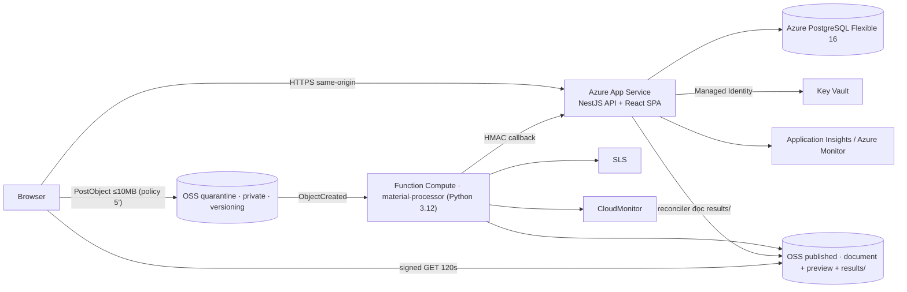

# Kiến trúc Multi-Cloud

| Lớp | Azure (Southeast Asia) | Alibaba Cloud (Singapore) |
|---|---|---|
| Ứng dụng | App Service Linux Node 24 (B1, Always On, health check `/api/v1/health`) | — |
| Dữ liệu | PostgreSQL Flexible Server 16 (B1ms, TLS, backup 7 ngày) | OSS quarantine + published (private, versioning, lifecycle) |
| Xử lý | — | Function Compute 3.0, OSS trigger, RAM role riêng |
| Bí mật | Key Vault (RBAC) + system-assigned Managed Identity, Key Vault references | Biến môi trường mã hóa của FC (HMAC secret) |
| Quan sát | App Insights (workspace-based), Azure Monitor metrics/alerts/availability test, Log Analytics | SLS logstore, CloudMonitor |

Mã nguồn hạ tầng: `infra/azure/main.bicep`, `infra/azure/postgres-roles.sql`, `infra/aliyun/ram/*.json`,
`infra/aliyun/oss/*.xml`, `functions/material-processor/s.yaml`.

## LOCAL / CLOUD MODE (provider abstraction)

| Khía cạnh | Interface | LOCAL | CLOUD |
|---|---|---|---|
| Storage | `StorageProvider` | `LocalStorageProvider` (đĩa + token ký, **MOCK**) | `OssStorageProvider` (ali-oss, chữ ký V4) |
| Processing | `ProcessingDispatcher` | `LocalProcessingDispatcher` (pdf-lib, **LOCAL_MOCK**) | `AliyunFcDispatcher` (OSS trigger; retry = copy object) |
| Secrets | `AppConfigService` (env) | `.env` | App Service Key Vault references (MI) + đọc metadata Key Vault |
| Monitoring | `TelemetryService`, `MetricsService`, `OpsLogService` | metric in-process + ops log DB | + App Insights SDK, Azure Monitor REST, SLS, CloudMonitor |

Chọn bằng `STORAGE_PROVIDER` và `PROCESSING_PROVIDER`. Thiếu credential cloud chỉ làm phần cloud báo
`NOT CONFIGURED`; các chức năng giáo dục không phụ thuộc cloud vẫn hoạt động. Trang Cloud Overview/Architecture
hiển thị trạng thái đo trực tiếp, không bao giờ báo MOCK là cloud.

## Triển khai thủ công

Phụ thuộc vòng: FC cần URL + HMAC secret của Azure; Azure cần access key OSS. Thứ tự:

1. `deploy-aliyun.ps1 -AccountId … -AppOrigin https://<app>.azurewebsites.net -CallbackUrl …` — bucket, RAM,
   xuất access key vào phiên PowerShell (không in ra). Dừng ở bước FC nếu chưa có `CALLBACK_HMAC_SECRET`.
2. `deploy-azure.ps1 -ResourceGroup rg-educenter-demo -OssQuarantineBucket … -OssPublishedBucket … -SlsProject …`
   — Bicep, secret vào Key Vault, vai trò DB + migration (firewall tạm), gói zip API+SPA, kiểm tra health.
3. Lấy secret `k1` từ Key Vault vào `$env:CALLBACK_HMAC_SECRET`, chạy `deploy-aliyun.ps1 … -SkipInfra` để deploy FC.

Cả hai script yêu cầu gõ xác nhận trước khi tạo tài nguyên tính phí. **Chưa được chạy trên tài khoản thật** —
trạng thái trong [completion-report.md](completion-report.md).
