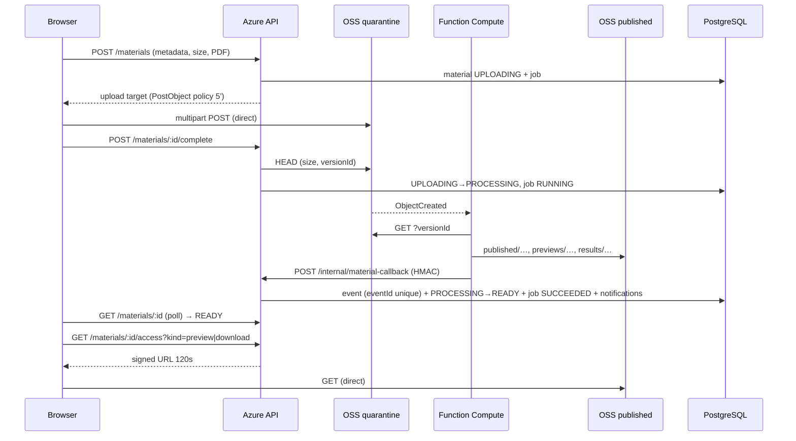

# Luồng dữ liệu xuyên cloud

Browser → Azure API → Alibaba OSS → Function Compute → OSS Published → Azure Callback → Database → Frontend.



## Hợp đồng kết quả (`educenter.material-result/v1`)
Cùng một JSON được lưu ở `results/{tenant}/{material}/{attempt}/{versionTag}.json` và gửi trong callback:
`schema, eventId, tenantId, materialId, sourceKey, sourceVersionId, correlationId, status (READY|REJECTED|FAILED),
processor (ALIYUN_FC|LOCAL_MOCK), attempt, startedAt, finishedAt, durationMs, result{sizeBytes, sha256, pageCount, title,
author, documentKey, previewKey, previewContentType} | error{code, message}`.
API kiểm tra `sourceKey` phải là key của lần xử lý hiện tại (`quarantine/{tenant}/{material}/{attempt}/{uuid}.pdf`) và các key
đầu ra đúng (attempt, version) — worker không thể trỏ tới object khác, kết quả của lần cũ bị bỏ qua.

## HMAC-SHA256
`X-Edu-Key-Id`, `X-Edu-Timestamp` (giây), `X-Edu-Signature: v1=hex(HMAC(secret, "<ts>.<raw body>"))`.
Raw body (Buffer) · so sánh constant-time · lệch giờ ±300 s · `eventId` unique chống replay trong cửa sổ ·
2 key cùng hiệu lực khi xoay vòng · mọi lỗi trả cùng 401, chi tiết chỉ vào ops log.
Vector kiểm thử chung TypeScript/Python: `HMAC("test-secret-0123456789abcdef0123456789", "1700000000.{\"a\":1}")`
= `773367e1…633359`.

## Máy trạng thái
```
UPLOADING → PROCESSING | READY | REJECTED | FAILED | DELETED   (callback có thể tới trước "complete")
PROCESSING → PROCESSING (lần thử mới) | READY | REJECTED | FAILED | DELETED
FAILED → PROCESSING | READY | REJECTED | DELETED
READY / REJECTED → DELETED          DELETED: kết thúc
```
Mỗi chuyển trạng thái: kiểm tra hợp lệ + khóa lạc quan theo `version` + bản ghi `material_processing_events`.
Kết quả cho version nguồn cũ → `callback.stale` (bỏ qua); tài liệu đã READY/DELETED → bỏ qua có ghi nhận.

## Reconciliation (`reconciler.service.ts`)
Chạy mỗi `RECONCILE_INTERVAL_SECONDS` (và nút "Chạy đối soát ngay"); một instance duy nhất nhờ
`pg_try_advisory_lock` trên kết nối riêng; lịch sử trong `background_job_runs`.
1. UPLOADING > 60 s: object có trong quarantine → tiếp tục luồng; quá `UPLOAD_EXPIRY_SECONDS` và không có → FAILED.
2. PROCESSING quá `PROCESSING_TIMEOUT_SECONDS`: có result JSON hợp lệ cùng version → áp dụng (eventId `reconcile:…`);
   chưa có và số lần < `PROCESSING_MAX_ATTEMPTS` → job TIMED_OUT + thử lại (OSS: copy object sang key của lần mới → trigger mới);
   hết lượt → FAILED.
3. Xóa ops log > 30 ngày.
Chống xử lý trùng: `(material, attempt)` unique, `eventId` unique, khóa version, hàng đợi local chống dispatch trùng, idempotency FC theo `versionId`.

## LOCAL MODE
Cùng hợp đồng, nhưng upload tới `/api/v1/storage/local/upload` (token ký thay policy), worker là `LocalProcessingDispatcher`
(pdf-lib, preview là PDF 1 trang) và callback HTTP thật tới chính API với HMAC thật. Được kiểm thử E2E (27/27).
