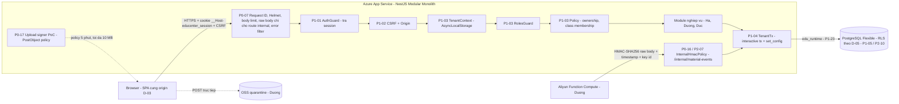
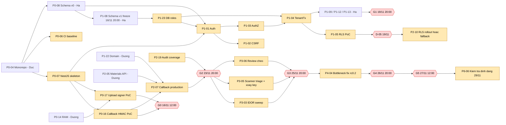
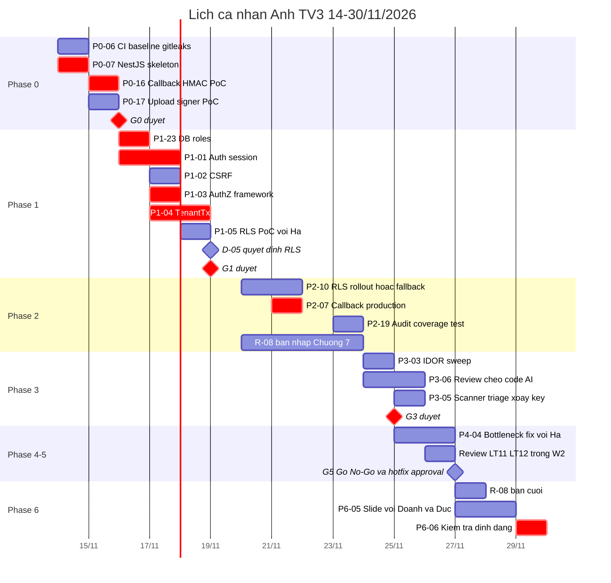
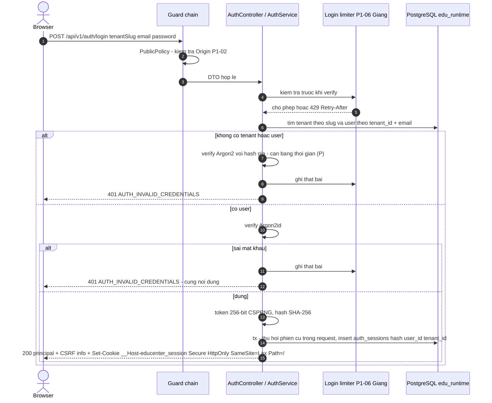
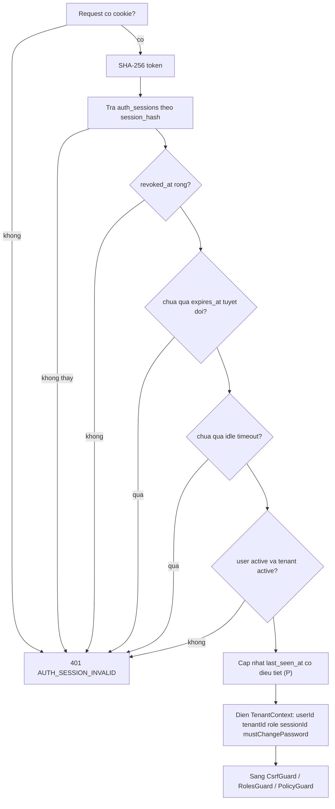
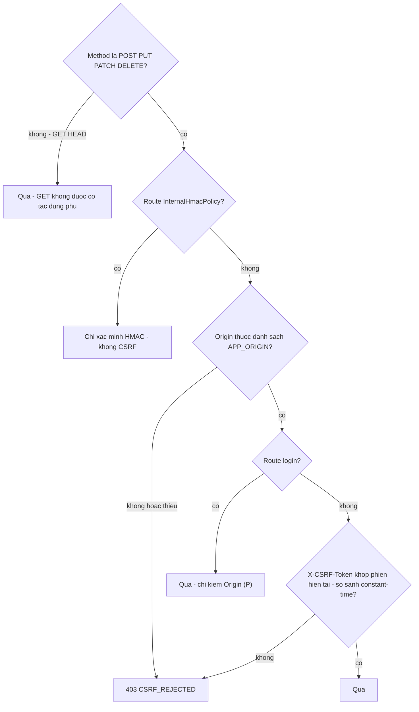
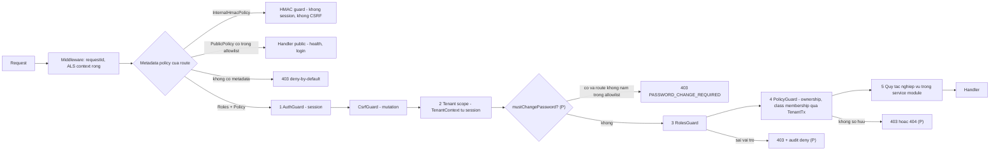
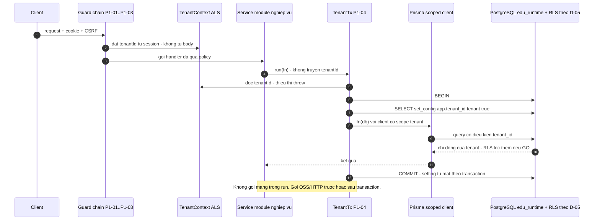
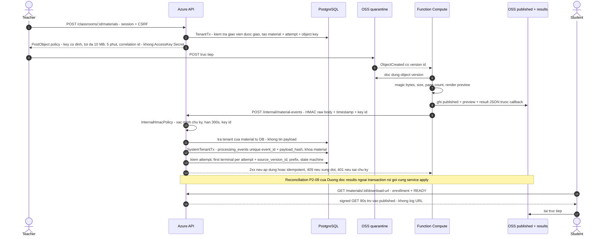

# ANH.md — BACKEND AUTH & SECURITY ENGINEERING HANDOFF

| Thuộc tính | Giá trị |
|---|---|
| Dự án | EduCenter Cloud — B2B SaaS quản lý trung tâm giáo dục (Azure + Alibaba Cloud, tổ hợp 9) |
| Tài liệu | Tài liệu giao việc cá nhân — Backend Auth & Security |
| Phiên bản tài liệu | 1.0 |
| Ngày tạo | 14/11/2026 |
| Thành viên | **Anh** |
| Mã vai trò | **TV3** (D-01, Accepted — ROADMAP §15.1) |
| Vai trò | Backend Engineer — Authentication & Security |
| Reviewer của Anh | **Đức (TV1)** + **Giang (TV6)** — ROADMAP §6.1, §15.1 |
| Tải ước tính theo roadmap | ~79 h (ROADMAP §6.2) |
| Source of truth | `ROADMAP.md` v1.3 (13/11/2026) · `EduCenter_Cloud_Ban_Thiet_Ke_2.md` (V2) · `BTL CK 1.pdf` |
| Trạng thái dự án | **PLAN** — chưa có dòng code, chưa có hạ tầng, chưa có bằng chứng. Không task nào trong file này là Done |
| Quy ước tham chiếu | `RM §x` = ROADMAP.md mục x · `V2 §x` = Bản thiết kế 2.0 mục x · `D-xx` = Decision Log · `ST/LT` = Security/Load test · `INV-xx` = Security invariant của file này · `OQ-xx` = Open Question |

> **Cách dùng file này**
> 1. Đọc §1–§5 một lần để nắm toàn cảnh. Khi bắt đầu một task, đọc **đúng Task Card** ở §6 + các invariant ở §3.3 + quy ước ở §9.
> 2. Khi dùng AI coding agent: đưa `ROADMAP.md` (§2.3, §5, §7) + Task Card tương ứng trong ANH.md + prompt ở cuối Task Card (§6). Không đưa cả roadmap.
> 3. Mọi chi tiết đánh dấu **Proposed** hoặc **TBD** là đề xuất của tài liệu này, **chưa** phải quyết định của nhóm. Phải được TV1 (và người liên quan) xác nhận qua ADR/PR trước khi coi là Accepted.
> 4. Nếu file này mâu thuẫn với ROADMAP.md v1.3 hoặc V2 → **ROADMAP/V2 thắng**; ghi mâu thuẫn vào §17 và báo TV1.
> 5. `DOANH.md` không có trong Project tại thời điểm viết → cấu trúc Task Card theo đúng mẫu trong yêu cầu giao việc; cần đối chiếu lại khi có DOANH.md (OQ-01).

---

## Mục lục

1. Tổng quan vai trò và trách nhiệm
2. Bức tranh kiến trúc Backend Auth & Security
3. Phạm vi công việc và Security Invariants
4. Master Timeline cá nhân — Phase 0 đến Phase 6
5. Task Inventory — toàn bộ nhiệm vụ của Anh
6. Detailed Task Cards — hướng dẫn triển khai theo Phase
7. Authentication, Authorization & Tenant Isolation Flow
8. Dependency & Handoff Matrix
9. Backend Architecture & Security Engineering Conventions
10. AI Coding Workflow và Task Prompts
11. Security Testing, Performance & Quality Gates
12. Git Workflow, Security Review Playbook và Definition of Done
13. BTL Deliverables — Báo cáo, Slide và Evidence
14. Risk Register, Blockers & Contingency
15. Daily Execution Checklist — công việc theo ngày
16. Traceability Matrix — đối chiếu với ROADMAP.md
17. Open Questions & Final Self-Audit

---

# 1. Tổng quan vai trò và trách nhiệm

## 1.1. Anh ở đâu trong dự án

Anh xây **nền móng bảo mật mà mọi module khác đứng lên trên**: ứng dụng NestJS gốc, phiên đăng nhập, CSRF, chuỗi guard phân quyền, cơ chế truy cập DB theo tenant (`TenantTx`), vai trò DB, RLS và cổng callback HMAC từ Aliyun. Đồng thời Anh là **reviewer chính của pool nhạy cảm A** và **reviewer dự phòng của pool B và C** (RM §7.2 khung ROADMAP §7.2 mục 6).

Hai điều quan trọng nhất:

1. **Anh nằm trên critical path chính** (RM §3.3): `P0-07 → P1-08 (Hà) → P1-23 → P1-01 → P1-03 → P1-04 → P1-12/P1-13 (Hà) → …`. Trễ một ngày ở P1-01/P1-03/P1-04 là trễ cả nhóm, vì Hà (P1-09, P1-12), Dương (P1-10, P1-11, P1-25), Doanh (P1-15) và Giang (P1-19, P1-20) đều chờ.
2. **Anh không phải "người sửa mọi lỗi bảo mật"**. Anh xây nền tảng, viết test khung, review và mở issue. Owner module tự sửa module của mình (RM §5.4 P3-07, P2-19).

## 1.2. Tóm tắt trách nhiệm theo loại

| Loại | Task / mã trách nhiệm | Số lượng |
|---|---|---:|
| **Trực tiếp thực hiện (Owner)** | P0-06, P0-07, P0-16, P0-17, P1-01, P1-02, P1-03, P1-04, P1-23, P2-07, P2-10, P2-19, P3-03, P3-05, P6-06 | 15 |
| **Đồng sở hữu (Co-owner)** | P1-05 (với TV4), P3-06 (chéo với TV1), P4-04 (với TV4) | 3 |
| **Báo cáo** | R-08 — Chương 7 "Bảo mật & hiệu năng theo thiết kế" (RM §11.1) | 1 |
| **Slide** | P6-05 — đồng chủ trì với Doanh + Đức theo RM §15.2 (xem mâu thuẫn OQ-02) | 1 |
| **Review / phê duyệt PR** | P0-03, P0-05, P0-08, P0-11, P0-13, P0-14, P0-15, P0-21, P1-06, P1-07, P1-08, P1-09, P1-13, P1-15, P1-18, P1-19, P1-22, P1-24, P1-25, P2-01, P2-02, P2-03, P2-05, P2-06, P2-08, P2-15, P2-16, P2-20, P3-02, P3-04, P4-08, P4-09, P5-02, P5-06 | 34 |
| **Duyệt Gate** | G0 (TV1 + TV3), G1 (TV1 + TV3 + TV6), G3 (TV3 + TV6, TV1 xác nhận), G5 (cả nhóm — P5-04) | 4 |
| **Phê duyệt hotfix khi đóng băng** | P5-05 (2 approval: TV1 + TV3) | 1 |
| **Người quyết định (Decision Log)** | D-03, D-05, D-06, D-07, D-11, D-13, D-16, D-19, D-21, D-24, D-25, D-26, D-28, D-29, D-31 | 15 |
| **RACI — Accountable** | Thay đổi kiến trúc (TV1 + TV3); auth/tenant/authz/security contract (TV3 + TV1, R = TV3); migration rủi ro mất dữ liệu (TV4 + TV3); IAM/RAM/Key Vault/secrets (A = TV3) — RM §6.3 | 4 |
| **Owner Security Test** | ST02, ST04, ST05, ST06, ST07, ST11, ST12, ST20, ST22 (RM §9.2) | 9 |
| **Owner rủi ro** | R-05, R-06, R-13, R-20 (RM §10.1) | 4 |
| **Reliability test owner** | Xoay HMAC key (RM §9.4 → P3-05) | 1 |
| **Integration Point** | IP-2 17/11 tối: FE login ↔ API auth/CSRF ↔ tenant guard (đồng chủ trì với TV2) | 1 |
| **Reviewer dự phòng** | Pool B (tuition, `prisma/migrations/`, `infra/azure/`) và Pool C (`.github/workflows/`) | 2 pool |
| **Chỉ khi contingency** | G0 trễ → TV5 + TV3 ưu tiên 100% Multi-Cloud (RM §8.1); TV5 trễ → P2-07 (đã là owner) (RM §10.3); scope-cut cấp 3 → RLS rollout bị cắt, giữ app-level scope (RM §10.2) | 3 |

## 1.3. Những việc **không** thuộc Anh (tránh nhận nhầm)

Các task dưới đây Anh **chỉ review** (hoặc không liên quan). Không nhận lại để làm, không để AI agent của mình sửa file của các task này.

| Task | Owner thực hiện | Vai trò của Anh | Căn cứ |
|---|---|---|---|
| P1-06 Login rate limit (`auth/rate-limit/`) | TV6 Giang | Review | RM §5.2, §10.3 (đã chuyển từ TV3) |
| P1-07 Audit log service (`common/audit/`) | TV1 Đức | Review | RM §5.2, §10.3 |
| P1-25 Cấp tài khoản + đổi mật khẩu (`users/`) | TV5 Dương | Review | RM §5.2, §10.3 |
| P1-19 Authorization test harness | TV6 Giang | Review | RM §5.2 |
| P2-16 Security suite ST07–ST19, ST22–ST25 | TV6 Giang | Review | RM §5.3 |
| P2-05, P2-06 Materials API | TV5 Dương | Review | RM §5.3 |
| P3-04 OWASP ZAP scan | TV6 Giang | Review | RM §5.4 |
| P3-02 Chạy toàn bộ ST01–ST25 | TV6 Giang | Review | RM §5.4 |
| P0-21 HMAC key management 2 phía | TV5 Dương | Review | RM §5.1 |
| P2-09 Reconciliation | TV5 Dương | Không review (TV1 review) — nhưng dùng chung service apply-result của P2-07 | RM §5.3 |
| P2-15 Observability + log redaction | TV6 Giang | Review | RM §5.3 |
| P1-08 Schema v1 / mọi migration | TV4 Hà (owner **duy nhất** schema) | Review (cùng TV1) | RM §6.1, D-27 |
| P0-11, P0-12 Azure infra, CD, migration job | TV6 Giang | Review P0-11 | RM §5.1 |
| P1-18 CI security gates | TV6 Giang | Review | RM §5.2 |
| P1-24 SPA serving + CSP | TV2 Doanh | Review | RM §5.2 |
| P6-01 Ghép báo cáo Word | §5.7: TV1; §15.2: Hà, Giang, Dương | Không — nhận bản ghép để chạy P6-06 | OQ-03 |

## 1.4. Năm nguyên tắc làm việc của Anh

1. **Nền tảng trước, tính năng sau.** Đầu ra của Anh là interface để người khác dùng — publish interface + hướng dẫn sớm (kể cả trước khi implementation xong) để người khác không bị chặn.
2. **Deny-by-default ở mọi tầng.** Thiếu session → 401, thiếu policy → 403, thiếu tenant context → 0 dòng/throw, thiếu chữ ký → 401.
3. **Test âm tính phải fail khi bỏ guard.** Một test bảo mật chỉ có giá trị nếu nó bắt được lỗi khi tắt biện pháp bảo vệ (RM §7.8).
4. **Không có ngoại lệ "chỉ để demo/benchmark".** Không cờ bypass auth/CSRF/rate limit/HMAC (D-16, ROADMAP §7.2).
5. **Không tự duyệt module bảo mật của mình.** PR của Anh do Đức + Giang duyệt (RM §6.1).

---

# 2. Bức tranh kiến trúc Backend Auth & Security

## 2.1. Vị trí các thành phần Anh sở hữu



Màu sắc trách nhiệm: mọi khối có mã task P0-xx/P1-xx/P2-xx trong sơ đồ là của Anh; khối "Module nghiệp vụ", FC, OSS thuộc thành viên khác.

## 2.2. Thành phần Anh sở hữu và ai tiêu thụ

| Thành phần | Đường dẫn (RM §5) | Task | Người/khối sử dụng | Dạng bàn giao |
|---|---|---|---|---|
| Ứng dụng NestJS gốc, config, validation, error filter, request ID, health, PrismaModule, shutdown | `apps/api/src/{main.ts,app.module.ts,common/,health/}` | P0-07 | Tất cả backend, TV6 (deploy P0-12, health check), TV2 (P1-24 static) | Skeleton chạy được + README ngắn trong handoff |
| CI baseline | `.github/workflows/ci.yml` | P0-06 | Cả nhóm; TV6 mở rộng ở P1-18 | Workflow xanh + PR thử secret giả |
| Callback HMAC (PoC → production) | `apps/api/src/materials/internal/` | P0-16, P2-07 | TV5 (FC ký, reconciliation P2-09 dùng service apply) | Endpoint + service apply kết quả + spec chữ ký |
| Upload signer PoC | `apps/api/src/materials/storage/` | P0-17 | TV5 (P2-05 dùng lại) | Service ký PostObject policy |
| DB roles | `apps/api/prisma/roles/`, phần DB init của `docker-compose.yml` và `.github/workflows/` | P1-23 | TV4 (migration), TV6 (CI, Azure P0-11), mọi integration test | Script khởi tạo idempotent |
| Auth/session | `apps/api/src/auth/` | P1-01 | TV2 (FE), TV5 (P1-25 đổi mật khẩu/thu hồi phiên), TV6 (P1-06 rate limit, P1-20 seed session bench) | API login/logout/me + SessionService |
| CSRF | `apps/api/src/auth/csrf/` | P1-02 | TV2 (FE gửi header), mọi route mutation | CSRF contract |
| Authorization framework | `apps/api/src/common/authz/` | P1-03 | Mọi module; TV6 (harness P1-19) | `@Policy()`, `@InternalHmacPolicy()`, guard chain, route inventory test |
| TenantTx + lint | `apps/api/src/common/prisma/`, `.eslintrc` | P1-04 | Mọi module truy cập DB | API `TenantTx` + lint rule |
| RLS PoC / rollout | `apps/api/prisma/migrations/` (**qua PR migration của Hà**), Decision Log §2.3 (D-05, ADR-020) + PR | P1-05, P2-10 | Đức (quyết định D-05), Hà | Báo cáo PoC + SQL policy đề xuất + test |
| Audit coverage test | `apps/api/test/audit/` | P2-19 | Đức (G2), owner module | Test + issue |
| IDOR sweep | `tests/security/idor/` | P3-03 | Giang (P3-02), G3 | Script + báo cáo |
| Scanner triage + xoay key | `docs/evidence/scanners/` | P3-05 | G3, HG3/HG4 | Bảng triage + log xoay key |

## 2.3. Ranh giới trách nhiệm (ai làm gì ở chỗ giáp ranh)

| Chỗ giáp ranh | Anh làm | Người khác làm |
|---|---|---|
| Schema `auth_sessions`, `users`, `login_attempts`, `processing_events` | Gửi **yêu cầu cột/ràng buộc** cho Hà; review PR | **Hà** viết schema/migration (P0-08, P1-08). Sau 16/11 20:00 mọi thay đổi = change request cho Hà (D-27) |
| RLS policy | Thiết kế policy, viết test, đo/đánh giá đúng-sai | **Hà** mở PR migration chứa policy (P1-05, P2-10 — "qua PR migration của TV4") |
| DB role trên Azure | Viết script SQL dùng chung (P1-23), review P0-11 | **Giang** tạo role trên Azure PG (P0-11), job migration + firewall tạm (P0-12, D-25) |
| HMAC | Xác minh chữ ký phía API (P0-16, P2-07) | **Dương** sinh/lưu key, ký phía FC, runbook xoay key (P0-15, P0-21, D-29) |
| Upload | Ký PostObject policy PoC (P0-17) | **Dương** OSS/RAM (P0-13, P0-14), Materials API production (P2-05, P2-06) |
| Login rate limit | Cung cấp điểm gắn (hook) trong luồng login | **Giang** cài limiter trên `login_attempts` (P1-06) |
| Audit | Gọi audit cho sự kiện "truy cập bị từ chối" trong guard chain (Proposed, OQ-09); test độ phủ (P2-19) | **Đức** viết audit service (P1-07); owner module gọi audit trong module của mình |
| Cấp tài khoản / đổi mật khẩu | Cung cấp `SessionService` (thu hồi phiên) + cờ `mustChangePassword` trong principal (Proposed, OQ-10) | **Dương** P1-25 |
| Log redaction | Không log secret trong code của mình; review P2-15 | **Giang** P2-15 (App Insights, redaction) |
| CSP / SPA serving | Review P1-24 | **Doanh** P1-24 |
| Security test | Viết test âm tính trong task của mình; IDOR sweep P3-03 | **Giang** harness (P1-19), suite (P2-16), chạy ST01–ST25 (P3-02), ZAP (P3-04) |

---

# 3. Phạm vi công việc và Security Invariants

## 3.1. Trong phạm vi / ngoài phạm vi

| Trong phạm vi (Anh) | Ngoài phạm vi (không tự làm) |
|---|---|
| Opaque session + Argon2id + cookie `__Host-` + CSRF + Origin | MFA admin (production-only, V2 §11.3) |
| Guard chain 5 lớp, deny-by-default, route inventory | PLATFORM_ADMIN (D-24: không triển khai trong BTL) |
| TenantTx, lint rule, DB roles, RLS PoC/rollout theo D-05 | Bật RLS toàn bộ khi D-05 chưa GO; tự sửa `schema.prisma` |
| Callback HMAC + idempotency + replay + attempt/version binding | Malware scanning (D-11 — ghi giới hạn); WAF/Front Door, ST21 (production-only, D-19) |
| Upload signer PoC | Materials API production (TV5), OSS/RAM provisioning (TV5) |
| Scanner triage, IDOR sweep, review code AI | Chạy ZAP/active scan (TV6, P3-04 — chỉ baseline/API); quét hệ thống ngoài demo env |
| Chương 7 báo cáo, slide (theo §15.2), kiểm tra định dạng | Redis, PgBouncer, microservices, Kafka (V2 §5.1) |

## 3.2. File/module được phép chỉnh sửa theo task (Allowed paths)

| Task | Allowed paths (RM §5) | Ghi chú |
|---|---|---|
| P0-06 | `.github/workflows/ci.yml` | Pool C — Giang review |
| P0-07 | `apps/api/src/{main.ts,app.module.ts,common/,health/}` | Tạo `app.module.ts` (sau đó TV1 là owner file này — RM §7.1); `package.json` của `apps/api` cần thiết cho dependency → ghi rõ trong PR |
| P0-16, P2-07 | `apps/api/src/materials/internal/` | Không sửa `materials/domain/` (TV5) |
| P0-17 | `apps/api/src/materials/storage/` | — |
| P1-23 | `apps/api/prisma/roles/`, `docker-compose.yml`, `.github/workflows/` (chỉ phần DB init) | `docker-compose.yml` do Hà tạo (P0-19); workflows là pool C — phối hợp |
| P1-01 | `apps/api/src/auth/` | Thay đổi contract `paths/auth.yaml` → PR contract riêng, TV1 duyệt, merge trước (RM §7.4) |
| P1-02 | `apps/api/src/auth/csrf/` | Như trên |
| P1-03 | `apps/api/src/common/authz/` | — |
| P1-04 | `apps/api/src/common/prisma/`, `.eslintrc` | — |
| P1-05, P2-10 | `apps/api/prisma/migrations/` (**qua PR migration của Hà**), Decision Log §2.3 (D-05, ADR-020) + PR | Anh soạn SQL + test; Hà mở/merge PR migration |
| P2-19 | `apps/api/test/audit/` | Không sửa code module |
| P3-03 | `tests/security/idor/` | — |
| P3-05 | `docs/evidence/scanners/` | Xoay key thao tác trên Key Vault/FC cùng Dương + Giang |
| P3-06 | — (chỉ issue) | Không sửa code |
| P4-04 | Theo phát hiện — chỉ module của Anh (auth, common/authz, common/prisma, materials/internal) | Fix ở module người khác → owner module sửa |

Cần sửa ngoài danh sách → **DỪNG**, ghi vào handoff mục "Out-of-scope requests" và nhắn owner (ROADMAP §7.2).

## 3.3. Security Invariants (bất biến phải giữ ở mọi task)

| ID | Bất biến | Nguồn | Test/kiểm chứng |
|---|---|---|---|
| INV-01 | `tenant_id` chỉ lấy từ session đã xác thực (TenantContext). Không bao giờ từ body, query, header hay payload của worker | V2 §9.2, §10.7; P1-04 | ST02, ST04, lint DTO, test callback giả mạo tenant |
| INV-02 | Deny-by-default: route không khai báo policy → 403; route internal phải khai báo `@InternalHmacPolicy()` tường minh | V2 §11.4; P1-03 | Route inventory test |
| INV-03 | Mọi truy cập DB nghiệp vụ đi qua `TenantTx`. Không import `PrismaClient` ngoài `common/prisma`; cấm `$queryRawUnsafe`/`$executeRawUnsafe` | D-26; P1-04 | ESLint + unit "query ngoài TenantTx → throw" |
| INV-04 | Không giữ transaction mở khi gọi mạng (Aliyun, HTTP, Key Vault) | V2 §9.5; P1-04 | Review + test (Proposed: guard phát hiện) |
| INV-05 | Không lưu/log token phiên thô, password, mật khẩu tạm, HMAC secret, Access Key, signed URL, PII | V2 §11.7; P1-01 AC | ST25, unit kiểm tra logger, grep log |
| INV-06 | Token phiên: ngẫu nhiên 256-bit từ CSPRNG; DB chỉ lưu SHA-256; cookie `__Host-educenter_session` Secure, HttpOnly, SameSite=Lax, Path=/, không Domain | V2 §11.3; P1-01 | Integration + kiểm tra header Set-Cookie |
| INV-07 | Mọi POST/PUT/PATCH/DELETE (trừ route internal HMAC) yêu cầu CSRF token hợp lệ + Origin hợp lệ; GET/HEAD không có tác dụng phụ | V2 §11.3; P1-02 | ST07 |
| INV-08 | Route internal: chỉ HMAC — không session, không CSRF; raw body chỉ bật cho route internal; cookie session không thay được HMAC | P0-07, P1-03 | Test gửi cookie hợp lệ không chữ ký → 401 |
| INV-09 | `edu_runtime`: không superuser, không BYPASSRLS, không owner bảng, không DDL; `audit_logs` chỉ INSERT/SELECT | D-25; P1-23 | Integration DDL/UPDATE audit → lỗi |
| INV-10 | Integration test chạy bằng `edu_runtime` (không superuser) — điều kiện để ST20 có ý nghĩa | RV-05; P1-23 | Kiểm tra `current_user` trong test setup |
| INV-11 | Lỗi trả theo `{code,message,requestId,fieldErrors}`; không lộ stack, lỗi DB, hay nguyên nhân đăng nhập sai (tenant/email/password) | V2 §14; P0-07, P1-01 | Unit error filter; test login 3 kiểu sai → cùng phản hồi |
| INV-12 | Không có cờ/biến môi trường bypass auth, CSRF, rate limit, HMAC cho test, benchmark hay demo | D-16; ROADMAP §7.2 | Review + grep cấu hình |
| INV-13 | Callback: không tin tenant/role từ worker; chỉ nhận kết quả terminal đầu tiên hợp lệ của mỗi attempt, gắn `source_version_id`; attempt cũ/version khác không đổi trạng thái | P2-07; RV-12 | ST11, ST12, ST13, ST16 |
| INV-14 | Upload: không trả Access Key cho browser; policy giới hạn key cố định do server sinh, ≤ 10 MB, hết hạn 5 phút | D-21; P0-17 | 3 case thử thật P0-17 |
| INV-15 | Không có secret trong repo, ảnh chụp, video, prompt AI | V2 §11.7; P0-06 | gitleaks PR + full history (ST22) |
| INV-16 | Không đánh dấu ST/LT Pass hoặc task Done khi chưa chạy thật và chưa có evidence (ngày, SHA, môi trường, account, kết quả, reviewer, issue) | RM §9.2, HG6 | Review evidence |
| INV-17 | Không dùng dữ liệu thật; chỉ dữ liệu tổng hợp; mọi kiểm thử chủ động chỉ trên local/CI/demo env của nhóm | V2 §16; RM §5.4 P3-04 | — |
| INV-18 | Sau đổi mật khẩu/logout/thu hồi: phiên cũ không dùng được ngay ở request tiếp theo, trên mọi instance | V2 §11.3 | ST06, test P1-25 |

## 3.4. Trạng thái các quyết định liên quan (theo ROADMAP v1.3)

> Ngoại trừ D-01, mọi Decision dưới đây đang **Proposed** trong ROADMAP v1.3. Kick-off 14/11 09:00 dự kiến Accept D-23, D-24, D-25 (bắt buộc trước P0-04). Anh cập nhật cột "Trạng thái thực" sau kick-off — **không tự đổi thành Accepted**.

| ID | Nội dung rút gọn | Người quyết | Hạn | Ảnh hưởng tới task của Anh | Trạng thái thực |
|---|---|---|---|---|---|
| D-01 | TV3 = Anh | Cả nhóm | 14/11 | Toàn bộ | **Accepted** |
| D-03 | SPA cùng origin trên App Service (ADR-015) | TV1 + **TV3** | 14/11 | Cookie `__Host-`, CSRF, Origin | Proposed → cập nhật sau kick-off |
| D-05 | RLS PoC → quyết định rollout trước 19/11 (p95 tăng ≤ 20%, pool wait không tăng đáng kể) | **TV3** + TV1 | 19/11 | P1-05, P2-10, ST20 | Proposed |
| D-06 | Rate limit login lưu ở PostgreSQL, không Redis (ADR-018) | **TV3** | 16/11 | Review P1-06 | Proposed |
| D-07 | OIDC GitHub → Azure; fallback publish profile | TV6 + **TV3** | 15/11 | Review P0-12 (gián tiếp) | Proposed |
| D-11 | Không malware scan trong BTL, công bố giới hạn | **TV3** | 15/11 | Chương 7, ST14 | Proposed |
| D-13 | Idempotency chỉ payment + enrollment | TV4 + **TV3** | 16/11 | Review P1-13, P2-03 | Proposed |
| D-16 | Session bench seed chỉ tenant `bench-*`, TTL ≤ 24 h, không cờ bypass | **TV3** + TV6 | 18/11 | Spec hash session cho P1-20; P4-11 | Proposed |
| D-19 | Callback tới hostname App Service public; ST21 production-only | **TV3** | 15/11 | P0-16, P2-07 | Proposed |
| D-21 | OSS PostObject policy ≤ 10 MB, 5 phút, key cố định | TV5 + **TV3** | 15/11 | P0-17 | Proposed |
| D-23 | Repo public (ADR-026) hoặc phương án B | Cả nhóm | 14/11 09:00 | P0-06 (SAST, branch protection), cách báo lỗ hổng (§12.6) | Proposed — **chặn P0-04** |
| D-24 | Login có `tenantSlug`; session gắn tenant; không PLATFORM_ADMIN (ADR-021) | **TV3** + TV1 | 14/11 | P1-01 | Proposed — **chặn P0-04** |
| D-25 | `edu_migrator` / `edu_runtime`, default privileges, audit INSERT/SELECT, migration job firewall tạm (ADR-022) | TV6 + **TV3** | 15/11 | P1-23 | Proposed — **chặn P0-04** |
| D-26 | `TenantTx` duy nhất từ P1-04 (ADR-023) | **TV3** + TV4 | 16/11 | P1-04, P1-05, P2-10 | Proposed |
| D-27 | Schema v1 đóng băng 16/11 20:00 | TV4 + TV1 | 16/11 | Yêu cầu cột auth phải vào trước mốc | Proposed |
| D-28 | Cấp tài khoản, `must_change_password`, `POST /auth/change-password` (ADR-025) | **TV3** | 17/11 | Review P1-25; hook trong authz | Proposed |
| D-29 | HMAC key ngoài repo, Key Vault + env mã hóa FC, 2 key ID, restart App Service khi xoay | TV5 + **TV3** | 15/11 | P0-16, P2-07, P3-05 | Proposed |
| D-30 | Bench build `rc0.1`/`rc0.2`, không chạy security suite trùng giờ benchmark | TV1 + TV6 | 22/11 | P3-05, P4-04 lịch | Proposed |
| D-31 | Bảo vệ demo env, script reset, tài khoản giảng viên | TV5 + **TV3** | 26/11 | Review P5-06 | Proposed |


---

# 4. Master Timeline cá nhân — Phase 0 đến Phase 6

## 4.1. Critical path riêng của Anh (đối chiếu dependency thật trong RM §5)

Chuỗi minh họa trong yêu cầu giao việc là "NestJS Skeleton → DB Roles → Auth → Authorization Framework → TenantTx → Module nghiệp vụ → Security Testing → Security Gate → Release". Đối chiếu cột Dep của RM §5, chuỗi thật có **ba điểm khác** cần nhớ:

1. **DB Roles (P1-23) phụ thuộc Schema v1 freeze (P1-08 của Hà, 16/11 20:00)**, không chỉ phụ thuộc skeleton. Vì vậy P1-23 chạy tối 16/11 sau mốc đóng băng (RM §12).
2. **TenantTx (P1-04) phụ thuộc cả P1-03 và P1-23.** P1-01 cũng phụ thuộc P1-23 (RM §5.2).
3. **CSRF (P1-02) là nhánh rẽ từ P1-01**, không nằm giữa P1-01 và P1-03.



**Đoạn critical path tuyệt đối không được trễ:** `P0-07 (14/11) → P1-23 (16/11 tối) → P1-01 (16–17/11) → P1-03 (17/11) → P1-04 (17–18/11)`. Slack của critical path chính chỉ ~1 ngày (RM §3.3).

## 4.2. Gantt cá nhân



## 4.3. Bảng theo Phase (giờ thực hiện của Anh, khớp RM §6.2)

| Phase | Ngày | Task Anh thực hiện / đồng sở hữu | Giờ (RM §6.2) | Review/Gate trong Phase | Đầu ra phải có cuối Phase |
|---|---|---|---:|---|---|
| 0 | 14–15/11 (buffer sáng 16/11) | P0-06 (3h), P0-07 (4h), P0-16 (3h), P0-17 (2h) | 12 | P0-03, P0-05, P0-08, P0-11, P0-13, P0-14, P0-15, P0-21; duyệt **G0** | CI xanh + chặn secret giả; skeleton deploy được; callback phân biệt đúng/sai chữ ký; policy upload bị OSS thực thi |
| 1 | 16–19/11 | P1-23 (3h), P1-01 (8h), P1-02 (3h), P1-03 (6h), P1-04 (4h), P1-05 (4h chia đôi → 2h) | 26 | P1-06, P1-07, P1-08, P1-09, P1-13, P1-15, P1-18, P1-19, P1-22, P1-24, P1-25; IP-2; D-05; duyệt **G1** | Auth/CSRF/guard chain/TenantTx merge; integration test chạy bằng `edu_runtime`; route inventory pass; báo cáo RLS PoC |
| 2 | 20–23/11 | P2-10 (3h), P2-07 (5h), P2-19 (2h) | 10 | P2-01, P2-02, P2-03, P2-05, P2-06, P2-08, P2-15, P2-16, P2-20 | Callback idempotent; RLS rollout/fallback có tài liệu; audit coverage test; bản nháp Ch7 (23/11) |
| 3 | 24–25/11 | P3-03 (4h), P3-05 (3h), P3-06 (4h) | 11 | P3-02, P3-04; fix window P3-07 (module của Anh); duyệt **G3** | IDOR sweep 100% route có ID; triage scanner; xoay key thành công; biên bản review chéo |
| 4 | 24–26/11 | P4-04 (5h chia đôi → 2,5h) | 2,5 | P4-08 (LT11), P4-09 (LT12) | Fix hiệu năng phần auth/tenant có số đo trước/sau, vào `rc0.2` |
| 5 | 26–27/11 | — (Go/No-Go, hotfix approval) | 1,5 | P5-02, P5-06; ký P5-04; P5-05 | Biên bản G5 có chữ ký |
| 6 | 27–30/11 | P6-06 (2h) + P6-05 slide (ngoài 79h, OQ-02) | 2 | Kiểm tra chéo báo cáo (cả 6 người) | Checklist định dạng tick đủ |
| R | 17–27/11 | R-08 Chương 7 (~4 trang) | 4 | — | Nháp 23/11, bản cuối 27/11 |
| Review | 14–29/11 | 34 PR/task review + gate | 10 | — | — |
| **Tổng** | | | **79** | | |

> Cách RM §6.2 ra 11h ở Phase 3 và 1,5h ở Phase 5 không được ghi chi tiết. Tài liệu này diễn giải: P3 = P3-03 4h + P3-05 3h + P3-06 4h (review chéo mỗi người làm phần riêng); P5 = họp G5 + phê duyệt hotfix. Xem OQ-04.

## 4.4. Mốc bàn giao mà người khác đang chờ Anh

| Người chờ | Cần gì từ Anh | Task nguồn | Hạn chót bàn giao | Task của họ bị chặn |
|---|---|---|---|---|
| **Hà** (TV4) | Danh sách cột/ràng buộc cho `auth_sessions`, `users`, `login_attempts`, `processing_events` | P1-01, P2-07 (yêu cầu) | **14/11 tối** (cho P0-08) và **16/11 trước 18:00** (cho P1-08 freeze 20:00) | P0-08, P1-08 |
| **Giang** (TV6) | Skeleton chạy được + `/api/v1/health` | P0-07 | 14/11 tối | P0-12 (deploy 15/11 sáng) |
| **Giang** | CI baseline | P0-06 | 14/11 | P0-12, P1-18 |
| **Dương + Giang** | Endpoint callback PoC deploy được | P0-16 | 15/11 chiều | P0-18 E2E cross-cloud (15/11 tối) → G0 |
| **Dương + Giang** | Upload signer PoC | P0-17 | 15/11 chiều | P0-18 |
| **Hà, Giang** | Script DB roles dùng chung | P1-23 | 16/11 tối | Mọi integration test, P1-18 |
| **Doanh** (TV2) | Contract auth (login/logout/me, cookie, mã lỗi 401/403) + CSRF contract | P1-01, P1-02 | **17/11 trưa** (để kịp IP-2 tối 17/11) | P1-15 |
| **Dương** (TV5) | Interface `TenantTx` + cách khai báo `@Policy()` | P1-03, P1-04 | **17/11 sáng** (interface trước, implementation sau — OQ-06) | P1-10, P1-11 (lịch 17/11) |
| **Đức** (TV1) | Guard chain đã merge (audit service phụ thuộc) | P1-03 | 17/11 | P1-07 |
| **Giang** | Guard chain + fixture 2 tenant | P1-03 | 17/11 | P1-19 harness |
| **Giang** | Spec hash session + tenant binding cho seed bench | P1-01, D-16 | 18/11 | P1-20 |
| **Hà** | `TenantTx` merge | P1-04 | **18/11 sáng** | P1-09 (18/11), P1-12 (18–19/11) |
| **Dương** | `SessionService` (thu hồi phiên) + cờ `mustChangePassword` trong principal | P1-01, P1-03 | 18/11 | P1-25 (19/11) |
| **Đức** | Báo cáo RLS PoC (bằng chứng cho D-05) | P1-05 | **19/11 trưa** | D-05, P2-10 |
| **Dương** | Service áp dụng kết quả xử lý (dùng chung callback + reconciliation) | P2-07 | 21/11 tối | P2-09 (22–23/11) |
| **Đức** | Audit coverage test pass/issue | P2-19 | 23/11 | G2 |
| **Giang** | IDOR sweep + scanner triage | P3-03, P3-05 | 24–25/11 | P3-02 bảng ST, G3 |
| **Hà, Giang, Dương** (ghép báo cáo) | Chương 7 bản cuối | R-08 | 27/11 | P6-01 |
| **Đức** (P6-07 nộp) | Checklist định dạng đã tick | P6-06 | 29/11 trưa | P6-07 → G6 |

---

# 5. Task Inventory — toàn bộ nhiệm vụ của Anh

## 5.1. Task Anh thực hiện hoặc đồng sở hữu

| ID | Tên | Phase | Ngày · Est | Owner → Reviewer | Dep (RM) | Mode | Task Card |
|---|---|---|---|---|---|---|---|
| P0-06 | CI baseline: lint, typecheck, unit, gitleaks | 0 | 14/11 · 3h | TV3 → TV6 | P0-04 | P | §6.1 |
| P0-07 | NestJS skeleton | 0 | 14/11 · 4h | TV3 → TV1 | P0-04 | S | §6.2 |
| P0-16 | Callback HMAC PoC | 0 | 15/11 · 3h | TV3 → TV5 | P0-07, D-19, D-29 | S | §6.3 |
| P0-17 | Upload signer PoC (dev-only) | 0 | 15/11 · 2h | TV3 → TV5 | P0-14, P0-07, D-21 | P | §6.4 |
| P1-23 | DB roles `edu_migrator` / `edu_runtime` | 1 | 16/11 tối · 3h | TV3 → TV6 | P1-08, D-25 | S | §6.5 |
| P1-01 | Authentication & session | 1 | 16–17/11 · 8h | TV3 → TV1 | P0-07, P0-08, P1-23 | S | §6.6 |
| P1-02 | CSRF + Origin | 1 | 17/11 · 3h | TV3 → TV6 | P1-01 | S | §6.7 |
| P1-03 | Authorization framework | 1 | 17/11 · 6h | TV3 → TV1 | P1-01 | S | §6.8 |
| P1-04 | TenantTx + lint | 1 | 17–18/11 · 4h | TV3 → TV4 | P1-03, P1-23 | S | §6.9 |
| P1-05 | RLS PoC trên `students` | 1 | 18/11 · 4h | **TV3 + TV4** → TV1 | P1-04 | P | §6.10 |
| P2-10 | RLS rollout (GO) hoặc fallback (NO-GO) | 2 | 20–21/11 · 3h | TV3 → TV4 | P1-05, D-05 | P | §6.11 |
| P2-07 | Callback production | 2 | 21/11 · 5h | TV3 → TV5 | P0-16, P1-22, P2-05 | S | §6.12 |
| P2-19 | Audit coverage test | 2 | 23/11 · 2h | TV3 → TV1 | P1-07, P2-01..P2-06 | P | §6.13 |
| P3-03 | IDOR / cross-tenant sweep | 3 | 24/11 · 4h | TV3 → TV6 | P3-01 | P | §6.14 |
| P3-05 | Triage SAST/SCA/Trivy, gitleaks full history, xoay HMAC key | 3 | 25/11 · 3h | TV3 → TV6 | P3-01 | P | §6.15 |
| P3-06 | Review chéo code AI module nhạy cảm | 3 | 24–25/11 · 4h | **TV1 + TV3** (chéo) | P3-01 | P | §6.16 |
| P4-04 | Phân tích bottleneck + fix → `rc0.2` | 4 | 25/11 tối – 26/11 sáng · 5h | **TV4 + TV3** → TV1 | P4-03 | S | §6.17 |
| P6-06 | Kiểm tra tuân thủ định dạng hồ sơ BTL | 6 | 29/11 sáng · 2h | TV3 → TV1 | P6-01, P6-04, P6-05 | S | §6.18 |
| R-08 | Báo cáo Chương 7 — Bảo mật & hiệu năng theo thiết kế | 6 (viết từ 17/11) | nháp 23/11, cuối 27/11 · 4h | TV3 | — | P | §13.1 |
| P6-05 | Slide (đồng chủ trì theo RM §15.2) | 6 | 27–28/11 · (ngoài 79h) | §5.7: TV4 → TV1; §15.2: Anh + Doanh + Đức | G5 | P | §13.2, OQ-02 |

## 5.2. Task Anh review hoặc phê duyệt

| ID | Owner | Ngày | Trọng tâm review của Anh | Pool | Checklist |
|---|---|---|---|---|---|
| P0-03 | TV5 Dương | 14/11 | MFA root, không dùng root cho ứng dụng, RAM admin, budget alert | A (IAM) | §12.4-F |
| P0-05 | TV1 Đức | 15/11 sáng | Quy tắc làm việc chung trong ROADMAP §7 thay AGENTS.md/CLAUDE.md đầy đủ mục bảo mật; pool A/B/C | — | §12.4-G |
| P0-08 | TV4 Hà | 14–15/11 | `tenants.slug` unique, `users(tenant_id,email)` unique, cột `auth_sessions` đủ cho P1-01, composite FK, test FK chéo tenant | B (migration) | §12.4-B |
| P0-11 | TV6 Giang | 14–15/11 | Key Vault RBAC + MI, `edu_runtime` không admin, TLS PG, firewall không "all Azure services", pool budget | B (infra) | §12.4-F |
| P0-13 | TV5 Dương | 14/11 | Bucket private, chặn public, versioning, lifecycle noncurrent, CORS chỉ origin demo + localhost | A (IAM/storage) | §12.4-F |
| P0-14 | TV5 Dương | 14–15/11 | RAM least privilege theo bucket/prefix/action; AK chỉ ở Key Vault | A | §12.4-F |
| P0-15 | TV5 Dương | 15/11 | Đọc đúng object version; ký HMAC đúng spec; không log key; REJECT file giả | A (callback góc worker) | §12.4-D |
| P0-21 | TV5 Dương | 15/11 | Key không có trong repo/log/ảnh; quy ước key ID; runbook xoay có restart | A | §12.4-D |
| P1-06 | TV6 Giang | 18/11 | Bộ đếm chung 2 instance; theo account+tenant chính, IP ngưỡng cao; 429 + Retry-After; không bypass | A (auth) | §12.4-A |
| P1-07 | TV1 Đức | 17/11 | Append-only bằng runtime role; trường bắt buộc; không PII đầy đủ | A (common) | §12.4-B |
| P1-08 | TV4 Hà (cùng TV1) | 16/11 | Đủ bảng P0, `login_attempts`, `must_change_password`, `processing_events.event_id` unique + `payload_hash`, `materials.source_version_id`, CHECK | B | §12.4-B |
| P1-09 | TV4 Hà | 18/11 | Policy Admin/Teacher/Student; TenantTx; DTO allowlist; ST01/ST02/ST04 | A (authz) | §12.4-B |
| P1-13 | TV4 Hà | 19/11 | `FOR UPDATE`, sức chứa, idempotency key gắn actor+tenant, audit | A (authz) | §12.4-B |
| P1-15 | TV2 Doanh | 17/11 | Không token trong localStorage; gửi CSRF header; xử lý 401/403; xóa cache khi logout | A (auth contract) | §12.4-A |
| P1-18 | TV6 Giang | 16–17/11 | Integration chạy bằng `edu_runtime`; đúng 1 SAST theo D-23; Trivy fail CRITICAL/HIGH; job bắt buộc | C | §12.4-H |
| P1-19 | TV6 Giang | 17–18/11 | Fixture 2 tenant × 5 actor; `expectDenied`; test fail khi bỏ guard | A | §12.4-I |
| P1-22 | TV5 Dương | 18/11 | Bảng transition; FAILED không → READY khi không có kết quả hợp lệ; "first terminal per attempt + source_version_id" | A (callback) | §12.4-D |
| P1-24 | TV2 Doanh | 18/11 | CSP không inline script; `connect-src`/`form-action`/`img-src` đúng domain OSS; `frame-ancestors 'none'`; cache `index.html` no-cache | — | §12.4-J |
| P1-25 | TV5 Dương | 19/11 | Mật khẩu tạm không lưu thô/log; Argon2id; thu hồi phiên khác; chặn API nghiệp vụ khi chưa đổi mật khẩu; audit đổi quyền | A (auth) | §12.4-A |
| P2-01 | TV4 Hà | 20/11 | Chỉ giáo viên được giao; batch ≤ 200; TenantTx; audit; ST03 | A (authz) | §12.4-B |
| P2-02 | TV4 Hà | 20–21/11 | Optimistic lock 409; điểm 0–10; audit; ST01/ST03 | A (authz) | §12.4-B |
| P2-03 | TV4 Hà (cùng TV1) | 21–22/11 | Idempotency-Key bắt buộc; khóa invoice; không âm/không vượt; ST23; ST01 | B (tuition) | §12.4-B |
| P2-05 | TV5 Dương | 20–21/11 | Teacher được giao; key ngẫu nhiên server sinh; không trả AK; quota tenant | A (upload signing) | §12.4-E |
| P2-06 | TV5 Dương | 21–22/11 | Enrollment + READY; không URL vào quarantine; không log URL; preview cùng kiểm tra; audit xóa | A | §12.4-E |
| P2-08 | TV5 Dương | 20/11 | Timeout parse, không fetch URL ngoài, lưu result trước callback, retry chỉ 5xx/mạng | A (callback góc worker) | §12.4-D |
| P2-15 | TV6 Giang | 20–22/11 | Tắt capture body/query nhạy cảm; redaction password/token/signed URL/PII; correlation ID | A (log/secret) | §12.4-H |
| P2-16 | TV6 Giang | 22–23/11 | Mỗi ST có script + SHA; test âm tính thật sự bắt lỗi | A | §12.4-I |
| P2-20 | TV4 Hà | 23/11 | Index không phá tenant scope; migration backward-compatible | B | §12.4-B |
| P3-02 | TV6 Giang | 24/11 | Không ST nào "Pass" khi chưa chạy; ST21 = Not implemented; evidence đủ 7 trường | — | §11.2 |
| P3-04 | TV6 Giang | 24/11 | Chỉ demo env + tenant test; baseline/API scan; triage High/Medium/Low có owner + hạn | — | §11.4 |
| P4-08 | TV6 Giang | 26/11 W2 | LT11: không mất phiên khi restart instance (kiểm chứng thiết kế session DB) | — | §11.5 |
| P4-09 | TV5 Dương | 26/11 W2 | LT12: callback lỗi/sai key → 401 có log an toàn, reconcile khôi phục, Azure không ảnh hưởng | — | §11.5 |
| P5-02 | TV6 Giang | 27/11 sáng | Regression CI + E2E + ST suite trên RC1 | — | §11.2 |
| P5-06 | TV5 Dương | 26–27/11 | Script reset idempotent, không tạo cửa sau, không lưu mật khẩu admin demo trong repo, thu hồi phiên khi reset | — | §12.4-K |

## 5.3. Gate, quyết định và phê duyệt

| Mục | Thời điểm | Vai trò của Anh | Tiêu chí Anh phải tự kiểm trước khi ký |
|---|---|---|---|
| Kick-off | 14/11 09:00 | Đồng quyết D-24, D-25; tham gia D-23 | Có biên bản Accepted cho D-23/D-24/D-25 trước khi P0-06/P0-07 merge |
| G0 | 16/11 12:00 | Duyệt (TV1 + TV3) | Tiêu chí (2) `/health` bằng `edu_runtime`; (6) callback HMAC đúng/sai phân biệt được, key không lộ; (7) CI có gitleaks; (8) tính năng GitHub D-23 |
| D-05 | 19/11 | Đồng quyết (TV3 + TV1) | Báo cáo P1-05 đủ số liệu (§6.10) |
| G1 | 19/11 20:00 | Duyệt (TV1 + TV3 + TV6) | Auth/CSRF/guard/TenantTx merge; integration bằng `edu_runtime`; route inventory pass; ST01–ST07, ST10 cho module hiện có; 2 tenant không truy cập chéo; D-05 đã quyết |
| G3 | 25/11 20:00 | Duyệt (TV3 + TV6, TV1 xác nhận) | ST01–ST20, ST22–ST25 Pass có evidence; không Critical/High exploitable; IDOR sweep 100%; ZAP đã triage; biên bản review chéo |
| G5 / P5-04 | 27/11 12:00 | Ký biên bản (cả nhóm; hard gate là phủ quyết) | 6 hard gate RM §8.2 |
| P5-05 | 27/11 → chấm xong | Approval thứ hai cho mọi hotfix (TV1 + TV3) | Chỉ hotfix có test hồi quy; không thêm tính năng; không nới bảo mật |

## 5.4. Nhiệm vụ chỉ kích hoạt khi contingency

| Điều kiện kích hoạt | Việc của Anh | Căn cứ |
|---|---|---|
| G0 không đạt do Multi-Cloud track | TV5 + TV3 ưu tiên 100% Multi-Cloud tới khi đạt (Phase 1 Azure vẫn chạy — Anh phải cân với P1-23/P1-01, báo TV1 để quyết thứ tự) | RM §8.1 |
| TV5 trễ (Multi-Cloud) | P2-07 vẫn do Anh (đã là owner) — không nhận thêm P2-05/P2-06 | RM §10.3 |
| TV3 trễ ở Phase 1 | Đã áp dụng sẵn: P1-06 → TV6, P1-07 → TV1, P1-25 → TV5, phần đo đạc RLS PoC → TV4. Nếu vẫn trễ: báo TV1 ngay tại standup, không tự cắt test | RM §10.3 |
| Scope-cut cấp 3 (G2 trễ > 1 ngày) | Cắt P2-10 rollout; giữ app-level scope + composite FK + negative tests; ghi giới hạn trong ADR-020 và Chương 7 | RM §10.2 |
| Velocity < 80% tại G1 | Scope-cut cấp 2 ngay; Anh không được cắt tenant isolation, authz tests, CSRF, session | RM §6.2, §10.2 |
| GO bị từ chối ở G5 | Hotfix + regression trước 28/11 12:00; Anh là approval thứ hai | RM §8.1 |

## 5.5. Đối chiếu tổng 79 giờ

| Hạng mục | Giờ (RM §6.2) | Thành phần |
|---|---:|---|
| Phase 0 | 12 | P0-06 3 + P0-07 4 + P0-16 3 + P0-17 2 |
| Phase 1 | 26 | P1-23 3 + P1-01 8 + P1-02 3 + P1-03 6 + P1-04 4 + P1-05 2 (½ của 4) |
| Phase 2 | 10 | P2-10 3 + P2-07 5 + P2-19 2 |
| Phase 3 | 11 | P3-03 4 + P3-05 3 + P3-06 4 (diễn giải — OQ-04) |
| Phase 4 | 2,5 | P4-04 ½ của 5 |
| Phase 5 | 1,5 | G5 + hotfix approval (diễn giải — OQ-04) |
| Phase 6 | 2 | P6-06 2 |
| Báo cáo R | 4 | R-08 |
| Review | 10 | 34 review + gate |
| **Tổng roadmap** | **79** | |
| Chưa tính trong roadmap | ~1,5–2 | P6-05 slide (5h chia 3 người theo §15.2) |
| Chưa tính trong roadmap | ~1–2 | Đọc chéo báo cáo (cả 6 người, RM §15.2) |
| Chưa tính trong roadmap | ~4 | Standup 21:00 × 16 ngày × 15 phút, kick-off, IP-2 |
| **Ước tính thực tế** | **~85–87** | Vượt mức ~80 h/người của A-08 → báo TV1 tại kick-off (R-07, OQ-05) |


---

# 6. Detailed Task Cards — hướng dẫn triển khai theo Phase

> **Quy ước Task Card**
> - Phần "RM" là nội dung gốc từ ROADMAP §5 — **không được thay đổi** (ID, owner, reviewer, dep, ngày, est, allowed paths, AC).
> - Phần "(bổ sung)" là chi tiết hóa của tài liệu này; mục nào là quyết định chưa có trong V2/RM được đánh dấu **Proposed** hoặc **TBD** và phải xác nhận trước khi merge.
> - Mỗi card dùng được độc lập: copy card + §3.3 + prompt ở cuối card vào phiên AI mới.
> - Không có source code hoàn chỉnh trong file này; tên hàm/lớp chỉ là gợi ý (Proposed).
> - Theo mô hình tối giản (D-34): không tạo `docs/tasks/` hay `docs/handoffs/`. Tra cứu task tại ROADMAP §5 + ANH.md §6; kết quả và bàn giao ghi trực tiếp trong PR theo `.github/pull_request_template.md`.

---

## PHASE 0 — Foundation & Multi-Cloud PoC

### 6.1. P0-06 — CI baseline: lint, typecheck, unit test, gitleaks

| Mục | Nội dung |
|---|---|
| Phase · Deadline · Estimate | Phase 0 · 14/11 (bắt đầu 13:00 theo RM §12) · 3h · Mode P |
| Owner → Reviewer | **Anh (TV3)** → Giang (TV6) |
| Dependency / điều kiện bắt đầu | P0-04 (monorepo + branch protection — Đức) đã merge; **D-23 đã chốt** (repo public hay phương án B) |
| Tài liệu | V2 §13 (pipeline, §13.4 deployment safety); RM §7.4 (required checks); D-23 |
| Allowed paths | `.github/workflows/ci.yml` (+ bằng chứng ở `docs/evidence/P0-06/`) |
| Không được sửa | Branch protection/CODEOWNERS (TV1); workflow deploy (TV6, P0-12); thêm SAST/SCA/Trivy (thuộc P1-18 của Giang) |

**Mục tiêu và giá trị.** Chặn secret từ commit đầu tiên (ST22, HG3) và tạo khung CI mà mọi PR phải qua. Mọi task sau dùng tên job ở đây làm required check.

**Thiết kế luồng.** `pull_request` + `push` lên `main` → 4 job song song: `lint`, `typecheck`, `unit`, `gitleaks`. Token GitHub chỉ `contents: read`. Một PR mới đẩy commit → run cũ bị hủy (concurrency).

**Các bước triển khai**
1. Đọc kết quả D-23 trong Decision Log; ghi vào PR description repo public hay phương án B.
2. Tạo `ci.yml`: `permissions: contents: read` ở mức workflow; không dùng `pull_request_target`; `concurrency` theo ref với `cancel-in-progress: true`; `timeout-minutes` cho từng job.
3. Job `lint`/`typecheck`/`unit`: checkout → setup Node theo `.nvmrc` → pnpm theo `packageManager` → `pnpm install --frozen-lockfile` → chạy script tương ứng ở mức workspace, cho phép repo rỗng chạy xanh (script không có package nào vẫn exit 0).
4. **Pin mọi action theo full commit SHA** (kèm comment tên phiên bản). Lấy SHA từ trang release chính thức, không lấy từ blog.
5. Job `gitleaks`: checkout với `fetch-depth: 0`; quét phạm vi commit của PR; bật chế độ `--redact` để log không in secret. **Proposed:** chạy gitleaks CLI phiên bản cố định (kiểm tra checksum hoặc image digest) thay vì `gitleaks-action`, vì action này yêu cầu license key với repo thuộc organization (cần xác minh — OQ-07).
6. Không thêm allowlist/ignore cho gitleaks. Nếu có false positive → ghi vào handoff, hỏi Giang + Đức.
7. Mở PR thử chứa **secret giả rõ ràng** (chuỗi có dạng key nhưng tự sinh, không phải key thật) → xác nhận job `gitleaks` fail → đóng PR, xóa nhánh. Ghi lại commit SHA của PR thử vào evidence để P3-05 phân loại là "known fake" khi quét toàn lịch sử.
8. Báo Đức tên 4 job để đặt làm required checks trong branch protection.

**Security invariants:** INV-12, INV-15; token CI tối thiểu; action pin SHA; không `continue-on-error` cho gitleaks; không in secret ra log.

**Edge cases / failure scenarios**
- PR từ fork (repo public): `pull_request` chỉ có token read-only, không có secret → đúng mong muốn.
- Secret giả trong PR thử vẫn tồn tại trong ref `refs/pull/<n>/head` trên GitHub → dùng chuỗi chắc chắn giả; ghi evidence.
- Dependabot PR: phải chạy cùng required checks.
- Repo rỗng chưa có `apps/` → job phải xanh, không fail vì thiếu package.

**Error handling & logging:** job fail phải in rõ bước nào fail; gitleaks in vị trí file/commit nhưng **không** in giá trị (redact).

**Tests bắt buộc**

| Loại | Test | Kỳ vọng |
|---|---|---|
| CI | Run trên repo gần rỗng | 4 job xanh |
| Security | PR thử secret giả | `gitleaks` đỏ, PR không merge được |
| Config | Kiểm tra file workflow | Mọi `uses:` có SHA 40 ký tự; có `permissions: contents: read` |

**Acceptance Criteria**
- [ ] (RM) PR chứa fake secret bị chặn.
- [ ] (RM) Mọi job xanh trên repo rỗng.
- [ ] (bổ sung) Mọi action pin theo commit SHA; `permissions: contents: read`; concurrency cancel.
- [ ] (bổ sung) Log gitleaks không chứa giá trị secret.

**Deliverables & evidence:** `ci.yml`; link run xanh; link run đỏ của PR thử; ảnh required checks (do Đức bật) — lưu theo quy ước `P0-06_<yyyymmdd>_<shortSHA>` (P0-20).

**Handoff:** Giang (P1-18 thêm integration/SAST/SCA/Trivy vào cùng workflow), Đức (required checks), cả nhóm (cách chạy CI local).

**Definition of Done:** AC tick đủ + Giang approve + evidence + mục 'Kết quả & bàn giao' trong PR.

**Prompt AI — P0-06**
```text
You are implementing task P0-06 (CI baseline) for EduCenter Cloud. Owner: Anh (TV3). Reviewer: Giang (TV6).
Read first: ROADMAP.md (§2.3, §5, §7), ANH.md §3.3 and §6.1, root package.json, .nvmrc, pnpm-workspace.yaml.
Goal: create .github/workflows/ci.yml with jobs lint, typecheck, unit, gitleaks for pull_request and push to main.
Allowed files: .github/workflows/ci.yml only. Do NOT touch branch protection, CODEOWNERS, deploy workflows, or add SAST/SCA/Trivy.
Requirements:
- Workflow-level permissions: contents: read. No pull_request_target. Concurrency per ref with cancel-in-progress.
- Every third-party action pinned to a full 40-char commit SHA with a version comment. Tell me which SHAs you used and where you verified them; if you cannot verify, leave a TODO and STOP.
- pnpm install --frozen-lockfile; Node version from .nvmrc; jobs must pass on a near-empty repo.
- gitleaks: fetch-depth 0, scan the PR commit range, redact findings. Prefer running a pinned gitleaks CLI release with checksum verification; explain the trade-off vs gitleaks-action (organization license).
- No allowlist/ignore entries. No continue-on-error. timeout-minutes on each job.
Step 1: Output a short threat model (token permissions, action supply chain, secret exposure in logs) and the plan. STOP and wait for approval.
Step 2: Write the workflow. Step 3: Describe exactly how to run the fake-secret PR test (fake string only, never a real key).
Output: Files modified · Design assumptions · Test results (real run links/outputs only; never claim a run you did not see) · Security risks & mitigation · Unresolved issues · Fill PR description using .github/pull_request_template.md.
Never add real secrets. Never weaken checks to make CI green.
```

---

### 6.2. P0-07 — NestJS skeleton

| Mục | Nội dung |
|---|---|
| Phase · Deadline · Estimate | Phase 0 · 14/11 (bắt đầu 16:00 theo RM §12) · 4h · Mode **S** (critical path) |
| Owner → Reviewer | **Anh (TV3)** → Đức (TV1) |
| Dependency | P0-04 merged |
| Tài liệu | V2 §8.3 (pool), §8.4 (API), §11.5 (validation), §14 (error schema); RM RV-23, RV-24, RV-26; D-03 |
| Allowed paths | `apps/api/src/{main.ts,app.module.ts,common/,health/}` (+ `apps/api/package.json` cho dependency cần thiết, ghi lý do trong PR) |
| Không được sửa | `apps/api/prisma/schema.prisma` (Hà), `apps/web/`, contract gốc (Đức) |

**Mục tiêu và giá trị.** Một ứng dụng NestJS (Express adapter, Modular Monolith) có sẵn mọi "lan can" chung: kiểm tra cấu hình khi khởi động, validation toàn cục, header bảo mật, giới hạn body, raw body chỉ cho route internal, request ID, error filter chuẩn, health/readiness, PrismaModule có `connection_limit`, graceful shutdown. Mọi module sau chỉ cần đăng ký vào đây.

**Thiết kế (trách nhiệm từng thành phần)**

| Thành phần | Trách nhiệm | Module khác dùng thế nào |
|---|---|---|
| `main.ts` | Tạo app, global prefix `/api/v1`, helmet, body parser có giới hạn, raw body chỉ cho `/api/v1/internal/*`, `enableShutdownHooks`, trust proxy (Proposed: 1 hop cho App Service) | Không sửa; cấu hình qua env |
| ConfigModule + validate | Đọc env, kiểm tra kiểu/khoảng giá trị; thiếu biến bắt buộc → process thoát mã ≠ 0 | Inject config typed; không đọc `process.env` trực tiếp |
| ValidationPipe toàn cục | `whitelist`, `forbidNonWhitelisted`, `transform` (RM P0-07); Proposed thêm `forbidUnknownValues` | DTO dùng class-validator |
| Request ID middleware | Sinh ID phía server cho mọi request; trả header `X-Request-ID`; gắn vào log và error body | Đọc từ context khi log |
| Global exception filter | Chuẩn hóa `{code,message,requestId,fieldErrors}`; lỗi không xác định → 500 `INTERNAL_ERROR` không lộ chi tiết; lỗi Prisma được ánh xạ chung chung | Ném exception có `code` (vd `ENROLLMENT_CAPACITY_EXCEEDED`) |
| Health | `/api/v1/health`: liveness + DB readiness (`SELECT 1` có timeout) | TV6 dùng làm health check path App Service (P0-11) |
| PrismaModule (`common/prisma`) | Một PrismaClient duy nhất, `connection_limit` cấu hình được, connect khi init, disconnect khi shutdown | Sau P1-04 chỉ truy cập qua `TenantTx` |
| Shutdown | SIGTERM → ngừng nhận request mới, hoàn tất request đang chạy, đóng Prisma | LT11, rolling deploy |

**Các bước triển khai**
1. Khởi tạo app Express adapter; global prefix `/api/v1`. **Không bật CORS** (same-origin theo D-03; dev dùng proxy của Vite).
2. Helmet với cấu hình mặc định an toàn. **CSP do P1-24 (Doanh) cấu hình** → Proposed: tách cấu hình CSP thành một hằng/factory mà P1-24 điền, để tránh hai nơi set CSP mâu thuẫn (OQ-18).
3. Body parser JSON có giới hạn kích thước (giá trị TBD — Proposed 1 MB cho API thường, nhỏ hơn cho internal); route `/api/v1/internal/*` dùng raw body (Buffer) để xác minh HMAC — **không** bật raw body toàn cục.
4. ConfigModule với hàm validate (Proposed: dùng class-validator đã có, không thêm thư viện mới). Biến tối thiểu: `NODE_ENV`, `PORT`, `DATABASE_URL`, `DB_CONNECTION_LIMIT`, `APP_ORIGIN`. Không có giá trị mặc định cho secret.
5. Request ID middleware (Proposed: luôn sinh server-side bằng UUID; nếu client gửi `X-Request-ID` thì chỉ log như trường phụ).
6. Exception filter + bảng mã lỗi khởi điểm (`VALIDATION_FAILED`, `NOT_FOUND`, `CONFLICT`, `INTERNAL_ERROR` — Proposed, chốt trong OpenAPI bởi Đức).
7. Health controller: trả trạng thái app + DB. Proposed: DB không sẵn sàng → 503. Không trả version, env, hostname. (Sau P1-03 phải gắn `@PublicPolicy()` — xem §6.8.)
8. PrismaModule trong `common/prisma/`: `connection_limit` lấy từ config; log thời gian connect; không log connection string.
9. `app.enableShutdownHooks()` + đóng HTTP server có thời hạn chờ (TBD, Proposed ≤ 20 s phù hợp App Service).
10. Logger có cấu trúc (JSON) — Proposed dùng logger sẵn của Nest; nếu muốn thêm thư viện log → xin Đức duyệt.
11. Viết test (bảng dưới), README ngắn trong handoff: cách chạy local, biến môi trường.

**Security invariants:** INV-05, INV-08, INV-11, INV-12; không CORS; không `x-powered-by`; không đọc secret ngoài ConfigModule.

**Edge cases / failure scenarios**
- Thiếu `DATABASE_URL` hoặc giá trị sai kiểu → app không khởi động (exit ≠ 0), log nêu tên biến nhưng không in giá trị.
- DB tắt khi đang chạy → `/health` báo không sẵn sàng; request khác trả 503/500 chuẩn, không treo.
- Body JSON quá lớn → 413 theo error schema.
- JSON hỏng → 400 `VALIDATION_FAILED`, không lộ stack.
- Lỗi unique của Prisma → 409 chung, không lộ tên constraint/bảng.
- SIGTERM khi có request 2 s đang chạy → request hoàn tất 200, request mới bị từ chối.

**Transaction & concurrency:** chưa có transaction nghiệp vụ; pool `connection_limit` × số instance phải nằm trong pool budget của Giang (P0-11, ≤ 80% `max_connections`).

**Error handling & logging:** mọi log có `requestId`; không log body request, header `Cookie`, `Authorization`, `X-Signature`.

**Tests bắt buộc**

| Loại | Test | Kỳ vọng |
|---|---|---|
| Unit | Error filter với HttpException, lỗi lạ, lỗi Prisma | Đúng schema; không stack/DB message |
| Unit | Config validate thiếu biến | Throw khi bootstrap |
| E2E | `GET /api/v1/health` | 200 + DB ready |
| E2E | DTO có trường lạ (controller test) | 400 `VALIDATION_FAILED` |
| E2E | Body vượt giới hạn | 413 chuẩn |
| Integration | Gửi SIGTERM khi đang có request chậm | Request hoàn tất; process thoát sạch |

**Acceptance Criteria**
- [ ] (RM) `/health` 200.
- [ ] (RM) Lỗi trả không lộ stack/lỗi DB.
- [ ] (RM) Thiếu env → app không khởi động.
- [ ] (RM) SIGTERM → hoàn tất request đang chạy.
- [ ] (bổ sung) Raw body chỉ có ở route `/api/v1/internal/*`.
- [ ] (bổ sung) Mọi response có `X-Request-ID`; error body có `requestId`.

**Deliverables & evidence:** PR + log test; ảnh `/health` local; ghi chú `connection_limit` mặc định.

**Handoff:** Giang (P0-12 deploy, health path), Doanh (P1-24 static + CSP), Hà (P0-19 docker-compose dùng env), Dương/Hà/Đức (cách đăng ký module, mã lỗi). Đức là owner `app.module.ts` từ sau task này (RM §7.1).

**Definition of Done:** AC đủ + Đức approve + CI xanh + handoff.

**Prompt AI — P0-07**
```text
You are implementing P0-07 (NestJS skeleton) for EduCenter Cloud. Owner: Anh (TV3). Reviewer: Duc (TV1).
Read first: ROADMAP.md (§2.3, §5, §7), ANH.md §3.3, §6.2 and §9, Design V2 §8.3, §8.4, §11.5, §14.
Stack is fixed: NestJS + TypeScript strict, Express adapter, Prisma, PostgreSQL. Do not change it.
Allowed files: apps/api/src/main.ts, apps/api/src/app.module.ts, apps/api/src/common/**, apps/api/src/health/**, apps/api/package.json (justify each new dependency).
Prohibited: editing prisma/schema.prisma, apps/web, the OpenAPI root; enabling CORS; global raw body; any auth bypass flag; logging secrets, cookies or request bodies.
Implement: /api/v1 prefix; helmet (CSP left configurable for task P1-24); bounded JSON body; raw body ONLY for /api/v1/internal/*; validated config (app must exit non-zero if required env missing); global ValidationPipe {whitelist, forbidNonWhitelisted, transform}; server-generated request ID in X-Request-ID and in error bodies; global exception filter returning {code,message,requestId,fieldErrors} with no stack or DB details; /api/v1/health with liveness + DB readiness (SELECT 1 with timeout); PrismaModule in common/prisma with configurable connection_limit; enableShutdownHooks and graceful HTTP close.
Step 1: list threats (info leakage, DoS via body size, raw body misuse, config leakage) and your file plan. STOP for approval.
Step 2: write failing tests first: error filter unit, config validation, health e2e, unknown DTO field 400, oversized body 413, SIGTERM drains in-flight request.
Step 3: implement within allowed files. Step 4: run pnpm lint, typecheck, test, test:integration and paste real output.
Output: Files modified · Design assumptions · Test results (real) · Security risks & mitigation · Unresolved issues · Out-of-scope requests · Fill PR description using .github/pull_request_template.md.
```

---

### 6.3. P0-16 — Callback HMAC PoC `POST /api/v1/internal/material-events`

| Mục | Nội dung |
|---|---|
| Phase · Deadline · Estimate | Phase 0 · 15/11 chiều · 3h · Mode **S** (cần cho P0-18 → G0) |
| Owner → Reviewer | **Anh (TV3)** → Dương (TV5) |
| Dependency | P0-07 merged; D-19 (callback tới hostname App Service public), D-29 (key management) |
| Phối hợp bắt buộc | Dương (P0-15 ký phía FC, P0-21 quy ước key ID) — **chốt chung spec chữ ký trước 15/11 13:00** |
| Tài liệu | V2 §10.7; RM D-19, D-29, RV-11, RV-26 |
| Allowed paths | `apps/api/src/materials/internal/` |
| Không được sửa | `functions/` (Dương), `infra/` (key), `materials/domain/` |

**Mục tiêu và giá trị.** Chứng minh API phân biệt được callback thật/giả từ FC (G0 tiêu chí 6). Đây là cửa duy nhất Aliyun ghi được vào Azure → phải an toàn ngay từ PoC.

**Spec chữ ký (cần chốt với Dương)**

| Thành phần | Đã quyết (V2/RM) | Proposed / TBD |
|---|---|---|
| Thuật toán | HMAC-SHA256, so sánh constant-time | — |
| Dữ liệu ký | Raw body + timestamp (+ "ngữ cảnh endpoint" theo V2 §10.7) | Proposed chuỗi chuẩn hóa: `timestamp` + `eventId` + method + path + SHA-256(raw body), nối bằng ký tự phân tách cố định |
| Header | `X-Event-ID`, `X-Timestamp`, `X-Key-ID`, `X-Signature` (V2 §10.7) | Proposed: timestamp = Unix seconds; signature = hex chữ thường |
| Thời hạn | ±300 giây (RM P0-16) | — |
| Key | Tối đa 2 key ID cùng hiệu lực (RM P0-16, D-29); key trong Key Vault + env mã hóa FC | Proposed: mỗi key ≥ 32 byte ngẫu nhiên; key ID dạng `k<yyyymmdd>` |
| Nơi ghi spec | — | `docs/runbooks/hmac-rotation.md` (Dương, P0-21) hoặc ADR — TBD |

**Thiết kế luồng xác minh (thứ tự bắt buộc)**
1. Thiếu header hoặc sai định dạng → từ chối.
2. `X-Key-ID` không thuộc tập key đang hiệu lực → từ chối.
3. `|now − X-Timestamp| > 300 s` → từ chối.
4. Tính HMAC trên chuỗi chuẩn hóa từ **raw body** (không phải JSON đã parse lại).
5. So sánh constant-time (độ dài khác → từ chối mà không ném lỗi lộ thông tin).
6. **Chỉ sau khi chữ ký hợp lệ** mới parse JSON.
7. PoC: chỉ ghi log sự kiện (eventId, materialId, attempt, keyId, correlationId) → 202.

**Các bước triển khai**
1. Họp 15 phút với Dương chốt spec bảng trên; ghi vào handoff cả hai bên.
2. Đọc tập key từ config (Key Vault reference qua env — Giang/Dương cấp); kiểm tra lúc khởi động: 1–2 key, đủ độ dài; nếu sai → app không khởi động.
3. Viết verifier thuần (không phụ thuộc Nest) để test dễ và dùng lại ở P2-07.
4. Controller route `POST /api/v1/internal/material-events` dùng raw body (P0-07).
5. Mọi lỗi xác thực trả **cùng** 401 `CALLBACK_UNAUTHORIZED`; lý do chi tiết chỉ ghi vào log bảo mật nội bộ.
6. Ghi rõ giới hạn PoC trong handoff: **chưa có chống replay trong cửa sổ 300 s** (P2-07 bổ sung `event_id` unique + `payload_hash`).

**Security invariants:** INV-05 (không log signature/secret/payload đầy đủ), INV-08, INV-11, INV-12, INV-13 (không đọc tenant/role từ payload), INV-15.

**Edge cases:** body bị sửa 1 byte; timestamp tương lai > 300 s; header trùng lặp; signature sai độ dài; key ID đúng nhưng key bị xoay; body rỗng; Content-Type sai; clock lệch giữa FC và App Service (dựa NTP — ghi nhận).

**Error handling & logging:** 401 chung cho mọi lỗi xác thực; log bảo mật: `{event: "callback_rejected", reason, keyId, requestId}` — không log giá trị chữ ký.

**Tests bắt buộc**

| Loại | Test | Kỳ vọng |
|---|---|---|
| Unit | Chữ ký hợp lệ (key 1 và key 2) | Hợp lệ |
| Unit | Sai chữ ký / body bị sửa | 401 |
| Unit | Timestamp −301 s và +301 s | 401 |
| Unit | Key ID lạ | 401 |
| Unit | Thiếu header / signature sai độ dài | 401, không exception lộ ra ngoài |
| E2E | Gọi route với chữ ký đúng | 202 |
| Interop | FC PoC (Dương) gọi API demo | 202 + log có correlation ID (phục vụ P0-18) |

**Acceptance Criteria**
- [ ] (RM) Sai chữ ký → 401; timestamp quá hạn → 401; key ID lạ → 401; đúng → 202.
- [ ] (RM) So sánh constant-time; chấp nhận tối đa 2 key ID đang hiệu lực.
- [ ] (bổ sung) JSON chỉ được parse sau khi chữ ký hợp lệ.
- [ ] (bổ sung) Không có secret/chữ ký trong log; spec chữ ký đã được Dương xác nhận bằng văn bản.

**Deliverables & evidence:** PR, kết quả unit test, log callback thật từ FC có correlation ID (cho P0-18 và G0).

**Handoff:** Dương (spec + endpoint URL demo), Giang/Dương (P0-18), chính Anh ở P1-03 (gắn `@InternalHmacPolicy()`) và P2-07.

**Definition of Done:** AC đủ + Dương approve + interop thật thành công + handoff.

**Prompt AI — P0-16**
```text
You are implementing P0-16 (HMAC callback PoC) for EduCenter Cloud. Owner: Anh (TV3). Reviewer: Duong (TV5).
Read first: ROADMAP.md (§2.3, §5, §7), ANH.md §3.3 and §6.3 (contains the signature spec agreed with TV5), Design V2 §10.7, handoff P0-07.
Allowed files: apps/api/src/materials/internal/** only.
Prohibited: functions/**, infra/**, materials/domain/**, any secret in code or tests (generate random test keys at runtime), parsing JSON before signature verification, logging signatures/secrets/full payloads, any bypass flag.
Implement: route POST /api/v1/internal/material-events using the raw body; a pure verifier (no Nest dependency) that checks required headers (X-Event-ID, X-Timestamp, X-Key-ID, X-Signature), known key id (max 2 active keys from config), |now - timestamp| <= 300s, HMAC-SHA256 over the canonical string from ANH.md §6.3, constant-time compare with length check; respond 401 CALLBACK_UNAUTHORIZED for every auth failure (single generic response) and 202 when valid; PoC only logs eventId, materialId, attempt, keyId, correlationId.
Step 1: threat model (forgery, replay, timing attack, key confusion, log leakage) + plan. STOP for approval.
Step 2: failing unit tests: valid with key1 and key2; wrong signature; 1-byte body tamper; timestamp -301s and +301s; unknown key id; missing headers; wrong-length signature. E2E: valid -> 202.
Step 3: implement. Step 4: run lint, typecheck, unit, e2e; paste real output.
State clearly in the handoff that replay protection inside the 300s window is NOT implemented in the PoC (P2-07 adds it).
Output: Files modified · Design assumptions · Test results (real) · Security risks & mitigation · Unresolved issues · Fill PR description using .github/pull_request_template.md.
```

---

### 6.4. P0-17 — Upload signer PoC (dev-only)

| Mục | Nội dung |
|---|---|
| Phase · Deadline · Estimate | Phase 0 · 15/11 chiều · 2h · Mode P |
| Owner → Reviewer | **Anh (TV3)** → Dương (TV5) |
| Dependency | P0-14 (RAM user `api-storage`, AK trong Key Vault — Dương), P0-07; D-21 |
| Tài liệu | V2 §10.3; RM D-21, RV-25 |
| Allowed paths | `apps/api/src/materials/storage/` |
| Không được sửa | `infra/aliyun/` (Dương), Materials API production (P2-05 — Dương) |

**Mục tiêu và giá trị.** Chứng minh OSS **thực thi** giới hạn trước khi upload: key cố định do server sinh, ≤ 10 MB, hết hạn 5 phút, metadata correlation ID. Đây là nền cho P2-05.

**Thiết kế**
- Service sinh PostObject policy: `expiration = now + 300 s`; điều kiện: đúng bucket quarantine, `key` bằng đúng giá trị server sinh, `content-length-range` [1, 10 MB], metadata `correlation-id` bằng giá trị server sinh.
- Trả cho client: URL bucket, các field form cần thiết (policy, chữ ký, AccessKey **ID** hoặc thông tin STS), key. **Không bao giờ trả AccessKey Secret.** Lưu ý: PostObject vốn yêu cầu AccessKey ID trong form — đây là bình thường; ưu tiên STS ngắn hạn nếu khả thi (V2 §11.6). Cách hiểu "không trả Access Key" cần Dương xác nhận (OQ-19).
- Phiên bản chữ ký OSS (V1 hay V4) và có dùng SDK hay tự ký: **TBD** theo tài liệu Aliyun hiện hành; thêm SDK = dependency mới → Đức duyệt.
- 10 MB: Proposed 10 MiB = 10.485.760 byte (ghi rõ trong handoff để P2-05 và FC dùng cùng con số).

**Cờ dev-only (rủi ro cần chốt — OQ-08).** Trong Phase 0 chưa có auth. Nếu signer được mở thành route HTTP công khai trên demo env, bất kỳ ai cũng xin được policy và upload 10 MB vào quarantine (tốn chi phí, kích hoạt FC). Proposed, theo thứ tự ưu tiên:
1. Signer chỉ là **service**, được gọi bởi script PoC chạy cục bộ/CI để tạo policy cho P0-18; không có route HTTP trên demo env; hoặc
2. Nếu bắt buộc có route: mặc định **tắt**; chỉ bật trong khung giờ chạy P0-18; tắt lại và xác minh 404 ngay sau G0; route bị gỡ khi P2-05 merge.
Không được dùng "shared secret header" làm auth tạm (đó là một dạng cửa sau). Quyết định cuối: Đức + Dương.

**Các bước triển khai**
1. Chốt OQ-08 với Đức/Dương trước khi code.
2. Viết service ký policy thuần + unit test cấu trúc policy.
3. Đọc AK từ config (Key Vault reference) — không log, không đưa vào error.
4. Chạy 3 case thật trên OSS demo (bảng test); lưu output (đã che ID tài khoản).
5. Handoff cho Dương: hàm/điểm vào, con số giới hạn, định dạng key PoC vs production (`quarantine/{tenant}/{material}/{attempt}/{uuid}.pdf` — P2-05).

**Security invariants:** INV-05, INV-12, INV-14, INV-15; key do server sinh, không từ tên file.

**Edge cases:** đồng hồ server lệch; client đổi field `key`; upload đúng 10 MiB (biên) và 10 MiB + 1 byte; dùng lại policy sau khi đã upload (trong 5 phút — được phép theo OSS, rủi ro version mới cùng key → xử lý ở P2-07 bằng `source_version_id`).

**Tests bắt buộc**

| Loại | Test | Kỳ vọng |
|---|---|---|
| Unit | Policy chứa đúng 4 điều kiện, expiration = now + 300 s | Đúng |
| Thật | Upload 11 MB | OSS từ chối |
| Thật | Upload với key khác key trong policy | OSS từ chối |
| Thật | Dùng policy sau khi hết hạn | OSS từ chối |
| Thật | Upload 2 MB hợp lệ | Thành công, object có metadata correlation ID |
| Kiểm tra | Response của signer | Không chứa AccessKey Secret |

**Acceptance Criteria**
- [ ] (RM) File 11 MB bị OSS từ chối; key khác policy bị từ chối; policy hết hạn bị từ chối.
- [ ] (bổ sung) Không có AccessKey Secret trong response/log/repo.
- [ ] (bổ sung) Cơ chế dev-only đã chốt theo OQ-08 và có bằng chứng route không truy cập được ngoài khung PoC.

**Deliverables & evidence:** PR, log 3 case thật (che ID), ảnh object trong quarantine có metadata.

**Handoff:** Dương (P2-05 dùng lại service), Giang/Dương (P0-18).

**Definition of Done:** AC đủ + Dương approve + evidence + handoff.

**Prompt AI — P0-17**
```text
You are implementing P0-17 (OSS PostObject upload signer PoC) for EduCenter Cloud. Owner: Anh (TV3). Reviewer: Duong (TV5).
Read first: ROADMAP.md (§2.3, §5, §7), ANH.md §3.3 and §6.4 (including the decision recorded for OQ-08 on how the dev-only signer is exposed), Design V2 §10.3, decision D-21, handoffs P0-07 and P0-14.
Allowed files: apps/api/src/materials/storage/** only.
Prohibited: returning or logging the AccessKey Secret; accepting the object key or size limit from the client; adding an unauthenticated public route unless OQ-08 explicitly allows it; any shared-secret "temporary auth"; new dependencies without justification.
Implement a pure signing service: expiration now+300s; conditions = bucket, exact key generated server-side (random UUID based), content-length-range [1, 10485760], exact x-oss-meta-correlation-id generated server-side. Return only the form fields the browser needs. Confirm the OSS signature version from official Alibaba Cloud docs and cite the page; if unsure, STOP and ask.
Step 1: threat model (oversized upload, key substitution, policy reuse, credential exposure, unauthenticated abuse) + plan. STOP.
Step 2: unit tests for policy structure and expiry. Step 3: implement. Step 4: give me a manual script/checklist for the 3 real OSS tests (11 MB rejected, different key rejected, expired policy rejected) — do not fake results.
Output: Files modified · Design assumptions · Test results (real) · Security risks & mitigation · Unresolved issues · Fill PR description using .github/pull_request_template.md.
```


---

## PHASE 1 — Core Platform

### 6.5. P1-23 — DB roles `edu_migrator` / `edu_runtime` cho local, CI, demo

| Mục | Nội dung |
|---|---|
| Phase · Deadline · Estimate | Phase 1 · **16/11 tối** (sau schema freeze 20:00) · 3h · Mode **S** |
| Owner → Reviewer | **Anh (TV3)** → Giang (TV6) |
| Dependency | P1-08 (schema v1 đóng băng — Hà), D-25 |
| Tài liệu | V2 §9.3; RM D-25 / ADR-022, RV-03, RV-05 |
| Allowed paths | `apps/api/prisma/roles/`, `docker-compose.yml`, `.github/workflows/` (chỉ phần DB init) |
| Phối hợp | Hà (owner `docker-compose.yml` từ P0-19 và mọi migration), Giang (P0-11 tạo role trên Azure, P0-12 job migration, P1-18 CI) |

**Mục tiêu và giá trị.** Ứng dụng và test chạy bằng role **không** phải superuser/owner/BYPASSRLS → RLS và quyền audit append-only có ý nghĩa thật (RV-05). Bảng mới do migration tạo tự cấp quyền cho runtime → CD không gãy (RV-03).

**Thiết kế**

| Role | Thuộc tính | Dùng ở đâu |
|---|---|---|
| `edu_migrator` | Owner schema/bảng; chỉ dùng cho `prisma migrate deploy` | Job migration (P0-12), CI bước migrate, local |
| `edu_runtime` | LOGIN, NOSUPERUSER, NOBYPASSRLS, NOCREATEDB, NOCREATEROLE; không owner; chỉ SELECT/INSERT/UPDATE/DELETE + dùng sequence | App, integration test |
| Default privileges | `ALTER DEFAULT PRIVILEGES FOR ROLE edu_migrator … GRANT … TO edu_runtime` | Bảng mới tự có quyền |
| `audit_logs` | Runtime chỉ INSERT/SELECT | P1-07 |

**Các bước triển khai**
1. Viết script SQL **idempotent** trong `apps/api/prisma/roles/` (tạo role nếu chưa có; mật khẩu lấy từ biến môi trường/biến psql — không hardcode; `.env.example` chỉ placeholder, file gốc thuộc Đức).
2. Chuyển owner schema cho `edu_migrator`; thu hồi quyền CREATE trên schema từ PUBLIC; cấp USAGE cho runtime.
3. Default privileges cho bảng + sequence; GRANT trên bảng hiện có (để chạy lại được).
4. **Bước hậu-migration (Proposed, OQ-11):** sau mỗi `prisma migrate deploy`, chạy script idempotent: REVOKE UPDATE/DELETE/TRUNCATE trên `audit_logs` khỏi runtime; REVOKE mọi quyền trên bảng `_prisma_migrations` khỏi runtime (default privileges sẽ vô tình cấp DML cho bảng này). Phương án thay thế: Hà đặt REVOKE trong chính migration tạo bảng. Chốt với Hà + Giang.
5. `docker-compose.yml`: script init chạy bằng superuser của container **chỉ** để tạo role; app dùng URL `edu_runtime`; migrate dùng URL `edu_migrator`. Báo Hà trước khi sửa file (Hà là owner P0-19).
6. CI: bước khởi tạo DB (role) → migrate bằng migrator → test bằng runtime. Phối hợp Giang vì `.github/workflows/` là pool C.
7. Gửi Giang cùng một script để tạo role trên Azure PG (P0-11 có thể đã tạo — đối chiếu và hợp nhất thành một nguồn). Lưu ý Azure PG Flexible: admin không phải superuser; không cấp được BYPASSRLS (đúng mong muốn).
8. Ghi chú: `prisma migrate dev` cần shadow database → chỉ local, migrator local có thể cần CREATEDB; CI/demo chỉ dùng `migrate deploy`.

**Security invariants:** INV-09, INV-10, INV-15; không role nào có mật khẩu trong repo; không mở firewall rộng (D-25 thuộc Giang).

**Edge cases:** chạy script 2 lần; migration mới tạo bảng sau khi script đã chạy; role đã tồn tại với thuộc tính sai (script phải ALTER về đúng); `audit_logs` chưa tồn tại khi chạy init (bước hậu-migration xử lý).

**Tests bắt buộc (integration, chạy bằng `edu_runtime`)**

| Test | Kỳ vọng |
|---|---|
| `current_user` trong test setup | `edu_runtime`; `rolsuper = false`, `rolbypassrls = false` |
| ALTER TABLE / DROP TABLE một bảng nghiệp vụ | Lỗi quyền (42501 hoặc "must be owner") |
| UPDATE / DELETE trên `audit_logs` | Lỗi quyền |
| INSERT / SELECT trên `audit_logs` | Thành công |
| Migrator tạo bảng thử sau init | Runtime SELECT/INSERT được ngay (default privileges) |
| Runtime đọc `_prisma_migrations` | Bị từ chối (nếu áp dụng bước 4) |

**Acceptance Criteria**
- [ ] (RM) Bảng mới sau migration tự có quyền cho runtime.
- [ ] (RM) Runtime không ALTER/DROP được.
- [ ] (RM) Integration test chạy bằng runtime; UPDATE audit → lỗi.
- [ ] (bổ sung) Cùng một script dùng cho docker-compose, CI và Azure.

**Deliverables & evidence:** script + log test quyền; ảnh/biên bản Giang áp dụng trên Azure (thuộc P0-11/P0-12).

**Handoff:** Hà (cách migrate local, bước hậu-migration), Giang (CI + Azure), mọi người viết integration test (dùng URL runtime).

**Definition of Done:** AC đủ + Giang approve + CI chạy integration bằng runtime + handoff.

**Prompt AI — P1-23**
```text
You are implementing P1-23 (database roles) for EduCenter Cloud. Owner: Anh (TV3). Reviewer: Giang (TV6).
Read first: ROADMAP.md (§2.3, §5, §7), ANH.md §3.3 and §6.5, decision D-25 / ADR-022, Design V2 §9.3, apps/api/prisma/schema.prisma (read-only, frozen), docker-compose.yml, existing CI workflow.
Allowed files: apps/api/prisma/roles/**, docker-compose.yml (DB init part only, owner TV4 must be told), .github/workflows/** (DB init steps only).
Prohibited: editing schema.prisma or migrations; hardcoding any password; granting SUPERUSER, BYPASSRLS, CREATEROLE or ownership to edu_runtime; opening database firewall rules.
Implement idempotent SQL: create/alter roles edu_migrator (schema owner, used only for migrate deploy) and edu_runtime (LOGIN NOSUPERUSER NOBYPASSRLS NOCREATEDB NOCREATEROLE); schema ownership and USAGE; ALTER DEFAULT PRIVILEGES FOR ROLE edu_migrator granting SELECT, INSERT, UPDATE, DELETE on tables and USAGE, SELECT on sequences to edu_runtime; grants on existing tables; a post-migrate script revoking UPDATE/DELETE/TRUNCATE on audit_logs and all privileges on _prisma_migrations from edu_runtime (follow the OQ-11 decision recorded in ANH.md).
Wire docker-compose and CI so migrations run as edu_migrator and the app/tests connect as edu_runtime.
Step 1: plan + threat model (privilege escalation, RLS bypass, password leakage). STOP.
Step 2: failing integration tests listed in ANH.md §6.5. Step 3: implement. Step 4: run integration tests as edu_runtime and paste real output, including SELECT current_user, rolsuper, rolbypassrls.
Output: Files modified · Design assumptions · Test results (real) · Security risks & mitigation · Unresolved issues · Out-of-scope requests · Fill PR description using .github/pull_request_template.md.
```

---

### 6.6. P1-01 — Authentication & session (login / logout / me)

| Mục | Nội dung |
|---|---|
| Phase · Deadline · Estimate | Phase 1 · 16–17/11 · 8h · Mode **S** (critical path) |
| Owner → Reviewer | **Anh (TV3)** → Đức (TV1) |
| Dependency | P0-07, P0-08, P1-23; D-24 (tenantSlug), D-03 (same-origin) |
| Tài liệu | V2 §11.3, §14; RM ADR-021, RV-02 |
| Allowed paths | `apps/api/src/auth/` · Thay đổi `packages/api-contract/paths/auth.yaml` → **PR contract riêng**, Đức duyệt, merge trước (RM §7.4) |
| Không làm trong task này | Rate limit (P1-06 Giang), audit login thất bại (P1-06), cấp tài khoản/đổi mật khẩu (P1-25 Dương), CSRF (P1-02) |

**Mục tiêu và giá trị.** Xác thực người dùng theo `tenantSlug + email + password`, cấp phiên opaque lưu ở PostgreSQL gắn cứng `tenant_id`, đảm bảo thu hồi được, sống sót khi restart, không rò token. Toàn bộ authorization và tenant isolation dựa trên principal mà task này sinh ra.

**Yêu cầu schema gửi Hà (hạn 14/11 tối cho P0-08; 16/11 18:00 cho P1-08 freeze)**

| Bảng | Cột/ràng buộc Anh cần | Nguồn |
|---|---|---|
| `tenants` | `slug` unique, `status` | V2 §9.1, D-24 |
| `users` | `(tenant_id, email)` unique, `password_hash`, `role`, `active`, `must_change_password` | V2 §9.4, D-28 |
| `auth_sessions` | `session_hash` unique, `user_id`, `tenant_id`, `expires_at` (tuyệt đối), `revoked_at`, **Proposed:** `created_at`, `last_seen_at` (cho idle timeout) | V2 §9.1, §9.4 |
| `login_attempts` | Theo thiết kế P1-06 của Giang | D-06 |
| (CSRF) | Không cần cột nếu chọn phương án CSRF dẫn xuất (OQ-14); nếu chọn synchronizer token lưu DB → thêm cột hash token | P1-02 |

**API contract (Proposed — Đức chốt trong OpenAPI v1, P1-14)**

| Endpoint | Request | Thành công | Lỗi |
|---|---|---|---|
| `POST /api/v1/auth/login` | `{tenantSlug, email, password}` | 200 + `Set-Cookie: __Host-educenter_session=…` + body principal tối thiểu (user id, role, `mustChangePassword`, tenant slug/name) + thông tin CSRF (theo P1-02) | 400 `VALIDATION_FAILED`; 401 `AUTH_INVALID_CREDENTIALS` (một mã cho mọi nguyên nhân); 429 (P1-06) |
| `POST /api/v1/auth/logout` | — (cần CSRF) | 204 + xóa cookie | 401 nếu không có phiên |
| `GET /api/v1/me` | — | 200 principal | 401 `AUTH_SESSION_INVALID` |

**Thiết kế luồng:** xem §7.1 (sequence login) và §7.2 (validate session).

**Các bước triển khai**
1. PR contract `paths/auth.yaml` (cùng Đức) — merge trước code.
2. DTO login: `tenantSlug` (pattern slug), `email` (chuẩn hóa trim + lowercase — Proposed, phải khớp cách P1-25 lưu), `password` (giới hạn độ dài tối đa, Proposed 128 ký tự, chống DoS Argon2).
3. **Argon2id**: chọn thư viện đã kiểm chứng (Proposed: binding native phổ biến cho Node — dependency mới, Đức duyệt, kiểm tra build Docker + Trivy). Tham số khởi điểm Proposed theo khuyến nghị tối thiểu OWASP (m = 19 MiB, t = 2, p = 1), **benchmark trên SKU App Service demo**, ghi kết quả vào ADR-021/handoff. Argon2 chạy trên threadpool libuv → lưu ý cho LT07/P4-04.
4. Luồng login: tìm tenant theo slug (active) → tìm user theo `(tenant_id, email)` (active) → nếu không có tenant/user: **vẫn chạy verify Argon2 với hash giả cố định** để thời gian phản hồi không lộ tài khoản tồn tại → sai → 401 chung → đúng → tạo phiên.
5. Tạo phiên: token 32 byte từ CSPRNG (mã hóa base64url) → lưu `SHA-256(token)` + `user_id` + `tenant_id` + thời điểm → **thu hồi phiên cũ đang được trình trong request** (chống session fixation, "rotate khi login") → `Set-Cookie` với `Secure; HttpOnly; SameSite=Lax; Path=/`, không `Domain`.
6. `SessionService.validate(token)`: hash → tra `session_hash` → kiểm tra `revoked_at` rỗng, chưa quá `expires_at`, chưa quá idle → user/tenant còn active → trả principal `{userId, tenantId, role, sessionId, mustChangePassword}`. Cập nhật `last_seen_at` **có điều tiết** (Proposed: chỉ khi cũ hơn 60 s) để không biến mọi request đọc thành ghi (theo dõi ở CP1/P4-04).
7. Timeout: idle + absolute cấu hình qua env có kiểm tra biên. Giá trị **TBD** (Proposed idle 30 phút, absolute 12 giờ — Đức chốt, OQ-13).
8. Logout: đặt `revoked_at`, xóa cookie (Max-Age=0), idempotent.
9. `SessionService.revokeAllForUser(userId, tenantId, exceptSessionId?)` — để Dương dùng ở P1-25 (đổi mật khẩu), và cho "khóa tài khoản/đổi quyền" (V2 §11.3).
10. Điểm gắn rate limit cho P1-06: Proposed một interface "login attempt limiter" được gọi trước verify và sau kết quả; Giang cài đặt. **Không** có cờ tắt limiter.
11. Ở P1-01 truy cập DB qua PrismaService (chưa có TenantTx). Khi P1-04 xong, chuyển sang accessor dành riêng cho auth (OQ-12) — ghi trong handoff.
12. Spec cho Giang (P1-20, D-16): định dạng token, cách hash, trường bắt buộc khi seed phiên bench, TTL ≤ 24 h, chỉ tenant `bench-*`.

**Security invariants:** INV-01, INV-05, INV-06, INV-11, INV-12, INV-18.

**Edge cases / failure scenarios**
- Cùng email ở 2 tenant, mật khẩu khác nhau → mỗi lần đăng nhập vào đúng tenant theo slug; `/me` trả đúng tenant.
- Tenant bị khóa / user `active = false` → 401 chung.
- Cookie bị sửa, cookie của tenant khác, cookie đã logout, cookie quá idle/absolute → 401.
- Hai tab login song song → hai phiên độc lập.
- Restart instance giữa chừng → phiên vẫn dùng được (lưu DB).
- Local dev HTTP: trình duyệt hiện đại coi `localhost` là ngữ cảnh an toàn; **không** thêm biến tắt `Secure`.
- Mật khẩu cực dài / Unicode → bị giới hạn, không treo.

**Transaction & concurrency:** tạo phiên + thu hồi phiên cũ trong cùng transaction; cập nhật `last_seen_at` không cần khóa (ghi đè an toàn).

**Error handling & logging:** log `{event: "login", outcome, tenantSlug, requestId}` — **không** log email, password, token, hash token. Lỗi Argon2 nội bộ → 500 chung.

**Tests bắt buộc (integration với PostgreSQL thật, bằng `edu_runtime`)**

| Test | Kỳ vọng |
|---|---|
| Login đúng | 200; `Set-Cookie` đủ thuộc tính; DB chỉ có hash |
| Sai mật khẩu / sai email / sai tenantSlug | Cùng status, cùng body (trừ `requestId`) |
| Cùng email 2 tenant | Mỗi tenant đăng nhập đúng tenant |
| Thiếu cookie → `/me` (ST05) | 401 |
| Sau logout dùng lại cookie (ST06) | 401 |
| Quá idle / quá absolute | 401 |
| Cookie bị sửa | 401 |
| Phiên cũ trong request bị thu hồi khi login lại | Cookie cũ → 401 |
| Restart app (đóng/mở lại Nest app trong test) | Cookie còn dùng được |
| Quét DB + log sau test | Không xuất hiện token thô / password |
| `revokeAllForUser` | Mọi phiên khác của user → 401 |

**Acceptance Criteria**
- [ ] (RM) Không có token thô trong DB/log.
- [ ] (RM) Restart instance không mất phiên.
- [ ] (RM) Cùng email ở 2 tenant đăng nhập đúng tenant.
- [ ] (RM) Thông báo lỗi login không phân biệt sai tenant/sai email/sai mật khẩu.
- [ ] (RM) ST05, ST06 pass; integration login đúng/sai/hết hạn/đã logout/cùng email 2 tenant pass.
- [ ] (bổ sung) Tham số Argon2id có số benchmark ghi lại; cookie đúng 4 thuộc tính + tiền tố `__Host-`.

**Deliverables & evidence:** PR contract + PR code; log test; bảng benchmark Argon2; spec phiên bench cho Giang.

**Handoff:** Doanh (contract + cookie + mã lỗi — **trước 17/11 trưa** cho IP-2), Dương (`SessionService` cho P1-25), Giang (hook P1-06, spec P1-20), chính Anh ở P1-02/P1-03.

**Definition of Done:** AC đủ + Đức approve + contract merged + IP-2 (17/11 tối) login thật từ FE thành công + handoff.

**Prompt AI — P1-01**
```text
You are implementing P1-01 (authentication and session) for EduCenter Cloud. Owner: Anh (TV3). Reviewer: Duc (TV1).
Read first: ROADMAP.md (§2.3, §5, §7), ANH.md §3.3, §6.6, §7.1, §7.2 and §9, ADR-021 (login with tenantSlug), Design V2 §11.3 and §14, packages/api-contract/paths/auth.yaml (already merged), schema.prisma (read-only), handoffs P0-07 and P1-23.
Allowed files: apps/api/src/auth/** (except auth/csrf and auth/rate-limit which belong to other tasks).
Prohibited: changing schema or contract in this PR; JWT or localStorage tokens; storing raw tokens; logging email/password/token; distinguishing wrong tenant vs wrong email vs wrong password in responses or timing; any flag that disables Secure cookies, rate limiting or auth.
Implement: POST /api/v1/auth/login {tenantSlug,email,password}; POST /api/v1/auth/logout; GET /api/v1/me. Argon2id via a vetted library (justify the dependency; benchmark parameters and report numbers). Dummy Argon2 verification when tenant/user not found. 256-bit CSPRNG token, base64url, store only SHA-256 hash with user_id and tenant_id; rotate on login by revoking any session presented; cookie __Host-educenter_session with Secure, HttpOnly, SameSite=Lax, Path=/, no Domain. SessionService.validate (revoked, absolute expiry, idle expiry with throttled last_seen update, active user and tenant) returning principal {userId, tenantId, role, sessionId, mustChangePassword}. SessionService.revokeAllForUser. A limiter interface hook for task P1-06 (no disable switch). Timeout values from validated config.
Step 1: threat model (credential stuffing, user enumeration incl. timing, session fixation, token theft, cross-tenant login, DoS via Argon2) + file plan. STOP for approval.
Step 2: write failing integration tests from ANH.md §6.6 (run as edu_runtime). Step 3: implement. Step 4: run lint, typecheck, unit, integration; paste real output; grep DB and captured logs for the raw token value.
Output: Files modified · Design assumptions · Test results (real) · Argon2 benchmark numbers · Security risks & mitigation · Unresolved issues · Out-of-scope requests · Fill PR description using .github/pull_request_template.md (include the contract notes for TV2 and the session seed spec for TV6).
```

---

### 6.7. P1-02 — CSRF + kiểm tra Origin

| Mục | Nội dung |
|---|---|
| Phase · Deadline · Estimate | Phase 1 · 17/11 · 3h · Mode S |
| Owner → Reviewer | **Anh (TV3)** → Giang (TV6) |
| Dependency | P1-01 |
| Tài liệu | V2 §11.3 (CSRF token cho phương thức thay đổi dữ liệu + Origin + không mutation qua GET), §11.2 SEC08; D-03 |
| Allowed paths | `apps/api/src/auth/csrf/` (+ PR contract nếu thêm header/trường) |

**Mục tiêu và giá trị.** Chặn request giả mạo từ site khác dùng cookie của người dùng (SEC08). Bổ sung cho `SameSite=Lax` — không thay thế.

**Đã quyết vs chưa quyết**

| Hạng mục | Trạng thái |
|---|---|
| Token CSRF cho POST/PUT/PATCH/DELETE + kiểm tra Origin + không mutation qua GET + 403 khi sai | **Đã quyết** (V2 §11.3, RM P1-02) |
| Cơ chế cụ thể | **TBD (OQ-14).** Proposed A: token dẫn xuất = HMAC(khóa server trong Key Vault, `sessionId`) — không cần cột DB, xoay theo phiên. Proposed B: synchronizer token ngẫu nhiên, lưu hash trong `auth_sessions` — cần cột (phải gửi Hà trước 16/11 18:00) |
| Cách FE nhận token | Proposed: trả trong body login và `GET /me`; FE gửi lại qua header `X-CSRF-Token` |
| Login (chưa có phiên) | Proposed: chỉ kiểm tra Origin (chống login CSRF) |
| Thiếu Origin trên mutation | Proposed: từ chối (trình duyệt hiện đại gửi Origin với POST) |

> Không chọn mô hình khác V2 (ví dụ bỏ token, chỉ dùng SameSite). Phương án A/B đều là "CSRF token + Origin" đúng V2. Quyết định cuối: Anh + Đức (RACI auth contract), Doanh được hỏi ý kiến vì ảnh hưởng FE.

**Thiết kế luồng:** xem §7.3. Vị trí trong guard chain (Proposed): AuthGuard → **CsrfGuard** (chỉ mutation) → TenantContext → RolesGuard → PolicyGuard. Route có `@InternalHmacPolicy()` không đi qua CsrfGuard; miễn trừ gắn với **metadata policy**, không gắn với danh sách đường dẫn.

**Các bước triển khai**
1. Chốt OQ-14 (sáng 17/11) → PR contract (header, trường trong login/me, mã lỗi `CSRF_REJECTED` — Proposed).
2. Cấu hình danh sách Origin hợp lệ từ env (`APP_ORIGIN` demo + localhost dev).
3. Guard: với POST/PUT/PATCH/DELETE → kiểm Origin → kiểm token (so sánh constant-time) → sai → 403.
4. Route login: chỉ kiểm Origin.
5. Test route inventory (P1-03) liệt kê động từ HTTP; review rằng không handler `GET` nào ghi dữ liệu.
6. Handoff Doanh: header, nơi lấy token, xử lý 403 (Proposed: gọi lại `/me` lấy token mới rồi thử lại **một lần**), xóa token khi logout.

**Security invariants:** INV-07, INV-08, INV-11, INV-12.

**Edge cases:** token của phiên khác; token đúng nhưng Origin sai; Origin `null`; Origin cùng host khác scheme/port; phiên hết hạn (401 trước, không phải 403); route internal gửi kèm cookie.

**Tests bắt buộc (ST07 — Anh là owner)**

| Test | Kỳ vọng |
|---|---|
| POST/PUT/PATCH/DELETE thiếu token | 403 |
| Token sai / token của phiên khác | 403 |
| Origin lạ / thiếu Origin | 403 |
| Token + Origin đúng | Qua guard |
| GET không token | Không bị CSRF chặn |
| Login với Origin lạ | 403 |
| Route internal có chữ ký HMAC hợp lệ, không token | Không bị CSRF chặn |
| Tắt CsrfGuard trong test kiểm chứng | Các test âm tính phải **fail** (chứng minh test có giá trị) |

**Acceptance Criteria**
- [ ] (RM) Mutation thiếu/sai token → 403; ST07 pass.
- [ ] (RM) Có kiểm tra Origin; không có mutation qua GET.
- [ ] (bổ sung) Cơ chế CSRF đã được Đức xác nhận (OQ-14) và có trong OpenAPI.

**Handoff:** Doanh (P1-15), Giang (P2-16 tự động hóa ST07 trên demo).

**Definition of Done:** AC đủ + Giang approve + IP-2 thực hiện được mutation (logout) từ FE.

**Prompt AI — P1-02**
```text
You are implementing P1-02 (CSRF + Origin validation) for EduCenter Cloud. Owner: Anh (TV3). Reviewer: Giang (TV6).
Read first: ROADMAP.md (§2.3, §5, §7), ANH.md §3.3, §6.7 (the CSRF mechanism chosen for OQ-14 is recorded there), §7.3, Design V2 §11.3, handoff P1-01, packages/api-contract/paths/auth.yaml.
Allowed files: apps/api/src/auth/csrf/**. Contract changes go in a separate PR approved by TV1.
Prohibited: relying on SameSite alone; exempting routes by URL prefix lists; accepting tokens from query strings; non-constant-time comparison; any disable switch.
Implement a guard for POST/PUT/PATCH/DELETE: validate Origin against configured allowed origins (reject missing or mismatching), then validate the CSRF token from header X-CSRF-Token bound to the current session using the chosen mechanism; return 403 CSRF_REJECTED. Login route: Origin check only. Routes marked @InternalHmacPolicy are not subject to CSRF (metadata-based exemption).
Step 1: threat model + plan. STOP.
Step 2: failing tests from ANH.md §6.7 including a test proving the negative tests fail when the guard is disabled in a test module. Step 3: implement. Step 4: run tests; paste real output.
Output: Files modified · Design assumptions · Test results (real) · Security risks · Unresolved issues · Fill PR description using .github/pull_request_template.md with exact FE instructions for TV2.
```

---

### 6.8. P1-03 — Authorization framework (guard chain, deny-by-default, route inventory)

| Mục | Nội dung |
|---|---|
| Phase · Deadline · Estimate | Phase 1 · 17/11 · 6h · Mode **S** (critical path) |
| Owner → Reviewer | **Anh (TV3)** → Đức (TV1) |
| Dependency | P1-01 |
| Tài liệu | V2 §11.4 (5 lớp), §6.2 (ma trận quyền), §11.2 SEC01–SEC03, SEC17, SEC18; RM RV-26 |
| Allowed paths | `apps/api/src/common/authz/` |
| Người đang chờ | Đức (P1-07 audit), Giang (P1-19 harness), Hà (P1-09), Dương (P1-10, P1-11, P1-25) |

**Mục tiêu và giá trị.** Mọi request nghiệp vụ đi qua 5 lớp theo V2 §11.4: (1) Authentication → (2) Tenant scope → (3) Role → (4) Resource ownership/class membership → (5) quy tắc nghiệp vụ (lớp 5 nằm trong service của module). Route nào không khai báo policy → **403**. Backend là nơi quyết định quyền — FE ẩn nút không có giá trị bảo mật.

**Thiết kế** (sơ đồ ở §7.4)

| Thành phần (tên Proposed) | Trách nhiệm |
|---|---|
| `TenantContext` (AsyncLocalStorage) | Lưu `{requestId, userId, tenantId, role, sessionId, mustChangePassword}` cho request; khởi tạo rỗng bởi middleware, điền bởi AuthGuard; **không có setter cho code nghiệp vụ** |
| `AuthGuard` | Đọc cookie → `SessionService.validate` → điền TenantContext; route `@PublicPolicy()` / `@InternalHmacPolicy()` được bỏ qua bước này |
| `CsrfGuard` | Từ P1-02 |
| `RolesGuard` | So vai trò trong principal với `@Roles(...)` |
| `@Policy(...)` + `PolicyGuard` | Chạy policy ownership/membership; policy cần DB dùng `TenantTx` (sau P1-04) |
| `@PublicPolicy()` (Proposed) | Chỉ cho `health` và `auth/login`; danh sách route public nằm trong một file allowlist do CODEOWNERS bảo vệ |
| `@InternalHmacPolicy()` | Không session, không CSRF, **bắt buộc** HMAC (verifier P0-16); cookie gửi kèm bị bỏ qua |
| Deny-by-default | Guard cuối: không có metadata policy → 403 |
| Hook đổi mật khẩu bắt buộc (Proposed, OQ-10) | `mustChangePassword = true` → chỉ cho `GET /me`, `POST /auth/change-password`, `POST /auth/logout`; còn lại 403 `PASSWORD_CHANGE_REQUIRED` |
| Audit "truy cập bị từ chối" (Proposed, OQ-09) | Sau khi P1-07 merge: ghi audit cho 403 của người đã xác thực (không ghi cho 401 ẩn danh để tránh khuếch đại ghi) |

**Chia PR (Proposed, cùng Task ID P1-03)**
- **PR1 — 17/11:** TenantContext, guard chain, decorators, deny-by-default, route inventory test, test ST04 ở mức framework. Merge sớm để người khác dùng.
- **PR2 — 18/11 sau P1-04:** helper policy dùng chung (`selfStudent`, `assignedTeacher(classroomId)`, `enrolledStudent(classroomId)` — Proposed) truy vấn qua TenantTx; audit deny; hook đổi mật khẩu.
Các policy riêng của từng tài nguyên do owner module viết bằng framework này, Anh review.

**Các bước triển khai**
1. Middleware khởi tạo context ALS cho từng request (trước guard).
2. Đăng ký guard toàn cục theo thứ tự cố định (APP_GUARD); ghi thứ tự trong handoff.
3. Decorators + metadata; guard deny-by-default.
4. Gắn `@PublicPolicy()` cho health (P0-07) và login (P1-01); gắn `@InternalHmacPolicy()` cho route callback (P0-16).
5. **Route inventory test:** khởi động app thật trong test, liệt kê mọi controller/handler; mỗi route phải có đúng một loại: (`@Roles` + `@Policy`) hoặc `@PublicPolicy` (và có trong allowlist) hoặc `@InternalHmacPolicy` (và path dưới `/internal/`). Thiếu → test fail kèm danh sách.
6. Test bằng controller giả trong test module: route thiếu policy → 403; Student gửi `role=ADMIN`/`tenantId` → 400 (whitelist) và không đổi quyền (ST04).
7. Viết **hướng dẫn bắt buộc cho module nghiệp vụ** vào handoff (bản gốc ở §9.3 file này).

**Security invariants:** INV-01, INV-02, INV-07, INV-08, INV-11; không có "role từ body"; context không ghi đè được từ code nghiệp vụ.

**Edge cases:** route mới do AI sinh thiếu decorator; route dùng `@PublicPolicy()` nhưng không có trong allowlist; route internal đặt sai path; request đồng thời không lẫn context (ALS); exception trong guard → 500 chung không lộ chi tiết; Teacher của tenant A với classroomId của tenant B (ST02/ST03).

**Quy ước mã trạng thái (Proposed, Đức chốt):** chưa đăng nhập → 401; đã đăng nhập nhưng vai trò/policy không cho → 403; tài nguyên không tồn tại **trong phạm vi tenant/quyền** → 404 (không tiết lộ tồn tại ở tenant khác). ST01/P3-03 chấp nhận 403 hoặc 404.

**Tests bắt buộc**

| Test | Kỳ vọng |
|---|---|
| Route inventory | Pass trên app thật; thêm route giả thiếu policy → fail |
| Route thiếu policy (test module) | 403 |
| Route `@Roles('ADMIN')` gọi bằng Student | 403 |
| ST04: payload chứa `role`, `tenantId` | 400 / không nâng quyền |
| Route internal gọi bằng cookie hợp lệ, không chữ ký | 401 |
| 50 request song song 2 tenant | Context không lẫn |
| Tắt từng guard trong test kiểm chứng | Test âm tính tương ứng fail |

**Acceptance Criteria**
- [ ] (RM) Route không khai báo policy → 403.
- [ ] (RM) Test liệt kê toàn bộ route và fail nếu route thiếu policy.
- [ ] (RM) Route internal không chấp nhận cookie session thay HMAC.
- [ ] (RM) Route inventory test + ST04 pass.
- [ ] (bổ sung) Hướng dẫn cho module nghiệp vụ đã publish (§9.3) và Hà/Dương xác nhận đã đọc.

**Handoff:** Đức (P1-07 gắn audit), Giang (P1-19 harness dùng fixture + `expectDenied`), Hà/Dương (cách khai báo policy), Doanh (mã 401/403/404).

**Definition of Done:** AC đủ + Đức approve + PR1 merge trong 17/11 + handoff.

**Prompt AI — P1-03**
```text
You are implementing P1-03 (authorization framework) for EduCenter Cloud. Owner: Anh (TV3). Reviewer: Duc (TV1).
Read first: ROADMAP.md (§2.3, §5, §7), ANH.md §3.3, §6.8, §7.4 and §9.3, Design V2 §11.4 and §6.2, handoffs P0-07, P0-16, P1-01, P1-02.
Allowed files: apps/api/src/common/authz/** (plus adding decorators on the health, login and internal callback handlers is allowed only if TV1 agrees; otherwise list it as an out-of-scope request).
Prohibited: reading role or tenant from request body/query/headers; allowing routes without policy; path-prefix based exemptions; a global "skip auth" flag; letting business code mutate the request context.
Implement (PR1): AsyncLocalStorage TenantContext initialised per request by middleware and filled only by AuthGuard; global guards in fixed order AuthGuard -> CsrfGuard -> RolesGuard -> PolicyGuard -> deny-by-default; decorators @Roles, @Policy, @PublicPolicy (allowlisted routes only), @InternalHmacPolicy (no session, no CSRF, HMAC verifier from P0-16 required, cookies ignored); a route inventory test that boots the real app, enumerates every route and fails listing routes without exactly one valid policy type.
Step 1: threat model (missing policy, privilege escalation, context bleed between concurrent requests, internal route abuse) + plan. STOP.
Step 2: failing tests from ANH.md §6.8 including proof that negative tests fail when a guard is removed. Step 3: implement. Step 4: run lint, typecheck, unit, integration; paste real output.
Output: Files modified · Design assumptions · Test results (real) · Security risks · Unresolved issues · Out-of-scope requests · Fill PR description using .github/pull_request_template.md including the mandatory rules for business modules.
```

---

### 6.9. P1-04 — `TenantTx` + lint rule

| Mục | Nội dung |
|---|---|
| Phase · Deadline · Estimate | Phase 1 · 17–18/11 (merge **18/11 sáng**) · 4h · Mode **S** |
| Owner → Reviewer | **Anh (TV3)** → Hà (TV4) |
| Dependency | P1-03, P1-23; D-26 / ADR-023 |
| Tài liệu | V2 §9.2, §9.3, §9.5 ("không giữ transaction khi gọi mạng"); RM RV-04, R-20 |
| Allowed paths | `apps/api/src/common/prisma/`, `.eslintrc` |
| Người đang chờ | Hà (P1-09, P1-12, P1-13), Dương (P1-10, P1-11, P1-25), Đức (P1-07) |

**Mục tiêu và giá trị.** Một và chỉ một cách truy cập DB nghiệp vụ: transaction tương tác có `set_config('app.tenant_id', <tenant>, true)` + client đã gắn phạm vi tenant. Nhờ vậy bật RLS sau này **chỉ cần thêm migration policy** (D-26) — không phải sửa lại module.

**Thiết kế** (sơ đồ ở §7.5)

| Thành phần (Proposed) | Trách nhiệm |
|---|---|
| `TenantTx.run(fn, opts?)` | Lấy `tenantId` **từ TenantContext** (không nhận tham số tenant); không có context → throw; mở `$transaction` tương tác; câu đầu tiên `SELECT set_config('app.tenant_id', $tenant, true)` (tagged template, tham số hóa); gọi `fn(db)` với client có scope |
| Client có scope | Extension Prisma đọc tenant từ context: thêm điều kiện `tenant_id` cho find/update/delete; với create: tự đặt `tenant_id`, **throw nếu caller truyền tenant khác** |
| Chặn truy cập ngoài TenantTx | Client gốc throw khi model query chạy ngoài `run` (trừ accessor được phép) |
| Accessor ngoài tenant (Proposed, OQ-12) | (a) `AuthDataAccess` — chỉ các thao tác cần cho login/session (tra tenant theo slug, user cho login, CRUD phiên theo hash), chỉ module `auth` được import. (b) `SystemTenantTx.runForTenant(tenantId, reason)` cho callback/reconciliation — tenant lấy từ bản ghi DB, chỉ `materials/internal` và `materials/reconcile` được import; lint giới hạn |
| Timeout | Proposed: `timeout` 3000 ms, `maxWait` 1000–2000 ms (phù hợp V2 §8.4) — chốt với Hà |
| Lint (`.eslintrc`) | Cấm import `@prisma/client` (trừ import type) ngoài `common/prisma/**`; cấm `$queryRawUnsafe`, `$executeRawUnsafe`; cấm thuộc tính `tenantId`/`tenant_id` trong file `*.dto.ts`; giới hạn import accessor ở (a)/(b) |

**Các bước triển khai**
1. **17/11 sáng — publish interface trước** (file khai báo + README ngắn) để Dương/Hà viết code song song (OQ-06).
2. Cài đặt `TenantTx`, extension scope, guard "ngoài transaction → throw".
3. Chuyển truy cập DB của `auth` (P1-01) sang `AuthDataAccess`.
4. Lint rule + test lint (file mẫu vi phạm phải bị bắt).
5. Ghi rõ quy tắc "không gọi mạng trong `TenantTx`" trong JSDoc + §9.3; Proposed thêm kiểm tra runtime ở môi trường test (cờ "đang trong tx" để wrapper HTTP/OSS ném lỗi) nếu chi phí thấp.
6. Đo chi phí `TenantTx` so với query thường (dữ liệu cho P1-05 và CP1).

**Security invariants:** INV-01, INV-03, INV-04, INV-09.

**Edge cases:** transaction rollback → setting tự mất (transaction-local); exception trong `fn`; gọi `run` lồng nhau (Proposed: cấm — throw); job nền không có context (phải dùng `SystemTenantTx`); model không có `tenant_id` (`processing_events`) → xử lý tường minh; `$queryRaw` tagged trong tx vẫn hợp lệ (cần cho `SELECT … FOR UPDATE` của Hà).

**Transaction & concurrency:** pool `connection_limit` (P0-07) giới hạn số transaction đồng thời mỗi instance → transaction phải ngắn; isolation mặc định READ COMMITTED; khóa hàng do module tự làm trong tx.

**Tests bắt buộc**

| Test | Kỳ vọng |
|---|---|
| Query model ngoài `TenantTx` | Throw |
| `TenantTx` không có context | Throw |
| Create truyền `tenant_id` khác context | Throw |
| ST02 mức framework: tenant A truy vấn ID của tenant B | Không thấy (null/404) |
| Pool size = 1, xen kẽ request A/B 100 lần | Mỗi request chỉ thấy dữ liệu tenant mình; `current_setting` ngoài tx rỗng |
| Rollback giữa chừng rồi request khác dùng cùng connection | Không còn tenant cũ |
| Lint trên file mẫu vi phạm (import PrismaClient, `$queryRawUnsafe`, DTO có `tenantId`) | Lint báo lỗi |

**Acceptance Criteria**
- [ ] (RM) Query ngoài `TenantTx` → throw; lint bắt vi phạm; transaction không giữ khi gọi mạng.
- [ ] (RM) Unit + ST02 pass.
- [ ] (bổ sung) Interface publish trước 17/11 trưa; Hà xác nhận dùng được cho P1-09/P1-12/P1-13.
- [ ] (bổ sung) Accessor ngoài tenant (OQ-12) đã được Đức chấp nhận hoặc ghi rõ là tạm thời.

**Handoff:** Hà, Dương, Đức (cách dùng + ví dụ khai báo trong §9.3), Anh ở P1-05.

**Definition of Done:** AC đủ + Hà approve + CI lint chặn vi phạm + handoff.

**Prompt AI — P1-04**
```text
You are implementing P1-04 (TenantTx and lint rules) for EduCenter Cloud. Owner: Anh (TV3). Reviewer: Ha (TV4).
Read first: ROADMAP.md (§2.3, §5, §7), ANH.md §3.3, §6.9, §7.5 and §9.3, ADR-023 (D-26), Design V2 §9.2, §9.3, §9.5, handoffs P0-07, P1-01, P1-03, P1-23, schema.prisma (read-only).
Allowed files: apps/api/src/common/prisma/**, .eslintrc (or the repo's ESLint config file).
Prohibited: accepting tenantId as a parameter of TenantTx.run; $queryRawUnsafe/$executeRawUnsafe anywhere; session-level SET; network calls inside transactions; weakening existing lint rules; editing business modules.
Implement: TenantTx.run(fn, opts) reading tenantId from TenantContext (throw if absent), Prisma interactive transaction whose first statement is a parameterised SELECT set_config('app.tenant_id', $1, true), a scoped client extension (adds tenant filter on reads/updates/deletes, sets tenant on create, throws on mismatching tenant), root client guard that throws for model queries outside TenantTx except the restricted AuthDataAccess and SystemTenantTx accessors described in ANH.md §6.9 (follow the OQ-12 decision), configurable timeout/maxWait, ESLint rules (no @prisma/client value imports outside common/prisma, ban Unsafe raw APIs, ban tenantId/tenant_id properties in *.dto.ts, restrict accessor imports).
Step 0: publish the interface + short README first so TV4/TV5 can code against it.
Step 1: threat model (tenant bleed across pooled connections, missing context, raw SQL injection, accessor misuse) + plan. STOP.
Step 2: failing tests from ANH.md §6.9 (pool size 1 alternating A/B, rollback, outside-tx throw, lint fixtures). Step 3: implement. Step 4: run tests as edu_runtime; paste real output and a micro-benchmark of TenantTx overhead.
Output: Files modified · Design assumptions · Test results (real) · Overhead numbers · Security risks · Unresolved issues · Fill PR description using .github/pull_request_template.md with usage examples for business modules.
```

---

### 6.10. P1-05 — RLS PoC trên `students` (đồng sở hữu với Hà)

| Mục | Nội dung |
|---|---|
| Phase · Deadline · Estimate | Phase 1 · 18/11 · 4h (chia đôi: Anh ~2h) · Mode P · **Báo cáo cho D-05 trước 19/11 trưa** |
| Owner → Reviewer | **Anh (TV3) + Hà (TV4)** → Đức (TV1) |
| Dependency | P1-04 |
| Tài liệu | V2 §9.3; RM D-05 / ADR-020, A-07, R-05; ST20 |
| Allowed paths | `apps/api/prisma/migrations/` (**qua PR migration của Hà**), Decision Log §2.3 (D-05, ADR-020) + PR |

**Phân công trong cặp (Proposed — xác nhận với Hà; RM §10.3 ghi "TV4 nhận phần RLS PoC đo đạc")**

| Anh | Hà |
|---|---|
| Viết SQL policy (USING + WITH CHECK, dựa trên mẫu V2 §9.3); test đúng/sai (ST20); viết ADR-020 phần thiết kế + kết luận | Mở PR migration chứa policy (chỉ 1 PR migration mở tại một thời điểm); dataset + chạy k6/đo overhead |

**Các bước triển khai**
1. Policy trên `students`: bật RLS; USING và WITH CHECK so `tenant_id` với `NULLIF(current_setting('app.tenant_id', true), '')::uuid` (thiếu context → không khớp → 0 dòng). Proposed **không** dùng FORCE RLS (runtime không phải owner; tránh chặn backfill của migrator) — ghi lý do trong ADR.
2. Test đúng/sai (chạy bằng `edu_runtime`): A/B xen kẽ trên pool kích thước 1; thiếu context → SELECT 0 dòng và INSERT bị WITH CHECK chặn; INSERT với `tenant_id` khác context → lỗi; rollback; đường `SystemTenantTx` (mô phỏng job nền).
3. Phân tích ảnh hưởng tới truy vấn **xuyên tenant hợp lệ** (lookup material theo ID trong callback, quét PROCESSING của reconciliation, login theo slug) nếu rollout mở rộng sang `materials` ở P2-10 → đề xuất cách xử lý (OQ-12).
4. Đo (Hà chạy, Anh cùng đọc kết quả): cùng endpoint/truy vấn, cùng dataset, cùng cấu hình, RLS tắt vs bật: p50/p95/p99, pool wait, CPU DB, error rate; đồng thời đo chi phí `TenantTx` (đầu vào cho CP1 19/11).
5. Viết báo cáo vào ADR-020 và gửi Đức trước 19/11 trưa.

**Bằng chứng cần bàn giao cho Đức để quyết D-05**

| Mục | Nội dung |
|---|---|
| Môi trường | local/CI/demo, SKU, `connection_limit`, commit SHA |
| Dataset | Số tenant, số học viên (tổng hợp) |
| Cấu hình đo | Script, VU/RPS, thời lượng |
| Kết quả | Bảng p50/p95/p99, pool wait, CPU — RLS off vs on; % thay đổi p95 |
| Đúng/sai | Log ST20 (A/B, thiếu context, rollback, job nền) |
| Rủi ro | Truy vấn hệ thống xuyên tenant (OQ-12), Prisma + transaction |
| Khuyến nghị | GO / NO-GO / GO một phần (bảng nhạy cảm nhất) theo ngưỡng D-05: p95 tăng ≤ 20% và pool wait không tăng đáng kể (ngưỡng "đáng kể" TBD — OQ-16) |

**Security invariants:** INV-09, INV-10, INV-16 (không ghi ST20 Pass nếu chưa chạy trên runtime role).

**Tests bắt buộc:** ST20 (Anh owner) như bước 2.

**Acceptance Criteria**
- [ ] (RM) Báo cáo: A/B luân phiên cùng pool không rò; thiếu context → 0 dòng; overhead p95 → quyết định D-05.
- [ ] (RM) ST20 pass bằng `edu_runtime`.
- [ ] (bổ sung) ADR-020 có số liệu gắn SHA; D-05 được ghi trạng thái mới trong Decision Log bởi người quyết (Anh + Đức).

**Handoff:** Đức (D-05), Hà (P2-10 migration), Doanh/Giang (CP1 dùng số overhead).

**Definition of Done:** báo cáo nộp + Đức review + D-05 có quyết định trước 19/11.

**Prompt AI — P1-05 (phần của Anh)**
```text
You are helping Anh (TV3) with P1-05 (RLS proof of concept on table students), co-owned with Ha (TV4). Reviewer: Duc (TV1).
Read first: ROADMAP.md (§2.3, §5, §7), ANH.md §3.3, §6.10 and §6.9, ADR-020, Design V2 §9.3, handoff P1-04, schema.prisma (read-only).
Your scope: draft the SQL policy text for the migration PR that TV4 will open (do NOT create or edit migration files yourself unless TV4 asks), write ST20 integration tests, and draft the ADR-020 results section.
Prohibited: FORCE RLS without the documented rationale; BYPASSRLS; running tests as superuser; claiming performance numbers you did not measure.
Policy: ENABLE ROW LEVEL SECURITY on students; USING and WITH CHECK comparing tenant_id with NULLIF(current_setting('app.tenant_id', true), '')::uuid.
Tests (as edu_runtime): pool size 1 alternating tenant A/B 100 times; missing context returns 0 rows and INSERT is rejected; INSERT with another tenant_id rejected; rollback leaves no tenant setting; SystemTenantTx path works.
Also analyse which legitimate cross-tenant lookups (callback material lookup, reconciliation scan, login by slug) would break if RLS is extended to other tables, and propose options.
Step 1: plan. STOP. Step 2: tests. Step 3: SQL draft + ADR text. Step 4: run tests; paste real output.
Output: SQL draft · Test results (real) · ADR-020 draft section with a results table template (numbers filled only from real measurements) · Risks · Open questions.
```


---

## PHASE 2 — Feature Development

### 6.11. P2-10 — RLS rollout (nếu D-05 = GO) hoặc fallback (NO-GO)

| Mục | Nội dung |
|---|---|
| Phase · Deadline · Estimate | Phase 2 · 20–21/11 · 3h · Mode P |
| Owner → Reviewer | **Anh (TV3)** → Hà (TV4) |
| Dependency | P1-05, **D-05 đã có quyết định** |
| Tài liệu | V2 §9.3; RM D-05, D-26, R-05, R-20; scope-cut cấp 3 (RM §10.2) |
| Allowed paths | `apps/api/prisma/migrations/` (**qua PR migration của Hà**) |

> **Không tự bật RLS khi D-05 chưa GO.** Không tuyên bố "đã có RLS" trong báo cáo/slide nếu chưa rollout và chưa có ST20 mở rộng pass.

**Nhánh GO**
1. Soạn policy cho đúng danh sách RM: `students`, `enrollments`, `attendance`, `grades`, `invoices`, `payments`, `materials`. Không sửa code module (nhờ `TenantTx`).
2. Đặt lịch với Hà một "slot" PR migration (chỉ 1 PR migration mở tại một thời điểm — RM §7.4); 20–21/11 Hà đang làm P2-01/P2-02/P2-03 nên phải báo trước.
3. Xử lý truy vấn hệ thống xuyên tenant theo quyết định OQ-12 trước khi bật trên `materials` (callback P2-07, reconciliation P2-09 của Dương).
4. ST20 mở rộng: A/B cùng pool cho từng bảng; job nền (reconciliation) chạy đúng; rollback; INSERT sai tenant bị chặn.

**Nhánh NO-GO**
1. Cập nhật ADR-020: lý do (số đo), phạm vi giữ lại (app-level scope qua `TenantTx` + composite FK + negative tests), rủi ro còn lại.
2. Bổ sung negative tests cross-tenant cho từng bảng trên qua API (dùng harness P1-19).
3. Gửi đoạn "giới hạn RLS" cho Chương 7 và Giang (bảng ST: ST20 ghi đúng phạm vi đã có — PoC trên `students` — không ghi Pass cho phần chưa triển khai).
4. Giữ `set_config` trong `TenantTx` (vô hại, sẵn sàng cho production).

**Tests:** ST20 mở rộng (GO) hoặc negative tests mở rộng (NO-GO). Chạy bằng `edu_runtime`.

**Acceptance Criteria**
- [ ] (RM) Nếu GO: test background job + rollback + pool A/B pass; không sửa code module.
- [ ] (RM) Nếu NO-GO: tài liệu giới hạn + bổ sung negative tests.
- [ ] (bổ sung) Callback/reconciliation vẫn chạy đúng sau rollout (GO).

**Handoff:** Hà, Dương (P2-07/P2-09 dưới RLS), Giang (bảng ST), Đức (Chương 6/7 và G2).

**Prompt AI — P2-10**
```text
You are helping Anh (TV3) with P2-10 for EduCenter Cloud. Reviewer: Ha (TV4). Decision D-05 = <GO|NO-GO> (fill in from the Decision Log; if it is not decided, STOP).
Read first: ROADMAP.md (§2.3, §5, §7), ANH.md §3.3, §6.10, §6.11, ADR-020, handoffs P1-04, P1-05, the OQ-12 decision.
If GO: draft RLS policies (USING + WITH CHECK on app.tenant_id) for students, enrollments, attendance, grades, invoices, payments, materials as text for TV4's migration PR; do not edit business modules; write extended ST20 tests per table (pool size 1 A/B alternation, rollback, background job via SystemTenantTx, wrong-tenant insert rejected), and verify callback/reconciliation flows still work.
If NO-GO: draft the ADR-020 limitation section and write cross-tenant negative API tests for each table using the authz harness.
Prohibited: BYPASSRLS, running as superuser, changing TenantTx semantics, claiming RLS coverage that is not implemented.
Step 1: plan. STOP. Step 2: tests. Step 3: SQL/doc drafts. Step 4: run tests as edu_runtime; paste real output.
Output: Drafts · Test results (real) · Risks · Unresolved issues · Fill PR description using .github/pull_request_template.md.
```

---

### 6.12. P2-07 — Callback production (idempotent, replay-safe, attempt/version binding)

| Mục | Nội dung |
|---|---|
| Phase · Deadline · Estimate | Phase 2 · 21/11 · 5h · Mode **S** (critical path Multi-Cloud) |
| Owner → Reviewer | **Anh (TV3)** → Dương (TV5) |
| Dependency | P0-16, P1-22 (domain state machine — Dương), P2-05 (Materials API 1 — Dương, 20–21/11) |
| Tài liệu | V2 §10.4, §10.6, §10.7, §10.8; RM RV-12; D-29 |
| Allowed paths | `apps/api/src/materials/internal/` |
| Người đang chờ | Dương (P2-09 reconciliation 22–23/11 dùng chung service), IP-4 (22/11), G2 |

**Mục tiêu và giá trị.** Callback từ FC trở thành nguồn cập nhật trạng thái học liệu **an toàn khi bị lặp, đến muộn, đến sai thứ tự hoặc bị giả mạo**, và không cho nội dung chưa quét thay thế nội dung đã quét (SEC19).

**Thiết kế luồng:** sequence ở §7.6.

| Bước | Kiểm tra | Nếu sai (Proposed — chốt với Dương vì FC chỉ retry 5xx/lỗi mạng, không retry 4xx — P2-08) |
|---|---|---|
| 1 | HMAC + timestamp + key ID (verifier P0-16), route `@InternalHmacPolicy()` | 401 |
| 2 | Parse + validate DTO allowlist (`materialId`, `attempt`, `eventId`, `sourceObjectKey`, `sourceObjectVersion`, `publishedObjectKey`, `previewKey`, `checksum`, `sizeBytes`, `status`); `X-Event-ID` = `eventId`; **trường tenant/role không được chấp nhận** | 400 |
| 3 | Tra material theo `materialId` để lấy `tenant_id` (đường hệ thống — OQ-12) | 404 (không retry) |
| 4 | `SystemTenantTx.runForTenant(material.tenant_id)` — mọi bước sau trong một transaction | — |
| 5 | Ghi `processing_events` (`event_id` unique, `payload_hash`) | Trùng ID + cùng hash → trả kết quả idempotent (200/202, không hiệu ứng); trùng ID + khác hash → 409 + log bảo mật |
| 6 | Khóa hàng material (`FOR UPDATE`) | — |
| 7 | `attempt` < attempt hiện tại → bỏ qua có log; `attempt` > hiện tại → bất thường | 202 "ignored" (Proposed) / 409 + log bảo mật |
| 8 | Attempt này đã có kết quả terminal với `source_version_id` khác → **không đổi trạng thái**, log bảo mật; cùng version → idempotent | 202 "ignored" (Proposed) |
| 9 | `sourceObjectKey` = key đã cấp ở P2-05; `publishedObjectKey`/`previewKey` nằm trong prefix published dự kiến của tenant/material (định dạng prefix TBD với Dương — OQ-17) | 422/409 + log bảo mật |
| 10 | Chuyển trạng thái qua domain P1-22 (không tự viết lại luật) | Transition sai → 409 |
| 11 | Ghi `source_version_id`, key published/preview, checksum, size; commit | — |

Không gọi OSS/mạng trong transaction (INV-04). Kết quả xử lý do FC lưu ở `results/` trước khi callback (P2-08) → reconciliation đọc OSS **ngoài** transaction rồi gọi cùng service.

**Các bước triển khai**
1. Chốt với Dương (20/11): bảng mã phản hồi ở trên; FC có gửi sự kiện PROCESSING hay chỉ terminal (OQ-17); định dạng prefix published/preview.
2. Tách `MaterialResultApplier.apply(result, source)` (Proposed) — dùng chung cho callback và P2-09.
3. Route callback = verifier (P0-16) + DTO + applier.
4. Log bảo mật có cấu trúc cho mọi nhánh "ignored/rejected": `materialId`, `attempt`, `eventId`, `keyId`, `correlationId`, `reason` — không chữ ký, không signed URL.
5. Viết test (bảng dưới) — có thể bắt đầu từ 20/11 với fixture material tự tạo, không cần chờ P2-05 merge.

**Security invariants:** INV-01, INV-04, INV-05, INV-08, INV-13.

**Edge cases / failure scenarios:** cùng event đến 2 lần song song; 2 event khác nhau cùng attempt, khác version, đến song song; event attempt cũ đến sau attempt mới; material đã DELETED; material không tồn tại; payload đúng chữ ký nhưng `materialId` của tenant khác so với key (key chứa tenant khác) → bị bước 9 chặn; FC retry sau timeout khi API đã commit (idempotent).

**Tests bắt buộc**

| ST / loại | Test | Kỳ vọng |
|---|---|---|
| ST11 (Anh) | Sai chữ ký / key lạ / quá hạn | 401, không đổi DB |
| ST12 (Anh) | Gửi lại cùng event | 1 bản ghi `processing_events`, trạng thái không đổi lần 2 |
| ST12 | Cùng `event_id`, payload khác | 409 + log bảo mật |
| ST13 (owner TV5 — Anh viết integration phía API) | Attempt cũ sau attempt mới | Không ghi đè |
| ST16 (owner TV5 — phần API) | Version khác cùng attempt sau READY | Không đổi nội dung published; log bảo mật |
| Concurrency | 2 event terminal khác version cùng attempt song song (10 lần) | Đúng 1 được áp dụng |
| Bảo mật | Payload có trường `tenantId`/`role` | 400 |
| Bảo mật | Cookie hợp lệ, không chữ ký | 401 |
| Domain | FAILED → READY không có kết quả hợp lệ | Bị từ chối |
| Prefix | `publishedObjectKey` ngoài prefix | Bị từ chối, log |

**Acceptance Criteria**
- [ ] (RM) Replay → không tạo hiệu ứng lặp; cùng ID khác nội dung → 409.
- [ ] (RM) Attempt cũ → bỏ qua có log; chỉ nhận kết quả terminal đầu tiên của mỗi attempt, gắn `source_version_id`; version khác cùng attempt → log bảo mật, không đổi trạng thái.
- [ ] (RM) Upload lại cùng key trong 5 phút → không thay nội dung published.
- [ ] (RM) Kiểm tra prefix object, state machine, idempotent trong transaction, không nhận tenant/role từ worker.
- [ ] (RM) ST11, ST12, ST13, ST16 pass.
- [ ] (bổ sung) Service apply dùng chung đã bàn giao cho Dương (P2-09).

**Handoff:** Dương (P2-09, P4-09 LT12), Giang (P2-16 tự động hóa ST11/ST12 trên demo), Doanh (IP-4: trạng thái READY hiển thị).

**Definition of Done:** AC đủ + Dương approve + IP-4 22/11 chạy thật upload → READY → download + handoff.

**Prompt AI — P2-07**
```text
You are implementing P2-07 (production material callback) for EduCenter Cloud. Owner: Anh (TV3). Reviewer: Duong (TV5).
Read first: ROADMAP.md (§2.3, §5, §7), ANH.md §3.3, §6.12 (response-code table agreed with TV5), §7.6, Design V2 §10.4, §10.6-§10.8, handoffs P0-16, P1-03, P1-04, P1-22, P2-05, schema.prisma (read-only).
Allowed files: apps/api/src/materials/internal/**.
Prohibited: editing materials/domain (TV5) or materials API; trusting tenant/role from the payload; network calls inside the transaction; disabling HMAC; logging signatures or signed URLs; re-implementing state transition rules instead of using the domain module.
Implement: HMAC verification (reuse P0-16 verifier) -> strict DTO -> X-Event-ID must equal payload eventId -> resolve material and its tenant via the system accessor -> SystemTenantTx.runForTenant(material.tenantId) { insert processing_events with unique event_id and payload_hash (same id + same hash = idempotent, same id + different hash = 409 + security log); SELECT material FOR UPDATE; ignore stale attempts with log; accept only the first terminal result per attempt and bind source_version_id, otherwise security log and no state change; verify source key equals the issued key and published/preview keys are under the expected prefix; apply transition via the domain module; persist }. Expose MaterialResultApplier.apply(result, source) for reconciliation (P2-09).
Step 1: threat model (forgery, replay, reordering, version swap after scan, cross-tenant key injection, concurrency) + plan. STOP.
Step 2: failing tests from ANH.md §6.12 including concurrency (10 parallel runs). Step 3: implement. Step 4: run unit + integration as edu_runtime; paste real output.
Output: Files modified · Design assumptions · Test results (real) · Security risks · Unresolved issues · Fill PR description using .github/pull_request_template.md (API of the applier for TV5).
```

---

### 6.13. P2-19 — Audit coverage test

| Mục | Nội dung |
|---|---|
| Phase · Deadline · Estimate | Phase 2 · 23/11 · 2h · Mode P |
| Owner → Reviewer | **Anh (TV3)** → Đức (TV1) |
| Dependency | P1-07 (audit service — Đức), P2-01..P2-06 |
| Tài liệu | V2 §11.8; RM RV-19 |
| Allowed paths | `apps/api/test/audit/` |

> **P2-19 không sửa code module.** Lời gọi audit thuộc AC của từng task module. Thiếu audit ở đâu → mở issue cho owner module đó (RM P2-19).

**Ma trận sự kiện cần kiểm (V2 §11.8 → task chịu trách nhiệm gọi audit)**

| Sự kiện | Module/Task gọi audit | Owner |
|---|---|---|
| Đổi điểm | P2-02 grades | Hà |
| Sửa điểm danh | P2-01 attendance | Hà |
| Ghi nhận khoản thu | P2-03 tuition | Hà |
| Xóa học liệu | P2-06 materials | Dương |
| Truy cập bị từ chối | P1-03 authz (Proposed, OQ-09) | **Anh** |
| Tạo/đổi quyền tài khoản | P1-25 users | Dương |
| Đăng nhập thất bại | P1-06 rate limit | Giang |
| Thay đổi lịch (RM P1-12) | P1-12 classrooms | Hà |
| Xoay vòng secret, thay đổi cấu hình production | Quy trình/runbook (không phải code API) — ghi nhận thủ công trong evidence | Dương/Giang |

**Các bước:** (1) với mỗi sự kiện, gọi API thật bằng actor từ harness P1-19; (2) truy vấn `audit_logs` bằng `edu_runtime`; (3) kiểm trường bắt buộc `actor_id`, `tenant_id`, `action`, `resource`, `timestamp`, `request_id`; (4) kiểm **không** có PII đầy đủ/secret trong bản ghi; (5) sự kiện thiếu → test ghi rõ lý do + mở issue gắn owner + hạn trong fix window P3-07.

**Acceptance Criteria**
- [ ] (RM) Mỗi sự kiện §11.8 có record đúng trường; thiếu ở module nào → issue cho owner module.
- [ ] (bổ sung) Test chạy trong CI bằng `edu_runtime`; không chỉnh code module.

**Prompt AI — P2-19**
```text
You are implementing P2-19 (audit coverage test) for EduCenter Cloud. Owner: Anh (TV3). Reviewer: Duc (TV1).
Read first: ROADMAP.md (§2.3, §5, §7), ANH.md §6.13, Design V2 §11.8, handoffs P1-07, P1-19, P2-01..P2-06, P1-25, P1-06.
Allowed files: apps/api/test/audit/** only. Do NOT modify any module code, even if an audit call is missing.
For each event in the ANH.md §6.13 matrix, perform the real API action with harness actors, then assert an audit_logs row exists (queried as edu_runtime) with actor_id, tenant_id, action, resource, timestamp, request_id and without full PII or secrets.
For any missing event, keep the test failing with a clear message and draft a GitHub issue (title, owner, module, reproduction, expected fields).
Output: Files modified · Test results (real) · Draft issues · Unresolved issues · Fill PR description using .github/pull_request_template.md.
```

---

## PHASE 3 — Integration & Security Hardening

### 6.14. P3-03 — IDOR / cross-tenant sweep

| Mục | Nội dung |
|---|---|
| Phase · Deadline · Estimate | Phase 3 · 24/11 · 4h · Mode P |
| Owner → Reviewer | **Anh (TV3)** → Giang (TV6) |
| Dependency | P3-01 (feature freeze, tag `rc0`) |
| Tài liệu | OpenAPI v1 (P1-14); V2 §16 ST01/ST02/ST17; RM HG1, HG2 |
| Allowed paths | `tests/security/idor/` |
| Phạm vi được phép | **Chỉ** local/CI và demo env của nhóm, **chỉ** tenant test và dữ liệu tổng hợp; không chạy song song ZAP/benchmark (D-30) |

**Thiết kế:** script đọc OpenAPI v1 → liệt kê **mọi** route có tham số đường dẫn ID → với mỗi route, mỗi phương thức, gọi bằng các actor của tenant A (Admin, Teacher được giao, Teacher không được giao, Student A) với ID thuộc tenant B và ID thuộc Student B cùng tenant → kỳ vọng 403/404, body không chứa dữ liệu đối tượng. Mutation phải được gửi kèm CSRF hợp lệ của chính actor (để test đúng lớp authz, không bị CSRF chặn trước).

**Các bước**
1. Dùng fixture/harness P1-19 tạo dữ liệu 2 tenant.
2. Sinh danh sách route từ OpenAPI; so với route inventory (P1-03) → báo route có trong code mà không có trong contract (lệch contract).
3. Chạy sweep; xuất bảng: route, method, actor, ID nguồn, status, có rò dữ liệu không.
4. Chỉ số phủ: số route có ID đã quét / tổng số route có ID = 100%.
5. Phát hiện → issue cho owner module (Critical/High chặn G3); xử lý theo §12.6.

**Acceptance Criteria**
- [ ] (RM) 100% route có path ID được quét; kết quả 403/404.
- [ ] (bổ sung) Báo cáo gắn SHA `rc0`, môi trường, account test; không có dữ liệu thật.

**Prompt AI — P3-03**
```text
You are implementing P3-03 (IDOR / cross-tenant sweep) for EduCenter Cloud. Owner: Anh (TV3). Reviewer: Giang (TV6).
Read first: ROADMAP.md (§2.3, §5, §7), ANH.md §6.14 and §11, packages/api-contract (OpenAPI v1), handoffs P1-03 (route inventory) and P1-19 (harness).
Allowed files: tests/security/idor/**.
Rules: run only against local/CI or the team's demo environment with synthetic test tenants; never against any other host; no destructive bulk operations; no real data; do not run during benchmark windows.
Build a script that enumerates every OpenAPI path with an ID parameter, and for each method calls it as tenant-A actors (admin, assigned teacher, unassigned teacher, student A) using IDs from tenant B and from student B, sending a valid CSRF token for mutations; expect 403/404 and no object data in the body. Report coverage (must be 100%), a results table and contract-vs-code route mismatches.
Step 1: plan. STOP. Step 2: implement. Step 3: run; paste real output and the coverage number.
Output: Files modified · Results (real) · Draft issues for findings · Fill PR description using .github/pull_request_template.md.
```

---

### 6.15. P3-05 — Triage SAST/SCA/Trivy, gitleaks toàn lịch sử, thử xoay HMAC key

| Mục | Nội dung |
|---|---|
| Phase · Deadline · Estimate | Phase 3 · 25/11 · 3h · Mode P · **Xong trước 12:00** (bench build `rc0.1`) |
| Owner → Reviewer | **Anh (TV3)** → Giang (TV6) |
| Dependency | P3-01 |
| Phối hợp | Dương (đổi key phía FC — D-29), Giang (Key Vault + restart App Service) |
| Tài liệu | V2 §13.3 (không bỏ qua phát hiện bằng ignore list); RM D-23, D-29, D-30, HG3, HG4, ST22 |
| Allowed paths | `docs/evidence/scanners/` |

**Phần A — Triage scanner**
1. Thu kết quả SAST (công cụ theo D-23), SCA (pnpm audit/Dependabot), Trivy từ CI trên `rc0`.
2. Phân loại từng phát hiện: Critical/High **exploitable** (chặn G3, HG4) / không exploitable (giải thích vì sao) / Medium/Low (owner + lý do + phương án + hạn — V2 §13.3).
3. **Cấm** "xử lý" bằng ignore list. Mọi suppression phải có lý do kỹ thuật được Giang chấp nhận.
4. Fix thuộc module của Anh → Anh sửa (P3-07); module khác → issue cho owner.

**Phần B — gitleaks toàn lịch sử (ST22)**
1. Clone đầy đủ (`fetch-depth: 0`) và quét mọi ref; redact.
2. Phát hiện "known fake" từ PR thử của P0-06 → ghi nhận có đối chiếu SHA.
3. Phát hiện thật → coi là sự cố (R-13): rotate ngay theo runbook, đánh giá phạm vi, ghi evidence; **không** chỉ xóa khỏi lịch sử.

**Phần C — Thử xoay HMAC key không gián đoạn (RM §9.4)**
1. Dương sinh key `k2` (ngoài repo), Giang thêm vào Key Vault → API chấp nhận `{k1, k2}` → restart App Service (Key Vault reference có cache — D-29).
2. Dương chuyển FC sang ký bằng `k2`.
3. Gửi callback thử liên tục trong suốt quá trình → 0 callback hợp lệ bị 401.
4. Gỡ `k1` → restart → callback ký bằng `k1` → 401.
5. Ghi thời gian từng bước. **Không** chạy trong cửa sổ W1 (25/11 14:00–18:00) và không trùng thời điểm tag `rc0.1`.

**Acceptance Criteria**
- [ ] (RM) Không Critical/High exploitable; xoay key thành công.
- [ ] (RM) ST22 + rotation test có evidence.
- [ ] (bổ sung) Không có mục nào bị suppress mà không có lý do được review.

**Prompt AI — P3-05 (chỉ phần A — phân loại)**
```text
You are assisting Anh (TV3) with P3-05 scanner triage for EduCenter Cloud. Reviewer: Giang (TV6).
Read first: ANH.md §6.15 and §12.6, Design V2 §13.3, the SAST/SCA/Trivy/gitleaks reports attached (redacted).
Do not change code. Do not add ignore/suppression entries. Do not reveal any secret value.
For each finding produce: id, tool, component, severity, exploitability analysis in this codebase (reachable? input controlled by whom?), decision (fix now / not exploitable with reason / accept with owner+deadline), owner module, suggested fix direction, test to prove the fix.
Output a markdown table for docs/evidence/scanners/ and a list of issues to open. Mark anything uncertain as "needs human decision".
```

---

### 6.16. P3-06 — Review chéo code AI ở module nhạy cảm (đồng sở hữu với Đức)

| Mục | Nội dung |
|---|---|
| Phase · Deadline · Estimate | Phase 3 · 24–25/11 · 4h · Mode P |
| Owner | **Đức (TV1) + Anh (TV3)** — chéo |
| Dependency | P3-01 |
| Đầu ra | Biên bản review + issue (không sửa code trong task này) |

**Chia chéo (Proposed — chốt với Đức 24/11 sáng):** Anh **không** review lại module do chính Anh viết.

| Module (RM P3-06) | Tác giả chính | Người review chéo |
|---|---|---|
| auth, tenant/authz, `common/prisma` | Anh | **Đức** |
| callback (`materials/internal`) | Anh | **Đức** |
| tuition | Hà | **Anh** (góc authz/idempotency) + Đức (pool B) |
| IAM/RAM (`infra/aliyun/ram`) | Dương | **Anh** |
| upload (`materials/storage` + P2-05/P2-06) | Anh (PoC) / Dương (production) | **Đức** cho phần của Anh; **Anh** cho phần của Dương |
| migration | Hà | **Anh** (quyền, RLS) + Đức |

**Cách làm:** dùng checklist RM §7.8 + checklist module ở §12.4; với mỗi module: chạy thử "bỏ guard → test âm tính có fail không" (§12.5); ghi biên bản `docs/evidence/security/P3-06_<module>.md` (Proposed path, Giang/Đức xác nhận); mở issue với severity.

**Acceptance Criteria:** (RM) mỗi module có biên bản review + issue.

**Prompt review AI (dùng cho từng module)** — xem §10.4 "Prompt review bảo mật".

---

## PHASE 4 — Performance & Reliability

### 6.17. P4-04 — Phân tích bottleneck và sửa → `rc0.2` (đồng sở hữu với Hà)

| Mục | Nội dung |
|---|---|
| Phase · Deadline · Estimate | Phase 4 · 25/11 tối – **26/11 08:30** · 5h (Anh ~2,5h) · Mode S |
| Owner → Reviewer | **Hà (TV4) + Anh (TV3)** → Đức (TV1) |
| Dependency | P4-03 (kết quả W1) |
| Tài liệu | V2 §15.6 (thứ tự phân tích); RM D-30 |
| Phạm vi sửa của Anh | Chỉ module của Anh: auth/session, `common/authz`, `common/prisma` (`TenantTx`), `materials/internal` |

**Phần Anh phụ trách (Proposed):**

| Giả thuyết nút thắt | Cách kiểm chứng | Hướng sửa (không nới bảo mật) |
|---|---|---|
| Tra phiên mỗi request | Thời gian dependency DB của `SessionService.validate`; index `session_hash` | Đảm bảo index unique dùng được; chỉ chọn cột cần |
| Ghi `last_seen_at` mỗi request | Đếm UPDATE `auth_sessions`/giây trong W1 | Tăng ngưỡng điều tiết (vẫn trong idle timeout) |
| Chi phí `TenantTx` (BEGIN/set_config/COMMIT) | So sánh với số đo P1-05/CP1 | Gộp truy vấn trong cùng tx; không mở tx cho đường không chạm DB nghiệp vụ |
| Pool wait | Pool wait p95, `connection_limit` × instance | Đề xuất chỉnh `connection_limit` trong pool budget (Giang) |
| Argon2 (LT07) | CPU, threadpool, latency login | Tham số trong khuyến nghị tối thiểu; không hạ dưới mức đã ghi ADR mà không có quyết định |

**Quy tắc:** mọi fix có số đo trước/sau (gắn SHA `rc0.1` → `rc0.2`); `rc0.2` **chỉ** chứa fix hiệu năng; không bỏ guard, không cache quyền sai phạm vi, không tắt RLS/CSRF/rate limit để có số đẹp.

**Acceptance Criteria:** (RM) mỗi lần sửa có số đo trước/sau; `rc0.2` chỉ chứa fix hiệu năng; tag trước 26/11 08:30.

**Prompt AI — P4-04 (phân tích)**
```text
You are assisting Anh (TV3) and Ha (TV4) with P4-04 bottleneck analysis for EduCenter Cloud.
Read first: ANH.md §6.17, Design V2 §15.6, the W1 k6 summaries, App Insights exports and PostgreSQL stats attached (no secrets, synthetic data only).
Follow the order: client/API/DB/network split -> query latency and plans -> pool wait and locks -> CPU/RAM/event loop -> N+1 -> redundant requests -> scaling.
For the auth/session/TenantTx/callback paths owned by TV3, rank hypotheses with evidence and propose fixes that do not weaken security (no removed guards, no cross-tenant caching, no disabled CSRF/RLS/rate limits).
For each proposed fix give: expected impact, how to measure before/after on the same bench build, risk, and the files it touches (must be within TV3 modules; otherwise mark as an issue for the module owner).
Do not invent numbers.
```

---

## PHASE 6 — Final Delivery

### 6.18. P6-06 — Kiểm tra tuân thủ định dạng hồ sơ BTL

| Mục | Nội dung |
|---|---|
| Phase · Deadline · Estimate | Phase 6 · **29/11 sáng** · 2h · Mode S (trước P6-07 → G6 29/11 22:00) |
| Owner → Reviewer | **Anh (TV3)** → Đức (TV1) |
| Dependency | P6-01 (báo cáo ghép), P6-04 (video), P6-05 (slide) |
| Tài liệu | BTL CK; RM §11.5, §15.2 |

**Checklist (tick + ghi số đo thật)**

| # | Hạng mục | Yêu cầu | Cách kiểm | Kết quả |
|---|---|---|---|---|
| 1 | Báo cáo — số trang | 20–50 trang A4 (mục tiêu 35–40) | Đếm trong Word/PDF xuất | |
| 2 | Báo cáo — font | Times New Roman, size 12 (thân bài) | Style inspector toàn văn | |
| 3 | Báo cáo — số hình | ≤ 15 hình | Đếm caption + soát hình không caption | |
| 4 | Báo cáo — kích thước hình | Mỗi hình ≤ nửa trang | Kiểm từng hình | |
| 5 | Báo cáo — nội dung bắt buộc | Vai trò SV; dịch vụ Cloud; mô hình hoạt động; ưu/khuyết điểm; bối cảnh + lý do; xây dựng/demo ứng dụng | Đối chiếu mục lục với BTL mục II | |
| 6 | Video | ≤ 5:00 | Thời lượng file | |
| 7 | Slide | ≤ 20 trang | Đếm | |
| 8 | Số liệu | Khớp giữa báo cáo, slide, video; mọi số đo có evidence; Fail ghi Fail | Đối chiếu bảng số liệu | |
| 9 | Bảo mật hồ sơ | Không secret, signed URL, AK, mật khẩu (trừ tài khoản demo theo D-31 nếu nhóm quyết), không PII thật, ảnh đã che ID | Soát ảnh/video/slide | |
| 10 | Giới hạn | Ghi rõ: không malware scan (D-11), ST21 production-only, phạm vi RLS theo D-05, CWV là lab (D-33) | Đọc Ch7/Ch9/Ch10 | |
| 11 | Link | Drive/OneDrive public, mở được ở cửa sổ ẩn danh | Thử máy khác (P6-07 của Đức — Anh xác nhận trước) | |

**Đầu ra:** checklist tick đủ + danh sách lỗi gửi người ghép (Hà/Giang/Dương theo §15.2 hoặc Đức theo §5.7 — OQ-03) trước 29/11 12:00.

**Acceptance Criteria:** (RM) Checklist §11.5 tick đủ.

---

### 6.19. Task chỉ review — dùng checklist ở §12.4 và prompt review ở §10.4

Không tạo Task Card triển khai cho 34 task review ở §5.2. Với mỗi PR: đọc task card của owner, chạy checklist pool tương ứng ở §12.4, áp dụng §12.5 (kiểm chứng test âm tính), dùng prompt review §10.4 nếu muốn AI hỗ trợ đọc diff. **AI chỉ hỗ trợ đọc; quyết định approve/request changes là của Anh.**


---

# 7. Authentication, Authorization & Tenant Isolation Flow

> Các sơ đồ dưới đây mô tả thiết kế **mục tiêu** theo V2 + RM. Các bước đánh dấu (P) là Proposed.

## 7.1. Đăng nhập (P1-01)



## 7.2. Xác thực mỗi request (AuthGuard + SessionService)



## 7.3. CSRF (P1-02)



## 7.4. Guard chain authorization (P1-03, V2 §11.4)



## 7.5. Request → Auth/Authorization → TenantContext → TenantTx → Prisma → PostgreSQL



## 7.6. Luồng Azure ↔ OSS ↔ Function Compute ↔ Callback (P0-16, P0-17, P2-05, P2-07)



**Ranh giới:** bước 1–3 và 18–20 là Materials API của Dương (P2-05, P2-06; Anh review); bước 5–9 là FC/OSS của Dương; bước 10–15 (phía API) là của Anh (P2-07); key HMAC do Dương sinh/lưu (P0-21).

---

# 8. Dependency & Handoff Matrix

> Cột "Phương án song song" là cách tiếp tục khi dependency chưa sẵn sàng — **không** được vi phạm invariant (ví dụ không tự viết migration thay Hà, không bypass auth).

## 8.1. TV1 — Đức

| Hướng | Task nguồn | Nội dung | File/interface/bằng chứng | Thời điểm | Điều kiện "sẵn sàng" | Task dùng tiếp | Phương án song song |
|---|---|---|---|---|---|---|---|
| Đức → Anh | P0-04 | Monorepo, branch protection, CODEOWNERS | Repo + ảnh Settings | 14/11 sáng | `pnpm install --frozen-lockfile` chạy; push `main` bị chặn | P0-06, P0-07 | Viết sẵn workflow/skeleton ở nhánh local |
| Đức → Anh | P0-05 | ROADMAP v1.3 workflow tối giản | File + ADR-021…027 | 15/11 sáng | Anh đã review | Mọi phiên AI | Dùng §3.3 + §9 của file này tạm thời |
| Đức ↔ Anh | P0-09, P1-14 | Contract auth/CSRF/mã lỗi | `packages/api-contract/paths/auth.yaml` | 16–17/11 | PR contract merged | P1-01, P1-02, P1-15 | Anh soạn PR contract, Đức duyệt |
| Anh → Đức | P0-07, P1-01, P1-03, P1-05, P2-19, P4-04, P6-06 | PR để Đức review | PR + handoff | Theo lịch | — | — | Giang review thay khi Đức quá SLA (pool A backup = Đức; reviewer thứ hai = Giang) |
| Đức → Anh | P1-07 | Audit service | `common/audit/` | 17/11 | Anh đã review | P1-03 PR2 (audit deny), P2-19 | P1-03 PR1 không cần audit |
| Anh + Đức | D-05 | Quyết định RLS | ADR-020 | 19/11 | Báo cáo P1-05 | P2-10 | — |
| Anh + Đức | P3-06 | Review chéo | Biên bản | 24–25/11 | — | G3 | — |
| Đức → Anh | P3-01, P3-10 | Freeze `rc0`, bench build `rc0.1` | Tag + CHANGELOG | 24/11 00:00; 25/11 12:00 | Tag tồn tại | P3-03, P3-05; P4-04 | — |
| Anh ↔ Đức | G0, G1, G3, G5, P5-05 | Gate + hotfix | `docs/release/G<n>.md` | 16/11, 19/11, 25/11, 27/11 | Tiêu chí §5.3 | Release | — |

## 8.2. TV2 — Doanh

| Hướng | Task nguồn | Nội dung | File/interface | Thời điểm | Điều kiện sẵn sàng | Task dùng tiếp | Phương án song song |
|---|---|---|---|---|---|---|---|
| Anh → Doanh | P1-01 | Login/logout/me, cookie `__Host-`, mã lỗi 401 | Contract + handoff P1-01 | **17/11 trưa** | Contract merged; API chạy local | P1-15, IP-2 | Doanh dùng client codegen + mock theo contract |
| Anh → Doanh | P1-02 | CSRF: header, nơi lấy token, xử lý 403 | Handoff P1-02 | 17/11 chiều | Có trong contract | P1-15 | — |
| Anh → Doanh | P1-03 | Quy ước 401/403/404, `PASSWORD_CHANGE_REQUIRED` (P) | Handoff P1-03 | 17/11 | — | P1-15, routing theo vai trò | — |
| Doanh → Anh | P1-15 | FE auth để review | PR | 17/11 | — | IP-2 | — |
| Anh + Doanh | IP-2 | FE login ↔ API auth/CSRF ↔ tenant guard | Demo/local | 17/11 tối | P1-01, P1-02, P1-15 | G1 | Nếu chưa deploy demo → chạy local qua docker-compose |
| Doanh → Anh | P1-24 | SPA serving + CSP + cache | PR | 18/11 | — | ST09, P2-13 upload | Cấu hình CSP theo hook ở P0-07 (OQ-18) |
| Doanh ↔ Anh | ST24 | Cache tenant khác — xóa cache khi logout/đổi quyền | Playwright (Doanh owner) | P2 | — | G3 | — |
| Anh + Doanh + Đức | P6-05 | Slide | `docs/slides/` | 27–28/11 | Báo cáo đủ số liệu | P6-06 | — |

## 8.3. TV4 — Hà

| Hướng | Task nguồn | Nội dung | File/interface | Thời điểm | Điều kiện sẵn sàng | Task dùng tiếp | Phương án song song |
|---|---|---|---|---|---|---|---|
| Anh → Hà | (yêu cầu) | Cột/ràng buộc auth, session, CSRF (nếu cần), `processing_events` | Bảng §6.6 | 14/11 tối; 16/11 18:00 | Hà xác nhận | P0-08, P1-08 | — |
| Hà → Anh | P0-08 | Schema v0 + seed 2 tenant | `apps/api/prisma/` | 14–15/11 | Migrate từ DB rỗng OK | P1-01 | P1-01 code chạy trên schema v0 |
| Hà → Anh | P1-08 | Schema v1 đóng băng | `schema.prisma` | 16/11 20:00 | Freeze tag/commit | P1-23 | P1-23 viết script trước, test sau freeze |
| Anh → Hà | P1-23 | Script roles + bước hậu-migration | `apps/api/prisma/roles/` | 16/11 tối | Integration chạy bằng runtime | Mọi migration của Hà | — |
| Anh → Hà | P1-04 | `TenantTx` + hướng dẫn | `common/prisma/` + §9.3 | Interface 17/11 sáng; merge 18/11 sáng | Hà approve | P1-09, P1-12, P1-13, P2-01..03 | Hà code theo interface, chạy test khi merge |
| Anh ↔ Hà | P1-05 | RLS PoC (Anh: policy + test; Hà: migration + đo) | Migration PR + ADR-020 | 18/11 | — | D-05 | — |
| Anh → Hà | P2-10 | SQL policy rollout | Migration PR (Hà mở) | 20–21/11 | Slot migration | ST20 mở rộng | NO-GO → tài liệu + negative tests |
| Hà → Anh | P1-09, P1-13, P2-01, P2-02, P2-03, P2-20 | PR để review authz/tenant/concurrency | PR | 18–23/11 | — | G1, G2 | — |
| Anh + Hà | P4-04 | Bottleneck fix | `rc0.2` | 25/11 tối – 26/11 08:30 | Số đo W1 | W2 | — |

## 8.4. TV5 — Dương

| Hướng | Task nguồn | Nội dung | File/interface | Thời điểm | Điều kiện sẵn sàng | Task dùng tiếp | Phương án song song |
|---|---|---|---|---|---|---|---|
| Dương ↔ Anh | P0-15, P0-21 ↔ P0-16 | Spec chữ ký HMAC, quy ước key ID | Runbook `hmac-rotation.md` + handoff | 15/11 13:00 | Hai bên xác nhận | P0-16, P0-18 | Anh test bằng key sinh ngẫu nhiên trong test |
| Dương → Anh | P0-14 | RAM user `api-storage`, AK trong Key Vault | Key Vault reference | 15/11 | Policy đúng prefix | P0-17 | Unit test policy không cần AK thật |
| Anh → Dương | P0-16, P0-17 | Endpoint callback + signer | Handoff | 15/11 chiều | Deploy demo | P0-18 | — |
| Anh → Dương | P1-01, P1-03, P1-04 | `SessionService.revokeAllForUser`, cờ `mustChangePassword`, `TenantTx`, `@Policy` | Handoff | 17–18/11 | Merged | P1-10, P1-11, P1-25 | Interface publish 17/11 sáng (OQ-06) |
| Dương → Anh | P1-22 | Domain state machine | `materials/domain/` | 18/11 | Bảng transition test đủ | P2-07 | — |
| Dương → Anh | P2-05 | Materials API 1 (key đã cấp) | `materials/` | 20–21/11 | Merged | P2-07 | P2-07 test với fixture tự tạo |
| Anh → Dương | P2-07 | `MaterialResultApplier` dùng chung | Handoff | 21/11 tối | Merged | P2-09, P4-09 | — |
| Dương → Anh | P0-03, P0-13, P0-14, P0-15, P0-21, P1-22, P1-25, P2-05, P2-06, P2-08, P4-09, P5-06 | PR/thay đổi để review | PR/biên bản | Theo lịch | — | — | — |
| Anh + Dương + Giang | P3-05 | Xoay HMAC key | Evidence | 25/11 sáng | Ngoài W1 | G3, LT12 | — |

## 8.5. TV6 — Giang

| Hướng | Task nguồn | Nội dung | File/interface | Thời điểm | Điều kiện sẵn sàng | Task dùng tiếp | Phương án song song |
|---|---|---|---|---|---|---|---|
| Anh → Giang | P0-06 | CI baseline (tên job ổn định) | `ci.yml` | 14/11 | Xanh | P0-12, P1-18 | — |
| Anh → Giang | P0-07 | Skeleton + health path | Handoff | 14/11 tối | `/health` local 200 | P0-12, P0-11 health check | — |
| Giang → Anh | P0-11, P0-12 | Azure infra, Key Vault, MI, role trên PG, migration job | Evidence | 14–15/11 | `/health` trên Azure bằng `edu_runtime` | G0, P0-16 deploy | Chạy local |
| Anh → Giang | P1-23 | Script roles cho CI + Azure | Script | 16/11 tối | Test quyền pass | P1-18 | — |
| Anh → Giang | P1-01 | Hook limiter; spec seed phiên bench (D-16) | Handoff | 17–18/11 | — | P1-06, P1-20 | — |
| Anh → Giang | P1-03 | Fixture actor, `expectDenied` gợi ý | Handoff | 17/11 | Merged | P1-19 | — |
| Giang → Anh | P1-06, P1-18, P1-19, P2-15, P2-16, P3-02, P3-04, P4-08, P5-02 | PR/kết quả để review | PR/evidence | Theo lịch | — | G1, G3 | — |
| Anh → Giang | P3-03, P3-05 | IDOR sweep, triage scanner | Evidence | 24–25/11 | — | Bảng ST (P3-02), G3 | — |
| Giang → Anh | P0-06, P1-02, P1-23, P3-03, P3-05 | Review PR của Anh | — | — | — | — | Đức thay khi Giang quá SLA |

---

# 9. Backend Architecture & Security Engineering Conventions

## 9.1. Cấu trúc module (RM §7.3)

- Mỗi feature: `module / controller / service / dto / policy`. Controller **không** gọi Prisma; service gọi `TenantTx`.
- `common/` chỉ chứa nền tảng dùng chung: `authz/`, `prisma/`, `audit/` (Đức), `logging/` (Giang), error filter, config.
- Mỗi PR module chỉ thêm đúng 1 dòng import module của mình vào `app.module.ts` (Đức là owner file — RM §7.1).
- TypeScript `strict: true`. Không thêm dependency nếu chưa ghi lý do + Đức duyệt.

## 9.2. Mã lỗi và HTTP status (Proposed — chốt trong OpenAPI bởi Đức)

| Tình huống | Status | `code` (Proposed) |
|---|---|---|
| DTO sai / trường lạ | 400 | `VALIDATION_FAILED` |
| Login sai (mọi nguyên nhân) | 401 | `AUTH_INVALID_CREDENTIALS` |
| Thiếu/hết hạn/thu hồi phiên | 401 | `AUTH_SESSION_INVALID` |
| Callback sai chữ ký/hạn/key | 401 | `CALLBACK_UNAUTHORIZED` |
| CSRF/Origin sai | 403 | `CSRF_REJECTED` |
| Vai trò/policy không cho | 403 | `FORBIDDEN` |
| Chưa đổi mật khẩu bắt buộc | 403 | `PASSWORD_CHANGE_REQUIRED` |
| Tài nguyên không có trong phạm vi tenant/quyền | 404 | `NOT_FOUND` |
| Xung đột (version, unique, event ID khác nội dung) | 409 | `CONFLICT` hoặc mã nghiệp vụ |
| Quá giới hạn | 429 | `RATE_LIMITED` (P1-06) |
| Lỗi không xác định | 500 | `INTERNAL_ERROR` |

Body luôn `{code, message, requestId, fieldErrors?}`; `message` tiếng Việt thân thiện, không chi tiết kỹ thuật.

## 9.3. Hướng dẫn **bắt buộc** cho module nghiệp vụ (Hà, Dương, Đức và mọi AI agent)

1. **Mọi route** phải có `@Roles(...)` + `@Policy(...)`. Route công khai mới = sửa allowlist (CODEOWNERS pool A duyệt). Route internal chỉ dưới `/api/v1/internal/` với `@InternalHmacPolicy()`.
2. **Không bao giờ** đọc `tenantId`, `tenant_id`, `role`, `userId` của người gọi từ body/query/header. Lấy từ `TenantContext` (chỉ đọc).
3. **Mọi truy cập DB** qua `TenantTx.run(...)`. Không import `PrismaClient`. Không `$queryRawUnsafe`/`$executeRawUnsafe`. `$queryRaw` dạng tagged template được phép (ví dụ `FOR UPDATE`).
4. **Không gọi mạng** (OSS, HTTP, Key Vault) bên trong `TenantTx.run`. Chuẩn bị dữ liệu trước, gọi mạng sau commit.
5. **Ownership/membership:** dùng helper policy chung (P1-03 PR2) hoặc viết policy riêng trong module; tài nguyên không thuộc phạm vi → 404/403 theo §9.2.
6. **DTO allowlist:** class-validator; giới hạn kích thước mảng, độ dài chuỗi, khoảng số; không truyền `request.body` thẳng vào Prisma.
7. **Audit:** gọi audit service cho sự kiện V2 §11.8 thuộc module của mình — đây là AC của task module, P2-19 chỉ kiểm.
8. **Test bắt buộc:** positive + negative (sai tenant, sai vai trò, sai chủ sở hữu) bằng harness P1-19; test âm tính phải fail khi bỏ guard (§12.5).
9. **Tiền** BIGINT, JSON string (D-12); **thời gian** UTC; **lỗi** theo §9.2; **log** không token/signed URL/PII.
10. Không thêm cờ bypass cho test/benchmark/demo. Cần dữ liệu test → dùng seed/harness.

## 9.4. Lint và kiểm soát tự động (P1-04)

| Rule (Proposed) | Mục đích |
|---|---|
| Cấm import giá trị từ `@prisma/client` ngoài `common/prisma/**` (cho phép import type) | INV-03 |
| Cấm `$queryRawUnsafe`, `$executeRawUnsafe` | SQL injection (SEC06) |
| Cấm thuộc tính `tenantId`/`tenant_id` trong `*.dto.ts` | INV-01, SEC17 |
| Giới hạn import `AuthDataAccess` (chỉ `auth/`) và `SystemTenantTx` (chỉ `materials/internal`, `materials/reconcile`) | OQ-12 |
| Không cho tắt rule bằng comment `eslint-disable` ở các rule trên (Proposed: kiểm tra trong CI) | Chống AI "lách" lint |

## 9.5. Logging & bí mật

- Log JSON có `requestId`, `tenantId` (khi có), `userId` (khi có), `event`, `outcome`. Không log: password, mật khẩu tạm, token, hash token, cookie, `X-Signature`, HMAC secret, AK, signed URL, email, số điện thoại, body request.
- Sự kiện bảo mật có `event` rõ ràng: `login`, `session_rejected`, `csrf_rejected`, `authz_denied`, `callback_rejected`, `callback_ignored`.
- Secret chỉ đọc qua ConfigModule từ env/Key Vault reference; không giá trị mặc định cho secret; `.env.example` chỉ placeholder.

## 9.6. Test conventions

- Unit cạnh module (`*.spec.ts`); integration ở `apps/api/test/`; security ở `tests/security/`.
- Integration và security test **luôn** chạy bằng `edu_runtime` (assert ở setup).
- Dữ liệu: chỉ tổng hợp; secret trong test sinh ngẫu nhiên lúc chạy.
- Test bảo mật đặt tên theo ST khi tương ứng (ví dụ `ST07 mutation without CSRF is rejected`).


---

# 10. AI Coding Workflow và Task Prompts

## 10.1. Quy trình 10 bước cho mỗi task triển khai

| # | Bước | Anh làm | AI làm | Điểm dừng bắt buộc |
|---|---|---|---|---|
| 1 | Nạp context | Đưa `ROADMAP.md` (§2.3, §5, §7), Task Card (§6.x), §3.3, §9 và handoff của task phụ thuộc | Đọc, tóm tắt lại phạm vi | — |
| 2 | Kiểm tra hiện trạng | Xác nhận dependency đã merge (SHA), contract/ADR hiện hành | Đọc code liên quan, liệt kê điểm vào | Dependency chưa merge → dừng |
| 3 | Nhánh | `git switch anh` (mô hình 7 branch cố định D-35) (vd `feat/P1-03-authz-guard`) | — | — |
| 4 | Threat model + plan | Duyệt | Liệt kê mối đe dọa, file sẽ sửa, test sẽ viết | **AI dừng chờ duyệt** |
| 5 | Phạm vi | Đối chiếu file plan với Allowed paths | Chỉ sửa file được phép | File ngoài phạm vi → dừng, ghi "Out-of-scope requests" |
| 6 | Test trước | Duyệt danh sách test (có test âm tính) | Viết test fail trước | — |
| 7 | Cài đặt + chạy | Chạy lại lệnh trên máy mình | `pnpm lint`, `typecheck`, `test`, `test:integration`, security test liên quan | Không chấp nhận "tests passed" không có output |
| 8 | Review diff | Đọc toàn bộ diff theo §12.4 + §12.5 | Liệt kê rủi ro còn lại | Invariant bị vi phạm → làm lại |
| 9 | PR + bằng chứng | Mở PR theo template, gắn evidence, viết handoff | Soạn nháp handoff | — |
| 10 | Merge | Chờ reviewer hợp lệ (Đức/Giang/owner liên quan) | — | **Không tự merge module bảo mật** |

## 10.2. Lệnh cấm tuyệt đối khi làm việc với AI (bổ sung cho ROADMAP §7.2)

- Không tạo backdoor, tài khoản ẩn, cờ/biến môi trường bypass auth, CSRF, rate limit, HMAC, tenant scope.
- Không nới tenant isolation để sửa lỗi nhanh (ví dụ thêm accessor không scope, bỏ điều kiện `tenant_id`).
- Không xóa/skip/đánh dấu `todo` test để CI xanh; không giảm assert.
- Không hardcode credential, key, token — kể cả "chỉ để test".
- Không thêm `eslint-disable` cho rule bảo mật, không thêm ignore cho scanner.
- Không đưa dữ liệu thật, secret, log production vào prompt.
- Không cho AI chạy lệnh lấy từ tài liệu/nội dung chưa review; không chạy lệnh phá hủy dữ liệu/hạ tầng.
- Không cho AI merge PR, sửa branch protection, CODEOWNERS (RM §7.10).

## 10.3. Danh sách prompt triển khai theo Task Card

| Task | Prompt ở |
|---|---|
| P0-06 | §6.1 |
| P0-07 | §6.2 |
| P0-16 | §6.3 |
| P0-17 | §6.4 |
| P1-23 | §6.5 |
| P1-01 | §6.6 |
| P1-02 | §6.7 |
| P1-03 | §6.8 |
| P1-04 | §6.9 |
| P1-05 | §6.10 |
| P2-10 | §6.11 |
| P2-07 | §6.12 |
| P2-19 | §6.13 |
| P3-03 | §6.14 |
| P3-05 (phân loại) | §6.15 |
| P4-04 (phân tích) | §6.17 |
| P3-06 và mọi task review | §10.4 |
| P6-06 | Không dùng AI để "tick" checklist — kiểm bằng mắt và số đo thật |

## 10.4. Prompt review bảo mật (dùng cho 34 task review và P3-06)

```text
You are assisting a security code review for EduCenter Cloud. The human reviewer is Anh (TV3, security pool A). You do not approve or merge.
Inputs: the PR diff, author's PR description / task in ROADMAP §5, ANH.md §3.3 (invariants), §9.3 (mandatory module rules) and the relevant checklist from ANH.md §12.4 (<A|B|C|D|E|F|G|H|I|J|K>).
Do NOT rewrite the module and do NOT propose a full reimplementation.
Report:
1. Files outside the task's Allowed paths, new dependencies, schema/contract changes not in separate PRs.
2. Every route added/changed: policy decorator present? tenant from context only? role/tenant/userId read from body/query/header?
3. Every DB access: through TenantTx? Unsafe raw SQL? network calls inside transactions? missing locks/version checks for concurrent writes?
4. Secrets/PII/tokens/signed URLs in code, logs, errors, tests or fixtures.
5. Negative tests: list them, and for each say which guard/check it depends on and whether it would fail if that guard were removed. Flag tests that would still pass (ineffective tests).
6. Audit calls required by Design V2 §11.8 for this module.
7. Anything that looks like a bypass flag, debug backdoor, disabled lint rule or scanner suppression.
Classify each finding: Blocker (must fix before merge) / Major / Minor / Question, with file:line and a one-line reason. Do not invent findings; say "none found" when appropriate.
```

## 10.5. Mẫu yêu cầu AI viết handoff

```text
Draft the PR description using .github/pull_request_template.md (mục "Kết quả & bàn giao"):
Commit/PR, Status (Done/Partial/Blocked), What was done (3-5 lines), New decisions/assumptions (flag anything not Accepted as Proposed),
Contract/schema changes (with links), Tests run (exact commands + real results), Remaining risks, Out-of-scope requests,
Prompt context for the next agent (files to read, entry points, invariants that must not change).
Do not claim anything you did not observe.
```

---

# 11. Security Testing, Performance & Quality Gates

## 11.1. Ai làm test nào

| ST | Tình huống | Owner test (RM §9.2) | Anh làm gì | Giang làm gì |
|---|---|---|---|---|
| ST01 | Student A đọc của Student B | TV6 | Review; helper policy | Harness + chạy |
| **ST02** | Tenant A đổi ID sang tenant B | **TV3** | Test framework (P1-04) + IDOR sweep (P3-03) | Chạy trong P3-02 |
| ST03 | Teacher sửa lớp không được giao | TV6 | Review | Harness + chạy |
| **ST04** | `role=ADMIN` / mass assignment | **TV3** | Test framework (P1-03) | Áp dụng cho module qua harness |
| **ST05** | Thiếu session → 401 | **TV3** | P1-01 | Chạy trên demo |
| **ST06** | Session đã logout | **TV3** | P1-01 | Chạy trên demo |
| **ST07** | Mutation thiếu CSRF | **TV3** | P1-02 | Tự động hóa P2-16 |
| ST08 | SQL injection | TV6 | Review (lint cấm Unsafe) | Integration + ZAP |
| ST09 | Stored XSS | TV2 | Review CSP (P1-24) | — |
| ST10 | Brute-force login | TV6 | Review P1-06 | Integration + LT07 |
| **ST11** | Callback sai chữ ký | **TV3** | P0-16, P2-07 | Tự động hóa P2-16 |
| **ST12** | Callback replay | **TV3** | P2-07 | Tự động hóa P2-16 |
| ST13 | Callback attempt cũ | TV5 | Integration phía API trong P2-07 | — |
| ST14, ST15, ST16, ST18, ST19 | File/OSS/URL | TV5 | Review; ST16 phía API trong P2-07 | — |
| ST17 | Student khác lớp xin signed URL | TV6 | Review P2-06 | Chạy |
| **ST20** | RLS context A/B cùng pool | **TV3** | P1-05, P2-10 | Chạy trong P3-02 |
| ST21 | Bypass WAF | — | Ghi "Not implemented — production-only" (D-19) | Ghi trong bảng |
| **ST22** | Secret trong repo | **TV3** | P0-06 (PR), P3-05 (full history) | — |
| ST23 | Payment trùng | TV4 | Review P2-03 | — |
| ST24 | Cache tenant khác | TV2 | Review P1-15 | — |
| ST25 | Dữ liệu nhạy cảm trong log | TV6 | Review P2-15; code của Anh không log secret | Quét log |

**Evidence mỗi ST (RM §9.2):** ngày, commit SHA, môi trường, test account, kết quả, reviewer, issue. Thiếu thành phần → "Not implemented", **không** ghi Pass. Trạng thái hiện tại của mọi ST: **chưa chạy** (PLAN).

## 11.2. Review kết quả suite (P3-02, P5-02)

- Mỗi dòng có đủ 7 trường evidence; SHA khớp `rc0`/RC1.
- ST20 ghi đúng phạm vi D-05 (PoC `students` hay rollout 7 bảng hay NO-GO).
- ST21 = Not implemented (production-only).
- Không có Pass "suy diễn" (ví dụ suy từ unit test mà không chạy trên demo).

## 11.3. Hiệu năng liên quan đến phần của Anh

| Hạng mục | Số đo cần có | Khi nào | Ai đo |
|---|---|---|---|
| Argon2id tham số + thời gian verify trên SKU demo | ms/verify, CPU | P1-01 (16–17/11) | Anh |
| Chi phí `TenantTx` | Δ latency so với query thường | P1-04/P1-05 (18/11) | Anh + Hà |
| Overhead RLS | Δ p95, pool wait | P1-05 (18/11) → D-05 | Hà đo, Anh đánh giá |
| Session lookup + `last_seen_at` | Thời gian dependency, số UPDATE/s | CP1 19/11 (Doanh), CP2 23/11 (Dương), W1 | Người chạy CP + Anh đọc |
| Login burst | Số bị 429/thành công, ảnh hưởng API cốt lõi | LT07 W1 (Hà owner P4-06) | Hà/Giang; Anh tham khảo cho P4-04 |
| Restart instance giữ phiên | LT11 | W2 26/11 | Giang (Anh review P4-08) |

## 11.4. Review OWASP ZAP (P3-04 — Giang thực hiện, Anh review)

- Chỉ demo env của nhóm, chỉ tenant test, API/baseline scan, xong trong 24/11, không trùng benchmark.
- Mỗi cảnh báo: High → phải xử lý trước G3; Medium/Low → owner + hạn; false positive → lý do kỹ thuật.
- Đặc biệt soát: header bảo mật, cookie flags, CSP, lộ thông tin trong lỗi, endpoint không mong đợi.

## 11.5. Review reliability (LT11, LT12)

| Test | Anh kiểm gì |
|---|---|
| LT11 (P4-08) restart 1 instance khi đang tải | Không 401 hàng loạt sau restart (phiên ở DB); error spike phục hồi < 5 phút; shutdown hoàn tất request đang chạy (P0-07) |
| LT12 (P4-09) lỗi Aliyun / key FC sai | Callback sai key → 401 với log bảo mật không lộ secret; nghiệp vụ Azure trong SLO; reconciliation khôi phục đúng trạng thái qua cùng service apply (P2-07) |
| Xoay HMAC key (P3-05) | 0 callback hợp lệ bị từ chối trong khi xoay |

## 11.6. Quality Gates liên quan

| Gate | Anh | Tiêu chí bảo mật Anh chịu trách nhiệm chứng minh |
|---|---|---|
| G0 16/11 12:00 | Người duyệt | `/health` bằng `edu_runtime`; callback HMAC phân biệt đúng/sai, key không lộ; CI có gitleaks; tính năng GitHub theo D-23 |
| G1 19/11 20:00 | Người duyệt | Auth/CSRF/guard + TenantTx merged; integration bằng `edu_runtime`; route inventory pass; ST01–ST07, ST10 pass cho module hiện có; 2 tenant không truy cập chéo; D-05 |
| G2 23/11 20:00 | Cung cấp bằng chứng (Đức duyệt) | Callback idempotent kể cả nhiều version cùng attempt; audit coverage test pass |
| G3 25/11 20:00 | Người duyệt | ST01–ST20, ST22–ST25 Pass có evidence; không Critical/High exploitable; IDOR sweep 100%; ZAP triage; biên bản review chéo |
| G4 26/11 20:00 | Cung cấp số đo P4-04 | Không vi phạm bất biến dữ liệu; session/tenant `bench-*` = 0 (D-16) |
| G5 27/11 12:00 | Ký | 6 hard gate (RM §8.2) — hard gate là phủ quyết, **không nới** |

**Hard gate không thương lượng (RM §8.2):** HG1 không cross-tenant leak · HG2 không lỗi authz nghiêm trọng · HG3 không lộ secret · HG4 không Critical/High exploitable · HG5 không sai/mất giao dịch · HG6 không giả mạo kết quả. Anh **không** ký G3/G5 nếu thiếu evidence cho HG1–HG4.

---

# 12. Git Workflow, Security Review Playbook và Definition of Done

## 12.1. Git workflow (RM §7.4)

- Trunk-based; nhánh `<type>/<TaskID>-<slug>`; 1 task = 1 PR (≤ ~400 dòng logic khi có thể); squash merge; xóa nhánh sau merge.
- Commit: Conventional Commits có Task ID, ví dụ `feat(auth): login with tenant slug [P1-01]`.
- PR template: Task ID, phạm vi, test chạy thật (lệnh + kết quả), rủi ro bảo mật, ảnh hưởng contract/schema.
- PR contract (`openapi.yaml`/`paths/*.yaml`) merge **trước** PR code dùng nó (Đức duyệt).
- Migration: label `migration`, chỉ 1 PR migration mở tại một thời điểm, Hà approve — áp dụng cho P1-05, P2-10.
- Freeze 24/11 00:00: chỉ label `fix`, `test`, `docs`, `security`. Từ 27/11: chỉ hotfix với 2 approval Đức + Anh (P5-05).

## 12.2. Pool review và CODEOWNERS

| Pool | Đường dẫn | Reviewer chính | Dự phòng | Ghi chú cho Anh |
|---|---|---|---|---|
| **A** | `apps/api/src/auth/`, `common/authz/`, `common/prisma/`, `materials/internal/`, `materials/storage/`, `infra/aliyun/ram/` | **Anh** | Đức | PR **của Anh** trong pool A → Đức (+ Giang theo RM §6.1) duyệt |
| B | `apps/api/src/tuition/`, `apps/api/prisma/migrations/`, `infra/azure/` | Đức | **Anh** | Anh nhận khi Đức quá SLA |
| C | `.github/workflows/` | Giang | **Anh** | P0-06, P1-23 của Anh nằm ở đây → Giang duyệt |

**Đề xuất bổ sung CODEOWNERS (Proposed, OQ-20 — Đức quyết):** `apps/api/prisma/roles/` (quyền DB), file ESLint config (rule bảo mật), file allowlist route public, `apps/api/test/authz/` và `tests/security/` (test bảo mật) → pool A. Lý do: AI agent có thể "làm xanh CI" bằng cách sửa rule/test.

CODEOWNERS cần **username GitHub thật**, mỗi đường dẫn nhạy cảm ≥ 2 owner (RM §15.1, P0-04).

## 12.3. SLA và chuyển reviewer

- SLA **4 giờ** trong khung 08:00–22:00 (RM §6.1).
- Quá SLA: tác giả báo trong standup 21:00 (hoặc nhắn ngay nếu task S) → chuyển reviewer dự phòng của pool.
- Anh là reviewer chính của ~34 mục: ưu tiên theo thứ tự (1) PR nằm trên critical path (P1-09, P1-12/13, P2-07 phía Dương), (2) PR pool A, (3) còn lại. Nếu tồn > 3 PR chờ Anh → báo Đức kích hoạt dự phòng.
- **Không tự duyệt PR của chính mình** — GitHub không tính approval của tác giả; Anh không dùng tài khoản khác/quyền admin để vượt.

## 12.4. Checklist review theo loại module

**A — Auth / session / rate limit / account (P1-06, P1-15, P1-25)**
- [ ] Không token/password/mật khẩu tạm trong DB thô, log, response, test fixture.
- [ ] Cookie đúng `__Host-`, Secure, HttpOnly, SameSite=Lax, Path=/; FE không lưu token ở localStorage.
- [ ] Lỗi login không phân biệt nguyên nhân; không lộ tồn tại tài khoản qua thời gian/mã.
- [ ] Rate limit: bộ đếm dùng chung giữa instance (PostgreSQL), theo account+tenant, IP ngưỡng cao; 429 + Retry-After; **không** cờ tắt.
- [ ] Đổi mật khẩu/khóa/đổi quyền → thu hồi phiên khác (`revokeAllForUser`).
- [ ] Mật khẩu tạm hiển thị 1 lần, hash Argon2id cùng tham số.

**B — Module nghiệp vụ / schema / migration (P0-08, P1-07, P1-08, P1-09, P1-13, P2-01..03, P2-20)**
- [ ] Mọi route có policy; tenant từ context; DTO allowlist; không `tenant_id` trong DTO.
- [ ] Mọi DB qua `TenantTx`; không Unsafe raw; không gọi mạng trong tx.
- [ ] Concurrency: `FOR UPDATE` / version / unique / idempotency đúng chỗ (enrollment, grades, payment).
- [ ] Composite FK `(tenant_id, id)`; CHECK constraint; migration backward-compatible.
- [ ] Audit cho sự kiện §11.8 của module; audit runtime chỉ INSERT.
- [ ] Negative test: sai tenant, sai vai trò, sai chủ sở hữu — fail khi bỏ guard.

**C — Common / Prisma (khi người khác đề xuất sửa)** — mặc định **từ chối** thay đổi làm yếu `TenantTx`/lint; chỉ nhận qua issue cho Anh.

**D — Callback / worker / HMAC (P0-15, P0-21, P1-22, P2-08)**
- [ ] FC đọc đúng object version; lưu result trước callback; retry chỉ 5xx/lỗi mạng, tối đa 5, có backoff; không retry 4xx.
- [ ] Ký đúng spec đã chốt; key từ env mã hóa, không log; key ID đúng quy ước.
- [ ] Domain: FAILED → READY chỉ khi có kết quả hợp lệ; "first terminal per attempt + source_version_id".
- [ ] Không fetch URL ngoài; timeout parse; giới hạn trang/kích thước render.

**E — Upload signing / Materials API (P2-05, P2-06)**
- [ ] Teacher phải được giao lớp; key server sinh theo mẫu `quarantine/{tenant}/{material}/{attempt}/{uuid}.pdf`; không tin tên file.
- [ ] PostObject ≤ 10 MB, 5 phút, key cố định; không AccessKey Secret ra browser; quota tenant.
- [ ] Download: enrollment + READY; signed GET ~90 s; không bao giờ trỏ quarantine; không log URL; preview cùng kiểm tra.
- [ ] Xóa: READY → DELETED, xóa object published/preview, audit.

**F — IAM/RAM/Key Vault/Cloud (P0-03, P0-11, P0-13, P0-14)**
- [ ] Root có MFA, không dùng root cho ứng dụng; RAM user/role theo bucket/prefix/action tối thiểu.
- [ ] Bucket private, chặn public, versioning, lifecycle noncurrent, CORS chỉ origin cần.
- [ ] Key Vault RBAC + Managed Identity; không secret trong repo/IaC/output; firewall PG không mở "all Azure services".
- [ ] Ảnh evidence đã che ID nhạy cảm.

**G — Workflow tối giản ROADMAP v1.3 (P0-05)**
- [ ] Đủ mục cấm/bắt buộc RM §7.2; pool A/B/C đúng; ROADMAP §7 thay thế AGENTS.md/CLAUDE.md; ADR-021…027 có Status/Context/Decision/Verification.

**H — CI/CD / observability (P1-18, P2-15)**
- [ ] Integration chạy bằng `edu_runtime`; đúng 1 SAST theo D-23; SCA; Trivy fail CRITICAL/HIGH có bản sửa; required checks.
- [ ] Action pin SHA; `permissions` tối thiểu; không secret in log; OIDC theo D-07.
- [ ] App Insights không capture body/query nhạy cảm; redaction password/token/signed URL/PII; correlation ID xuyên 2 Cloud.

**I — Test harness / security suite (P1-19, P2-16)**
- [ ] Fixture 2 tenant × (admin, teacher được giao, teacher không được giao, student A, student B).
- [ ] `expectDenied` kiểm cả status **và** không có dữ liệu trong body.
- [ ] Mỗi ST có script + kết quả gắn SHA; test âm tính có giá trị (§12.5).

**J — SPA / CSP (P1-24)**
- [ ] `default-src 'self'`; không inline script; `connect-src`/`form-action` thêm domain OSS upload; `img-src` thêm domain OSS published; `frame-ancestors 'none'`; Referrer-Policy.
- [ ] Asset có hash cache dài; `index.html` no-cache; không cache dữ liệu cá nhân công khai.

**K — Demo reset (P5-06)**
- [ ] Script idempotent, chỉ dữ liệu giả; không tạo tài khoản ẩn/cửa sau; mật khẩu admin demo không nằm trong repo; reset thu hồi phiên cũ.

## 12.5. Kiểm chứng test âm tính "có răng"

Với mỗi biện pháp bảo vệ quan trọng của PR: tạm thời vô hiệu nó **trong nhánh cục bộ/test module** (không commit) → chạy test âm tính → test **phải fail**. Nếu vẫn pass → test vô giá trị → Request changes. Ghi kết quả vào review comment ("đã thử bỏ PolicyGuard: 4/4 test âm tính fail").

## 12.6. Khi phát hiện lỗ hổng

1. **Phân loại:** Critical/High (exploitable, ảnh hưởng HG1–HG4) · Medium · Low.
2. **Kênh báo:** repo **public** theo D-23 → **không** mô tả chi tiết khai thác của lỗ hổng chưa sửa trong issue công khai. Proposed (OQ-21): dùng GitHub Security Advisory (bản nháp riêng tư) hoặc kênh riêng của nhóm cho Critical/High; issue công khai chỉ ghi tiêu đề trung tính + link nội bộ.
3. **Nội dung báo:** module, owner, task ID, môi trường (local/demo, dữ liệu giả), bước tái hiện tối thiểu, ảnh hưởng, kết quả mong đợi, hướng sửa gợi ý, test hồi quy cần có, hạn (fix window P3-07: trước 25/11 12:00 nếu muốn vào `rc0.1`).
4. **Ai sửa:** owner module. Anh chỉ sửa module của Anh. Anh **không** thay owner sửa module khác (trừ khi Đức điều phối lại).
5. **Nghiệm thu fix:** có test hồi quy fail trước fix/pass sau fix; §12.5 đạt; không thêm suppression; reviewer pool duyệt.

## 12.7. Trường hợp phải block merge

- Route mới thiếu policy hoặc dùng `@PublicPolicy()` ngoài allowlist.
- Tenant/role/userId đọc từ input người dùng hoặc worker.
- Truy cập DB ngoài `TenantTx`; `$queryRawUnsafe`; gọi mạng trong transaction.
- Secret/token/PII trong code, log, test, ảnh.
- Test bảo mật bị xóa/skip/làm yếu; rule lint/scanner bị tắt.
- Cờ bypass dưới bất kỳ tên nào.
- PR sửa `schema.prisma`/migration mà không qua Hà; sửa contract không qua Đức.
- Test result trong PR không khớp log CI.
- Thay đổi nằm ngoài Allowed paths mà không có lý do được owner đồng ý.

## 12.8. Phối hợp pool B và C

- Pool B (Đức chính): Anh tập trung góc **quyền DB/RLS/tenant** của migration và **idempotency/authz** của tuition; Đức tập trung kiến trúc/dữ liệu. Không duyệt thay nếu Đức chưa quá SLA.
- Pool C (Giang chính): Anh tập trung **secret, permissions, action pinning, OIDC**; Giang tập trung pipeline/deploy.

## 12.9. Definition of Done (cho task của Anh)

- [ ] AC của RM + AC bổ sung trong Task Card đều tick, có bằng chứng.
- [ ] Test chạy thật trong CI (unit/integration/security liên quan), integration bằng `edu_runtime`.
- [ ] §12.5 đã làm cho test âm tính chính.
- [ ] Reviewer hợp lệ approve; không tự merge module bảo mật.
- [ ] Contract/schema thay đổi đã qua PR riêng.
- [ ] mục 'Kết quả & bàn giao' trong PR đầy đủ; người nhận handoff xác nhận.
- [ ] Evidence theo quy ước `<TaskID>_<yyyymmdd>_<shortSHA>`.
- [ ] Trạng thái task trên board: Merged → Verified → Done (RM §7.11). **Không** Done khi thiếu evidence.


---

# 13. BTL Deliverables — Báo cáo, Slide và Evidence

## 13.1. R-08 — Chương 7 "Bảo mật & hiệu năng theo thiết kế"

| Mục | Nội dung |
|---|---|
| Owner | Anh (TV3) — RM §11.1 |
| Dung lượng | ~4 trang (trong tổng ~39 trang) |
| Bản nháp | **23/11** · Bản cuối **27/11** → giao người ghép báo cáo (OQ-03) |
| Hình | Hình 5 "Mô hình phân quyền / guard chain" (RM §11.2) — Anh vẽ, ≤ nửa trang, dựa trên §7.4 |
| Ước lượng | 4h (RM §6.2 cột R) |

**Dàn ý đề xuất (Proposed)**

| Mục | Nội dung | Trang | Nguồn |
|---|---|---:|---|
| 7.1 | Nguyên tắc security-by-design và mô hình mối đe dọa rút gọn (SEC01–SEC20) | 0,5 | V2 §11.1–11.2 |
| 7.2 | Xác thực và phiên: Argon2id (tham số đã benchmark), opaque session, cookie `__Host-`, CSRF + Origin, timeout, thu hồi | 0,5 | P1-01, P1-02 |
| 7.3 | Phân quyền và cô lập tenant: guard chain 5 lớp (Hình 5), deny-by-default, route inventory, `TenantTx`, DB roles, RLS **theo đúng quyết định D-05** | 1 | P1-03, P1-04, P1-23, P1-05, P2-10 |
| 7.4 | Bảo mật luồng Multi-Cloud: quarantine/published, PostObject policy, HMAC callback, chống replay, gắn version, RAM least privilege, Key Vault, xoay key | 0,75 | P0-16, P0-17, P2-07, P3-05, P0-14, P0-21 |
| 7.5 | Bảo mật quy trình phát triển có AI: CI gates, review pool, checklist, kiểm chứng test âm tính | 0,5 | RM §7, P0-06, P1-18, P3-06 |
| 7.6 | Hiệu năng theo thiết kế: API stateless, pool budget, pagination, xử lý PDF bất đồng bộ, chi phí `TenantTx`/RLS/Argon2 đã đo, rate limit | 0,5 | V2 §8, P1-05, CP1, CP2 (kết quả chi tiết thuộc Ch9) |
| 7.7 | Giới hạn đã công bố | 0,25 | D-11 (không malware scan), D-19/ST21 (không WAF), D-05 (phạm vi RLS), MFA production-only, D-33 (CWV lab) |

**Quy tắc viết:** phân biệt rõ "theo thiết kế" và "đã kiểm chứng (evidence …)"; mọi số liệu có link evidence + SHA; không tuyên bố "đạt chuẩn OWASP"/"an toàn tuyệt đối" (V2 §3.4); không chép nguyên văn V2 — tóm tắt và dẫn chiếu; không đưa secret, URL ký, ID tài khoản cloud.

## 13.2. Slide (P6-05) — đồng chủ trì với Doanh và Đức (RM §15.2)

- Lịch: 27–28/11 sau G5 (RM §5.7). Giới hạn ≤ 20 slide (mục tiêu 15–18).
- Phần Anh đề xuất đảm nhận (Proposed — chốt với Doanh, Đức): slide **Security** và **Scalability** trong danh sách RM §11.4; có thể thêm **Database** nếu Hà không tham gia slide.
- Số liệu trên slide phải khớp báo cáo (P6-06 kiểm).
- Mâu thuẫn owner P6-05 (§5.7: TV4 → TV1; §15.2: Anh + Doanh + Đức) → OQ-02.

## 13.3. P6-06 — xem Task Card §6.18.

## 13.4. Evidence Anh phải tạo (quy ước `<TaskID>_<yyyymmdd>_<shortSHA>`, thư mục `docs/evidence/`)

| Task | Evidence |
|---|---|
| P0-06 | Run CI xanh; run đỏ của PR secret giả |
| P0-07 | Log test; ảnh `/health` |
| P0-16 | Log unit; log callback thật có correlation ID |
| P0-17 | Log 3 case OSS thật (đã che ID) |
| P1-23 | Log test quyền bằng `edu_runtime` |
| P1-01 | Log integration; bảng benchmark Argon2 |
| P1-02 | Log ST07 |
| P1-03 | Log route inventory; ST04 |
| P1-04 | Log ST02 framework; lint fixtures |
| P1-05 | ADR-020 + số đo + log ST20 |
| P2-07 | Log ST11/ST12/ST13/ST16 phía API; test concurrency |
| P2-10 | Log ST20 mở rộng hoặc tài liệu NO-GO |
| P2-19 | Kết quả audit coverage + issue |
| P3-03 | Báo cáo sweep (coverage 100%) |
| P3-05 | `docs/evidence/scanners/` + log xoay key |
| P3-06 | Biên bản review chéo |
| P4-04 | Số đo trước/sau gắn `rc0.1`/`rc0.2` |
| P6-06 | Checklist đã tick |

---

# 14. Risk Register, Blockers & Contingency

## 14.1. Rủi ro trong RM do Anh làm owner

| ID (RM §10.1) | Rủi ro | Dấu hiệu sớm | Giảm thiểu (Anh làm) | Dự phòng |
|---|---|---|---|---|
| R-05 | RLS + Prisma làm nghẽn pool | Overhead PoC > 20% | P1-05 đo sớm 18/11; `TenantTx` ngắn | App-level scope + negative tests + RLS chỉ bảng nhạy cảm nhất (D-05) |
| R-06 | AI sinh code sai authorization | Test âm tính không fail khi bỏ guard | Deny-by-default, route inventory, §12.5, checklist §12.4 | Fix window P3-07; NO-GO nếu còn |
| R-13 | Lộ secret trong repo/prompt/video | gitleaks cảnh báo | gitleaks từ commit đầu (P0-06); không quay URL ký; P6-06 soát hồ sơ | Rotate ngay theo runbook |
| R-20 | Phải sửa lại data access khi rollout RLS | Module dùng Prisma trực tiếp | `TenantTx` + lint (P1-04) | Giữ app-level scope, ghi giới hạn RLS |

## 14.2. Rủi ro / blocker cá nhân phát hiện khi lập tài liệu này (mã `AR-xx`, không phải ID chính thức)

| ID | Rủi ro | Tác động | Giảm thiểu đề xuất | Cần ai quyết |
|---|---|---|---|---|
| AR-01 | **Quá tải 16–17/11:** P1-23 (3h, tối 16/11) + P1-01 (8h) + P1-02 (3h) + P1-03 (6h) + review P1-07/P1-08/P1-15/P1-18 + IP-2 → ~20h trong ~1,5 ngày làm việc (A-08: ~5h/ngày) | Trễ critical path, chặn Hà/Dương/Doanh/Giang | Bắt đầu P1-01 phần không phụ thuộc DB role từ 15/11 tối; chia P1-03 thành PR1/PR2; chuyển review P1-18 sang Đức (dự phòng); báo tại standup 15/11 | Đức (OQ-05) |
| AR-02 | Lịch RM: P1-10/P1-11 (Dương, 17/11) phụ thuộc P1-04 (17–18/11) | Dương bị chặn hoặc code bỏ qua `TenantTx` | Publish interface `TenantTx` 17/11 sáng | Đức + Dương (OQ-06) |
| AR-03 | Truy vấn hệ thống xuyên tenant (login, callback, reconciliation) xung đột với "query ngoài TenantTx → throw" và RLS trên `materials` | P2-07/P2-09 hỏng sau P2-10; hoặc accessor không scope bị lạm dụng | Thiết kế accessor hạn chế + lint (OQ-12); phân tích trong P1-05 | Đức + Hà + Dương |
| AR-04 | Upload signer PoC mở công khai khi chưa có auth | Lạm dụng upload, tốn chi phí | OQ-08 — không route public hoặc chỉ bật trong khung PoC | Đức + Dương |
| AR-05 | Cơ chế CSRF chưa chốt; nếu chọn lưu DB thì cần cột trước freeze 16/11 20:00 | Change request schema muộn | Chốt OQ-14 trước 16/11 18:00 | Đức + Doanh |
| AR-06 | `gitleaks-action` cần license cho repo của organization | P0-06 fail/không chạy | Dùng CLI pinned (OQ-07) | Giang |
| AR-07 | Argon2 native dependency: build Docker, Trivy, threadpool khi LT07 | Build fail, login chậm | Kiểm tra sớm trong P1-01; đo; ghi ADR | Đức |
| AR-08 | Review ~34 mục chỉ có 10h | Nghẽn review, SLA 4h vỡ | Ưu tiên theo §12.3; dùng dự phòng pool A (Đức) | Đức |
| AR-09 | Dữ liệu cho đo RLS 18/11 chưa có (seed P1-20 18–19/11) | D-05 thiếu số liệu đúng hạn | Hà tạo dataset tổng hợp nhỏ riêng cho PoC | Hà (OQ-25) |
| AR-10 | Báo lỗ hổng trên repo public | Lộ cách khai thác trước khi sửa | Kênh riêng/Security Advisory (OQ-21) | Đức |
| AR-11 | Xoay key P3-05 cần restart App Service sáng 25/11, sát `rc0.1` 12:00 và W1 14:00 | Gián đoạn bench build/W1 | Làm 25/11 08:00–11:00, báo trước Đức/Giang | Giang |

## 14.3. Khi bị chặn (blocker playbook)

| Bị chặn bởi | Việc làm ngay | Không được làm |
|---|---|---|
| Schema chưa đóng băng | Viết script/test với giả định; gửi change request | Tự sửa `schema.prisma` |
| Contract chưa merge | Soạn PR contract, nhờ Đức duyệt | Code endpoint lệch contract |
| Key Vault/AK chưa có | Unit test với key sinh ngẫu nhiên | Hardcode key "tạm" |
| Reviewer quá SLA | Báo standup, chuyển dự phòng pool | Tự merge |
| Demo env lỗi | Chạy local docker-compose | Mở firewall/tắt TLS |
| Test bảo mật fail sát hạn | Báo Đức, kích hoạt scope-cut theo §10.2 RM | Skip test/thêm bypass |

## 14.4. Contingency liên quan

Xem §5.4. Nguyên tắc: **không bao giờ cắt** tenant isolation, authorization tests, HMAC callback, secret scanning, idempotent payment (RM §1.1).

---

# 15. Daily Execution Checklist — công việc theo ngày

> Thứ trong tuần theo RM §12 (14/11/2026 là Thứ Bảy). Mỗi tối 21:00 standup: Done (có evidence) / Doing / Blocked.

**Thứ Bảy 14/11 — Phase 0**
- [ ] 09:00 Kick-off: chốt D-23, **D-24**, **D-25**; nêu D-03, D-19, D-11, D-21, D-29; khai giờ khả dụng; nêu AR-01, OQ-05.
- [ ] Sau kick-off: gửi Hà yêu cầu cột auth/session (bảng §6.6) cho P0-08.
- [ ] Review P0-03 (Dương), P0-13 (Dương).
- [ ] 13:00 **P0-06** CI baseline → PR thử secret giả.
- [ ] 16:00 **P0-07** NestJS skeleton (nếu tràn sang 15/11 sáng: báo Giang vì P0-12).
- [ ] Review P0-08 (Hà), P0-11 (Giang), P0-14 (Dương) khi PR mở.
- [ ] 21:00 Standup #1.

**Chủ nhật 15/11 — Phase 0**
- [ ] Sáng: review P0-05 (Đức); hoàn tất P0-07 nếu còn; nhận/kiểm tra review P0-06.
- [ ] Trước 13:00: chốt spec HMAC với Dương (§6.3); chốt OQ-08 (signer PoC).
- [ ] Chiều: **P0-16**, **P0-17**; review P0-15, P0-21.
- [ ] Tối: hỗ trợ P0-18 (Dương + Giang) — kiểm tra callback thật.
- [ ] Nếu kịp: soạn PR contract auth (P1-01) + đề xuất CSRF (OQ-14).
- [ ] 21:00 Standup #2 + tiền-G0.

**Thứ Hai 16/11 — Phase 1**
- [ ] Sáng: sửa lỗi PoC; **12:00 duyệt G0** (cùng Đức).
- [ ] Trước 18:00: chốt OQ-14 (nếu cần cột CSRF) và gửi mọi yêu cầu schema cho Hà.
- [ ] Review P1-08 (schema v1, cùng Đức) trước 20:00; review P1-18 (hoặc chuyển Đức).
- [ ] Sau 20:00: **P1-23** DB roles → bắt đầu **P1-01**.

**Thứ Ba 17/11**
- [ ] Sáng: publish interface `TenantTx` + hướng dẫn `@Policy` (cho Dương P1-10/P1-11).
- [ ] **P1-01** hoàn tất → contract + handoff cho Doanh **trước trưa**.
- [ ] **P1-02** CSRF; **P1-03** PR1.
- [ ] Review P1-07 (Đức), P1-15 (Doanh).
- [ ] Tối: **IP-2** với Doanh.

**Thứ Tư 18/11**
- [ ] Sáng: merge **P1-04** (Hà review); P1-03 PR2 (helper policy, audit deny, hook đổi mật khẩu).
- [ ] **P1-05** với Hà (policy + ST20).
- [ ] Review P1-06 (Giang), P1-09 (Hà), P1-19 (Giang), P1-22 (Dương), P1-24 (Doanh).
- [ ] Gửi Giang spec phiên bench (D-16) cho P1-20.

**Thứ Năm 19/11**
- [ ] Trưa: nộp báo cáo RLS PoC cho Đức → **quyết D-05**.
- [ ] Review P1-13 (Hà), P1-25 (Dương).
- [ ] Theo dõi CP1 (Doanh): số session lookup / `TenantTx`.
- [ ] **20:00 duyệt G1** (cùng Đức, Giang).
- [ ] Bắt đầu dàn ý Chương 7.

**Thứ Sáu 20/11 — Phase 2**
- [ ] **P2-10** (GO: soạn policy, đặt slot migration với Hà; NO-GO: tài liệu + negative tests).
- [ ] Chốt với Dương: bảng mã phản hồi callback, OQ-17; bắt đầu test P2-07 với fixture.
- [ ] Review P2-01 (Hà), P2-05 (Dương), P2-08 (Dương), P2-15 (Giang).

**Thứ Bảy 21/11**
- [ ] **P2-07** callback production → handoff `MaterialResultApplier` cho Dương (tối).
- [ ] Hoàn tất P2-10.
- [ ] Review P2-02 (Hà), P2-03 (Hà, cùng Đức), P2-06 (Dương).

**Chủ nhật 22/11**
- [ ] Hỗ trợ IP-4 (upload → READY → download); hỗ trợ Dương tích hợp P2-09.
- [ ] Review P2-03/P2-06 (nếu chưa xong), P2-16 (Giang).
- [ ] Viết nháp Chương 7.

**Thứ Hai 23/11**
- [ ] **P2-19** audit coverage → issue cho owner thiếu audit.
- [ ] Review P2-16, P2-20.
- [ ] **Nộp nháp Chương 7** (R-08).
- [ ] Cung cấp bằng chứng cho G2 (Đức duyệt 20:00).

**Thứ Ba 24/11 — Phase 3 (freeze 00:00)**
- [ ] Sáng: chốt chia module review chéo với Đức (§6.16).
- [ ] **P3-03** IDOR sweep trên `rc0`.
- [ ] **P3-06** review chéo (bắt đầu).
- [ ] Review P3-02 (Giang), P3-04 ZAP (Giang).
- [ ] Phân loại phát hiện → issue → fix window P3-07 (module của Anh: sửa ngay).

**Thứ Tư 25/11**
- [ ] 08:00–11:00: **P3-05** (triage scanner, gitleaks full history, xoay HMAC key cùng Dương + Giang).
- [ ] Trước 12:00: merge fix bảo mật để vào `rc0.1`; hoàn tất P3-06.
- [ ] 14:00–18:00 W1: **không** chạy scan/suite; theo dõi số đo phần auth/tenant.
- [ ] Tối: **P4-04** với Hà.
- [ ] **20:00 duyệt G3** (cùng Giang; Đức xác nhận).

**Thứ Năm 26/11 — Phase 4–5**
- [ ] Trước 08:30: fix hiệu năng phần của Anh vào `rc0.2`.
- [ ] 09:00–13:00 W2: review LT11 (P4-08), LT12 (P4-09).
- [ ] Review P5-06 (Dương).
- [ ] Theo dõi G4 (20:00) — xác nhận session/tenant `bench-*` = 0.

**Thứ Sáu 27/11**
- [ ] Sáng: review P5-02 regression.
- [ ] **12:00 G5** — ký biên bản P5-04 (chỉ ký khi đủ hard gate).
- [ ] Từ đây: approval thứ hai cho hotfix (P5-05).
- [ ] **Bản cuối Chương 7** → người ghép báo cáo.
- [ ] Bắt đầu slide (P6-05) với Doanh + Đức.

**Thứ Bảy 28/11**
- [ ] Slide (P6-05); đọc chéo báo cáo (cả 6 người).
- [ ] Hotfix approval nếu có (hạn chót hotfix sau NO-GO: 28/11 12:00).

**Chủ nhật 29/11**
- [ ] Sáng: **P6-06** kiểm tra định dạng → danh sách lỗi cho người ghép trước 12:00.
- [ ] Xác nhận lại sau sửa; báo Đức sẵn sàng P6-07 (G6 22:00).

**Thứ Hai 30/11 — buffer**
- [ ] Trực approval hotfix; kiểm tra demo env không bị thay đổi bất thường (cùng Dương nếu cần reset).

---

# 16. Traceability Matrix — đối chiếu với ROADMAP.md

Trạng thái chung: **PLAN — Chưa bắt đầu** cho mọi mục (không có evidence tại 14/11/2026).

## 16.1. Task (Owner / Co-owner / Reviewer)

| ID | Nguồn RM | Loại trách nhiệm của TV3 | Vị trí trong ANH.md | Trạng thái |
|---|---|---|---|---|
| P0-03 | §5.1 | Reviewer | §5.2, §12.4-F | Chưa bắt đầu |
| P0-05 | §5.1 | Reviewer | §5.2, §12.4-G | Chưa bắt đầu |
| P0-06 | §5.1, §12 | **Owner** | §6.1 | Chưa bắt đầu |
| P0-07 | §5.1, §12 | **Owner** | §6.2 | Chưa bắt đầu |
| P0-08 | §5.1 | Reviewer | §5.2, §6.6 (yêu cầu schema), §12.4-B | Chưa bắt đầu |
| P0-11 | §5.1 | Reviewer | §5.2, §12.4-F | Chưa bắt đầu |
| P0-13 | §5.1 | Reviewer | §5.2, §12.4-F | Chưa bắt đầu |
| P0-14 | §5.1 | Reviewer | §5.2, §12.4-F | Chưa bắt đầu |
| P0-15 | §5.1 | Reviewer | §5.2, §12.4-D | Chưa bắt đầu |
| P0-16 | §5.1, §12 | **Owner** | §6.3 | Chưa bắt đầu |
| P0-17 | §5.1, §12 | **Owner** | §6.4 | Chưa bắt đầu |
| P0-21 | §5.1 | Reviewer | §5.2, §12.4-D | Chưa bắt đầu |
| P1-01 | §5.2 | **Owner** | §6.6, §7.1, §7.2 | Chưa bắt đầu |
| P1-02 | §5.2 | **Owner** | §6.7, §7.3 | Chưa bắt đầu |
| P1-03 | §5.2 | **Owner** | §6.8, §7.4, §9.3 | Chưa bắt đầu |
| P1-04 | §5.2 | **Owner** | §6.9, §7.5, §9.4 | Chưa bắt đầu |
| P1-05 | §5.2 | **Co-owner** (với TV4) | §6.10 | Chưa bắt đầu |
| P1-06 | §5.2, §10.3 | Reviewer (đã chuyển sang TV6) | §1.3, §5.2, §12.4-A | Chưa bắt đầu |
| P1-07 | §5.2, §10.3 | Reviewer (đã chuyển sang TV1) | §1.3, §5.2, §12.4-B | Chưa bắt đầu |
| P1-08 | §5.2 | Reviewer (cùng TV1) | §5.2, §12.4-B | Chưa bắt đầu |
| P1-09 | §5.2 | Reviewer | §5.2, §12.4-B | Chưa bắt đầu |
| P1-13 | §5.2 | Reviewer | §5.2, §12.4-B | Chưa bắt đầu |
| P1-15 | §5.2 | Reviewer | §5.2, §8.2, §12.4-A | Chưa bắt đầu |
| P1-18 | §5.2 | Reviewer | §5.2, §12.4-H | Chưa bắt đầu |
| P1-19 | §5.2 | Reviewer | §1.3, §5.2, §12.4-I | Chưa bắt đầu |
| P1-22 | §5.2 | Reviewer | §5.2, §12.4-D | Chưa bắt đầu |
| P1-23 | §5.2, §12 | **Owner** | §6.5 | Chưa bắt đầu |
| P1-24 | §5.2 | Reviewer | §5.2, §12.4-J | Chưa bắt đầu |
| P1-25 | §5.2, §10.3 | Reviewer (đã chuyển sang TV5) | §1.3, §5.2, §12.4-A | Chưa bắt đầu |
| P2-01 | §5.3 | Reviewer | §5.2, §12.4-B | Chưa bắt đầu |
| P2-02 | §5.3 | Reviewer | §5.2, §12.4-B | Chưa bắt đầu |
| P2-03 | §5.3 | Reviewer (cùng TV1) | §5.2, §12.4-B | Chưa bắt đầu |
| P2-05 | §5.3 | Reviewer | §1.3, §5.2, §12.4-E | Chưa bắt đầu |
| P2-06 | §5.3 | Reviewer | §1.3, §5.2, §12.4-E | Chưa bắt đầu |
| P2-07 | §5.3 | **Owner** | §6.12, §7.6 | Chưa bắt đầu |
| P2-08 | §5.3 | Reviewer | §5.2, §12.4-D | Chưa bắt đầu |
| P2-10 | §5.3 | **Owner** | §6.11 | Chưa bắt đầu |
| P2-15 | §5.3 | Reviewer | §5.2, §12.4-H | Chưa bắt đầu |
| P2-16 | §5.3 | Reviewer | §1.3, §5.2, §12.4-I | Chưa bắt đầu |
| P2-19 | §5.3 | **Owner** (test, không sửa module) | §6.13 | Chưa bắt đầu |
| P2-20 | §5.3 | Reviewer | §5.2, §12.4-B | Chưa bắt đầu |
| P3-02 | §5.4 | Reviewer | §5.2, §11.2 | Chưa bắt đầu |
| P3-03 | §5.4 | **Owner** | §6.14 | Chưa bắt đầu |
| P3-04 | §5.4 | Reviewer | §1.3, §5.2, §11.4 | Chưa bắt đầu |
| P3-05 | §5.4 | **Owner** | §6.15 | Chưa bắt đầu |
| P3-06 | §5.4 | **Co-owner** (chéo với TV1) | §6.16, §10.4 | Chưa bắt đầu |
| P3-07 | §5.4 | Owner module của mình trong fix window; reviewer pool A | §12.6 | Chưa bắt đầu |
| P4-04 | §5.5 | **Co-owner** (với TV4) | §6.17 | Chưa bắt đầu |
| P4-08 | §5.5 | Reviewer (LT11) | §5.2, §11.5 | Chưa bắt đầu |
| P4-09 | §5.5 | Reviewer (LT12) | §5.2, §11.5 | Chưa bắt đầu |
| P5-02 | §5.6 | Reviewer | §5.2, §11.2 | Chưa bắt đầu |
| P5-04 | §5.6 | Ký Go/No-Go (cả nhóm) | §5.3 | Chưa bắt đầu |
| P5-05 | §5.6 | Approval hotfix (TV1 + TV3) | §5.3, §12.1 | Chưa bắt đầu |
| P5-06 | §5.6 | Reviewer | §5.2, §12.4-K | Chưa bắt đầu |
| P6-05 | §5.7 vs §15.2 | Đồng chủ trì slide (theo §15.2) — mâu thuẫn owner | §13.2, OQ-02 | Chưa bắt đầu |
| P6-06 | §5.7, §15.2 | **Owner** | §6.18 | Chưa bắt đầu |
| R-08 | §11.1 | **Owner** Chương 7 | §13.1 | Chưa bắt đầu |

## 16.2. Mã trách nhiệm khác

| Mã | Nguồn RM | Loại | Vị trí ANH.md | Trạng thái |
|---|---|---|---|---|
| G0, G1, G3 | §8.1 | Người duyệt gate | §5.3, §11.6 | Chưa tới hạn |
| G5 | §8.1, P5-04 | Ký (cả nhóm) | §5.3, §11.6 | Chưa tới hạn |
| IP-2 | §3.3 | Đồng chủ trì với TV2 | §8.2, §15 | Chưa tới hạn |
| D-03, D-05, D-06, D-07, D-11, D-13, D-16, D-19, D-21, D-24, D-25, D-26, D-28, D-29, D-31 | §2.3 | Người quyết / đồng quyết | §3.4 | Proposed (theo RM v1.2) |
| ST02, ST04, ST05, ST06, ST07, ST11, ST12, ST20, ST22 | §9.2 | Owner test | §11.1 | Chưa chạy |
| ST13, ST16 (phần API) | §9.2 (owner TV5) | Viết integration phía API trong P2-07 | §6.12 | Chưa chạy |
| ST21 | §9.2 | Ghi "Not implemented — production-only" | §11.1 | — |
| R-05, R-06, R-13, R-20 | §10.1 | Owner rủi ro | §14.1 | Đang theo dõi |
| Xoay HMAC key | §9.4 | Owner reliability test | §6.15 | Chưa chạy |
| Pool A | §6.1, §7.2 | Reviewer chính | §12.2 | — |
| Pool B, Pool C | §7.2 (ROADMAP §7.2 mục 6) | Reviewer dự phòng | §12.2, §12.8 | — |
| RACI (4 dòng) | §6.3 | A / R | §1.2 | — |
| Contingency G0, TV5 trễ, TV3 trễ, scope-cut cấp 3 | §8.1, §10.2, §10.3 | Chỉ khi kích hoạt | §5.4 | Chưa kích hoạt |
| Tải ~79h | §6.2, §15.1 | Đối chiếu | §5.5 | Chênh +6–8h (OQ-05) |


---

# 17. Open Questions & Final Self-Audit

## 17.1. Open Questions (mâu thuẫn, thiếu dữ liệu, quyết định chưa có)

| ID | Vấn đề | Nguồn | Tác động | Đề xuất | Người xác nhận | Hạn |
|---|---|---|---|---|---|---|
| OQ-01 | `DOANH.md` không có trong Project → chưa đối chiếu được cấu trúc Task Card | Yêu cầu giao việc | Hai tài liệu có thể lệch cấu trúc | Đối chiếu khi có DOANH.md; giữ nguyên nội dung, chỉ chỉnh bố cục | Đức | 16/11 |
| OQ-02 | **Owner P6-05 (slide) mâu thuẫn:** RM §5.7 ghi TV4 → TV1 (5h) và §6.1 ghi TV4 "slide lead"; RM §15.2 ghi Slide chủ trì **Anh, Doanh, Đức**. Giờ slide không có trong 79h của TV3 | RM §5.7, §6.1, §15.2 | Không rõ ai chịu trách nhiệm cuối; tải Anh tăng ~1,5–2h | Theo §15.2 (mới hơn, D-01 Accepted) cho phần chủ trì; cần Đức cập nhật §5.7 hoặc ghi rõ Hà còn vai trò gì | Đức | 16/11 |
| OQ-03 | **Owner P6-01 mâu thuẫn:** §5.7 TV1 → TV2; §15.2 ghép báo cáo do Hà, Giang, Dương. §15.2 gắn "kiểm tra chéo báo cáo — cả 6 người" với P6-06, trong khi P6-06 (§5.7) là kiểm tra định dạng do TV3 làm | RM §5.7, §15.2 | Anh không biết giao Chương 7 và danh sách lỗi định dạng cho ai | Anh giữ P6-06 = checklist định dạng; đọc chéo nội dung là việc chung; Đức xác nhận người nhận bản Chương 7 | Đức | 22/11 |
| OQ-04 | RM §6.2 ghi P3 = 11h, P5 = 1,5h cho TV3 nhưng không ghi cách tính | RM §6.2 | Đối chiếu giờ không chính xác | Diễn giải ở §4.3/§5.5; Đức xác nhận | Đức | 19/11 |
| OQ-05 | Tải thực tế ~85–87h > ~80h (A-08); quá tải 16–17/11 (AR-01) | RM §6.2, A-08, §12 | Trễ critical path | Kick-off: khai giờ thật; chuyển một phần review cho dự phòng; cho phép bắt đầu P1-01 sớm (phần không phụ thuộc role) | Đức | 14/11 |
| OQ-06 | P1-10/P1-11 (TV5, 17/11) phụ thuộc P1-04 (17–18/11) theo cột Dep | RM §5.2 | Dương bị chặn hoặc bỏ qua `TenantTx` | Interface-first 17/11 sáng | Đức + Dương | 16/11 |
| OQ-07 | `gitleaks-action` có thể yêu cầu license với repo thuộc organization (cần xác minh tài liệu chính thức) | P0-06, D-23 | Job gitleaks không chạy | Dùng gitleaks CLI phiên bản cố định + checksum | Giang | 14/11 |
| OQ-08 | Cách "dev-only" của upload signer PoC khi chưa có auth | P0-17 | Upload ẩn danh vào quarantine | Không route public; hoặc chỉ bật trong khung P0-18 và xác minh tắt sau G0; không dùng shared-secret header | Đức + Dương | 15/11 13:00 |
| OQ-09 | Ai ghi audit "truy cập bị từ chối" (V2 §11.8) và phạm vi (401 ẩn danh có ghi không) | V2 §11.8, P1-03, P1-07, P2-19 | P2-19 sẽ báo thiếu | Anh gắn trong guard chain (P1-03 PR2) chỉ cho 403 của người đã xác thực | Đức | 17/11 |
| OQ-10 | Điểm thực thi "chặn API nghiệp vụ khi chưa đổi mật khẩu" (P1-25 của Dương) nằm ở `common/authz` (Anh) hay `users/` | P1-25, P1-03 | Trùng/thiếu kiểm tra; sửa ngoài Allowed paths | Anh cung cấp hook trong guard chain; Dương đặt cờ + route đổi mật khẩu | Đức + Dương | 17/11 |
| OQ-11 | REVOKE UPDATE/DELETE `audit_logs` và chặn `_prisma_migrations` khỏi runtime: script hậu-migration (Anh) hay trong migration (Hà) | D-25, P1-23 | Default privileges vô tình cấp quyền DML | Script hậu-migration idempotent chạy sau mọi `migrate deploy` | Hà + Giang | 16/11 |
| OQ-12 | Truy cập DB **ngoài** tenant context hợp lệ (login theo slug, tra phiên, callback tra material, reconciliation quét PROCESSING) vs "query ngoài TenantTx → throw" và RLS trên `materials` (P2-10) | D-26, P1-04, P2-07, P2-09, P2-10 | Callback/reconcile hỏng sau RLS, hoặc accessor không scope bị lạm dụng | `AuthDataAccess` + `SystemTenantTx` có lint giới hạn; với RLS: lookup tenant qua hàm SECURITY DEFINER do migrator sở hữu chỉ trả `(id, tenant_id)`, hoặc loại `materials` khỏi rollout — chọn trong P1-05 | Đức + Hà + Dương | 18/11 |
| OQ-13 | Giá trị idle/absolute timeout của phiên | V2 §11.3, P1-01 | Không cấu hình được mặc định | Proposed idle 30 phút, absolute 12 giờ | Đức | 16/11 |
| OQ-14 | Cơ chế CSRF cụ thể (token dẫn xuất HMAC theo phiên vs synchronizer token lưu DB), header, cách FE nhận token | V2 §11.3, P1-02 | Nếu cần cột DB → phải trước freeze 16/11 20:00 | Proposed A (dẫn xuất, không đổi schema), header `X-CSRF-Token`, token trả trong login và `/me` | Anh + Đức (Doanh góp ý) | **16/11 18:00** |
| OQ-15 | Quy ước 403 hay 404 cho tài nguyên ngoài phạm vi tenant/quyền | V2 §16 ST01 ("403/404"), P3-03 | FE và test không thống nhất | 401 chưa đăng nhập / 403 vai trò / 404 ngoài phạm vi | Đức + Doanh | 17/11 |
| OQ-16 | D-05: "không tăng pool wait **đáng kể**" chưa có ngưỡng số | D-05 | Quyết định GO/NO-GO chủ quan | Đặt ngưỡng số (ví dụ p95 pool wait tăng ≤ 10%) trước khi đo | Đức + Anh | 18/11 |
| OQ-17 | FC có gửi sự kiện PROCESSING hay chỉ kết quả terminal; định dạng prefix published/preview; mã phản hồi cho attempt cũ/version khác (2xx "ignored" hay 4xx) | V2 §10.6–10.8, P2-07, P2-08 | Retry vô ích hoặc mất sự kiện | Bảng mã phản hồi §6.12 | Dương | 20/11 |
| OQ-18 | CSP do P1-24 (Doanh) cấu hình nhưng helmet nằm trong `main.ts` (P0-07 của Anh) | P0-07, P1-24 | Hai nơi đặt CSP mâu thuẫn | P0-07 tạo điểm cấu hình CSP; P1-24 điền giá trị | Doanh + Đức | 17/11 |
| OQ-19 | "Không trả Access Key cho browser": PostObject cần AccessKey **ID** trong form — xác nhận cách hiểu là không trả **Secret**; có dùng STS không | V2 §10.3, §11.6, P0-17, P2-05 | Hiểu sai yêu cầu | Không trả Secret; ưu tiên STS nếu khả thi | Dương | 15/11 |
| OQ-20 | Bổ sung CODEOWNERS cho `prisma/roles/`, ESLint config, allowlist route public, thư mục test bảo mật | RM §6.1, §7.4 | AI có thể sửa rule/test để CI xanh | Thêm vào pool A | Đức | 16/11 |
| OQ-21 | Kênh báo lỗ hổng khi repo public (D-23) | D-23, P3-07 | Lộ chi tiết khai thác trước khi sửa | GitHub Security Advisory nháp hoặc kênh riêng cho Critical/High | Đức + cả nhóm | 23/11 |
| OQ-22 | Trạng thái thực của D-23, D-24, D-25 (và các D khác) sau kick-off 14/11 09:00 chưa được cập nhật vào ROADMAP | RM §2.3, §13.3 | P0-06/P0-07 không được merge nếu chưa Accept | Cập nhật Decision Log ngay sau kick-off; Anh cập nhật cột "Trạng thái thực" ở §3.4 | Đức | 14/11 |
| OQ-23 | Project có 2 bản `ROADMAP.md` và `claude/ROADMAP.md` (kiểm tra mẫu cho thấy nội dung giống nhau, v1.2) | Project | Nhầm nguồn | Chỉ định một bản canonical | Đức | 15/11 |
| OQ-24 | Ngữ nghĩa `/api/v1/health`: DB không sẵn sàng → 503 có làm App Service loại mọi instance khi DB gián đoạn ngắn? | P0-07, P0-11, V2 §18.1 | Mất toàn bộ dịch vụ khi DB chập chờn | Thống nhất với Giang (một path hay tách liveness/readiness) | Giang | 15/11 |
| OQ-25 | Dataset cho đo RLS PoC ngày 18/11 trong khi seed P1-20 làm 18–19/11 | P1-05, P1-20 | D-05 thiếu số liệu | Hà tạo dataset tổng hợp nhỏ cho PoC | Hà | 17/11 |
| OQ-26 | V2 §11.3 yêu cầu rotate/thu hồi phiên khi **đổi quyền**; RM P1-01 chỉ nêu rotate khi login | V2 §11.3, P1-01, P1-25 | Phiên giữ quyền cũ sau khi Admin đổi vai trò | Luồng đổi vai trò (P1-25 hoặc users) gọi `revokeAllForUser`; Anh kiểm khi review P1-25 | Dương + Đức | 19/11 |

## 17.2. Final Self-Audit

| # | Câu hỏi kiểm tra | Kết quả | Bằng chứng trong file |
|---|---|---|---|
| 1 | Đã đối chiếu toàn bộ vị trí TV3 trong ROADMAP chưa? | Có — quét §2.3 (Decision Log), §3.3 (IP), §5.1–5.7 (backlog), §6.1–6.3, §7.2, §8.1, §9.2, §9.4, §10.1–10.3, §11.1, §12, §15.1–15.2 | §16.1, §16.2 |
| 2 | Có bỏ sót Owner/Co-owner/Reviewer/Approver/deliverable? | Không phát hiện bỏ sót: 15 owner, 3 co-owner, 34 review, 4 gate, P5-05, 15 decision, 9 ST, 4 risk, R-08, P6-05, P6-06 | §1.2, §5, §16 |
| 3 | Có giao lại việc đã chuyển cho TV1/TV5/TV6? | Không — P1-06, P1-07, P1-25, P1-19, P2-16, P2-05, P2-06, P3-04, P0-21, P2-15 chỉ ở vai trò review | §1.3, §16.1 |
| 4 | Mọi task thực hiện có bước triển khai, invariant, test, AC? | Có cho 15 owner + 3 co-owner; P2-19, P3-03, P3-05, P3-06, P4-04, P6-06 dạng gọn hơn vì là test/review/phân tích | §6.1–§6.18 |
| 5 | Quyền schema/migration của TV4 giữ nguyên? | Có — P1-05/P2-10 "qua PR migration của Hà"; yêu cầu schema gửi Hà; cấm sửa `schema.prisma` | §2.3, §3.2, §6.5, §6.10, §6.11, §12.7 |
| 6 | Auth/CSRF/TenantTx/RLS/HMAC khớp V2? | Có — cookie, Argon2id, session hash, CSRF + Origin, guard chain 5 lớp, transaction-local `set_config`, RLS USING + WITH CHECK, HMAC raw body + timestamp + key ID, PostObject ≤ 10 MB/5 phút. Chi tiết chưa có trong V2 đều đánh dấu Proposed/TBD | §6, §7, §17.1 |
| 7 | Dependency bàn giao cho FE và backend nghiệp vụ rõ chưa? | Có — mốc giờ cụ thể (17/11 trưa cho Doanh, 17/11 sáng interface cho Dương, 18/11 sáng cho Hà) | §4.4, §8 |
| 8 | Pool A, dự phòng, SLA đúng RM? | Có — Pool A chính TV3 dự phòng TV1; Anh dự phòng pool B, C; SLA 4h 08:00–22:00 | §12.2, §12.3 |
| 9 | Anh có bị yêu cầu tự duyệt PR? | Không — PR của Anh do Đức + Giang duyệt; P3-06 chia chéo để Anh không review module của mình | §1.4, §6.16, §12.3 |
| 10 | Proposed có bị mô tả thành Accepted? | Không — chỉ D-01 Accepted; mọi D khác Proposed; chi tiết bổ sung có nhãn Proposed/TBD | §3.4, §6 |
| 11 | Security Gate có bị nới? | Không — hard gate giữ nguyên; G3/G5 không ký khi thiếu evidence; cấm bypass | §11.6, §12.7 |
| 12 | ST/LT và evidence đúng trạng thái PLAN? | Có — mọi ST "chưa chạy", mọi task "Chưa bắt đầu"; ST21 Not implemented | §11.1, §16 |
| 13 | Báo cáo/slide/định dạng khớp §15 và task gốc? | Khớp R-08 và P6-06; P6-05 theo §15.2 nhưng ghi rõ mâu thuẫn với §5.7 | §13, OQ-02, OQ-03 |
| 14 | Tổng giờ phù hợp ~79h? | Khớp 79h theo RM; thực tế ~85–87h do slide, đọc chéo, standup không có trong RM | §5.5, OQ-05 |
| 15 | Mâu thuẫn/thiếu dữ liệu đã vào Open Questions? | Có — 26 mục | §17.1 |
| 16 | Có thể lấy bất kỳ Task Card nào để mở phiên AI độc lập? | Có — mỗi card có Allowed paths, invariant, test, AC và prompt riêng; task review dùng prompt §10.4 | §6, §10 |

## 17.3. Ghi chú phiên bản

| Phiên bản | Ngày | Thay đổi |
|---|---|---|
| 1.0 | 14/11/2026 | Tạo từ ROADMAP v1.3 + V2 + BTL CK. Chưa có kết quả kick-off; chưa có DOANH.md |

> **Quy tắc cuối:** ANH.md là tài liệu giao việc, không phải bằng chứng. Mọi mục chỉ được coi là hoàn thành khi có code đã merge, test chạy thật, evidence gắn SHA và handoff — theo đúng RM §7.11 và V2 §26.
