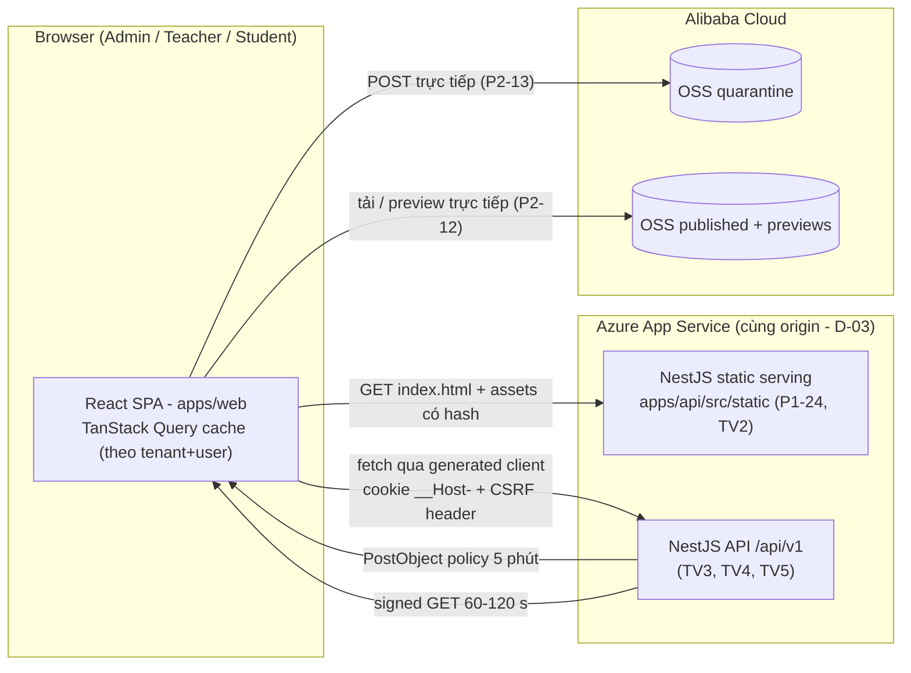
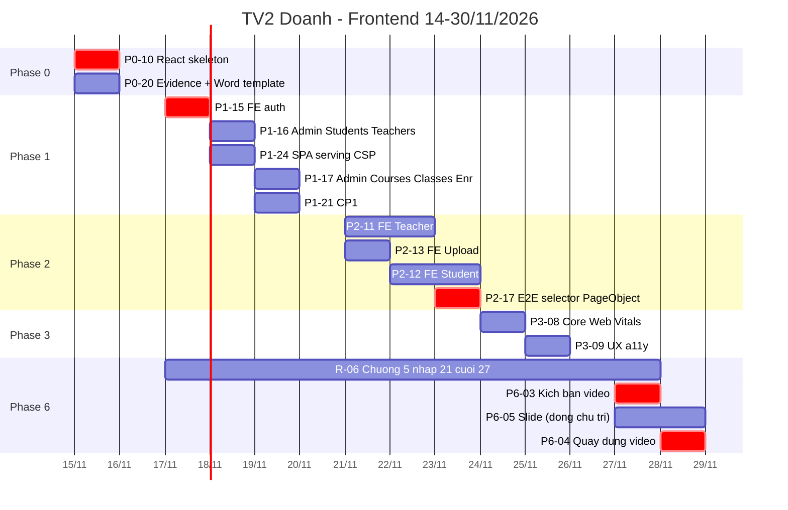
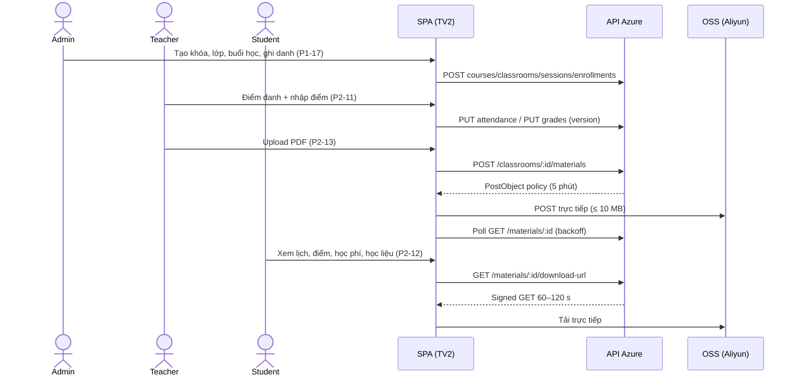

# DOANH.md — FRONTEND ENGINEERING HANDOFF

| Trường | Giá trị |
|---|---|
| Dự án | EduCenter Cloud — B2B SaaS quản lý trung tâm giáo dục (Microsoft Azure + Alibaba Cloud, tổ hợp 9) |
| Tài liệu | Giao việc cá nhân chính thức — **không** phải bản tóm tắt roadmap |
| Phiên bản tài liệu | 1.0 (bản đầu, chờ Tech Lead xác nhận) |
| Ngày tạo | 14/11/2026 |
| Thành viên | **Doanh** |
| Mã vai trò | **TV2** (theo D-01, Accepted — ROADMAP §15.1) |
| Vai trò | Frontend Engineer — React/Web, UI Admin/Teacher/Student, SPA serving + CSP, UX, Core Web Vitals, CP1 |
| Người duyệt chính | TV1 — Đức (Tech Lead). Một số task do TV3 (Anh), TV5 (Dương), TV6 (Giang) duyệt — xem từng Task Card |
| Source of truth | `ROADMAP.md` v1.2 (13/11/2026) · `EduCenter_Cloud_Ban_Thiet_Ke_2.md` (V2, 13/11/2026) · `BTL CK 1.pdf` |
| Trạng thái dự án | **PLAN** — chưa có dòng code, chưa có hạ tầng, chưa có test nào chạy. Mọi chỉ số trong file là mục tiêu, không phải kết quả |
| Trạng thái tài liệu | Draft — các mục gắn nhãn **Proposed** / **TBD** chưa được trưởng nhóm chốt |
| Đường dẫn đề xuất trong repo | `docs/members/DOANH.md` (**Proposed** — repo chưa tồn tại, TV1 quyết vị trí) |

> **Quy ước nhãn trong file này**
> - **[RM]** = trích nguyên từ ROADMAP.md (Task ID, deadline, estimate, owner, reviewer, AC). Không được tự sửa.
> - **[V2]** = trích từ Bản thiết kế 2.0.
> - **Proposed** = đề xuất cách làm của tài liệu này, **chưa** phải quyết định của nhóm. Muốn biến thành quyết định → TV1 xác nhận.
> - **TBD** = chưa có căn cứ trong nguồn, phải hỏi (xem §17 Open Questions, mã `OQ-xx`).
> - `TVx` = mã vai trò. TV1 = Đức · TV2 = Doanh · TV3 = Anh · TV4 = Hà · TV5 = Dương · TV6 = Giang.
> - Trạng thái task: tất cả đang **Todo** (PLAN). Không task nào Done khi chưa có commit SHA + log test + handoff [RM §7.11].

---

## 1. Tổng quan vai trò và trách nhiệm

### 1.1. Doanh làm gì trong dự án

Doanh là **owner duy nhất của tầng giao diện web** (`apps/web`) cho cả 3 vai trò Admin / Teacher / Student, cộng thêm phần **phục vụ SPA cùng origin và CSP** trong NestJS (P1-24), **checkpoint hiệu năng sớm CP1** (P1-21), **Core Web Vitals và UX/a11y** ở Phase 3, và **dẫn dắt video demo** ở Phase 6 [RM §6.1, §15.1].

Nói ngắn gọn: mọi thứ người dùng và giảng viên chấm bài **nhìn thấy** đều đi qua tay Doanh. Phần lớn điểm "càng nhiều chức năng càng nhiều điểm" của BTL được chứng minh bằng màn hình và video.

### 1.2. Doanh **không** làm gì

| Không thuộc trách nhiệm TV2 | Thuộc về |
|---|---|
| OpenAPI contract (viết spec) | TV1 — Doanh chỉ **review góc FE** (P0-09, P1-14) |
| Auth/session/CSRF phía server, guard, TenantTx, RLS | TV3 |
| Prisma schema, migration, API nghiệp vụ | TV4 (schema đóng băng 16/11 20:00 — D-27) |
| OSS, RAM, FC, ký PostObject policy, Materials API | TV5 |
| CI/CD workflows, Azure infra, k6 suite đầy đủ (P2-18), security suite (P2-16), benchmark W1/W2 | TV6 |
| **FE Admin Tuition + Dashboard (P2-14)** | **TV1** (Doanh chỉ review) — dù nằm trong `apps/web` |
| Ghép báo cáo Word cuối (P6-01) | Theo §15.2: Hà, Giang, Dương (xem OQ-02) |

**Nguyên tắc bất biến:** frontend route guard **không** thay thế authorization phía Backend. Mọi kiểm tra quyền ở FE chỉ để điều hướng/ẩn UI; quyền thật do API quyết định [V2 §11.1 "Không phụ thuộc frontend để cấp quyền"].

### 1.3. Tóm tắt khối lượng

| Loại trách nhiệm | Số mục | Task / mục |
|---|---:|---|
| Owner (thực hiện chính) | 14 | P0-10, P0-20, P1-15, P1-16, P1-17, P1-21, P1-24, P2-11, P2-12, P2-13, P3-08, P3-09, P6-03, R-06 (Chương 5) |
| Co-owner | 2 | P2-17 (với TV6), P6-04 (với TV5) |
| Đồng chủ trì (theo §15.2) | 1 | P6-05 Slide (với Anh, Đức) |
| Reviewer | 4 | P0-09, P1-14, P2-14, P6-01 (P6-01 cần xác nhận — OQ-02) |
| Owner security test | 2 | ST09 (Stored XSS), ST24 (Cache tenant khác) |
| Người quyết định | 1 | D-33 (CWV đo lab) — Proposed, hạn 24/11 |
| Integration point chủ trì | 2 | IP-2 (17/11, với TV3), IP-4 (22/11, với TV5) |
| Hỗ trợ / phối hợp | 4 | P3-07 (fix window FE), P6-06 (kiểm tra chéo báo cáo — cả 6 người), IP-3 (màn hình admin cho TV1), cung cấp ảnh màn hình hình 9–11 (Proposed) |
| Chỉ kích hoạt khi contingency | 2 | Viết test P2-17 nếu TV6 trễ; tập trung báo cáo/video 27–28/11 nếu R-12 xảy ra |

Tải ước tính theo roadmap: **~69 h** [RM §6.2]. Tải đối chiếu lại trong file này: **~74–78 h** (xem §5.4). Capacity: ~80 h [RM A-08].

---

## 2. Bức tranh kiến trúc Frontend trong hệ thống

### 2.1. Vị trí của SPA



### 2.2. Các sự thật kiến trúc FE phải tôn trọng

| # | Sự thật | Nguồn | Hệ quả cho FE |
|---|---|---|---|
| 1 | SPA được NestJS phục vụ tĩnh **cùng origin** với API | D-03 (Proposed, chờ kick-off), ADR-015 | Không CORS cho API; cookie `__Host-` + CSRF hoạt động; không gọi API bằng domain khác |
| 2 | Opaque session cookie `__Host-educenter_session` Secure/HttpOnly/SameSite=Lax | P1-01, V2 §11.3 | FE **không** đọc được session token và **không** được lưu token trong localStorage/sessionStorage |
| 3 | CSRF token cho POST/PUT/PATCH/DELETE + kiểm tra Origin | P1-02 | Mọi mutation phải gửi CSRF header. Cách lấy token: **TBD** (OQ-07) |
| 4 | Login gồm `tenantSlug` + email + password; session gắn tenant cố định; đổi tenant = đăng nhập lại | D-24 (Proposed), ADR-021 | Form login có định danh tenant; không có "chuyển tenant" trong UI |
| 5 | Error schema `{code, message, requestId, fieldErrors}` | P0-07, V2 §14 | FE map `fieldErrors` vào form; hiển thị `requestId` khi lỗi hệ thống |
| 6 | Tiền VND: BIGINT trong DB, **JSON string** | D-12 (Proposed) | FE không `parseFloat`/`Number()` tiền; không tính toán tiền phía client |
| 7 | Thời gian lưu UTC ISO-8601, hiển thị Asia/Ho_Chi_Minh | V2 §9.1, P0-09 | Format ở tầng hiển thị |
| 8 | Pagination `?page&pageSize≤100`, mặc định 25–50 | V2 §8.4, RM §7.3 | Không fetch toàn bộ danh sách |
| 9 | FE chỉ gọi API qua client sinh từ contract | RM §7.3 | Không tự viết URL/endpoint "đoán"; endpoint thiếu → yêu cầu TV1 bổ sung contract |
| 10 | Query key gồm tenant + user scope; xóa cache khi logout/đổi quyền | V2 §7.3, P0-10, P1-15 | Query key factory bắt buộc từ skeleton |
| 11 | Upload: OSS PostObject policy ≤ 10 MB, hết hạn 5 phút; FE POST trực tiếp | D-21, P2-05 | Không gửi file qua API; không bao giờ nhận AccessKey |
| 12 | Download: signed GET ngắn hạn, `?variant=preview` cho ảnh xem trước | P2-06, RV-21 | Không tự ghép URL OSS; không log/lưu signed URL |
| 13 | Optimistic UI có kiểm soát; không optimistic với tiền | V2 §7.4 | Điểm danh: chỉ báo "đã lưu" sau API; học phí: không optimistic |
| 14 | Bundle JS ban đầu route core ≤ 250 KB gzip | P0-10, V2 §7.2 | Route-based code splitting, lazy load theo vai trò |
| 15 | CSP `default-src 'self'` + domain OSS; không inline script | P1-24 | Build Vite không được sinh inline script |

### 2.3. Stack FE đã chốt (không đổi)

React + TypeScript + Vite · Tailwind CSS + shadcn/ui · TanStack Query · React Hook Form + validation schema · Vitest · Playwright · (k6 cho CP1, Lighthouse cho CWV) [V2 §4, RM §1.2].

Thư viện validation schema cụ thể (vd Zod) **TBD** — V2 chỉ ghi "validation schema". Router cụ thể **TBD** — RM chỉ ghi "router lazy theo vai trò". Chọn ở P0-10 và ghi lại trong handoff; thêm dependency phải có lý do [AGENTS.md §2].

---

## 3. Phạm vi công việc và nguyên tắc bắt buộc

### 3.1. Trong phạm vi

- Toàn bộ UI P0 cho F01–F09 và phần học phí của Student (F10 phía Student) [V2 §6.1].
- SPA serving + cache headers + CSP (P1-24).
- CP1 (P1-21), Core Web Vitals (P3-08), UX/a11y (P3-09).
- Selector + Page Object cho Playwright E2E (P2-17).
- ST09, ST24 (owner theo RM §9.2).
- Chương 5 báo cáo (R-06), kịch bản + quay/dựng video (P6-03, P6-04), đồng chủ trì slide (P6-05 theo §15.2).
- Review contract góc FE (P0-09, P1-14) và review P2-14.

### 3.2. Ngoài phạm vi (không tự làm)

- P1 features F12–F15 (CSV export, Assignments, Notifications, Certificates) — ngoài phạm vi BTL (D-22).
- Biểu đồ/thư viện chart (dashboard chỉ thẻ số liệu) [RM §2.2].
- Parent portal, thanh toán online, AI Education (P2).
- Bất kỳ endpoint, schema, response shape, CI job, cấu hình Cloud nào.
- PWA/offline cache, i18n đa ngôn ngữ, dark mode, animation nặng (không có trong nguồn — không thêm).

### 3.3. Nguyên tắc bắt buộc (rút từ AGENTS.md §2–§3, V2 §7, §11)

| # | Nguyên tắc |
|---|---|
| N1 | Chỉ sửa file trong **Allowed paths** của Task Card. Cần sửa ngoài phạm vi → dừng, ghi "Out-of-scope requests" trong handoff |
| N2 | Không đổi stack, không thêm dependency khi chưa giải thích lý do trong PR |
| N3 | Không lưu token/session/PII trong localStorage, sessionStorage, IndexedDB; không persist TanStack cache |
| N4 | Không nhận/gửi `tenant_id` hoặc `role` từ form để làm căn cứ quyền; tenant/role chỉ đọc từ `GET /me` để hiển thị |
| N5 | Route guard FE chỉ là UX. Không ẩn lỗi 403 bằng cách "giả" dữ liệu rỗng |
| N6 | Không `dangerouslySetInnerHTML` với dữ liệu người dùng; không `eval`/inline script (CSP) |
| N7 | Không log signed URL, token, mật khẩu, PII ra console/telemetry |
| N8 | Không dùng dữ liệu học viên thật — kể cả trong ảnh chụp, video, fixture test |
| N9 | Không tự viết endpoint/response shape. Thiếu API → change request cho TV1 (contract) |
| N10 | Không ghi "tests passed"/"Pass" khi chưa chạy thật và chưa có log |
| N11 | Không thêm cờ bypass auth/CSRF/rate limit cho test, demo hay benchmark (D-16) |
| N12 | Mọi màn hình có đủ 4 trạng thái: loading / empty / error / success [V2 §7.1] |
| N13 | Giao diện tiếng Việt; hỗ trợ bàn phím, focus state, tương phản, screen reader ở luồng chính [V2 §7.1] |

---

## 4. Master Timeline cá nhân — Phase 0 đến Phase 6

### 4.1. Lịch theo ngày (deadline giữ nguyên roadmap)

| Ngày | Phase | Doanh phải làm (Owner) | Phối hợp / Review | Mốc nhóm |
|---|---|---|---|---|
| T7 14/11 | 0 | Chuẩn bị môi trường, đọc tài liệu; **review P0-09** khi TV1 mở PR (chiều/tối) | Kick-off 09:00 (D-03, D-12, D-24, D-33 liên quan FE) | — |
| CN 15/11 | 0 | **P0-10** (sáng, 5h) · **P0-20** (chiều, 2h) | — | Standup tiền-G0 |
| T2 16/11 | 1 | Không có task Owner theo lịch → chuẩn bị P1-15 bằng contract v0 (Proposed); **review P1-14** | — | **G0 12:00** · Schema v1 freeze 20:00 |
| T3 17/11 | 1 | **P1-15** (5h) · bắt đầu nháp Chương 5 (R-06) | **IP-2 tối** (với TV3) | — |
| T4 18/11 | 1 | **P1-16** (6h) · **P1-24** (3h) | — | — |
| T5 19/11 | 1 | **P1-17** (6h) · **P1-21 CP1** (3h) | IP-3 (TV1 chủ trì — cung cấp màn hình admin) | **G1 20:00** |
| T6 20/11 | 2 | Không có task Owner theo lịch → trả nợ Phase 1, chuẩn bị Page Object, nháp ST09/ST24 (Proposed) | — | — |
| T7 21/11 | 2 | **P2-11** (bắt đầu, 7h/2 ngày) · **P2-13** (4h) · **R-06 bản nháp** | — | — |
| CN 22/11 | 2 | **P2-11** (hoàn thành) · **P2-12** (bắt đầu, 5h/2 ngày) | **IP-4** (với TV5) | Trigger contingency nếu P2-11 chưa merge tối 22/11 |
| T2 23/11 | 2 | **P2-12** (hoàn thành) · **P2-17** phần selector/Page Object | **Review P2-14** (TV1) | Trigger nếu P2-17 chưa bắt đầu sáng 23/11 · **G2 20:00** |
| T3 24/11 | 3 | **P3-08** Core Web Vitals (3h) · fix FE từ ST/ZAP (P3-07) | Chốt D-33 | **Feature freeze 00:00** |
| T4 25/11 | 3–4 | **P3-09** UX/a11y (4h) — ưu tiên merge trước 12:00 (xem OQ-10) | — | **rc0.1 12:00** · W1 14–18h · G3 20:00 |
| T5 26/11 | 4–5 | Không có task Owner → hỗ trợ regression FE, chuẩn bị nháp storyboard (Proposed) | — | W2 09–13h · G4 20:00 · RC1 tối |
| T6 27/11 | 5–6 | **P6-03** kịch bản video (sau G5 12:00, 3h) · **R-06 bản cuối** · P6-05 slide (đồng chủ trì) | — | **G5 12:00 Go/No-Go** |
| T7 28/11 | 6 | **P6-04** quay + dựng video (6h, với TV5) · P6-05 slide | — | — |
| CN 29/11 | 6 | P6-06 kiểm tra chéo báo cáo (sáng, cả nhóm) · sửa video theo review của Đức | — | **G6 22:00 nộp nội bộ** |
| T2 30/11 | — | Buffer — không deploy | — | Hạn nộp |

### 4.2. Gantt cá nhân



### 4.3. Critical path riêng của Frontend

```text
P0-09 (TV1) → P0-10 → P1-14 (TV1) + P1-01/P1-02 (TV3) → P1-15 → P1-16 → P1-17
                                                                        ↓
P2-01/P2-02 (TV4) → P2-11 ─┐
P2-05 (TV5) → P2-13 ───────┼→ P2-17 (TV6 + TV2) → G2 → … → G5 → P6-03 → P6-04 → G6
P2-03 + P2-06 → P2-12 ─────┘
```

P2-17 là task Mode **S → G2** trên critical path toàn dự án [RM §3.3]. Nếu P2-11/P2-12/P2-13 trễ, G2 trễ.

### 4.4. Deadline tuyệt đối không được bỏ lỡ

| Mốc | Lý do |
|---|---|
| **15/11 tối — P0-10 merge** | Mọi task FE Phase 1 xây trên skeleton; P1-24 phụ thuộc P0-10 |
| **17/11 tối — P1-15 + IP-2** | Login là cửa vào mọi màn hình; IP-2 là điểm tích hợp auth/CSRF/tenant đầu tiên |
| **19/11 20:00 — P1-21 CP1 có số** | G1 yêu cầu "CP1 có số" [RM §8.1] |
| **22/11 tối — P2-11 merge** | Trigger contingency TV2 [RM §10.3] |
| **23/11 — P2-17 selector/Page Object sẵn sàng** | E2E xanh 3 lần là điều kiện G2 |
| **24/11 00:00 — feature freeze** | Sau mốc này chỉ nhận label `fix`/`test`/`docs`/`security` |
| **25/11 12:00 — rc0.1** | Fix FE muốn vào bench build phải merge trước mốc |
| **27/11 — P6-03 (sau G5)** và **28/11 — P6-04** | Video là 2/10 điểm BTL |

---

## 5. Task Inventory — danh sách toàn bộ nhiệm vụ của Doanh

### 5.1. Nhiệm vụ thực hiện (Owner / Co-owner)

| Task ID | Tên | Owner → Reviewer [RM] | Dep [RM] | Ngày · Est [RM] | Mode | Loại | Card |
|---|---|---|---|---|---|---|---|
| P0-10 | React skeleton | TV2 → TV1 | P0-04, P0-09 | 15/11 · 5h | P | Owner | §6.1 |
| P0-20 | Evidence system + Word template | TV2 → TV1 | P0-04 | 15/11 · 2h | P | Owner | §6.2 |
| P1-15 | FE auth | TV2 → TV3 | P1-01, P1-02, P1-14 | 17/11 · 5h | S | Owner | §6.3 |
| P1-16 | FE Admin Students + Teachers | TV2 → TV1 | P1-15, P1-09 | 18/11 · 6h | P | Owner | §6.4 |
| P1-17 | FE Admin Courses/Classes/Schedule/Enrollment | TV2 → TV1 | P1-16, P1-12, P1-13 | 19/11 · 6h | P | Owner | §6.5 |
| P1-21 | CP1 — LT01 + 30 RPS đọc | TV2 → TV6 | P1-09, P1-20, P0-12 | 19/11 · 3h | P | Owner | §6.6 |
| P1-24 | SPA serving + CSP | TV2 → TV3 | P0-10, P0-12 | 18/11 · 3h | P | Owner | §6.7 |
| P2-11 | FE Teacher | TV2 → TV1 | P2-01, P2-02 | 21–22/11 · 7h | P | Owner | §6.8 |
| P2-12 | FE Student | TV2 → TV1 | P2-03, P2-06 | 22–23/11 · 5h | P | Owner | §6.9 |
| P2-13 | FE Upload | TV2 → TV5 | P2-05 | 21/11 · 4h | P | Owner | §6.10 |
| P2-17 | Playwright E2E luồng P0 (TV2: selector/Page Object) | TV6 + TV2 → TV1 | P2-11, P2-12, P2-13, P2-09 | 23/11 · 6h | S → G2 | **Co-owner** | §6.11 |
| P3-08 | Core Web Vitals | TV2 → TV1 | P3-01 | 24/11 · 3h | P | Owner | §6.12 |
| P3-09 | UX: responsive, keyboard, tiếng Việt, states | TV2 → TV1 | P3-01 | 25/11 · 4h | P | Owner | §6.13 |
| P6-03 | Kịch bản video + storyboard | TV2 → TV1 | G5 | 27/11 · 3h | S | Owner | §6.14 |
| P6-04 | Quay + dựng video ≤ 5:00 | TV2 + TV5 → TV1 | P6-03 | 28/11 · 6h | S | **Co-owner** | §6.15 |
| R-06 | Báo cáo Chương 5 — nghiệp vụ, use case, ma trận quyền (~4 trang) | TV2 | — | Nháp 21/11 · Cuối 27/11 · (R = 4h trong §6.2) | — | Owner | §6.16 |
| P6-05 | Slide 15–18 trang | §5.7: TV4 → TV1 · **§15.2: Anh, Doanh, Đức chủ trì** | G5 | 27–28/11 · 5h | P | **Đồng chủ trì (§15.2)** | §6.17 |

### 5.2. Nhiệm vụ review

| Task ID | Nội dung | Owner [RM] | Doanh review góc nào | Hạn | Card/mục |
|---|---|---|---|---|---|
| P0-09 | OpenAPI v0 (health, login có `tenantSlug`, logout, me, students; codegen) | TV1 | Codegen dùng được trong web, login có tenantSlug, error/pagination/money convention dùng được ở FE | 14/11 | §6.18 |
| P1-14 | OpenAPI v1 toàn bộ endpoint P0 | TV1 | Đủ endpoint đọc cho mọi màn hình (§7), error code nghiệp vụ, pagination | 16–17/11 | §6.18 |
| P2-14 | FE Admin Tuition + Dashboard | TV1 | Convention FE, query key, states, không optimistic với tiền, a11y, dùng đúng component chung | 23/11 | §6.18 |
| P6-01 | Ghép và biên tập báo cáo Word cuối | §5.7: TV1 → **TV2** · §15.2: Hà/Giang/Dương chủ trì | Định dạng theo template P0-20, chương 5 khớp UI thật | 27–28/11 | §6.18 — **chờ OQ-02** |
| Contract (góc FE), E2E selector | Vai trò reviewer thường trực | — | [RM §6.1] | Liên tục | §12 |

### 5.3. Nhiệm vụ hỗ trợ, security test, quyết định, contingency

| Mục | Nguồn | Loại | Ghi chú |
|---|---|---|---|
| ST09 — Stored XSS không chạy script (Playwright) | RM §9.2, Owner TV2 | Owner security test | Sơ bộ trong P1-24; đầy đủ ở P2 (xem §6.19) |
| ST24 — Cache của tenant khác (E2E đổi tài khoản + kiểm tra cache FE) | RM §9.2, Owner TV2 | Owner security test | Gắn với P1-15 + P2-17 (xem §6.19) |
| D-33 — CWV đo bằng Lighthouse lab, ghi rõ không phải p75 field | RM §2.3, TV2 quyết, hạn 24/11 | Người quyết định | Proposed → cần Accept trước P3-08 |
| IP-2 — FE login ↔ API auth/CSRF ↔ tenant guard | RM §3.3, 17/11 tối | Đồng chủ trì với TV3 | §6.3 |
| IP-4 — Teacher upload → FC → READY → Student download | RM §3.3, 22/11 | Đồng chủ trì với TV5 | §6.10, §6.9 |
| IP-3 — Admin Students → Classes → Enrollment E2E trên demo | RM §3.3, 19/11, TV1 chủ trì | Hỗ trợ | Màn hình P1-16/P1-17 phải chạy trên demo |
| P3-07 — Fix window | RM §5.4, owner module | Hỗ trợ | Fix issue FE từ P3-02/03/04/06; ưu tiên trước 25/11 12:00 |
| P6-06 — Kiểm tra chéo báo cáo | §15.2: cả 6 người (task owner TV3) | Hỗ trợ | 29/11 sáng |
| Hình 9, 10, 11 báo cáo (màn hình Admin, Teacher điểm danh, Student tải học liệu) | RM §11.2 (chương 5) | Hỗ trợ — **Proposed** | Chương 5 do TV2 viết → TV2 chụp, dữ liệu giả |
| Contingency: TV6 trễ P2–P4 → **TV2 nhận viết test P2-17** | RM §10.3 | Chỉ khi kích hoạt | Trigger: P2-17 chưa bắt đầu sáng 23/11 |
| Contingency: TV2 trễ → TV1 nhận P2-14, TV5 nhận P2-13 | RM §10.3 | Doanh là bên được giảm tải | Trigger: P2-11 chưa merge tối 22/11 (xem OQ-01) |
| Contingency R-12: báo cáo/video dồn cuối → TV1 + TV2 tập trung 27–28/11 | RM §10.1 | Chỉ khi kích hoạt | Owner rủi ro TV1 |

> **Lưu ý trùng ID "R-06":** trong ROADMAP, `R-06` vừa là **mã chương báo cáo** (§11.1, Chương 5 — owner TV2) vừa là **mã rủi ro** (§10.1, "AI sinh code sai authorization" — owner TV3). Trong file này: "R-06 (Chương 5)" = chương báo cáo; "Risk R-06" = rủi ro. Doanh không sở hữu Risk R-06 nhưng phải tuân thủ biện pháp giảm thiểu (xem §14).

### 5.4. Đối chiếu khối lượng với roadmap

| Hạng mục | §6.2 RM (TV2) | Tính lại từ cột Est §5 | Chênh |
|---|---:|---:|---|
| P0 | 7 | P0-10 5 + P0-20 2 = **7** | 0 |
| P1 | 23 | 5 + 6 + 6 + 3 + 3 = **23** | 0 |
| P2 | 18 | P2-11 7 + P2-12 5 + P2-13 4 + P2-17 6÷2 = **19** | **+1** |
| P3 | 7 | 3 + 4 = **7** | 0 (chưa tính P3-07) |
| P4, P5 | 0 | 0 | 0 |
| P6 | 6 | P6-03 3 + P6-04 6÷2 = **6** | 0 (chưa tính P6-05, P6-06) |
| R (viết báo cáo) | 4 | 4 | 0 |
| Review | 4 | P0-09, P1-14, P2-14, P6-01 ≈ 4 | 0 |
| **Tổng RM** | **~69** | **~70** | +1 |
| P6-05 (đồng chủ trì theo §15.2, 5h ÷ 3) | — | ~1,7 | **chưa có trong §6.2** |
| P6-06 kiểm tra chéo (cả 6 người) | — | ~1–2 (**ước tính Proposed**) | chưa có trong §6.2 |
| P3-07 fix window (8h tổng nhóm) | — | ~1,5 (**ước tính Proposed**) | chưa có trong §6.2 |
| IP-2, IP-4, ST09/ST24 viết test | — | ~1–3 (**ước tính Proposed**) | chưa có trong §6.2 |
| **Tổng thực tế dự kiến** | | **~74–78 h** | +5–9 h so với §6.2 |
| Contingency P2-17 viết test (nếu TV6 trễ) | — | +3 | chỉ khi kích hoạt |

**Kết luận:** vẫn dưới capacity ~80 h nhưng chỉ còn 2–6 h dư. Ngày 18/11 và 19/11 mỗi ngày ~9 h theo lịch roadmap (vượt mức ~5 h/ngày của A-08). Doanh phải báo velocity thật ở standup 17/11 và 18/11; nếu trễ > 0,5 ngày → TV1 quyết theo §10.2 (scope-cut cấp 1: "FE admin chỉ màn cần cho video"). Chênh lệch này đã đưa vào OQ-04.


---

## 6. Detailed Task Cards — hướng dẫn triển khai từng task theo Phase

> **Cách dùng:** mỗi card có thể copy nguyên văn vào `docs/tasks/<TaskID>.md` (template RM §7.6) và đưa cho AI agent cùng với `AGENTS.md`. Phần đánh dấu **[RM]** là bất biến; phần "Bước triển khai" là hướng dẫn thực thi (**Proposed** ở chỗ nguồn chưa quy định). Prompt AI viết bằng tiếng Anh theo đúng template RM §7.9 mà nhóm đã thống nhất.
>
> **DoD chung cho mọi task code** (không lặp lại trong từng card): xem §12.3.

---

### 6.1. P0-10 — React skeleton

| Trường | Giá trị [RM] |
|---|---|
| Phase · Ngày · Est · Mode | Phase 0 · **15/11 (sáng, theo §12)** · 5h · P |
| Owner → Reviewer | TV2 (Doanh) → TV1 (Đức) |
| Dependency | P0-04 (monorepo, TV1, 14/11) · P0-09 (OpenAPI v0 + codegen, TV1, 14/11) |
| Module/File | `apps/web/` |
| Đầu vào | V2 §7 |
| AC [RM] | Build pass; JS ban đầu route core ≤ 250 KB gzip (ghi số đo) |
| Test [RM] | Vitest smoke; báo cáo size |

**Mục tiêu & giá trị.** Dựng nền móng mà mọi màn hình sau sẽ cắm vào: Vite + TS, Tailwind, shadcn/ui, TanStack Query với query key factory có tenant + user scope, router lazy theo vai trò, layout 3 vai trò, các component trạng thái loading/empty/error. Làm đúng ngay từ đầu giúp tránh refactor cache/auth ở Phase 1–2 (nơi rủi ro ST24 nằm).

**Điều kiện bắt đầu.** P0-04 đã merge (có `pnpm-workspace.yaml`, `apps/`, lockfile, branch protection). P0-09 đã merge hoặc ít nhất client sinh được từ nhánh của TV1. Nếu P0-09 chưa xong → làm phần không phụ thuộc client (Vite, Tailwind, layout, router, state components) trước, cắm client sau.

**Allowed paths.** `apps/web/**` · `docs/tasks/P0-10.md` · `docs/handoffs/P0-10.md` · `docs/evidence/P0-10/`
**Không được sửa.** `packages/api-contract/**` (chỉ import), `.github/workflows/**` (cần job CI cho web → nhờ TV6), root `package.json`/`pnpm-workspace.yaml` (trừ khi P0-04 chưa khai báo `apps/web` — báo TV1).

**Bước triển khai.**
1. Đọc `AGENTS.md`, V2 §7, RM §7.3 (convention FE). Kiểm tra `pnpm install --frozen-lockfile` chạy được ở root.
2. Khởi tạo Vite React TS trong `apps/web`, bật `strict: true`.
3. Cài Tailwind + shadcn/ui; chỉ thêm component shadcn khi cần (không import cả bộ). Không import toàn bộ thư viện icon [V2 §7.2].
4. Cấu trúc thư mục theo V2 §12.2 (`src/features/`, `src/components/`, `src/lib/`). Chi tiết bên trong (vd `src/app/` cho router + providers, `src/lib/api/`, `src/lib/query-keys.ts`) là **Proposed** — ghi vào handoff để các task sau dùng thống nhất.
5. **API client wrapper** trong `src/lib/api/`: dùng client sinh từ `packages/api-contract`; base path `/api/v1` cùng origin; chuẩn hóa lỗi về `{code, message, requestId, fieldErrors}`; chừa hook gắn CSRF header (cơ chế cụ thể **TBD** đến P1-02 — OQ-07).
6. **QueryClient**: không persist cache; không retry với 4xx; không tự retry mutation; không bật refetch liên tục [V2 §7.3]. Giá trị `staleTime`/`gcTime` cụ thể là **Proposed**, ghi lại trong handoff.
7. **Query key factory**: mọi key bắt đầu bằng scope `{tenantId, userId}` lấy từ `GET /me`, sau đó resource + params. Riêng query `me` là ngoại lệ. Viết unit test chứng minh hai user khác nhau sinh key khác nhau.
8. **Router lazy theo vai trò**: route `/login` và 3 nhóm route Admin/Teacher/Student, mỗi nhóm là 1 chunk lazy. Đường dẫn cụ thể (vd `/admin/*`) là **Proposed**.
9. **Layout 3 vai trò**: điều hướng riêng mỗi vai trò [V2 §7.1]; chưa cần màn hình thật — placeholder.
10. **Component trạng thái dùng chung**: Loading (skeleton, không chặn toàn màn hình — PERF-09), Empty, Error (thông điệp tiếng Việt + `requestId` + nút thử lại), thông báo Success.
11. `vite.config.ts`: build ra asset có hash; không sinh inline script trong `index.html` (chuẩn bị cho CSP P1-24); dev proxy `/api` → API local để giữ cùng origin khi dev (**Proposed**).
12. Viết Vitest smoke (render App, render từng layout, query key factory). Build production, đo kích thước gzip của JS tải ban đầu cho route core, ghi số vào evidence.

**UI states & edge cases.** `GET /me` đang tải → Loading toàn khung (không nháy sang login). Lỗi mạng khi tải chunk lazy → Error state có nút tải lại. Route không tồn tại → trang 404 nội bộ.

**Bảo mật / tenant.** Không có bất kỳ chỗ nào đọc/ghi `localStorage`/`sessionStorage` cho dữ liệu phiên. Query key luôn có tenant + user scope (nền cho ST24). Không có `dangerouslySetInnerHTML`.

**Tích hợp API.** Chỉ `GET /api/v1/health` (nếu muốn smoke) và chuẩn bị `GET /me`. Không gọi endpoint ngoài contract v0.

**Test bắt buộc.** Vitest smoke (render, query key khác nhau theo user/tenant, error normalizer map đúng 4 trường). Báo cáo size bundle.

**Acceptance Criteria.**
- [RM] `pnpm --filter web build` (tên filter theo P0-04) pass.
- [RM] JS ban đầu của route core ≤ 250 KB gzip — **ghi số đo thật**, kể cả khi vượt (vượt → mở issue, không xóa chức năng chỉ để đạt số [V2 §7.2]).
- Kiểm chứng bổ sung (**Proposed**): `index.html` build ra không chứa thẻ `<script>` inline; grep `localStorage|sessionStorage` trong `apps/web/src` = 0 kết quả.

**Deliverables & evidence.** PR `feat/P0-10-react-skeleton`; `docs/evidence/P0-10/P0-10_20261115_<shortSHA>/` (log build, bảng size, log Vitest).

**Handoff.** → chính Doanh (P1-15, P1-24), TV1 (review, P2-14 dùng chung component/query key), TV6 (cần job CI chạy `vitest` + `build` cho `apps/web`). Ghi rõ: cấu trúc thư mục, cách tạo query key, cách gọi client, component trạng thái.

**DoD riêng.**
- [ ] Số đo bundle có trong evidence
- [ ] Handoff mô tả convention cho các task FE sau
- [ ] Đã nhờ TV6 thêm job CI web (issue/PR của TV6)

**AI prompt.**
```text
You are implementing P0-10 (React skeleton) in EduCenter Cloud.
Read AGENTS.md, docs/tasks/P0-10.md, docs/members/DOANH.md §2 and §9, V2 §7, and packages/api-contract first.
Objective: Vite + React + TS (strict), Tailwind, shadcn/ui, TanStack Query with a query-key factory scoped by
{tenantId, userId} from GET /me, lazy role-based routing (Admin/Teacher/Student), 3 role layouts, shared
Loading/Empty/Error/Success components, API client wrapper over the generated contract client that normalizes
errors to {code,message,requestId,fieldErrors} and exposes a hook for a CSRF header (mechanism TBD).
Allowed paths: apps/web/** only. Do not edit packages/api-contract, .github/workflows, apps/api.
Rules: no localStorage/sessionStorage for any session data; no persisted query cache; no inline scripts in
index.html; no new dependency without a one-line justification; no endpoints outside the contract.
Step 1: propose the folder layout and the exact files you will create. Wait for approval.
Step 2: write Vitest smoke tests (render, query keys differ per user/tenant, error normalizer).
Step 3: implement. Step 4: run lint, typecheck, vitest, production build; report gzip size of initial JS for the
core route with the real command output. Step 5: write docs/handoffs/P0-10.md.
Do not claim tests passed if they were not executed.
```

---

### 6.2. P0-20 — Hệ thống bằng chứng + template Word

| Trường | Giá trị [RM] |
|---|---|
| Phase · Ngày · Est · Mode | Phase 0 · **15/11 (chiều)** · 2h · P |
| Owner → Reviewer | TV2 → TV1 |
| Dependency | P0-04 |
| Module/File | `docs/evidence/README.md`, `docs/report/` |
| Đầu vào | V2 §25, BTL |
| AC [RM] | Quy ước tên evidence `<TaskID>_<yyyymmdd>_<shortSHA>`; template có sẵn mục lục |
| Test [RM] | Review |

**Mục tiêu & giá trị.** Hard gate HG6 "không giả mạo kết quả" chỉ kiểm chứng được khi mọi bằng chứng có quy ước thống nhất. Template Word đúng định dạng BTL ngay từ 15/11 để báo cáo viết liên tục từ 17/11 [RM §3.1].

**Allowed paths.** `docs/evidence/README.md` · `docs/report/**` · `docs/tasks/P0-20.md` · `docs/handoffs/P0-20.md`

**Bước triển khai.**
1. `docs/evidence/README.md`:
   - Quy ước tên `<TaskID>_<yyyymmdd>_<shortSHA>` [RM]; mỗi task một thư mục `docs/evidence/<TaskID>/` (cấu trúc thư mục con là **Proposed**; giữ các đường dẫn roadmap đã dùng: `P0-01/`, `P0-18/`, `perf/CP1/`, `perf/CP2/`, `security/`, `zap/`, `scanners/`).
   - Trường bắt buộc cho evidence ST: ngày, commit SHA, môi trường, test account (mã, không mật khẩu), kết quả, reviewer, issue [RM §9.2].
   - Trường bắt buộc cho evidence hiệu năng: SHA/tag build, cấu hình (SKU, instance, `connection_limit`), nguồn tải, thời gian chạy (D-30).
   - Quy tắc: che ID subscription/account nhạy cảm; **không** secret, signed URL, token, PII, dữ liệu thật; trạng thái chỉ là Pass/Fail/Not run/Not implemented — không "Pass" khi chưa chạy.
2. `docs/report/`: template Word A4, Times New Roman 12, heading đa cấp, đánh số hình/bảng tự động, mục lục tự động, ghi chú "≤ 15 hình, mỗi hình ≤ nửa trang" [BTL].
3. Phân chương theo RM §11.1 (Ch1–Ch10, owner, hạn nháp/cuối, số trang dự kiến ~39) và kế hoạch hình RM §11.2 — đưa vào `docs/report/README.md` (**Proposed** tên file).
4. Nhờ TV1 review; gửi link template cho Hà/Giang/Dương (người ghép báo cáo theo §15.2).

**Test.** Review checklist: mở template, kiểm tra font/cỡ chữ, mục lục cập nhật được, caption hình đánh số được.

**AC.** [RM] như bảng trên. Kiểm chứng (**Proposed**): một chương mẫu dán vào template giữ đúng style; tên evidence mẫu đúng quy ước.

**Deliverables.** PR `docs/P0-20-evidence-template`; template `.docx`.

**Handoff.** → cả nhóm (quy ước evidence áp dụng từ P0-18), TV1 + Hà/Giang/Dương (báo cáo).

**DoD riêng.** [ ] README evidence có ví dụ đúng/sai · [ ] template có TOC + caption · [ ] đã thông báo nhóm ở standup 15/11.

**AI prompt.**
```text
Task P0-20 (docs only). Draft docs/evidence/README.md for EduCenter Cloud.
Required: naming <TaskID>_<yyyymmdd>_<shortSHA>; per-task folders; mandatory fields for security-test evidence
(date, commit SHA, environment, test account id, result, reviewer, issue) and performance evidence (build tag/SHA,
SKU/instances/connection_limit, load source, run time); allowed statuses Pass/Fail/Not run/Not implemented;
redaction rules (no secrets, signed URLs, tokens, PII, real data; mask subscription/account IDs).
Also draft docs/report/README.md listing chapters 1–10 with owners and deadlines exactly as given in
ROADMAP §11.1 and the figure plan §11.2. Do not invent new chapters, owners or deadlines.
Output Markdown only. Allowed paths: docs/evidence/README.md, docs/report/README.md.
```

---

### 6.3. P1-15 — FE auth

| Trường | Giá trị [RM] |
|---|---|
| Phase · Ngày · Est · Mode | Phase 1 · **17/11** · 5h · **S** |
| Owner → Reviewer | TV2 → **TV3** (Anh) |
| Dependency | P1-01 (Auth, TV3, 16–17/11) · P1-02 (CSRF, TV3, 17/11) · P1-14 (OpenAPI v1, TV1, 16–17/11) |
| Module/File | `apps/web/src/features/auth/` |
| Đầu vào | V2 §7.3 |
| AC [RM] | Không có token trong localStorage; logout xóa sạch cache |
| Test [RM] | Vitest + Playwright login |
| Integration point | **IP-2 — 17/11 tối** (TV2 + TV3) |

**Mục tiêu & giá trị.** Cửa vào duy nhất của ứng dụng. Phải đúng mô hình session cookie + CSRF + tenant của V2/D-24, và phải là nền chống rò cache giữa tenant (ST24, SEC15).

**Điều kiện bắt đầu.** Contract `paths/auth.yaml` (login có `tenantSlug`, logout, me) đã merge trong P1-14 hoặc P0-09. Backend P1-01/P1-02 có thể chưa xong lúc bắt đầu → code theo contract, tích hợp thật ở IP-2 tối 17/11.

**Allowed paths.** `apps/web/src/features/auth/**` · `apps/web/src/lib/api/**` (chỉ phần CSRF + xử lý 401/403 toàn cục) · router/guard trong `apps/web/src/app/**` (nếu dùng cấu trúc P0-10) · `tests/e2e/**` (spec login — phối hợp TV6) · docs task/handoff.

**Bước triển khai.**
1. Đọc contract auth: body login (`tenantSlug`, `email`, `password`), response, mã lỗi (401 chung, 429 + `Retry-After`), `GET /me` (role, tenant, user, cờ `must_change_password` nếu có), cơ chế CSRF (OQ-07).
2. Trang Login (RHF + schema): 3 trường; cách nhập `tenantSlug` (gõ tay hay lấy từ URL) là **TBD — OQ-06**; chống double submit; thông báo lỗi **không phân biệt** sai tenant/email/mật khẩu [P1-01]; 429 → hiển thị thời gian chờ từ `Retry-After` [P1-06].
3. Sau login thành công: gọi `GET /me` → chuyển tới trang chủ theo vai trò. Không đọc cookie bằng JS (HttpOnly).
4. Bootstrap khi tải app: `GET /me`; 401 → về Login.
5. CSRF: gắn header cho mọi POST/PUT/PATCH/DELETE trong client wrapper theo contract.
6. Xử lý **401 toàn cục**: `queryClient.clear()` → về Login với thông điệp "Phiên đăng nhập đã hết hạn". Nếu lưu "return path", chỉ chấp nhận đường dẫn nội bộ (chống open redirect — **Proposed**).
7. Xử lý **403 toàn cục**: hiển thị trạng thái "Không có quyền truy cập"; không retry; không hiển thị dữ liệu cache cũ của resource đó.
8. **Logout**: `POST /auth/logout` → `queryClient.clear()` (kể cả khi API lỗi) → về Login.
9. **Đổi user/tenant/role**: khi `GET /me` trả về user/tenant/role khác scope đang cache → clear toàn bộ cache trước khi render (**Proposed** cách phát hiện).
10. Route guard theo vai trò (chỉ UX); truy cập route vai trò khác → trang 403 nội bộ.
11. `must_change_password` / đổi mật khẩu (D-28, P1-25): **không tự làm** khi chưa có quyết định — OQ-08. Nếu TV1 giao thêm thì làm trong task này và ghi Est thêm.

**UI states & edge cases.** Đăng nhập sai nhiều lần → 429. Mất mạng khi submit → Error có thử lại, không xóa email đã nhập. Cookie hết hạn giữa chừng khi đang điền form dài → 401 → giữ người dùng ở trang login, không mất cảnh báo. Hai tab: logout ở tab A → tab B gọi API nhận 401 → về Login.

**Bảo mật / tenant.**
- Không token trong localStorage/sessionStorage/IndexedDB; không persist query cache.
- Cache key có tenant + user; logout/đổi user → clear (nền ST24).
- Không gửi `tenant_id`/`role` trong body nào; `tenantSlug` chỉ dùng cho login.
- Không log password/token; không đưa mật khẩu vào URL.

**Tích hợp API.** `POST /auth/login` · `POST /auth/logout` · `GET /me` · CSRF theo P1-02. Thứ tự: mock theo contract (16–17/11) → local docker-compose (P0-19) → demo env ở IP-2.

**Test bắt buộc.**
- Vitest: client wrapper gắn CSRF header cho mutation và không gắn cho GET; 401 → cache bị clear; 403 không retry; form validation.
- Playwright login: đăng nhập đúng (3 vai trò); sai mật khẩu → thông báo chung; logout → cache rỗng và quay về Login; sau login kiểm tra `localStorage`/`sessionStorage` không chứa token; **cùng email ở 2 tenant đăng nhập đúng tenant** (test case của P1-01, kiểm qua UI — **Proposed**).

**Acceptance Criteria.**
- [RM] Không có token trong localStorage.
- [RM] Logout xóa sạch cache.
- Kiểm chứng (**Proposed**): sau logout, quay lại bằng nút Back không hiển thị dữ liệu cũ; mutation thiếu CSRF bị 403 (đối chiếu ST07 của TV3 qua UI).

**Deliverables & evidence.** PR; log Vitest + Playwright; biên bản IP-2 (`docs/evidence/P1-15/` hoặc theo quy ước P0-20).

**Handoff.** → P1-16/17 (guard + client dùng lại), TV6 (spec login cho P2-17), TV3 (xác nhận ST24 nền).

**DoD riêng.** [ ] IP-2 chạy thật trên demo với TV3 · [ ] TV3 approve · [ ] OQ-06/07/08 đã có câu trả lời hoặc ghi rõ giả định trong handoff.

**AI prompt.**
```text
You are implementing P1-15 (FE auth) in EduCenter Cloud.
Read AGENTS.md, docs/tasks/P1-15.md, handoffs of P0-10, P1-01, P1-02, P1-14, and packages/api-contract/paths/auth.yaml.
Objective: login page (tenantSlug + email + password per D-24), logout, GET /me bootstrap, CSRF header on all
mutations per the contract, global 401 (clear TanStack cache, go to login) and 403 handling, role-based routing
(UX only), clear the whole query cache on logout or when /me returns a different user/tenant/role.
Allowed paths: apps/web/src/features/auth/**, apps/web/src/lib/api/** (CSRF + 401/403 only), apps/web/src/app/**
(router/guards), tests/e2e/** (login spec only).
Forbidden: storing any token/session data in localStorage/sessionStorage/IndexedDB; persisting query cache;
sending tenant_id/role in any body; distinguishing wrong tenant/email/password in error messages; implementing
change-password unless the task card says so.
Step 1: list the contract endpoints and error codes you will use and the files you will touch. Wait for approval.
Step 2: write failing Vitest tests (CSRF header on mutations only; 401 clears cache) and a Playwright login spec
(valid login per role, invalid login, logout clears cache, no token in web storage).
Step 3: implement. Step 4: run lint, typecheck, vitest, playwright; paste real output. Step 5: docs/handoffs/P1-15.md.
Stop and ask if the contract lacks something you need (CSRF retrieval, must_change_password).
```

---

### 6.4. P1-16 — FE Admin Students + Teachers

| Trường | Giá trị [RM] |
|---|---|
| Phase · Ngày · Est · Mode | Phase 1 · **18/11** · 6h · P |
| Owner → Reviewer | TV2 → TV1 |
| Dependency | P1-15 · P1-09 (Students API, TV4, 18/11) |
| Module/File | `apps/web/src/features/{students,teachers}/` |
| Đầu vào | V2 §7 |
| AC [RM] | Có đủ loading/empty/error/success; không fetch toàn bộ danh sách |
| Test [RM] | Vitest component |

> **Dependency ngầm (không đổi RM, chỉ lưu ý):** phần Teachers cần API P1-10 (TV5, 17/11). RM chỉ ghi P1-09 — nếu P1-10 chưa merge, làm Students trước.

**Mục tiêu & giá trị.** Admin quản lý hồ sơ học viên/giáo viên — luồng đầu tiên trong video (0:50–1:40) và IP-3.

**Allowed paths.** `apps/web/src/features/students/**` · `apps/web/src/features/teachers/**` · `apps/web/src/components/**` (chỉ thêm component dùng chung mới, không phá API component cũ) · docs task/handoff.

**Bước triển khai.**
1. Đọc contract `paths/students.yaml`, `paths/teachers.yaml`: tham số `page`, `pageSize` (≤ 100), tham số tìm kiếm (mã/tên theo P1-09), trường trả về, mã lỗi (trùng mã học viên → 409, `fieldErrors`).
2. Danh sách Students: bảng phân trang phía server; ô tìm kiếm **debounce** (vd 300 ms — **Proposed**) và **hủy request cũ** khi đổi từ khóa (AbortSignal của TanStack Query) [V2 §7.3]; giữ trang/bộ lọc trên URL query (**Proposed**, giúp E2E và Back).
3. Form tạo/sửa Student (RHF + schema): schema client chỉ là UX, server vẫn validate; map `fieldErrors` 400 vào từng ô; `PATCH /students/:id` chỉ gửi trường đã đổi (**Proposed**); sau mutation `invalidate` đúng query list + detail.
4. Teachers: danh sách + tạo mới (theo contract P1-10). "Phân công" giáo viên vào lớp được thực hiện khi tạo lớp ở P1-17 (cột `classrooms.teacher_id`) — **Proposed** cách hiểu, xác nhận với TV5/TV1.
5. Cấp tài khoản đăng nhập cho teacher/student (D-28) — **không** nằm trong P1-16 theo RM; xem OQ-08.

**UI states & edge cases.** Danh sách rỗng (tenant mới) → Empty có nút "Thêm học viên". Từ khóa không khớp → Empty "Không tìm thấy". Trang vượt tổng số → về trang cuối. 409 trùng mã → lỗi tại ô "Mã học viên". 403 (user không phải Admin) → trạng thái 403. Tên có ký tự đặc biệt/HTML → hiển thị dạng text (ST09).

**Bảo mật / tenant.** Route chỉ cho Admin (UX); quyền thật do API. Không có trường `tenant_id` trong form. Chỉ hiển thị trường API trả về. Không cache danh sách học viên ngoài phiên.

**Tích hợp API.** `GET/POST /students`, `GET/PATCH /students/:id`, `GET/POST /teachers` (theo V2 §14 + P1-09/P1-10).

**Test bắt buộc.** Vitest component: list ở 4 trạng thái; debounce gọi API đúng 1 lần sau khi gõ xong; đổi từ khóa hủy request trước; form map `fieldErrors`; payload không chứa `tenant_id`.

**AC.** [RM] đủ 4 trạng thái; không fetch toàn bộ danh sách. Kiểm chứng (**Proposed**): mọi request list có `pageSize ≤ 100`.

**Handoff.** → P1-17 (component bảng/form/phân trang dùng lại), TV1 (IP-3), TV6 (selector cho P2-17).

**AI prompt.**
```text
You are implementing P1-16 (FE Admin Students + Teachers) in EduCenter Cloud.
Read AGENTS.md, docs/tasks/P1-16.md, handoffs of P0-10, P1-15, P1-09, P1-10, and contract paths students.yaml,
teachers.yaml. Objective: server-paginated list (pageSize<=100) with debounced search that cancels stale requests,
create/edit forms with React Hook Form + schema mapping API fieldErrors, teachers list/create, all four UI states
(loading/empty/error/success), invalidate the right queries after mutations, query keys via the existing factory.
Allowed paths: apps/web/src/features/students/**, apps/web/src/features/teachers/**, apps/web/src/components/**
(add-only). Forbidden: fetching the full list, sending tenant_id/role, endpoints not in the contract, account
provisioning (out of scope). Step 1: plan + files, wait. Step 2: failing Vitest component tests. Step 3: implement.
Step 4: lint, typecheck, vitest with real output. Step 5: docs/handoffs/P1-16.md.
```

---

### 6.5. P1-17 — FE Admin Courses / Classes / Schedule / Enrollment

| Trường | Giá trị [RM] |
|---|---|
| Phase · Ngày · Est · Mode | Phase 1 · **19/11** · 6h · P |
| Owner → Reviewer | TV2 → TV1 |
| Dependency | P1-16 · P1-12 (Classrooms + class_sessions, TV4, 18–19/11) · P1-13 (Enrollment, TV4, 19/11) |
| Module/File | `apps/web/src/features/{courses,classrooms}/` |
| Đầu vào | V2 §7 |
| AC [RM] | Lỗi 409 sức chứa hiển thị rõ |
| Test [RM] | Vitest + Playwright admin flow |
| Integration point | IP-3 — 19/11 (TV1 chủ trì) |

> Dependency ngầm: Courses cần P1-11 (TV5, 17/11).

**Mục tiêu & giá trị.** Hoàn thành luồng Admin: khóa học → lớp → lịch → ghi danh. Là luồng nghiệp vụ có rủi ro nhất quán cao nhất phía Admin (sức chứa, trùng lịch giáo viên, ghi danh trùng).

**Allowed paths.** `apps/web/src/features/courses/**` · `apps/web/src/features/classrooms/**` · `apps/web/src/components/**` (add-only) · `tests/e2e/**` (spec admin flow — phối hợp TV6) · docs.

**Bước triển khai.**
1. Đọc contract courses/classrooms/enrollments: trường, mã lỗi nghiệp vụ (vd `ENROLLMENT_CAPACITY_EXCEEDED` là ví dụ trong RM §7.3 — mã chính xác lấy từ contract), header `Idempotency-Key` cho enrollment (D-13).
2. Courses: list + create; `fee_vnd` nhận và gửi dạng **string** (D-12); input chỉ chấp nhận chữ số; hiển thị định dạng VND không qua `Number`/`parseFloat` (**Proposed**: format bằng `BigInt` + `Intl.NumberFormat`).
3. Classrooms: list + create (chọn course, teacher, capacity > 0).
4. Schedule: tạo buổi học `POST /classrooms/:id/sessions`; nhập giờ địa phương Asia/Ho_Chi_Minh → gửi UTC ISO-8601; trùng lịch giáo viên → lỗi 409 (D-18) hiển thị rõ giáo viên/khung giờ bị trùng nếu API trả thông tin, không tự suy đoán.
5. Enrollment: `POST /classrooms/:id/enrollments`; sinh `Idempotency-Key` **một lần cho mỗi ý định ghi danh** và dùng lại khi thử lại cùng ý định (**Proposed**; yêu cầu bắt buộc hay không do contract quyết); 409 sức chứa → thông báo rõ "Lớp đã đủ N/N chỗ"; 409 ghi danh trùng → thông báo riêng; disable nút khi đang gửi.
6. Sau ghi danh: invalidate danh sách học viên của lớp + chỉ số sức chứa.

**UI states & edge cases.** Hai admin cùng ghi danh chỗ cuối → một bên nhận 409 → UI refetch sĩ số. Mất mạng sau khi bấm Ghi danh → thử lại với **cùng** Idempotency-Key, không tạo bản ghi đôi. Lớp không có buổi học → Empty. Thời gian kết thúc ≤ bắt đầu → lỗi form.

**Bảo mật / tenant.** Không có `tenant_id` trong payload. Không optimistic khi ghi danh (vì tạo invoice cùng transaction — ảnh hưởng tiền). Chỉ Admin.

**Tích hợp API.** `GET/POST /courses` · `GET/POST /classrooms` · `POST /classrooms/:id/sessions` · `POST /classrooms/:id/enrollments`. Endpoint đọc danh sách buổi học/danh sách ghi danh của lớp **không có trong V2 §14** → phải có trong P1-14, nếu không → OQ-05.

**Test bắt buộc.** Vitest: tiền hiển thị đúng với giá trị lớn (vd "9007199254740993"); 409 sức chứa render thông báo; Idempotency-Key giữ nguyên khi retry. Playwright admin flow: tạo khóa → lớp (sức chứa nhỏ) → buổi học → ghi danh đến khi đầy → nhận 409 hiển thị rõ.

**AC.** [RM] Lỗi 409 sức chứa hiển thị rõ. Kiểm chứng (**Proposed**): tiền không mất chính xác; không có request ghi danh trùng khi double-click.

**Handoff.** → TV1 (IP-3 19/11), TV6 (spec admin flow cho P2-17), TV1 (P2-14 dùng format tiền chung).

**AI prompt.**
```text
You are implementing P1-17 (FE Admin Courses/Classes/Schedule/Enrollment) in EduCenter Cloud.
Read AGENTS.md, docs/tasks/P1-17.md, handoffs of P1-16, P1-11, P1-12, P1-13 and the contract paths for courses,
classrooms, sessions, enrollments. Objective: courses list/create with money as string (never Number/parseFloat),
classrooms list/create, create class sessions (local Asia/Ho_Chi_Minh input -> UTC ISO-8601), enrollment with an
Idempotency-Key generated once per user intent and reused on retry, clear UI for 409 capacity-exceeded and 409
teacher schedule overlap, no optimistic update for enrollment.
Allowed paths: apps/web/src/features/courses/**, apps/web/src/features/classrooms/**, apps/web/src/components/**
(add-only), tests/e2e/** (admin flow spec only). Use only contract error codes; do not invent endpoints — if a read
endpoint you need is missing, stop and report it.
Steps: plan+files (wait) -> failing Vitest + Playwright admin-flow spec -> implement -> lint/typecheck/tests with real
output -> docs/handoffs/P1-17.md.
```

---

### 6.6. P1-21 — CP1: k6 LT01 baseline + 30 RPS đọc

| Trường | Giá trị [RM] |
|---|---|
| Phase · Ngày · Est · Mode | Phase 1 · **19/11** · 3h · P |
| Owner → Reviewer | TV2 → **TV6** (Giang) |
| Dependency | P1-09 (Students API) · P1-20 (seed `bench-*` + session, TV6) · P0-12 (CD demo) |
| Module/File | `tests/load/`, `docs/evidence/perf/CP1/` |
| Đầu vào | V2 §15.3 |
| Nội dung [RM] | LT01 baseline (1–10 VU, 5 phút) + **30 RPS đọc 10 phút** (`/me`, students list, lớp) trên cấu hình demo; ghi p95, pool wait, CPU, thời gian session lookup |
| AC [RM] | Có số liệu; nếu p95 đọc > 500 ms ở 30 RPS → mở issue kiến trúc trước G1 |
| Test [RM] | LT01 + CP1 |

**Mục tiêu & giá trị.** Phát hiện sớm nút thắt kiến trúc (session lookup DB mỗi request, TenantTx, pool 10, Argon2id) **trước** feature freeze [RV-08]. G1 yêu cầu "CP1 có số".

**Điều kiện bắt đầu.** Demo env chạy bản có P1-09; dataset `bench-*` đã seed; file token session (local, `.gitignore`) do TV6 cung cấp theo D-16; quyền đọc App Insights/metric PostgreSQL (xin TV6).

**Allowed paths.** `tests/load/cp1/**` (**Proposed** thư mục con để không đụng script P2-18 của TV6) · `docs/evidence/perf/CP1/**` · docs.

**Bước triển khai.**
1. Thống nhất với TV6 cấu trúc `tests/load/` (P2-18 sẽ dùng lại), cách đọc session token từ file local, tag `kind:read`.
2. Thống nhất khung giờ chạy với TV3/TV4 (P1-05 cũng chạy k6 nhỏ "cùng lúc cho CP1") để không chồng tải làm sai số (**Proposed**: chạy tuần tự, ghi rõ).
3. Script LT01: closed model 1–10 VU, 5 phút, request `/me`, students list, classrooms list.
4. Script CP1: `constant-arrival-rate` 30 RPS, 10 phút, cùng 3 endpoint đọc; mỗi VU dùng session riêng của tenant `bench-*`; checks status 200; thresholds chỉ để báo cáo (không làm "đẹp" số).
5. Chạy từ laptop (D-15), theo dõi CPU máy tạo tải và `dropped_iterations`.
6. Thu thập: p50/p95/p99, error rate, `dropped_iterations` (k6); pool wait, CPU, thời gian session lookup (App Insights/PG — cách đo session lookup **TBD**, OQ-12).
7. Viết báo cáo `docs/evidence/perf/CP1/`: SHA build, cấu hình demo (D-17), thời gian, nguồn tải, kết quả, nhận định. p95 đọc > 500 ms → mở issue kiến trúc (gắn TV1, TV3) trước G1.

**Bảo mật.** Không commit token/session; không bypass rate limit/auth (D-16); không chạy trên tenant demo thật (chỉ `bench-*`); không chạy trùng ZAP.

**Test.** Chính LT01 + CP1. Smoke script trước (1 VU, 30 giây).

**AC.** [RM] Có số liệu; > 500 ms → issue. Kiểm chứng (**Proposed**): mọi số liệu gắn SHA; `dropped_iterations` được báo cáo.

**Handoff.** → TV6 (P2-18, CP2 của TV5 dùng lại script), TV1/TV3 (issue kiến trúc nếu có), G1 review.

**AI prompt.**
```text
Task P1-21 (CP1) in EduCenter Cloud. Read AGENTS.md, docs/tasks/P1-21.md, V2 §15.3–15.5, handoffs of P1-09, P1-20, P0-12.
Write two k6 scripts under tests/load/cp1/: (1) LT01 closed model 1–10 VUs for 5 minutes, (2) constant-arrival-rate
30 RPS for 10 minutes; endpoints GET /api/v1/me, students list, classrooms list; tag kind:read; each VU uses its own
pre-seeded bench-* session read from a local git-ignored file path passed via env var; checks on status 200; report
p50/p95/p99, error rate and dropped_iterations. Never hardcode tokens, never add auth or rate-limit bypass, never
commit token files. Also draft docs/evidence/perf/CP1/report.md template with fields: build SHA, demo config,
load source, time window, k6 results, server metrics (pool wait, CPU, session lookup time — filled manually), verdict.
Allowed paths: tests/load/cp1/**, docs/evidence/perf/CP1/**. Do not fabricate any numbers.
```

---

### 6.7. P1-24 — NestJS phục vụ SPA + CSP (D-03)

| Trường | Giá trị [RM] |
|---|---|
| Phase · Ngày · Est · Mode | Phase 1 · **18/11** · 3h · P |
| Owner → Reviewer | TV2 → **TV3** |
| Dependency | P0-10 · P0-12 |
| Module/File | `apps/api/src/static/`, `apps/web/vite.config.ts` |
| Đầu vào | V2 §7.2, §11.2 SEC07 |
| Nội dung [RM] | Static cache (asset có hash → cache dài hạn; `index.html` → no-cache), fallback route; CSP (`default-src 'self'`, `connect-src` + `form-action` thêm domain OSS upload, `img-src` thêm domain OSS published), `frame-ancestors 'none'`, Referrer-Policy |
| AC [RM] | Không có inline script; upload/preview vẫn chạy với CSP bật; HTML/dữ liệu cá nhân không cache công khai |
| Test [RM] | ST09 sơ bộ; kiểm tra header bằng test |

**Mục tiêu & giá trị.** Giữ mô hình same-origin cho cookie/CSRF (D-03) và giảm thiểu XSS (SEC07). Đây là task duy nhất Doanh sửa code trong `apps/api`.

**Điều kiện bắt đầu.** D-03 đã Accept ở kick-off (nếu không → dừng, hỏi TV1). P0-10 merge (có build). P0-12 cho phép deploy để kiểm tra header trên demo.

**Allowed paths.** `apps/api/src/static/**` · `apps/web/vite.config.ts` · **1 dòng import** module static trong `apps/api/src/app.module.ts` (quy tắc RM §7.1, TV1 owner file) · docs.
**Không được sửa.** `apps/api/src/main.ts` (helmet do P0-07/TV3 cấu hình — nếu CSP phải cấu hình qua helmet trong `main.ts` → OQ-09), mọi module API khác, workflow CI.

**Bước triển khai.**
1. Đọc handoff P0-07 (helmet đã đặt header gì) và P0-12 (artifact build đặt SPA ở đâu — **TBD** nếu chưa rõ).
2. Module static: phục vụ thư mục build của `apps/web`; loại trừ `/api/*` khỏi fallback; mọi path không phải API và không phải file tĩnh → `index.html`.
3. Cache headers: asset có hash → cache dài hạn (giá trị cụ thể **Proposed**, vd `public, max-age=31536000, immutable`); `index.html` → `no-cache` [RM]. Không gắn header cache công khai cho `/api/*`.
4. CSP đúng danh sách RM; domain OSS upload/published đọc từ biến môi trường (không hardcode bucket). Không thêm `'unsafe-inline'`/`'unsafe-eval'`. `frame-ancestors 'none'`. Referrer-Policy: giá trị cụ thể **Proposed** (vd `strict-origin-when-cross-origin`) — TV3 chốt khi review.
5. `vite.config.ts`: đảm bảo build không sinh inline script; base path phù hợp phục vụ từ root.
6. Test header (unit/e2e trong `apps/api/src/static/`): asset hash có cache dài; `index.html` no-cache; có CSP đủ directive; `/api/v1/health` không bị fallback sang `index.html`.
7. ST09 sơ bộ: trên local, tạo bản ghi có chuỗi `<script>`/`` (dữ liệu giả) → render ở màn hình danh sách → xác nhận không thực thi (xem §6.19).
8. Sau deploy demo: kiểm tra header thật (curl/DevTools) → evidence.

**Edge cases.** Deep link `/admin/students?page=2` reload → trả `index.html` 200. File tĩnh không tồn tại có đuôi (vd `/assets/x.js`) → 404, không trả `index.html` (**Proposed**). CSP chặn preview/upload → chỉ phát hiện đầy đủ ở P2-12/P2-13/IP-4 — ghi rõ "verify lại ở IP-4" trong handoff.

**AC.** [RM] 3 tiêu chí ở bảng. Lưu ý: "upload/preview vẫn chạy với CSP bật" chỉ kiểm chứng được khi P2-12/P2-13 xong → đánh dấu **Partial** ở P1-24 và hoàn tất ở IP-4 (22/11).

**Handoff.** → TV3 (review), TV6 (build/deploy SPA trong artifact), chính Doanh (P2-12, P2-13 kiểm CSP), TV5 (domain OSS cho CSP).

**AI prompt.**
```text
You are implementing P1-24 (serve SPA same-origin + CSP) in EduCenter Cloud (decision D-03).
Read AGENTS.md, docs/tasks/P1-24.md, handoffs of P0-07, P0-10, P0-12, V2 §7.2 and §11.2.
Objective: a NestJS static module in apps/api/src/static/ that serves the apps/web build, excludes /api/* from SPA
fallback, sets long-lived cache for hashed assets and no-cache for index.html, and sends CSP: default-src 'self';
connect-src and form-action add the OSS upload origin; img-src adds the OSS published origin; frame-ancestors 'none';
plus Referrer-Policy. OSS origins come from env config. No 'unsafe-inline' or 'unsafe-eval'.
Allowed paths: apps/api/src/static/**, apps/web/vite.config.ts, and exactly one import line in
apps/api/src/app.module.ts. Do not edit main.ts or other modules — if helmet in main.ts conflicts, stop and report.
Steps: plan+files (wait) -> failing header tests -> implement -> lint/typecheck/tests with real output ->
docs/handoffs/P1-24.md (mark "upload/preview under CSP" as to-verify at IP-4).
```

---

### 6.8. P2-11 — FE Teacher: lớp, điểm danh, nhập điểm

| Trường | Giá trị [RM] |
|---|---|
| Phase · Ngày · Est · Mode | Phase 2 · **21–22/11** · 7h · P |
| Owner → Reviewer | TV2 → TV1 |
| Dependency | P2-01 (Attendance API, TV4, 20/11) · P2-02 (Grades API, TV4, 20–21/11) |
| Module/File | `apps/web/src/features/{attendance,grades}/` |
| Đầu vào | V2 §7.4 |
| Nội dung [RM] | Danh sách lớp, màn điểm danh (optimistic có kiểm soát, chỉ báo "đã lưu" sau API), nhập điểm với UI xử lý 409 |
| AC [RM] | Điểm danh 1 lớp 30 học viên ≤ 3 thao tác chính |
| Test [RM] | Vitest + Playwright teacher |
| Contingency | Nếu **chưa merge tối 22/11** → TV1 nhận P2-14, TV5 nhận P2-13 [RM §10.3] |

**Mục tiêu & giá trị.** Thao tác hằng ngày của giáo viên trong giờ cao điểm — tốc độ và độ tin cậy quan trọng nhất (V2 §2.2 "giáo viên mất thời gian tổng hợp điểm danh"). Xuất hiện trong video 1:40–2:30 (gồm cảnh xung đột 409).

**Allowed paths.** `apps/web/src/features/attendance/**` · `apps/web/src/features/grades/**` · danh sách lớp của Teacher: đặt trong `features/classrooms/` (view Teacher) hoặc `features/attendance/` (**Proposed**, ghi rõ trong handoff) · `apps/web/src/components/**` (add-only) · docs.

**Bước triển khai.**
1. Đọc contract attendance/grades/assessments + handoff P2-01/P2-02: enum trạng thái điểm danh, batch ≤ 200, trường `version` của grade, mã lỗi 409, 403 khi không được giao lớp.
2. **Kiểm tra endpoint đọc** cần cho UI: danh sách buổi học của lớp, danh sách học viên ghi danh của lớp/buổi, điểm danh hiện có của buổi, danh sách assessment và điểm hiện có. V2 §14 **không liệt kê** các endpoint đọc này → nếu P1-14 chưa có → dừng phần đó, báo TV1 (OQ-05). Không tự đoán URL.
3. **Danh sách lớp của giáo viên** (`GET /classrooms` theo scope Teacher — API lọc).
4. **Màn điểm danh** (thiết kế **Proposed** để đạt ≤ 3 thao tác chính với lớp 30 HV): (1) chọn buổi học → (2) "Đánh dấu tất cả có mặt" rồi chỉnh các ngoại lệ → (3) "Lưu". Trạng thái tạm thời hiển thị ngay khi bấm (optimistic cục bộ), nhưng nhãn **"Đã lưu"** chỉ xuất hiện sau khi `PUT /sessions/:id/attendance` trả 2xx [V2 §7.4]. Lỗi → giữ nguyên lựa chọn, hiện nút "Thử lại". Gửi lại cùng dữ liệu không tạo trùng (API upsert).
5. Cảnh báo khi rời trang mà còn thay đổi chưa lưu (**Proposed**).
6. **Nhập điểm**: lưới học viên × assessment; validate 0–10 ở client (UX), gửi kèm `version`; **409** → hộp thoại xung đột hiển thị giá trị mới nhất từ server (refetch) và cho giáo viên chọn áp lại hoặc bỏ; **không bao giờ ghi đè im lặng**.
7. Tạo assessment (`POST /classrooms/:id/assessments`) — UI có thuộc P2-11 không: **TBD (OQ-14)**.
8. Sau lưu: invalidate query điểm danh/điểm của lớp đó (key có tenant + user scope).

**UI states & edge cases.** Lớp không có buổi học → Empty. Giáo viên mở lớp không được giao (sửa URL) → 403 state. Mất mạng giữa lúc lưu → không báo "đã lưu". Hai giáo viên/admin sửa cùng điểm → 409 (video). Điểm "10,5" hoặc "abc" → lỗi form. Lớp > 200 học viên (hiếm) → chia batch hoặc báo lỗi theo contract (**Proposed**: hiển thị lỗi rõ, không tự chia nếu contract không cho).

**Bảo mật / tenant.** Không gửi `tenant_id`/`teacher_id` làm căn cứ quyền. Không cache điểm của lớp khác vào key chung. Ẩn nút sửa với Student là UX — API vẫn chặn (ST03 do TV6).

**Tích hợp API.** `GET /classrooms` · `PUT /sessions/:id/attendance` · `PUT /assessments/:id/grades` · (+ endpoint đọc theo OQ-05, OQ-14).

**Test bắt buộc.** Vitest: "Đã lưu" chỉ hiện sau resolve; lỗi giữ trạng thái; 409 mở dialog xung đột; validate điểm. Playwright teacher: điểm danh lớp 30 HV đếm số thao tác chính ≤ 3; nhập điểm; mô phỏng 409 (hai context trình duyệt sửa cùng điểm).

**AC.** [RM] ≤ 3 thao tác chính cho 30 HV. Kiểm chứng (**Proposed**): không có trạng thái "đã lưu" giả khi API lỗi; 409 không làm mất dữ liệu người dùng đã nhập.

**Handoff.** → TV6 (selector cho P2-17), Doanh (video cảnh 409), TV1 (review).

**AI prompt.**
```text
You are implementing P2-11 (FE Teacher: class list, attendance, grades) in EduCenter Cloud.
Read AGENTS.md, docs/tasks/P2-11.md, handoffs of P2-01, P2-02, P1-17 and the contract paths for classrooms,
attendance, assessments, grades. Objective: teacher class list; attendance screen reachable in <=3 primary actions
for a 30-student class (open session -> mark all present + adjust exceptions -> save); local optimistic marks but the
"Saved" label only after a 2xx from PUT /sessions/:id/attendance; on error keep selections and offer retry;
grade grid with 0–10 validation sending version; on 409 show a conflict dialog with the latest server value and never
overwrite silently.
Allowed paths: apps/web/src/features/attendance/**, apps/web/src/features/grades/**, apps/web/src/components/**
(add-only). If a read endpoint (sessions of a class, roster, existing attendance, assessments) is missing from the
contract, stop and report — do not guess URLs.
Steps: plan+files (wait) -> failing Vitest + Playwright teacher spec -> implement -> real test output ->
docs/handoffs/P2-11.md.
```

---

### 6.9. P2-12 — FE Student: lịch, điểm, điểm danh, học phí, học liệu

| Trường | Giá trị [RM] |
|---|---|
| Phase · Ngày · Est · Mode | Phase 2 · **22–23/11** · 5h · P |
| Owner → Reviewer | TV2 → TV1 |
| Dependency | P2-03 (Tuition API, TV4, 21–22/11) · P2-06 (download-url/retry/delete, TV5, 21–22/11) |
| Module/File | `apps/web/src/features/student/` |
| Đầu vào | V2 §6.2 |
| AC [RM] | Chỉ thấy dữ liệu bản thân |
| Test [RM] | Playwright student |
| Integration point | IP-4 — 22/11 (phần Student download) |

**Mục tiêu & giá trị.** Hoàn tất vòng đời dữ liệu cho học viên và phần cuối luồng cross-cloud (Student tải học liệu đã xử lý) — điểm nhấn Multi-Cloud của BTL (video 2:30–3:35).

**Allowed paths.** `apps/web/src/features/student/**` · `apps/web/src/components/**` (add-only) · docs.

**Bước triển khai.**
1. Đọc contract + handoff P2-03/P2-06. Liệt kê endpoint cho từng màn hình (§7.4). Lịch học, điểm, lịch sử điểm danh **không có endpoint đọc trong V2 §14** → OQ-05.
2. **Lịch học**: theo tuần, giờ hiển thị Asia/Ho_Chi_Minh.
3. **Điểm số** và **lịch sử điểm danh** của chính mình (read-only).
4. **Học phí**: `GET /invoices` (API trả theo vai trò); hiển thị số phải thu/đã thu/trạng thái/hạn; tiền dạng string → format; Student **không** có thao tác thanh toán.
5. **Học liệu**: danh sách theo lớp đã ghi danh (`GET /classrooms/:id/materials`); chỉ trạng thái READY mới có nút tải/xem (API là nơi chặn).
6. **Preview**: `GET /materials/:id/download-url?variant=preview` → hiển thị ảnh. **Download**: `GET /materials/:id/download-url` → điều hướng tới URL ngay. Xin URL **ngay lúc bấm**, không prefetch, không lưu trong query cache lâu, không log, không đưa vào URL của SPA (**Proposed** cụ thể: `staleTime: 0`, `gcTime` ngắn).
7. URL hết hạn (60–120 s) → bấm lại sẽ xin URL mới; lỗi 403 từ OSS → thông điệp "Liên kết đã hết hạn, vui lòng thử lại".

**UI states & edge cases.** Học viên chưa ghi danh lớp nào → Empty cho lịch/học liệu. Học liệu PROCESSING/FAILED → hiển thị trạng thái, không có nút tải. Sửa URL sang `materials/<id của lớp khác>` → 403/404 state, không lộ tên tài liệu. Hóa đơn đã thanh toán đủ → trạng thái rõ.

**Bảo mật / tenant.** Không cache signed URL; không gửi signed URL vào analytics/log/error reporter. CSP phải cho phép `img-src` domain OSS published (P1-24) — kiểm chứng tại IP-4. Không ghép URL OSS thủ công.

**Tích hợp API.** `GET /invoices` · `GET /classrooms/:id/materials` · `GET /materials/:id/download-url[?variant=preview]` · (+ endpoint đọc lịch/điểm/điểm danh theo OQ-05).

**Test bắt buộc.** Playwright student: đăng nhập Student A → thấy dữ liệu của A; mở URL tài nguyên của Student B / lớp khác → 403/404 state; tải học liệu READY thành công; preview hiển thị với CSP bật. Vitest: format tiền, trạng thái học liệu.

**AC.** [RM] Chỉ thấy dữ liệu bản thân. Kiểm chứng (**Proposed**): không request download-url nào được gửi khi chỉ mở danh sách (không prefetch).

**Handoff.** → TV5 (IP-4), TV6 (selector P2-17), Doanh (ảnh hình 11 cho Chương 5).

**AI prompt.**
```text
You are implementing P2-12 (FE Student) in EduCenter Cloud.
Read AGENTS.md, docs/tasks/P2-12.md, handoffs of P2-03, P2-05, P2-06, P1-24 and the contract.
Objective: student-only read views — schedule (Asia/Ho_Chi_Minh), own grades, own attendance history, own invoices
(money as string, no payment actions), materials of enrolled classes; preview via
GET /materials/:id/download-url?variant=preview and download via GET /materials/:id/download-url requested only on
click (no prefetch, no long caching, never logged, never put in SPA URLs); handle expired links by requesting a new one.
Allowed paths: apps/web/src/features/student/**, apps/web/src/components/** (add-only). If schedule/grades/attendance
read endpoints are missing from the contract, stop and report.
Steps: plan+files (wait) -> failing Playwright student spec incl. access to another student's resource shows
403/404 state -> implement -> real output -> docs/handoffs/P2-12.md.
```

---

### 6.10. P2-13 — FE Upload học liệu lên OSS

| Trường | Giá trị [RM] |
|---|---|
| Phase · Ngày · Est · Mode | Phase 2 · **21/11** · 4h · P |
| Owner → Reviewer | TV2 → **TV5** (Dương) |
| Dependency | P2-05 (Materials API 1, TV5, 20–21/11) |
| Module/File | `apps/web/src/features/materials/` |
| Đầu vào | V2 §7.5 |
| Nội dung [RM] | POST trực tiếp lên OSS có tiến độ, polling backoff dừng ở terminal state/tab ẩn, nút thử lại |
| AC [RM] | Giáo viên thao tác việc khác trong khi xử lý |
| Test [RM] | Playwright upload |
| Integration point | IP-4 — 22/11 (TV5 + TV2) |

**Mục tiêu & giá trị.** Mở đầu luồng cross-cloud Azure → Aliyun. Không chặn giáo viên chờ FC xử lý [V2 §7.5].

**Allowed paths.** `apps/web/src/features/materials/**` · `apps/web/src/components/**` (add-only) · docs.

**Bước triển khai.**
1. Đọc contract materials + handoff P2-05/P0-17: response của `POST /classrooms/:id/materials` (URL upload, các field policy, `materialId`, `attempt`), trạng thái, quota tenant, response của `POST /materials/:id/retry`.
2. Chọn file: kiểm tra phía client đuôi/MIME PDF và ≤ 10 MB **chỉ để báo sớm** — giới hạn thật do OSS policy (`content-length-range`) và worker kiểm tra [D-21].
3. Gọi `POST /classrooms/:id/materials` → nhận policy → POST multipart **trực tiếp** tới OSS với đúng các field policy. Thứ tự field và yêu cầu field file đặt cuối: **xác nhận với TV5** theo tài liệu OSS PostObject.
4. Hiển thị tiến độ upload (cách lấy progress, vd XHR `upload.onprogress`, là **Proposed** — không thêm thư viện).
5. Sau upload: hiển thị "Đang xử lý"; **polling** `GET /materials/:id` với backoff (vd 2 → 4 → 8 → … tối đa 30 s — **Proposed**), **dừng** ở READY/REJECTED/FAILED/DELETED, **tạm dừng** khi tab ẩn (`document.visibilityState`), tiếp tục khi hiện.
6. Giáo viên rời màn hình vẫn dùng app bình thường; trạng thái cập nhật khi quay lại danh sách học liệu.
7. FAILED → nút "Thử lại" (`POST /materials/:id/retry` → attempt mới → upload lại nếu contract yêu cầu). REJECTED → thông báo tệp không hợp lệ, không có nút thử lại tự động (REJECTED ≠ FAILED theo V2 §10.6).
8. Policy hết hạn (5 phút) trước khi upload xong → OSS từ chối → xin phiên upload mới. Map lỗi OSS (quá kích thước, hết hạn) sang tiếng Việt.

**UI states & edge cases.** File 11 MB → báo trước khi gửi. File `.pdf` giả (đổi đuôi) → upload được nhưng kết thúc REJECTED. Mất mạng giữa upload → lỗi + thử lại. Quota tenant vượt → lỗi từ API. Đóng tab khi PROCESSING → mở lại vẫn thấy trạng thái đúng.

**Bảo mật.** Không bao giờ nhận/lưu AccessKey; không log policy/signature; không dùng tên file làm đường dẫn; CSP `connect-src`/`form-action` phải có domain OSS upload (P1-24) — kiểm tại IP-4.

**Tích hợp API.** `POST /classrooms/:id/materials` · POST tới OSS · `GET /materials/:id` · `GET /classrooms/:id/materials` · `POST /materials/:id/retry`.

**Test bắt buộc.** Playwright upload: PDF mẫu (tự tạo, không dữ liệu thật) → thấy tiến độ → PROCESSING → (trên demo) READY; trong lúc PROCESSING điều hướng sang màn khác và quay lại; file > 10 MB bị chặn; polling dừng khi tab ẩn (Vitest với fake timers).

**AC.** [RM] Giáo viên thao tác việc khác trong khi xử lý. Kiểm chứng (**Proposed**): polling dừng hoàn toàn ở terminal state (không còn request sau READY).

**Handoff.** → TV5 (IP-4, review), TV6 (P2-17), Doanh (video 2:30–3:35).

**AI prompt.**
```text
You are implementing P2-13 (FE material upload to OSS) in EduCenter Cloud.
Read AGENTS.md, docs/tasks/P2-13.md, handoffs of P0-17, P2-05, P1-24 and the materials contract.
Objective: teacher selects a PDF (client pre-check <=10 MB and PDF type for UX only), calls
POST /classrooms/:id/materials, uploads directly to OSS with the returned PostObject policy fields (multipart),
shows upload progress, then polls GET /materials/:id with exponential backoff, stops at READY/REJECTED/FAILED/DELETED,
pauses while the tab is hidden; retry button for FAILED via POST /materials/:id/retry; teacher can navigate away.
Allowed paths: apps/web/src/features/materials/**, apps/web/src/components/** (add-only). Never handle access keys,
never log policy/signature, no new upload library without justification.
Steps: plan+files (wait) -> failing Vitest (backoff/stop/pause with fake timers) + Playwright upload spec ->
implement -> real output -> docs/handoffs/P2-13.md.
```

---

### 6.11. P2-17 — Playwright E2E luồng P0 (Co-owner: selector + Page Object)

| Trường | Giá trị [RM] |
|---|---|
| Phase · Ngày · Est · Mode | Phase 2 · **23/11** · 6h (chia đôi ~3h cho TV2) · **S → G2** |
| Owner → Reviewer | **TV6 + TV2** → TV1 |
| Phân công trong task [RM] | **TV2 viết selector/page object**, TV6 viết kịch bản + chạy trên demo |
| Dependency | P2-11, P2-12, P2-13, P2-09 |
| Module/File | `tests/e2e/` |
| Nội dung [RM] | Admin tạo lớp + ghi danh; teacher điểm danh + nhập điểm + upload; student xem + tải |
| AC [RM] | Chạy xanh trên demo env 3 lần liên tiếp |
| Contingency | TV6 trễ (P2-17 chưa bắt đầu sáng 23/11) → **TV2 nhận viết test P2-17** [RM §10.3] |

**Mục tiêu & giá trị.** Điều kiện bắt buộc của G2 ("mọi luồng P0 E2E xanh 3 lần trên demo"). Selector ổn định quyết định E2E có flaky hay không.

**Allowed paths.** `tests/e2e/pages/**` (Page Objects — **Proposed** thư mục) · `tests/e2e/fixtures/**` (chỉ phần đăng nhập, phối hợp TV6) · bổ sung thuộc tính selector trong `apps/web/src/**` (chỉ thêm `data-testid`/label, không đổi logic) · docs.

**Bước triển khai.**
1. Thống nhất với TV6 (sáng 23/11 hoặc sớm hơn, **Proposed** 20/11 khi Doanh rảnh lịch): quy ước selector — ưu tiên `getByRole`/`getByLabel` (kiêm kiểm a11y), dùng `data-testid` khi không có nhãn duy nhất; tên `data-testid` theo `<feature>-<element>` (**Proposed**).
2. Page Object cho: Login, Admin Students, Admin Courses/Classrooms/Sessions/Enrollment, Teacher Attendance, Teacher Grades, Teacher Materials Upload, Student Schedule/Grades/Invoices/Materials.
3. Mỗi Page Object chỉ đóng gói thao tác + chờ trạng thái ổn định (vd chờ nhãn "Đã lưu", chờ READY) — không chứa assert nghiệp vụ (để TV6 viết kịch bản).
4. Tài khoản test: tài khoản demo dữ liệu giả; mật khẩu đọc từ biến môi trường, **không commit**.
5. Chạy thử local với kịch bản mẫu của TV6; bàn giao trước trưa 23/11 (**Proposed**) để TV6 còn thời gian chạy 3 lần trên demo trước G2 20:00.

**Edge cases.** Polling học liệu dài → Page Object chờ có timeout hợp lý theo PERF-08 (≤ 60 s khi tải thấp). Thông điệp tiếng Việt thay đổi → selector không phụ thuộc văn bản dài.

**AC.** [RM] Xanh 3 lần liên tiếp trên demo (AC chung của task, TV6 chạy). Phần TV2 (**Proposed**): mọi bước kịch bản P0 có Page Object; không selector theo CSS class Tailwind.

**Handoff.** → TV6 (chạy G2, regression P5-02), TV1.

**AI prompt.**
```text
Task P2-17 (TV2 part: selectors and Page Objects) in EduCenter Cloud.
Read AGENTS.md, docs/tasks/P2-17.md, handoffs of P2-11, P2-12, P2-13 and tests/e2e conventions agreed with TV6.
Create Playwright Page Objects under tests/e2e/pages/ for Login, Admin (students, courses, classrooms, sessions,
enrollment), Teacher (attendance, grades, materials upload), Student (schedule, grades, invoices, materials).
Prefer getByRole/getByLabel; use data-testid only where no unique accessible name exists; never select by Tailwind
classes. Page Objects encapsulate actions and wait for stable states (e.g. "Saved" label, READY status); they contain
no business assertions. You may add data-testid attributes in apps/web/src/** without changing logic.
Credentials come from env vars; never commit them. Run the sample specs locally and paste real output.
```

---

### 6.12. P3-08 — Core Web Vitals (Lighthouse)

| Trường | Giá trị [RM] |
|---|---|
| Phase · Ngày · Est · Mode | Phase 3 · **24/11** · 3h · P |
| Owner → Reviewer | TV2 → TV1 |
| Dependency | P3-01 (feature freeze + tag `rc0`) |
| Module/File | `apps/web/` |
| Đầu vào | PERF-01..03 (LCP ≤ 2,5 s · INP ≤ 200 ms · CLS ≤ 0,1, p75) |
| Nội dung [RM] | Lighthouse mobile + desktop route core; bundle analysis; tối ưu |
| AC [RM] | Ghi số đo; nếu vượt ngưỡng → issue + nguyên nhân |
| Test [RM] | Lighthouse report |
| Quyết định liên quan | **D-33** (TV2 quyết, hạn 24/11, Proposed): đo lab, ghi rõ không phải p75 field |

**Bước triển khai.**
1. Trước khi đo: đề nghị nhóm Accept D-33 (Doanh là người quyết theo RM; cần ghi trạng thái Accepted vào Decision Log qua TV1).
2. Chọn route core (**Proposed**): Login, Admin Students list, Teacher Attendance, Student Materials. Mỗi route đo mobile + desktop.
3. Route cần đăng nhập: cách chạy Lighthouse có session (DevTools thủ công với tài khoản demo, hoặc Lighthouse điều khiển qua Playwright) — **TBD (OQ-23)**; không tạo cờ bypass auth.
4. Chạy trên demo env bản `rc0` (24/11) — **không** chạy trong W1 (25/11 14–18h) và không trùng ZAP (để không nhiễu số).
5. Ghi LCP, CLS, TBT (Lighthouse navigation không đo INP; TBT là chỉ báo lab gần nhất — ghi rõ giới hạn). Đính kèm báo cáo HTML/JSON.
6. Bundle analysis: dùng output kích thước của Vite build; công cụ visualizer thêm dependency → phải có lý do và TV1 đồng ý.
7. Tối ưu trong khuôn khổ freeze (label `fix`): lazy load, giảm import, ảnh preview có kích thước phù hợp. Vượt ngưỡng mà không sửa kịp → issue + nguyên nhân [RM].

**AC.** [RM]. Báo cáo ghi rõ "Lighthouse lab, không phải p75 field" (D-33). Không làm tròn/chọn lần đo đẹp nhất mà không ghi số lần đo (**Proposed**: chạy 3 lần, báo trung vị).

**Deliverables.** `docs/evidence/P3-08/` (hoặc `docs/evidence/perf/cwv/` — **Proposed**) + số liệu cho Chương 9 (TV6/TV4) và Chương 7.

**AI prompt.**
```text
Task P3-08 (Core Web Vitals) in EduCenter Cloud, after feature freeze (only fix-labelled changes allowed).
Read AGENTS.md, docs/tasks/P3-08.md, D-33. Help me (1) write a short procedure to run Lighthouse mobile+desktop
3 times per core route on the demo env with a test account (no auth bypass), (2) produce a results table template
(route, device, LCP, CLS, TBT, median, build SHA, date) clearly labelled "lab, not field p75", (3) analyse the Vite
build output to list the largest chunks of the initial route and propose fixes limited to apps/web/**.
Do not fabricate any numbers; leave cells empty until real runs are pasted.
```

---

### 6.13. P3-09 — UX: responsive, keyboard, thông điệp tiếng Việt, states

| Trường | Giá trị [RM] |
|---|---|
| Phase · Ngày · Est · Mode | Phase 3 · **25/11** · 4h · P |
| Owner → Reviewer | TV2 → TV1 |
| Dependency | P3-01 |
| Module/File | `apps/web/` |
| Đầu vào | V2 §7.1 |
| AC [RM] | Checklist UX đạt |
| Test [RM] | Playwright viewport mobile |

> **Xung đột lịch cần xử lý:** P3-09 xếp ngày 25/11 nhưng `rc0.1` tag lúc **25/11 12:00**; sau mốc này chỉ merge fix hiệu năng hoặc fix Critical [P3-10]. → **Proposed:** làm P3-09 buổi sáng 25/11 và merge trước 12:00; phần còn lại xin TV1 cho vào RC1 sau W2 (OQ-10).

**Checklist UX (Proposed — dựa trên V2 §7.1, chờ TV1 duyệt):**
- [ ] Responsive: mobile (~375 px), tablet (~768 px), desktop (~1280 px) cho mọi màn hình chính
- [ ] Mọi thao tác chính dùng được bằng bàn phím (Tab/Shift+Tab/Enter/Space/Esc)
- [ ] Focus luôn nhìn thấy; dialog giữ focus bên trong và trả focus khi đóng
- [ ] Mọi input có label; lỗi form gắn với input (đọc được bằng screen reader)
- [ ] Tương phản chữ/nền đủ đọc ở luồng chính
- [ ] Thông điệp tiếng Việt nhất quán; mã lỗi API → câu tiếng Việt dễ hiểu; lỗi hệ thống có `requestId`
- [ ] Mọi màn hình có loading/empty/error/success
- [ ] Không có animation nặng chặn tác vụ chính
- [ ] Thao tác thường dùng tối đa vài bước (điểm danh ≤ 3)

**Test.** Playwright chạy các spec chính ở viewport mobile; kiểm tra điều hướng bàn phím ở Login, Điểm danh, Ghi danh.

**AI prompt.**
```text
Task P3-09 (UX/a11y) in EduCenter Cloud, post-freeze (fix label only, merge before 25/11 12:00 if possible).
Read AGENTS.md, docs/tasks/P3-09.md, V2 §7.1. Audit apps/web/** against this checklist: responsive at ~375/768/1280 px,
keyboard operability, visible focus, dialog focus trap/return, labelled inputs with associated error messages,
contrast, consistent Vietnamese messages with requestId on system errors, loading/empty/error/success on every screen.
Output a findings table (screen, issue, severity, proposed fix) first and wait; then fix only approved items within
apps/web/**, add Playwright mobile-viewport specs, and paste real output.
```

---

### 6.14. P6-03 — Kịch bản video + storyboard

| Trường | Giá trị [RM] |
|---|---|
| Phase · Ngày · Est · Mode | Phase 6 · **27/11** (sau G5 12:00) · 3h · S |
| Owner → Reviewer | TV2 → TV1 |
| Dependency | G5 |
| Module/File | `docs/video/script.md` |
| Đầu vào | V2 §25.2, RM §11.3 |
| AC [RM] | Tổng ≤ 4:45 trên giấy |
| Test [RM] | Đọc thử bấm giờ |

**Bước triển khai.**
1. Khung thời gian bắt buộc (RM §11.3): 0:00–0:25 bài toán · 0:25–0:50 kiến trúc · 0:50–1:40 Admin · 1:40–2:30 Teacher (có 409) · 2:30–3:35 upload → OSS → FC (log SLS) → READY → Student tải · 3:35–4:25 kết quả security + load test (**số đo thật**) · 4:25–5:00 dashboard, giá trị thương mại, hạn chế.
2. Mỗi cảnh: thời lượng, màn hình/tài khoản dùng, lời thoại, người nói, dữ liệu demo cần chuẩn bị, rủi ro lộ thông tin cần che.
3. Thu thập đầu vào: bảng ST + LT từ TV6 (evidence thật, ghi Fail/Not run nếu có), ảnh log SLS từ TV5, slide 1–2 + hình kiến trúc từ nhóm slide/báo cáo.
4. Có thể nháp storyboard từ 26/11 (**Proposed**), nhưng chốt sau G5 và chỉ dùng RC1 đã GO.
5. Đọc thử có bấm giờ; tổng ≤ 4:45.

**Quy tắc.** Không hiển thị mật khẩu, signed URL, thanh địa chỉ chứa URL ký, DevTools Network, ID subscription; số liệu chưa đạt phải nói rõ [RM §11.3].

**AI prompt.**
```text
Task P6-03. Draft docs/video/script.md for a <=5:00 demo video (target <=4:45 on paper) of EduCenter Cloud using
exactly the segment timings in ROADMAP §11.3. For each segment list: duration, screen/account (role only), narration
in Vietnamese, data to prepare (synthetic), what must be hidden (passwords, signed URLs, address bar with signed
URLs, DevTools network, subscription IDs). Leave placeholders for security/load numbers — never invent results;
add a note to state Fail/Not run honestly. Output Markdown only.
```

---

### 6.15. P6-04 — Quay + dựng video ≤ 5:00 (Co-owner)

| Trường | Giá trị [RM] |
|---|---|
| Phase · Ngày · Est · Mode | Phase 6 · **28/11** · 6h (chia với TV5) · S |
| Owner → Reviewer | **TV2 + TV5** → TV1 (theo §15.2: **Đức review/duyệt cuối**) |
| Dependency | P6-03 · RC1 |
| Module/File | `docs/video/` |
| AC [RM] | File ≤ 5:00; không lộ secret/URL ký/thông tin cá nhân |
| Test [RM] | Xem lại toàn bộ |

**Phân chia đề xuất (Proposed, chốt với Dương):** Doanh quay các cảnh UI Admin/Teacher/Student + dựng tổng; Dương quay cảnh OSS/FC/SLS và thuyết minh phần Multi-Cloud.

**Bước triển khai.**
1. Chạy reset dữ liệu demo (P5-06, TV5) trước khi quay; dùng tài khoản demo dữ liệu giả.
2. Quay theo storyboard; độ phân giải đủ đọc chữ; tắt thông báo hệ điều hành.
3. Dựng, chèn tiêu đề cảnh; kiểm tra tổng thời lượng ≤ 5:00.
4. Xem lại **toàn bộ** từng khung hình để tìm secret/URL ký/PII; làm mờ nếu có.
5. Gửi Đức duyệt; sửa theo review (29/11). File video lớn: lưu ở Drive của nhóm, repo giữ script + link (**Proposed**, OQ-18). TV1 upload ở P6-07.

**AI prompt.** Không dùng AI để sinh hình ảnh/giọng nói giả trong video (**Proposed**). Có thể dùng AI rà kịch bản và checklist kiểm duyệt khung hình.

---

### 6.16. R-06 (Chương 5) — Yêu cầu nghiệp vụ, use case, ma trận quyền

| Trường | Giá trị [RM §11.1] |
|---|---|
| Owner | TV2 |
| Bản nháp · Bản cuối | **21/11** · **27/11** |
| Số trang dự kiến | ~4 |
| Yêu cầu BTL đáp ứng | "Trình bày xây dựng một ứng dụng / dịch vụ demo" |
| Hình thuộc chương | Hình 9 (màn hình Admin), 10 (Teacher điểm danh), 11 (Student + tải học liệu) [RM §11.2] |
| Est | 4h (cột R trong §6.2) |

**Nội dung (Proposed dàn ý):** 5.1 Tác nhân và vai trò (CENTER_ADMIN, TEACHER, STUDENT; PLATFORM_ADMIN, PARENT ngoài phạm vi BTL) · 5.2 Phạm vi chức năng P0 F01–F11 (bảng) · 5.3 Use case chính theo vai trò (bảng, không thêm hình ngoài 3 hình đã phân bổ) · 5.4 Ma trận quyền (V2 §6.2) · 5.5 Quy tắc nghiệp vụ cần nhất quán (V2 §6.3) · 5.6 Giao diện và luồng thao tác (hình 9–11).

**Quy tắc.** Chỉ mô tả tính năng **đã chạy thật**; tính năng cắt giảm ghi vào hạn chế. Ảnh chụp dùng dữ liệu giả. Dùng template P0-20. Tên file **Proposed**: `docs/report/ch05.docx` (theo mẫu `ch09.docx` của P6-02).

**AI prompt.**
```text
Help draft Chapter 5 (business requirements, use cases, permission matrix) of the EduCenter Cloud report in Vietnamese,
~4 pages, based only on V2 §2, §6.1–§6.3 and the features that are actually implemented (I will list them).
Use tables instead of diagrams (only 3 figures are allotted: Admin screen, Teacher attendance, Student download).
Mark P1/P2 features as out of scope. Do not claim anything not implemented.
```

---

### 6.17. P6-05 — Slide (đồng chủ trì theo §15.2)

| Trường | Giá trị |
|---|---|
| Phase · Ngày · Est · Mode [RM] | Phase 6 · 27–28/11 · 5h · P |
| Owner → Reviewer [RM §5.7] | TV4 → TV1 |
| Người chủ trì [RM §15.2 — phân công đã chốt] | **Anh, Doanh, Đức** |
| Dependency [RM] | G5 |
| Module/File [RM] | `docs/slides/` |
| AC [RM] | ≤ 20 trang; số liệu khớp báo cáo |
| Mâu thuẫn | §5.7/§6.1 ghi TV4 (Hà) slide lead; §15.2 giao Anh/Doanh/Đức → theo §15 (đã chốt), cần xác nhận vai trò của Hà — **OQ-03** |

**Phần đề xuất cho Doanh (Proposed, chốt với Anh + Đức):** slide Use case, Giao diện/Demo luồng (ảnh màn hình), Hiệu năng FE (CWV lab), và đảm bảo bố cục slide thống nhất. Danh sách 18 slide theo RM §11.4. Số liệu lấy từ báo cáo bản cuối, không tự tính lại.

---

### 6.18. Nhiệm vụ Review (P0-09, P1-14, P2-14, P6-01)

SLA review **4 giờ** trong khung 08:00–22:00 [RM §6.1]. Review bằng checklist RM §7.8 + checklist góc FE dưới đây.

| Task | Owner | Hạn | Checklist góc FE của Doanh |
|---|---|---|---|
| **P0-09** OpenAPI v0 | TV1 | 14/11 | [ ] codegen sinh client import được vào `apps/web` · [ ] `POST /auth/login` có `tenantSlug` (D-24) · [ ] error schema `{code,message,requestId,fieldErrors}` · [ ] pagination `page`/`pageSize≤100` + tổng số bản ghi để phân trang · [ ] tiền là string (D-12) · [ ] datetime UTC ISO-8601 · [ ] tách file theo module |
| **P1-14** OpenAPI v1 | TV1 | 16–17/11 | [ ] mọi màn hình ở §7 có endpoint đọc tương ứng (đặc biệt OQ-05: lịch, điểm danh, điểm, roster, assessments) · [ ] mã lỗi nghiệp vụ liệt kê đủ (409 capacity, 409 trùng lịch, 409 grade version, 429 login) · [ ] cơ chế CSRF mô tả rõ (OQ-07) · [ ] `Idempotency-Key` cho enrollment/payment · [ ] `download-url?variant=preview` · [ ] response upload chứa đủ field PostObject · [ ] `GET /me` đủ role/tenant/user (+ `must_change_password` nếu D-28 Accept) |
| **P2-14** FE Admin Tuition + Dashboard | TV1 | 23/11 | [ ] **không optimistic với tiền** · [ ] payment gửi `Idempotency-Key` · [ ] tiền là string, không `Number` · [ ] query key qua factory có tenant+user · [ ] 4 trạng thái · [ ] không thêm thư viện chart · [ ] dùng component chung, không fork · [ ] selector cho P2-17 |
| **P6-01** Ghép báo cáo | §5.7: TV1 · §15.2: Hà/Giang/Dương | 27–28/11 | [ ] dùng template P0-20 · [ ] Chương 5 khớp UI thật · [ ] ≤ 15 hình, ≤ nửa trang · **Vai trò reviewer cần xác nhận (OQ-02)** |

**Đầu ra review.** Comment trên PR + approve/request changes; ghi các phát hiện ảnh hưởng FE vào handoff của task FE liên quan.

---

### 6.19. Security tests thuộc TV2: ST09 và ST24

| ST | Tình huống [RM §9.2] | Phase | Phương pháp | Owner |
|---|---|---|---|---|
| **ST09** | Stored XSS payload | P2 (sơ bộ ở P1-24) | Playwright (không thực thi script) | TV2 |
| **ST24** | Cache tenant khác | P2 | E2E đổi tài khoản + kiểm tra cache FE | TV2 |

> **Ranh giới với P2-16 (TV6 — "ST07–ST19, ST22–ST25 tự động hóa"):** RM giao owner ST09/ST24 cho TV2 nhưng P2-16 của TV6 tự động hóa toàn bộ dải ST. **Proposed:** TV2 viết spec Playwright cho ST09/ST24, TV6 đưa vào suite và chạy ở P3-02. Đường dẫn file (`tests/e2e/` hay `tests/security/`) **TBD — OQ-11**.

**ST09 — kịch bản (Proposed).**
1. Admin (tenant test) tạo học viên có tên chứa payload XSS (vd thẻ `script`, thuộc tính `onerror` — chuỗi giả, không gửi ra ngoài).
2. Mở danh sách học viên (Admin), roster lớp (Teacher), hồ sơ (Student).
3. Assert: không có dialog/alert, không có request ra ngoài, payload hiển thị dạng text; CSP không bị vi phạm (đọc console violations).
4. Evidence: ngày, SHA, môi trường, account, kết quả, reviewer, issue.

**ST24 — kịch bản (Proposed).**
1. Đăng nhập Admin tenant A → mở danh sách học viên (cache được tạo).
2. Logout → đăng nhập Admin tenant B trên **cùng** context trình duyệt.
3. Assert: không có tên học viên của tenant A xuất hiện ở bất kỳ màn hình nào, kể cả trong khoảnh khắc trước khi refetch; Back button không hiện dữ liệu A.
4. Lặp lại với Student A → Student B (cùng tenant).
5. Assert phụ: `localStorage`/`sessionStorage`/IndexedDB không chứa dữ liệu nghiệp vụ.

**AC.** Không ST nào ghi "Pass" khi chưa chạy; kết quả do TV6 tổng hợp ở P3-02, TV3 review [RM §5.4].

---

## 7. Screen & User Flow Map — Admin, Teacher, Student

> Đường dẫn route trong bảng là **Proposed** (chưa chốt). Cột "API" chỉ ghi endpoint có trong V2 §14 hoặc task RM; endpoint chưa có trong nguồn ghi **TBD (OQ-05)** — không tự tạo.

### 7.1. Chung (mọi vai trò)

| Mã | Màn hình | Route (Proposed) | Thao tác | API | Trạng thái/edge case | Quyền | Task |
|---|---|---|---|---|---|---|---|
| C-01 | Đăng nhập | `/login` | Nhập tenant + email + mật khẩu | `POST /auth/login`, `GET /me` | Sai thông tin (thông báo chung), 429 + Retry-After, mất mạng | Public | P1-15 |
| C-02 | Đăng xuất | (menu) | Đăng xuất | `POST /auth/logout` | API lỗi vẫn clear cache | Đã đăng nhập | P1-15 |
| C-03 | 401 / phiên hết hạn | (toàn cục) | — | — | Clear cache → Login | — | P1-15 |
| C-04 | 403 / không có quyền | (toàn cục) | — | — | Không hiển thị cache cũ | — | P1-15 |
| C-05 | 404 nội bộ | `*` | — | — | — | — | P0-10 |
| C-06 | Đổi mật khẩu / bắt buộc đổi lần đầu | `/change-password` | Đổi mật khẩu | `POST /auth/change-password` (P1-25) | Thu hồi phiên khác | Đã đăng nhập | **TBD — OQ-08** |

### 7.2. Admin (CENTER_ADMIN)

| Mã | Màn hình | Route (Proposed) | Thao tác | API | Trạng thái/edge case | Task |
|---|---|---|---|---|---|---|
| A-01 | Danh sách học viên | `/admin/students` | Tìm (debounce), phân trang | `GET /students` | Empty, không khớp, 403 | P1-16 |
| A-02 | Tạo/sửa học viên | `/admin/students/new`, `/:id` | Form | `POST /students`, `GET/PATCH /students/:id` | 400 fieldErrors, 409 trùng mã | P1-16 |
| A-03 | Giáo viên | `/admin/teachers` | List, tạo | `GET/POST /teachers` | 400, 409 | P1-16 |
| A-04 | Khóa học | `/admin/courses` | List, tạo (học phí string) | `GET/POST /courses` | Tiền lớn | P1-17 |
| A-05 | Lớp học | `/admin/classrooms` | List, tạo (course, teacher, sức chứa) | `GET/POST /classrooms` | capacity > 0 | P1-17 |
| A-06 | Lịch học của lớp | `/admin/classrooms/:id` | Tạo buổi học | `POST /classrooms/:id/sessions`; đọc danh sách buổi: **TBD** | 409 trùng lịch GV, end ≤ start | P1-17 |
| A-07 | Ghi danh | `/admin/classrooms/:id` (tab) | Chọn HV → ghi danh | `POST /classrooms/:id/enrollments` (+Idempotency-Key); roster: **TBD** | 409 đủ chỗ, 409 trùng, retry | P1-17 |
| A-08 | Học phí | `/admin/tuition` | Xem khoản thu, ghi nhận thanh toán | `GET /invoices`, `POST /invoices/:id/payments` | Không optimistic | **P2-14 (TV1)** — Doanh review |
| A-09 | Dashboard | `/admin` | Thẻ số liệu | `GET /dashboard/summary` | Không chart | **P2-14 (TV1)** — Doanh review |
| A-10 | Cấp tài khoản teacher/student | — | Tạo login, hiện mật khẩu tạm 1 lần | P1-25 (contract TBD) | Mật khẩu tạm không lưu/không log | **TBD — OQ-08** |
| A-11 | Thử lại/xóa học liệu (Admin) | — | Retry có kiểm soát, xóa | `POST /materials/:id/retry`, xóa (P2-06) | — | **TBD — OQ-13** |

### 7.3. Teacher

| Mã | Màn hình | Route (Proposed) | Thao tác | API | Trạng thái/edge case | Task |
|---|---|---|---|---|---|---|
| T-01 | Lớp của tôi | `/teacher` | Chọn lớp | `GET /classrooms` (scope Teacher) | Empty | P2-11 |
| T-02 | Điểm danh buổi học | `/teacher/classes/:id/sessions/:sid` | Đánh dấu, lưu (≤ 3 thao tác) | `PUT /sessions/:id/attendance`; đọc roster + điểm danh hiện có: **TBD** | "Đã lưu" chỉ sau 2xx, lỗi giữ trạng thái, 403 lớp không giao | P2-11 |
| T-03 | Nhập điểm | `/teacher/classes/:id/grades` | Nhập 0–10, lưu | `PUT /assessments/:id/grades` (version); đọc assessments/điểm: **TBD**; tạo assessment `POST /classrooms/:id/assessments`: **OQ-14** | 409 → dialog xung đột | P2-11 |
| T-04 | Học liệu lớp | `/teacher/classes/:id/materials` | Upload, theo dõi, thử lại | `POST /classrooms/:id/materials`, POST OSS, `GET /materials/:id`, `GET /classrooms/:id/materials`, `POST /materials/:id/retry` | Tiến độ, PROCESSING, REJECTED, FAILED, policy hết hạn | P2-13 |
| T-05 | Dashboard phạm vi lớp | `/teacher` | Xem số liệu | `GET /dashboard/summary` | — | **TBD — OQ-15** |

### 7.4. Student

| Mã | Màn hình | Route (Proposed) | Thao tác | API | Trạng thái/edge case | Task |
|---|---|---|---|---|---|---|
| S-01 | Lịch học | `/student/schedule` | Xem theo tuần | **TBD (OQ-05)** | Chưa ghi danh → Empty | P2-12 |
| S-02 | Điểm số | `/student/grades` | Xem | **TBD (OQ-05)** | — | P2-12 |
| S-03 | Lịch sử điểm danh | `/student/attendance` | Xem | **TBD (OQ-05)** | — | P2-12 |
| S-04 | Học phí | `/student/tuition` | Xem | `GET /invoices` (scope Student) | Không có thao tác thanh toán | P2-12 |
| S-05 | Học liệu | `/student/materials` | Xem danh sách, preview, tải | `GET /classrooms/:id/materials`, `GET /materials/:id/download-url[?variant=preview]` | Link hết hạn → xin lại; không prefetch | P2-12 |
| S-06 | Dashboard cá nhân | `/student` | Xem | `GET /dashboard/summary` | — | **TBD — OQ-15** |

### 7.5. Luồng xuyên vai trò (khớp video và E2E P2-17)



---

## 8. Dependency & Handoff Matrix

### 8.1. Doanh **nhận** từ người khác

| # | Doanh chờ ai | Task nguồn | Bàn giao gì | Định dạng | Điều kiện "sẵn sàng" | Dùng cho | Làm song song khi chưa có |
|---|---|---|---|---|---|---|---|
| D1 | TV1 Đức | P0-04 (14/11) | Monorepo, pnpm workspace, branch protection, CODEOWNERS | PR merged | `pnpm install --frozen-lockfile` chạy; có thư mục `apps/web` hoặc được phép tạo | P0-10, P0-20 | Đọc tài liệu, chuẩn bị Node/pnpm theo `.nvmrc` |
| D2 | TV1 Đức | P0-09 (14/11) | OpenAPI v0 + client sinh tự động | Spec `packages/api-contract/` + generated client | Spec lint + bundle pass; client import được | P0-10 | Dựng phần UI không gọi API |
| D3 | TV1 Đức | P0-05 (15/11) | `AGENTS.md`, `CLAUDE.md`, ADR log | Files | Merged | Mọi phiên AI | Dùng RM §7.2 làm luật tạm |
| D4 | TV3 Anh | P0-07 (14/11) | Error filter, helmet, request-id | PR merged + handoff | `/health` 200; handoff nêu header helmet | P0-10 (error shape), P1-24 | — |
| D5 | TV4 Hà | P0-19 (15/11) | docker-compose local + seed demo | Compose + runbook | Chạy local ≤ 15 phút | Mọi task FE tích hợp local | Mock theo contract |
| D6 | TV6 Giang | P0-12 (15/11) | CD demo, URL demo | Workflow + URL | `/api/v1/health` 200 trên Azure | P1-24, P1-21 | Kiểm header ở local |
| D7 | TV1 Đức | P1-14 (16–17/11) | OpenAPI v1 toàn P0 | Spec + client | Lint pass; có endpoint đọc cho §7 (OQ-05) | P1-15→P2-13 | Dùng v0 cho auth/students |
| D8 | TV3 Anh | P1-01, P1-02 (16–17/11) | Auth + CSRF chạy thật | API endpoint + handoff | Login/logout/me + CSRF chạy trên local/demo | P1-15, IP-2 | Code theo contract |
| D9 | TV4 Hà | P1-09 (18/11) | Students API | API + handoff | Integration test xanh; trên demo | P1-16, P1-21 | Contract + mock |
| D10 | TV5 Dương | P1-10, P1-11 (17/11) | Teachers, Courses API | API | Merged | P1-16 (teachers), P1-17 (courses) | Làm Students trước |
| D11 | TV4 Hà | P1-12, P1-13 (18–19/11) | Classrooms/sessions, Enrollment API | API + mã lỗi 409 | Concurrency test xanh | P1-17 | Form + validation trước, nối API cuối ngày |
| D12 | TV6 Giang | P1-20 (18–19/11) | Dataset `bench-*` + file session token (local, không commit) + quyền xem metric | Script + file local + quyền App Insights | Seed đủ số lượng; token TTL ≤ 24 h | P1-21 | Viết script k6, smoke với 1 VU |
| D13 | TV5 Dương | P1-25 (19/11) | Contract change-password, cờ `must_change_password` | `paths/auth.yaml` | Merged | C-06, A-10 (nếu được giao — OQ-08) | — |
| D14 | TV4 Hà | P2-01, P2-02 (20–21/11) | Attendance, Grades API | API + enum + version | Merged | P2-11 | UI với contract |
| D15 | TV5 Dương | P2-05 (20–21/11) | Materials API 1 (policy upload) | API + ví dụ response (không chứa key thật) | Upload thật lên OSS từ local/demo | P2-13 | UI chọn file + progress giả lập |
| D16 | TV5 Dương | P2-06 (21–22/11) | download-url/preview/retry/delete | API | Merged | P2-12, P2-13 (retry) | — |
| D17 | TV4 Hà | P2-03 (21–22/11) | Tuition API | API | Merged | P2-12 (học phí Student) | — |
| D18 | TV5 Dương | P2-09 (22–23/11) | Reconciliation | Job | Merged | P2-17 dep | — |
| D19 | TV5 Dương / TV6 | P0-13, P0-14 | Domain OSS upload/published + CORS origin demo | Biến môi trường (không key) | Có giá trị cho demo | P1-24 (CSP), P2-13 | Placeholder env |
| D20 | TV6 Giang | P2-17 | Kịch bản E2E + chạy trên demo | Specs | — | Doanh giao Page Object | — |
| D21 | TV6 / TV5 | P3-02, P5-06 | Bảng ST/LT thật; reset demo | Evidence; script | Có SHA | P6-03, P6-04 | Placeholder trong script |
| D22 | Cả nhóm | G5 (27/11 12:00) | Quyết định GO RC1 | Biên bản | GO | P6-03, P6-04 | Nháp storyboard |
| D23 | TV1 Đức | Kick-off 14/11 | Accept D-03, D-12, D-24, D-23 (và D-33 đến 24/11) | Decision Log | Trạng thái Accepted | Toàn bộ FE | Ghi giả định trong handoff |

### 8.2. Doanh **bàn giao** cho người khác

| Đầu ra của Doanh | Task | Người nhận | Họ dùng cho | Hạn |
|---|---|---|---|---|
| Skeleton + convention FE (query key, client, states) | P0-10 | TV1 | P2-14 | 15/11 |
| Quy ước evidence + template Word | P0-20 | Cả nhóm; Hà/Giang/Dương | Mọi evidence; P6-01 | 15/11 |
| Luồng login chạy thật | P1-15 | TV3 (IP-2), TV6 | ST05–07 qua UI; P2-17 | 17/11 |
| Màn hình admin trên demo | P1-16, P1-17 | TV1 (IP-3) | Kiểm luồng E2E G1 | 19/11 |
| Script + báo cáo CP1 | P1-21 | TV6 (P2-18), TV5 (CP2), TV1/TV3 (issue kiến trúc) | Benchmark tiếp theo | 19/11 |
| Static module + CSP | P1-24 | TV3 (review), TV6 (artifact), TV5 (domain OSS) | Deploy; P2-13/12 | 18/11 |
| UI upload + student download | P2-13, P2-12 | TV5 (IP-4) | Luồng cross-cloud | 22/11 |
| Page Objects + selector | P2-17 | TV6 | E2E G2, regression P5-02 | 23/11 |
| Spec ST09, ST24 | §6.19 | TV6 (P2-16, P3-02) | Bảng ST | trước 24/11 |
| Số đo CWV (lab) | P3-08 | TV6/TV4 (Ch9), TV3 (Ch7) | Báo cáo | 24/11 |
| Chương 5 + hình 9–11 | R-06 | Hà/Giang/Dương | Ghép P6-01 | nháp 21/11, cuối 27/11 |
| Kịch bản + video | P6-03, P6-04 | Đức (duyệt), TV1 (P6-07 upload) | Nộp bài | 27–29/11 |

---

## 9. Frontend Architecture & Engineering Conventions

> Mọi mục trong phần này là **Proposed** trừ khi gắn [RM]/[V2]. Chốt ở P0-10 và ghi vào handoff; thay đổi sau đó cần TV1 đồng ý.

### 9.1. Cấu trúc thư mục `apps/web`

```text
apps/web/
  index.html                 # không inline script (P1-24)
  vite.config.ts             # TV2 (P0-10, P1-24)
  src/
    app/                     # Proposed: router, providers, layouts, guards
    features/                # [V2 §12.2] feature folders [RM §7.3]
      auth/                  # P1-15
      students/  teachers/   # P1-16
      courses/  classrooms/  # P1-17 (+ view Teacher của lớp — Proposed)
      attendance/  grades/   # P2-11
      materials/             # P2-13
      student/               # P2-12 (tên theo RM)
      tuition/  dashboard/   # P2-14 — TV1 (Doanh KHÔNG sửa)
    components/              # [V2] UI dùng chung (shadcn + state components)
    lib/                     # [V2] api client wrapper, query-keys, format (money/date), errors
```

**Quyền sửa:** `features/tuition/**` và `features/dashboard/**` thuộc P2-14 (TV1). Nếu TV1 cần đổi component chung trong `components/` → PR do Doanh review; Doanh đổi API của component chung → báo TV1 trước.

### 9.2. Data fetching (TanStack Query)

| Quy tắc | Nguồn |
|---|---|
| Query key = `[scope{tenantId,userId}, resource, params]`, tạo qua factory duy nhất | [V2 §7.3] + Proposed hình dạng |
| Deduplication mặc định; không refetch liên tục; `refetchOnWindowFocus` cân nhắc tắt cho danh sách lớn | [V2 §7.3] |
| Tìm kiếm: debounce + hủy request cũ (AbortSignal) | [V2 §7.3] |
| Mutation: invalidate đúng key liên quan, không invalidate toàn cục | [V2 §7.3] |
| Logout/đổi user/tenant/role: `queryClient.clear()` | [V2 §7.3], P1-15 |
| Không persist cache; không lưu dữ liệu học viên lâu dài trên thiết bị | [V2 §7.3] |
| Không retry 4xx; không tự retry mutation | Proposed |
| Signed URL: không cache lâu, không prefetch | Proposed (V2 §10.9) |

### 9.3. Form

React Hook Form + validation schema [V2 §4]. Schema client mô phỏng ràng buộc contract (để UX), **không** thay validation server. Lỗi 400 `fieldErrors` → `setError` từng trường. Disable submit khi đang gửi. Thư viện schema cụ thể: **TBD** (chọn ở P0-10, ghi handoff).

### 9.4. Format dữ liệu

| Loại | Quy tắc |
|---|---|
| Tiền VND | Nhận/gửi string (D-12); format hiển thị không qua `Number`; không tính toán tiền phía client |
| Thời gian | API UTC ISO-8601 → hiển thị Asia/Ho_Chi_Minh; input giờ địa phương → gửi UTC |
| Điểm | 0–10 (V2 §6.3); định dạng số thập phân theo contract |
| Văn bản người dùng | Render text, không HTML |

### 9.5. Lỗi và thông điệp

Bảng ánh xạ `code` → câu tiếng Việt đặt tập trung trong `src/lib/` (**Proposed**). Lỗi không có trong bảng → thông điệp chung + `requestId`. Không hiển thị stack/lỗi kỹ thuật thô.

### 9.6. Hiệu năng FE

Route-based code splitting; lazy load module Admin ít dùng; không import toàn bộ thư viện icon; ảnh preview đúng kích thước; font tối giản; asset có hash + cache dài; phân trang thay vì tải toàn bộ [V2 §7.2]. Ngân sách: JS ban đầu route core ≤ 250 KB gzip [P0-10]. Tránh request thừa vì mỗi thao tác sinh nhiều request làm tăng tải gấp nhiều lần [V2 §3.2].

### 9.7. Coding conventions [RM §7.3]

TypeScript `strict: true` · feature folders · chỉ gọi API qua client sinh từ contract · query key gồm tenant + user scope · test đặt cạnh module (`*.spec.ts`/`*.test.tsx`), E2E ở `tests/e2e/` · commit Conventional Commits có Task ID, vd `feat(web-auth): login with tenantSlug [P1-15]`.

---

## 10. AI Coding Workflow và Task Prompts

### 10.1. Quy trình chuẩn mỗi task (áp dụng RM §7.5, §7.9)

| Bước | Việc | Ai | Lưu ý FE |
|---|---|---|---|
| 1 | Đọc `AGENTS.md`, `CLAUDE.md`, `DOANH.md` (file này), Task Card trong `docs/tasks/<TaskID>.md`, handoff của task phụ thuộc | Doanh + agent | Không dựa vào lịch sử chat cũ [RM §7.7] |
| 2 | Kiểm tra repo: `git pull`, dependency đã Done (SHA), contract mới nhất, codegen chạy lại | Doanh | Contract đổi → chạy lại codegen trước khi code |
| 3 | Tạo nhánh `<type>/<TaskID>-<slug>`, vd `feat/P2-13-oss-upload` | Doanh | 1 task = 1 PR |
| 4 | Yêu cầu agent đưa **plan + danh sách file** trước khi code; Doanh duyệt | Doanh | Từ chối plan đụng file ngoài Allowed paths |
| 5 | Agent viết test positive + negative trước (Vitest/Playwright) | Agent | Test negative: 401, 403, 409, lỗi mạng |
| 6 | Agent triển khai trong phạm vi | Agent | Không thêm dependency khi chưa giải thích |
| 7 | Chạy `pnpm lint`, `pnpm typecheck`, `pnpm test` (+ Playwright liên quan) — dán **output thật** | Doanh | Không tin "tests passed" tự khai [RM §7.8] |
| 8 | Tự review diff theo §10.2 | Doanh | Đặc biệt auth, cache, tenant scope, upload, signed URL |
| 9 | Mở PR theo template (Task ID, phạm vi, test thật, rủi ro bảo mật, ảnh hưởng contract), viết `docs/handoffs/<TaskID>.md`, evidence | Doanh | — |
| 10 | Chờ reviewer approve → squash merge theo quy trình nhóm. **Agent không được merge, không sửa branch protection/CODEOWNERS** [RM §7.10] | Reviewer | SLA 4h |

### 10.2. Checklist tự review diff (FE)

- [ ] Chỉ file trong Allowed paths; không có file lạ; không dependency mới chưa giải thích
- [ ] Không `localStorage`/`sessionStorage`/IndexedDB cho phiên hay dữ liệu nghiệp vụ
- [ ] Query key mới đi qua factory có tenant + user scope
- [ ] Mutation có CSRF header (qua wrapper), không gửi `tenant_id`/`role`
- [ ] Không `dangerouslySetInnerHTML`, `eval`, inline script/handler string
- [ ] Không log signed URL/token/mật khẩu/PII; không đưa signed URL vào URL SPA
- [ ] Tiền là string, không `Number`/`parseFloat`
- [ ] 4 trạng thái UI; 401/403/409 xử lý đúng
- [ ] Test negative tồn tại và **fail khi bỏ phần xử lý** tương ứng
- [ ] Không endpoint ngoài contract

### 10.3. Khi nào agent phải DỪNG và hỏi

Thiếu endpoint/field trong contract · cần sửa file ngoài Allowed paths (`main.ts`, `app.module.ts` ngoài 1 dòng, workflow CI, contract, schema) · cần dependency mới · đụng tới auth/CSRF/cache-scope ngoài mô tả task · test yêu cầu dữ liệu thật hoặc secret.

### 10.4. Prompt cho từng task

Prompt riêng nằm cuối mỗi Task Card ở §6 (P0-10, P0-20, P1-15, P1-16, P1-17, P1-21, P1-24, P2-11, P2-12, P2-13, P2-17, P3-08, P3-09, P6-03, R-06). Khung chung (RM §7.9):

```text
You are implementing <TaskID> in EduCenter Cloud.
Read AGENTS.md, CLAUDE.md, docs/members/DOANH.md, docs/tasks/<TaskID>.md, handoffs of dependencies,
the OpenAPI contract (packages/api-contract) first.
Step 1: Propose a plan and the exact files you will modify. Wait for approval.
Step 2: Write failing positive and negative tests from the acceptance criteria.
Step 3: Implement only within Allowed paths.
Step 4: Run lint, typecheck, unit and relevant Playwright tests; paste real command output.
Step 5: Write docs/handoffs/<TaskID>.md.
Stop and ask if you need to change auth, CSRF, cache scoping, contract, schema, dependencies, CI or files outside
Allowed paths. Never use real student data or secrets. Never merge to main. Do not claim tests passed if they were
not executed.
```

---

## 11. Testing, Security, Performance & Quality Gates

### 11.1. Ma trận test của Doanh

| Tầng | Công cụ | Doanh chịu trách nhiệm | Chạy ở |
|---|---|---|---|
| Unit/component | Vitest | Mọi feature FE | Mỗi PR (job CI do TV6 thêm) |
| E2E | Playwright | Spec login (P1-15), admin flow (P1-17), teacher (P2-11), student (P2-12), upload (P2-13), Page Objects (P2-17), viewport mobile (P3-09) | Local + demo; P2-17 chạy bởi TV6 |
| Security | Playwright | ST09, ST24 | P2 → P3-02 |
| Header | Test trong `apps/api/src/static/` | Cache + CSP (P1-24) | Mỗi PR |
| Load | k6 | CP1 (P1-21) | 19/11 trên demo |
| Frontend perf | Build size report, Lighthouse lab | P0-10 (bundle), P3-08 (CWV) | 15/11, 24/11 |

### 11.2. Yêu cầu bảo mật FE (truy về nguồn)

| Yêu cầu | Nguồn | Kiểm chứng |
|---|---|---|
| Không token trong localStorage | P1-15, V2 §11.3 | Playwright đọc web storage |
| Xóa cache khi logout/đổi quyền | V2 §7.3, SEC15 | ST24 |
| CSRF cho mutation | P1-02, SEC08 | Vitest wrapper + IP-2 |
| Không lộ dữ liệu sau 403 | V2 §11.4 | Playwright 403 state |
| XSS giảm thiểu: escaping + CSP | SEC07, P1-24 | ST09 + header test |
| Signed URL không log, không cache CDN công khai | V2 §10.9 | Review diff; P2-12 |
| Upload: không AccessKey ở browser | V2 §10.3 | Review diff; P2-13 |
| Không dữ liệu thật | V2 §11.7 | Review fixture/ảnh/video |

### 11.3. Gate liên quan đến Doanh

| Gate | Thời điểm | Tiêu chí liên quan FE [RM §8.1] | Doanh phải có |
|---|---|---|---|
| G0 | 16/11 12:00 | (Không có tiêu chí FE trực tiếp) | P0-10 merged, P0-20 merged (không bắt buộc cho G0 nhưng là hạn của task) |
| G1 | 19/11 20:00 | **CP1 có số**; 2 tenant không truy cập chéo; velocity đo được | P1-21 báo cáo; P1-15/16/17 chạy trên demo (IP-3) |
| G2 | 23/11 20:00 | **Mọi luồng P0 E2E xanh 3 lần trên demo** | P2-11/12/13 merged; Page Objects P2-17 |
| G3 | 25/11 20:00 | ST01–ST20, ST22–ST25 Pass (gồm **ST09, ST24**) | Spec ST09/ST24 chạy thật có evidence; fix FE từ P3-07 |
| G4 | 26/11 20:00 | (Hiệu năng backend) | Không chạy Lighthouse trong W1/W2 |
| G5 | 27/11 12:00 | 6 hard gates + regression xanh trên RC1 | E2E FE xanh trên RC1 |
| G6 | 29/11 22:00 | Checklist §11.5 đủ | Video ≤ 5:00 đã duyệt; Chương 5 trong báo cáo; slide phần mình |

Hard gate liên quan FE: **HG1** (ST24 — cache tenant khác) và **HG6** (không giả mạo kết quả — CWV/CP1 phải là số thật, ghi rõ lab).

### 11.4. Ngưỡng hiệu năng FE

| Chỉ số | Mục tiêu [V2 §3.1] | Cách đo trong BTL |
|---|---|---|
| LCP | ≤ 2,5 s (p75) | Lighthouse lab (D-33) |
| INP | ≤ 200 ms (p75) | Không đo được trực tiếp bằng Lighthouse navigation → TBT làm chỉ báo lab, ghi rõ giới hạn |
| CLS | ≤ 0,1 (p75) | Lighthouse lab |
| JS ban đầu route core | ≤ 250 KB gzip | Build output (P0-10, P3-08) |
| PERF-09 phản hồi thao tác | Có phản hồi ngay, không chặn toàn màn hình | Review UX P3-09 |
| CP1 API đọc | p95 ≤ 500 ms ở 30 RPS (ngưỡng mở issue) | k6 (P1-21) |

---

## 12. Git Workflow, Review và Definition of Done

### 12.1. Git [RM §7.4]

| Quy tắc | Áp dụng cho Doanh |
|---|---|
| Trunk-based, `main` luôn deploy được | Nhánh ngắn `<type>/<TaskID>-<slug>` |
| 1 task = 1 PR, ≤ ~400 dòng thay đổi logic khi có thể | P2-11 (7h) có thể tách 2 PR (attendance / grades) trong cùng Task ID — **Proposed** |
| PR template bắt buộc | Task ID, phạm vi, test chạy thật, rủi ro bảo mật, ảnh hưởng contract/schema |
| Contract đổi → PR contract merge **trước** PR FE | Doanh không mở PR sửa contract; gửi yêu cầu cho TV1 |
| Squash merge; cấm force-push `main` | Agent không merge |
| Freeze 24/11 00:00 | Chỉ label `fix`/`test`/`docs`/`security` |
| Sau `rc0.1` (25/11 12:00) | Chỉ fix hiệu năng (vào `rc0.2`) hoặc fix Critical |
| Commit | `feat(web-teacher): attendance bulk save [P2-11]` |

### 12.2. Review

- PR của Doanh: reviewer theo từng Task Card (TV1 mặc định; TV3 cho P1-15, P1-24; TV5 cho P2-13; TV6 cho P1-21).
- Doanh review: P0-09, P1-14, P2-14, (P6-01 — OQ-02), contract góc FE, E2E selector. SLA 4h, khung 08:00–22:00.
- PR quá SLA → báo ở standup 21:00, chuyển reviewer dự phòng [RM §6.1].

### 12.3. Definition of Done chung (mọi task code của Doanh)

- [ ] Chỉ sửa trong Allowed paths
- [ ] Lint + typecheck + Vitest xanh trong CI (log có link)
- [ ] Playwright liên quan chạy thật (local hoặc demo) — có log
- [ ] Đủ 4 trạng thái UI; 401/403/409/lỗi mạng xử lý
- [ ] Không token/PII/signed URL trong web storage, log, URL
- [ ] Query key qua factory; mutation qua wrapper (CSRF)
- [ ] Reviewer đúng người đã approve; merged
- [ ] `docs/handoffs/<TaskID>.md` đầy đủ (template RM §7.7)
- [ ] Evidence theo quy ước P0-20 (`<TaskID>_<yyyymmdd>_<shortSHA>`)
- [ ] Trạng thái task cập nhật ở standup: Merged → Verified → Done [RM §7.11]

### 12.4. Template handoff ngắn cho task FE (bổ sung RM §7.7)

```markdown
# Handoff <TaskID>
Commit/PR: <SHA, link> · Trạng thái: Done / Partial / Blocked
Màn hình/route đã làm: <...>
Endpoint đã dùng (theo contract version/SHA): <...>
Query key mới: <...>
Component chung thêm/đổi: <...>
Test đã chạy (lệnh + kết quả): <...>
Giả định chờ xác nhận (OQ-xx): <...>
Selector/Page Object cho E2E: <...>
Out-of-scope requests: <...>
```

---

## 13. BTL Deliverables — Báo cáo, Slide, Video và Evidence

### 13.1. Phần của Doanh

| Sản phẩm | Vai trò của Doanh | Hạn | Nguồn |
|---|---|---|---|
| Template Word + quy ước evidence | Owner | 15/11 | P0-20 |
| **Chương 5** — Nghiệp vụ, use case, ma trận quyền (~4 trang) | Owner | Nháp 21/11 · Cuối 27/11 | RM §11.1 (R-06) |
| Hình 9, 10, 11 (màn hình Admin, Teacher điểm danh, Student tải) | Cung cấp — **Proposed** | Cùng Chương 5 | RM §11.2 |
| Số đo CWV (lab) cho Ch7/Ch9 | Owner số liệu | 24/11 | P3-08, D-33 |
| Kết quả CP1 cho Ch9 | Owner số liệu | 19/11 | P1-21 |
| **Slide** (15–18, ≤ 20) | **Đồng chủ trì với Anh, Đức** | 27–28/11 | RM §15.2, P6-05 |
| **Kịch bản video** | Owner | 27/11 | P6-03 |
| **Video ≤ 5:00** | Co-owner với Dương; Đức duyệt cuối | 28/11 (sửa 29/11) | P6-04, §15.2 |
| Kiểm tra chéo báo cáo | Tham gia (cả 6 người) | 29/11 sáng | §15.2, P6-06 |
| Review bản ghép báo cáo | Reviewer theo §5.7 — **chờ OQ-02** | 27–28/11 | P6-01 |

### 13.2. Ràng buộc định dạng BTL cần nhớ

Word 20–50 trang A4 (mục tiêu 35–40), Times New Roman 12, **≤ 15 hình**, mỗi hình ≤ nửa trang · Video ≤ 5 phút · Slide ≤ 20 trang · Nộp link Drive/OneDrive công khai vào Excel của thầy trước 30/11 (nội bộ 29/11 22:00) [BTL, RM §11.5].

### 13.3. Evidence Doanh phải nộp

| Evidence | Task | Thư mục (theo RM hoặc Proposed) |
|---|---|---|
| Bundle size | P0-10 | `docs/evidence/P0-10/` |
| Log login + biên bản IP-2 | P1-15 | `docs/evidence/P1-15/` |
| Header cache/CSP trên demo | P1-24 | `docs/evidence/P1-24/` |
| CP1 report | P1-21 | `docs/evidence/perf/CP1/` [RM] |
| Playwright report các luồng FE | P1-17, P2-11, P2-12, P2-13 | `docs/evidence/<TaskID>/` |
| ST09, ST24 | §6.19 | `docs/evidence/security/` [RM] |
| Lighthouse reports | P3-08 | `docs/evidence/P3-08/` |
| UX checklist | P3-09 | `docs/evidence/P3-09/` |
| Kịch bản video | P6-03 | `docs/video/script.md` [RM] |

---

## 14. Risk Register, Blockers & Contingency

### 14.1. Rủi ro riêng của Frontend (Proposed — bổ sung cho RM §10.1)

| ID | Rủi ro | Xác suất | Tác động | Dấu hiệu sớm | Giảm thiểu | Dự phòng |
|---|---|---|---|---|---|---|
| FE-R1 | Contract thiếu endpoint đọc (lịch, roster, điểm danh, điểm, assessments) | Cao | Cao | Review P1-14 thấy thiếu | Review P1-14 kỹ 16–17/11, gửi yêu cầu ngay (OQ-05) | Scope-cut cấp 1 cho màn hình phụ; giữ màn hình trong video |
| FE-R2 | Backend cùng ngày với FE (P1-16/P1-09, P1-17/P1-12–13) → tích hợp dồn cuối ngày | Cao | TB | API chưa merge lúc 15:00 | Code theo contract trước, tích hợp tối | Chuyển phần tích hợp sang 20/11 (ngày trống) |
| FE-R3 | Ngày 18/11 và 19/11 ~9 h/ngày | Cao | TB | Velocity 17/11 < 80% | Báo ở standup 17/11 | TV1 quyết scope-cut cấp 1 [RM §10.2] |
| FE-R4 | CSP chặn upload/preview OSS | TB | Cao | Lỗi console CSP ở IP-4 | Domain OSS qua env từ P1-24 | Sửa CSP (TV3 review) trước G2 |
| FE-R5 | E2E flaky vì selector/polling | TB | Cao (chặn G2) | Kết quả xanh/đỏ xen kẽ | Selector theo role/label + testid; chờ trạng thái ổn định | Tăng timeout có căn cứ PERF-08; không skip test |
| FE-R6 | Rò cache giữa tenant (ST24) | TB | Rất cao (HG1) | Thấy dữ liệu cũ sau đổi tài khoản | Query key scope + clear từ P0-10/P1-15 | NO-GO tới khi sửa |
| FE-R7 | Bundle > 250 KB do shadcn/icon/libs | TB | TB | Số đo P0-10 | Import có chọn lọc, lazy theo vai trò | Ghi số thật + issue, không cắt chức năng |
| FE-R8 | Lộ signed URL/mật khẩu trong video | TB | Rất cao | Thanh địa chỉ/DevTools trong khung hình | Checklist P6-03, xem lại toàn bộ | Quay lại cảnh; làm mờ |
| FE-R9 | P3-09 sau rc0.1 không merge được | TB | Thấp | Lịch 25/11 | Làm buổi sáng | OQ-10 |

### 14.2. Rủi ro roadmap liên quan trực tiếp

| ID [RM §10.1] | Rủi ro | Liên quan đến Doanh |
|---|---|---|
| Risk R-06 | AI sinh code sai authorization (owner TV3) | Không để agent "sửa" 403 bằng cách ẩn lỗi hoặc gọi endpoint khác; route guard FE không thay authz; test negative phải fail khi bỏ xử lý |
| R-07 | Quá tải TV3/TV4/TV6 | Backend trễ → FE bị chặn; dùng mock theo contract |
| R-12 | Báo cáo/video dồn cuối | Dự phòng: **TV1 + TV2 tập trung 27–28/11** |
| R-13 | Lộ secret trong repo/prompt/video | Không đưa token/URL ký vào prompt, ảnh, video |
| R-16 | Demo env lỗi lúc quay/chấm | Quay từ RC1 đã GO; giữ bản ghi màn hình dự phòng |
| R-21 | Dữ liệu demo bị sửa trước khi chấm | Chạy reset (P5-06) trước khi quay |

### 14.3. Contingency kích hoạt cho TV2 [RM §10.3]

| Trigger | Hành động | Ai quyết |
|---|---|---|
| **P2-17 chưa bắt đầu sáng 23/11** (TV6 trễ) | Doanh nhận viết cả kịch bản test P2-17 (+~3h) | TV1 |
| **P2-11 chưa merge tối 22/11** (TV2 trễ) | TV1 nhận P2-14 (đã là owner — OQ-01), **TV5 nhận P2-13** | TV1 |
| Velocity < 80% tại G1 | Scope-cut cấp 2; cấp 1 áp cho FE: bỏ filter/sort nâng cao, Teachers/Courses chỉ list + create, **FE admin chỉ màn cần cho video** | TV1 + nhóm |
| G2 trễ ≤ 1 ngày (cấp 2) | Bỏ preview ảnh PDF (giữ validate + publish), **UI xóa/sửa nâng cao** | TV1 + nhóm |
| R-12 xảy ra | TV1 + TV2 tập trung báo cáo/video 27–28/11 | TV1 |

**Không bao giờ cắt:** xử lý 401/403, clear cache khi logout/đổi tài khoản, CSRF header, không lưu token, CSP. Không bao giờ ghi số liệu giả hoặc "Pass" khi chưa chạy [RM §10.2].

### 14.4. Escalation

Blocked > 2 giờ trên task S (P1-15, P2-17, P6-03, P6-04) → báo TV1 ngay, không chờ standup (**Proposed**). Task P → báo ở standup 21:00.

---

## 15. Daily Execution Checklist — công việc theo ngày

> Mỗi ngày: đọc lại mục ngày đó → làm → cập nhật trạng thái ở standup 21:00 (Done có evidence / Doing / Blocked).

**T7 14/11 — Phase 0**
- [ ] 09:00 Kick-off: theo dõi Accept D-03, D-12, D-23, D-24; khai số giờ khả dụng thực 14–29/11
- [ ] Cài Node theo `.nvmrc`, pnpm; clone repo sau P0-04
- [ ] Đọc `AGENTS.md` (bản nháp), V2 §6–§7, §10.3, §10.9, §11.3–11.4, §14
- [ ] Review PR P0-09 theo checklist §6.18 (SLA 4h)
- [ ] 21:00 Standup #1

**CN 15/11 — Phase 0**
- [ ] Sáng: **P0-10** → PR, evidence bundle size
- [ ] Chiều: **P0-20** → PR, thông báo nhóm quy ước evidence
- [ ] Nhờ TV6 thêm job CI cho `apps/web`
- [ ] 21:00 Standup #2 (tiền-G0)

**T2 16/11 — Phase 1**
- [ ] Merge xong P0-10/P0-20 nếu còn review
- [ ] Review P1-14 (OpenAPI v1) — đặc biệt OQ-05, OQ-07
- [ ] Chuẩn bị P1-15 theo contract (form, wrapper CSRF, guard)
- [ ] Hỏi TV1: OQ-06 (tenantSlug UX), OQ-08 (đổi mật khẩu FE)
- [ ] 12:00 G0 · 20:00 Schema freeze (không ảnh hưởng trực tiếp FE)

**T3 17/11 — Phase 1**
- [ ] **P1-15** hoàn thành; Playwright login
- [ ] Tối: **IP-2** với Anh trên demo
- [ ] Mở file nháp Chương 5
- [ ] Standup: báo velocity ngày đầu (đo velocity 16–17/11)

**T4 18/11 — Phase 1 (ngày nặng ~9h)**
- [ ] **P1-16** Students (sáng) → Teachers (khi P1-10 có)
- [ ] **P1-24** static + CSP; test header
- [ ] ST09 sơ bộ trên local
- [ ] Thống nhất với Giang cấu trúc `tests/load/` + nhận file session (P1-20)

**T5 19/11 — Phase 1 (ngày nặng ~9h)**
- [ ] **P1-17** — nối API P1-12/P1-13 khi merge
- [ ] **P1-21 CP1** trên demo — báo cáo có số trước G1
- [ ] IP-3 với Đức (màn hình admin trên demo)
- [ ] 20:00 **G1**

**T6 20/11 — Phase 2 (không có task Owner theo lịch)**
- [ ] Trả nợ Phase 1 (fix review, test thiếu)
- [ ] Thống nhất quy ước selector với Giang; bắt đầu Page Object cho màn hình đã có
- [ ] Viết spec ST09/ST24 (OQ-11)
- [ ] Viết tiếp Chương 5

**T7 21/11 — Phase 2**
- [ ] **P2-13** Upload (khi P2-05 có)
- [ ] **P2-11** phần điểm danh
- [ ] **Chương 5 bản nháp** (hạn 21/11)

**CN 22/11 — Phase 2**
- [ ] **P2-11** phần nhập điểm + 409 → **merge trước tối** (trigger contingency)
- [ ] **P2-12** bắt đầu (học phí, học liệu)
- [ ] **IP-4** với Dương: upload → READY → student tải; kiểm CSP

**T2 23/11 — Phase 2**
- [ ] **P2-12** hoàn thành
- [ ] **P2-17** Page Objects — bàn giao Giang trước trưa (Proposed)
- [ ] Nếu sáng 23/11 P2-17 chưa bắt đầu → báo Đức kích hoạt contingency
- [ ] Review **P2-14** của Đức
- [ ] 20:00 **G2**

**T3 24/11 — Phase 3 (freeze 00:00)**
- [ ] D-33 chốt Accept
- [ ] **P3-08** Lighthouse mobile + desktop (tránh trùng ZAP)
- [ ] P3-07: nhận và sửa issue FE từ ST/ZAP/review chéo (label `fix`)

**T4 25/11 — Phase 3/4**
- [ ] **P3-09** UX — merge trước **12:00** (rc0.1)
- [ ] Không chạy Lighthouse 14–18h (W1)
- [ ] 20:00 G3

**T5 26/11 — Phase 4/5**
- [ ] Hỗ trợ regression FE trên RC1 (tối)
- [ ] Nháp storyboard (Proposed); xin Giang bảng ST/LT, Dương ảnh log SLS

**T6 27/11 — Phase 5/6**
- [ ] 12:00 G5 → **P6-03** kịch bản, đọc thử bấm giờ ≤ 4:45
- [ ] **Chương 5 bản cuối**
- [ ] Slide (với Anh, Đức)

**T7 28/11 — Phase 6**
- [ ] Reset demo (nhờ Dương) → **P6-04** quay + dựng với Dương
- [ ] Gửi Đức duyệt video; slide hoàn thiện

**CN 29/11 — Phase 6**
- [ ] Sáng: kiểm tra chéo báo cáo (P6-06)
- [ ] Sửa video theo review Đức; xác nhận ≤ 5:00, không lộ thông tin
- [ ] 22:00 **G6**

**T2 30/11 — Buffer**
- [ ] Không deploy; chỉ hỗ trợ kiểm tra link/demo nếu được yêu cầu

---

## 16. Traceability Matrix — đối chiếu toàn bộ nhiệm vụ với ROADMAP.md

Trạng thái: **Todo** = chưa bắt đầu · **Chờ dep** = phụ thuộc chưa xong · **Chờ xác nhận** = có mâu thuẫn/thiếu dữ liệu (xem OQ). Không mục nào Done (dự án ở PLAN).

| # | ID gốc | Nguồn trong ROADMAP | Nội dung | Loại trách nhiệm | Mục DOANH.md | Trạng thái |
|---|---|---|---|---|---|---|
| 1 | D-01 | §2.3, §15.1 | TV2 = Doanh | Mapping | Metadata | Accepted |
| 2 | P0-09 | §5.1 | OpenAPI v0 | Reviewer | §6.18 | Chờ dep (P0-04) |
| 3 | P0-10 | §5.1, §12 | React skeleton | Owner | §6.1 | Chờ dep (P0-04, P0-09) |
| 4 | P0-20 | §5.1, §12 | Evidence + template Word | Owner | §6.2 | Chờ dep (P0-04) |
| 5 | P1-14 | §5.2 | OpenAPI v1 | Reviewer | §6.18 | Chờ dep |
| 6 | P1-15 | §5.2 | FE auth | Owner | §6.3 | Chờ dep · Chờ xác nhận (OQ-06/07/08) |
| 7 | P1-16 | §5.2 | FE Admin Students + Teachers | Owner | §6.4 | Chờ dep |
| 8 | P1-17 | §5.2 | FE Admin Courses/Classes/Schedule/Enrollment | Owner | §6.5 | Chờ dep · Chờ xác nhận (OQ-05) |
| 9 | P1-21 | §5.2, §6.2 | CP1 | Owner | §6.6 | Chờ dep · Chờ xác nhận (OQ-12) |
| 10 | P1-24 | §5.2, §6.2 | SPA serving + CSP | Owner | §6.7 | Chờ dep · Chờ xác nhận (OQ-09, D-03) |
| 11 | P2-11 | §5.3 | FE Teacher | Owner | §6.8 | Chờ dep · Chờ xác nhận (OQ-05, OQ-14) |
| 12 | P2-12 | §5.3 | FE Student | Owner | §6.9 | Chờ dep · Chờ xác nhận (OQ-05) |
| 13 | P2-13 | §5.3 | FE Upload | Owner | §6.10 | Chờ dep |
| 14 | P2-14 | §5.3 | FE Admin Tuition + Dashboard | Reviewer | §6.18 | Chờ dep · Chờ xác nhận (OQ-01) |
| 15 | P2-17 | §5.3, §6.2 | Playwright E2E — selector/Page Object | Co-owner | §6.11 | Chờ dep |
| 16 | P3-07 | §5.4 | Fix window (owner module) | Hỗ trợ | §5.3, §15 | Todo |
| 17 | P3-08 | §5.4 | Core Web Vitals | Owner | §6.12 | Chờ dep (P3-01) · D-33 |
| 18 | P3-09 | §5.4 | UX | Owner | §6.13 | Chờ dep · Chờ xác nhận (OQ-10) |
| 19 | P6-01 | §5.7 vs §15.2 | Ghép báo cáo | Reviewer (§5.7) | §6.18 | **Chờ xác nhận (OQ-02)** |
| 20 | P6-03 | §5.7 | Kịch bản video | Owner | §6.14 | Chờ dep (G5) |
| 21 | P6-04 | §5.7, §15.2 | Quay + dựng video | Co-owner (TV5); Đức duyệt | §6.15 | Chờ dep (P6-03) |
| 22 | P6-05 | §5.7 vs §15.2 | Slide | Đồng chủ trì (§15.2) | §6.17 | **Chờ xác nhận (OQ-03)** |
| 23 | P6-06 | §5.7, §15.2 | Kiểm tra chéo báo cáo/định dạng | Hỗ trợ (cả 6) | §13.1, §15 | Chờ dep |
| 24 | R-06 (chương) | §11.1 | Chương 5 | Owner | §6.16 | Todo |
| 25 | Hình 9–11 | §11.2 | Màn hình cho Chương 5 | Hỗ trợ — Proposed | §6.16, §13.1 | Chờ xác nhận |
| 26 | ST09 | §9.2 | Stored XSS | Owner security test | §6.19 | Chờ xác nhận (OQ-11) |
| 27 | ST24 | §9.2 | Cache tenant khác | Owner security test | §6.19 | Chờ xác nhận (OQ-11) |
| 28 | D-33 | §2.3 | CWV đo lab | Người quyết | §6.12 | Proposed (hạn 24/11) |
| 29 | D-03, D-12, D-24 | §2.3 | Same-origin, tiền string, login tenantSlug | Bị ảnh hưởng | §2.2 | Proposed (kick-off 14/11) |
| 30 | IP-2 | §3.3 | FE login ↔ auth/CSRF ↔ tenant guard | Đồng chủ trì (TV3) | §6.3 | Todo (17/11) |
| 31 | IP-3 | §3.3 | Admin flow E2E trên demo | Hỗ trợ (TV1 chủ trì) | §5.3 | Todo (19/11) |
| 32 | IP-4 | §3.3 | Upload → READY → Student tải | Đồng chủ trì (TV5) | §6.9, §6.10 | Todo (22/11) |
| 33 | §6.1 vai trò | §6.1 | Reviewer contract góc FE, E2E selector; video lead; Ch5 | Vai trò thường trực | §5.2, §6.11 | — |
| 34 | §6.2 tải | §6.2 | ~69h | Capacity | §5.4 | Chênh +5–9h (OQ-04) |
| 35 | §10.3 (TV6 trễ) | §10.3 | TV2 nhận viết test P2-17 | Contingency | §14.3 | Chỉ khi kích hoạt |
| 36 | §10.3 (TV2 trễ) | §10.3 | TV1 nhận P2-14, TV5 nhận P2-13 | Contingency (Doanh được giảm tải) | §14.3 | Chỉ khi kích hoạt · OQ-01 |
| 37 | R-12 | §10.1 | TV1 + TV2 tập trung 27–28/11 | Contingency | §14.2 | Chỉ khi kích hoạt |
| 38 | §10.2 cấp 1, 2 | §10.2 | FE admin chỉ màn cho video; bỏ UI xóa/sửa nâng cao | Scope-cut | §14.3 | Chỉ khi kích hoạt |
| 39 | §11.3 video | §11.3 | Storyboard 7 đoạn | Owner (qua P6-03/04) | §6.14 | Chờ dep |
| 40 | §12 lịch Phase 0 | §12 | Sáng 15/11 P0-10, chiều 15/11 P0-20 | Lịch | §4.1, §15 | Todo |
| 41 | §15.2 Slide | §15.2 | Anh, Doanh, Đức | Đồng chủ trì | §6.17 | Chờ xác nhận (OQ-03) |
| 42 | §15.2 Video | §15.2 | Quay/dựng TV2+TV5; Đức duyệt | Co-owner | §6.15 | Chờ dep |
| 43 | §15.2 Báo cáo | §15.2 | Kiểm tra chéo cả 6 người | Hỗ trợ | §13.1 | Chờ dep |
| 44 | §15.1 pool review | §15.1 | TV2 không thuộc pool nhạy cảm | Ghi chú | §12.2 | — |
| 45 | Risk R-06 | §10.1 | AI sinh code sai authz (TV3) | Tuân thủ giảm thiểu | §14.2 | — |

**Kiểm tra số lượng:** có **19** task mang `TV2` trong cột Owner → Reviewer của §5 (P0-09, P0-10, P0-20, P1-14, P1-15, P1-16, P1-17, P1-21, P1-24, P2-11, P2-12, P2-13, P2-14, P2-17, P3-08, P3-09, P6-01, P6-03, P6-04); trong đó Owner 13, Co-owner 2, Reviewer 4. Tất cả có mặt ở bảng trên. Ngoài §5: ST09, ST24 (§9.2), D-33 (§2.3), IP-2, IP-4 (§3.3), R-06 chương (§11.1), R-12 (§10.1), 2 dòng §10.3, §15.2 (slide, video, kiểm tra chéo).

---

## 17. Open Questions & Final Self-Audit

### 17.1. Open Questions (cần Tech Lead / người liên quan trả lời)

| ID | Câu hỏi | Nguồn mâu thuẫn / thiếu | Ảnh hưởng | Hỏi ai | Cần trước |
|---|---|---|---|---|---|
| OQ-01 | P2-14 nằm trong `apps/web` nhưng owner là TV1; §10.3 lại ghi "TV2 trễ → TV1 nhận P2-14" (vốn đã là của TV1). Xác nhận: Doanh **không** sửa `features/tuition`, `features/dashboard`, và contingency thực chất chỉ là "TV5 nhận P2-13"? | §5.3 vs §6.1 vs §10.3 | Allowed paths, contingency | TV1 | 20/11 |
| OQ-02 | P6-01: §5.7 ghi TV1 → **TV2** (review); §15.2 giao Hà/Giang/Dương chủ trì ghép. Doanh còn là reviewer P6-01 không? Ai là owner chính thức? | §5.7 vs §15.2 | Tải 27–28/11 | TV1 | 26/11 |
| OQ-03 | P6-05: §5.7/§6.1 ghi TV4 (Hà) slide lead; §15.2 giao Anh/Doanh/Đức. Hà còn vai trò gì? Chia slide ra sao giữa 3 người? | §5.7, §6.1 vs §15.2 | Tải P6, nội dung slide | TV1 | 26/11 |
| OQ-04 | Tải TV2 thực tế ~74–78h (P2 tính lại 19h thay 18h; chưa tính P6-05, P6-06, P3-07, IP). Ngày 18/11 và 19/11 ~9h. Có cần điều chỉnh không? | §6.2 vs §5 | Capacity | TV1 | Kick-off 14/11 |
| OQ-05 | V2 §14 **không có endpoint đọc** cho: danh sách buổi học của lớp, roster ghi danh của lớp/buổi, điểm danh hiện có, danh sách assessment + điểm, lịch/điểm/điểm danh của Student. P1-14 có bổ sung không? | V2 §14, P1-14 | P1-17, P2-11, P2-12 — chặn màn hình | TV1 (+TV4) | 17/11 |
| OQ-06 | Người dùng nhập `tenantSlug` thế nào: ô nhập tay, tham số URL, hay cách khác? | D-24 chỉ quy định body | UX login, video | TV1 + TV3 | 16/11 |
| OQ-07 | FE lấy CSRF token bằng cách nào (endpoint, cookie đọc được, header trong `/me`)? Tên header? | P1-02 không nêu | P1-15, mọi mutation | TV3 | 16/11 |
| OQ-08 | D-28/P1-25 không có task FE: màn hình Admin tạo tài khoản (mật khẩu tạm hiển thị 1 lần), màn hình đổi mật khẩu, chuyển hướng khi `must_change_password`. Ai làm, task nào, Est bao nhiêu? | P1-25 chỉ có API | F02/F03, luồng đăng nhập lần đầu | TV1 | 17/11 |
| OQ-09 | CSP đặt ở đâu: module static (P1-24) hay helmet trong `main.ts` (P0-07, TV3)? Doanh có được sửa `main.ts` không? | P0-07 vs P1-24 Module/File | P1-24 | TV3 + TV1 | 18/11 |
| OQ-10 | P3-09 xếp 25/11 nhưng `rc0.1` khóa lúc 12:00 cùng ngày (sau đó chỉ fix hiệu năng/Critical). Fix UX sau 12:00 vào đâu (rc0.2/RC1)? | P3-09 vs P3-10/D-30 | P3-09 | TV1 | 24/11 |
| OQ-11 | ST09/ST24 owner TV2 (§9.2) nhưng P2-16 (TV6) tự động hóa "ST07–ST19, ST22–ST25". Ai viết spec? Đặt ở `tests/e2e/` hay `tests/security/`? | §9.2 vs P2-16 | Tránh làm trùng | TV6 + TV1 | 20/11 |
| OQ-12 | CP1: cách đo "thời gian session lookup" (instrumentation phía server?); quyền đọc App Insights/PG metrics; phối hợp khung giờ với k6 của P1-05 | P1-21, P1-05 | P1-21 | TV6 + TV3 | 18/11 |
| OQ-13 | UI xóa học liệu (P2-06) và "Admin có thao tác retry được kiểm soát" (V2 §10.8) — có FE task nào? | P2-06, V2 §10.8 | F09 đầy đủ | TV1 + TV5 | 20/11 |
| OQ-14 | UI tạo assessment (`POST /classrooms/:id/assessments`) thuộc P2-11 (Teacher) hay Admin? | V2 §14, P2-11 | P2-11 scope | TV1 | 20/11 |
| OQ-15 | Dashboard Teacher (phạm vi lớp) và Student (cá nhân) theo V2 §6.2 — P2-14 chỉ ghi "FE Admin Tuition + Dashboard". Ai làm UI dashboard Teacher/Student? | V2 §6.2 vs P2-14 | F11 | TV1 | 21/11 |
| OQ-16 | Thư viện validation schema và router cụ thể (V2 chỉ ghi "validation schema", RM "router lazy") — Doanh chọn ở P0-10 hay TV1 chốt trong ADR? | V2 §4, RM | P0-10 | TV1 | 15/11 |
| OQ-17 | Công cụ codegen client và cách web tiêu thụ (workspace package?) | P0-09 | P0-10 | TV1 | 14/11 |
| OQ-18 | File video lớn: lưu trong repo (`docs/video/`) hay chỉ Drive + link? | P6-04 Module/File | Repo size | TV1 | 27/11 |
| OQ-19 | Có dùng công cụ mock API (cần thêm dependency) để làm FE trước khi backend xong không? | AGENTS.md §2 | P1-15..P2-13 | TV1 | 16/11 |
| OQ-20 | Project có 2 bản `ROADMAP.md` và `claude/ROADMAP.md` (cùng v1.2, nội dung đọc được trùng khớp). Bản nào là chính thức khi có thay đổi sau này? | Project docs | Source of truth | TV1 | 14/11 |
| OQ-21 | Header ROADMAP ghi "v1.2 (bỏ gán tên…)" và §6.1 ghi "chưa gán người", nhưng §15/D-01 đã Accepted gán tên. File này theo §15. Xác nhận? | RM header, §6.1 vs §15 | Mapping | TV1 | 14/11 |
| OQ-22 | Giá trị Referrer-Policy và cache-control cụ thể cho asset (RM không nêu số) | P1-24 | P1-24 | TV3 | 18/11 |
| OQ-23 | Chạy Lighthouse cho route cần đăng nhập bằng cách nào (DevTools thủ công / Playwright)? | P3-08, D-33 | P3-08 | TV1 | 23/11 |
| OQ-24 | Ai chụp ảnh màn hình hình 9–11 cho báo cáo? (đề xuất: Doanh, vì Chương 5) | §11.2 | R-06 | TV1 | 21/11 |

### 17.2. Final Self-Audit

| # | Câu hỏi kiểm tra | Kết quả | Bằng chứng trong file |
|---|---|---|---|
| 1 | Đã đối chiếu tất cả vị trí TV2 trong ROADMAP.md chưa? | **Có.** Rà §2.3 (D-01, D-33), §3.3 (IP-2, IP-4), §5.1–5.7 (19 dòng task), §6.1, §6.2, §9.2 (ST09, ST24), §10.1 (R-12), §10.3 (2 dòng), §11.1 (Ch5), §11.3, §12, §15.1, §15.2 | §16 dòng 1–45 |
| 2 | Có bỏ sót Owner/Co-owner/Reviewer/deliverable? | **Không phát hiện bỏ sót.** 13 Owner + 2 Co-owner + 4 Reviewer trong §5; thêm R-06 chương, P6-05 (§15.2), ST09, ST24 | §5.1, §5.2, §5.3, §16 |
| 3 | Có task bị đổi owner, deadline, dependency? | **Không.** Mọi bảng Task Card ghi nguyên giá trị [RM]. Dependency ngầm (P1-10, P1-11) chỉ ghi chú, không sửa cột Dep. P6-05 theo §15.2 và ghi rõ mâu thuẫn với §5.7 | §6.4, §6.5, §6.17, OQ-02, OQ-03 |
| 4 | Có mô tả như đã triển khai khi dự án ở PLAN? | **Không.** Mọi trạng thái Todo/Chờ dep/Chờ xác nhận; không có số đo nào được điền | Metadata, §16 |
| 5 | Mọi nhiệm vụ thực hiện có AC và test cụ thể? | **Có** cho 15 Task Card thực hiện (AC [RM] + kiểm chứng Proposed). P6-05 chỉ có AC [RM] chung vì phân chia chờ OQ-03 | §6.1–§6.17, §6.19 |
| 6 | Mọi dependency có người bàn giao và đầu ra? | **Có** — 23 dòng nhận, 12 dòng bàn giao | §8.1, §8.2 |
| 7 | Security, tenant isolation, CSP, auth, cache được giữ nguyên? | **Có.** Không đổi D-03/D-24/P1-02/P1-24; route guard FE ghi rõ chỉ là UX; clear cache, không web storage, signed URL không log | §2.2, §3.3, §11.2 |
| 8 | Phân công báo cáo, slide, video khớp §15? | **Có, với 2 mâu thuẫn được nêu:** slide theo §15.2 (Anh/Doanh/Đức) khác §5.7 (TV4); P6-01 reviewer TV2 (§5.7) không xuất hiện ở §15.2 | §13.1, OQ-02, OQ-03 |
| 9 | Tổng khối lượng khớp estimate/capacity? | **Gần khớp, có chênh.** §6.2 = ~69h; tính lại ~70h; tính đủ việc phát sinh ~74–78h (< 80h). Ngày 18/11, 19/11 quá tải | §5.4, OQ-04 |
| 10 | Mâu thuẫn/thiếu dữ liệu đã vào Open Questions? | **Có** — 24 câu hỏi | §17.1 |
| 11 | Có thể lấy 1 Task Card bất kỳ để mở phiên AI coding độc lập? | **Có** cho các task code: mỗi card có Allowed paths, bước, test, AC, prompt. Các task phụ thuộc OQ chưa trả lời (OQ-05, OQ-07, OQ-08) phải dừng ở bước "plan" cho đến khi có câu trả lời — prompt đã yêu cầu agent dừng và báo | §6, §10.3 |

**Giới hạn của tài liệu này:** chưa có repo, `AGENTS.md`, contract hay handoff thật — mọi đường dẫn con trong `apps/web/src/`, route và giá trị cấu hình gắn nhãn Proposed phải được xác nhận ở P0-10 và cập nhật lại file này (phiên bản 1.1) sau G0.
