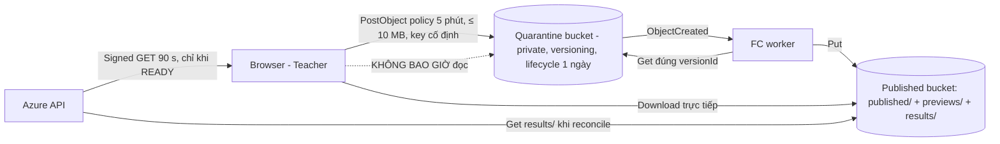
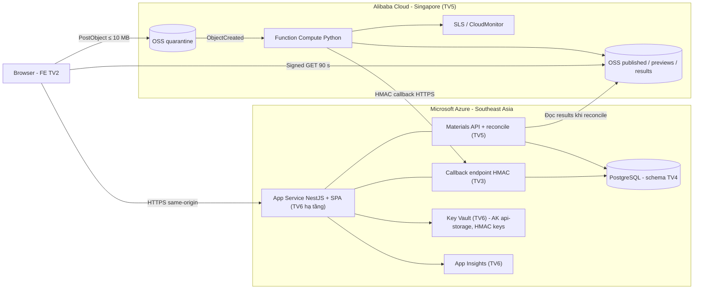
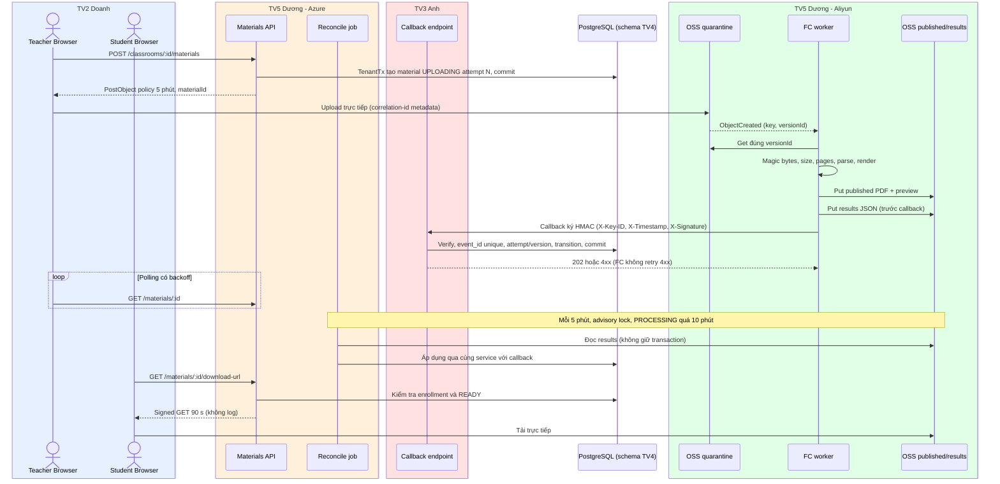
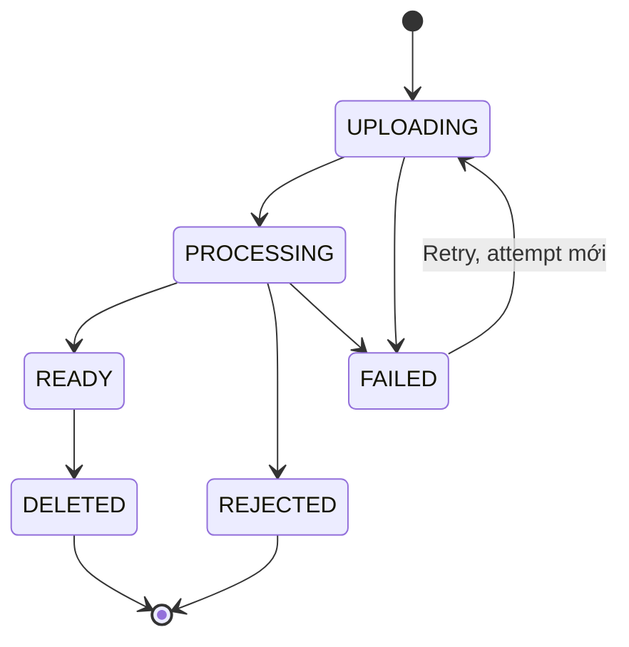

# DUONG.md — MULTI-CLOUD & MATERIALS ENGINEERING HANDOFF

| Trường | Giá trị |
|---|---|
| Dự án | EduCenter Cloud — B2B SaaS multi-tenant quản lý trung tâm giáo dục, **Azure + Alibaba Cloud** (tổ hợp 9) |
| Vị trí file | `docs/handoff/DUONG.md` |
| Ngày tạo · Phiên bản | 14/11/2026 · v1.0 |
| Thành viên | **Dương — TV5** |
| Vai trò | Multi-Cloud Engineer / Backend Materials Pipeline |
| Khối lượng | ~70 h theo ROADMAP §6.2; sau khi cộng phân công §15.2 ước tính ~73–74 h (xem §7.4) |
| Reviewer | **Anh (TV3)**: security, OSS/RAM/FC, Materials API, cấp tài khoản, LT12, demo reset · **Đức (TV1)**: P0-18, P2-09, video, tích hợp · **Hà (TV4)**: Teachers, Courses · **Giang (TV6)**: CP2, LT09 |
| Tài liệu nguồn | `ROADMAP.md` v1.3 (bản trong Project, cập nhật 13/11 17:43) · `EduCenter_Cloud_Ban_Thiet_Ke_2.md` (V2) · `BTL CK 1.pdf`. **Không có khi soạn:** DUC.md, DOANH.md, ANH.md, HA.md, GIANG.md → cần đối chiếu chéo khi các file này có mặt |
| Trạng thái dự án | **PLAN**: chưa có Cloud resource, code hay pipeline. Không mục nào trong file này là Done, Pass hay Verified |
| Thứ tự ưu tiên | `ROADMAP.md` (Task ID, deadline, dependency, AC) > V2 (thiết kế) > `DUONG.md`. File này **không** đổi phân công hay kiến trúc |

**Quy ước:** **[R]** = quy định trong ROADMAP/V2, giữ nguyên · **[P]** = đề xuất của file này, cần người có thẩm quyền xác nhận trước khi áp dụng · **[TBD]** = nguồn chưa quyết định · `→` = Owner → Reviewer.

---

## 1. AI Execution Protocol & Vai trò

### 1.1. Mô hình tài liệu áp dụng

- `ROADMAP.md` là tài liệu điều phối chung: Task ID, dependency, deadline, Module/File, AC.
- `docs/handoff/<TÊN>.md` gồm 6 file giao việc cá nhân; file này dành cho Dương.
- **Không** dùng `AGENTS.md`, `CLAUDE.md`, `docs/tasks/<TaskID>.md`, `docs/handoffs/<TaskID>.md`. Các tham chiếu tới chúng trong ROADMAP §7 được thay bằng: cột **Module/File** ở ROADMAP §5 (= allowed files) và **mô tả Pull Request** (= kết quả, test, bàn giao).
- Evidence (`docs/evidence/...`) và runbook (`docs/runbooks/...`) chỉ tạo khi task yêu cầu hoặc thực sự cần.

### 1.2. Ranh giới trách nhiệm

| Dương sở hữu (Owner) | Không thuộc Dương: chỉ review hoặc phối hợp |
|---|---|
| Tài khoản Alibaba Cloud, OSS, RAM, Function Compute, SLS/CloudMonitor phía FC | Callback endpoint, HMAC verification, replay protection: **Anh** (P0-16, P2-07) |
| Quản lý HMAC key hai phía (sinh, phân phối, quy trình xoay) | Upload signer PoC: **Anh** (P0-17); Dương dùng lại và đưa vào production ở P2-05 |
| Materials API (upload session, list, status, download/preview, retry, delete) | Auth, session, Argon2id, Authorization framework, TenantTx: **Anh** |
| Domain state machine học liệu, reconciliation | Prisma schema/migration: **Hà** (owner duy nhất, schema đóng băng 16/11 20:00) |
| Teachers, Courses, cấp tài khoản + đổi mật khẩu | Frontend Upload/Polling/Preview: **Doanh** (P2-13) |
| CP2, LT09, LT12, demo reset | Azure infra, Key Vault, App Insights, CI/CD, k6 scripts, E2E: **Giang** |
| R-04, R-05 (cùng Hà), P6-01 (cùng Hà, Giang), P6-04 (cùng Doanh) | OpenAPI root, ADR, release: **Đức** |

### 1.3. Quy trình mỗi phiên làm việc với Claude Code/Codex

1. Đọc `ROADMAP.md` và `docs/handoff/DUONG.md`.
2. Kiểm tra repo (`git status`, nhánh, `pnpm install --frozen-lockfile`), dependency đã merge và trạng thái Cloud hiện tại (Dương tự kiểm tra trên console rồi báo lại cho AI; AI không đăng nhập Cloud).
3. Xác định task TV5 đã đủ điều kiện: dependency ở ROADMAP §5 đã merge/verified và decision liên quan đã Accepted.
4. Đề xuất nhóm task liên quan cho phiên này (theo batch ở §1.5), kèm danh sách file sẽ sửa.
5. Chỉ sửa file trong cột Module/File của task. Nếu cần sửa ngoài phạm vi thì **dừng lại** và ghi vào PR mục "Out-of-scope request".
6. Viết test positive/negative trước, sau đó implement. Chạy lint, typecheck, unit, integration và đối chiếu AC.
7. Ghi kết quả thật vào PR: lệnh đã chạy kèm output, evidence (đã che ID nhạy cảm), rủi ro, việc bàn giao cho ai.
8. Chỉ chuyển sang task tiếp theo khi dependency và approval đã sẵn sàng.

### 1.4. Việc con người phải tự làm hoặc xác nhận

| Hành động | AI được làm | Dương/người duyệt phải làm |
|---|---|---|
| Đăng ký Aliyun, xác minh danh tính, thanh toán, MFA | Soạn checklist | Thao tác thật; không đưa giấy tờ, thẻ, mật khẩu vào prompt |
| Tạo/xóa bucket, đổi lifecycle/CORS/BPA | Soạn cấu hình, script để review | Chạy sau khi tự đọc lại; xóa bucket cần Anh đồng ý |
| Tạo/sửa RAM user, role, policy, AccessKey | Soạn policy JSON (không chứa key) | Áp dụng; Anh review (RACI §6.3: IAM có TV3 là A) |
| Sinh, lưu, xoay HMAC key | Soạn runbook | Sinh key trên máy cá nhân; nhập vào Key Vault/FC; không dán vào chat |
| Deploy FC, bật/tắt trigger, đổi biến môi trường FC | Soạn cấu hình, lệnh | Dương thực hiện; drill LT12 cần Anh + Giang đồng ý |
| CP2, LT09 trên demo env | Viết/chỉnh script trong phạm vi | Chạy trong khung giờ đã thống nhất với Giang |
| Reset dữ liệu demo | Viết script | Chạy trên demo env sau khi Đức/Giang đồng ý |
| Merge PR, sửa branch protection/CODEOWNERS | Không | Reviewer theo CODEOWNERS |

AI **không** được: tự tạo resource tốn tiền, xóa bucket, nâng quyền IAM/RAM, deploy ngoài demo env, đọc secret thật, dùng dữ liệu học viên thật.

### 1.5. Batch gợi ý

Batch chỉ là cách gom ngữ cảnh cho AI. Thứ tự dependency và deadline vẫn theo ROADMAP. Mỗi task trong batch phải tự kiểm tra điều kiện bắt đầu.

| Batch | Task | Khung ngày | Điều kiện mở batch |
|---|---|---|---|
| B1 — Aliyun, OSS, RAM | P0-03, P0-13, P0-14 | 14–15/11 | Kick-off 09:00 14/11; P0-01 xác nhận đăng ký (chặn chi tiêu Cloud); budget alert bật |
| B2 — FC PoC, HMAC, E2E | P0-15, P0-21, P0-18 + review P0-16, P0-17 | 15/11 → G0 16/11 12:00 | B1 xong; P0-11/P0-12 (Giang) cho phần Azure |
| B3 — Teachers, Courses, Domain, Accounts | P1-10, P1-11, P1-22, P1-25 | 17–19/11 | P1-08 freeze, P1-23, P1-04 merged; D-28 Accepted (cho P1-25) |
| B4 — Materials API, FC hardening, Reconcile | P2-05, P2-06, P2-08, P2-09 + review P2-07, P2-13 | 20–23/11 | G1; P1-12; P1-22; quyết định B-01…B-06 (§7.3) |
| B5 — Perf, Security, Drill, Reset | P2-21, ST13–ST19, P4-07, P4-09, P5-06 | 23–27/11 | P2-18; P3-10 (`rc0.1`); P4-05; P5-01 |
| B6 — Báo cáo, video, giao nộp | R-04, R-05, P6-01, P6-04, P6-06 | Nháp 21–22/11; bản cuối 27–29/11 | G5 cho video/P6-01 |

### 1.6. Prompt thực thi dùng lại

```text
Bạn đang thực hiện <TaskID hoặc Batch ID> của EduCenter Cloud cho TV5 (Dương).
1. Đọc ROADMAP.md (mục §5 hàng của task, §8 gate, §9 test liên quan) và docs/handoff/DUONG.md
   (mục của task ở §3, invariants ở §5.1, quyết định mở ở §7.3).
2. Kiểm tra repo: nhánh hiện tại, dependency trong cột Dep đã merge chưa, contract
   packages/api-contract/paths/<module>.yaml và schema Prisma hiện có. Báo cáo task nào trong batch
   ĐỦ điều kiện, task nào bị chặn và vì sao. Không tự giả định Cloud resource đã tồn tại.
3. Đề xuất plan + danh sách file sẽ sửa (chỉ trong cột Module/File). Chờ tôi duyệt.
4. Viết test positive + negative từ Acceptance Criteria trước, rồi implement.
5. Chạy lint, typecheck, unit, integration; dán output THẬT. Không ghi "pass" nếu chưa chạy.
6. Soạn mô tả PR: Task ID, phạm vi, test đã chạy, evidence cần chụp, rủi ro bảo mật,
   ảnh hưởng contract/schema, bàn giao cho ai.
DỪNG và hỏi nếu cần: sửa schema, contract gốc, auth/authz/TenantTx, IAM/RAM, CI, thêm dependency,
thay đổi Cloud resource, hoặc bất kỳ quyết định [P]/[TBD] nào trong DUONG.md.
Cấm: secret/AK/HMAC key thật trong code, log, prompt; bucket public; bỏ versioning,
authorization, HMAC, idempotency; nhận tenant_id/role từ request body hoặc từ worker.
```

---

## 2. Timeline và Task Inventory

### 2.1. Task Inventory

| ID | Vai trò Dương | Nội dung | Owner → Reviewer | Dep [R] | Ngày · Est [R] | Gate |
|---|---|---|---|---|---|---|
| P0-03 | **Owner** | Tài khoản Aliyun, MFA, RAM admin, budget, region SG | TV5 → TV3 | — | 14/11 · 3h | G0 |
| P0-13 | **Owner** | OSS quarantine/published, BPA, versioning, lifecycle, CORS | TV5 → TV3 | P0-01, P0-03 | 14/11 · 2h | G0 |
| P0-14 | **Owner** | RAM FC role + `api-storage`, AK vào Key Vault | TV5 → TV3 | P0-13, P0-11 | 14–15/11 · 3h | G0 |
| P0-15 | **Owner** | FC Python PoC | TV5 → TV3 | P0-13, P0-14, D-10 | 15/11 · 6h | G0 |
| P0-21 | **Owner** | HMAC key management hai phía | TV5 → TV3 | P0-14, D-29 | 15/11 · 1,5h | G0 |
| P0-18 | **Co-owner** (với Giang) | E2E cross-cloud + latency 3 chặng | TV5 + TV6 → TV1 | P0-12, P0-15, P0-16, P0-17, P0-21 | 15/11 tối · 3h | **G0** |
| P0-16 | Reviewer | Callback HMAC PoC | TV3 → **TV5** | P0-07, D-19, D-29 | 15/11 · 3h | G0 |
| P0-17 | Reviewer | Upload signer PoC | TV3 → **TV5** | P0-14, P0-07, D-21 | 15/11 · 2h | G0 |
| P1-10 | **Owner** | Teachers CRUD + phân công | TV5 → TV4 | P1-04, P1-08 | 17/11 · 3h | G1 |
| P1-11 | **Owner** | Courses CRUD, `fee_vnd` BIGINT → string | TV5 → TV4 | P1-04, P1-08 | 17/11 · 3h | G1 |
| P1-22 | **Owner** | Materials domain state machine | TV5 → TV3 | P1-08 | 18/11 · 4h | G1 |
| P1-25 | **Owner** | Cấp tài khoản + `POST /auth/change-password` | TV5 → TV3 | P1-01, P1-03, P1-09, P1-10 | 19/11 · 4h | G1 |
| P2-05 | **Owner** | Materials API 1: upload session, list, status | TV5 → TV3 | P1-12, P1-22, P0-17 | 20–21/11 · 6h | G2 |
| P2-06 | **Owner** | Materials API 2: download/preview, retry, delete | TV5 → TV3 | P2-05 | 21–22/11 · 4h | G2 |
| P2-08 | **Owner** | FC hardening | TV5 → TV3 | P0-15 | 20/11 · 5h | G2 |
| P2-09 | **Owner** | Reconciliation + advisory lock | TV5 → TV1 | P2-07 | 22–23/11 · 3h | G2 |
| P2-07 | Reviewer + cung cấp worker contract | Callback production | TV3 → **TV5** | P0-16, P1-22, P2-05 | 21/11 · 5h | G2 |
| P2-13 | Reviewer | FE Upload | TV2 → **TV5** | P2-05 | 21/11 · 4h | G2 |
| P2-21 | **Owner** | CP2 — 100 RPS mix 10 phút | TV5 → TV6 | P2-18 | 23/11 · 2h | G2 |
| P3-07 | Owner module | Fix window cho phát hiện ở module TV5 | Owner → pool | P3-02..P3-06 | 24–25/11 · ~1h (phần TV5) | G3 |
| P4-07 | **Owner** | LT09 upload surge | TV5 → TV6 | P3-10 | 25/11 sáng · 2h ⚠ C-04 | G4 |
| P4-09 | **Owner** | LT12 Aliyun failure drill | TV5 → TV3 | P2-09, P4-05 | 26/11 W2 · 1h | G4 |
| P5-06 | **Owner** | Demo reset (D-31) | TV5 → TV3 | P5-01 | 26–27/11 · 2h | G5/G6 |
| P6-04 | **Co-owner** (với Doanh) | Quay + dựng video ≤ 5:00 | TV2 + TV5 → TV1 | P6-03 | 28/11 · 6h | G6 |
| R-04 | **Owner** | Ch3 phần Aliyun | TV5 | — | Nháp 21/11 · Cuối 27/11 | G6 |
| R-05 | **Co-owner** (với Hà) | Ch4 so sánh hai Cloud | TV5 + TV4 | — | Nháp 22/11 · Cuối 27/11 | G6 |
| P6-01 | **Co-chủ trì** theo §15.2 | Ghép + biên tập báo cáo Word | Hà, Giang, Dương ⚠ C-05 | R-01..R-11, G5 | 27–28/11 · 8h (chia 3) | G6 |
| P6-06 | Tham gia kiểm tra chéo | Kiểm tra báo cáo/định dạng | Cả nhóm theo §15.2 | P6-01, P6-04, P6-05 | 29/11 sáng | G6 |
| ST13–16, ST18, ST19 | **Owner ST** (§9.2) | Security tests học liệu/OSS | — | Xem §5.2 | P0 → P3-02 24/11 | G3 |
| IP-1, IP-4 | Chủ trì tích hợp | IP-1 với Giang; IP-4 với Doanh | — | — | 15/11 tối · 22/11 | G0 · G2 |

### 2.2. Lịch theo ngày của Dương

| Ngày | Việc chính | Mốc |
|---|---|---|
| **Sat 14/11** | 09:00 kick-off (đẩy Accept D-09, D-10, D-21, D-29, D-31, D-32) · 10:00 P0-03 · 13:30 P0-13 · 15:30 P0-14 (phần RAM; bước AK→Key Vault chờ P0-11) · 21:00 standup | Aliyun dùng được trước 15/11 tối (R-02) |
| **Sun 15/11** | Sáng P0-15 · Chiều P0-21 + review P0-16/P0-17 · Tối P0-18 + IP-1 với Giang | Tiền-G0 tại standup 21:00 |
| **Mon 16/11** | Sáng: buffer, sửa lỗi G0 · Chiều: chuẩn bị B3 (đọc contract v1, schema v1 freeze 20:00) | **G0 12:00** |
| **Tue 17/11** | P1-10, P1-11 (⚠ C-03 phụ thuộc P1-04) | — |
| **Wed 18/11** | P1-22; hoàn thiện P1-10/P1-11 nếu TenantTx merge muộn | — |
| **Thu 19/11** | P1-25 · Theo dõi trigger contingency P1-12 lúc 12:00 | **G1 20:00** |
| **Fri 20/11** | P2-08 · P2-05 (bắt đầu) · Chốt B-01…B-06 với Đức/Anh | D-32 hạn 20/11 |
| **Sat 21/11** | P2-05 (xong) · P2-06 · Review P2-07, P2-13 · **Nháp R-04** | — |
| **Sun 22/11** | P2-06 (xong) · P2-09 · **IP-4** với Doanh · **Nháp R-05** | Trigger contingency P2-13 (tối) |
| **Mon 23/11** | P2-09 (xong) · **P2-21 CP2** · hỗ trợ P2-17 E2E | **G2 20:00** |
| **Tue 24/11** | Hỗ trợ P3-02 (ST13–16, 18, 19) · P3-07 fix · P3-06 cung cấp ngữ cảnh IAM/upload | Feature freeze 00:00 |
| **Wed 25/11** | P3-07 fix trước 12:00 · **P4-07 LT09** (khung giờ chờ Đức chốt, C-04) | `rc0.1` 12:00 · W1 14–18h |
| **Thu 26/11** | **P4-09 LT12** trong W2 (sau LT06) · P5-06 bắt đầu | W2 09–13h · **G4 20:00** |
| **Fri 27/11** | P5-06 xong · R-04/R-05 bản cuối · P6-01 bắt đầu | **G5 12:00** |
| **Sat 28/11** | P6-04 quay/dựng · P6-01 · reset/kiểm tra demo #1 | — |
| **Sun 29/11** | P6-06 · reset/kiểm tra demo #2 | **G6 22:00** |
| **Mon 30/11** | Chỉ reset demo nếu dữ liệu bị đổi (P6-08 do Đức + Giang chủ trì) | Buffer |

### 2.3. Decision mà Dương đồng sở hữu (đều đang **Proposed**)

| ID | Nội dung | Đồng quyết | Hạn | Dương cần làm |
|---|---|---|---|---|
| D-09 | Region Azure SEA + Aliyun Singapore (`ap-southeast-1`) | TV6 + TV5 | 15/11 | Xác nhận dịch vụ khả dụng (P0-03), cung cấp số latency (P0-18) |
| D-10 | `pypdf` + `pypdfium2` (ADR-019) | TV5 | 15/11 | Xác nhận chạy được trên FC, ghi license/version vào PR P0-15 |
| D-21 | PostObject policy ≤ 10 MB, 5 phút, key cố định | TV5 + TV3 | 15/11 | Kiểm chứng bằng 3 case thật của P0-17 |
| D-29 | HMAC key hai phía, 2 key ID, restart App Service | TV5 + TV3 | 15/11 | Thực hiện P0-21 |
| D-31 | Bảo vệ demo env, reset idempotent | TV5 + TV3 | 26/11 | Thực hiện P5-06 |
| D-32 | `pg_try_advisory_lock` cho reconciliation | TV5 + TV1 | 20/11 | Chốt lock lifecycle (§3.3 P2-09) |
| D-28 | Cấp tài khoản (owner decision là TV3; task P1-25 thuộc TV5) | TV3 | 17/11 | Yêu cầu Accept trước 19/11 |

### 2.4. Rủi ro Dương sở hữu

| ID | Rủi ro | Dấu hiệu | Phương án [R] |
|---|---|---|---|
| R-02 | Xác minh/thanh toán Aliyun chậm | Chưa tạo được bucket trước 14/11 tối | Song song đăng ký tài khoản của một thành viên khác; Phase 1 Azure không bị chặn |
| R-09 | FC event lặp/thiếu | Material PROCESSING quá hạn | Callback idempotent + reconciliation; Admin retry có kiểm soát |
| R-15 | Thư viện PDF không chạy trên FC | Lỗi build/import ở P0-15 | Đóng gói layer/custom runtime; nếu vẫn lỗi thì **bỏ preview, giữ validate** và ghi rõ |
| R-21 | Dữ liệu demo bị sửa trước khi chấm | Dữ liệu khác snapshot | Chạy script reset P5-06 |

---

## 3. Detailed Implementation Guide

### 3.1. Phase 0 — Alibaba Cloud Foundation & Multi-Cloud PoC

#### P0-03 — Chuẩn bị tài khoản Alibaba Cloud
**Dep:** — (chi tiêu Cloud chờ P0-01) · **Allowed files:** `infra/aliyun/README.md` · **14/11 · 3h** · → Anh

| # | Bước | Ai làm |
|---|---|---|
| 1 | Đăng nhập/đăng ký tài khoản **quốc tế** Alibaba Cloud; hoàn tất xác minh danh tính và phương thức thanh toán theo yêu cầu | Dương (không gửi giấy tờ/thẻ cho AI) |
| 2 | Bật **MFA cho root account**; cất thông tin root, chỉ dùng cho billing/khẩn cấp | Dương |
| 3 | Tạo RAM user quản trị cho con người (ví dụ `<ten>-admin`), có console login + MFA, dùng cho mọi thao tác hằng ngày. Quyền đủ để dựng OSS/FC/RAM/SLS; **không** tạo AccessKey nếu chưa cần CLI | Dương; AI soạn checklist quyền |
| 4 | Chọn region **Singapore (`ap-southeast-1`)**; xác nhận console OSS và Function Compute khả dụng | Dương |
| 5 | Thiết lập **budget alert** 50/80/100% (theo V2 §19.3). Mức ngân sách **[TBD — cả nhóm chốt]** | Dương |
| 6 | Kiểm tra quota liên quan (FC concurrency/instance, OSS bucket) và bảng giá OSS/FC/SLS theo region; ghi chi phí ước tính | Dương; AI tóm tắt bảng giá công khai |
| 7 | Viết `infra/aliyun/README.md`: region, quy ước đặt tên resource, ai giữ quyền admin, nơi lưu secret (Key Vault). **Không có ID tài khoản, AK hay mật khẩu** | AI soạn, Dương duyệt |

**AC [R]:** RAM user đăng nhập được · root có MFA · OSS + FC khả dụng ở SG.
**Evidence:** ảnh MFA đã bật, RAM user, budget alert, console OSS/FC ở SG (đã che account ID).
**Escalate:** nếu xác minh bị kẹt đến 14/11 tối thì kích hoạt R-02 và báo Đức ngay ở standup.

#### P0-13 — OSS Foundation
**Dep:** P0-01, P0-03 · **Allowed files:** `infra/aliyun/oss/` · **14/11 · 2h** · → Anh

| Cấu hình | Quarantine bucket | Published bucket |
|---|---|---|
| Nội dung | File mới upload, **chưa** xử lý | PDF đã qua kiểm tra (`published/`), ảnh xem trước (`previews/`), kết quả xử lý (`results/`) |
| ACL | Private | Private |
| Block Public Access | **ON** | **ON** |
| Versioning | **ON** [R] | **ON** [R] |
| Lifecycle | Xóa bản hiện tại sau **1 ngày** + bản noncurrent sau **1 ngày** [R]; dọn delete marker hết hạn [P] | Noncurrent version **[TBD — B-04]** |
| CORS | Chỉ origin demo + `http://localhost:<port dev>`; method POST (PostObject) | Tối thiểu; chỉ thêm GET nếu FE gọi XHR. Thẻ ``/điều hướng tải không cần CORS [P] |
| Ai ghi | Browser (qua PostObject policy do API ký) | **Chỉ FC role**; browser không có quyền ghi |
| Ai đọc | **Chỉ FC role** (đúng version) | API ký signed GET; browser đọc qua URL ngắn hạn |

- Bố cục prefix/key chi tiết: §4.4 **[P — B-03, B-04, C-18]**.
- Tên bucket là duy nhất toàn cầu; đặt `<prefix-nhóm>-quarantine` / `<prefix-nhóm>-published`, không chứa thông tin cá nhân.
- Mã hóa phía server (SSE-OSS) **[P]**, bật nếu không phát sinh chi phí đáng kể.
- **Cấm:** mở bucket public hoặc nới CORS `*` để chữa lỗi download/CORS. Lỗi download phải sửa ở signed URL, Content-Disposition hoặc CSP (P1-24 của Doanh).



**Test:** GET ẩn danh + PUT ẩn danh lên cả hai bucket → **403** (ST19 sơ bộ), lưu log lệnh · lifecycle quarantine có rule noncurrent · bucket không có ACL public.
**AC [R]:** GET/PUT ẩn danh → 403 · lifecycle có rule noncurrent.

#### P0-14 — RAM và Least Privilege
**Dep:** P0-13, P0-11 (Key Vault của Giang) · **Allowed files:** `infra/aliyun/ram/` (policy JSON, **không có key**) · **14–15/11 · 3h** · → Anh

| Danh tính | Loại | Quyền cho phép [R] | Bị cấm |
|---|---|---|---|
| `fc-material-processor` | RAM **role**, trust Function Compute; FC tự nhận STS ngắn hạn | Get object + Get object **version** trên `quarantine/*`; Put trên `published/*`, `previews/*`, `results/*`; ghi log vào đúng SLS project/logstore. Thêm Get `results/*` nếu áp dụng tái dùng kết quả (§3.3 P2-08) **[P]** | Delete; bất kỳ bucket/prefix khác; RAM; truy cập PostgreSQL |
| Role cho OSS trigger | Role hệ thống cho OSS gọi FC | Chỉ invoke đúng function | Mọi quyền khác |
| `api-storage` | RAM **user**, chỉ programmatic access | Put trên `quarantine/*` (để ký PostObject policy); Get trên `published/*`, `previews/*`, `results/*`; **Delete** trên `published/*`, `previews/*` | Get quarantine; Put published; ghi `results/`; RAM; quyền OSS toàn bộ |
| Browser | — | Không có credential; chỉ dùng policy/URL do API cấp | Mọi AccessKey |

- **AK của `api-storage`:** Dương tạo trên console → nhập trực tiếp vào **Azure Key Vault** (Giang cấp quyền ghi secret) → App Service đọc qua Key Vault reference. Không lưu vào file, chat, ảnh chụp hay biến môi trường local được commit.
- **Lịch xoay AK [P]:** xoay khi nghi lộ hoặc sau khi chấm bài. RAM cho phép 2 AK cùng lúc nên xoay được mà không gián đoạn: tạo AK2 → cập nhật Key Vault → restart App Service → xác nhận → vô hiệu hóa rồi xóa AK1.
- **Quyền bổ sung cần Anh duyệt:** List giới hạn prefix `results/` (B-03); Delete object version trên published (B-04).
- **Cấm:** gán `AliyunOSSFullAccess`, `AdministratorAccess` hay RAM admin cho runtime "để chạy nhanh hơn".

**Test (bắt buộc chạy thật, lưu log):**

| # | Hành động | Danh tính | Kết quả mong đợi |
|---|---|---|---|
| 1 | Put vào `published/` | `api-storage` | Denied |
| 2 | Get object trong quarantine | `api-storage` | Denied |
| 3 | Delete object trong quarantine | FC role | Denied |
| 4 | Get/Put trên bucket khác hoặc prefix khác | cả hai | Denied |
| 5 | Ký PostObject với key ngoài `quarantine/` | `api-storage` | Upload bị OSS từ chối |
| 6 | Get `published/`, Put `results/` | đúng danh tính | Allowed |

**AC [R]:** policy chỉ đúng bucket/prefix/action · AK không xuất hiện trong repo/log · action ngoài phạm vi bị từ chối.

#### P0-15 — Function Compute Python PoC
**Dep:** P0-13, P0-14, D-10 · **Allowed files:** `functions/material-processor/` · **15/11 · 6h** · → Anh

| # | Luồng [R] | Ghi chú triển khai |
|---|---|---|
| 1 | OSS nhận PDF upload | Upload bằng policy dev-only của P0-17 hoặc console |
| 2 | ObjectCreated kích hoạt FC | Lọc theo prefix `quarantine/`, suffix `.pdf`; invoke async |
| 3 | Đọc object **đúng version** | Lấy `versionId` từ event. **Nếu event không có versionId (A-04 sai) thì dừng và escalate**, không tự đọc bản mới nhất (B-11) |
| 4 | Kiểm tra magic bytes, size, page count | `%PDF-` ở đầu file; size thật ≤ 10 MB; page count ≤ giới hạn **[TBD — B-10]** |
| 5 | `pypdf` kiểm tra cấu trúc | Bắt mọi exception → REJECTED/FAILED theo bảng phân loại ở P2-08 |
| 6 | `pypdfium2` render trang 1 → PNG | Giới hạn kích thước render **[TBD — B-10]** |
| 7 | Ghi PDF + preview vào published | Key theo §4.4 |
| 8 | Ghi result JSON vào `results/` | Ghi **trước** callback |
| 9 | Callback HMAC về Azure API | Dùng key của P0-21 và endpoint của P0-16. Nếu buổi sáng chưa có, ghi result và log trước; nối callback vào buổi chiều/tối |

- **Runtime:** Python runtime mà FC hỗ trợ tại thời điểm deploy; ghi chính xác version runtime, `pypdf`, `pypdfium2` và license vào PR (D-10, V2 §4.3). Đóng gói dependency cho Linux x86_64 và pin version.
- **Correlation ID:** đọc `x-oss-meta-correlation-id` của object (P0-17 gắn vào) → ghi vào log và callback.
- **Nếu thư viện không chạy được (R-15):** thử layer/custom runtime. Nếu vẫn lỗi thì **bỏ preview, giữ validate**, ghi rõ trong PR và báo Đức. Không tuyên bố preview đã chạy.

**Validator pytest (tối thiểu 6 case [R]; đề xuất 8):**

| # | Input | Kết quả |
|---|---|---|
| 1 | PDF hợp lệ nhỏ | READY |
| 2 | PNG/ZIP đổi đuôi `.pdf` | REJECTED |
| 3 | File rỗng | REJECTED |
| 4 | > 10 MB | REJECTED |
| 5 | PDF bị cắt cụt/hỏng | REJECTED |
| 6 | Magic bytes đúng nhưng nội dung rác | REJECTED |
| 7 | PDF mã hóa (có mật khẩu) | REJECTED **[P]** |
| 8 | Vượt giới hạn số trang | REJECTED |

**AC [R]:** PDF mẫu 2 MB xử lý < 60 s · file giả đổi đuôi → REJECTED · ≥ 6 test case · chạy thật với 2 file mẫu (log SLS + object trong published/results).

#### P0-21 — HMAC Key Management
**Dep:** P0-14, D-29 · **Allowed files:** `docs/runbooks/hmac-rotation.md`, `infra/` (không chứa key) · **15/11 · 1,5h** · → Anh

1. **Sinh key** ≥ 256-bit bằng CSPRNG trên máy Dương. Không sinh trong chat AI, không dán vào prompt.
2. **Quy ước key ID [P]:** `mcb-<yyyymmdd>-<n>` (ví dụ `mcb-20261115-1`). Key ID không phải secret và đi trong header `X-Key-ID`.
3. **Azure:** lưu vào Key Vault (Giang cấp quyền), App Service đọc qua Key Vault reference. API chấp nhận **tối đa 2 key ID cùng hiệu lực** (Anh implement trong P0-16).
4. **Aliyun:** lưu vào cấu hình biến môi trường **được mã hóa** của FC. **Xác minh cơ chế mã hóa cụ thể trên console FC (B-12);** nếu không đáp ứng thì báo Anh trước khi lưu.
5. **Đồng bộ:** FC chỉ ký bằng **một** key hiện hành. API giữ "current + previous" trong thời gian xoay.
6. **Sau mỗi thay đổi secret trong Key Vault phải restart App Service** (D-29, vì Key Vault reference có cache).
7. **Runbook xoay key** (tạo trong task này, ngắn gọn): sinh K2 → thêm K2 vào Key Vault làm key thứ hai → restart → xác nhận API nhận cả K1 lẫn K2 → đổi FC sang K2 → gửi callback thử → gỡ K1 khỏi Key Vault → restart → ghi audit "xoay vòng secret" (V2 §11.8). P3-05 (Anh) sẽ chạy thử runbook này.
8. **Kiểm tra:** gitleaks sạch · log API/SLS không chứa key hoặc giá trị chữ ký · ảnh evidence chỉ có key ID.

**AC [R]:** key không xuất hiện trong repo/log/ảnh · FC và API dùng cùng key ID.

#### P0-18 — Cross-Cloud E2E PoC (Co-owner với Giang, Đức review)
**Dep [R]:** P0-12 (Giang, `/health` trên Azure) · P0-15 (Dương) · P0-16, P0-17 (Anh) · P0-21 (Dương) · **Allowed files:** `docs/evidence/P0-18/`, `tests/poc/` · **15/11 tối · 3h** → **G0 16/11 12:00**

| Phần | Người làm **[P — B-14, chờ Giang xác nhận]** |
|---|---|
| Script lặp ≥ 5 lần: xin policy (P0-17) → POST PDF lên OSS → chờ FC → kiểm tra callback được API ghi log | Dương |
| Latency Client → OSS và FC → Azure (đo trong FC) | Dương |
| Latency Client → Azure (`/health`), truy vấn log API/App Insights theo correlation ID | Giang |
| Tổng hợp bảng p50/p95 + evidence | Dương + Giang |

- **Phương pháp [R]:** mỗi chặng 10 mẫu, ghi p50/p95. Báo cáo cần ghi rõ p95 của 10 mẫu gần như là giá trị lớn nhất.
- **Correlation ID** phải xuất hiện xuyên suốt: metadata của object → log SLS → header/payload callback → log API.
- **Không làm lại** callback endpoint hay upload signer của Anh. Lỗi ở phần đó thì mở issue cho Anh.

**AC [R]:** ≥ 5 lần **liên tiếp** thành công · bảng p50/p95 Client→Azure, Client→OSS, FC→Azure · log có correlation ID.
**Liên quan G0:** tiêu chí (4) OSS private + versioning, (5) FC xử lý PDF thật + REJECT file giả, (6) callback đúng/sai được phân biệt và key không lộ, (9) latency 3 chặng.

#### Review P0-16 (Callback HMAC PoC) và P0-17 (Upload signer PoC)

| P0-16 — checklist | P0-17 — checklist |
|---|---|
| ☐ HMAC-SHA256 tính trên **raw body** + timestamp, so sánh constant-time | ☐ Key do server sinh ngẫu nhiên, đúng định dạng §4.4; không lấy từ tên file |
| ☐ Timestamp ±300 s; quá hạn → 401 | ☐ Điều kiện `content-length-range` ≤ 10 MB; file 11 MB bị từ chối (chạy thật) |
| ☐ Key ID lạ → 401; chấp nhận tối đa 2 key ID | ☐ Ràng buộc key cố định; đổi key → bị từ chối (chạy thật) |
| ☐ Sai chữ ký → 401; đúng → 202 | ☐ Hết hạn 5 phút; policy quá hạn → bị từ chối (chạy thật) |
| ☐ Không log chữ ký hay secret | ☐ Gắn metadata correlation-id |
| ☐ Thứ tự header/canonical string khớp với cách FC ký | ☐ Chỉ AccessKeyId (định danh công khai mà giao thức PostObject yêu cầu) xuất hiện trong form; **AccessKeySecret không bao giờ rời server** |
| ☐ Raw body chỉ bật cho route internal | ☐ Flag dev-only không bật được trên demo env |

### 3.2. Phase 1 — Backend nghiệp vụ & Materials Domain

**Quy tắc chung cho P1-10, P1-11, P1-22, P1-25 [R]:**
- Mọi truy cập DB đi qua `TenantTx` (P1-04, Anh). Lint cấm import PrismaClient trực tiếp, cấm `$queryRawUnsafe`.
- Mọi route có `@Policy()` theo deny-by-default (P1-03). DTO dùng whitelist + forbidNonWhitelisted. Không nhận `tenant_id`/`role` từ body.
- Contract: chỉ sửa `packages/api-contract/paths/<module>.yaml` của module mình, Đức duyệt và **merge trước** PR backend.
- `app.module.ts`: mỗi PR chỉ thêm đúng 1 dòng import.
- Schema đóng băng 16/11 20:00. Cần cột/bảng mới thì gửi change request cho Hà, không tự viết migration.
- Test authz dùng harness P1-19 (Giang): 2 tenant × (admin, teacher được giao, teacher không được giao, student A, student B). Test negative phải **fail khi bỏ guard**.

#### P1-10 — Teachers Module
**Dep:** P1-04, P1-08 · **Allowed files:** `apps/api/src/teachers/` (+ `paths/teachers.yaml` qua Đức) · **17/11 · 3h** ⚠ C-03 · → Hà

| Hạng mục | Nội dung |
|---|---|
| Endpoint | Theo contract (V2 §14: `GET/POST /teachers`; ROADMAP: CRUD). Nếu kích hoạt scope-cut cấp 1 thì chỉ còn list + create |
| Phân quyền | Admin: quản lý trong tenant · Teacher: xem hồ sơ bản thân **[P]** · Student: không truy cập danh sách giáo viên **[P]** (ma trận V2 §6.2 chưa có dòng Teachers → Đức xác nhận) |
| "Phân công" | ⚠ **C-14:** `classrooms.teacher_id` thuộc Classrooms (Hà, P1-12). Đề xuất **[P]**: Teachers chỉ đọc danh sách lớp được giao; thao tác gán giáo viên nằm ở Classrooms. Đức + Hà chốt |
| Dữ liệu | `teachers(tenant_id, user_id, specialization)`; `user_id` được liên kết qua P1-25 |
| Validation | DTO allowlist, pagination ≤ 100, chỉ select cột cần thiết |

**Test:** Admin tạo/list/sửa thành công · Teacher tạo teacher → 403 · Admin tenant B đọc teacher tenant A → 403/404 · body chứa `tenant_id`/`role` → 400 · pagination > 100 → 400.
**Bàn giao:** API cho Doanh (P1-16) · dữ liệu teacher cho Hà (P1-12).

#### P1-11 — Courses Module
**Dep:** P1-04, P1-08 · **Allowed files:** `apps/api/src/courses/` (+ `paths/courses.yaml`) · **17/11 · 3h** ⚠ C-03 · → Hà

- `fee_vnd`: DB kiểu **BIGINT**; JSON request/response dạng **string** chỉ gồm chữ số (D-12). Không bao giờ chuyển qua `number` của JS.
- Phân quyền: Admin quản lý; Teacher/Student xem khóa của lớp được giao/đã ghi danh, theo contract.
- **Test:** round-trip `"9007199254740993"` (lớn hơn 2^53) không mất chính xác · số âm, dạng thập phân, kiểu number → 400 · authz positive/negative như P1-10.
- **Bàn giao:** API cho Doanh (P1-17) · dữ liệu course cho Hà (P1-12 Classrooms).

#### P1-22 — Materials Domain (state machine thuần)
**Dep:** P1-08 · **Allowed files:** `apps/api/src/materials/domain/` · **18/11 · 4h** · → Anh

- **Thuần:** không import Prisma, OSS SDK hay NestJS HTTP. Chỉ có kiểu dữ liệu, hàm chuyển trạng thái, luật chấp nhận kết quả và **interface storage** (port) để P2-05/P2-06/P2-09 implement.
- **State diagram và luật xử lý event:** xem §4.3 (nguồn V2 §10.6, không thêm transition).
- **Interface storage [P]:** tạo upload policy cho một key · tạo signed GET cho key/variant · đọc result của (material, attempt) · xóa published/preview. Không lộ kiểu dữ liệu riêng của SDK ra ngoài.
- **Attempt:** bắt đầu từ 1; chỉ `FAILED → UPLOADING` mới tạo attempt mới (attempt + 1, key mới). Số attempt tối đa **[TBD — B-08]**.
- **`source_version_id`:** được gắn vào material khi chấp nhận **kết quả terminal hợp lệ đầu tiên** của attempt hiện tại.

**Bảng transition test (tối thiểu):**

| # | Trạng thái | Sự kiện | Kết quả |
|---|---|---|---|
| T1 | UPLOADING | Bắt đầu xử lý | PROCESSING |
| T2 | UPLOADING | Lỗi kỹ thuật/hết hạn upload | FAILED |
| T3 | PROCESSING | Kết quả READY (attempt hiện tại, version v1) | READY, gắn v1 |
| T4 | PROCESSING | Kết quả REJECTED | REJECTED |
| T5 | PROCESSING | Kết quả FAILED | FAILED |
| T6 | FAILED | Retry | UPLOADING, attempt + 1 |
| T7 | READY | Delete | DELETED |
| T8 | READY (v1) | Kết quả khác cùng attempt, version v2 | **Bỏ qua + security log**, giữ READY/v1 |
| T9 | READY (attempt 2) | Kết quả của attempt 1 | **Bỏ qua + log** (ST13) |
| T10 | FAILED (chưa có kết quả hợp lệ) | Yêu cầu READY không có kết quả | **Lỗi** — FAILED không tự thành READY |
| T11 | REJECTED / DELETED | Bất kỳ sự kiện nào | Lỗi/bỏ qua (terminal) |
| T12 | READY | Retry | Lỗi (retry chỉ áp dụng cho FAILED) |
| T13 | UPLOADING | READY trực tiếp | Theo quyết định **B-01** |
| T14 | Mọi cặp còn lại | — | Lỗi transition không hợp lệ (kiểm tra bằng vòng lặp toàn bộ ma trận 6×N) |

**AC [R]:** transition không hợp lệ → lỗi · FAILED không thể → READY nếu chưa có kết quả hợp lệ · version khác cùng attempt → bị bỏ qua.

#### P1-25 — Cấp tài khoản và đổi mật khẩu
**Dep:** P1-01, P1-03, P1-09, P1-10 · D-28 (Proposed) · **Allowed files:** `apps/api/src/users/`, `packages/api-contract/paths/auth.yaml` · **19/11 · 4h** · → Anh

| Luồng | Yêu cầu |
|---|---|
| Admin cấp tài khoản cho Teacher/Student | Chỉ Admin trong tenant · chỉ role TEACHER/STUDENT **[P]** · liên kết với `teachers.user_id`/`students.user_id` · email unique theo tenant · audit "tạo tài khoản" (V2 §11.8) |
| Mật khẩu tạm | Sinh bằng CSPRNG, chính sách độ dài **[TBD — B-15]** · hash bằng **dịch vụ Argon2id của Anh** · trả về **một lần** trong response (header `Cache-Control: no-store`) · không lưu dạng thô, không log, không ghi audit · `must_change_password = true` |
| `POST /auth/change-password` | Theo contract · yêu cầu CSRF · xác minh mật khẩu hiện tại · đặt `must_change_password = false` · **thu hồi các phiên khác** qua session service của Anh · rotate phiên hiện tại theo V2 §11.3 **[P]** · audit |
| Chặn API khi chưa đổi mật khẩu | Chỉ cho phép `/me`, `/auth/logout`, `/auth/change-password`. ⚠ **C-08:** cần hook trong guard chain (`common/authz/`, pool A của Anh), nằm ngoài allowed files → Anh thêm hook hoặc Đức mở rộng phạm vi |

- **Không** tự xây hệ thống auth riêng. Tái sử dụng password hashing, session và authorization của Anh.
- **Test:** mật khẩu tạm không có trong DB/log (quét log test) · phiên cũ không dùng được sau khi đổi mật khẩu (ST06 mở rộng) · user có `must_change_password` gọi API nghiệp vụ → bị chặn · Student tự cấp role ADMIN → không được (ST04) · Teacher gọi endpoint cấp tài khoản → 403.
- **Phối hợp:** Đức (contract `auth.yaml`, ADR-025) · Doanh (màn hình hiển thị mật khẩu tạm một lần + màn đổi mật khẩu).

### 3.3. Phase 2 — Materials Pipeline (trọng tâm)

> **Chặn trước khi code B4:** chốt B-01…B-06 (§7.3) với Đức/Anh trong ngày 20/11. P2-05 không cần chờ B-02, B-05, B-06; P2-07 và P2-09 thì cần.

#### P2-05 — Materials API: Upload, List, Status
**Dep:** P1-12, P1-22, P0-17 · **Allowed files:** `apps/api/src/materials/` ⚠ C-09 (không gồm `internal/`; sửa `storage/` phải qua Anh review) · **20–21/11 · 6h** · → Anh

| Endpoint | Quyền | Hành vi |
|---|---|---|
| `POST /classrooms/:id/materials` | **Teacher được giao** lớp [R]; Admin **[TBD — B-09]**; Student → 403 | Tạo material + attempt 1, trả upload policy |
| `GET /classrooms/:id/materials` | Admin; Teacher được giao; Student đã ghi danh | Phân trang ≤ 100; Student chỉ thấy READY **[P]** |
| `GET /materials/:id` | Như trên | Trả trạng thái cho FE polling |

**Luồng xử lý `POST`:**
1. Guard: session → tenant → role → kiểm tra teacher được giao lớp (`classrooms.teacher_id` trong tenant).
2. Validate DTO: tiêu đề hiển thị, kích thước khai báo ≤ 10 MB, content type khai báo. **Tên file từ client chỉ là metadata hiển thị đã sanitize, không bao giờ dùng làm key.**
3. Kiểm tra quota tenant: số lượng/dung lượng **[TBD — B-07]**; vượt quota → 429 hoặc 409 theo contract.
4. **Transaction ngắn (TenantTx):** tạo material `UPLOADING`, `attempt = 1`, `object_key = quarantine/{tenant}/{material}/{attempt}/{uuid}.pdf`, correlation ID → commit.
5. **Sau khi commit:** ký PostObject policy (≤ 10 MB, khóa đúng key, 5 phút, metadata correlation-id). Ký policy là thao tác crypto cục bộ, nhưng vẫn đặt ngoài transaction.
6. Response: `materialId`, URL endpoint của bucket, các field của form, `expiresAt`. **Không có AccessKeySecret.**

**Bàn giao cho Doanh (P2-13):** response schema, danh sách trạng thái, ý nghĩa terminal (READY/REJECTED/FAILED/DELETED), chu kỳ polling gợi ý, mã lỗi (`MATERIAL_QUOTA_EXCEEDED`, `MATERIAL_NOT_READY`… theo contract).

**Test:** Teacher không được giao → 403 · Student → 403 · tenant B → 403/404 · tên file chứa `../`, `%00` không ảnh hưởng key · policy cấp ra không cho upload sang key khác/file 11 MB (tái dùng 3 case P0-17) · quota · không giữ DB transaction khi gọi storage (kiểm tra bằng mock/spy) · ST17 phần list.
**AC [R]:** không tin tên file · không trả AK cho browser.

#### P2-06 — Download, Preview, Retry, Delete
**Dep:** P2-05 · **Allowed files:** `apps/api/src/materials/` · **21–22/11 · 4h** · → Anh

| Endpoint | Điều kiện | Hành vi |
|---|---|---|
| `GET /materials/:id/download-url` | Student **đã ghi danh** lớp / Teacher được giao / Admin; material **READY** | Signed GET **90 s** cho đúng `publishedObjectKey` đã được chấp nhận; `Content-Disposition: attachment` với tên đã sanitize; response `no-store` |
| `…?variant=preview` | Như trên + preview tồn tại | Signed GET cho `previewKey`; **cùng kiểm tra quyền** (không tạo endpoint mới) |
| `POST /materials/:id/retry` | Chỉ khi **FAILED**; ai được gọi và số lần tối đa **[TBD — B-08]** | Attempt + 1, key mới, trạng thái UPLOADING, upload policy mới **[P]** |
| Xóa (path theo contract) | Chỉ **READY → DELETED**; Admin chắc chắn, Teacher **[TBD — B-09]** | Xem thứ tự bên dưới |

**Thứ tự xóa [P — B-06]:** (1) transaction: READY → DELETED + ghi audit "xóa học liệu" → commit; (2) ngoài transaction: xóa object published + preview, thử lại có giới hạn; (3) nếu vẫn lỗi thì ghi log lỗi có cấu trúc (materialId, không có URL) và để cơ chế dọn **[TBD]** xử lý.
**Lý do làm DB trước:** khi đã DELETED, API không cấp URL nữa, nên quyền truy cập bị cắt ngay cả khi object còn tồn tại. Làm OSS trước có thể để lại material READY trỏ vào object đã mất.
**Lưu ý versioning:** xóa trên bucket có versioning chỉ tạo delete marker; bản noncurrent vẫn còn → B-04.

**Security invariants:** không cấp URL trỏ vào quarantine · preview cũng kiểm tra enrollment · **không log signed URL** (log redaction P2-15 + review) · Student khác lớp/tenant → 403 (ST17) · retry tuân thủ luật attempt · URL hết hạn không dùng được (ST18).
**Test:** ST17, ST18 · URL không bao giờ chứa bucket quarantine · retry trên READY → lỗi · xóa REJECTED/FAILED → lỗi (state machine không có transition) · audit có record.

#### P2-08 — Function Compute Hardening
**Dep:** P0-15 · **Allowed files:** `functions/material-processor/` · **20/11 · 5h** · → Anh

| Hạng mục [R] | Cách làm |
|---|---|
| Timeout khi parse | Timeout nội bộ < timeout của function; khi hết giờ thì ghi result `FAILED` (giá trị **[TBD — B-10]**) |
| Page count, kích thước render | Giới hạn cứng **[TBD — B-10]**; vượt → REJECTED |
| PDF hỏng/quá lớn | REJECTED theo bảng phân loại; không để function treo |
| Không fetch URL ngoài | Không mở link/tài nguyên trong PDF; outbound chỉ tới hostname callback (allowlist trong code) |
| Lưu result trước callback | Ghi `results/…` thành công rồi mới gọi callback |
| Retry callback | Chỉ với lỗi mạng/5xx; backoff; **tối đa 5 lần**; **không retry 4xx** |
| Tái dùng kết quả **[P]** | Nếu result của (attempt, version) đã tồn tại (event lặp) thì gửi lại **đúng body đó**, không xử lý lại. Nhờ vậy cùng `eventId` luôn đi với cùng payload hash (yêu cầu của P2-07) |
| `eventId` **[P]** | Suy ra tất định từ (materialId, attempt, sourceVersionId); body không chứa trường thay đổi giữa các lần gửi lại |
| Log SLS | JSON có cấu trúc: correlationId, materialId, attempt, versionId, status, duration. **Không** có nội dung file, URL ký, key hay chữ ký |
| Concurrency | Giới hạn số instance/concurrency của function **[TBD — B-10]** |
| Async retry của trigger | Xác minh cấu hình retry thực tế của FC cho OSS trigger, ghi vào PR; không giả định giống các loại trigger khác (V2 §10.8) |

**Phân loại kết quả [P]:**

| Kết quả | Khi nào |
|---|---|
| READY | Qua mọi kiểm tra, ghi published + preview thành công |
| REJECTED | Nội dung vi phạm: magic bytes sai, rỗng, > 10 MB, cấu trúc hỏng, mã hóa, quá số trang |
| FAILED | Lỗi kỹ thuật có thể thử lại: OSS read/write lỗi, parser timeout do tài nguyên, render lỗi không do nội dung |

**Test (pytest + chạy thật):** PDF giả định dạng (ST14) · file hỏng · file quá lớn · parser timeout (ST15, dùng PDF được tạo để xử lý lâu hoặc mock) · event trùng → gửi lại cùng body · callback mất kết nối → retry rồi dừng · callback trả 401/400 → không retry · 503 → retry ≤ 5 · versionId không tồn tại → FAILED + log.

> **Giới hạn phải ghi trong báo cáo [R, D-11]:** worker chỉ **kiểm tra cấu trúc PDF**, không quét malware. Không tuyên bố "đã quét virus" hay "loại bỏ mọi mã độc".

#### P2-09 — Reconciliation
**Dep:** P2-07 · **Allowed files:** `apps/api/src/materials/reconcile/` · **22–23/11 · 3h** · → Đức · D-32/ADR-027

| Thành phần | Thiết kế |
|---|---|
| Lịch | Mỗi **5 phút** trên mọi instance [R] |
| Khóa | `pg_try_advisory_lock(<hằng số của job>)`; trả false thì bỏ lượt [R] |
| Lock lifecycle **[P — Anh/Đức review]** | Dùng **một kết nối riêng** (không lấy từ pool Prisma dùng chung) cho session-level advisory lock; giải phóng bằng unlock trong `finally`; nếu kết nối rớt thì PostgreSQL tự nhả lock. Pool budget của P0-11 đã tính 1 kết nối cho reconcile |
| Chọn việc | Material **PROCESSING quá 10 phút** [R]; mở rộng sang UPLOADING theo **B-01** |
| Đọc kết quả | Đọc `results/` trong OSS **khi không có transaction nào đang mở** [R] |
| Áp dụng | Gọi **cùng service** với callback (P2-07) bên trong `TenantTx(tenant của material)` ngắn; mọi luật attempt/version/first-terminal giữ nguyên |
| Liệt kê xuyên tenant | ⚠ **B-05:** job không có session tenant → cần cơ chế liệt kê hẹp được Anh duyệt (chỉ trả `tenant_id, material_id, attempt`), sau đó xử lý từng material trong TenantTx đúng tenant |
| Không có result | Sau ngưỡng **[TBD — B-02]** → FAILED (transition PROCESSING → FAILED đã có) để material không treo vĩnh viễn |
| Lịch sử | `background_jobs`: một bản ghi mỗi lượt chạy (bắt đầu, kết thúc, số đã xử lý, lỗi); trường `lease_until` không dùng (D-32) |
| Tenant scope | Prefix key của result phải khớp `{tenant}/{material}/{attempt}` của material trong DB; lệch thì bỏ qua + security log |

**Test [R]:** **2 instance chạy cùng lúc → chỉ 1 xử lý** (integration với 2 kết nối) · callback bị mất (có result, material PROCESSING) → được áp dụng · kết quả đến muộn sau khi reconcile đã áp dụng → idempotent, không đổi · PROCESSING quá hạn · result của attempt cũ → bỏ qua · result sai prefix tenant → bỏ qua.

#### Review P2-07 — Callback Production (Owner: Anh)
Dương cung cấp: schema result/payload, quy tắc `eventId` và key (§4.4), hành vi retry của worker. **Không nhận lại phần implement.**

| ☐ | Điểm kiểm tra |
|---|---|
| ☐ | HMAC + timestamp + key ID đúng như P0-16; raw body |
| ☐ | `event_id` unique + `payload_hash`: cùng ID khác nội dung → **409**; cùng ID cùng nội dung → no-op idempotent |
| ☐ | Replay không tạo hiệu ứng lặp (ST12) |
| ☐ | `materialId` + `attempt` khớp attempt **hiện tại**; attempt cũ → bỏ qua có log (ST13) |
| ☐ | **Chỉ kết quả terminal hợp lệ đầu tiên** của attempt được chấp nhận, gắn `source_version_id`; version khác cùng attempt → security log, **không đổi trạng thái** (ST16) |
| ☐ | `sourceObjectKey` khớp `object_key` của attempt; `publishedObjectKey`/`previewKey` nằm đúng prefix |
| ☐ | Transition đi qua domain P1-22, không tự viết luật riêng |
| ☐ | Cập nhật trạng thái + `processing_events` trong cùng transaction |
| ☐ | **Tenant được lấy từ bản ghi material trong DB**, không bao giờ lấy tenant/role từ payload (B-05) |
| ☐ | Service áp dụng kết quả được export để P2-09 dùng lại |
| ☐ | Mã trả về khớp chính sách retry của worker: 4xx cho lỗi xác thực/nội dung, 5xx chỉ cho lỗi tạm thời |

#### Review P2-13 — FE Upload (Owner: Doanh)

| ☐ | Điểm kiểm tra |
|---|---|
| ☐ | POST form lên OSS dùng **đúng** field API trả về; FE không tự tạo key, không chứa AK |
| ☐ | Có thanh tiến độ; giáo viên vẫn làm việc khác được trong lúc xử lý |
| ☐ | Polling có backoff, dừng khi gặp terminal state hoặc tab bị ẩn |
| ☐ | Signed URL không lưu localStorage, không log console, không gửi telemetry |
| ☐ | Nút thử lại gọi `POST /materials/:id/retry`, không upload lại vào key cũ |
| ☐ | CSP (P1-24) có domain OSS trong `form-action`/`connect-src`/`img-src` |

### 3.4. Phase 3–5 — Fix window và Demo Reset

- **P3-07 (phần TV5):** sửa phát hiện từ P3-02…P3-06 trong module của Dương, có test hồi quy; **ưu tiên merge trước 25/11 12:00** để vào `rc0.1`.
- **P3-06:** Đức + Anh review chéo IAM/upload/callback. Dương chuẩn bị ngữ cảnh: policy RAM, cấu hình bucket, luồng ký URL.
- **CP2, LT09, LT12:** chi tiết ở §5.3–§5.5.

#### P5-06 — Demo Reset (D-31)
**Dep:** P5-01 · **Allowed files:** `scripts/seed/demo/`, `docs/runbooks/demo-reset.md` · **26–27/11 · 2h** · → Anh

| Yêu cầu | Cách làm |
|---|---|
| Idempotent [R] | Upsert theo khóa tự nhiên (slug tenant, email, mã học viên); chạy lại nhiều lần cho cùng kết quả |
| Phạm vi | **Chỉ tenant demo trong allowlist** (ví dụ `demo-*`); từ chối chạy nếu tham số tenant không khớp; không động vào `bench-*` hay môi trường khác |
| Tài khoản | Teacher/Student cho giảng viên; **Admin riêng** với mật khẩu chỉ ghi trong báo cáo nộp [R] |
| Mật khẩu | Lấy từ biến môi trường/Key Vault lúc chạy; **không có trong repo** |
| Học liệu demo | Khôi phục bản ghi material READY + object published/preview của tenant demo (chỉ prefix của tenant đó) **[P]** |
| Thời gian | **< 5 phút** [R]; đo và ghi lại |
| Sau reset | Chạy luồng E2E demo (bộ P2-17), phải xanh [R] |
| Cách chạy trên demo DB | ⚠ **B-13:** cần cách chạy được kiểm soát (ví dụ workflow thủ công dùng cơ chế firewall tạm theo D-25), Giang chốt. Không tự mở firewall DB |
| Lịch | Kiểm tra + reset **28, 29, 30/11**; không cài reset tự động |

**Runbook ngắn:** điều kiện chạy · lệnh chạy · cách xác minh · người được phép chạy (Dương, Đức, Giang) · cách khôi phục nếu reset lỗi.

---

## 4. Multi-Cloud Architecture, Materials Pipeline & Team Handoff

### 4.1. Kiến trúc và ranh giới sở hữu



### 4.2. Sequence toàn bộ Materials Pipeline



Giang (TV6) chịu trách nhiệm phần hạ tầng bao quanh: App Service, Key Vault, App Insights, nơi chạy E2E/k6 cho luồng này.

### 4.3. State machine học liệu



Nguồn: V2 §10.6. **Không thêm transition.** Hệ quả: REJECTED không retry được; chỉ READY mới xóa được.

| Sự kiện đến | Xử lý |
|---|---|
| Cùng `eventId`, cùng payload hash | No-op idempotent, trả 2xx |
| Cùng `eventId`, khác payload hash | 409 + security log |
| Attempt < attempt hiện tại | Bỏ qua + log (ST13) |
| Cùng attempt, đã có kết quả terminal, version khác | Bỏ qua + **security log**, không đổi trạng thái (ST16, RV-12) |
| Cùng attempt, đã có kết quả terminal, cùng version | No-op |
| Event tới material DELETED/REJECTED | Bỏ qua + log |
| Kết quả terminal tới khi material đang UPLOADING | Theo **B-01** |

**Invariant:** chỉ kết quả terminal hợp lệ **đầu tiên** của mỗi attempt, gắn với `source_version_id`, được chấp nhận. Version khác cùng attempt không đổi được kết quả đã xác nhận. Attempt cũ không ghi đè attempt mới.

### 4.4. Object key và result contract [P — cần Anh + Đức chốt trước 20/11]

| Loại | Bucket | Key đề xuất | Ghi chú |
|---|---|---|---|
| Upload | quarantine | `quarantine/{tenantId}/{materialId}/{attempt}/{uuid}.pdf` | [R] theo P2-05 |
| PDF đã xử lý | published | `published/{tenantId}/{materialId}/{attempt}/{sourceVersionTag}.pdf` | Có version tag để upload lại cùng key trong 5 phút **không ghi đè** bản đã chấp nhận (ST16) — B-04 |
| Preview | published | `previews/{tenantId}/{materialId}/{attempt}/{sourceVersionTag}.png` | Như trên |
| Kết quả | published | `results/{tenantId}/{materialId}/{attempt}/{sourceVersionTag}.json` | Reconcile cần List giới hạn prefix `results/` — B-03 |

`sourceVersionTag` = biểu diễn an toàn cho key (ví dụ hash rút gọn) của OSS versionId.

**Trường của result/payload** (theo V2 §10.7): `materialId`, `attempt`, `eventId`, `sourceObjectKey`, `sourceObjectVersion`, `publishedObjectKey`, `previewKey`, `checksum` (SHA-256), `sizeBytes`, `pageCount`, `status` (READY/REJECTED/FAILED), `reasonCode`, `correlationId`. **Không** có tenant/role dùng làm nguồn phân quyền; tenant trong key chỉ để đối chiếu prefix. Header: `X-Event-ID`, `X-Timestamp`, `X-Key-ID`, `X-Signature`.

### 4.5. Dependency & Handoff Matrix

| Task nguồn | Người chịu trách nhiệm | Dương nhận | Dương bàn giao | Deadline | Sẵn sàng khi | Task tiếp theo dùng |
|---|---|---|---|---|---|---|
| P0-01 | Đức | Xác nhận đăng ký tổ hợp 9 | — | 14/11 sáng | Có ảnh xác nhận | P0-13 (chi tiêu Cloud) |
| P0-11 | Giang | Key Vault + quyền ghi secret | Tên secret AK/HMAC (không có giá trị) | 14–15/11 | App Service đọc được Key Vault reference | P0-14, P0-21 |
| P0-12 | Giang | `/health` trên URL Azure | — | 15/11 | 200 + DB ready | P0-18 |
| P0-16 | Anh | Callback PoC, cách ký | Cách FC ký, key ID, payload mẫu | 15/11 | Unit 4 case pass | P0-18, P2-07 |
| P0-17 | Anh | Signer PoC | Prefix/bucket, quyền `api-storage` | 15/11 | 3 case thật bị từ chối đúng | P0-18, P2-05 |
| P0-15, P0-21 | **Dương** | — | Worker chạy thật, key hai phía | 15/11 | AC P0-15/P0-21 | P0-18 |
| P0-18 | **Dương + Giang** | Log/App Insights | Bảng latency, evidence | 15/11 tối | ≥ 5 lần liên tiếp | **G0**, R-05, báo cáo Ch9 |
| P0-09 / P1-14 | Đức | Contract teachers/courses/materials/auth | PR `paths/<module>.yaml` | 16–17/11 | Contract merged | P1-10, P1-11, P1-25, P2-05 |
| P1-08 | Hà | Schema v1: `materials.attempt`, `source_version_id`, `processing_events`, `background_jobs`, `must_change_password` | Change request nếu thiếu | 16/11 20:00 | Migration merged | P1-10, P1-11, P1-22, P1-25, P2-* |
| P1-23, P1-03, P1-04 | Anh | Role `edu_runtime`, `@Policy`, `TenantTx` | — | 16–18/11 | Merged | P1-10, P1-11, P1-25, P2-05 |
| P1-01 | Anh | Session service, hash mật khẩu | Yêu cầu hook `must_change_password` (C-08) | 17/11 | Merged | P1-25 |
| P1-19 | Giang | Harness authz | — | 17–18/11 | Dùng lại được | Test P1-10, P1-11, P1-25, P2-05/06 |
| P1-10, P1-11 | **Dương** | — | API teachers/courses | 17–18/11 | Merged + test | P1-12 (Hà), P1-16/17 (Doanh), P1-25 |
| P1-12 | Hà | `classrooms.teacher_id`, lớp | — | 19/11 | Merged | P2-05 |
| P1-13 | Hà | Enrollment | — | 19/11 | Merged | P2-06 (kiểm tra ghi danh) |
| P1-22 | **Dương** | — | Domain + interface storage | 18/11 | Merged | P2-05, P2-07, P2-09 |
| P2-05 | **Dương** | — | Response schema, trạng thái | 21/11 | Merged | P2-07, P2-13, P2-12, P2-18 |
| P2-07 | Anh | Service áp dụng kết quả | Worker contract (§4.4) | 21/11 | Merged | P2-09 |
| P2-08 | **Dương** | — | Log SLS có correlation ID | 20/11 | Merged + deploy FC | P2-15 (Giang) |
| P2-09 | **Dương** | — | Job reconcile | 23/11 | Merged | P2-17, G2, LT12 |
| P2-13 | Doanh | FE upload | Review | 21/11 | Merged | IP-4, P2-17 |
| P2-18, P1-20 | Giang | k6 scripts, dataset `bench-*` | — | 22–23/11 | Smoke 5 phút xanh | **P2-21 CP2** |
| P3-10 | Đức | Tag `rc0.1` + SHA | — | 25/11 12:00 | Deploy xong | P4-07 |
| P4-05 | Giang | W2 re-run + soak xong | — | 26/11 W2 | Xong LT06 | **P4-09 LT12** |
| P5-01 | Giang | RC1 + dữ liệu demo | Script reset | 26/11 tối | URL demo ổn định | P5-06, P6-04, P6-08 |
| P6-03 | Doanh | Storyboard | Nội dung đoạn Multi-Cloud | 27/11 | ≤ 4:45 trên giấy | P6-04 |

### 4.6. Phối hợp theo thành viên

| Thành viên | Dương cần nhận | Dương cung cấp / phối hợp |
|---|---|---|
| **Đức (TV1)** | Repo foundation (P0-04), contract (P0-09/P1-14), Decision Log, chốt C-xx/B-xx, `rc0.1` | Kết quả G0 (P0-18), dữ liệu cho G2 (IP-4, CP2), review P2-09 cùng Đức, nội dung Ch6 (hình 2, hình 4), video để Đức duyệt cuối |
| **Doanh (TV2)** | P2-13 upload/polling/preview, generated client, CSP P1-24, storyboard P6-03 | Response schema P2-05/P2-06, ý nghĩa trạng thái, review P2-13, IP-4 22/11, quay/dựng video cùng Doanh |
| **Anh (TV3)** | Auth/TenantTx/authz, P0-16, P0-17, P2-07, hook `must_change_password`, quyết định B-03/B-05/B-10/B-15 | Review P0-16/P0-17/P2-07, worker contract, runbook xoay key cho P3-05, xin review OSS/RAM/FC/P1-25/P5-06 |
| **Hà (TV4)** | Schema v1 + change request, P1-12 Classrooms, P1-13 Enrollment, review P1-10/P1-11 | API teachers/courses cho Classrooms; viết R-05 cùng Hà; ghép P6-01 cùng Hà, Giang |
| **Giang (TV6)** | Key Vault, App Service, App Insights/Azure Monitor, P2-15 correlation, k6 + dataset, E2E P2-17, khung W1/W2, cách chạy reset (B-13) | Phần P0-18 phía Aliyun, log SLS cho P2-15/ST25, script ST cho P2-16/P3-02, CP2 (Giang review), phối hợp LT09/LT12, ghép P6-01 |

### 4.7. Ranh giới observability

| Phía | Người làm | Nội dung |
|---|---|---|
| Aliyun: **SLS / CloudMonitor** | **Dương** (P2-08) | Log có cấu trúc của FC, số lần gọi/lỗi/thời gian chạy FC, cảnh báo cơ bản cho lỗi FC |
| Azure: **App Insights / Azure Monitor** | Giang (P2-15) | Request/dependency/exception, alert theo V2 §17.3, redaction |
| Chung | Cả hai | **Correlation ID** nối OSS metadata → SLS → callback → App Insights; số material pending quá hạn (V2 §17.1) |

---

## 5. Security, Performance, Reliability & Quality Gates

### 5.1. Security invariants (không được vi phạm trong mọi PR của Dương)

| ID | Invariant |
|---|---|
| INV-01 | Hai bucket private, Block Public Access bật; GET/PUT ẩn danh → 403 |
| INV-02 | Browser không bao giờ nhận AccessKeySecret, STS token của FC hay HMAC key |
| INV-03 | Không cấp URL nào trỏ vào quarantine |
| INV-04 | Download/preview chỉ cấp khi đủ cả 3: đúng tenant, đúng quan hệ (ghi danh/được giao/admin), trạng thái READY |
| INV-05 | Signed GET sống 90 s; không log, không lưu signed URL |
| INV-06 | Key do server sinh; policy khóa key, ≤ 10 MB, 5 phút |
| INV-07 | Worker đọc **đúng versionId**; published key gắn version (B-04) |
| INV-08 | Chỉ kết quả terminal hợp lệ đầu tiên mỗi attempt được chấp nhận; attempt cũ không ghi đè |
| INV-09 | Tenant luôn lấy từ session hoặc bản ghi DB, không từ body hay payload worker |
| INV-10 | Không giữ DB transaction mở khi gọi OSS hay mạng |
| INV-11 | RAM least privilege; runtime không có quyền OSS toàn bộ hay quyền quản trị RAM |
| INV-12 | Secret (AK, HMAC) chỉ ở Key Vault/biến môi trường mã hóa FC; gitleaks sạch |
| INV-13 | Mật khẩu tạm hiển thị đúng một lần, không lưu thô, không log |
| INV-14 | Không fetch URL ngoài từ worker; outbound chỉ tới hostname callback |
| INV-15 | Báo cáo ghi rõ: structural validation **≠** malware scanning |

### 5.2. Security tests liên quan TV5

| ST | Tình huống | Owner ST (§9.2) | Task cài đặt | Phương pháp | Dương làm |
|---|---|---|---|---|---|
| ST11 | Callback sai chữ ký | TV3 | P0-16, P2-07 | Unit + integration | Review |
| ST12 | Callback replay | TV3 | P2-07 | Integration | Review |
| **ST13** | Callback attempt cũ | **TV5** | P2-07 (code của Anh) ⚠ C-10 | Integration | Viết/xác minh kịch bản, nộp evidence P3-02 |
| **ST14** | PDF giả định dạng | **TV5** | P0-15 → P2-08 | pytest + E2E | Owner |
| **ST15** | PDF quá lớn / parser timeout | **TV5** | P2-08 | pytest + thử thật | Owner |
| **ST16** | Ghi đè object sau scan | **TV5** | P2-07 + P2-08 | Script thật trên OSS: upload v1 → READY → POST lại cùng key trong 5 phút với nội dung v2 → kiểm tra published và trạng thái không đổi | Owner |
| ST17 | Student khác lớp xin signed URL | TV6 | P2-05/P2-06 | Integration | Viết integration test trong module |
| **ST18** | Signed URL hết hạn | **TV5** | P2-06 | Script thật: tải lúc 0 s OK, sau 90 s → 403 | Owner |
| **ST19** | OSS public access | **TV5** | P0-13 | GET/PUT ẩn danh | Owner |
| ST22 | Secret trong repo | TV3 | P0-06 | gitleaks | Đảm bảo không có AK/HMAC |
| ST25 | Dữ liệu nhạy cảm trong log | TV6 | P2-15 | Quét App Insights/SLS | Đảm bảo log FC/API đã redaction |

**Mỗi ST cần evidence gồm** ngày, commit SHA, môi trường, test account, kết quả, reviewer, issue. **Không ghi Pass nếu chưa chạy.** Chỉ dùng dữ liệu giả, tài khoản test, demo env của nhóm.

### 5.3. P2-21 — CP2 Performance Checkpoint
**Dep:** P2-18 · **Allowed files:** `docs/evidence/perf/CP2/` · **23/11 · 2h** · → Giang

| Hạng mục | Nội dung |
|---|---|
| Điều kiện | Script k6 P2-18 smoke xanh · dataset `bench-*` đã seed (P1-20) · **cấu hình demo, chưa scale-up** · không chạy ZAP/test khác cùng lúc · dashboard App Insights (P2-15) |
| Workload [R] | 100 RPS, mix §9.3.1 (40/20/10/15/10/5), open model `constant-arrival-rate`, **10 phút** |
| Chỉ số [R] | p95/p99 (tách đọc/ghi), error rate, pool wait, CPU, event loop lag; thêm `dropped_iterations` và CPU máy tạo tải |
| Tính đúng | Chạy SQL bất biến sau run (enrollment ≤ capacity, payment không trùng, attendance unique) |
| Lưu ý Materials | 5% mix tạo upload session → sinh material UPLOADING trong tenant bench và tốn quota. Cấu hình quota bench theo cách bình thường, **không có cờ bypass** (D-16); 429 phải được báo cáo, không loại khỏi thống kê |
| Kết quả | Báo cáo gắn SHA + cấu hình; nêu **nút thắt chính** (session lookup, TenantTx, pool, CPU…) |
| Nếu Fail | Được chấp nhận ở cấu hình demo, nhưng **phải mở issue + hướng xử lý trước W1 (25/11 14:00)** |
| Cấm | Tự scale-up hay đổi hạ tầng để làm đẹp số liệu CP2 |

### 5.4. P4-07 — LT09 Upload Surge
**Dep:** P3-10 · **Allowed files:** `tests/load/upload/` · **2h** · → Giang · ⚠ **C-04:** ROADMAP ghi "25/11 sáng" nhưng `rc0.1` xong lúc 12:00 → Đức chốt khung giờ, không chạy chồng W1 (14–18h)

| Bước | Nội dung |
|---|---|
| 1 | Chuẩn bị 50–100 PDF ≤ 2 MB (dữ liệu giả) + tài khoản teacher bench được giao lớp |
| 2 | Script: tạo upload session qua API → POST lên OSS, dàn đều trong **60 giây** |
| 3 | Đo thời gian xử lý mỗi file: từ lúc upload xong đến lúc callback được chấp nhận (dùng correlation ID, log SLS + API) |
| 4 | Ghi p50/p95; so sánh với **PERF-08 (p95 ≤ 60 s khi tải thấp)**. LT09 là tải đột biến nên báo cáo đúng bối cảnh |
| 5 | Quan sát concurrency FC, throttling, số retry callback |
| 6 | Sau run: đếm material UPLOADING/PROCESSING quá ngưỡng → **phải về 0** sau ≤ 2 chu kỳ reconcile [R: không material treo vĩnh viễn] |
| 7 | Evidence gắn SHA `rc0.1`/`rc0.2` + cấu hình FC |

### 5.5. P4-09 — LT12 Aliyun Failure Drill
**Dep:** P2-09, P4-05 · **Allowed files:** `docs/evidence/perf/` · **26/11 W2 · 1h** · → Anh

**Điều kiện bắt đầu (bắt buộc):** P2-09 đã merge và test · LT06 soak đã xong (không làm nhiễu số liệu W2) · Anh và Giang đồng ý · **đã ghi sẵn cấu hình gốc và phương án khôi phục** · chỉ demo env, tenant test.

| Bước | Kịch bản A — key FC sai **[P: khuyến nghị]** |
|---|---|
| 1 | Ghi lại key ID hiện hành của FC + trạng thái trigger; chụp ảnh (không có giá trị key) |
| 2 | Đổi biến môi trường FC sang key không hợp lệ (key ID lạ) |
| 3 | Upload 3–5 PDF thử → FC xử lý, ghi result, callback nhận **401** → FC **không retry** |
| 4 | Trong lúc đó chạy luồng nghiệp vụ Azure (E2E core hoặc k6 nhẹ): đăng nhập, điểm danh, học phí phải trong SLO |
| 5 | Khôi phục key đúng; xác nhận bằng 1 upload mới |
| 6 | Chờ reconcile (lịch 5 phút + ngưỡng 10 phút → **dự trù ≥ 20 phút**); kiểm tra các material thử về đúng trạng thái |
| 7 | Ghi thời gian từng bước, lỗi, log, kết quả |

**Kịch bản B — tắt trigger:** OSS không phát lại event bị lỡ, nên material sẽ kẹt ở **UPLOADING** mà job chỉ quét PROCESSING không cứu được. **Chỉ chạy khi B-01 đã chốt cơ chế xử lý UPLOADING.**
**Hủy drill:** nếu sau 15 phút chưa khôi phục được cấu hình gốc thì dừng, khôi phục thủ công và báo Đức/Giang.
**Rủi ro thời gian:** 1h có thể không đủ vì phải chờ reconcile → báo Giang để xếp lịch.

### 5.6. Quality gates liên quan

| Gate | Phần Dương phải có bằng chứng |
|---|---|
| **G0** 16/11 12:00 | OSS private + versioning (P0-13) · FC xử lý PDF thật + REJECT file giả (P0-15) · callback đúng/sai được phân biệt, key không lộ (P0-21 + review P0-16) · latency 3 chặng (P0-18). Trễ thì Dương + Anh ưu tiên 100% Multi-Cloud track |
| **G1** 19/11 20:00 | P1-10, P1-11, P1-22, P1-25 merged với test authz; ST04/ST06 mở rộng cho P1-25 |
| **G2** 23/11 20:00 | Callback idempotent (gồm nhiều version cùng attempt) + reconciliation · IP-4 · E2E upload/download xanh · **CP2 có số + nút thắt** |
| **G3** 25/11 20:00 | ST13–ST16, ST18, ST19 Pass có evidence · review chéo IAM/upload (P3-06) |
| **G4** 26/11 20:00 | LT09, LT12: Pass/Fail/Not run có lý do, gắn SHA |
| **G5** 27/11 12:00 | Script reset demo đã chạy thử; tài khoản cho giảng viên hoạt động |
| **G6** 29/11 22:00 | R-04/R-05 trong báo cáo; video đã duyệt |

### 5.7. Checklist tự review trước khi mở PR

- ☐ Chỉ sửa file trong cột Module/File; không thêm dependency khi chưa giải thích.
- ☐ Route mới có `@Policy`; tenant lấy từ session/DB; test negative fail khi bỏ guard.
- ☐ Không gọi OSS/mạng trong transaction.
- ☐ Không có AK, HMAC, mật khẩu hay signed URL trong code, test fixture, log hay ảnh.
- ☐ Policy RAM/CORS không nới rộng hơn mức cần.
- ☐ Output test trong PR khớp log CI.
- ☐ Thay đổi contract/schema đã qua PR riêng của Đức/Hà.

---

## 6. BTL Deliverables & Final Checklist

### 6.1. R-04 — Ch3 phần Alibaba Cloud (nháp 21/11 · bản cuối 27/11)
Đáp ứng yêu cầu BTL "chức năng/dịch vụ" và "mô hình hoạt động". Ch3 dự kiến 7 trang chung với Hà (Azure); phần Aliyun khoảng 3–3,5 trang **[P]**.

| Nội dung | Ý chính | Bằng chứng |
|---|---|---|
| Tổng quan Alibaba Cloud, region `ap-southeast-1` | Lý do chọn Singapore (D-09), độ trễ đo được | P0-03, P0-18 |
| OSS | Object storage, bucket/prefix, versioning, lifecycle, Block Public Access, PostObject policy, signed URL | P0-13, ST19, ST18 |
| Function Compute | Serverless theo sự kiện, OSS trigger, gọi bất đồng bộ, retry, concurrency, mô hình tính phí theo lượt gọi/thời gian | P0-15, P2-08, LT09 |
| RAM | User/role/policy, STS cho FC, least privilege | P0-14 |
| SLS/CloudMonitor | Log có cấu trúc, correlation ID | P2-08, hình 13 |
| Mô hình hoạt động | FaaS + object storage; mô hình chia sẻ trách nhiệm; vai trò của Aliyun trong kiến trúc (không thuộc critical path nghiệp vụ) | §4.1 |

### 6.2. R-05 — Ch4 so sánh hai Cloud (cùng Hà · nháp 22/11 · bản cuối 27/11)
Khoảng 3 trang. Mỗi nhận định cần có bằng chứng nhóm đo được hoặc dẫn tài liệu chính thức.

| Tiêu chí | Azure (Hà) | Aliyun (Dương) |
|---|---|---|
| Compute / serverless | App Service | Function Compute |
| Object storage | (không dùng trong kiến trúc) | OSS |
| IAM / secret | Managed Identity, Key Vault | RAM, STS |
| Giám sát | App Insights, Azure Monitor | SLS, CloudMonitor |
| Tạo tài khoản / onboarding | Trải nghiệm thực tế P0-02 | Trải nghiệm thực tế P0-03 |
| Độ trễ từ Việt Nam | P0-18 | P0-18 |
| Chi phí thực tế | Theo hóa đơn/budget | Theo hóa đơn/budget |
| Tài liệu, hệ sinh thái, vendor lock-in | Nhận xét có dẫn nguồn | Nhận xét có dẫn nguồn |

### 6.3. P6-01 — Ghép báo cáo Word (Hà, Giang, Dương theo §15.2 · 27–28/11)
Ghép R-01…R-11 · Times New Roman 12 · 35–40 trang (giới hạn 20–50) · **≤ 15 hình, mỗi hình ≤ nửa trang** · đánh số hình/bảng · mục lục · thống nhất văn phong · mọi số liệu có link evidence. Hình liên quan Dương: **2** (sequence), **4** (state machine), **8** (OSS + FC đã che ID), **13** (trace correlation). Đề xuất chia việc **[P]**: Hà phụ trách định dạng và mục lục; Giang đối chiếu số liệu với evidence; Dương ghép chương, kiểm tra hình.

### 6.4. P6-04 — Video demo (Doanh + Dương quay/dựng · Đức duyệt cuối · 28/11)
- Dương chủ trì đoạn **2:30–3:35**: Teacher upload → OSS → FC (log SLS) → READY → Student tải. Phải thấy được **luồng Multi-Cloud thật**, không chỉ giao diện: console OSS (object vào quarantine), log FC trên SLS, trạng thái chuyển READY, Student tải thành công.
- Quay trên **RC1 đã GO**. Tổng thời lượng ≤ 5:00 (kịch bản ≤ 4:45).
- **Không lộ:** AK, HMAC key, token, cookie, signed URL (ẩn thanh địa chỉ/devtools khi tải), account ID, thông tin cá nhân. Chỉ dùng dữ liệu giả.
- Quay sẵn một clip dự phòng của đoạn pipeline (R-16).

### 6.5. P6-06 — Kiểm tra chéo (cả nhóm · 29/11 sáng)
Phần Dương kiểm tra kỹ: dữ kiện về Aliyun đúng · số liệu P0-18, CP2, LT09, LT12 khớp evidence · không có tính năng hay benchmark nào được mô tả là đạt khi chưa chạy · có ghi các giới hạn (không quét malware, ST21 chỉ áp dụng cho production, demo env một instance).

### 6.6. Evidence của Dương (đặt tên `<TaskID>_<yyyymmdd>_<shortSHA>`)
P0-03 ảnh MFA/RAM/budget · P0-13 log truy cập ẩn danh 403 · P0-14 log action bị từ chối · P0-15 log SLS + kết quả pytest · P0-21 gitleaks · P0-18 bảng latency + log correlation · ST13–16/18/19 · CP2 · LT09 · LT12 · P5-06 thời gian reset + E2E sau reset.

### 6.7. Final checklist của Dương
- ☐ OSS private + versioning; FC xử lý PDF thật; callback HMAC + idempotent + reconciliation đã test.
- ☐ Log hai Cloud liên kết bằng correlation ID.
- ☐ ST13–ST16, ST18, ST19 có evidence; ST14 ghi rõ là structural validation.
- ☐ CP2, LT09, LT12 có kết quả Pass/Fail/Not run kèm lý do và SHA.
- ☐ Script reset demo đã chạy thử < 5 phút; E2E xanh sau reset; tài khoản giảng viên hoạt động.
- ☐ R-04, R-05 xong; hình 2/4/8/13 đã nộp cho người ghép.
- ☐ Video đoạn 2:30–3:35 không lộ secret/URL/thông tin cá nhân.
- ☐ Kế hoạch xoay/thu hồi AK và HMAC sau khi chấm đã chuyển cho Giang (P6-09).

---

## 7. Traceability, Blockers & Self-Audit

### 7.1. Traceability Matrix

| Trách nhiệm TV5 | Vị trí trong ROADMAP | Mục DUONG.md | Trạng thái |
|---|---|---|---|
| P0-03, P0-13, P0-14, P0-15, P0-21 | §5.1 | §3.1 | Chưa bắt đầu |
| P0-18 (co-owner) | §5.1, §8.1 G0 | §3.1 | Chưa bắt đầu |
| Review P0-16, P0-17 | §5.1 | §3.1 | Chưa bắt đầu |
| P1-10, P1-11, P1-22, P1-25 | §5.2, §10.3 (P1-25 chuyển cho TV5) | §3.2 | Chưa bắt đầu |
| P2-05, P2-06, P2-08, P2-09 | §5.3 | §3.3 | Chưa bắt đầu |
| Review P2-07, P2-13 | §5.3, §6.1 | §3.3 | Chưa bắt đầu |
| P2-21 CP2 | §5.3, §9.3 | §5.3 | Chưa bắt đầu |
| P3-07 fix, P3-06 hỗ trợ | §5.4 | §3.4 | Chưa bắt đầu |
| P4-07 LT09, P4-09 LT12 | §5.5, §9.3.2, §9.4 | §5.4, §5.5 | Chưa bắt đầu |
| P5-06 | §5.6, D-31 | §3.4 | Chưa bắt đầu |
| P6-04 | §5.7, §11.3, §15.2 | §6.4 | Chưa bắt đầu |
| P6-01, P6-06 | §15.2 | §6.3, §6.5 | Chưa bắt đầu |
| R-04, R-05 | §11.1 | §6.1, §6.2 | Chưa bắt đầu |
| ST13–ST16, ST18, ST19 | §9.2 | §5.2 | Chưa chạy |
| D-09, D-10, D-21, D-29, D-31, D-32 | §2.3 | §2.3 | Proposed |
| R-02, R-09, R-15, R-21 | §10.1 | §2.4 | Mở |
| IP-1, IP-4 | §3.3 | §2.1, §4.6 | Chưa tới |
| Contingency P1-12 (class_sessions), P2-13 | §10.3 | §7.5 | Chưa kích hoạt |

### 7.2. Mâu thuẫn trong tài liệu nguồn

| ID | Mâu thuẫn | Vị trí | Ảnh hưởng | Cần xác nhận |
|---|---|---|---|---|
| C-01 | Mô hình tài liệu mới (không `AGENTS.md`/`CLAUDE.md`/task card/handoff riêng) khác ROADMAP | §7.1, §7.2, §7.6, §7.7; P0-04; P0-05; Phase 0 deliverables; V2 §12.3 | Phạm vi P0-05; allowed files nay lấy từ cột Module/File; bàn giao qua PR | Đức |
| C-02 | Thư mục `docs/handoff/` (mô hình mới) khác `docs/handoffs/` | ROADMAP §7.1 | Đặt sai vị trí file | Đức |
| C-03 | P1-10/P1-11 xếp ngày 17/11 nhưng phụ thuộc P1-04 (Anh, 17–18/11) và P1-23 | §5.2 | Không gắn được TenantTx sáng 17/11; P1-12 của Hà phụ thuộc P1-10/11 | Đức + Anh. Đề xuất: 17/11 làm contract, DTO, test; gắn TenantTx ngay khi P1-04 merge; xong trước 18/11 trưa |
| C-04 | P4-07 xếp "25/11 sáng" nhưng phụ thuộc P3-10 (25/11 12:00) | §5.5 | Không chạy được trên bench build | Đức. Đề xuất 12:30–13:30 25/11 hoặc tối 25/11, tránh W1 |
| C-05 | P6-01: §5.7 ghi TV1 → TV2; §15.2 ghi Hà, Giang, Dương chủ trì | §5.7 / §15.2 | Tải §6.2 chưa tính P6-01 cho TV5 | Đức. File này áp dụng §15.2 theo chỉ đạo |
| C-06 | P6-06: §5.7 ghi TV3 → TV1; §15.2 ghi cả 6 người | §5.7 / §15.2 | Nhỏ | Đức |
| C-07 | §10.3 "TV5 trễ → TV6 nhận P2-15 phần SLS", nhưng P2-15 ghi phần SLS thuộc P2-08 (TV5) | §10.3 / §5.3 | Phương án chuyển việc không rõ | Đức |
| C-08 | AC của P1-25 cần hook trong guard chain và session service (`common/authz/`, `auth/` của Anh), nhưng allowed files chỉ có `users/`, `paths/auth.yaml` | §5.2 | Không thể đạt AC mà không vượt phạm vi | Anh + Đức |
| C-09 | Allowed files của P2-05/P2-06 (`materials/`) chồng lên `materials/internal/` (P2-07, Anh) và `materials/storage/` (P0-17, pool A) | §5.1, §5.3, §7.2 | Xung đột file/review | Anh + Đức |
| C-10 | ST13/ST16 owner là TV5, nhưng test nằm trong AC của P2-07 (TV3); ST17 owner là TV6 nhưng nằm trong AC của P2-05/P2-06 | §9.2 / §5.3 | Trùng hoặc hụt trách nhiệm | Giang (P3-02) + Anh |
| C-11 | Decision D-28 do TV3 quyết, task P1-25 do TV5 làm; D-28 vẫn Proposed | §2.3 | P1-25 bị chặn nếu chưa Accept trước 19/11 | Anh |
| C-12 | P0-14 bắt đầu 14/11 15:30 nhưng phụ thuộc P0-11 (Key Vault, 14–15/11) | §12 | Bước lưu AK phải chờ | Giang (chỉ lệch giờ) |
| C-13 | Project có 2 file roadmap: `ROADMAP.md` (mới hơn) và `claude/ROADMAP.md` | Project | Đọc nhầm bản cũ | Đức xác nhận bản chuẩn |
| C-14 | "Phân công" trong Teachers (P1-10) trùng với `classrooms.teacher_id` (P1-12, Hà) | §5.2 | Hai module cùng ghi một dữ liệu | Đức + Hà |
| C-15 | Bố cục bucket/prefix không thống nhất: P0-13 nói "bucket published có prefix `previews/`, `results/`" còn P0-14 dùng prefix `quarantine/`, `published/` | §5.1 | Policy RAM có thể sai prefix | Anh (đề xuất ở §4.4) |

### 7.3. Quyết định thiết kế cần chốt (nguồn chưa đủ)

| ID | Vấn đề | Đề xuất [P] | Người quyết | Hạn |
|---|---|---|---|---|
| **B-01** | Nguồn chưa nói **ai đưa UPLOADING → PROCESSING**. Reconcile chỉ quét PROCESSING → material kẹt UPLOADING khi callback/trigger lỗi (ảnh hưởng LT12) | FC gửi event PROCESSING (cùng HMAC) khi bắt đầu xử lý; reconcile quét thêm UPLOADING quá (5 phút policy + 10 phút): có result thì áp dụng, không có thì → FAILED (transition đã có) | Đức + Anh | 20/11 |
| **B-02** | PROCESSING không có result sau ngưỡng | → FAILED sau 30 phút | Đức | 20/11 |
| **B-03** | Reconcile cần biết key của result khi chưa biết versionId | Key theo version + List giới hạn prefix `results/` cho `api-storage` (bổ sung quyền so với P0-14) | Anh | 20/11 |
| **B-04** | Published bucket có versioning: ghi đè cùng key và xóa chỉ tạo delete marker | Key published/preview gắn version tag; lifecycle noncurrent 7 ngày cho published | Anh + Đức | 20/11 |
| **B-05** | Callback/reconcile cần tra material xuyên tenant trong khi TenantTx/RLS yêu cầu tenant context | Đường tra cứu hẹp do Anh duyệt (chỉ trả `tenant_id, material_id, attempt`), sau đó TenantTx theo tenant đó | Anh (D-26, D-05) | 20/11 |
| **B-06** | Bù trừ khi DB đã cập nhật mà xóa OSS lỗi | DB trước, OSS sau, retry có giới hạn, log; cơ chế dọn bổ sung TBD | Đức | 21/11 |
| B-07 | Giá trị quota upload theo tenant | Cấu hình được (số file/ngày, tổng dung lượng) | Đức | 20/11 |
| B-08 | Ai được retry, số attempt tối đa, response có kèm policy mới không | Admin + Teacher được giao; tối đa 3; có kèm policy mới | Đức (contract) | 20/11 |
| B-09 | Teacher có được xóa không; Admin có được upload không | Admin: có cả hai; Teacher được giao: được xóa học liệu của lớp mình | Đức | 20/11 |
| B-10 | Giới hạn của FC: số trang, kích thước render, timeout parse/function, concurrency | Ví dụ: ≤ 300 trang, render ≤ 1600 px, parse 30 s, function 60 s, giới hạn instance nhỏ. Hiệu chỉnh theo PoC | Anh (review P2-08) | 20/11 |
| B-11 | Event OSS có versionId không (A-04) | Kiểm chứng ở P0-15; nếu không có thì escalate để ra ADR, không đọc bản mới nhất | Đức + Anh | 15/11 |
| B-12 | Cơ chế mã hóa biến môi trường FC (D-29) | Xác minh trên console; nếu không đáp ứng thì Anh chọn phương án thay thế | Anh | 15/11 |
| B-13 | Cách chạy reset trên demo DB | Workflow thủ công dùng firewall tạm theo D-25 | Giang | 26/11 |
| B-14 | Chia việc P0-18 với Giang | Như bảng ở §3.1 P0-18 | Giang | 15/11 |
| B-15 | Chính sách mật khẩu tạm và mật khẩu mới | Theo chuẩn Anh chọn cho P1-01 | Anh | 18/11 |
| B-16 | Mức ngân sách Aliyun | Cả nhóm chốt ở kick-off | Cả nhóm | 14/11 |

### 7.4. Đối chiếu khối lượng

| Nguồn | Giờ |
|---|---:|
| ROADMAP §6.2 TV5 (P0 17 · P1 14 · P2 20 · P3 1 · P4 3 · P5 2 · P6 3 · R 5,5 · Review 4) | **~69,5** |
| + P6-01 đồng chủ trì (8h ÷ 3) theo §15.2 | +2,7 |
| + P6-06 kiểm tra chéo | +1–2 |
| **Ước tính sau §15.2** | **~73–74** |
| Nếu kích hoạt contingency P1-12 (phần class_sessions, ~2–3h) và P2-13 (4h) | lên tới **~80–81** → vượt trần 80h (A-08): Đức cần phân bổ lại |
| Chưa tính trong est | Chờ reconcile ở LT12 (≥ 20 phút); thời gian IP-1/IP-4 |

### 7.5. Contingency

| Contingency | Điều kiện kích hoạt [R] | Việc của Dương | Trạng thái |
|---|---|---|---|
| Nhận P1-12 phần `class_sessions` | P1-12 chưa merge lúc **19/11 12:00** | Làm theo D-18 (khóa hàng teacher + kiểm tra chồng giờ), Hà review | **Chưa kích hoạt** |
| Nhận P2-13 FE Upload | P2-11 chưa merge **22/11 tối** | Làm FE upload theo §3.3 review checklist; Đức review | **Chưa kích hoạt** |
| R-02: tài khoản Aliyun bị chặn | Chưa tạo được bucket trước 14/11 tối | Dùng tài khoản thành viên khác | Theo dõi |
| R-09: FC event thiếu/lặp | PROCESSING quá hạn | Idempotent + reconcile + Admin retry | Thiết kế sẵn |
| R-15: thư viện PDF không tương thích | Lỗi build/import ở P0-15 | Layer/custom runtime → bỏ preview, giữ validate | Theo dõi |
| R-21: demo data bị thay đổi | Dữ liệu khác snapshot | Chạy P5-06 | Theo dõi 28–30/11 |
| Scope-cut cấp 1 | G1 trễ hoặc velocity 80–90% | Teachers/Courses chỉ còn list + create | Chưa kích hoạt |
| Scope-cut cấp 2 | G2 trễ ≤ 1 ngày | Bỏ preview ảnh PDF (giữ validate + publish). **Giữ nguyên HMAC, quarantine/published, reconcile tối thiểu** | Chưa kích hoạt |

### 7.6. Self-Audit

| # | Câu hỏi | Kết quả |
|---|---|---|
| 1 | Đã bao phủ toàn bộ trách nhiệm TV5? | **Có**: 22 hạng mục owner/co-owner (gồm R-04, R-05, P6-01), 4 task review, 6 ST, 6 decision, 4 risk, 2 IP, contingency (§7.1) |
| 2 | Phân biệt Owner và Reviewer? | **Có**: §2.1 cột "Vai trò Dương"; review chỉ trình bày bằng checklist |
| 3 | Foundation đủ OSS, RAM, FC, HMAC? | **Có**: P0-13, P0-14, P0-15, P0-21 |
| 4 | PoC Multi-Cloud đủ dependency và AC? | **Có**: P0-18 với 5 dependency, AC ≥ 5 lần, p50/p95 3 chặng |
| 5 | Pipeline giữ tenant isolation, invariant attempt/version, authz? | **Có**: INV-01…15, §4.3. Lỗ hổng thiết kế B-01, B-04, B-05 đã nêu để chốt |
| 6 | P2-07 giữ đúng owner TV3? | **Có**: Dương chỉ review và cung cấp worker contract |
| 7 | Teachers, Courses, Account Provisioning giao đúng TV5? | **Có**, kèm C-08 (phạm vi file) và C-14 (phân công) |
| 8 | P2-21, LT09, LT12 đầy đủ? | **Có**: §5.3–§5.5, kèm C-04 và rủi ro kịch bản tắt trigger |
| 9 | Reconcile giữ advisory lock theo D-32? | **Có**: `pg_try_advisory_lock` + lock lifecycle [P] chờ Anh/Đức review |
| 10 | Demo Reset đúng D-31? | **Có**: idempotent, Teacher/Student cho giảng viên, Admin riêng, reset 28–30/11, < 5 phút |
| 11 | Báo cáo/video đúng §15.2? | **Có**: P6-01 với Hà + Giang, P6-04 với Doanh, Đức duyệt; C-05/C-06 đã ghi |
| 12 | Đúng mô hình ROADMAP + 6 file handoff? | **Có**: §1.1; C-01/C-02 ghi các tham chiếu cũ |
| 13 | Tổng estimate khoảng 70h? | **~73–74h** sau §15.2; có thể tới ~81h nếu kích hoạt contingency (§7.4) |
| 14 | Đã ghi mâu thuẫn deadline/dependency/phân công? | **Có**: C-01…C-15 |
| 15 | Có thể bắt đầu Batch 1 ngay? | **Có**: sau kick-off 09:00 14/11 và khi P0-01 xác nhận; dùng prompt ở §1.6 với `B1` |

**Trạng thái tài liệu:** PLAN. Khi task có PR merge kèm evidence, cập nhật cột Trạng thái ở §7.1. Không đổi nội dung [R] trong file này nếu ROADMAP chưa đổi.
