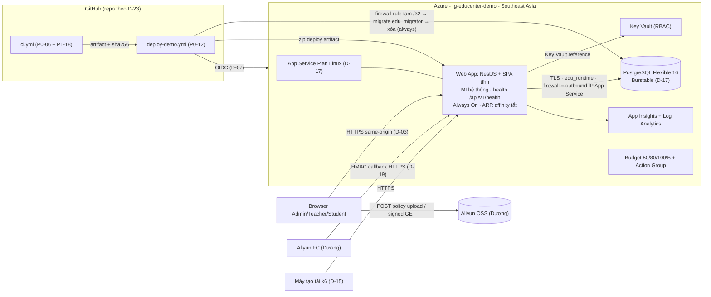
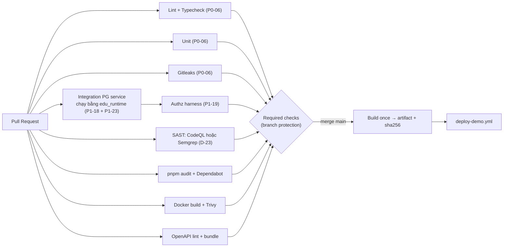
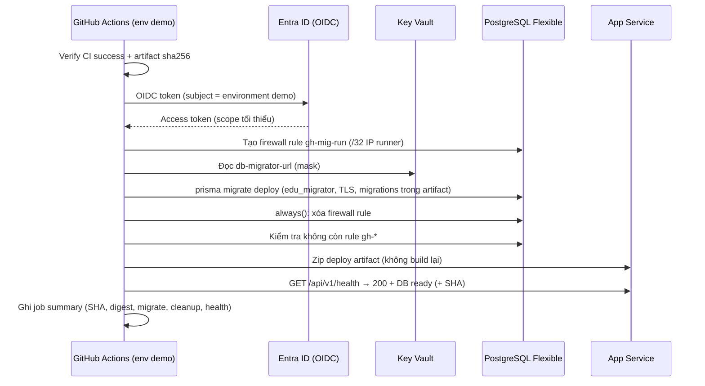

# GIANG.md — DEVOPS, CLOUD INFRASTRUCTURE & QA HANDOFF

| Mục | Nội dung |
|---|---|
| Dự án | EduCenter Cloud — B2B SaaS quản lý trung tâm giáo dục, multi-tenant, Microsoft Azure + Alibaba Cloud (tổ hợp 9) |
| Vị trí file | `docs/handoff/GIANG.md` |
| Ngày tạo | 14/11/2026 · Phiên bản 1.0 |
| Thành viên | **Giang — TV6 — DevOps / QA & Benchmark Engineer** (D-01 Accepted, ROADMAP §15.1) |
| Khối lượng theo ROADMAP | ~80 h (§6.2). Ước tính lại theo task: ~90 h — xem §2.6 và C-08 |
| Reviewer chính của Giang | **Anh (TV3)**: security, IAM, credentials, pipeline · **Đức (TV1)**: architecture, deployment, release, pool B `infra/azure/` · **Hà (TV4)**: benchmark/seed/data integrity (P1-20, P2-18, P4-02, P4-05) |
| Pool review Giang phụ trách | **Pool C**: `.github/workflows/` và secrets trong pipeline (dự phòng: Anh) |
| Tài liệu nguồn | `ROADMAP.md` v1.2 (nguồn điều phối, Task ID, dependency, deadline, AC, Decision Log) · `EduCenter_Cloud_Ban_Thiet_Ke_2.md` (V2) · `BTL CK 1.pdf` |
| Tài liệu không khả dụng khi soạn | `DUC.md`, `DOANH.md`, `ANH.md`, `HA.md`, `DUONG.md` — không có trong Project; cấu trúc 7 mục theo yêu cầu trưởng nhóm. Khi các file này có, đối chiếu lại §4.8 |
| Trạng thái dự án | **PLAN** — chưa có Azure resource, workflow CI/CD, test suite hay ứng dụng. Mọi chỉ số trong file là mục tiêu, không phải kết quả |

> **Quy ước:** Task ID, dependency, estimate, deadline, allowed files và acceptance criteria (AC) **lấy nguyên từ ROADMAP §5**. Nếu file này và ROADMAP lệch nhau, **ROADMAP thắng**; ghi lệch vào §7.2 và báo Đức. Giờ là giờ Việt Nam (UTC+7). "Owner → Reviewer" dùng tên thật theo §15.1: TV1 Đức · TV2 Doanh · TV3 Anh · TV4 Hà · TV5 Dương · TV6 Giang.

> **Mô hình tài liệu đang áp dụng** (thay cho ROADMAP §7.1, §7.6, §7.7, §7.9 và phần AGENTS.md/CLAUDE.md của P0-05): không có `AGENTS.md`/`CLAUDE.md`; không có `docs/tasks/` hay `docs/handoffs/`; `docs/` ban đầu chỉ có `handoff/`. Kết quả, test, evidence và nội dung bàn giao ghi trong **Pull Request**. Decision Log nằm trong ROADMAP §2.3. Runbook/evidence/báo cáo chỉ tạo khi thật sự cần (các đường dẫn `docs/evidence/…`, `docs/runbooks/…` trong cột Module/File của ROADMAP được hiểu là "được phép tạo khi cần", không bắt buộc). Các quy tắc cấm của ROADMAP §7.2 vẫn giữ nguyên hiệu lực — chúng được chép vào §1.4 dưới đây.

---

## 1. AI Execution Protocol & Vai trò

### 1.1. Giang làm gì — và không làm gì

| Mảng | Giang (TV6) chịu trách nhiệm | Không thuộc Giang — chỉ phối hợp/review |
|---|---|---|
| Azure | Subscription, RG, budget, quota (P0-02); IaC App Service + PostgreSQL Flexible + Key Vault + Managed Identity + App Insights (P0-11); firewall, connection pool budget; scale-up/scale-down (P4-01, P4-11) | Aliyun OSS/FC/RAM/SLS (Dương); quyết định SKU/ngân sách cuối (cả nhóm, D-08, D-17) |
| CI/CD | **Mở rộng** CI thành security gates (P1-18); workflow `deploy-demo.yml`, migration job, build-once artifact (P0-12); review mọi thay đổi `.github/workflows/` (pool C) | **CI baseline P0-06** (lint, typecheck, unit, gitleaks) do **Anh** xây; Giang chỉ review |
| Database | Tạo server, TLS, firewall, roles bootstrap trên Azure (P0-11); chạy migration bằng `edu_migrator` trong CD | **Schema/migration** (Hà, P0-08, P1-08 — owner duy nhất); **script DB roles dùng chung** (Anh, P1-23); TenantTx (Anh, P1-04) |
| Backend | **P1-06 Login rate limit** (task backend giao trực tiếp cho Giang); logging/telemetry trong `common/logging/` (P2-15) | Auth/session/CSRF/authz (Anh); Audit Service (Đức, P1-07); mọi module nghiệp vụ (owner module) |
| QA/Security | Authz harness (P1-19), security suite automation (P2-16), chạy ST01–ST25 trên rc0 (P3-02), ZAP (P3-04), E2E kịch bản + chạy demo (P2-17, cùng Doanh) | **Sửa lỗi** thuộc module owner; security review = Anh; IDOR sweep (Anh, P3-03) |
| Performance | Seed `bench-*` (P1-20), k6 framework (P2-18), W1/W2 (P4-02, P4-03, P4-05), LT11 (P4-08), rollback + dọn bench (P4-11) | **CP1** (Doanh, P1-21) · **CP2** (Dương, P2-21) · LT07 (Hà, P4-06) · LT09, LT12 (Dương) · PITR restore (Hà, P4-10) · bottleneck fix (Hà + Anh, P4-04) |
| Release | Deploy RC1 (P5-01), regression (P5-02), demo freeze (P5-05), kiểm tra demo 30/11 (P6-08, cùng Đức), kế hoạch teardown (P6-09) | **Go/No-Go** và bench build tag (Đức, P5-04, P3-10); demo reset script (Dương, P5-06) |
| Báo cáo | R-09 (Ch8), R-10 (Ch9, cùng Hà), P6-02, ghép báo cáo P6-01 (cùng Hà, Dương — §15.2), kiểm tra chéo P6-06 | Slide (Anh, Doanh, Đức), video (Doanh + Dương quay, Đức duyệt) |

### 1.2. AI Execution Protocol (bắt buộc mỗi phiên Claude Code/Codex)

1. **Đọc** `ROADMAP.md` (dòng task ở §5, Decision Log §2.3, gate §8, test plan §9) và `docs/handoff/GIANG.md` (mục 3 của task + §7.2 mâu thuẫn liên quan).
2. **Kiểm tra trạng thái thật**: `git status`, nhánh hiện tại, PR/commit của task phụ thuộc (tìm theo Task ID), file đã có trong allowed files. Trạng thái Azure: **người** chạy lệnh `az … show/list` và dán kết quả đã che ID; agent không giả định resource tồn tại.
3. **Xác định task TV6 đủ điều kiện**: dependency đã merge + có evidence; decision liên quan đã Accepted (D-07, D-08, D-17, D-23, D-25…).
4. **Đề xuất batch** (§1.3): kế hoạch, danh sách file sẽ sửa, lệnh Cloud dự kiến, chi phí ước tính, cách hoàn tác. **Chờ Giang duyệt.**
5. **Chỉ sửa file trong allowed files** của task. Cần sửa ngoài phạm vi → dừng, ghi vào mục "Out-of-scope" của PR, báo owner.
6. **Trước thao tác Cloud**: kiểm tra chi phí, quyền, rủi ro; thao tác có phí/IAM/deploy/scale/restart/rollback/xóa do **Giang tự chạy** với quyền và phê duyệt phù hợp (§1.4).
7. **Chạy test thật** (local, CI, demo); dán output thật. Không có output = chưa chạy.
8. **Ghi PR** theo mẫu §1.6: kết quả, evidence, SHA, blocker.
9. **Tiếp batch sau** chỉ khi dependency và approval đã sẵn sàng. **1 task = 1 PR** (giữ nguyên ROADMAP §5) trừ khi Đức quyết định khác.

### 1.3. Batch công việc

Batch chỉ là cách nhóm việc để dùng AI hiệu quả — **không** thay đổi dependency, deadline hay quy tắc 1 task = 1 PR.

| Batch | Task | Khung thời gian | Điều kiện bắt đầu | Kết thúc khi |
|---|---|---|---|---|
| **B1** Azure Account, Infra, Deploy | P0-02, P0-11, P0-12 | 14/11 10:00 → 15/11 trưa | Kick-off 09:00 Accept D-17, D-23, D-25; P0-01 xác nhận trước khi tạo resource có phí | `/api/v1/health` trên Azure 200 + DB ready; không còn firewall rule tạm |
| **B2** Multi-Cloud PoC + CI Security | P0-18, P1-18 | 15/11 tối → 17/11 | P0-12, P0-15/16/17, P0-21 (P0-18); P0-06, P1-23 (P1-18) | ≥ 5 lần cross-cloud liên tiếp thành công; required checks xác minh |
| **B3** Rate limit, Authz harness, Seed | P1-06, P1-19, P1-20 | 17/11 → 19/11 sáng | Schema v1 freeze (16/11 20:00), P1-01, P1-03, P1-07 | ST10 + ST01–ST06 chạy; dataset `bench-*` trên demo trước CP1 |
| **B4** Observability, Security suite, E2E, k6 | P2-15, P2-16, P2-17, P2-18 | 20/11 → 23/11 20:00 | G1; P2-08, P2-03, P2-07, các FE flow | G2: E2E xanh 3 lần trên demo; k6 smoke 5 phút; ST có script |
| **B5** Security hardening + Benchmark | P3-02, P3-04, P4-01, P4-02, P4-03, P4-05, P4-08, P4-11 | 24/11 → 26/11 chiều | Feature freeze, `rc0.1` (25/11 12:00), `rc0.2` (26/11 08:30), D-08 | G3, G4: bảng ST + LT gắn SHA; `bench-*` = 0; đã scale-down |
| **B6** RC1, Regression, Freeze, Delivery | P5-01, P5-02, P5-05, P6-02, P6-08, P6-09, R-09, R-10, P6-01, P6-06 | 26/11 tối → 30/11 | G3 + G4 | G6; demo sống tới khi chấm xong; kế hoạch teardown |

### 1.4. Thao tác cần người thực hiện/duyệt và quy tắc cấm

| Thao tác | AI được làm | Người thực hiện | Phê duyệt |
|---|---|---|---|
| Soạn Bicep/az CLI script, workflow YAML, test, k6 script, runbook | Có | — | Review PR (Anh/Đức theo pool) |
| Tạo resource có phí, đổi SKU, scale-up/down | Chỉ soạn lệnh + ước tính chi phí | Giang | D-17/D-08 đã Accept; vượt ngân sách → cả nhóm (RACI §6.3) |
| IAM: role assignment, federated credential, Key Vault access | Chỉ soạn lệnh | Giang | **Anh** (A trong RACI "IAM/Key Vault/secrets") |
| Deploy demo, restart, rollback | Chuẩn bị workflow | Giang (qua workflow có environment approval) | Theo D-23; sau freeze: Đức + Anh (P5-05) |
| Firewall DB | Chỉ trong job CD có cleanup `always()` | Workflow / Giang (thủ công có biên bản — R-19) | Anh |
| Xóa dữ liệu `bench-*`, xóa resource | Chuẩn bị lệnh có `--dry-run` | Giang, sau khi kiểm tra phạm vi | Đức (teardown P6-09: cả nhóm) |

**Cấm tuyệt đối (giữ nguyên ROADMAP §7.2 + V2 §12.3):** đổi stack/region/SKU/Cloud provider; thêm dịch vụ Cloud mới khi chưa có quyết định; đổi auth/session/CSRF; bỏ guard/tenant validation; sửa `schema.prisma` hay migration (chỉ Hà); hardcode secret; tắt TLS verification; mở firewall "all Azure services" hoặc `0.0.0.0–255.255.255.255`; cấp quyền rộng chỉ để deploy chạy được; thêm cờ bypass auth/CSRF/rate limit cho test hay benchmark; skip/xóa test để merge; đưa secret, credential Azure/Aliyun, dữ liệu thật vào prompt; loại 429/5xx khỏi thống kê; ghi Pass/Done/Verified khi chưa có bằng chứng; workflow "giả" để CI xanh.

### 1.5. Prompt thực thi chung (dùng lại với Task ID hoặc Batch ID)

```text
Bạn là AI coding agent hỗ trợ Giang (TV6 — DevOps/QA & Benchmark) trong dự án EduCenter Cloud.
Phiên này: <TASK_ID hoặc BATCH_ID>.

1. Đọc ROADMAP.md (dòng task ở §5, Decision Log §2.3, §8, §9) và docs/handoff/GIANG.md
   (mục 3 của task, §1.4, §7.2). ROADMAP thắng nếu hai file lệch nhau.
2. Kiểm tra repo: git status, nhánh, PR/commit của các task phụ thuộc, file hiện có trong allowed files.
   Không giả định Azure resource đã tồn tại; nếu cần trạng thái Cloud, đưa tôi lệnh az chỉ-đọc để tôi chạy.
3. Báo cáo: task nào đủ điều kiện, dependency/decision còn thiếu, mâu thuẫn liên quan trong §7.2.
4. Đề xuất kế hoạch + danh sách file sẽ sửa (chỉ trong allowed files) + lệnh Cloud dự kiến
   (chi phí ước tính, quyền cần, cách hoàn tác). DỪNG chờ tôi duyệt.
5. Viết test trước theo acceptance criteria (positive + negative), rồi implement.
6. Chạy lint/typecheck/test thật; dán output thật. Không ghi "passed" nếu chưa chạy.
7. Soạn mô tả PR theo mẫu GIANG.md §1.6.
Dừng và hỏi nếu cần: sửa file ngoài phạm vi; đổi schema/contract/auth/IAM/SKU/region/dịch vụ Cloud;
secret thật; tạo/xóa/scale resource; test chỉ pass khi nới bảo mật.
Không bao giờ: hardcode secret, tắt TLS verify, bypass auth/CSRF/rate limit, mở firewall rộng,
loại 429/5xx khỏi số liệu, dùng dữ liệu thật.
```

### 1.6. Mẫu mô tả PR cho task của Giang

```markdown
## <TaskID> — <tiêu đề>   · Owner: Giang · Reviewer: <tên> (+ pool nếu có)
**Phạm vi file:** <đường dẫn> (khớp allowed files ROADMAP §5)
**Thay đổi Cloud thật:** <resource/config, ai chạy, thời điểm> | Không
**Chi phí:** <ước tính/giờ hoặc /tháng> | Không phát sinh
**IAM/secrets:** <role/scope thay đổi; secret mới — chỉ tên, không giá trị> | Không
**Test đã chạy:** <lệnh> → <kết quả thật> · <link CI run>
**Evidence:** <link run, ảnh đã che subscription/tenant ID, SHA, môi trường>
**Acceptance criteria (copy ROADMAP):** - [ ] …
**Hoàn tác/rollback:** <cách quay lại>
**Blocker / Out-of-scope / Quyết định cần chốt:** <…>
```

Evidence tối thiểu cho mọi kết quả: **ngày giờ, commit SHA, môi trường (local/CI/demo), cấu hình, lệnh, output/ảnh, người chạy**. Ảnh chụp Azure phải che subscription ID, tenant ID, object ID, IP cá nhân, email (repo public theo D-23, RV-34).

---

## 2. Timeline và Task Inventory

### 2.1. Lịch của Giang (14/11 → 30/11)

| Ngày | Owner / Co-owner | Review / Phối hợp | Gate / IP |
|---|---|---|---|
| **T7 14/11** | 09:00 kick-off · 10:00 **P0-02** · 13:30 **P0-11** (sau P0-01) | P0-04 (Đức), P0-06 (Anh) | — |
| **CN 15/11** | Hoàn tất P0-11 · sáng **P0-12** · tối **P0-18** (cùng Dương) | P0-19 (Hà) | **IP-1** tối (Dương + Giang chủ trì) |
| **T2 16/11** | Buffer P0 · **P1-18** bắt đầu | P1-23 (Anh, tối) | **G0 12:00** · schema v1 freeze 20:00 |
| **T3 17/11** | P1-18 · **P1-19** | P1-02 (Anh) | IP-2 (Doanh + Anh) — Giang giữ demo deploy |
| **T4 18/11** | P1-19 · **P1-06** · **P1-20** | — | — |
| **T5 19/11** | P1-20 hoàn tất **trên demo trước CP1** | **P1-21 CP1** (Doanh) | IP-3 (Đức) · **G1 20:00** (Giang là approver) |
| **T6 20/11** | **P2-15** | — | — |
| **T7 21/11** | P2-15 · chuẩn bị khung P2-17 | — | — |
| **CN 22/11** | P2-15 xong · **P2-16** · **P2-18** | — | IP-4 (Dương + Doanh) — Giang hỗ trợ trace |
| **T2 23/11** | P2-16 · P2-18 smoke 5' · **P2-17** chạy 3 lần trên demo | **P2-21 CP2** (Dương) | **IP-5 (Giang chủ trì)** · **G2 20:00** |
| **T3 24/11** | 00:00 freeze · **P3-02** (sáng) · **P3-04 ZAP xong trong ngày** | P3-03 (Anh), P4-10 restore (Hà) | — |
| **T4 25/11** | 13:30 **P4-01** · W1 14:00–18:00: **P4-02, P4-03** | P3-05 (Anh), P3-10 (Đức, 12:00), P4-06 LT07 (Hà), P4-07 LT09 (Dương) | **G3 20:00** (approver) |
| **T5 26/11** | W2 09:00–13:00: **P4-05**, **P4-08** · chiều **P4-11** · tối **P5-01** | P4-09 LT12 (Dương) — giám sát Azure | **G4 20:00** (approver) |
| **T6 27/11** | Sáng **P5-02** · **P5-05** · **P6-02** · R-09/R-10 bản cuối | — | **G5 12:00** |
| **T7 28/11** | **P6-01** ghép báo cáo (cùng Hà, Dương) · theo dõi demo khi quay video | — | — |
| **CN 29/11** | Sáng **P6-06** (cả nhóm) | **P6-07** (Đức) | **G6 22:00** (approver) |
| **T2 30/11** | **P6-08** (cùng Đức) · **P6-09** | — | Buffer — không deploy |

### 2.2. Task Owner / Co-owner (giữ nguyên ROADMAP §5)

| ID | Mục tiêu (rút gọn) | Vai trò Giang | Reviewer | Dependency | Ngày · Est | Mode |
|---|---|---|---|---|---|---|
| P0-02 | Azure subscription, RG `rg-educenter-demo`, budget 50/80/100%, quota SEA | Owner | Đức | — | 14/11 · 3h | P |
| P0-11 | Azure IaC: App Service, PG Flexible TLS, Key Vault RBAC, MI, App Insights, roles, pool budget | Owner | Anh (+ Đức pool B) | P0-01, P0-02, D-17, D-25 | 14–15/11 · 5h | S |
| P0-12 | CD demo build-once + migration job firewall tạm + approval | Owner | Đức | P0-06, P0-07, P0-11, D-07, D-23, D-25 | 15/11 · 4h | S |
| P0-18 | E2E cross-cloud PoC + latency 3 chặng | Co-owner (cùng Dương) | Đức | P0-12, P0-15, P0-16, P0-17, P0-21 | 15/11 tối · 3h | S → G0 |
| P1-06 | Login rate limit (`login_attempts`, account+tenant, IP NAT-aware, 429 + Retry-After, audit) | Owner | Anh | P1-01, P1-07, P1-08, D-06 | 18/11 · 4h | P |
| P1-18 | CI security gates | Owner | Anh | P0-06, P1-23, D-23 | 16–17/11 · 6h | P |
| P1-19 | Authorization test harness + ST01–ST06 | Owner | Anh | P1-03 | 17–18/11 · 5h | P |
| P1-20 | Seed generator `bench-*` + lệnh xóa | Owner | Hà | P1-01, P1-08 | 18–19/11 · 4h | P |
| P2-15 | Observability Azure + log redaction + alerts | Owner | Anh | P0-12, P2-08 | 20–22/11 · 4h | P |
| P2-16 | Security suite ST07–ST19, ST22–ST25 | Owner | Anh | P1-19, P2-03, P2-07 | 22–23/11 · 6h | P |
| P2-17 | Playwright E2E P0 trên demo | Co-owner (cùng Doanh) | Đức | P2-11, P2-12, P2-13, P2-09 | 23/11 · 6h | S → G2 |
| P2-18 | k6 framework đầy đủ | Owner | Hà | P1-20, P2-01, P2-02, P2-03, P2-05, P2-06 | 22–23/11 · 5h | P |
| P3-02 | Chạy ST01–ST25 trên rc0 + bảng evidence | Owner | Anh | P3-01 | 24/11 · 4h | S |
| P3-04 | OWASP ZAP API/baseline, triage | Owner | Anh | P3-01 | 24/11 · 3h | P |
| P4-01 | Scale-up W1 | Owner | Đức | P3-10, D-08 | 25/11 13:30 · 0,5h | S |
| P4-02 | LT02 ramp | Owner | Hà | P4-01, P2-18 | 25/11 W1 · 1h | S |
| P4-03 | W1: LT03, LT04, LT05, LT08, LT10 + SQL bất biến | Co-owner (cùng Hà) | Đức | P4-02 | 25/11 W1 · 2,5h | S |
| P4-05 | W2: re-run Fail + LT06 soak 60' | Owner | Hà | P4-04 | 26/11 W2 · 2h | S |
| P4-08 | LT11 restart instance | Owner | Anh | P4-05 | 26/11 W2 · 0,5h | P |
| P4-11 | Rollback drill + dọn `bench-*` + scale-down + chi phí | Owner | Đức | P4-05, P4-08, P4-09 | 26/11 chiều · 2h | S |
| P5-01 | Deploy RC1 + dữ liệu demo giả | Owner | Đức | G3, G4 | 26/11 tối · 2h | S |
| P5-02 | Regression trên RC1 | Owner | Anh | P5-01 | 27/11 sáng · 3h | S |
| P5-05 | Đóng băng demo env | Owner | (ROADMAP không ghi reviewer; approval hotfix: Đức + Anh) | P5-04 | 27/11 · 0,5h | S |
| P6-02 | Chương kết quả kiểm thử & benchmark (R-10) | Co-owner (cùng Hà) | Đức | G3, G4 | 27/11 · 4h | P |
| P6-08 | Kiểm tra link + demo 30/11 | Co-owner (cùng Đức) | — | P6-07, P5-06 | 30/11 · 1h | S |
| P6-09 | Kế hoạch teardown | Owner | Đức | P6-07 | 30/11 · 1h | P |

### 2.3. Review / Coordination

| ID | Owner | Vai trò Giang | Hạn | Trọng tâm review (chi tiết §3.8) |
|---|---|---|---|---|
| P0-04 | Đức | Reviewer | 14/11 | Branch protection, CODEOWNERS ≥ 2 người cho `.github/workflows/`, tính năng GitHub theo D-23 có thật |
| P0-06 | Anh | Reviewer | 14/11 | CI baseline: permissions, SHA pin, gitleaks chặn secret giả |
| P0-19 | Hà | Reviewer | 15/11 | docker-compose chạy ≤ 15 phút trên máy Giang; PG cùng major với demo |
| P1-02 | Anh | Reviewer | 17/11 | CSRF hoạt động sau proxy App Service; k6/E2E lấy được CSRF token |
| P1-21 (CP1) | Doanh | Reviewer | 19/11 | 30 RPS đọc 10', p95, CPU, pool wait, session lookup; môi trường đo đúng |
| P1-23 | Anh | Reviewer | 16/11 tối | Script roles idempotent, chạy được trên Azure PG, khớp bootstrap P0-11 |
| P2-21 (CP2) | Dương | Reviewer | 23/11 | 100 RPS mix 10' trên cấu hình demo; bottleneck + issue trước W1 |
| P3-03 | Anh | Reviewer | 24/11 | 100% route có path ID được quét |
| P3-05 | Anh | Reviewer + hỗ trợ Azure | 25/11 | Triage scanner; gitleaks full history; xoay HMAC key (Giang restart App Service theo D-29) |
| P3-10 | Đức | Reviewer + deploy | 25/11 12:00 | Đúng artifact `rc0.1`, smoke, SHA, cấu hình |
| P4-06 (LT07) | Hà | Reviewer | 25/11 W1 | Rate limit hoạt động, đếm số bị giới hạn/thành công, API cốt lõi trong SLO |
| P4-07 (LT09) | Dương | Reviewer | 25/11 | p95 xử lý PDF, không material treo; không làm nhiễu W1 (C-03) |
| P4-09 (LT12) | Dương (reviewer Anh) | Phối hợp giám sát Azure | 26/11 W2 | App Insights trong lúc Aliyun lỗi + reconcile |
| P4-10 | Hà | Reviewer + hỗ trợ infra | 24/11 | PITR sang server cô lập, không đụng demo, xóa server sau đo |
| P6-07 | Đức | Reviewer | 29/11 | Link public mở được từ máy khác/ẩn danh |
| Pool C | Mọi PR | Reviewer chính | SLA 4h (08:00–22:00) | Mọi thay đổi `.github/workflows/`, secrets pipeline |
| Gates | — | Approver | G1 19/11 · G3 25/11 · G4 26/11 · G6 29/11 | §5.7 |
| IP-1, IP-5 | — | Chủ trì (IP-1 cùng Dương) | 15/11, 23/11 | §4.9 |

### 2.4. Security tests liên quan Giang (ROADMAP §9.2)

| Nhóm | ST | Ý nghĩa với Giang |
|---|---|---|
| **Giang là owner ST** | ST01, ST03, ST08, ST10, ST17, ST25 | Viết test, chạy, bảo đảm đúng; Anh review |
| Automation/tích hợp vào suite (P2-16) và chạy trên rc0 (P3-02) | ST07, ST09, ST11–ST16, ST18, ST19, ST22–ST24 | Owner ST (Anh/Dương/Hà/Doanh) chịu trách nhiệm tính đúng của case; Giang gom vào suite, chạy, ghi evidence |
| Harness (P1-19) | ST01–ST06 cho module đã có | ST02, ST04, ST05, ST06 thuộc Anh — Giang viết trên harness, Anh xác nhận kỳ vọng |
| Không chạy | ST21 | **Not implemented (production-only)** — D-19 |
| Chỉ trong P3-02 | ST20 | Owner Anh; Giang chạy lại + ghi kết quả; nếu RLS NO-GO (D-05) → ghi đúng phạm vi, không ghi Pass cho phần chưa có |

### 2.5. BTL Deliverables (ROADMAP §11.1 + §15.2)

| ID | Nội dung | Vai trò | Nháp | Cuối |
|---|---|---|---|---|
| R-09 | Ch8 — Quá trình triển khai thật, CI/CD, sự cố và cách xử lý (~4 trang) | Owner | 23/11 | 27/11 |
| R-10 | Ch9 — Kiểm thử, benchmark, kết quả Pass/Fail trung thực (~4 trang) | Co-owner cùng Hà | 26/11 | 27/11 |
| P6-02 | Hoàn thiện chương kết quả kiểm thử & benchmark | Co-owner cùng Hà | — | 27/11 |
| P6-01 | Ghép + biên tập báo cáo Word cuối | **Đồng chủ trì cùng Hà, Dương** (§15.2) | — | 27–28/11 |
| P6-06 | Kiểm tra chéo báo cáo | Cả 6 người | — | 29/11 sáng |
| P6-07 | Hỗ trợ Đức kiểm tra link từ máy khác | Reviewer | — | 29/11 |

### 2.6. Khối lượng giờ — ước tính lại

| Nhóm | Theo ROADMAP §6.2 | Tính lại từ cột Est §5 (task chung chia đôi) |
|---|---:|---:|
| P0 (P0-02, P0-11, P0-12, ½ P0-18) | 13,5 | 13,5 |
| P1 (P1-06, P1-18, P1-19, P1-20) | 19 | 19 |
| P2 (P2-15, P2-16, ½ P2-17, P2-18) | 19 | 18 |
| P3 (P3-02, P3-04) | 7 | 7 |
| P4 (P4-01, P4-02, ½ P4-03, P4-05, P4-08, P4-11) | 7 | 7,25 |
| P5 (P5-01, P5-02, P5-05) | 4 | **5,5** |
| P6 (½ P6-02, ½ P6-08, P6-09) | 3,5 | 3,5 |
| R (R-09, ½ R-10) | 4 | 4 |
| P6-01 (⅓ của 8h, §15.2) + P6-06 | — (chưa tính) | **~4** |
| Review (14 task + pool C + 4 gate + 2 IP) | 3 | **~10** (ước tính của file này) |
| **Tổng** | **~80** | **~92** |

→ Chênh ~12 h so với 80 h (A-08). Đây là ước tính của file này, **cần Đức xác nhận** (C-08). Không tự chuyển task; các phương án giảm tải để Đức chọn nằm ở §7.4.

---

## 3. Detailed Implementation Guide

Mỗi task trực tiếp gồm: **Dependency · Allowed files · Bước thực hiện · Test · AC (nguyên văn ROADMAP) · Đầu ra PR**. Task chỉ review nằm ở §3.8.

### 3.1. Phase 0 — Azure foundation (Batch B1)

#### P0-02 — Chuẩn bị Azure · 14/11 · 3h · Đức review

- **Dependency:** không. Kick-off 09:00 chốt ngân sách nội bộ (con số tuyệt đối) để cấu hình budget.
- **Allowed files:** `infra/azure/README.md`
- **Phân biệt:** P0-02 = **chuẩn bị tài khoản** (không phát sinh phí). Tạo Resource Group và budget không tính phí. **Không** tạo App Service/PG/Key Vault ở đây — đó là P0-11 và chỉ sau khi P0-01 (Đức) xác nhận đăng ký tổ hợp 9.

**Bước thực hiện**

1. Đăng nhập `az login` trên máy Giang (không qua AI). Ghi lại loại subscription (vd Azure for Students/credit) — **không** ghi subscription ID vào repo.
2. Kiểm tra quyền: Giang cần **Owner** (hoặc Contributor + User Access Administrator) trên subscription/RG để tạo role assignment cho Managed Identity và cho identity của GitHub OIDC. Nếu chỉ có Contributor → báo Anh/Đức ngay (chặn P0-11, P0-12).
3. Kiểm tra Azure Policy giới hạn region (subscription dạng sinh viên thường có policy "allowed locations"): `az policy assignment list`. Xác nhận **Southeast Asia** được phép.
4. Đăng ký resource provider cần dùng: `Microsoft.Web`, `Microsoft.DBforPostgreSQL`, `Microsoft.KeyVault`, `Microsoft.Insights`, `Microsoft.OperationalInsights`.
5. Kiểm tra khả dụng SKU tại SEA: App Service Linux (gói theo D-17) và PG Flexible (Burstable). Kiểm tra quota trong Portal → Subscription → *Usage + quotas* (Microsoft.Web, PostgreSQL vCore theo region).
6. Tạo RG `rg-educenter-demo` tại `southeastasia` (miễn phí).
7. Tạo **Action Group** (email theo vai trò nhóm) và **Budget** ở scope subscription (khuyến nghị) với ngưỡng **50%, 80%, 100%** của ngân sách nội bộ; gắn action group. Dùng chức năng *Test action group* để gửi email thử.
8. Ghi nhớ: budget alert **không phải hard cap** và dữ liệu chi phí cập nhật trễ nhiều giờ (V2 §19.3) → cần thêm kiểm tra credit thủ công tại standup.
9. Nếu offer type của subscription không hỗ trợ Budgets → ghi blocker cho Đức; fallback: kiểm tra số dư credit hằng ngày trong standup + alert metric ở P2-15.

**Test / Evidence:** email test của action group nhận được; ảnh budget (che ID); kết quả kiểm tra SKU/quota/region.

**AC (ROADMAP):** Budget alert gửi email thử thành công; quota/region xác nhận; không commit subscription secret.

**Đầu ra PR:** `infra/azure/README.md` gồm loại subscription (không ID), region, kết quả SKU/quota, ngưỡng budget, kênh nhận alert (tên vai trò, **không** ghi email cá nhân — repo public), giới hạn credit đã chốt.

#### P0-11 — Azure Infrastructure as Code · 14–15/11 · 5h · Anh review (+ Đức, pool B)

- **Dependency:** P0-01 (Đức xác nhận đăng ký — blocker cứng cho tạo resource có phí), P0-02, D-17, D-25 (Accept tại kick-off).
- **Allowed files:** `infra/azure/` (IaC, tham số không chứa secret, script bootstrap roles, README, truy vấn KQL sau này).
- **Công cụ IaC:** đề xuất **Bicep** (native Azure, chạy lại idempotent bằng `az deployment group create`); fallback: az CLI script có kiểm tra tồn tại. Chọn 1, ghi vào README. Không thêm công cụ ngoài (Terraform) nếu chưa thống nhất với Đức.

**Thành phần (theo V2 §5.4, §11.6 và ROADMAP P0-11) — tên gợi ý, SKU theo D-17:**

| Resource | Tên gợi ý | Cấu hình bắt buộc |
|---|---|---|
| App Service Plan Linux | `asp-educenter-demo` | SKU theo D-17: gói thấp nhất hỗ trợ Always On + deployment (ứng viên Basic — **nhóm chốt giá**); 1 instance |
| Web App | `app-educenter-demo` | Node LTS theo D-20; **system-assigned MI**; HTTPS only; TLS tối thiểu 1.2; FTP tắt; **Always On**; **health check path `/api/v1/health`**; **ARR affinity tắt** (V2 §8.1 không sticky session — quan trọng cho LT11); `SCM_DO_BUILD_DURING_DEPLOYMENT=false` (giữ build-once); tắt basic auth SCM nếu dùng OIDC |
| PostgreSQL Flexible | `psql-educenter-demo` | PostgreSQL 16 (D-20, nếu Azure + Prisma hỗ trợ); Burstable (D-17); HA tắt; backup retention mặc định (cần cho PITR P4-10); `require_secure_transport=ON`; public access **chỉ qua firewall rule cụ thể**; **không** bật "Allow public access from any Azure service" |
| Database | `educenter` | Owner = `edu_migrator` |
| Key Vault | `kv-educenter-<suffix>` | **RBAC authorization**; soft delete (retention ngắn, vd 7 ngày); purge protection: quyết định cùng Anh (ảnh hưởng teardown) |
| App Insights | `appi-educenter-demo` | Workspace-based → cần **Log Analytics workspace** `log-educenter-demo` (thành phần bắt buộc của App Insights hiện nay, không phải dịch vụ mới); đặt daily cap + retention ngắn để kiểm soát chi phí |

**Identity, secrets, network** (chi tiết §4.3–§4.4):

1. Gán MI của Web App role **Key Vault Secrets User** (scope vault).
2. App setting dùng **Key Vault reference** cho mọi secret: `DATABASE_URL` (runtime), khóa HMAC (Dương nạp theo P0-21), Access Key Aliyun `api-storage` (Dương nạp theo P0-14). Giá trị không bao giờ nằm trong repo, IaC parameters hay log.
3. Không biết trước giá trị secret của Aliyun → cấp cho **Dương** quyền *Key Vault Secrets Officer* giới hạn đúng các secret cần nạp (hoặc Giang nạp qua kênh an toàn do Anh chỉ định) — **Anh duyệt**.
4. PG firewall: thêm rule cho từng IP trong `possibleOutboundIpAddresses` của Web App (tên `appsvc-out-<n>`). Không dùng dải rộng. Ghi giới hạn: outbound IP của App Service dùng chung scale unit — chấp nhận cho demo, production dùng private networking (ngoài phạm vi BTL).
5. Mật khẩu admin PG sinh ngẫu nhiên → lưu Key Vault; **ứng dụng không bao giờ dùng admin**.

**Roles DB (D-25) — bootstrap trên Azure:**

- Tạo `edu_migrator` (owner schema/DB, chỉ dùng cho migration) và `edu_runtime` (DML, không superuser, không BYPASSRLS, không owner); `ALTER DEFAULT PRIVILEGES FOR ROLE edu_migrator` cấp DML cho `edu_runtime` trên bảng mới; `audit_logs` chỉ INSERT/SELECT (áp dụng khi bảng tồn tại).
- Chạy bằng tài khoản admin PG từ máy Giang qua **firewall rule tạm cho IP Giang**, xóa ngay sau khi xong, ghi biên bản.
- **Script dùng chung** cho local/CI/demo là việc của **Anh (P1-23)**. P0-11 chỉ bootstrap tối thiểu để G0 kết nối được bằng `edu_runtime`; sau khi P1-23 merge, Giang chạy lại script của Anh trên demo và xác nhận idempotent (C-05).
- Mật khẩu 2 role → Key Vault (`db-runtime-url`, `db-migrator-url`), connection string có `sslmode=require`; **không** dùng tùy chọn chấp nhận chứng chỉ không hợp lệ.

**Connection pool budget (bắt buộc ghi trong README)** — công thức và ví dụ ở §4.5:

```
N_instance × connection_limit + migration + reconciliation + admin/monitor + seed/invariant ≤ 80% max_connections
```

- Đọc `max_connections` thật trên server sau khi tạo (`SHOW max_connections;`), không dựa vào bảng tra.
- Azure giữ 15 kết nối cho replication/monitoring — số kết nối người dùng thực tế thấp hơn `max_connections`. (nguồn §7.8)
- Giữ nguyên D-17 (cấu hình demo khởi điểm) và D-25 (role + migration job).

**Test / Evidence:** chạy IaC lần 2 không tạo thay đổi ngoài ý muốn (what-if/no-op); ứng dụng tạm hoặc lệnh `psql` từ máy có rule tạm kết nối bằng `edu_runtime` qua TLS; `edu_runtime` không tạo được bảng; firewall list không có rule "Allow Azure services" (`0.0.0.0`); Web App đọc được KV reference (trạng thái reference "Resolved" trong Portal); ảnh resource đã che ID.

**AC (ROADMAP):** Web App đọc secret qua Key Vault reference; kết nối PG bằng `edu_runtime`; firewall không mở "all Azure services"; bảng pool budget. Test: Evidence + script chạy lại được.

**Đầu ra PR:** IaC + parameters (không secret) + README: SKU thực tế, `max_connections` đo được, bảng pool budget, danh sách secret (chỉ tên), danh sách role assignment, cách chạy lại, cách hủy. Không đổi `schema.prisma`.

**Bàn giao ngay sau P0-11:** hostname App Service → **Dương** (CORS OSS, callback URL của FC, CSP domain cho Doanh qua P1-24); tên secret KV → Anh, Dương.

#### P0-12 — Continuous Deployment lên Azure · 15/11 · 4h · Đức review

- **Dependency:** P0-06 (CI baseline — Anh), P0-07 (NestJS skeleton + `/health` — Anh), P0-11, D-07, D-23, D-25.
- **Allowed files:** `.github/workflows/deploy-demo.yml`

**Xác thực Azure (D-07):**

1. **Ưu tiên OIDC**: app registration + federated credential, subject giới hạn đúng environment: `repo:<org>/<repo>:environment:demo`. GitHub lưu `AZURE_CLIENT_ID`, `AZURE_TENANT_ID`, `AZURE_SUBSCRIPTION_ID` ở dạng **environment variables** (không phải secret dài hạn).
2. Quyền tối thiểu cho identity này (Anh duyệt): deploy Web App (Website Contributor trên Web App), ghi firewall rule của PG server, **Key Vault Secrets User chỉ trên secret `db-migrator-url`**. Không cấp Contributor toàn subscription.
3. Nếu không tạo được app registration (tenant trường hạn chế — A-06): phương án trung gian để **Anh + Đức quyết**: user-assigned managed identity có federated credential (tài nguyên identity mới, miễn phí). Nếu vẫn không được → **fallback D-07**: publish profile lưu ở GitHub **environment secret** có required reviewer (cần bật lại basic auth SCM — ghi rõ giới hạn bảo mật). Migration job khi đó không tự tạo firewall rule được → chạy theo R-19 (thủ công có biên bản).

**Luồng workflow `deploy-demo.yml`:**

| Bước | Nội dung | Ghi chú bắt buộc |
|---|---|---|
| Trigger | `workflow_run` sau CI xanh trên `main` + `workflow_dispatch` (input: SHA/run ID của artifact — dùng cho redeploy/rollback/rc tag) | Trong freeze (P5-05): chỉ `workflow_dispatch` |
| Cấu hình chung | `permissions`: `contents: read`, `id-token: write`, `actions: read`; actions pin commit SHA; `concurrency: deploy-demo` **không** cancel-in-progress (tránh 2 migration song song) | Pool C |
| 1. Verify | Xác nhận CI của SHA đó **success**; tải artifact; đối chiếu sha256 với digest CI ghi lại | **Build once** — không build lại từ source |
| 2. Migrate (environment `demo`, approval theo D-23) | `azure/login` OIDC → lấy IP runner → `az postgres flexible-server firewall-rule create` tên `gh-mig-<run_id>-<attempt>` /32 → đọc `db-migrator-url` từ Key Vault (mask ngay) → `prisma migrate deploy` bằng **migrations nằm trong artifact**, Prisma CLI đúng version lockfile → bước `if: always()` xóa rule → bước kiểm tra cuối: liệt kê rule, **fail nếu còn rule `gh-*`** | D-25; migration chạy 1 lần, trước deploy; migration phải backward-compatible (V2 §13.4) |
| 3. Deploy | Zip deploy artifact lên Web App (Oryx build tắt) | App Service 1 instance → có thể gián đoạn ngắn; ghi nhận |
| 4. Smoke | Gọi `https://<host>/api/v1/health` có retry; yêu cầu **200 + DB ready**; nếu health trả version/SHA (đề nghị Anh bổ sung ở P0-07) → so khớp SHA đã deploy | Không tuyên bố thành công chỉ vì workflow xanh — phải kiểm URL thật |
| 5. Record | Job summary: SHA, digest artifact, kết quả migrate, firewall cleanup, health response, thời gian | Evidence cho PR và R-09 |

- **Artifact:** ở P0-12, workflow có một job build duy nhất tạo artifact (nếu CI chưa sinh); từ P1-18, **CI sinh artifact** và `deploy-demo` chỉ tiêu thụ. Artifact gồm build API + SPA tĩnh (D-03) + `node_modules` production + `prisma/migrations` + Prisma CLI. Native module (`argon2`, Prisma engine) phải build trên Linux x64 cùng Node major với App Service; nếu Prisma cần `binaryTargets` riêng → **change request cho Hà** (schema.prisma).
- **Hình thức deploy (zip vs container) chưa chốt** — xem C-11. Mặc định đề xuất zip vì P0-11 không có container registry.
- **Runbook nhỏ (trong README hoặc PR):** nếu runner chết giữa chừng (bước `always()` không chạy) → lệnh thủ công xóa mọi rule `gh-mig-*`; kiểm tra lại firewall.

**Test / Evidence:** run log deploy; ảnh firewall **trước/trong/sau**; `curl` health từ máy ngoài; thử 1 run cố ý fail ở bước migrate (vd migration giả trên nhánh thử, không merge) để chứng minh rule vẫn bị xóa.

**AC (ROADMAP):** `/api/v1/health` trên URL Azure trả 200 + DB ready; sau job không còn firewall rule tạm; credential không nằm trong repo.

**Không tự quyết:** deployment slot (Basic không hỗ trợ slot), dịch vụ CI/CD khác, registry mới.

#### P0-18 — Cross-Cloud E2E PoC · 15/11 tối · 3h · Co-owner cùng Dương · Đức review

- **Dependency:** P0-12, P0-15 (FC PoC — Dương), P0-16 (callback HMAC PoC — Anh), P0-17 (upload signer — Anh), P0-21 (HMAC key 2 phía — Dương).
- **Allowed files:** `docs/evidence/P0-18/` (evidence G0 — được phép tạo), `tests/poc/`
- **Luồng kiểm chứng:** Browser/Client → Azure API (POST policy) → OSS quarantine → FC → HMAC callback → log API Azure.

| Ai | Làm gì |
|---|---|
| Dương | OSS, FC, worker, HMAC key phía Aliyun, phần upload + đọc log SLS trong script |
| Anh | Callback endpoint + upload signer (đã merge, deploy qua P0-12) |
| **Giang** | Bảo đảm bản deploy demo chứa P0-16/P0-17; KV có HMAC key (Dương nạp) + restart App Service sau khi đổi secret (D-29); kiểm tra kết nối; truy vấn log App Insights theo correlation ID; đo latency |
| Đức | Nghiệm thu tích hợp (G0) |

**Bước thực hiện:**

1. Trước 18:00: xác nhận demo đang chạy SHA chứa callback + signer; `/health` 200.
2. Thống nhất **correlation ID**: API sinh khi cấp POST policy → metadata object OSS → FC đọc và gửi kèm callback → API log cùng `materialId`, `attempt`, `eventId`.
3. Script `tests/poc/` chạy lặp **5 lần liên tiếp**: mỗi lần ghi correlation ID, thời điểm, kết quả callback (202/401).
4. Latency 3 chặng (p50/p95), đo từ mạng Việt Nam:
   - **Client → Azure:** 10 mẫu `curl` tới `/api/v1/health` (ghi connect, TLS, TTFB, total).
   - **Client → OSS:** Dương đo thời gian upload file mẫu.
   - **FC → Azure:** thời gian callback từ log FC (Dương) đối chiếu `requests` App Insights (Giang).
   - Với 10 mẫu, p95 gần như bằng giá trị lớn nhất → **ghi kèm toàn bộ mẫu thô**, không chỉ con số tổng hợp.
5. Ghi bảng kết quả + truy vấn App Insights tìm theo correlation ID.

**AC (ROADMAP):** ≥ 5 lần liên tiếp thành công; bảng p50/p95 Client→Azure, Client→OSS, FC→Azure; script lặp 5 lần + log có correlation ID. **Dependency trọng yếu cho G0 16/11 12:00.**

**Không làm:** triển khai lại FC, sửa callback hay signer của owner khác. Lỗi phía Aliyun → Dương; lỗi callback → Anh.

### 3.2. Phase 1 — CI Security, Rate limit, Harness, Seed (Batch B2–B3)

#### P1-18 — CI Security Gates · 16–17/11 · 6h · Anh review

- **Dependency:** P0-06 (CI baseline của **Anh**), P1-23 (DB roles của Anh), D-23 (repo public → CodeQL; private → Semgrep).
- **Allowed files:** `.github/workflows/` (+ `.github/dependabot.yml` thuộc `.github/`)
- **Phân biệt:** P0-06 (Anh) đã có lint, typecheck, unit, gitleaks. P1-18 **mở rộng**, không viết lại.

| Gate | Yêu cầu | Lưu ý |
|---|---|---|
| Integration test | PostgreSQL service container; init bằng script P1-23; migrate bằng `edu_migrator`; **test chạy bằng `edu_runtime`** | Superuser chỉ dùng để init roles (RV-05) |
| Authorization tests | Chạy harness P1-19 | Required check |
| Gitleaks | Giữ từ P0-06 | — |
| SAST | **Đúng 1 công cụ theo D-23**: CodeQL (repo public) hoặc Semgrep (repo private, phương án B) | Không chạy cả hai; CodeQL cần `security-events: write` ở cấp job |
| SCA | `pnpm audit` (mức high, dependency production) + Dependabot (npm, github-actions, pip cho `functions/`) | Không bỏ qua phát hiện bằng ignore list im lặng (V2 §13.3) — ngoại lệ phải có owner + hạn |
| Container | Docker build + **Trivy** fail CRITICAL/HIGH **có bản sửa** | — |
| OpenAPI | Lint + bundle (công cụ theo P0-09 của Đức) | — |
| Build-once | Một job build tạo artifact + sha256 digest; `deploy-demo` dùng lại | Retention artifact đủ tới sau 30/11 |

**Quy tắc pool C:** actions pin SHA (kèm comment version); `permissions` mặc định `contents: read`, chỉ nâng ở job cần; dùng `pull_request`, **không** `pull_request_target`; concurrency cancel cho PR; tên job ổn định để làm required check.

**Bước kiểm chứng:**

1. Gửi danh sách tên required checks cho Đức để cấu hình branch protection (P0-04).
2. PR thử: thêm dependency phiên bản có lỗ hổng đã biết (không chứa secret) → `pnpm audit`/Trivy **fail** → PR bị chặn merge. Ảnh chụp, rồi đóng PR, xóa nhánh.
3. Ảnh chụp trang branch protection hiển thị required checks thực tế.
4. Nếu gói GitHub/quyền repo không hỗ trợ (R-17) → áp dụng phương án B của D-23 hoặc báo Đức. **Không tạo workflow giả để CI xanh.**

**AC (ROADMAP):** Mọi job bắt buộc ở branch protection. Test: PR thử dependency có lỗ hổng → fail.

**Phối hợp:** P1-23 (Anh) cũng sửa `.github/workflows/` (phần DB init) → **merge P1-23 trước**, P1-18 rebase (C-07).

#### P1-06 — Login Rate Limit · 18/11 · 4h · Anh review

- **Đây là task Backend giao trực tiếp cho Giang** (ROADMAP §10.3 "đã áp dụng sẵn"), không phải Anh.
- **Dependency:** P1-01 (Auth — Anh), P1-07 (Audit Service — Đức), P1-08 (schema v1 có `login_attempts` — Hà), D-06.
- **Allowed files:** `apps/api/src/auth/rate-limit/`
- **Tích hợp vào luồng login** (file của Anh trong `auth/`) cần điểm gắn: đề nghị Anh để sẵn interface/hook ở P1-01, hoặc PR P1-06 sửa đúng 1 điểm gọi trong auth service với Anh approve (C-06).

**Thiết kế (theo D-06, V2 §8.5) — ngưỡng cụ thể là đề xuất, Anh duyệt, cấu hình qua env:**

1. Bộ đếm lưu ở PostgreSQL bảng `login_attempts` (schema v1 — dùng đúng cột Hà định nghĩa; thiếu cột → change request cho Hà, **không** tự migration).
2. Khóa chính: **account + tenant** (`tenantSlug` + email chuẩn hóa) — giới hạn chặt; khóa phụ: **IP** — ngưỡng cao vì trung tâm dùng chung NAT.
3. Cập nhật bộ đếm **nguyên tử trong DB** (upsert trả về giá trị mới) để 2 instance dùng chung, không mất cập nhật khi đồng thời. Không dùng in-memory làm lớp duy nhất.
4. Kiểm tra giới hạn **trước** khi verify Argon2id (không tốn CPU cho tài khoản đang bị khóa); tăng bộ đếm sau khi verify thất bại; reset bộ đếm account khi đăng nhập thành công (IP không reset).
5. Lockout tăng dần (vd: vượt N lần trong cửa sổ → khóa T, lần sau ×2, có trần).
6. Phản hồi **429 + `Retry-After`** (giây), error schema chuẩn; **cùng phản hồi cho tài khoản tồn tại hay không** (không lộ thông tin tài khoản/tenant — khớp quy tắc lỗi login của P1-01).
7. Audit login thất bại qua Audit Service (P1-07): tenant, action, requestId, timestamp; email **che bớt** (không ghi PII đầy đủ).
8. IP client sau App Service lấy từ `X-Forwarded-For` — chỉ tin đúng số hop proxy của App Service (cấu hình `trust proxy` thuộc `main.ts` của Anh → phối hợp); giá trị có thể kèm port → chuẩn hóa. Sai cấu hình = kẻ tấn công giả IP để né limiter.
9. Limiter API chung: **ngoài phạm vi mặc định** của P1-06. Nếu Đức/Anh yêu cầu → theo user/tenant, **không theo IP**.
10. `tenantSlug` không tồn tại: thống nhất với Hà + Anh cách ghi khóa (C-12b) để không làm lộ tenant và không vi phạm FK.

**Test (integration, PostgreSQL thật, chạy bằng `edu_runtime`):**

| Case | Kỳ vọng |
|---|---|
| Brute-force 1 account vượt ngưỡng | 429 + `Retry-After`; đăng nhập đúng mật khẩu trong thời gian khóa vẫn 429 |
| 2 instance ứng dụng (2 app NestJS cùng DB) xen kẽ request | Bộ đếm chung — khóa đúng ngưỡng tổng |
| 50 request sai song song | Bộ đếm chính xác, không mất cập nhật |
| **30 người khác nhau cùng 1 IP**, mỗi người sai 1–2 lần rồi đúng | **Không ai bị khóa** |
| Lockout tăng dần | Thời gian khóa tăng theo cấu hình, có trần |
| Tài khoản không tồn tại | Hành vi và phản hồi giống tài khoản tồn tại |
| Audit | Có record login thất bại, không có email/password đầy đủ |

**AC (ROADMAP):** 2 instance dùng chung bộ đếm; 30 người chung 1 IP không bị khóa nhau. Test: **ST10** (Giang là owner ST10; Anh review tính đúng).

**Liên quan benchmark:** LT07 (Hà) đo hành vi này; không có cờ bypass cho benchmark (D-16).

#### P1-19 — Authorization Test Harness · 17–18/11 · 5h · Anh review

- **Dependency:** P1-03 (authz framework — Anh).
- **Allowed files:** `apps/api/test/authz/`, `tests/security/`

**Fixture tối thiểu (2 tenant độc lập × 5 vai trò):**

| Fixture | Tenant A | Tenant B |
|---|---|---|
| Admin | `adminA` | `adminB` |
| Teacher được phân công | `teacherAssignedA` (dạy `classA1`) | `teacherAssignedB` |
| Teacher không được phân công | `teacherOtherA` | `teacherOtherB` |
| Student A | `studentA1` (ghi danh `classA1`) | `studentB1` |
| Student B | `studentA2` (không thuộc `classA1`) | `studentB2` |

**Thành phần harness:**

1. **Fixture factory** tạo dữ liệu tổng hợp cho 2 tenant (qua cùng đường truy cập dữ liệu với runtime, không dùng superuser).
2. **Đăng nhập thật** qua `POST /auth/login` (có `tenantSlug`, D-24) → agent có cookie session + CSRF token. **Không có đường tắt bỏ qua guard.**
3. Helper `expectDenied(res)`: status 403/404 (theo quy ước của Anh) **và** body không chứa trường dữ liệu của tài nguyên bị từ chối.
4. Helper `expectAllowed(res)` cho positive test.
5. **Bảng ma trận** để module owner tái sử dụng: mỗi dòng = endpoint × actor × kỳ vọng (`allow`/`deny`), chạy bằng một vòng lặp chung.
6. Hướng dẫn cho module owner (đặt trong README của thư mục test): import fixture, thêm dòng ma trận cho endpoint mới, luôn có cả positive và negative; kiểm tra một lần cục bộ rằng negative test **fail khi gỡ guard** (không commit thay đổi gỡ guard).

**Phạm vi ST01–ST06 tại 18/11 (module đã có):** ST05/ST06 (auth), ST02/ST04 (students khi P1-09 merge), ST01/ST03 (phần dữ liệu đã có; mở rộng ở P2-16 khi grades/attendance/invoice xong). ST02, ST04, ST05, ST06 thuộc Anh → Giang viết trên harness, Anh xác nhận kỳ vọng.

**AC (ROADMAP):** Harness dùng lại được cho mọi module. Test: ST01–ST06.

**Không:** bỏ guard, mở bypass, chạy integration bằng superuser để test nhanh hơn.

#### P1-20 — Benchmark Seed Generator · 18–19/11 · 4h · Hà review

- **Dependency:** P1-01 (định dạng session — Anh), P1-08 (schema v1 — Hà), D-16.
- **Allowed files:** `scripts/seed/` (+ dòng `.gitignore` cho file token — nếu `.gitignore` gốc không thuộc phạm vi, nhờ Đức thêm ở PR riêng).
- **Hạn thực tế:** dataset phải **có trên demo trước CP1 (19/11)** vì P1-21 phụ thuộc P1-20.

**Quy mô giữ nguyên nguồn:** 10 tenant `bench-*` · 10.000 học viên · 500 giáo viên · 500 lớp · ≥ 10.000 enrollment · ≥ 200.000 attendance · 1.200 tài khoản test · session TTL tuyệt đối ≤ 24 h.

**Yêu cầu thiết kế:**

1. **Tham số hóa** (số tenant/học viên/lớp/attendance/tài khoản, TTL, random seed) → chạy lại cho cùng kết quả cấu trúc.
2. **Chốt an toàn:** mọi tenant tạo/xóa phải có slug bắt đầu `bench-`; script từ chối chạy nếu không khớp. Chế độ `--dry-run` mặc định cho lệnh xóa; cần cờ xác nhận rõ ràng.
3. **Không dữ liệu thật**: tên tổng hợp, email dạng `@bench.invalid`.
4. **Tài khoản test**: phân bổ vai trò khớp workload (đa số student, đủ teacher **được phân công** cho request ghi điểm danh/điểm, một ít admin) — chốt tỷ lệ với Hà và theo P2-18. `must_change_password = false` (nếu không, P1-25 chặn API nghiệp vụ).
5. **Session seed (D-16)**: token ngẫu nhiên 256-bit, lưu **SHA-256 hash** vào `auth_sessions` với `tenant_id`, `expires_at ≤ now + 24h` — **định dạng phải khớp chính xác P1-01** (Anh xác nhận). Token thô chỉ ghi vào file trong thư mục bị `.gitignore` (vd `tests/load/.secrets/`) — kiểm tra bằng `git check-ignore` trước khi chạy.
6. **CSRF cho request ghi**: thống nhất với Anh (P1-02) cách k6 lấy CSRF token cho session seed (endpoint cấp token hay token gắn session) — chặn P2-18 nếu chưa rõ.
7. **Không** thêm cờ bypass auth/rate limit (D-16).
8. **Hiệu năng seed**: insert theo lô lớn trong transaction ngắn; nếu RLS bật (D-05) phải đặt tenant context cho từng tenant.
9. **Lệnh xóa `bench-*`**: thu hồi/xóa session, xóa dữ liệu theo thứ tự FK, chỉ tenant `bench-*`; in số dòng trước/sau; xác nhận số dòng của tenant không phải `bench-*` **không đổi**.
   - ⚠ `audit_logs` append-only (runtime chỉ INSERT/SELECT) → không xóa được bằng `edu_runtime` → cần quyết định (C-13).
10. **Chạy trên demo**: cần đường truy cập DB (rule firewall tạm + role) → phương án ở C-12; không mở firewall cố định.

**Test:** chạy trên local docker-compose → đếm số bản ghi từng bảng theo tenant `bench-*` khớp tham số; chạy lại lần 2 (idempotent hoặc báo đã tồn tại); chạy lệnh xóa → `bench-*` = 0, tenant demo không đổi; session seed gọi được `GET /me` → 200 và hết hạn đúng TTL; `git status` không thấy file token.

**AC (ROADMAP):** Seed lặp lại được, có tham số; không dữ liệu thật; token chỉ ghi file bị `.gitignore`; lệnh xóa bench chạy được. Test: kiểm tra số lượng bản ghi + lệnh xóa.

**Đầu ra PR:** script + README (tham số, thời gian chạy đo được, cách xóa) + bảng đếm bản ghi thực tế.

### 3.3. Phase 2 — Observability, Security suite, E2E, k6 (Batch B4)

#### P2-15 — Observability · 20–22/11 · 4h · Anh review

- **Dependency:** P0-12, P2-08 (FC hardening + SLS — Dương).
- **Allowed files:** `apps/api/src/common/logging/`, `infra/azure/`
- **Ranh giới:** App Insights/Azure Monitor = **Giang**. SLS/CloudMonitor phía FC = **Dương trong P2-08** (ROADMAP P2-15, §6.2). Giang **không nhận** SLS trừ khi Đức kích hoạt contingency §10.3 (C-02).

**Bước thực hiện:**

1. **Telemetry**: chọn 1 trong 2 cách — SDK Azure Monitor OpenTelemetry trong code (kiểm soát redaction tốt hơn, là dependency mới → nêu lý do trong PR) hoặc auto-instrumentation của App Service. Thu: request, dependency (PostgreSQL, gọi OSS), exception.
2. **Không capture** request body; lọc query string nhạy cảm khỏi URL request/dependency; telemetry processor xóa header `Cookie`, `Authorization`, `X-Signature`, `X-CSRF-*`.
3. **Log redaction** trong `common/logging/`: password, session token/cookie, CSRF token, HMAC secret/signature, Access Key, **signed URL** (tham số chữ ký OSS), email/số điện thoại đầy đủ.
4. **Correlation ID**: dùng request-id của P0-07 (Anh) cho request thường; với học liệu: correlation ID sinh khi cấp upload policy → metadata OSS → FC → callback → log API (`materialId`, `attempt`, `eventId`, trạng thái). Dương bảo đảm chiều FC.
5. **Truy vấn KQL lưu sẵn** trong `infra/azure/` (vd: trace 1 material theo correlation ID; p95 theo endpoint; tỉ lệ 5xx).
6. **Alerts (V2 §17.3)** — ngưỡng khởi điểm, chỉnh theo baseline: 5xx > 1% trong 5'; p95 vượt SLO 5'; CPU/RAM App Service cao kéo dài; PG: số kết nối, **CPU credits remaining** (Burstable có thể cạn credit khi tải kéo dài); material pending quá hạn (log từ reconcile); login failure tăng bất thường; budget (P0-02). Tất cả về action group của P0-02.
7. **Chi phí**: daily cap Log Analytics; nếu bật sampling phải ghi rõ trong báo cáo (k6 là nguồn số liệu client-side chính).

**Test:** upload 1 PDF trên demo → truy vết từ upload tới READY bằng 1 correlation ID (ảnh KQL); **ST25** — chạy E2E/security với **chuỗi canary** (mật khẩu/token giả biết trước) rồi quét `requests`, `dependencies`, `traces`, `exceptions` tìm canary, `Signature=`, `OSSAccessKeyId`, tên cookie session, mẫu email; Dương quét SLS cùng bộ canary.

**AC (ROADMAP):** Truy vết 1 material từ upload tới READY bằng 1 correlation ID. Test: ST25 log scan.

#### P2-16 — Security Test Suite · 22–23/11 · 6h · Anh review

- **Dependency:** P1-19, P2-03 (tuition — Hà), P2-07 (callback production — Anh).
- **Allowed files:** `tests/security/`

**Nguyên tắc:** Giang xây **automation + runner + evidence**; owner module **sửa lỗi**; Anh **review bảo mật**; Dương hỗ trợ ST OSS/FC/signed URL; Hà hỗ trợ ST23 và data integrity.

| ST | Owner (§9.2) | Cách tích hợp vào suite |
|---|---|---|
| ST07 CSRF | Anh | Dùng test của P1-02 qua harness |
| **ST08 SQLi** | **Giang** | Payload vào tham số tìm kiếm/lọc/body; kỳ vọng 4xx hoặc kết quả bình thường, không 500, không lộ lỗi DB; bổ sung ZAP (P3-04) |
| ST09 XSS | Doanh | Gọi Playwright spec của Doanh |
| **ST10 brute-force** | **Giang** | Test P1-06 chạy trên demo với **tài khoản riêng** (tránh khóa tài khoản dùng chung); chạy **cuối** suite vì có thể chạm IP limiter |
| ST11–ST13 callback | Anh / Dương (ST13) | Dùng test integration của P0-16/P2-07 |
| ST14–ST16, ST18, ST19 | Dương | Gọi script thật trên OSS/FC của Dương; Giang ghi evidence |
| **ST17 signed URL** | **Giang** | Student khác lớp xin `download-url` (cả `?variant=preview`) → bị từ chối, không có URL trong body |
| ST20 RLS | Anh | Chạy lại test của Anh |
| ST22 secret | Anh | Kết quả gitleaks PR + full history (P3-05) |
| ST23 payment trùng | Hà | Gọi concurrency test của Hà |
| ST24 cache tenant | Doanh | Playwright đổi tài khoản |
| **ST25 log** | **Giang** | Quét canary (P2-15) |

**Runner & evidence:**

- 2 chế độ: **CI** (API + PG service) và **demo** (base URL + tài khoản test từ file gitignored/biến môi trường).
- Mỗi lần chạy sinh bảng: Test ID · ngày giờ · **commit SHA** · môi trường · test account (bí danh) · kết quả **Pass / Fail / Not run / Not implemented** · reviewer · issue.
- **ST21 luôn = Not implemented (production-only)**.
- Dữ liệu test trên demo: đề xuất cặp tenant tổng hợp riêng cho QA (vd `qa-a`, `qa-b`) tách khỏi tenant demo cho giảng viên — cần Đức + Dương đồng ý (C-14). Không chạy suite bằng tài khoản demo của giảng viên.

**AC (ROADMAP):** Mỗi ST có script + kết quả gắn commit SHA.

**Không:** tự sửa module có lỗi bảo mật ngoài phạm vi — mở issue cho owner theo §9.2.

#### P2-17 — Playwright End-to-End · 23/11 · 6h · Co-owner cùng Doanh · Đức review

- **Dependency:** P2-11, P2-12, P2-13 (FE — Doanh), P2-09 (reconciliation — Dương).
- **Allowed files:** `tests/e2e/`
- **Phân công:** Doanh — selector (`data-testid`), page object, hỗ trợ FE. **Giang — kịch bản, dữ liệu test, orchestration, chạy trên demo.**

**Kịch bản P0 tối thiểu:**

| Vai trò | Luồng |
|---|---|
| Admin | Đăng nhập → tạo học viên/giáo viên/khóa → tạo lớp + lịch → ghi danh (kèm lỗi 409 sức chứa) → xem học phí, ghi nhận thanh toán → dashboard |
| Teacher | Đăng nhập → danh sách lớp → điểm danh lớp được giao → nhập điểm (xung đột 409 ngắn) → upload PDF → chờ READY |
| Student | Đăng nhập → lịch, điểm, lịch sử điểm danh, học phí của mình → tải học liệu READY |
| Khác (theo V2 P0) | Cấp tài khoản + đổi mật khẩu lần đầu (D-28); logout xóa cache |

**Quy tắc chạy:**

1. Chạy trên **demo env thật** (OSS + FC thật cho upload); test local/mock không đủ để nghiệm thu.
2. `retries = 0` — **3 lần chạy đầy đủ liên tiếp, mỗi lần đều xanh**; retry sẽ che giấu flaky.
3. Dữ liệu tái lập: tên có hậu tố run ID; chạy trong tenant QA (C-14); **không** dùng/sửa tài khoản demo của giảng viên.
4. Chờ READY bằng polling có timeout (PERF-08 ≤ 60 s → timeout test rộng hơn, vd 120 s).
5. **Không lưu trace/HAR/video chứa signed URL** lên artifact public (repo public) — tắt trace cho bước tải hoặc chỉ giữ local.
6. Chuẩn bị khung kịch bản từ 21/11 trên các flow đã có để giảm rủi ro ngày 23/11.

**Contingency (§10.3):** nếu P2-17 **chưa bắt đầu sáng 23/11** → Doanh nhận viết test; Giang vẫn chạy trên demo và ghi evidence.

**AC (ROADMAP):** Chạy xanh trên demo env 3 lần liên tiếp. → **G2 23/11 20:00.**

#### P2-18 — k6 Load Testing Framework · 22–23/11 · 5h · Hà review

- **Dependency:** P1-20, P2-01, P2-02, P2-03, P2-05, P2-06.
- **Allowed files:** `tests/load/` (dùng chung với CP1 của Doanh — tách thư mục con theo kịch bản, C-15)
- Phương pháp đầy đủ ở **§5.4**. Tóm tắt phần phải có:

1. **Workload mix §15.2 V2**: 40% lịch/lớp/học liệu · 20% tìm kiếm/hồ sơ · 10% dashboard/kết quả · 15% điểm danh/điểm · 10% ghi danh/học phí · 5% upload/download URL.
2. **Session pool** từ file seed (P1-20); mỗi VU một session riêng ở closed model.
3. **Tag** mọi request: `kind:read|write`, `category`, `name` (gộp URL có ID để tránh high-cardinality).
4. **Checks + thresholds** theo §15.5 V2 (read p95 < 500 ms, write p95 < 800 ms, p99 < 1,5 s, error < 0,5%, `dropped_iterations == 0`).
5. **Closed model** (VU + think time ~12 s) và **open model** (`constant-arrival-rate`); ramp, steady, soak.
6. **SQL bất biến** sau mỗi run (§5.4.6).
7. **Giám sát máy tạo tải** (CPU, RAM, mạng) và báo cáo `dropped_iterations`.
8. Chốt an toàn: request ghi chỉ nhắm tenant `bench-*`; script dừng nếu base URL/tenant không đúng.

**AC (ROADMAP):** Máy tạo tải được giám sát; `dropped_iterations` báo cáo. Test: **smoke 5 phút trên demo** (tải thấp, chỉ để chứng minh script đúng — không làm quá tải demo). Kết quả cũng phục vụ **IP-5** và CP2 của Dương cùng ngày.

### 3.4. Phase 3 — Security hardening (Batch B5)

#### P3-02 — Security Test Execution trên rc0 · 24/11 · 4h · Anh review

- **Dependency:** P3-01 (feature freeze + tag `rc0` — Đức, 24/11 00:00).
- **Allowed files:** `docs/evidence/security/`
- **Bước:** xác nhận demo chạy đúng SHA `rc0` (`/health`) → chạy suite P2-16 chế độ demo (ST10 cuối cùng) → chạy lại ST của owner khác theo §2.4 → lập bảng evidence → mở issue cho owner module với Fail; Critical/High phải sửa trước **25/11 12:00** để vào `rc0.1` (P3-07).
- **Bảng evidence bắt buộc:** Test ID · ngày · commit SHA · môi trường · test account · kết quả (Pass/Fail/Not run/Not implemented) · reviewer · issue.
- Phối hợp lịch với IDOR sweep (Anh, P3-03) và ZAP (P3-04) để tránh khóa tài khoản/IP lẫn nhau.

**AC (ROADMAP):** Không ST nào "Pass" khi chưa chạy; ST21 = Not implemented. Test: ST01–ST25.

#### P3-04 — OWASP ZAP · 24/11 · 3h · Anh review

- **Dependency:** P3-01. **Allowed files:** `docs/evidence/zap/`
- **Phạm vi:** chỉ demo env của nhóm, chỉ tenant test, **hoàn thành trong 24/11**, không chạy trùng benchmark.
- **Lưu ý kỹ thuật:** script API scan của ZAP nhập OpenAPI rồi chạy **active scan**; baseline scan chỉ passive. ROADMAP yêu cầu "API/baseline, không active scan toàn bộ" → đề xuất: baseline cho SPA + API scan **giới hạn** (chỉ endpoint đọc hoặc policy rule rút gọn, loại `/auth/login` và endpoint payment/xóa) — **Anh chốt cấu hình trước khi chạy**.
- Xác thực bằng session của tài khoản QA; không quét hệ thống bên ngoài (OSS chỉ là đích của signed URL, không quét).
- **Triage:** High → issue hard gate (HG4), owner sửa trước `rc0.1`; Medium/Low → owner + hạn; false positive → ghi lý do, không ẩn im lặng.

**AC (ROADMAP):** Không High chưa xử lý; Medium/Low có owner + hạn.

### 3.5. Phase 4 — Benchmark & Reliability (Batch B5)

> Lịch phút-theo-phút W1/W2 và bảng timeline đầy đủ: **§5.5**. Mọi số liệu gắn SHA `rc0.1` (W1) hoặc `rc0.2` (W2). Không chạy ZAP/security suite trùng giờ benchmark (D-30).

#### P4-01 — Scale-up cho W1 · 25/11 13:30 · 0,5h · Đức review

- **Dependency:** P3-10 (`rc0.1` deploy 12:00), D-08 (cấu hình + giới hạn chi phí phải **Accept trước 22/11**).
- **Allowed files:** `infra/azure/`, `docs/evidence/perf/config.md`

**Checklist (đề xuất bắt đầu phần PG sớm hơn nếu Đức đồng ý, vì đổi compute PG cần restart):**

1. Kiểm tra credit còn lại + chi phí ước tính W1 (Pricing Calculator) ≤ hạn mức D-08.
2. Scale PG compute theo D-08. ⚠ **`max_connections` mặc định được tính lúc tạo server và không tự đổi khi đổi SKU** → đặt lại `max_connections` phù hợp SKU mới (tham số static → restart). (nguồn §7.8)
3. Scale App Service plan theo D-08 (≥ 2 instance). ⚠ Đổi tier có thể **đổi outbound IP** → đọc lại `possibleOutboundIpAddresses` và cập nhật firewall PG trước khi chạy.
4. Đặt `connection_limit` theo bảng pool budget mới (§4.5): tổng ≤ 80% `max_connections` (và ≤ số kết nối người dùng khả dụng).
5. Xác nhận: health check thấy đủ instance; ARR affinity tắt; App Insights Live Metrics hoạt động; alert không bị tắt.
6. Xác nhận dataset `bench-*` (đếm bản ghi) và session seed còn hạn (TTL ≤ 24 h — seed lại nếu cần).
7. Ghi `config.md`: SKU App Service, số instance, SKU PG, `max_connections`, `connection_limit`, SHA, giờ bắt đầu, chi phí ước tính.

**AC (ROADMAP):** Cấu hình + chi phí ước tính được ghi lại; tổng pool ≤ 80% max_connections. **Không tự chọn cấu hình vượt ngân sách.**

#### P4-02 — LT02 Ramp · 25/11 W1 · 1h · Hà review

- **Dependency:** P4-01, P2-18. **Allowed files:** `tests/load/`
- Closed model, các bậc **50 → 200 → 500 → 1.000 VU**, mỗi bậc ramp ngắn + giữ ổn định vài phút.
- Ghi theo từng bậc: RPS thực tế, p50/p95/p99, error rate, CPU/RAM App Service, kết nối PG + pool wait, event loop lag, CPU máy tạo tải, `dropped_iterations` (nếu có).
- Xác định **knee** (điểm p95/error tăng gấp). Điều kiện dừng sớm để bảo vệ demo/chi phí: error rate rất cao kéo dài hoặc PG không phản hồi — dừng, ghi Fail kèm lý do.
- Ghi cấu hình máy tạo tải (CPU, RAM, mạng có dây/không dây, ISP, vị trí).

**AC (ROADMAP):** Đường cong latency/error theo số user.

#### P4-03 — W1 Core Benchmark · 25/11 W1 · 2,5h · Co-owner cùng Hà · Đức review

- **Dependency:** P4-02. **Allowed files:** `tests/load/`

| Kịch bản | Mô hình | Pass criteria (ROADMAP §9.3.2 / V2 §15.5) | Ai dẫn |
|---|---|---|---|
| LT03 | Closed, 1.200 VU, 15' | p95 đọc ≤ 500 ms, ghi ≤ 800 ms, p99 ≤ 1,5 s, error < 0,5% | Giang |
| LT04 | Open, 100 RPS, 15' | Như LT03 + duy trì 100 RPS thực, `dropped_iterations = 0` | Giang |
| LT05 | Open, 200 RPS, 5' (+ quan sát hồi phục) | p95 ≤ 1 s, error < 1%, hồi phục về SLO chuẩn ≤ 5' | Giang |
| LT08 | Điểm danh đồng thời nhiều lớp | Không trùng/mất bản ghi | Hà (dữ liệu) + Giang (chạy) |
| LT10 | Contention ghi danh + thu phí + sửa điểm | Không vi phạm bất biến; 409 báo cáo đúng | Hà (dữ liệu) + Giang (chạy) |

- **Mọi số liệu gắn SHA `rc0.1`.** Không loại 429 hay 5xx khỏi thống kê. Ghi `dropped_iterations`.
- Chạy **SQL bất biến** sau mỗi kịch bản (§5.4.6).
- Pass/Fail theo §15.5 — **không** đánh giá đạt chỉ vì máy tạo tải đạt số VU.
- Fail → dữ liệu cho P4-04 (Hà + Anh).

**AC (ROADMAP):** Pass/Fail theo §15.5; không loại 429/5xx khỏi thống kê; không vi phạm bất biến.

#### P4-04 — Bottleneck Analysis (phối hợp) · 25/11 tối – 26/11 sáng

Owner: **Hà + Anh**, reviewer Đức. Giang **cung cấp**, không tự sửa schema/Auth/module:

| Dữ liệu | Nguồn |
|---|---|
| CPU/RAM App Service theo instance | Azure Monitor |
| Request/dependency latency theo endpoint | App Insights (KQL) |
| Kết nối PG, pool wait, CPU/credits, slow query, locks | PG metrics + log |
| Event loop lag | Telemetry ứng dụng |
| Metrics máy tạo tải, `dropped_iterations` | k6 + OS |
| Build SHA + cấu hình benchmark | `config.md` |

Phân loại nút thắt theo V2 §15.6: **client/máy tạo tải** (CPU tải > 80%, `dropped_iterations` khi server rảnh) · **network** (connect/TLS time cao, server time thấp) · **API** (CPU/event loop) · **DB** (pool wait, query, lock, credits). Giang deploy `rc0.2` (tag trước 26/11 08:30) qua workflow, smoke, ghi SHA.

#### P4-05 — W2 Benchmark · 26/11 09:00–13:00 · 2h · Hà review

- **Dependency:** P4-04 (`rc0.2`). **Allowed files:** `tests/load/`
- Chạy lại **mọi kịch bản Fail ở W1** trên `rc0.2`; **LT06 soak 100 RPS 60 phút**.
- Theo dõi latency và memory **theo thời gian** (phát hiện rò rỉ/suy giảm); error < 0,5%.
- Bảng trước/sau tối ưu: cùng kịch bản, cùng cấu hình, khác SHA — ghi rõ cả hai SHA.
- Nếu scale-down sau W1 (C-09) → scale-up lại và kiểm tra outbound IP/`max_connections` trước 09:00.

**AC (ROADMAP):** Không tăng dần latency/memory; error < 0,5%; mọi số liệu gắn SHA.

#### P4-08 — LT11 Instance Restart · 26/11 W2 · 0,5h · Anh review

- **Dependency:** P4-05. **Allowed files:** `docs/evidence/perf/`
- Điều kiện: **≥ 2 instance**, health check bật, ARR affinity tắt. Thử thao tác restart **một** instance trên cấu hình demo không tải trước (vd chức năng restart từng instance trong *Diagnose and solve problems* của App Service) để chắc thao tác chỉ ảnh hưởng 1 instance.
- Chạy tải ổn định (open model, mức vừa) → restart 1 instance → đo: thời điểm bắt đầu/kết thúc error spike, error rate trong spike, số 401 (dấu hiệu mất phiên — phải ≈ 0 vì session ở PG), thời gian health check loại/nhận lại instance.

**AC (ROADMAP):** Không mất phiên; error spike phục hồi < 5 phút.

#### P4-11 — Rollback, Cleanup, Scale-down · 26/11 chiều · 2h · Đức review

- **Dependency:** P4-05, P4-08, P4-09. **Allowed files:** `docs/runbooks/rollback.md`, `scripts/seed/`

**A. Rollback drill (ứng dụng, không phải database):**

1. Chọn artifact trước (vd `rc0.1`), deploy qua `workflow_dispatch` **bỏ qua migration** (chỉ đổi ứng dụng; schema giữ nguyên — yêu cầu migration của `rc0.2` backward-compatible, Hà xác nhận — C-16).
2. Bấm giờ từ quyết định rollback → `/health` 200 với SHA cũ → luồng smoke OK. Mục tiêu **< 15 phút**.
3. Đối chiếu số bản ghi trước/sau (không mất dữ liệu).
4. **Roll forward** về build mục tiêu trước P5-01.

**B. Dọn benchmark:**

1. Kiểm tra phạm vi: liệt kê tenant sẽ bị xóa — **chỉ `bench-*`**; đếm dữ liệu tenant demo trước.
2. Thu hồi toàn bộ session `bench-*` → xóa dữ liệu `bench-*` bằng lệnh P1-20 (vấn đề `audit_logs` — C-13).
3. Truy vấn đếm session và tenant `bench-*` = **0**; tenant demo **không đổi**; xóa file token local.

**C. Scale-down:** App Service + PG về cấu hình demo (D-17); đặt lại `max_connections`/`connection_limit`; cập nhật firewall nếu outbound IP đổi; `/health` 200; xóa tài nguyên tạm (VM máy tạo tải nếu đã thuê theo D-15).

**D. Chi phí thực tế:** ghi chi phí ước tính ngày 26/11; cập nhật số thực tế khi Cost Management có dữ liệu (trễ nhiều giờ) — trước khi viết R-10.

**Phân biệt:** PITR restore (P4-10, Hà) khôi phục **dữ liệu** sang server mới; rollback (P4-11) đổi **phiên bản ứng dụng** trên cùng DB. Rollback ứng dụng không đồng nghĩa rollback DB an toàn (V2 §13.4).

**AC (ROADMAP):** Rollback < 15 phút; truy vấn đếm session/tenant bench = 0; tài nguyên về cấu hình demo. **Không xóa tenant demo hay tài nguyên phục vụ chấm bài.**

### 3.6. Phase 5 — Release (Batch B6)

#### P5-01 — Deploy RC1 · 26/11 tối · 2h · Đức review

- **Dependency:** **G3 và G4** đều đạt. **Allowed files:** `scripts/seed/demo/`
- Deploy artifact RC1 đã xác nhận (tag do Đức chốt) qua workflow; smoke `/health` + đăng nhập 3 vai trò.
- Dữ liệu demo giả dễ đọc: **2–3 tenant**, tên tiếng Việt tổng hợp; tài khoản cho giảng viên ưu tiên Teacher/Student, Admin riêng (D-31).
- Mật khẩu demo sinh lúc seed → lưu Key Vault/kênh an toàn → Đức đưa vào báo cáo nộp nếu được phép. **Không commit mật khẩu.**
- Seed demo (Giang) và reset (Dương, P5-06) cùng thư mục `scripts/seed/demo/` → thống nhất 1 nguồn dữ liệu, reset = xóa tenant demo + seed lại (C-17).

**AC (ROADMAP):** URL demo ổn định; tài khoản demo cho giảng viên (mật khẩu chỉ ghi trong báo cáo nếu được phép, không trong repo). Test: Smoke.

#### P5-02 — Regression Test · 27/11 sáng · 3h · Anh review

- CI chạy lại trên tag RC1 · E2E đầy đủ trên demo (tenant QA, không đụng tenant giảng viên) · security suite chế độ demo.
- Ghi kết quả gắn SHA RC1; danh sách giới hạn chưa xử lý; issue cho module owner.
- Vi phạm bảo mật hoặc data integrity **không phải lỗi nhỏ** → báo Đức ngay (hard gate, G5).

**AC (ROADMAP):** Toàn bộ xanh hoặc có ghi chú giới hạn.

#### P5-05 — Demo Environment Freeze · 27/11 · 0,5h

- **Dependency:** P5-04 (Go/No-Go — Đức). **Allowed files:** environment protection / workflow.
- Bước: tắt auto-deploy từ `main` (chỉ `workflow_dispatch`); environment `demo` yêu cầu reviewer **Đức + Anh**, bật *prevent self-review*; giới hạn ref được deploy (tag RC/hotfix).
- ⚠ GitHub environment **chỉ cần 1 trong các required reviewer** duyệt → không đủ để ép "2 approval (TV1 + TV3)". Đề xuất: PR hotfix cần **2 approval** (branch protection, CODEOWNERS Đức + Anh) **và** environment approval với prevent self-review. Đức + Anh xác nhận (C-04). (nguồn §7.8)
- Theo dõi demo khi quay video (28/11) và trong thời gian chấm: alert + kiểm tra `/health` hằng ngày 28–30/11 cùng lịch reset của Dương.

**AC (ROADMAP):** Không deploy ngoài hotfix tới khi chấm xong.

### 3.7. Phase 6 — Final Delivery (Batch B6)

| Task | Việc của Giang | AC / Lưu ý |
|---|---|---|
| **P6-02** (cùng Hà, 27/11, 4h) | Hoàn thiện chương kết quả kiểm thử & benchmark từ evidence G3/G4 | Mọi số liệu có link evidence; Fail ghi Fail |
| **P6-01** (cùng Hà, Dương, 27–28/11) | Ghép chương, biên tập, đánh số hình ≤ 15, kiểm TNR 12 | 35–40 trang; số liệu khớp evidence |
| **P6-06** (cả nhóm, 29/11 sáng) | Đọc chéo, đặc biệt Ch8/Ch9 và số liệu ở slide/video | Checklist §11.5 ROADMAP |
| **P6-07** (review, 29/11) | Thử link từ máy khác/cửa sổ ẩn danh | Link mở không cần đăng nhập |
| **P6-08** (cùng Đức, 30/11, 1h) | Kiểm tra link nộp, `/health`, đăng nhập tài khoản demo; chạy reset theo P5-06 nếu dữ liệu bị đổi | **Không deploy** trong ngày buffer; ảnh xác nhận |
| **P6-09** (30/11, 1h) | Kế hoạch teardown `docs/runbooks/teardown.md` (§6.4) | Danh sách resource + thứ tự xóa; **không tự xóa ngày 30/11** |

### 3.8. Checklist các task Giang review

| ID | Checklist ngắn |
|---|---|
| **P0-04** (Đức) | Push thẳng `main` bị chặn · PR cần approval + CODEOWNERS · `.github/workflows/` có ≥ 2 owner (Giang + Anh) · environment `demo` tạo được theo D-23 · `.gitignore` có `.env`, thư mục token load test, file publish profile · không có email/số điện thoại thành viên |
| **P0-06** (Anh) | `permissions: contents: read` · actions pin SHA · concurrency cancel · PR chứa secret giả bị chặn · không `pull_request_target` · tên job ổn định |
| **P0-19** (Hà) | Chạy ≤ 15' trên máy Giang · PG cùng major với demo · không mật khẩu thật trong compose · sẵn chỗ cho script roles P1-23 |
| **P1-02** (Anh) | ST07 chạy trên harness · kiểm Origin đúng khi sau proxy App Service · có cách lấy CSRF token cho k6/E2E |
| **P1-21 CP1** (Doanh) | LT01 baseline + 30 RPS đọc 10' trên **cấu hình demo** · p95, CPU, pool wait, thời gian session lookup có số · dataset `bench-*` đúng · máy tạo tải ghi rõ · p95 đọc > 500 ms → issue trước G1 · **không nhận lại CP1** |
| **P1-23** (Anh) | Idempotent · chạy được trên Azure PG (không cần superuser) · default privileges đúng · runtime không DDL · `audit_logs` chỉ INSERT/SELECT · thay thế bootstrap P0-11 không xung đột |
| **P2-21 CP2** (Dương) | 100 RPS mix 10' trên cấu hình demo chưa scale · p95/p99, error, pool wait, CPU, event loop lag · nút thắt + issue trước W1 · **không nhận lại CP2** |
| **P3-03** (Anh) | 100% route có path ID trong OpenAPI được quét · dùng harness · kết quả 403/404 |
| **P3-05** (Anh) | Triage có owner/hạn · gitleaks full history · xoay HMAC: Giang restart App Service sau khi đổi secret KV, xác nhận callback không gián đoạn |
| **P3-10** (Đức) | Deploy đúng artifact `rc0.1` · `/health` khớp SHA · `build.md` có SHA + cấu hình · sau mốc chỉ merge fix hiệu năng (`rc0.2`) hoặc Critical |
| **P4-06 LT07** (Hà) | Chạy cuối W1 · đếm 429/thành công · API cốt lõi trong SLO trong lúc burst · không bypass |
| **P4-07 LT09** (Dương) | p95 xử lý PDF ≤ 2 MB · không material treo · thời điểm chạy không nhiễu W1 (C-03) |
| **P4-10 Restore** (Hà) | PITR sang **server mới cô lập** · firewall riêng · không ghi đè demo · đo RPO/RTO thật · xóa server restore sau đo (chi phí) |
| **P6-07** (Đức) | Link public · thử ẩn danh từ máy khác · ảnh đã dán vào file Excel |
| **Pool C** | Permissions tối thiểu · SHA pin · không secret/`echo` secret · không `pull_request_target` · OIDC subject đúng environment · cleanup `always()` cho mọi tài nguyên tạm · không tắt job bắt buộc |

---

## 4. Azure Architecture, CI/CD & Team Handoff

### 4.1. Sơ đồ hạ tầng demo (BTL — D-02: một môi trường "demo")



### 4.2. Cấu hình baseline và quyết định liên quan

| Hạng mục | Giá trị/cấu hình | Nguồn | Trạng thái |
|---|---|---|---|
| Môi trường | 1 môi trường cloud "demo" (vai trò staging) + local docker | D-02 | Proposed — kick-off 14/11 |
| Region | Azure Southeast Asia (Aliyun Singapore) | D-09 | Proposed — xác nhận sau đo latency P0-18 |
| App Service | Linux, 1 instance, gói thấp nhất có Always On + deployment | D-17 | Proposed |
| PostgreSQL | Flexible, Burstable, PostgreSQL 16 nếu hỗ trợ | D-17, D-20 | Proposed |
| DB roles + migration job | `edu_migrator` / `edu_runtime`; firewall tạm; không "all Azure services" | D-25 | Proposed — **bắt buộc chốt kick-off** |
| GitHub → Azure | OIDC; fallback publish profile + environment secret có reviewer | D-07 | Proposed |
| Repo/approval/SAST | Public → environment approval + CodeQL; phương án B private + Pro → Semgrep, không environment approval | D-23 | Proposed — **bắt buộc chốt kick-off** |
| Benchmark windows | W1 25/11 14–18h, W2 26/11 09–13h, ≥ 2 instance, PG lớn hơn, giới hạn chi phí | D-08 | Proposed — hạn 22/11 |
| Bench build | `rc0.1` 25/11 12:00 → `rc0.2` trước 26/11 08:30 | D-30 | Proposed |
| Máy tạo tải | Laptop VN mặc định; VM ngắn hạn khi `dropped_iterations` > 0 hoặc CPU > 80% | D-15 | Proposed — hạn 22/11 |
| Session benchmark | Seed trực tiếp, chỉ `bench-*`, TTL ≤ 24 h, không cờ bypass | D-16 | Proposed — hạn 18/11 |
| Ngoài phạm vi BTL | Front Door/WAF, Redis, PgBouncer, HA DB, private networking | ROADMAP §2.2 | Đã chốt |

### 4.3. Identity & secrets matrix

| Chủ thể | Truy cập | Cơ chế | Phạm vi tối thiểu | Người duyệt |
|---|---|---|---|---|
| Web App (system MI) | Đọc secret | Key Vault reference | Key Vault Secrets User trên vault | Anh |
| GitHub `deploy-demo` (job env `demo`) | Deploy, firewall rule, đọc migrator URL | OIDC federated credential (subject = environment `demo`) | Web App deploy · PG firewall rule · Secrets User **chỉ secret `db-migrator-url`** | Anh |
| Giang (người) | Quản trị RG, nạp secret | Entra ID | Owner/Contributor + quyền gán role trên RG | Đức |
| Dương (người) | Nạp AK `api-storage`, HMAC key | Entra ID | Secrets Officer giới hạn secret cần nạp (hoặc nạp qua Giang) | Anh |
| Ứng dụng → PG | DML | `edu_runtime` + TLS | Không DDL, không BYPASSRLS | Anh (P1-23) |
| Migration → PG | DDL | `edu_migrator` + TLS | Chỉ trong job CD | Anh |
| Admin PG | Bootstrap roles | Mật khẩu trong KV | Không dùng cho ứng dụng | Anh |

**Secret trong Key Vault (chỉ tên — Anh chốt danh sách):** `db-runtime-url`, `db-migrator-url`, `pg-admin-password`, `hmac-callback-key-<kid>` (D-29, tối đa 2 key ID hiệu lực), `oss-api-storage-ak-id`, `oss-api-storage-ak-secret`, `demo-accounts` (P5-01). Sau khi đổi giá trị secret → **restart App Service** (Key Vault reference có cache — D-29).

### 4.4. Network access matrix

| Nguồn → Đích | Cho phép bằng | Ghi chú |
|---|---|---|
| Internet → Web App | HTTPS only, TLS ≥ 1.2 | Không IP allowlist (callback FC có IP động; bảo vệ bằng HMAC — D-19) |
| Web App → PG | Firewall rule cho từng outbound IP của App Service | Kiểm tra lại khi đổi tier (P4-01, P4-11) |
| GitHub runner → PG | Rule tạm `/32` tên `gh-mig-<run>` | Xóa ở bước `always()` + bước kiểm tra cuối |
| Máy Giang → PG (bootstrap, seed, SQL bất biến) | Rule tạm `/32` có tên + thời hạn | Xóa ngay sau khi xong, ghi biên bản (C-12) |
| Mọi nguồn → PG qua "all Azure services" | **Cấm** | D-25 |
| Web App → OSS / FC → Web App | HTTPS public endpoint | Phía Aliyun do Dương |

### 4.5. Connection pool budget

```
Tổng = N_instance × connection_limit + migration + reconciliation + admin/monitor + seed/SQL bất biến
Điều kiện: Tổng ≤ 80% × max_connections   và   Tổng ≤ số kết nối người dùng khả dụng
```

- Azure giữ **15 kết nối** cho replication/monitoring; số kết nối người dùng = `max_connections` − (reserved + superuser_reserved).
- `max_connections` mặc định tính theo SKU **lúc tạo server**, đổi SKU sau đó **không** tự đổi giá trị; đổi tham số cần restart.
- Luôn đo bằng `SHOW max_connections;` trên server thật.

**Ví dụ minh họa (giả định SKU nhỏ nhất Burstable có `max_connections` = 50 — phải xác minh trên server thật):**

| Cấu hình | Ứng dụng | Migration | Reconcile | Admin/monitor | Seed/SQL | Tổng | Ngưỡng 80% | Kết luận |
|---|---:|---:|---:|---:|---:|---:|---:|---|
| Demo: 1 instance × 10 | 10 | 2 | 1 | 3 | 2 | 18 | 40 | Đạt |
| W1 nếu giữ PG nhỏ: 3 instance × 10 | 30 | 0 (không migrate khi đo) | 1 | 3 | 2 | 36 | 40 | Sát giới hạn kết nối người dùng (~35) → **không đạt** → cần PG lớn hơn theo D-08 và đặt lại `max_connections` |

Reconciliation (P2-09) chạy trong instance ứng dụng — nếu dùng chung pool thì không cộng riêng; nếu giữ kết nối riêng cho advisory lock thì cộng 1 (xác nhận với Dương).

### 4.6. CI pipeline (P0-06 của Anh + P1-18 của Giang)



### 4.7. Deployment & migration flow (P0-12)



Thứ tự **migrate → deploy** yêu cầu migration backward-compatible (code cũ vẫn chạy với schema mới) — trách nhiệm của Hà khi viết migration; Giang kiểm tra ở rollback drill.

### 4.8. Dependency & Handoff Matrix

| Task ID | Owner | Giang cần nhận | Giang phải bàn giao | Deadline | Điều kiện sẵn sàng | Test/evidence | Task sau dùng kết quả |
|---|---|---|---|---|---|---|---|
| **Đức — TV1** | | | | | | | |
| P0-01 | Đức | Xác nhận đăng ký tổ hợp 9 | — | 14/11 sáng | Ảnh xác nhận | Evidence P0-01 | P0-11 (tạo resource có phí) |
| P0-04 | Đức | Repo, branch protection, CODEOWNERS, environment `demo` | Review; danh sách required checks (P1-18) | 14/11 | Ảnh Settings | Push `main` bị chặn | P0-06, P0-12, P1-18 |
| P0-09/P1-14 | Đức | OpenAPI bundle | — | 14/11; 17/11 | Spec lint pass | — | P1-18 (lint), P3-04 (ZAP), P3-03 |
| P1-07 | Đức | Audit Service API | Dùng cho audit login thất bại | 17/11 | Merged | Integration | P1-06 |
| IP-3 | Đức | Luồng admin E2E | Demo deploy ổn định | 19/11 | — | — | G1 |
| P3-01/P3-10 | Đức | Tag `rc0`, `rc0.1` | Deploy, smoke, SHA, `build.md` | 24/11 00:00; 25/11 12:00 | Fix bảo mật merged | `/health` khớp SHA | P3-02, P4-01 |
| P5-04 | Đức | Quyết định GO, tag RC1 | Regression P5-02 | 27/11 12:00 | G3, G4 | Biên bản | P5-05 |
| **Doanh — TV2** | | | | | | | |
| P0-10/P1-24 | Doanh | Build SPA trong artifact; CSP cần domain OSS | Hostname App Service | 15/11; 18/11 | — | — | P0-12, P2-15 |
| P2-11..13 | Doanh | Màn hình Teacher/Student/Upload + `data-testid` | — | 22–23/11 | Merged + deploy demo | Vitest | P2-17 |
| P2-17 | Doanh (co) | Page object, selector | Kịch bản, dữ liệu, chạy demo | 23/11 | — | 3 lần xanh | G2, P5-02 |
| P1-21 (CP1) | Doanh | Kết quả CP1 | Dataset `bench-*` trên demo, review | 19/11 | P1-20 trên demo | Báo cáo CP1 | G1 |
| ST09, ST24 | Doanh | Playwright spec | Gom vào suite | 23/11 | — | — | P2-16, P3-02 |
| P6-04 | Doanh + Dương | Lịch quay video | Demo ổn định khi quay, không deploy | 28/11 | Freeze | — | G6 |
| **Anh — TV3** | | | | | | | |
| P0-06 | Anh | CI baseline | Review (pool C) | 14/11 | — | PR secret giả bị chặn | P0-12, P1-18 |
| P0-07 | Anh | `/health` (liveness + DB ready, nên có SHA), request-id, `connection_limit`, shutdown hooks | — | 14/11 | Merged | e2e health | P0-12 |
| P0-16/P0-17 | Anh | Callback HMAC, upload signer | Deploy demo | 15/11 | Merged | Unit | P0-18 |
| P1-01/P1-02 | Anh | Định dạng session hash, cookie, CSRF, điểm gắn rate limit | — | 17/11 | Merged | ST05–ST07 | P1-06, P1-19, P1-20, P2-18 |
| P1-03 | Anh | Guard chain, quy ước 403/404 | — | 17/11 | Merged | Route inventory | P1-19 |
| P1-23 | Anh | Script roles dùng chung | Review; áp dụng lên demo | 16/11 tối | Merged | Runtime không DDL | P1-18, P0-11 (thay bootstrap) |
| D-07/D-25/IAM | Anh | Duyệt OIDC scope, KV roles, firewall | IaC + workflow | 14–15/11 | — | — | P0-11, P0-12 |
| P3-05 | Anh | Xoay HMAC key | Restart App Service | 25/11 | — | Callback không gián đoạn | G3 |
| Review | Anh | Review P0-11, P1-06, P1-18, P1-19, P2-15, P2-16, P3-02, P3-04, P4-08, P5-02 | PR đủ evidence | SLA 4h | — | — | Gates |
| **Hà — TV4** | | | | | | | |
| P0-08/P1-08 | Hà | Migrations, `login_attempts`, schema v1 | Change request khi thiếu cột | 15/11; 16/11 20:00 | Freeze | Integration | P0-12, P1-06, P1-20 |
| P0-19 | Hà | docker-compose | Review | 15/11 | — | ≤ 15' | P1-18 |
| P1-20 | Giang | Data model, phân bổ dữ liệu | Seed + lệnh xóa | 19/11 | — | Đếm bản ghi | P1-21, P2-18, P4-01 |
| P2-18/LT08/LT10 | Giang/Hà | Định nghĩa bất biến dữ liệu | SQL bất biến chạy được | 23/11 | — | Smoke | P4-03 |
| P4-04 | Hà + Anh | Fix → `rc0.2` | Metrics W1, cấu hình | 26/11 08:30 | — | Trước/sau | P4-05 |
| P4-06 (LT07) | Hà | Kịch bản LT07 | Review; môi trường W1 | 25/11 | — | — | G4 |
| P4-10 | Hà | Kết quả PITR | Hỗ trợ infra, review | 24/11 | — | RPO/RTO | G4 |
| Rollback compat | Hà | Xác nhận migration `rc0.2` tương thích `rc0.1` | Rollback drill | 26/11 | — | — | P4-11 |
| R-10/P6-02 | Hà (co) | Phần data/DB | Phần test/benchmark | 26–27/11 | — | Link evidence | P6-01 |
| **Dương — TV5** | | | | | | | |
| P0-13/P0-14/P0-21 | Dương | AK `api-storage`, HMAC key (nạp KV), CORS cần hostname | Hostname, quyền nạp secret | 14–15/11 | — | gitleaks | P0-18 |
| P0-15/P0-18 | Dương (co) | FC PoC, phần upload/SLS | Phần Azure, latency | 15/11 tối | — | 5 lần liên tiếp | G0 |
| P2-08 | Dương | Correlation ID chiều FC, SLS | Correlation ID chiều Azure | 20/11 | — | ST25 SLS | P2-15 |
| P2-09 | Dương | Reconcile + advisory lock | Pool budget | 23/11 | — | — | P2-17, LT12 |
| P2-21 (CP2) | Dương | Kết quả CP2 | k6 scripts, review | 23/11 | P2-18 | Báo cáo CP2 | W1 |
| P4-07, P4-09 | Dương | LT09, LT12 | Review LT09; giám sát Azure LT12 | 25–26/11 | — | — | G4 |
| P5-06 | Dương | Script reset demo | Seed demo (P5-01) | 26–27/11 | — | Reset < 5' | P6-08 |
| P6-09 | Dương | Inventory Aliyun | Kế hoạch teardown tổng | 30/11 | — | — | Sau chấm |

### 4.9. Integration Points của Giang

| IP | Ngày | Vai trò Giang | Đầu ra |
|---|---|---|---|
| IP-1 | 15/11 tối | **Chủ trì cùng Dương** | `/health` Azure + OSS + FC + callback cùng chạy (≡ P0-18) |
| IP-2 | 17/11 tối | Hỗ trợ: demo chạy bản mới nhất | Deploy + log khi FE ↔ auth lỗi |
| IP-3 | 19/11 | Hỗ trợ Đức | Demo ổn định, telemetry |
| IP-4 | 22/11 | Hỗ trợ Dương + Doanh | Trace correlation ID phía Azure |
| IP-5 | 23/11 | **Chủ trì** | Toàn bộ P0 E2E + k6 smoke trên dataset 10k |

---

## 5. QA, Security, Benchmark & Reliability

### 5.1. Test strategy (phần Giang chịu trách nhiệm)

| Tầng | Công cụ | Giang làm | Chạy ở |
|---|---|---|---|
| Integration + DB privilege | Jest + Supertest + PG service, `edu_runtime` | Hạ tầng CI (P1-18) | Mỗi PR |
| Authorization/security | Harness P1-19 + `tests/security` | Harness, suite, runner | PR (subset) + demo |
| SAST/SCA/secret/container | CodeQL hoặc Semgrep, pnpm audit, Dependabot, gitleaks, Trivy | Gates (gitleaks từ P0-06) | Mỗi PR |
| E2E | Playwright | Kịch bản + chạy demo | Sau deploy demo |
| DAST | OWASP ZAP | P3-04 | 24/11 (+ RC1 nếu cần) |
| Load | k6 | Framework, W1/W2 | Smoke 23/11, W1, W2 |
| Reliability | Restart, rollback | LT11, P4-11 | W2, 26/11 chiều |

### 5.2. Ma trận ST01–ST25 (owner sửa lỗi = owner module)

| ST | Owner ST (§9.2) | Automation trong suite | Chạy rc0 (P3-02) | Review |
|---|---|---|---|---|
| ST01 | **Giang** | Giang (P1-19 → P2-16) | Giang | Anh |
| ST02 | Anh | Giang (harness) + IDOR sweep (Anh) | Giang | Anh |
| ST03 | **Giang** | Giang | Giang | Anh |
| ST04–ST07 | Anh | Giang (harness) | Giang | Anh |
| ST08 | **Giang** | Giang + ZAP | Giang | Anh |
| ST09 | Doanh | Gọi spec Playwright | Giang | Anh |
| ST10 | **Giang** | Giang (P1-06) | Giang (chạy cuối) | Anh |
| ST11, ST12 | Anh | Gọi test callback | Giang | Anh |
| ST13–ST16, ST18, ST19 | Dương | Gọi script OSS/FC | Giang + Dương | Anh |
| ST17 | **Giang** | Giang | Giang | Anh |
| ST20 | Anh | Gọi test RLS | Giang | Anh (kết quả theo D-05) |
| ST21 | — | — | **Not implemented (production-only)** | — |
| ST22 | Anh | gitleaks PR + full history | Anh (P3-05) | — |
| ST23 | Hà | Gọi concurrency test | Giang | Anh |
| ST24 | Doanh | Gọi spec Playwright | Giang | Anh |
| ST25 | **Giang** | Quét canary App Insights (Dương: SLS) | Giang + Dương | Anh |

**Hard gates liên quan Giang (§8.2):** HG1 (ST02, ST20, ST24, IDOR), HG2 (ST01, ST03, ST04, ST17), HG3 (ST22, ST25), HG4 (P3-04, P3-05), HG5 (ST23, LT08, LT10 SQL bất biến), **HG6 — không giả mạo kết quả** (evidence có SHA + ngày + môi trường).

### 5.3. E2E strategy

- **Môi trường thật:** demo env, OSS/FC thật. Local chỉ để phát triển kịch bản.
- **Tiêu chí:** 3 lần chạy đầy đủ liên tiếp đều xanh, `retries = 0`, mỗi lần ghi SHA.
- **Dữ liệu:** tenant QA riêng, tên có hậu tố run ID, không đụng tài khoản giảng viên.
- **Bảo mật artifact:** không đẩy trace/HAR/video chứa signed URL hoặc cookie lên artifact public.

### 5.4. k6 — phương pháp đo

#### 5.4.1. Khái niệm không được nhầm

| Khái niệm | Ý nghĩa | Hệ quả |
|---|---|---|
| **VU** (virtual user) | Một vòng lặp mô phỏng người dùng; có think time | **1.200 VU ≠ 1.200 request/giây.** Với think time ~12 s, 1.200 VU ≈ 100 RPS (giả định V2 §3.2) |
| **RPS** | Số request mỗi giây đến server | LT04/LT05/LT06 đo bằng open model để giữ RPS cố định |
| **Closed model** | Số VU cố định; RPS giảm khi server chậm | LT02, LT03 — mô phỏng người dùng thật |
| **Open model** (`constant-arrival-rate`) | Tốc độ đến cố định, k6 tự cấp VU | LT04–LT06; nếu hết VU → `dropped_iterations` |
| **Server latency** | Thời gian server xử lý | App Insights `requests` |
| **Client latency** | Server + mạng + máy tạo tải | k6 `http_req_duration`; tách `http_req_connecting`, `http_req_tls_handshaking`, `http_req_waiting` |
| **Saturation máy tạo tải** | CPU tải > 80%, `dropped_iterations` > 0 khi server còn rảnh | Kết quả không hợp lệ → thêm/thuê máy theo D-15, ghi rõ |
| **Error rate** | 5xx, timeout, **429** trong workload hợp lệ | **Tính vào lỗi**, không loại |
| **Rate-limited** | 429 | Báo cáo **riêng số lượng** và vẫn tính vào error rate của workload hợp lệ; chỉ LT07 coi 429 là hành vi mong đợi (báo cáo số bị giới hạn/thành công) |
| **Negative test** | Request cố ý sai quyền/sai mật khẩu | **Không** tính vào error rate bài tải (V2 §15.4) |
| **SLO mục tiêu vs kết quả** | SLO là mục tiêu V2 | Báo cáo đặt cạnh nhau: mục tiêu · đo được · Pass/Fail |

Ước lượng VU cho open model (định luật Little): VU cần ≈ RPS × thời gian phản hồi trung bình (giây) + dư địa. Ví dụ 200 RPS, phản hồi 1 s → ~200 VU; đặt `maxVUs` cao hơn để không tự gây `dropped_iterations`.

#### 5.4.2. Cấu trúc thư mục đề xuất `tests/load/`

| Thư mục | Nội dung |
|---|---|
| `lib/` | Đọc session pool, builder request theo nhóm workload, tag, checks |
| `scenarios/` | `smoke`, `lt02`…`lt06`, `lt08`, `lt10`, `lt11` (CP1 của Doanh để thư mục con riêng — C-15) |
| `invariants/` | SQL kiểm tra bất biến |
| `.secrets/` | Token session seed — **gitignored** |
| `README.md` | Cách chạy, tham số, máy tạo tải, cách đọc kết quả |

#### 5.4.3. Tags, checks, thresholds

- Tag mọi request: `kind` (`read`/`write`), `category` (6 nhóm workload), `name` (endpoint đã gộp ID).
- Checks: status kỳ vọng + hình dạng body tối thiểu.
- Thresholds (§15.5): `http_req_failed` < 0,5% (spike < 1%) · `http_req_duration{kind:read}` p95 < 500 ms · `{kind:write}` p95 < 800 ms · p99 < 1.500 ms · `dropped_iterations` = 0 (spike p95 < 1 s).
- Mặc định k6 coi status ngoài 200–399 là lỗi. **Chỉ LT10** được khai báo 409 là phản hồi mong đợi (xung đột nghiệp vụ) và phải đếm 409 riêng. **Không bao giờ** khai báo 429 hay 5xx là mong đợi.
- Có ngưỡng dừng khẩn cấp (abort) khi lỗi rất cao để bảo vệ demo và chi phí — vẫn ghi Fail.

#### 5.4.4. Session pool

- Closed model: VU *i* dùng session *i* (1.200 session cho 1.200 VU) — không dùng 1 tài khoản cho mọi VU (V2 §15.1).
- Open model: lấy session theo vòng/ngẫu nhiên từ pool.
- Request ghi dùng CSRF theo cơ chế thống nhất với Anh (P1-02).
- Kiểm tra TTL trước mỗi window; seed lại nếu cần (TTL ≤ 24 h).

#### 5.4.5. Giám sát máy tạo tải

Ghi: cấu hình máy (CPU, RAM, OS), mạng (có dây/Wi-Fi, ISP, vị trí VN), phiên bản k6, CPU/RAM/mạng trong lúc chạy (công cụ OS ghi theo thời gian), `dropped_iterations`, `vus_max`. Tắt đọc body khi không cần check để giảm tải máy.

#### 5.4.6. SQL bất biến (sau mỗi run, chỉ đọc)

| Bất biến | Kỳ vọng |
|---|---|
| Số enrollment active mỗi lớp ≤ capacity | 0 lớp vi phạm |
| Enrollment trùng (tenant, classroom, student) | 0 |
| Payment trùng (tenant, idempotency_key) | 0 |
| Mỗi invoice: tổng payment = `paid_vnd` ≤ `amount_vnd`; không âm | 0 vi phạm |
| Attendance trùng (session, enrollment) | 0 |
| Grades trong 0–10; version không lùi | 0 vi phạm |
| Tham chiếu chéo tenant (enrollment ↔ classroom ↔ student khác tenant) | 0 |

Hà xác nhận định nghĩa theo schema v1. Chạy bằng tài khoản chỉ đọc nếu Anh đồng ý tạo; nếu không, `edu_runtime` với câu lệnh SELECT. Truy cập DB theo C-12.

### 5.5. W1/W2 Timeline

**Bảng tổng hợp:**

| Mốc | Kịch bản/Task | Owner | Reviewer | Dependency | Build | Evidence |
|---|---|---|---|---|---|---|
| 24/11 | P3-02, P3-04 (không trùng benchmark) | Giang | Anh | P3-01 | `rc0` | `docs/evidence/security/`, `zap/` |
| 24/11 | P4-10 PITR restore | Hà | Giang | G2 | — | RPO/RTO |
| 25/11 sáng (C-03) | P4-07 LT09 | Dương | Giang | P3-10 | `rc0.1` | p95 PDF |
| 25/11 12:00 | P3-10 bench build | Đức | Giang | P3-02, P3-07 | `rc0.1` | `build.md` |
| 25/11 13:30 | P4-01 scale-up | Giang | Đức | P3-10, D-08 | `rc0.1` | `config.md` |
| 25/11 W1 | P4-02 LT02 | Giang | Hà | P4-01, P2-18 | `rc0.1` | Đường cong |
| 25/11 W1 | P4-03 LT03, LT04, LT05, LT08, LT10 | Giang + Hà | Đức | P4-02 | `rc0.1` | k6 summary + metrics + SQL |
| 25/11 W1 cuối | P4-06 LT07 | Hà | Giang | P4-03 | `rc0.1` | 429/thành công |
| 25/11 tối – 26/11 08:30 | P4-04 fix → `rc0.2` | Hà + Anh | Đức | P4-03 | `rc0.2` | Trước/sau |
| 26/11 W2 | P4-05 re-run + LT06 | Giang | Hà | P4-04 | `rc0.2` | Soak theo thời gian |
| 26/11 W2 | P4-08 LT11 | Giang | Anh | P4-05 | `rc0.2` | Spike + phục hồi |
| 26/11 W2 | P4-09 LT12 | Dương | Anh (Giang giám sát Azure) | P2-09, P4-05 | `rc0.2` | SLO Azure + reconcile |
| 26/11 chiều | P4-11 rollback + dọn bench + scale-down | Giang | Đức | P4-05, P4-08, P4-09 | `rc0.1` ↔ `rc0.2` | < 15'; `bench-*` = 0 |
| 26/11 20:00 | **G4** | Giang + Hà duyệt | — | — | — | `docs/evidence/perf/` |

**Lịch đề xuất trong cửa sổ (Đức xác nhận — W1 gần như không có slack, C-19):**

| W1 25/11 | Việc | W2 26/11 | Việc |
|---|---|---|---|
| 13:30–14:00 | P4-01 scale-up, kiểm tra | 08:30–09:00 | Deploy `rc0.2`, smoke, (scale-up lại nếu đã scale-down — C-09) |
| 14:00–14:05 | Smoke | 09:00–10:00 | Re-run kịch bản Fail ở W1 |
| 14:05–14:35 | LT02 ramp | 10:00–11:10 | LT06 soak 60' + kiểm tra |
| 14:40–15:05 | LT03 1.200 VU 15' (+ ramp) | 11:10–11:40 | LT11 restart instance |
| 15:05–15:10 | SQL bất biến | 11:40–12:40 | LT12 (Dương) — cần ≥ 15–20' để quan sát reconcile (job 5', ngưỡng PROCESSING 10') |
| 15:10–15:30 | LT04 100 RPS 15' + SQL | 12:40–13:00 | Xuất evidence, chốt |
| 15:35–15:50 | LT05 200 RPS 5' + hồi phục 5' + SQL | | |
| 15:55–16:25 | LT08 + SQL | | |
| 16:25–16:55 | LT10 + SQL | | |
| 16:55–17:20 | Buffer / chạy lại nhanh | | |
| 17:20–17:45 | LT07 (Hà) — cuối vì có thể kích IP limiter của máy tạo tải | | |
| 17:45–18:00 | Xuất evidence; scale-down hay giữ qua đêm (C-09) | | |

Giữa các kịch bản nghỉ 2–3 phút và ghi mốc giờ để đối chiếu App Insights.

### 5.6. Reliability drills — phân biệt trách nhiệm

| Drill | Owner | Giang | Khác biệt |
|---|---|---|---|
| LT11 restart instance | **Giang** (P4-08) | Thực hiện | Hạ tầng ứng dụng — session phải còn (lưu PG) |
| Rollback ứng dụng | **Giang** (P4-11) | Thực hiện | Đổi **phiên bản code**, giữ DB; < 15' |
| PITR restore | Hà (P4-10) | Review + hỗ trợ infra | Khôi phục **dữ liệu** sang **server mới cô lập**; đo RPO/RTO; xóa server sau đo |
| LT12 Aliyun failure | Dương (P4-09) | Giám sát Azure | Chứng minh critical path Azure độc lập; reconcile khôi phục material |
| LT07 login burst | Hà (P4-06) | Review | Chứng minh rate limit (P1-06 của Giang) hoạt động |
| LT09 upload surge | Dương (P4-07) | Review | FC độc lập Azure; callback vẫn vào Azure |
| Xoay HMAC key | Anh (P3-05) | Restart App Service | Không gián đoạn callback |

### 5.7. Quality Gates — trách nhiệm Giang

| Gate | Thời điểm | Giang phải có / kiểm tra |
|---|---|---|
| G0 | 16/11 12:00 | `/health` Azure + DB TLS bằng `edu_runtime`; migration job tự xóa firewall rule; latency 3 chặng (P0-18) |
| **G1 (approver)** | 19/11 20:00 | Integration test chạy bằng `edu_runtime`; CI security gates là required; ST01–ST07, ST10 pass cho module hiện có; CP1 có số (Doanh) |
| G2 | 23/11 20:00 | E2E xanh 3 lần trên demo; ST08–ST19, ST22–ST25 có script; k6 smoke OK |
| **G3 (approver cùng Anh)** | 25/11 20:00 | ST01–ST20, ST22–ST25 Pass (ST21 production-only); không Critical/High exploitable; ZAP triaged |
| **G4 (approver cùng Hà)** | 26/11 20:00 | LT01–LT12 Pass/Fail/Not run + lý do + SHA; không vi phạm bất biến; RPO/RTO; rollback drill; `bench-*` = 0; đã scale-down. Fail hiệu năng **không** chặn release nếu báo cáo trung thực; vi phạm bất biến **chặn** |
| **G6 (approver cùng Đức)** | 29/11 22:00 | Checklist nộp bài; link public thử ẩn danh |

### 5.8. Cost control

| Biện pháp | Khi nào |
|---|---|
| Budget 50/80/100% + action group | P0-02 |
| Kiểm tra credit còn lại tại standup 21:00 | Hằng ngày |
| Daily cap Log Analytics, retention ngắn | P0-11/P2-15 |
| Theo dõi PG CPU credits (Burstable) — CP1/CP2 không chạy sát giờ demo/E2E | 19/11, 23/11 |
| Ước tính chi phí W1/W2 trước khi scale (D-08) | 22/11 (D-08), 25/11 13:00 |
| Scale-down ngay sau W2 + xóa server restore (P4-10) + VM tải (nếu có) | 24/11, 26/11 |
| Ghi chi phí thực tế vào báo cáo | 26–28/11 |
| Chi phí vượt ngân sách đã chốt → cả nhóm quyết (RACI §6.3) | Bất kỳ lúc nào |

---

## 6. Release Operations, BTL Deliverables & Final Checklist

### 6.1. RC1 và đóng băng demo

| Bước | Thời điểm | Điều kiện | Kết quả |
|---|---|---|---|
| Deploy RC1 (P5-01) | 26/11 tối | G3 + G4 đạt | URL ổn định; dữ liệu demo giả 2–3 tenant; tài khoản giảng viên |
| Regression (P5-02) | 27/11 sáng | P5-01 | CI + E2E + ST trên RC1, gắn SHA |
| Go/No-Go (P5-04, Đức) | 27/11 12:00 | Hard gates | GO / NO-GO (NO-GO: hotfix + regression trước 28/11 12:00) |
| Freeze (P5-05) | 27/11 sau GO | — | Chỉ hotfix, 2 approval Đức + Anh (cơ chế C-04) |
| Theo dõi khi quay video | 28/11 | Freeze | Không deploy; alert bật |
| Kiểm tra + reset | 28, 29, 30/11 | Lịch Dương (P5-06) | Demo sống, dữ liệu đúng snapshot |

**Quy trình hotfix trong freeze:** issue mô tả lỗi → PR `fix` có test hồi quy → CI xanh → 2 approval (Đức + Anh) → `workflow_dispatch` deploy với environment approval → smoke + E2E rút gọn trên demo → ghi vào PR. Không deploy hotfix trong lúc đang quay video.

### 6.2. P6-08 — Kiểm tra ngày 30/11 (cùng Đức)

- [ ] Link Drive/OneDrive mở được ở cửa sổ ẩn danh, máy khác
- [ ] `/api/v1/health` 200, đúng SHA RC1
- [ ] Đăng nhập được tài khoản Teacher, Student, Admin demo
- [ ] Dữ liệu demo khớp snapshot; nếu bị đổi → chạy reset P5-06 theo runbook của Dương, chạy lại E2E rút gọn
- [ ] Không deploy; ảnh xác nhận

### 6.3. BTL deliverables của Giang

**R-09 — Ch8 "Quá trình triển khai thật, CI/CD, sự cố và cách xử lý" (~4 trang):**

1. Môi trường demo và lý do một môi trường (D-02); kiến trúc triển khai Azure (bảng resource + cấu hình, không lộ ID).
2. IaC và cách tái lập.
3. Pipeline CI/CD (**Hình 6**) — các gate, build-once, OIDC, approval.
4. Quản lý secrets, Managed Identity, migration job với firewall tạm (D-25).
5. Ảnh tài nguyên Azure đã che ID (**Hình 7**).
6. **Nhật ký sự cố**: ghi từ ngày đầu trong PR — sự cố, nguyên nhân, cách xử lý, link evidence.
7. Giới hạn so với production (Front Door/WAF, private networking, HA, staging/production tách biệt).

**R-10/P6-02 — Ch9 "Kiểm thử, benchmark, kết quả" (~4 trang, cùng Hà):**

1. Chiến lược test theo tầng.
2. Bảng ST01–ST25 rút gọn (Pass/Fail/Not run/Not implemented + SHA).
3. E2E (3 lần xanh, SHA).
4. CP1, CP2, LT01–LT12: mục tiêu SLO · kết quả đo · Pass/Fail/Not run · SHA · cấu hình · máy tạo tải.
5. **Hình 12** (biểu đồ load test), **Hình 13** (trace correlation ID xuyên 2 Cloud).
6. Reliability: LT11, rollback, PITR (Hà), LT12 (Dương).
7. Phân tích bottleneck và thay đổi `rc0.1` → `rc0.2`.
8. Hạn chế, nguyên nhân; chi phí benchmark thực tế.

**Quy tắc viết:** số liệu thật + link evidence + commit SHA + cấu hình + phương pháp đo. **Không** ghi "hệ thống chịu được 1.200 người dùng đồng thời" nếu LT03 chưa Pass theo §15.5. **Không** bỏ request lỗi, run thất bại hay 429/5xx để làm đẹp kết quả. Kịch bản không chạy vì ngân sách → "Not run — lý do ngân sách" + kết quả mức thấp hơn + phương án mở rộng.

**P6-01 (cùng Hà, Dương):** ghép chương 1–10, thống nhất văn phong, đánh số ≤ 15 hình (mỗi hình ≤ nửa trang), Times New Roman 12, 20–50 trang (mục tiêu 35–40). **P6-06:** cả nhóm đọc chéo; Giang kiểm số liệu Ch8/Ch9 khớp slide và video.

### 6.4. P6-09 — Khung kế hoạch teardown (`docs/runbooks/teardown.md`)

> Đây là **kế hoạch**, không phải lệnh xóa ngày 30/11. Chỉ thực hiện khi Đức xác nhận không còn cần cho việc chấm (giảng viên có thể chấm sau 30/11).

| Thứ tự | Việc | Ai |
|---|---|---|
| 0 | Xác nhận mốc được phép dọn; export/backup chỉ khi nhóm duyệt (dữ liệu đều tổng hợp) | Đức + cả nhóm |
| 1 | Kiểm kê Azure (`az resource list` theo RG) và Aliyun (OSS kèm phiên bản noncurrent, FC, trigger, RAM user/AK, SLS) | Giang + Dương |
| 2 | Thu hồi quyền trước: xóa federated credential/role assignment của GitHub; vô hiệu workflow deploy; xóa environment secret | Giang (Anh duyệt) |
| 3 | Aliyun: vô hiệu AK `api-storage` trước, rồi trigger/FC, object (cả noncurrent) → bucket, SLS | Dương |
| 4 | Azure: Web App + Plan → PG server → Key Vault (soft delete/purge theo cấu hình) → App Insights + Log Analytics → Budget/Action Group cuối cùng; xóa RG để quét sót | Giang |
| 5 | Kiểm tra chi phí còn phát sinh sau 24–48 h (Cost Management, Aliyun billing) | Giang + Dương |
| 6 | Repo: quyết định giữ public hay archive (nhóm quyết) | Đức |

### 6.5. Final Checklist của Giang

**Hạ tầng & CI/CD**
- [ ] Azure resource tạo bằng IaC, chạy lại được; không firewall "all Azure services"
- [ ] App dùng `edu_runtime` qua TLS; secret qua Key Vault reference
- [ ] `deploy-demo` build-once, OIDC (hoặc fallback D-07 đã ghi rõ), approval theo D-23, cleanup firewall chứng minh được
- [ ] Required checks được xác minh bằng ảnh + PR thử dependency lỗ hổng

**QA & Security**
- [ ] ST01–ST25 có bảng evidence trên rc0; ST21 Not implemented
- [ ] ZAP triaged; không High mở
- [ ] E2E xanh 3 lần trên demo; regression RC1 có kết quả

**Benchmark & Reliability**
- [ ] CP1/CP2 đã review; LT02–LT06, LT08, LT10, LT11 có kết quả + SHA; `dropped_iterations` báo cáo
- [ ] SQL bất biến sau mọi run = 0 vi phạm (hoặc báo Fail và chặn release)
- [ ] Rollback < 15' có số đo; `bench-*` = 0; đã scale-down; chi phí thực tế ghi lại

**Release & Delivery**
- [ ] RC1 deploy; freeze có cơ chế 2 approval; demo theo dõi 28–30/11
- [ ] R-09, R-10 xong 27/11; P6-01 ghép xong; P6-06 đọc chéo
- [ ] P6-08 ảnh xác nhận; P6-09 kế hoạch teardown đã duyệt

---

## 7. Traceability, Blockers & Self-Audit

### 7.1. Traceability Matrix

| Hạng mục | Vai trò | Nguồn ROADMAP | Mục trong GIANG.md | Deadline | Trạng thái |
|---|---|---|---|---|---|
| P0-02 | Owner | §5.1, §12 | §3.1 | 14/11 | Todo |
| P0-11 | Owner | §5.1, D-17, D-25 | §3.1, §4.2–4.5 | 15/11 | Todo |
| P0-12 | Owner | §5.1, D-07, D-23, D-25 | §3.1, §4.7 | 15/11 | Todo |
| P0-18 | Co-owner | §5.1, G0 | §3.1, §4.9 | 15/11 tối | Todo |
| P1-06 | Owner | §5.2, D-06, §10.3 | §3.2 | 18/11 | Todo |
| P1-18 | Owner | §5.2, D-23 | §3.2, §4.6 | 17/11 | Todo |
| P1-19 | Owner | §5.2 | §3.2 | 18/11 | Todo |
| P1-20 | Owner | §5.2, D-16 | §3.2 | 19/11 | Todo |
| P2-15 | Owner | §5.3 | §3.3 | 22/11 | Todo |
| P2-16 | Owner | §5.3, §9.2 | §3.3, §5.2 | 23/11 | Todo |
| P2-17 | Co-owner | §5.3, §10.3 | §3.3, §5.3 | 23/11 | Todo |
| P2-18 | Owner | §5.3, §9.3 | §3.3, §5.4 | 23/11 | Todo |
| P3-02 | Owner | §5.4 | §3.4 | 24/11 | Todo |
| P3-04 | Owner | §5.4 | §3.4 | 24/11 | Todo |
| P4-01 | Owner | §5.5, D-08 | §3.5, §4.5 | 25/11 13:30 | Todo |
| P4-02 | Owner | §5.5 | §3.5, §5.5 | 25/11 | Todo |
| P4-03 | Co-owner | §5.5 | §3.5, §5.5 | 25/11 | Todo |
| P4-05 | Owner | §5.5 | §3.5, §5.5 | 26/11 | Todo |
| P4-08 | Owner | §5.5 | §3.5, §5.6 | 26/11 | Todo |
| P4-11 | Owner | §5.5, D-16 | §3.5, §5.6 | 26/11 | Todo |
| P5-01 | Owner | §5.6, D-31 | §3.6, §6.1 | 26/11 tối | Todo |
| P5-02 | Owner | §5.6 | §3.6, §6.1 | 27/11 | Todo |
| P5-05 | Owner | §5.6, D-23 | §3.6, §6.1 | 27/11 | Todo |
| P6-02 | Co-owner | §5.7, §11.1 | §3.7, §6.3 | 27/11 | Todo |
| P6-08 | Co-owner | §5.7 | §3.7, §6.2 | 30/11 | Todo |
| P6-09 | Owner | §5.7 | §3.7, §6.4 | 30/11 | Todo |
| P0-04, P0-06, P0-19 | Reviewer | §5.1 | §3.8 | 14–15/11 | Todo |
| P1-02, P1-21, P1-23 | Reviewer | §5.2 | §3.8 | 16–19/11 | Todo |
| P2-21 | Reviewer | §5.3 | §3.8 | 23/11 | Todo |
| P3-03, P3-05, P3-10 | Reviewer | §5.4 | §3.8 | 24–25/11 | Todo |
| P4-06, P4-07, P4-10 | Reviewer | §5.5 | §3.8, §5.6 | 24–25/11 | Todo |
| P4-04, P4-09 | Phối hợp | §5.5 | §3.5, §5.6 | 25–26/11 | Todo |
| P6-07 | Reviewer | §5.7 | §3.7 | 29/11 | Todo |
| Pool C | Reviewer chính | §6.1, §7.2 | §3.8 | Liên tục | — |
| G1, G3, G4, G6 | Approver | §8.1 | §5.7 | 19/11–29/11 | — |
| IP-1, IP-5 | Chủ trì | §3.3 | §4.9 | 15/11, 23/11 | — |
| R-09, R-10 | Owner / co-owner | §11.1 | §6.3 | 27/11 | Todo |
| P6-01, P6-06 | Đồng chủ trì / cả nhóm | §15.2 | §6.3 | 28–29/11 | Todo |
| ST01, ST03, ST08, ST10, ST17, ST25 | Owner ST | §9.2 | §5.2 | 23/11 (script) · 24/11 (rc0) | Todo |
| R-03, R-04, R-10, R-11, R-14, R-16, R-19, R-22 | Owner rủi ro | §10.1 | §7.5 | — | Đang theo dõi |
| A-02, A-06, A-09, A-10, A-11 | Kiểm chứng giả định | §2.1.2 | §7.3 | 14/11–23/11 | Chưa kiểm chứng |

### 7.2. Mâu thuẫn và điểm cần xác nhận

> Không tự chuyển giao task hay đổi deadline. Mỗi mục cần người được ghi tên xác nhận và cập nhật Decision Log ROADMAP §2.3 nếu ảnh hưởng.

| ID | Nguồn | Vấn đề | Ảnh hưởng | Đề xuất | Người xác nhận |
|---|---|---|---|---|---|
| C-01 | ROADMAP §7.1, §7.6, §7.7, §7.9, P0-05 | Còn yêu cầu `AGENTS.md`, `CLAUDE.md`, `docs/tasks/`, `docs/handoffs/` — trái mô hình mới | Agent đọc ROADMAP có thể tạo file thừa | Áp dụng mô hình mới; quy tắc §7.2 chuyển vào handoff (§1.4) | Đức |
| C-02 | §10.3 dòng TV5 vs P2-15, §6.2 | §10.3 ghi "TV6 nhận P2-15 phần SLS", trong khi P2-15 và §6.2 ghi SLS thuộc TV5 (P2-08) | Trùng/nhầm trách nhiệm SLS | Giang **không nhận** SLS; dòng §10.3 là contingency **chưa kích hoạt** | Đức |
| C-03 | P4-07 | LT09 lịch "25/11 sáng" nhưng phụ thuộc P3-10 (25/11 12:00); chạy trong W1 sẽ đẩy callback vào Azure làm nhiễu số liệu W1 | Lịch không khả thi | (a) bỏ dep P3-10 và chạy sáng trên `rc0`; hoặc (b) chạy 12:15–13:15 trước P4-01 | Đức |
| C-04 | P5-05, D-23 | Environment required reviewers chỉ cần **1** người duyệt → không ép được "2 approval TV1 + TV3"; phương án B (private) không có environment approval | Freeze không đúng quy tắc | PR hotfix 2 approval (branch protection/CODEOWNERS) + environment approval có prevent self-review; phương án B: biên bản | Đức + Anh |
| C-05 | P0-11 vs P1-23 | Cả hai tạo DB roles trên demo | Hai nguồn sự thật cho quyền DB | P0-11 bootstrap tối thiểu; P1-23 là script chuẩn, Giang áp lại lên demo sau merge | Anh |
| C-06 | P1-06 allowed files | Chỉ `auth/rate-limit/` nhưng phải gắn vào luồng login (file của Anh) + cấu hình `trust proxy` (`main.ts`) | PR P1-06 có thể vượt phạm vi | Anh để sẵn hook ở P1-01 hoặc cho phép PR P1-06 sửa đúng 1 điểm gọi, Anh approve | Anh |
| C-07 | P1-23 vs P1-18 | Cả hai sửa `.github/workflows/` | Xung đột merge | Merge P1-23 trước, P1-18 rebase | Đức + Anh |
| C-08 | §6.2 | TV6 ~80 h; tính lại ~92 h (P5 = 5,5 h, review thực tế ~10 h, P6-01/P6-06 chưa tính) | Quá tải TV6 (R-07) | Đức chọn phương án giảm tải §7.4 | Đức |
| C-09 | D-08, P4-01 | Không có task scale-down sau W1/scale-up trước W2, không ai được giao deploy `rc0.2` trước 09:00; LT11 cần ≥ 2 instance ở W2 | Chi phí qua đêm hoặc W2 trễ | Giang làm trong P4-01/P4-05 (+~0,5 h); Đức quyết giữ hay hạ qua đêm theo chi phí | Đức |
| C-10 | §10.3 dòng TV6 | "TV4 nhận P4-10" nhưng P4-10 vốn đã thuộc TV4 | Contingency không giảm tải thật cho TV6 | Cần phương án thay thế (§7.4) | Đức |
| C-11 | P0-12, P1-18, P0-11 | Chưa chốt deploy zip hay container; P1-18 có Docker + Trivy nhưng P0-11 không có container registry | Build-once không nhất quán; có thể phát sinh dịch vụ mới | Mặc định zip artifact; Trivy quét image + filesystem; registry = dịch vụ mới cần TV1 + TV3 duyệt | Đức + Anh |
| C-12 | P1-20, P2-18, P4-11 | Seed/SQL bất biến/xóa bench trên demo cần truy cập DB, ROADMAP không nêu cách | Nguy cơ mở firewall lâu dài | Rule tạm `/32` có tên + xóa ngay + biên bản, hoặc workflow `workflow_dispatch` dùng cùng cơ chế firewall tạm; role: `edu_runtime` (DML) | Anh |
| C-12b | P1-06, schema v1 | Khóa bộ đếm khi `tenantSlug` không tồn tại (không có `tenant_id` cho FK) | Lộ tenant hoặc lỗi FK | Hà + Anh chốt cột khóa trong `login_attempts` | Hà + Anh |
| C-13 | D-16, P4-11, P1-07 | `audit_logs` append-only (runtime chỉ INSERT/SELECT) → không xóa được dữ liệu `bench-*` bằng runtime; FK có thể chặn xóa tenant | P4-11 không đạt "tenant bench = 0" | Chạy xóa bằng `edu_migrator` qua job có kiểm soát, hoặc giữ audit bench (không FK) và đánh dấu tenant đã xóa | Anh + Hà |
| C-14 | P2-16, P2-17, P3-02, P5-02 | Chưa có tenant/tài khoản riêng cho QA trên demo; dùng tenant demo sẽ làm bẩn dữ liệu chấm | Hỏng dữ liệu demo (R-21) | Tạo cặp tenant tổng hợp `qa-*` ngoài reset demo | Đức + Dương |
| C-15 | P1-21 vs P2-18 | Cùng thư mục `tests/load/` | Xung đột file | Thư mục con theo kịch bản; P2-18 tái dùng thư viện chung | Doanh |
| C-16 | P4-11 | Rollback về `rc0.1` sau khi `rc0.2` có migration (index từ P4-04) | Rollback có thể lỗi | Hà xác nhận migration `rc0.2` backward-compatible | Hà |
| C-17 | P5-01 vs P5-06 | Cùng `scripts/seed/demo/` | Hai script seed lệch nhau | Một nguồn dữ liệu demo; reset = xóa + seed lại | Dương |
| C-18 | §5.7 vs §15.2 | P6-01 ghi TV1 → TV2, P6-06 ghi TV3; §15.2 giao P6-01 cho Hà/Giang/Dương, P6-06 cho cả nhóm | Không rõ ai chịu trách nhiệm cuối | Áp dụng §15.2 (D-01 đã chốt) | Đức |
| C-19 | P4-02, P4-03, P4-06 | W1 4 h = 1 + 2,5 + 0,5 h, không slack | Kịch bản cuối có thể không kịp | Thứ tự ưu tiên khi thiếu giờ (vd LT10 hoặc LT08 dời W2) | Đức |
| C-20 | §9.2 vs P2-16 | P2-16 giao Giang tự động hóa cả ST thuộc owner khác (ST11–ST16…) | Nhầm trách nhiệm tính đúng | Owner ST chịu đúng/sai của case; Giang tích hợp + chạy + evidence (§2.4) | Đức + Anh |
| C-21 | P5-05 | Không ghi reviewer | Thiếu người duyệt cấu hình freeze | Đề xuất Đức review | Đức |
| C-22 | P0-11 reviewer vs §7.2 pool B | P0-11 reviewer Anh; `infra/azure/` thuộc pool B (Đức) | — | CODEOWNERS 2 người: Anh + Đức | Đức |

### 7.3. Quyết định chưa chốt ảnh hưởng Giang

| ID | Nội dung | Hạn | Chặn task |
|---|---|---|---|
| D-23 | Repo public hay phương án B | Kick-off 14/11 09:00 | P0-12, P1-18, P5-05 |
| D-25 | DB roles + migration job | Kick-off 14/11 | P0-11, P0-12 |
| D-02, D-17 | Một môi trường demo; SKU khởi điểm | 14/11 | P0-11 |
| D-07 | OIDC / fallback | 15/11 | P0-12 |
| D-09 | Region (xác nhận sau latency) | 15/11 | P0-18 |
| D-16 | Session benchmark | 18/11 | P1-20 |
| D-05 | Phạm vi RLS | 19/11 | ST20, seed với RLS |
| D-08 | Ngân sách + cấu hình W1/W2 | 22/11 | P4-01, LT03/LT05/LT11 |
| D-15 | Máy tạo tải | 22/11 | P2-18, P4 |
| D-30 | Bench build | 22/11 | P3-10, P4-* |
| A-02, A-06, A-09, A-10, A-11 | Subscription/quota, OIDC, credit, năng lực máy tải, mạng | 14–23/11 | P0-02, P0-12, P4-01, P2-18, P0-18 |

### 7.4. Contingency — phân biệt trạng thái

| Phương án | Trạng thái | Kích hoạt khi | Giang làm gì |
|---|---|---|---|
| P1-06 chuyển từ TV3 sang TV6 | **Đã chuyển giao (bắt buộc)** | Đã áp dụng sẵn (§10.3) | Owner P1-06 |
| P1-21 CP1 chuyển sang TV2; SLS chuyển TV5 | **Đã chuyển giao** | §6.2 | Chỉ review CP1; không làm SLS |
| TV6 trễ P2–P4: TV2 viết test P2-17 | Chưa kích hoạt | P2-17 chưa bắt đầu sáng 23/11 | Vẫn chạy demo + evidence |
| TV5 trễ: TV6 nhận phần SLS của P2-15 | **Chưa kích hoạt** (C-02) | Đức quyết định | Không tự nhận |
| Hỗ trợ TV5 khác (nếu Đức giao) | Chưa kích hoạt | Theo thực tế | Chạy máy tạo tải cho LT09; chạy reset demo P6-08 theo runbook của Dương; giữ Azure sẵn sàng cho P0-18 nếu Aliyun trễ (R-02) |
| Hết credit Azure (R-03) | Chưa kích hoạt | Budget 80% | Dừng scale-up; benchmark cấu hình nhỏ; ghi "Not run — ngân sách" |
| OIDC không khả dụng (R-04) | Chưa kích hoạt | Không tạo được federated credential | UAMI (nếu được duyệt) → publish profile (D-07) |
| Migration bị chặn (R-19) | Chưa kích hoạt | Firewall/quyền lỗi | Chạy thủ công từ IP tạm có biên bản |
| Máy tạo tải thiếu năng lực (R-11) | Chưa kích hoạt | `dropped_iterations` > 0 khi server rảnh / CPU > 80% | VM ngắn hạn (D-15) hoặc nhiều máy; ghi nguồn tải |
| Demo lỗi khi quay/chấm (R-16) | Chưa kích hoạt | Alert 5xx | Hotfix theo freeze; video quay từ RC đã GO |
| Dependency lỗ hổng gần deadline (R-14) | Chưa kích hoạt | Dependabot/Trivy High | Patch/thay thế; Medium/Low có owner + hạn |
| Benchmark không tái lập (R-22) | Chưa kích hoạt | Số liệu không gắn SHA | Chạy lại ở W2 |
| **Giảm tải TV6 (C-08) — chờ Đức chọn** | Đề xuất | Đức quyết | (a) Doanh nhận nhiều hơn trong P2-17; (b) Hà dẫn soạn P6-02; (c) Anh làm reviewer chính một phần pool C; (d) ZAP chỉ baseline nếu Anh đồng ý |

### 7.5. Rủi ro Giang sở hữu (ROADMAP §10.1)

| ID | Rủi ro | Dấu hiệu sớm | Hành động của Giang |
|---|---|---|---|
| R-03 | Hết credit khi benchmark | Budget 80% | Ước tính trước W1, scale-down ngay sau W2 |
| R-04 | OIDC không khả dụng | Lỗi tạo federated credential | Fallback theo D-07, báo Anh |
| R-10 | Latency VN ↔ SG không ổn định | p95 P0-18 cao | Ghi nhận; điều chỉnh region chỉ qua ADR |
| R-11 | Máy tạo tải thiếu năng lực | `dropped_iterations` > 0 | Giám sát; VM ngắn hạn |
| R-14 | Dependency lỗ hổng High | Dependabot alert | Gate P1-18; patch |
| R-16 | Demo lỗi khi quay/chấm | Alert 5xx | Freeze; hotfix có approval |
| R-19 | Migration bị firewall/quyền chặn | Lỗi bước migrate | D-25, P1-23; chạy thủ công có biên bản |
| R-22 | Benchmark không tái lập | Thiếu SHA | Bench build D-30; chạy lại W2 |
| Thêm | PG Burstable cạn CPU credits trong CP1/CP2 | Metric credits giảm | Alert; không chạy tải nặng sát giờ E2E/demo |
| Thêm | Đổi tier App Service làm đổi outbound IP | DB connection lỗi sau scale | Cập nhật firewall trong P4-01/P4-11 |
| Thêm | `max_connections` không đổi theo SKU mới | Lỗi "too many clients" hoặc không tận dụng PG lớn | Đặt lại tham số + restart trong P4-01/P4-11 |

### 7.6. Self-Audit

| # | Câu hỏi | Kết quả | Ở đâu |
|---|---|---|---|
| 1 | Bao phủ mọi trách nhiệm TV6 trong ROADMAP? | ✓ Owner/co-owner 26 task, review 16, pool C, 4 gate, 2 IP, R-09/R-10, P6-01/P6-06, 6 ST, 8 rủi ro | §2.2–2.5, §7.1 |
| 2 | Phân biệt Owner/Co-owner/Reviewer? | ✓ | §2.2, §2.3 |
| 3 | Azure đúng D-17, D-25 và pool budget? | ✓ (D-17, D-25 còn Proposed — chốt 14/11) | §3.1, §4.2–4.5 |
| 4 | Build-once + migration firewall cleanup? | ✓ `always()` + bước kiểm tra cuối + runbook khi runner chết | §3.1, §4.7 |
| 5 | Phân biệt P0-06 (Anh) với P1-18 (Giang)? | ✓ | §1.1, §3.2, §4.6 |
| 6 | P1-06 đúng phân công TV6? | ✓ (§10.3 "đã áp dụng sẵn") | §3.2, §7.4 |
| 7 | Harness đủ 2 tenant + negative? | ✓ 2 tenant × 5 vai trò, `expectDenied` | §3.2 |
| 8 | Seed đúng số lượng, TTL, cleanup? | ✓; vấn đề `audit_logs` ghi C-13 | §3.2, §7.2 |
| 9 | CP1/CP2 giữ owner TV2/TV5? | ✓ Giang chỉ review | §2.3, §3.8 |
| 10 | E2E chạy thật trên demo 3 lần liên tiếp? | ✓ `retries = 0` | §3.3, §5.3 |
| 11 | W1/W2 đúng giờ, SHA, workload, AC? | ✓; W1 không slack (C-19), lịch LT09 (C-03), scale qua đêm (C-09) | §3.5, §5.5 |
| 12 | Báo cáo `dropped_iterations` và mọi request lỗi? | ✓ 429/5xx tính vào lỗi; 409 chỉ mong đợi ở LT10 | §5.4 |
| 13 | Restore/restart/rollback/Aliyun failure đúng trách nhiệm? | ✓ | §5.6 |
| 14 | Scale-down + cleanup `bench-*`? | ✓ | §3.5 (P4-11) |
| 15 | Freeze và teardown đúng điều kiện duyệt? | ✓; giới hạn 1-reviewer của GitHub ghi C-04; teardown chỉ là kế hoạch | §3.6, §6.4 |
| 16 | Báo cáo/video đúng phân công §15? | ✓ P6-01 với Hà/Dương; video không thuộc Giang | §2.5, §6.3, C-18 |
| 17 | Tổng estimate ~80 h? | ⚠ Tính lại ~92 h — ghi C-08 | §2.6 |
| 18 | Mâu thuẫn owner/dependency/deadline đã ghi? | ✓ 23 mục | §7.2 |
| 19 | Mô hình ROADMAP + 6 handoff? | ✓; ROADMAP còn tham chiếu mô hình cũ — C-01 | Metadata, §7.2 |
| 20 | Giang bắt đầu Batch 1 được ngay? | ✓ sau kick-off 09:00 14/11: P0-02 không phụ thuộc; P0-11 chờ P0-01 + D-17/D-25 | §1.3, §3.1 |

### 7.7. Việc đầu tiên sáng 14/11

1. 09:00 kick-off: đề nghị chốt **D-23, D-25, D-17, D-02, D-07**; xin con số ngân sách Azure; hỏi Đức về C-08 (tải ~92 h).
2. 10:00 bắt đầu **P0-02** (không cần chờ P0-01).
3. Review **P0-04** (Đức) và **P0-06** (Anh) khi PR mở.
4. Khi Đức xác nhận P0-01 → 13:30 **P0-11**; bàn giao hostname cho Dương ngay khi Web App được tạo.

### 7.8. Nguồn kỹ thuật đã đối chiếu (14/11/2026)

- Microsoft Learn — *Limits in Azure Database for PostgreSQL flexible server*: 15 kết nối dự trữ; `max_connections` mặc định tính lúc tạo và không đổi khi đổi SKU; đổi tham số cần restart.
- Microsoft Learn — *Compute options in Azure Database for PostgreSQL flexible server*: Burstable dùng CPU credit, cạn credit có thể làm server không truy cập được; nên theo dõi CPU Credits Remaining.
- GitHub Docs — *Deployments and environments*: chỉ cần một required reviewer duyệt; required reviewers trên gói Free/Pro/Team chỉ có cho repo public; có tùy chọn prevent self-review.
