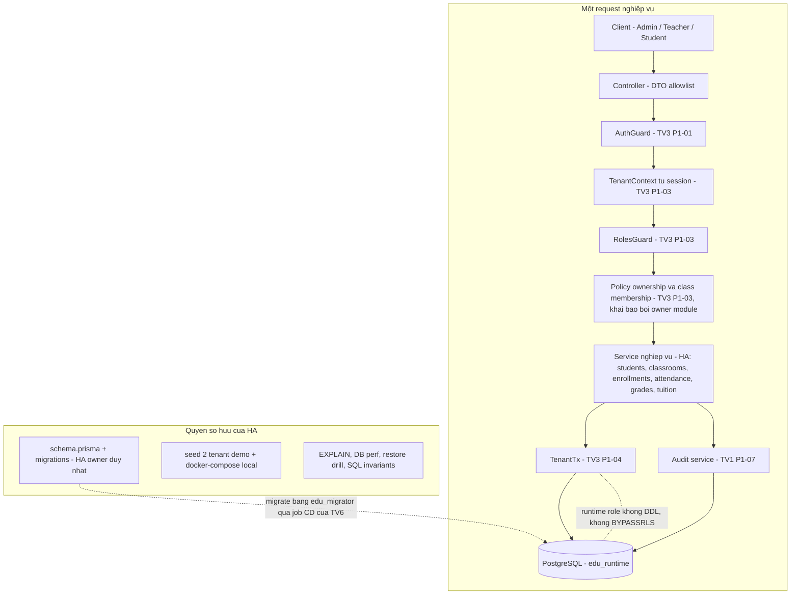
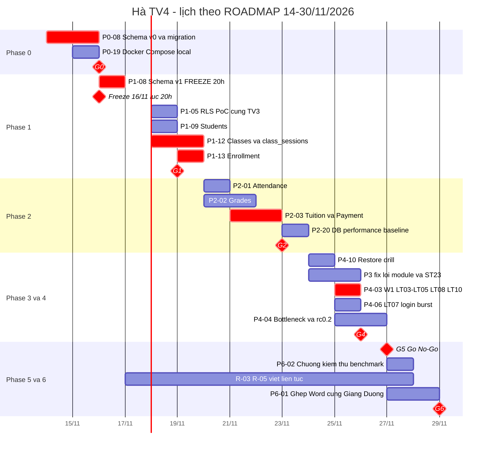
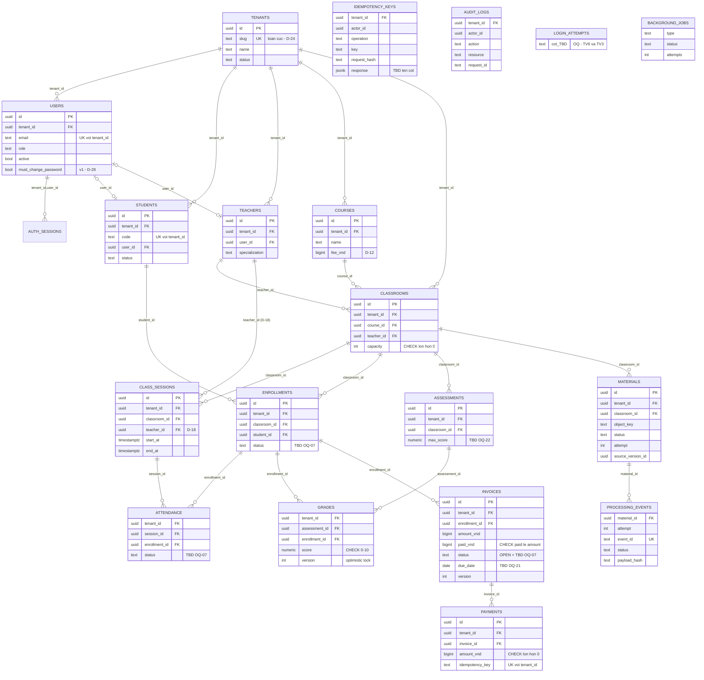
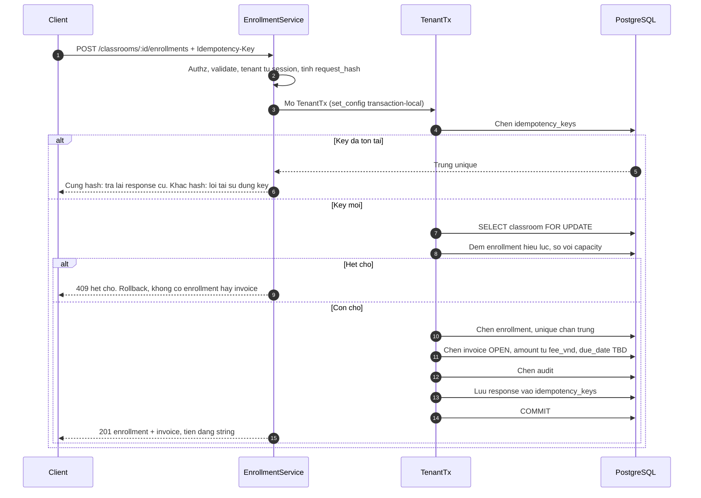
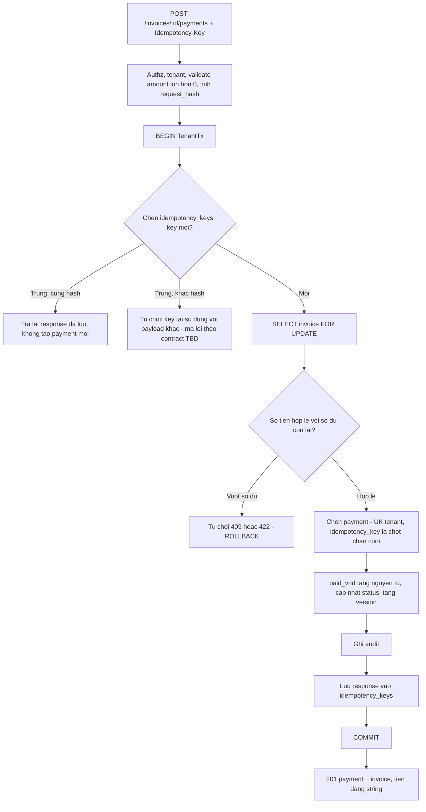
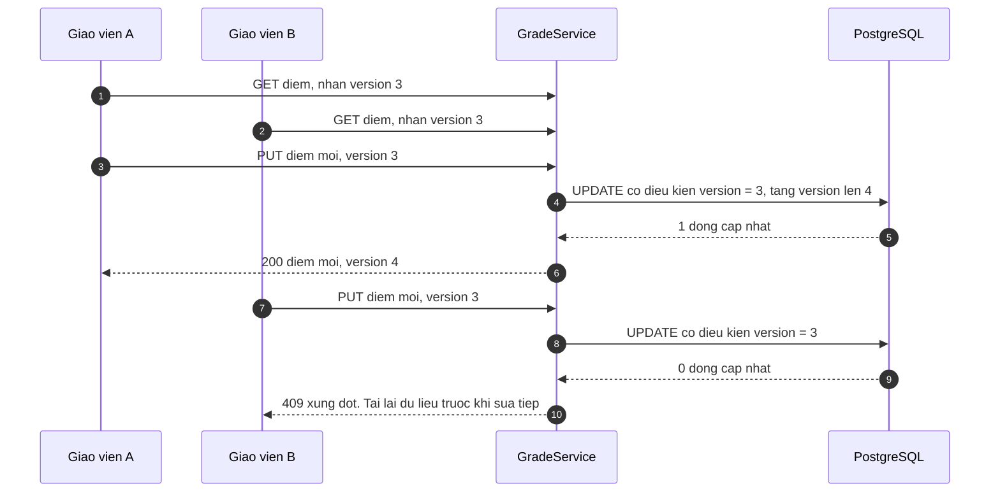
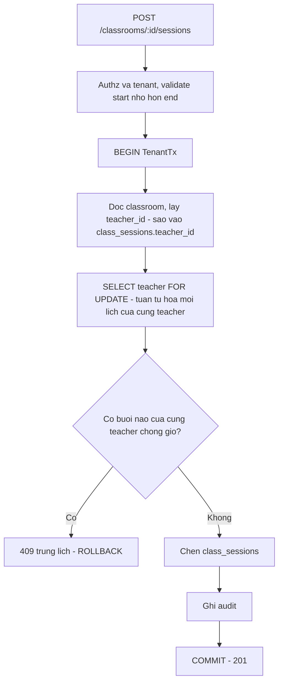
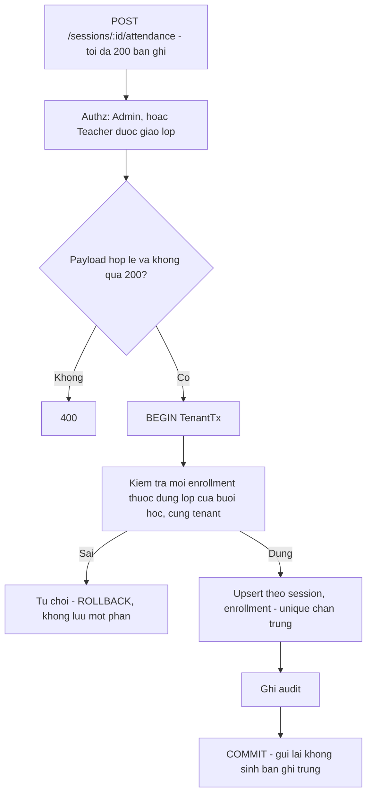

# HA.md — BACKEND DATA & BUSINESS ENGINEERING HANDOFF

| Trường | Nội dung |
|---|---|
| Dự án | EduCenter Cloud — B2B SaaS quản lý trung tâm giáo dục, multi-tenant, Azure + Alibaba Cloud (tổ hợp 9) |
| Tài liệu | `HA.md` — tài liệu giao việc cá nhân chính thức + nguồn context cho AI coding agent |
| Phiên bản tài liệu | 1.0 (bản đề xuất để trưởng nhóm duyệt) |
| Ngày tạo | 14/11/2026 |
| Thành viên | **Hà** |
| Mã vai trò | **TV4** (D-01, **Accepted** — ROADMAP §15.1) |
| Vai trò | Backend Engineer — Data & Business Logic; **owner duy nhất của Prisma schema và database migration** |
| Khối lượng | ~79 giờ theo ROADMAP §6.2 (đối chiếu chi tiết ở §5.4 và §17) |
| Source of Truth | `ROADMAP.md` (header v1.2, 13/11/2026; phần thân chủ yếu v1.1; **§15 là phân công thực tế đã chốt**) · `EduCenter_Cloud_Ban_Thiet_Ke_2.md` (V2.0) · `BTL CK 1.pdf` |
| Trạng thái dự án | **PLAN** — chưa có dòng code, chưa có hạ tầng, chưa có bằng chứng. Mọi số liệu trong tài liệu này là mục tiêu (SLO) hoặc ước lượng, **không phải kết quả đo**. Không task nào được coi là Done khi chưa có evidence (commit SHA + log test + handoff). |
| Hạn nộp BTL | 30/11/2026 (mục tiêu nội bộ 29/11/2026 22:00) |
| Mốc quan trọng nhất của Hà | **Schema v1 Freeze — 16/11/2026 lúc 20:00** (P1-08, D-27) |

> **Cách đọc tài liệu.** Mỗi quy tắc được gắn nhãn nguồn để không nhầm "đã chốt" với "đề xuất":
> - **[SRC]** — có trong ROADMAP / Bản thiết kế V2 / đề BTL (kèm mục tham chiếu).
> - **[Accepted]** — quyết định đã được nhóm chốt. Tại thời điểm tạo tài liệu **chỉ D-01 là Accepted**; mọi D-xx khác vẫn **Proposed** cho tới khi biên bản kick-off/Decision Log cập nhật.
> - **[Proposed]** — quyết định đã có trong Decision Log nhưng chưa được Accept.
> - **[ADD]** — biện pháp kỹ thuật do `HA.md` đề xuất bổ sung để thực thi (không phải quyết định của nhóm; cần reviewer xác nhận trước khi coi là quy tắc).
> - **[TBD]** — nguồn chưa đủ chi tiết; **không tự quyết định**, đã đưa vào §17 Open Questions.
>
> **Không tạo Task ID chính thức mới.** Phần chia nhỏ trong mỗi Task Card là *subtask/checklist* (đánh số `a, b, c…` hoặc "Bước n") nằm *bên trong* Task ID gốc. Các mã `INV-xx` (invariant), `RK-HA-xx` (rủi ro riêng), `OQ-xx` (câu hỏi mở) trong tài liệu này chỉ là nhãn tham chiếu nội bộ, **không phải Task ID** và không thay thế ID của ROADMAP.
>
> **Quy ước tham chiếu mục:** `§x.y` **không có tiền tố** = mục của chính `HA.md`; tham chiếu nguồn luôn có tiền tố (`ROADMAP §…`, `V2 §…`). Ở một số dòng trong bảng, tiền tố được rút gọn thành *nguồn* ngay trong cùng ô (vd "V2 §9.4"). Khi nghi ngờ, ưu tiên hiểu là nguồn nếu ô có chữ ROADMAP/V2/AGENTS.
>
> **Lưu ý trùng ký hiệu trong ROADMAP:** `R-01…R-11` vừa là *chương báo cáo* (ROADMAP §11.1) vừa trùng dạng với *Risk ID* (ROADMAP §10.1, `R-01…R-22`). Trong tài liệu này, "R-03 (chương)" là chương báo cáo, "Risk R-03" là rủi ro.

---

## 1. Tổng quan vai trò và trách nhiệm

### 1.1. Hồ sơ vai trò

| Mục | Nội dung | Nguồn |
|---|---|---|
| Mapping | TV4 = **Hà** | D-01 Accepted; ROADMAP §15.1 |
| Mảng việc chính | Backend: Data & Nghiệp vụ | §6.1, §15.1 |
| Module owner | Prisma schema/migration (owner duy nhất), `students`, `classrooms` (+ `class_sessions`), `enrollments`, `attendance`, `grades` (+ `assessments`), `tuition` (invoices/payments), DB performance, restore drill | §6.1, §15.1 |
| Pool review | Không thuộc pool nhạy cảm A/B/C; PR của Hà được **TV3 review phần authz** và TV1 review nghiệp vụ/kiến trúc/dữ liệu quan trọng | §15.1, §6.1 |
| Reviewer chính cho | Seed/k6 data, `teachers`, `courses`, **mọi PR có label `migration`** | §6.1 |
| Được review bởi | TV3 (authz/security), TV1 (nghiệp vụ, kiến trúc, tuition — Pool B) | §6.1, §5 |
| Chương báo cáo | Ch3 phần Azure (R-03), Ch4 so sánh hai Cloud (R-05, cùng TV5), Ch9 kiểm thử & benchmark (R-10 = P6-02, cùng TV6); **ghép báo cáo Word cùng Giang + Dương (P6-01)** | §11.1, §15.2 |
| Slide | **Không phải slide lead.** Slide do Anh, Doanh, Đức chủ trì (P6-05) | §15.2 (xem mâu thuẫn tại §16.3 và OQ-01) |

### 1.2. Năm loại trách nhiệm của Hà

| Loại | Ý nghĩa | Task |
|---|---|---|
| **A. Thực hiện trực tiếp (Owner)** | Hà viết/chịu trách nhiệm đầu ra | P0-08, P0-19, P1-08, P1-09, P1-12, P1-13, P2-01, P2-02, P2-03, P2-20, P4-06, P4-10 |
| **B. Đồng sở hữu (Co-owner)** | Chia việc với thành viên khác trong cùng Task ID | P1-05 (cùng TV3), P4-03 (cùng TV6), P4-04 (cùng TV3), P6-02 = R-10 (cùng TV6), R-05 (cùng TV5), R-03 (phần Azure) |
| **C. Review / phê duyệt migration** | Không viết code của task, chỉ review/approve | P1-04, P1-10, P1-11, P1-20, P2-04, P2-10 (+ quản lý migration), P2-18, P4-02, P4-05; mọi PR `migration`; **ST23 thuộc trách nhiệm TV4** |
| **D. Hỗ trợ / tham gia tập thể** | Không phải owner nhưng có phần việc | P6-01 (ghép báo cáo cùng Giang, Dương), P6-06 (cả 6 người), P5-04 (Go/No-Go, ký 6 người), P3-07 (sửa lỗi module mình), kick-off/standup |
| **E. Chỉ khi contingency kích hoạt** | Đổi người theo ROADMAP §10.3 | P1-12 phần `class_sessions` → TV5 nhận nếu P1-12 chưa merge lúc 19/11 12:00; xem thêm §14.4 |

### 1.3. Hà KHÔNG phụ trách (giữ nguyên owner hiện tại — không giao lại cho Hà)

| Hạng mục | Owner hiện tại | Quan hệ của Hà |
|---|---|---|
| Auth, session, CSRF, authorization framework (P1-01, P1-02, P1-03) | TV3 — Anh | Chỉ **dùng** `@Policy()`/guards; không viết lại |
| `TenantTx` (P1-04), DB roles `edu_migrator`/`edu_runtime` (P1-23), RLS policy implementation | TV3 — Anh | Review P1-04; co-owner P1-05; review P2-10; **không implement** TenantTx/roles |
| Audit service (P1-07) | TV1 — Đức | Chỉ **gọi** audit trong module mình (AC của từng task module) |
| Teachers (P1-10), Courses (P1-11), cấp tài khoản (P1-25) | TV5 — Dương | Chỉ **review** P1-10/P1-11 |
| Dashboard (P2-04) | TV1 — Đức | Chỉ **review** (EXPLAIN/query) |
| Seed generator benchmark (P1-20), k6 scripts (P2-18), CI/CD, migration job, Azure infra | TV6 — Giang | Review P1-20/P2-18; co-owner benchmark W1 |
| OpenAPI contract, ADR | TV1 — Đức | Là **bên tiêu thụ + đề xuất thay đổi**; không tự sửa root contract |
| Slide (P6-05) | Anh, Doanh, Đức (§15.2) | Không giao cho Hà |
| Materials API, callback, reconciliation | TV5 — Dương / TV3 — Anh | Chỉ cung cấp **schema dependencies** (P1-08) |
| Frontend | TV2 — Doanh | Bàn giao API contract + hành vi 409/pagination |

### 1.4. Sở hữu migration ≠ triển khai từng migration policy

| Khía cạnh | Ai chịu trách nhiệm | Nguồn |
|---|---|---|
| `schema.prisma`, thư mục `apps/api/prisma/migrations/`, change request, ERD | **TV4 (Hà) — owner duy nhất.** Sau freeze 16/11 20:00 chỉ TV4 đổi schema | §7.1, D-27, ADR-024 |
| Nội dung migration policy RLS (P1-05 PoC, P2-10 rollout) | TV3 thiết kế policy; **TV4 sở hữu PR migration, review và quản lý** (P1-05 ghi "qua PR migration của TV4"; P2-10 "qua PR migration") | §5.2 P1-05, §5.3 P2-10 |
| Script khởi tạo DB roles, `ALTER DEFAULT PRIVILEGES` (`apps/api/prisma/roles/`) | TV3 (P1-23) — **không phải migration của Hà**; Hà không sửa | §5.2 P1-23 |
| Chạy `prisma migrate deploy` trong CD, firewall rule tạm | TV6 (P0-12, D-25) | §5.1 P0-12 |
| Migration có nguy cơ mất dữ liệu | R = TV4; A = TV4 + TV3; C = TV1; I = TV6 | §6.3 RACI |
| Ai approve PR `migration` | **Chưa đồng bộ** giữa §6.1 ("TV4 reviewer mọi PR migration"), §7.4 ("TV4 approve"), Pool B/AGENTS.md (`prisma/migrations/` → TV1, dự phòng TV3). Xem **OQ-02** và đề xuất [ADD] ở §12 | §6.1, §7.2, §7.4 |

### 1.5. Decision Log liên quan trực tiếp tới Hà

> Trạng thái lấy nguyên từ ROADMAP §2.3. **Hà không được coi quyết định Proposed là đã chốt** khi viết code; nếu quyết định thay đổi, cập nhật task card và báo trưởng nhóm.

| ID | Nội dung ảnh hưởng Hà | Người quyết (theo nguồn) | Hạn | Trạng thái | Task liên quan |
|---|---|---|---|---|---|
| D-01 | Mapping TV1–TV6 → tên thật | Cả nhóm | 14/11 | **Accepted** | Toàn bộ |
| D-04 | Đổi `sessions` → `class_sessions` (model `ClassSession`); API path giữ `/sessions/:id/attendance` | TV1 + TV4 | 14/11 | Proposed | P0-08, P1-12, P2-01 |
| D-05 | RLS: PoC `students` → quyết định rollout trước 19/11 (ngưỡng p95 ≤ +20%, không tăng pool wait đáng kể) | TV3 + TV1 | 19/11 | Proposed | P1-05, P2-10 |
| D-12 | Tiền VND `BIGINT` trong DB, JSON dạng **string** | TV1 + TV4 | 14/11 | Proposed | P0-09, P1-11, P2-03 |
| D-13 | `idempotency_keys` (tenant, actor, operation, key, request_hash, response) chỉ cho `POST /invoices/:id/payments` (bắt buộc) và `POST /classrooms/:id/enrollments`; `payments.idempotency_key` unique là chốt chặn cuối | TV4 + TV3 | 16/11 | Proposed | P1-13, P2-03 |
| D-18 | Chống trùng lịch: `class_sessions.teacher_id` + `SELECT … FOR UPDATE` hàng teacher + kiểm tra chồng giờ trong cùng transaction; **bỏ `btree_gist`** | TV4 | 16/11 | Proposed | P0-08, P1-12 |
| D-24 | Login gồm `tenantSlug`; `users` unique `(tenant_id,email)`; `tenants.slug` unique | TV3 + TV1 | 14/11 | Proposed | P0-08 |
| D-25 | DB roles `edu_migrator` / `edu_runtime`; default privileges; `audit_logs` chỉ INSERT/SELECT; migration chạy qua job CD với firewall rule tạm | TV6 + TV3 | 15/11 | Proposed | P0-08 (ảnh hưởng cách viết migration), P1-23 |
| D-26 | Mọi truy cập DB nghiệp vụ qua `TenantTx` từ P1-04 | TV3 + TV4 | 16/11 | Proposed | P1-04, mọi module của Hà |
| D-27 / ADR-024 | **Schema v1 đóng băng 16/11 20:00**; sau đó đổi schema = change request cho TV4 (+ ADR nếu đổi nghĩa) | TV4 + TV1 | 16/11 | Proposed | P1-08 |
| D-30 | Bench build `rc0.1` (25/11 12:00) / `rc0.2`; mọi số liệu gắn SHA | TV1 + TV6 | 22/11 | Proposed | P4-03, P4-04 |
| D-08 | Hai cửa sổ benchmark W1 (25/11 14:00–18:00), W2 (26/11 09:00–13:00) | Cả nhóm | 22/11 | Proposed | P4-xx |
| D-16 | Session benchmark chỉ cho tenant `bench-*`, TTL ≤ 24 h, **không có cờ bypass** | TV3 + TV6 | 18/11 | Proposed | P1-20 (review), P4-11 |

> **Cảnh báo:** Hà vừa là "người quyết" của D-18 và đồng quyết của D-13, D-27, D-04, D-12, D-26. Các quyết định này chặn P0-08/P1-08 nhưng nguồn chưa Accept D-18/D-13/D-27 trước khi Hà phải bắt đầu code (P0-08 bắt đầu 14/11). Cách xử lý: xem **OQ-03** và §3.5.

---

## 2. Bức tranh kiến trúc Backend Data & Business

### 2.1. Vị trí của Hà trong kiến trúc

Kiến trúc [SRC §1.2, V2 §5]: **Modular Monolith NestJS** + PostgreSQL Flexible Server (Azure) + Prisma (khóa version); worker xử lý học liệu nằm ở Aliyun (không phải phạm vi của Hà). Critical path nghiệp vụ chỉ cần Azure API + PostgreSQL (V2 §5.3). Hà làm việc ở **tầng Service + Data** của các module nghiệp vụ và sở hữu **schema**.



### 2.2. Ai cung cấp gì cho Hà (interfaces tiêu thụ)

| Interface | Nhà cung cấp | Task nguồn | Hà dùng để | Nếu chưa sẵn sàng |
|---|---|---|---|---|
| `TenantTx` (interactive transaction + `set_config('app.tenant_id', …, true)` + Prisma client có scope) | TV3 | P1-04 (17–18/11) | Mọi truy vấn DB của module | Viết service theo interface giả định + test trước, **không** gọi Prisma trực tiếp để "tạm chạy" (xem §10) |
| `@Policy()`, `RolesGuard`, `TenantContext`, route inventory test | TV3 | P1-03 (17/11) | Khai báo quyền cho mọi route của Hà | Không merge route thiếu policy (deny-by-default) |
| Audit service (append-only) | TV1 | P1-07 (17/11) | Ghi audit đổi lịch, ghi danh, điểm danh, đổi điểm, payment | Task module có audit trong AC; nếu P1-07 chưa merge → blocker mềm, ghi rõ trong handoff |
| Error filter `{code,message,requestId,fieldErrors}`, ValidationPipe | TV3 | P0-07 | Trả lỗi chuẩn | — |
| OpenAPI conventions (error schema, pagination, `Idempotency-Key`, money string) | TV1 | P0-09, P1-14 | Contract-first | Gửi change request cho TV1 |
| DB roles + default privileges | TV3 | P1-23 | Integration test chạy bằng `edu_runtime` | Test local chỉ có ý nghĩa với runtime role |
| Migration job (firewall tạm → `migrate deploy`) | TV6 | P0-12 | Áp migration lên demo | Không tự chạy migration lên demo bằng quyền admin |
| Teachers/Courses APIs | TV5 | P1-10, P1-11 | `classrooms.teacher_id`, `course_id` | Xem Handoff Matrix §8 |
| Helper idempotency dùng chung | **Chưa có owner trong nguồn** | — | Enrollment + Payment | **OQ-04** |

### 2.3. Quy tắc tích hợp bắt buộc (áp dụng cho mọi module của Hà) — [SRC AGENTS.md §7.2, D-26, V2 §9.2]

1. Mọi truy cập DB nghiệp vụ đi qua **`TenantTx`** (common/prisma). Không import `PrismaClient` trực tiếp ngoài `common/prisma`.
2. Không dùng `$queryRawUnsafe`; không nối chuỗi SQL. Nếu cần `FOR UPDATE`/SQL thô cho lock → dùng API an toàn của TenantTx đã được TV3 cung cấp (**[TBD]** cách TenantTx cho phép raw lock — hỏi TV3 trong review P1-04, OQ-05).
3. `tenant_id` **chỉ lấy từ session** (TenantContext). Không nhận `tenant_id`, `role`, `userId` từ body/query để cấp quyền.
4. Mọi route có `@Policy()`; DTO `whitelist` + `forbidNonWhitelisted`; giới hạn kích thước mảng.
5. **Không giữ transaction khi gọi mạng** (không có call mạng ngoài DB trong module của Hà).
6. Tiền: `BIGINT` ↔ JSON `string`; không `Number`/float. Thời gian lưu UTC.
7. Gọi audit **ngay trong module** (AC từng task); P2-19 chỉ kiểm tra coverage, không sửa code module.
8. Không thêm cờ bypass authz/rate limit/CSRF cho test hoặc benchmark.
9. Không sửa `schema.prisma` ngoài workflow migration (§9, §12).

### 2.4. Ma trận quyền Hà phải hiện thực trong service (V2 §6.2)

| Nghiệp vụ | Admin | Teacher | Student | Task |
|---|---|---|---|---|
| Hồ sơ học viên | Quản lý trong tenant | Xem học viên **lớp được giao** | Xem bản thân | P1-09 |
| Khóa học và lớp | Quản lý | Xem lớp được giao | Xem lớp đã ghi danh | P1-12 |
| Ghi danh | Quản lý *(suy ra từ ma trận + P1-17/IP-3)* **[TBD]** | — | — | P1-13 |
| Điểm danh | Quản lý | **Sửa lớp được giao** | Xem của mình | P2-01 |
| Điểm số | Quản lý | **Sửa lớp được giao** | Xem của mình | P2-02 |
| Học phí | Quản lý | **Không** | Xem của mình | P2-03 |
| Dashboard | Toàn trung tâm | Phạm vi lớp | Cá nhân | P2-04 (TV1) |

"Lớp được giao" = `classrooms.teacher_id` của Teacher đó [SRC V2 §9.1]. PLATFORM_ADMIN **không** triển khai trong BTL (D-24).

---

## 3. Phạm vi công việc và Data Invariants

### 3.1. Trong phạm vi của Hà (P0 — F02, F05, F06, F07, F08, F10 + nền tảng dữ liệu)

| Module | Chức năng V2 | Endpoint theo V2 §14 | Task | Ghi chú |
|---|---|---|---|---|
| Schema/migration | — | — | P0-08, P1-08, mọi change request | Owner duy nhất |
| Local dev | — | — | P0-19 | Docker Compose local |
| Students (F02) | Hồ sơ, tìm kiếm | `GET/POST /students`, `PATCH /students/:id`; **`get` chi tiết có trong phạm vi P1-09** (đường dẫn `GET /students/:id` là **[Proposed]**, chốt trong OpenAPI v1 — P1-14) | P1-09 | Pagination ≤ 100 |
| Classes/Schedule (F05) | Lớp, lịch, buổi học | `GET/POST /classrooms`, `POST /classrooms/:id/sessions` | P1-12 | Endpoint sửa lịch/lớp **[TBD]** — nguồn chỉ liệt kê tạo |
| Enrollment (F06) | Ghi danh, sức chứa | `POST /classrooms/:id/enrollments` | P1-13 | `Idempotency-Key` theo D-13 |
| Attendance (F07) | Điểm danh | `PUT /sessions/:id/attendance` | P2-01 | Batch ≤ 200 |
| Grades (F08) | Đầu điểm, nhập điểm | `POST /classrooms/:id/assessments`, `PUT /assessments/:id/grades` | P2-02 | Version → 409 |
| Tuition (F10) | Khoản phải thu, thanh toán thủ công | `GET /invoices`, `POST /invoices/:id/payments` | P2-03 | `Idempotency-Key` **bắt buộc** |
| DB performance | PERF-04/05/06 | — | P2-20, P4-03, P4-04 | EXPLAIN ANALYZE 10 truy vấn |
| Restore | V2 §18 | — | P4-10 | PITR sang server cô lập |

> **Endpoint đọc cho Student/Teacher** (lịch, điểm, lịch sử điểm danh, liệt kê điểm danh/điểm theo lớp) mà FE cần ở P2-11/P2-12 **không có trong bảng V2 §14**. Hà **không tự thêm**; xem **OQ-06** (gửi change request cho TV1).

### 3.2. Ngoài phạm vi (tuyệt đối không làm)

| Hạng mục | Lý do / nguồn |
|---|---|
| P1 (F12–F15) và P2 (F16–F18): CSV export, assignments, notifications, certificates, parent portal, online payment gateway, AI | D-22 (Proposed): ngoài phạm vi BTL; V2 §6.1 |
| Cổng thanh toán online, payment gateway | V2 §6.1 F17 (P2); đề bài giao Hà: thanh toán **thủ công** |
| `btree_gist`, exclusion constraint cho lịch | D-18 (loại bỏ) |
| Idempotency cho mọi mutation | D-13: chỉ payment + enrollment |
| Redis, PgBouncer, HA database | §2.2 / V2 §5.4 — chỉ thiết kế |
| Dữ liệu học viên thật | V2 §11.7; AGENTS §2 |
| PLATFORM_ADMIN | D-24 |
| Destructive migration, reset DB | Constraints; D-27 backward-compatible |

### 3.3. Danh mục Data Invariants

> Cột "Tầng bảo đảm": **DB** = ràng buộc ở PostgreSQL (CHECK/UNIQUE/FK) · **TX** = transaction + lock/version trong ứng dụng · **APP** = validation ứng dụng · **VERIFY** = kiểm bằng SQL sau chạy (P4-03, LT08/LT10). Tên cột chính xác sau schema v1 còn **[TBD]**; dùng tên khái niệm.

| INV | Bất biến | Tầng | Cách kiểm chứng | Nguồn |
|---|---|---|---|---|
| INV-01 | Không liên kết dữ liệu chéo tenant (mọi FK giữa bảng nghiệp vụ là composite `(tenant_id, x_id)` → `UNIQUE(tenant_id, id)`) | DB | Integration: tạo enrollment chéo tenant bị DB từ chối (P0-08) | V2 §9.2; P0-08 |
| INV-02 | `tenants.slug` unique; `users(tenant_id, email)` unique | DB | Integration cùng email 2 tenant (P1-01 của TV3) | D-24; V2 §9.4 |
| INV-03 | `students(tenant_id, code)` unique | DB | Integration | V2 §9.4 |
| INV-04 | Không ghi danh trùng: `enrollments(tenant_id, classroom_id, student_id)` unique | DB | P1-13 test | V2 §9.4, §6.3 |
| INV-05 | Sức chứa lớp `capacity > 0` | DB (CHECK) | Constraint test (P1-08) | P1-08 |
| INV-06 | Số enrollment ≤ `capacity` | **TX** (khóa classroom `FOR UPDATE`) | 20 request vào lớp sức chứa 10 → đúng 10 | P1-13; V2 §9.5 |
| INV-07 | Ghi danh thành công ⇒ có invoice tương ứng trong **cùng transaction** (`status=OPEN`, `due_date`) | TX | Test rollback + VERIFY: đếm enrollment không có invoice = 0 | P1-13; yêu cầu đề bài |
| INV-08 | Teacher không có 2 buổi chồng giờ | **TX** (D-18: khóa hàng teacher + kiểm tra chồng giờ trong transaction) | 10 request song song, 1 thành công | P1-12; D-18 |
| INV-09 | Mỗi buổi chỉ 1 điểm danh/học viên: `attendance(session, enrollment)` unique | DB + TX (bulk upsert) | Gửi lại payload không trùng | V2 §9.4; P2-01 |
| INV-10 | Enrollment trong payload điểm danh phải thuộc **đúng lớp của buổi học** và cùng tenant | APP/TX (composite FK chỉ bảo đảm cùng tenant, không bảo đảm cùng lớp) **[ADD]** | Test enrollment lớp khác | P2-01 (đề bài) |
| INV-11 | Điểm trong [0, 10] | DB (CHECK) + APP | Test biên 0, 10, −0,1, 10,1 | P1-08; V2 §6.3 |
| INV-12 | `grades(assessment, enrollment)` unique; enrollment thuộc lớp của assessment | DB + APP | Test | V2 §9.4; P2-02 |
| INV-13 | Không ghi đè điểm khi 2 người sửa đồng thời: cập nhật có điều kiện theo `version`, xung đột → 409 | **TX/optimistic lock** | 2 update cùng version: 1 thành công, 1 nhận 409 | P2-02 |
| INV-14 | `payment.amount > 0` | DB (CHECK) + APP | Test 0, âm | P1-08 |
| INV-15 | `paid_vnd ≥ 0` và `paid_vnd ≤ amount_vnd` (tổng đã thanh toán không vượt số phải thu) | DB (CHECK) + **TX** (khóa invoice) | 2 payment đồng thời vượt số dư → 1 bị từ chối | P1-08; P2-03; ST23 |
| INV-16 | `payments(tenant_id, idempotency_key)` unique — chốt chặn cuối | DB | Gửi trùng key → 1 payment | V2 §9.4; D-13 |
| INV-17 | Cùng `Idempotency-Key` + cùng request → trả lại kết quả cũ; khác payload → xử lý theo contract | TX | Test | D-13 |
| INV-18 | Không có payment đã ghi mà invoice chưa cập nhật (cùng transaction) | TX | Test rollback giữa chừng + VERIFY: `invoice.paid_vnd = SUM(payments.amount)` | P2-03 (đề bài) |
| INV-19 | Tiền = `BIGINT` ↔ JSON `string`; không float | DB + APP | Test số lớn > 2^53 | D-12 |
| INV-20 | `audit_logs` append-only (runtime chỉ INSERT/SELECT) | DB (privileges, TV3 P1-23) | UPDATE/DELETE bị từ chối (P1-07) | D-25; V2 §11.8 |
| INV-21 | Không trả invoice/điểm/hồ sơ của người khác khi không có quyền | APP (policy) + test | ST01–ST04 | V2 §11.4 |
| INV-22 | `invoices.status` nhất quán với `paid_vnd`/`amount_vnd` | TX **[TBD]** | Giá trị status ngoài `OPEN` chưa được nguồn định nghĩa (**OQ-07**) | P1-13/P2-03 |

### 3.4. DB-enforced vs Application-enforced — tóm tắt

| Chỉ cần DB đảm bảo (và test ở mức DB) | Cần transaction/lock/version (không thể chỉ bằng constraint) |
|---|---|
| Composite FK chéo tenant, unique slug/email/code/enrollment/attendance/grade/payment-key, CHECK score/amount/paid/capacity | Sức chứa (INV-06), chống trùng lịch (INV-08), enrollment+invoice nguyên tử (INV-07), optimistic lock điểm (INV-13), chống payment vượt số dư và đồng bộ `paid_vnd` (INV-15, INV-18), idempotency (INV-17), enrollment cùng lớp với session (INV-10) |

### 3.5. Quyết định/chi tiết chưa chốt mà Hà bị chặn bởi — [TBD]

Hà bắt đầu code ngày 14/11, trong khi D-04, D-18, D-13, D-27 còn Proposed. Quy tắc làm việc đề xuất [ADD]: **viết theo nội dung Proposed trong Decision Log** (đó là thiết kế đã review), đánh dấu rõ trong PR "dựa trên D-xx (Proposed)", và nếu nhóm đổi quyết định → tạo change request, **không** tự đổi hướng. Danh sách đầy đủ ở §17.

---

## 4. Master Timeline cá nhân — Phase 0 đến Phase 6

### 4.1. Lịch theo Phase (ngày/gate lấy từ ROADMAP §3.1 — không thay đổi)

| Phase | Ngày | Gate | Việc của Hà (Task ID) | Đầu ra then chốt |
|---|---|---|---|---|
| **0** Foundation | 14–15/11 (buffer sáng 16/11) | **G0** 16/11 12:00 | P0-08 (14–15/11), P0-19 (15/11) | Schema v0 migrate được từ DB rỗng; FK chéo tenant bị từ chối; seed 2 tenant; docker-compose local ≤ 15 phút |
| **1** Core Platform | 16–19/11 | **G1** 19/11 20:00 | **P1-08 (16/11, freeze 20:00)**, P1-05 (18/11), P1-09 (18/11), P1-12 (18–19/11), P1-13 (19/11); review P1-04, P1-10, P1-11, P1-20 | Schema v1 đóng băng; Students/Classes/Enrollment; test đồng thời pass; số liệu RLS PoC |
| **2** Features | 20–23/11 | **G2** 23/11 20:00 | P2-01 (20/11), P2-02 (20–21/11), P2-03 (21–22/11), P2-20 (23/11); review P2-04, P2-10, P2-18 | Attendance/Grades/Tuition; ST23; EXPLAIN baseline; invariant SQL |
| **3** Hardening | 24–25/11 | **G3** 25/11 20:00 | Fix lỗi module mình (P3-07, ~2h); ST23 evidence; review migration/data integrity | Không lỗi tenant/authz/money trong module của Hà |
| **4** Performance | 24–26/11 | **G4** 26/11 20:00 | P4-10 (24/11), P4-03 (25/11 W1), P4-06 (25/11 W1), P4-04 (25/11 tối – 26/11 sáng); review P4-02, P4-05 | RPO/RTO đo thật; SQL invariants sau tải; phân tích bottleneck; `rc0.2` chỉ fix hiệu năng |
| **5** Release | 26–27/11 | **G5** 27/11 12:00 | Không có Task ID TV4 (§6.2: 0 h). Tham gia P5-04 (ký Go/No-Go, 6 người) | Hỗ trợ hotfix DB/nghiệp vụ nếu có; đóng góp hard gate HG5 |
| **6** Delivery | 27–30/11 | **G6** 29/11 22:00 | P6-02 = R-10 (27/11), R-03, R-05, P6-01 (ghép Word cùng Giang + Dương), P6-06 (cả nhóm) | Chương báo cáo + evidence; bản Word hoàn chỉnh |

### 4.2. Critical path riêng của Hà (theo dependency **thực tế** của ROADMAP)

Chuỗi minh họa trong đề bài: *Schema v0 → Schema v1 Freeze → TenantTx Integration → Students/Classrooms → Enrollment → Attendance/Grades/Tuition → E2E → DB Performance → Benchmark → Release.* Đối chiếu với cột Dep §5 và flowchart §3.3:

```mermaid
flowchart LR
    P004["P0-04 Monorepo - TV1"] --> P008["P0-08 Schema v0 - HA"]
    P008 --> P108["P1-08 Schema v1 FREEZE 16/11 20:00 - HA"]
    P108 --> P123["P1-23 DB roles - TV3"]
    P123 --> P101["P1-01 Auth - TV3"]
    P101 --> P103["P1-03 AuthZ - TV3"]
    P103 --> P104["P1-04 TenantTx - TV3, HA review"]
    P108 --> P109["P1-09 Students - HA"]
    P104 --> P109
    P104 --> P112["P1-12 Classes + sessions - HA"]
    P108 --> P112
    P110["P1-10 Teachers + P1-11 Courses - TV5"] --> P112
    P112 --> P113["P1-13 Enrollment - HA"]
    P113 --> P201["P2-01 Attendance - HA"]
    P113 --> P202["P2-02 Grades - HA"]
    P113 --> P203["P2-03 Tuition - HA"]
    P201 --> P217["P2-17 E2E - TV6 + TV2"]
    P203 --> P217
    P217 --> G2{{"G2 23/11"}}
    P201 --> P220["P2-20 DB perf - HA"]
    P202 --> P220
    P203 --> P220
    P220 -. "bat song song, khong chan E2E" .-> G2
    G2 --> P310["P3-10 Bench build rc0.1 - TV1"]
    P310 --> P403["P4-03 W1 LT03-LT10 - TV6 + HA"]
    P403 --> P404["P4-04 Bottleneck + rc0.2 - HA + TV3"]
    P404 --> G4{{"G4 26/11"}}
    G4 --> G5{{"G5 Go/No-Go 27/11"}}
```



**Điểm lệch giữa chuỗi minh họa và nguồn — Hà dùng nguồn, không dùng chuỗi minh họa để đổi lịch:**

| # | Chuỗi minh họa | Nguồn thực tế | Tác động |
|---|---|---|---|
| 1 | "TenantTx Integration" là một bước sau Freeze | `TenantTx` là **P1-04 của TV3** (17–18/11). Hà không "tích hợp" bằng task riêng mà **dùng** TenantTx trong P1-09, P1-12… | P1-09 (18/11) và P1-12 (18–19/11) bị chặn bởi P1-04 + P1-08 |
| 2 | P1-12 phụ thuộc TenantTx | Cột Dep của P1-12 ghi **P1-08, P1-10, P1-11** (không có P1-04), nhưng flowchart §3.3 vẽ `P1-04 → P1-12` và D-26 yêu cầu mọi truy cập DB qua TenantTx | **Không đồng bộ nội bộ ROADMAP** → xử lý thận trọng: coi P1-04 là điều kiện bắt đầu **[ADD]**; ghi **OQ-08** |
| 3 | "E2E" nằm trước DB Performance | P2-20 (23/11) phụ thuộc P1-20, P2-01..03; **không** phụ thuộc P2-17 | P2-20 chạy song song E2E; cả hai trước G2 |
| 4 | "Benchmark → Release" | P4-03 dep P4-02 (dep P4-01, P3-10, D-08); G4 → G5 | Hà không mở được W1 nếu `rc0.1` chưa tag 25/11 12:00 |
| 5 | P0-19 không nằm trên chuỗi | P0-19 (15/11) dep P0-07 (TV3, 14/11) và P0-08 | Không critical, nhưng **lịch P0-19 (15/11) có thể trước khi P0-07 merge** → xem **OQ-09** |

**Hệ quả với critical path chung của dự án (ROADMAP §3.3):** `P0-04 → P0-07/P0-08 → P1-08 (freeze 16/11) → P1-23 → P1-01 → P1-03 → P1-04 → P1-12 → P1-13 → P2-03 → P2-17 → P3-02 → P3-10 → P4-03 → G4 → G5`. **Có 6 task của Hà nằm trực tiếp trên critical path** (P0-08, P1-08, P1-12, P1-13, P2-03, P4-03). Slack toàn dự án ≈ 1 ngày. Mọi trễ của Hà ở các task này trừ trực tiếp vào slack đó.

### 4.3. MỐC QUAN TRỌNG NHẤT — Schema v1 Freeze 16/11/2026 20:00

> **Schema v1 Freeze: 16/11/2026, 20:00 (P1-08, D-27 / ADR-024).** Toàn bộ backend P1–P2 (P1-01, P1-06, P1-09, P1-12, P1-13, P1-20, P1-22, P2-xx) phụ thuộc schema này. Sau mốc: **chỉ TV4 đổi schema, qua change request**; một PR `migration` mở tại một thời điểm; migration phải backward-compatible.

Chuỗi phụ thuộc phía sau freeze (từ cột Dep §5):

| Task chờ freeze | Owner | Dep | Lịch nguồn |
|---|---|---|---|
| P1-23 DB roles + privileges | TV3 | P1-08 | 16/11 tối · 3h |
| P1-01 Auth | TV3 | P0-07, P0-08, **P1-23** | 16–17/11 · 8h |
| P1-06 Login rate limit (`login_attempts`) | TV6 | P1-01, P1-07, **P1-08** | 18/11 |
| P1-20 Seed benchmark | TV6 | P1-01, **P1-08** | 18–19/11 |
| P1-22 Domain materials | TV5 | **P1-08** | 18/11 |
| P1-09 / P1-12 / P1-10 / P1-11 | TV4 / TV5 | P1-08 (+P1-04) | 17–19/11 |

**Lịch nội bộ đề xuất cho 16/11 [ADD — không thay đổi mốc 20:00 của nguồn]:**

| Giờ | Việc | Ghi chú |
|---|---|---|
| 12:00 | G0 diễn ra; P0-08 phải đã merge (đã có từ 15/11) | P0-08 là dependency của P1-08 |
| trước 16/11 (15/11 tối) | Bắt đầu P1-08 (đọc V2 §9, liệt kê bảng/cột/constraint/index; chốt danh sách thiếu) | Thực hiện sớm vì P1-08 = 6h > ~5h/ngày làm việc |
| 14:00 | **Gửi bản nháp schema v1 + ERD cho TV3, TV5, TV1, TV6** để xác nhận (đề bài: "lấy xác nhận của các thành viên Backend") | Hạn phản hồi đề xuất 17:00 **[ADD]** |
| 17:30 | Mục tiêu merge PR `migration` P1-08 vào `main` (sớm hơn 20:00 để TV3 chạy P1-23 tối 16/11) | **[ADD]**; nếu chưa kịp thì giữ nguyên 20:00 |
| **20:00** | **FREEZE**: gắn tag/ghi nhận commit SHA schema v1; công bố trong kênh nhóm; từ đây mọi đổi schema = change request (§9.4) | Nguồn |
| 20:00 trở đi | Không merge thêm cột/bảng "tiện tay" từ bất kỳ PR feature nào | AGENTS §3 |

### 4.4. Gantt cá nhân (ngày/gate theo ROADMAP)



### 4.5. Việc Hà phải chứng minh tại từng Gate

| Gate | Điều kiện nguồn liên quan Hà | Evidence Hà chuẩn bị | Người duyệt (nguồn) |
|---|---|---|---|
| G0 (16/11 12:00) | Migrate được từ DB rỗng; (2) `/health` DB TLS bằng `edu_runtime` (TV6/TV3) | P0-08: log migrate + test FK chéo tenant; P0-19: runbook + xác nhận thành viên khác chạy ≤ 15 phút | TV1 + TV3 |
| **Freeze** (16/11 20:00) | Schema v1 đầy đủ, ERD sinh được, mọi task backend tìm thấy bảng/cột cần | P1-08: PR migration, ERD, constraint tests, xác nhận của TV3/TV5/TV1/TV6 | TV4 + TV1 (D-27) |
| G1 (19/11 20:00) | Schema v1 đóng băng; **enrollment concurrency test pass**; ST01–ST07, ST10 cho module hiện có; D-05 + CP1 | P1-12/P1-13 log test đồng thời; ST01/ST02/ST04 cho students; báo cáo RLS PoC (P1-05) | TV1 + TV3 + TV6 |
| G2 (23/11 20:00) | Luồng P0 E2E; audit coverage; EXPLAIN baseline; CP2 | P2-01..03 evidence, P2-20 EXPLAIN, ST23 script | TV1 |
| G3 (25/11 20:00) | ST01–ST20, ST22–ST25 Pass; IDOR sweep 100% route | Kết quả ST của module Hà; fix có test hồi quy | TV3 + TV6 (TV1 xác nhận) |
| G4 (26/11 20:00) | LT01–LT12 có Pass/Fail/Not run + SHA; **không vi phạm bất biến dữ liệu**; RPO/RTO đo được | SQL invariants sau W1/W2; báo cáo restore drill | **TV6 + TV4** |
| G5 (27/11 12:00) | 6 hard gates; **HG5 = không sai/mất giao dịch** (ST23, LT08, LT10 invariant SQL) | Xác nhận invariant; ký biên bản | Cả nhóm |

---

## 5. Task Inventory — toàn bộ nhiệm vụ của Hà

> Cột "Hà" cho biết giờ Hà gánh (task chung chia đôi theo §6.2). **Tất cả trạng thái hiện tại: Todo** (PLAN — chưa có evidence).

### 5.1. Loại A + B — Hà thực hiện trực tiếp hoặc đồng sở hữu

| ID | Tên (nguồn) | Phase | Loại | Owner → Reviewer | Deadline · Est (nguồn) | Hà | Dep (nguồn) | Test bắt buộc (nguồn) | Task Card |
|---|---|---|---|---|---|---:|---|---|---|
| P0-08 | Prisma schema v0 + migration + seed 2 tenant | 0 | A | TV4 → TV3 | 14–15/11 · 5h | 5 | P0-04, D-04, D-18, D-24 | Integration FK chéo tenant | §6.1 |
| P0-19 | docker-compose local, seed, runbook dev | 0 | A | TV4 → TV6 | 15/11 · 2h | 2 | P0-07, P0-08 | Thử trên máy thành viên khác | §6.2 |
| P1-05 | RLS PoC trên `students` bằng TenantTx; đo overhead (D-05) | 1 | B | TV3 + TV4 → TV1 | 18/11 · 4h | 2 | P1-04 | ST20 | §6.3 |
| P1-08 | **Schema v1 Freeze** (D-27) | 1 | A | TV4 → TV3 + TV1 | 16/11 · 6h | 6 | P0-08, D-27 | Integration constraint tests | §6.4 |
| P1-09 | Students | 1 | A | TV4 → TV3 | 18/11 · 6h | 6 | P1-04, P1-08 | ST01, ST02, ST04 cho students | §6.5 |
| P1-12 | Classrooms + class_sessions + chống trùng lịch (D-18) | 1 | A | TV4 → TV1 | 18–19/11 · 5h | 5 | P1-08, P1-10, P1-11 | Concurrency 10 request song song | §6.6 |
| P1-13 | Enrollment (khóa classroom, invoice, Idempotency-Key) | 1 | A | TV4 → TV3 | 19/11 · 5h | 5 | P1-12 | Concurrency; ST02 | §6.7 |
| P2-01 | Attendance | 2 | A | TV4 → TV3 | 20/11 · 5h | 5 | P1-13 | ST03; integration idempotent | §6.8 |
| P2-02 | Assessments + Grades (optimistic lock) | 2 | A | TV4 → TV3 | 20–21/11 · 5h | 5 | P1-13 | ST01, ST03; concurrency | §6.9 |
| P2-03 | Tuition: invoices + payments idempotent | 2 | A | TV4 → TV3 + TV1 | 21–22/11 · 6h | 6 | P1-13, P1-07, D-13 | ST23; ST01 invoice | §6.10 |
| P2-20 | DB performance baseline (EXPLAIN ANALYZE 10 truy vấn) | 2 | A | TV4 → TV3 | 23/11 · 4h | 4 | P1-20, P2-01..03 | EXPLAIN evidence | §6.11 |
| P4-03 | W1: LT03, LT04, LT05, LT08, LT10 + SQL bất biến | 4 | B | TV6 + TV4 → TV1 | 25/11 W1 · 2,5h | 1,25 | P4-02 | LT03/04/05/08/10 | §6.12 |
| P4-04 | Bottleneck analysis (§15.6 V2) + fix → `rc0.2` | 4 | B | TV4 + TV3 → TV1 | 25/11 tối – 26/11 sáng · 5h | 2,5 | P4-03 | Re-run kịch bản lỗi ở W2 | §6.13 |
| P4-06 | LT07 login burst | 4 | A | TV4 → TV6 | 25/11 W1 · 0,5h | 0,5 | P4-03 | LT07 | §6.14 |
| P4-10 | Restore drill (PITR, RPO/RTO) | 4 | A | TV4 → TV6 | 24/11 · 3h | 3 | G2 | Restore test | §6.15 |
| P6-02 (= R-10) | Chương kết quả kiểm thử & benchmark | 6 | B | TV6 + TV4 → TV1 | 27/11 · 4h | 2 | G3, G4 | — | §6.17 |
| R-03 | Báo cáo Ch3 — phần Azure | 6 (R) | B/A | TV4 (chương) | nháp 21/11, cuối 27/11 | 3 | evidence TV6/TV1 | — | §6.17 |
| R-05 | Báo cáo Ch4 — so sánh hai Cloud | 6 (R) | B | TV5 + TV4 | nháp 22/11, cuối 27/11 | 2,5 | R-03, R-04 | — | §6.17 |
| P3 (không có Task ID TV4 riêng) | Sửa lỗi module sở hữu, ST23 evidence, review migration | 3 | A/D | owner module → reviewer pool | 24–25/11 · ~2h | 2 | P3-02..P3-06 | Test hồi quy | §6.16 |

### 5.2. Loại C — Review / phê duyệt migration

| ID | Tên | Owner → Reviewer | Deadline (nguồn) | Hà (đề xuất [ADD]) | Review Card |
|---|---|---|---|---:|---|
| P1-04 | TenantTx | TV3 → **TV4** | 17–18/11 | 0,75 | §6.18 |
| P1-10 | Teachers CRUD + phân công | TV5 → **TV4** | 17/11 | 0,5 | §6.18 |
| P1-11 | Courses CRUD (`fee_vnd` BIGINT/string) | TV5 → **TV4** | 17/11 | 0,5 | §6.18 |
| P1-20 | Seed generator benchmark | TV6 → **TV4** | 18–19/11 | 0,5 | §6.18 |
| P2-04 | Dashboard summary + EXPLAIN | TV1 → **TV4** | 22/11 | 0,5 | §6.18 |
| P2-10 | RLS rollout (nếu D-05 = GO) — **TV4 review + quản lý migration** | TV3 → **TV4** | 20–21/11 | 0,75 | §6.18 |
| P2-18 | k6 scripts đầy đủ | TV6 → **TV4** | 22–23/11 | 0,75 | §6.18 |
| P4-02 | W1: LT02 ramp | TV6 → **TV4** | 25/11 W1 | 0,25 | §6.18 |
| P4-05 | W2: re-run + LT06 soak trên `rc0.2` | TV6 → **TV4** | 26/11 W2 | 0,5 | §6.18 |
| Mọi PR `migration` / change request sau freeze | — | TV4 (owner schema) | liên tục | 1,0 | §9.4, §12 |
| ST23 | Kiểm thử payment trùng | TV4 (owner theo §9.2) | script 22–23/11; chạy ở P3-02 24/11 | (trong P2-03) | §6.10 |

Tổng review đề xuất = **6,0 h** (khớp cột Review §6.2).

### 5.3. Loại D + E — Hỗ trợ, tập thể, contingency

| ID / mã | Nội dung | Loại | Ghi chú |
|---|---|---|---|
| P6-01 | Ghép và biên tập báo cáo Word cuối | D | **Backlog ghi TV1 → TV2; §15.2 giao Hà + Giang + Dương.** Hà tham gia theo §15.2 (xem §16.3, OQ-01) |
| P6-06 | Kiểm tra tuân thủ định dạng / kiểm tra chéo báo cáo | D | Backlog: TV3 → TV1; §15.2: cả 6 người đọc lại nội dung/số liệu |
| P5-04 | Họp Go/No-Go, biên bản ký 6 người | D | Hà là một trong 6 người; HG5 thuộc mảng Hà |
| P3-07 | Fix window — owner module sửa | D | Hà sửa lỗi trong module mình (đã tính trong P3 ~2h) |
| P5-06 / P1-20 | Seed demo reset (TV5) / seed bench (TV6) | D | Hà **không** viết, nhưng trả lời câu hỏi schema và giữ seed P0-08 tương thích schema v1 [ADD] |
| P5-03 | Gói tài liệu kỹ thuật (ERD) | D | TV1 là owner; Hà cung cấp ERD cập nhật (P1-08 AC "ERD sinh được") |
| P1-12 phần `class_sessions` | Contingency §10.3: nếu P1-12 chưa merge lúc 19/11 12:00 → **TV5 nhận** | E | Hà bàn giao việc, không nhận thêm |
| P4-10 | §10.3 "TV4 nhận P4-10 khi P2-17 chưa bắt đầu 23/11 sáng" | E | **Trùng** với việc P4-10 đã giao TV4 ở backlog (xem OQ-10) |
| P2-04 | §10.3 "TV1 nhận P2-04" | E | Trùng — P2-04 đã là TV1 owner |

### 5.4. Đối chiếu tổng giờ với ~79 h (ROADMAP §6.2)

| Phase | §6.2 (TV4) | HA.md (chia nhỏ) | Chênh lệch | Cơ sở |
|---|---:|---:|---:|---|
| P0 | 7 | 7 | 0 | 5 + 2 |
| P1 | 24 | 24 | 0 | 2 (½ P1-05) + 6 + 6 + 5 + 5 |
| P2 | 20 | 20 | 0 | 5 + 5 + 6 + 4 |
| P3 | 2 | 2 | 0 | Không có Task ID cụ thể trong nguồn — phân bổ do HA.md **[TBD]** |
| P4 | 7 | 7,25 | +0,25 | ½×2,5 + ½×5 + 0,5 + 3 = 7,25 (làm tròn nguồn) |
| P5 | 0 | 0 | 0 | Không có task TV4 |
| P6 (ma trận cũ: P6-02 ½×4 + P6-05 5) | 7 | 7 | 0 | Nếu giữ phân công cũ |
| P6 (**theo §15.2**: P6-02 2 + ghép báo cáo P6-01) | — | **≈ 4,7** | **−2,3** so với 7 | P6-05 (5 h) chuyển sang Anh/Doanh/Đức; P6-01 (8 h backlog) chia 3 người Hà/Giang/Dương ≈ 2,7 h/người **[ADD — nguồn không nêu cách chia]** |
| R | 5,5 | 5,5 | 0 | R-03 3,0 + R-05 2,5 (R-10 tính trong P6-02 để khỏi đếm trùng — **OQ-11**) |
| Review | 6 | 6 | 0 | §5.2 |
| **Tổng (ma trận cũ)** | **78,5 (~79)** | **78,75** | +0,25 | |
| **Tổng (theo §15.2)** | — | **≈ 76,45** | −2,3 so với 78,75 (−2,05 so với 78,5 của §6.2) | ROADMAP §6.2 **chưa cập nhật** theo §15.2 |

Kết luận: khối lượng Hà khớp ~79 h trên bảng gốc (chênh 0,25 h do làm tròn). Khi áp §15.2, tải giảm ≈ 2,3 h (P6-05 rời đi, P6-01 đến). Tuy nhiên **tải phân bố theo ngày không đều**: 16–19/11 tập trung 24 h task + ~2 h review trên 4 ngày làm việc (~5 h/ngày theo A-08) — xem §15 và RK-HA-01.

### 5.5. Việc KHÔNG thuộc Hà nhưng dễ bị giao nhầm (đối chiếu)

| Task | Owner đúng | Ghi chú |
|---|---|---|
| P6-05 Slide | Anh, Doanh, Đức (§15.2) — backlog/ma trận cũ ghi TV4 | **Không giao Hà** |
| P1-10, P1-11, P1-25 | TV5 | Hà chỉ review P1-10/P1-11 |
| P2-04 Dashboard | TV1 | Hà chỉ review |
| P1-20 Seed benchmark | TV6 | Hà chỉ review |
| P2-18, P4-02, P4-05 k6/benchmark windows | TV6 | Hà review (P4-03 là co-owner) |
| P1-04, P1-23, P2-10 implementation | TV3 | Hà review/quản lý migration |
| P4-11 Rollback + dọn bench | TV6 → TV1 | Hà không tham gia (chỉ cung cấp truy vấn kiểm tra bench = 0 nếu được hỏi) |

---

## 6. Detailed Task Cards — hướng dẫn triển khai theo Phase

> **Cách dùng một Task Card độc lập.** Mỗi card có đủ: mục tiêu, dependency, tài liệu, file được phép, entities, business rules, bước triển khai (subtask), transaction/concurrency, invariants, tenant scope, validation/HTTP, audit, edge cases, test, AC, deliverables, handoff, DoD và **prompt riêng cho AI coding agent** (tiếng Anh, theo mẫu V2 §12.5 / ROADMAP §7.9). Khi bắt đầu phiên AI: (1) dán prompt của card; (2) bảo AI đọc `AGENTS.md`, `CLAUDE.md`, `HA.md` (card này), task card `docs/tasks/<TaskID>.md`, handoff của các dependency; (3) xác nhận dependency sẵn sàng (§8) trước khi code.
>
> **Hằng số dùng cho mọi card (ghi một lần ở đây, không lặp lại):**
> - **HTTP chung** [SRC §7.3 + V2 §14; ánh xạ mã cụ thể theo OpenAPI v1 của TV1 — **[TBD]** cho tới khi P1-14 chốt]: `400` validation (`fieldErrors`), `401` thiếu/hết hạn session, `403` thiếu quyền/route thiếu policy, `404` không tồn tại **hoặc ngoài phạm vi tenant/ownership** (không lộ sự tồn tại — ST01 "403/404"), `409` xung đột nghiệp vụ (sức chứa, trùng lặp, version, trùng lịch, vượt số dư), `429` rate limit (không thuộc Hà). Lỗi theo schema `{code,message,requestId,fieldErrors}`; không trả stack/lỗi DB thô.
> - **Tenant scope chung:** `tenant_id` lấy từ session qua TenantContext; mọi query trong `TenantTx`; không nhận `tenant_id`/`role` từ client; mọi FK là composite theo tenant.
> - **DoD chuẩn (§12.5)** áp dụng cho mọi card, cộng các mục riêng của card.
> - **Trạng thái card:** Todo (PLAN). Không đổi sang Done khi chưa có evidence.

### Phase 0 — Foundation

#### 6.1. P0-08 — Prisma schema v0 + migration + seed 2 tenant demo

| Phase | Deadline | Estimate | Owner → Reviewer | Loại | Mode / Critical |
|---|---|---|---|---|---|
| 0 | 14–15/11 (bắt đầu 13:00 ngày 14/11 theo §12) | 5 h | TV4 (Hà) → TV3 (Anh) | A — Owner | S · **critical path** |

**1. Mục tiêu.** Dựng schema nền (v0) để TV3 làm auth, TV5 làm teachers/courses, TV1 viết OpenAPI, TV6 chạy integration test. Giá trị nghiệp vụ: cô lập tenant **ở tầng DB** ngay từ đầu (INV-01).

**2. Dependency / điều kiện bắt đầu.** P0-04 (monorepo, `pnpm install --frozen-lockfile` chạy được, Prisma đã khóa version); D-04, D-18, D-24 (đều **Proposed** — viết theo nội dung Decision Log, gắn nhãn trong PR); D-12 (tiền BIGINT). *Không cần chờ* P0-07.

**3. Tài liệu / ADR / contract.** V2 §9.1, §9.2, §9.4, §6.3 · ROADMAP §5.1 (P0-08), D-04 (ADR-016), D-18, D-24 (ADR-021), D-25 (migration không giả định superuser) · AGENTS.md §3 · §12 (lịch 14/11 13:00).

**4. File được phép sửa.** `apps/api/prisma/` (`schema.prisma`, `migrations/`), `scripts/seed/` (seed 2 tenant). **Cấm:** `apps/api/src/**`, `.github/**`, `packages/api-contract/**`, `docker-compose.yml` (thuộc P0-19), thư mục roles `apps/api/prisma/roles/` (thuộc TV3, P1-23).

**5. Entities (schema v0 — theo V2 §9.1; ✱ = chi tiết [TBD], không tự quyết).**

| Bảng | Cột theo nguồn | Ràng buộc/index theo nguồn |
|---|---|---|
| `tenants` | id, slug, name, status | `slug` unique [D-24] |
| `users` | tenant_id, email, password_hash, role, active | `UNIQUE(tenant_id,email)`; `UNIQUE(tenant_id,id)` |
| `auth_sessions` | session_hash, user_id, tenant_id, expires_at, revoked_at ✱ (cột idle-timeout/rotation do TV3 yêu cầu) | `session_hash` unique; FK composite `(tenant_id,user_id)` |
| `students` | tenant_id, code, user_id, profile ✱ (cấu trúc `profile`; cột tên để tìm kiếm — **OQ-17**), status | `UNIQUE(tenant_id,code)`; `UNIQUE(tenant_id,id)` |
| `teachers` | tenant_id, user_id, specialization | `UNIQUE(tenant_id,id)` |
| `courses` | tenant_id, name, fee_vnd (BIGINT), duration | `UNIQUE(tenant_id,id)` |
| `classrooms` | tenant_id, course_id, teacher_id, capacity (+ `status` ✱ — V2 §9.4 có index `classrooms(tenant_id,status)` nhưng §9.1 không liệt kê cột; **OQ-12**) | `UNIQUE(tenant_id,id)` |
| `class_sessions` (đổi tên từ `sessions`, D-04) | tenant_id, classroom_id, **teacher_id (D-18)**, start_at, end_at | `UNIQUE(tenant_id,id)`; index `(tenant_id,classroom_id,start_at)` |
| `enrollments` | tenant_id, classroom_id, student_id, status ✱ | `UNIQUE(tenant_id,classroom_id,student_id)`; `UNIQUE(tenant_id,id)` |

Composite FK **[ADD — áp dụng đồng nhất mẫu V2 §9.2 cho mọi quan hệ giữa bảng nghiệp vụ]**: `students/teachers/auth_sessions → users(tenant_id,id)`; `classrooms → courses, teachers`; `class_sessions → classrooms, teachers`; `enrollments → classrooms, students`. Mỗi bảng nghiệp vụ có `tenant_id` NOT NULL tham chiếu `tenants(id)`.

**6. Business rules.** (a) Email unique **theo tenant**, slug unique toàn cục; (b) không liên kết chéo tenant ở bất kỳ quan hệ nào; (c) `class_sessions.teacher_id` được **sao** từ classroom khi tạo buổi (D-18) — tính nhất quán khi classroom đổi teacher: **[TBD]** (nguồn không có endpoint đổi teacher — OQ-20); (d) tiền `fee_vnd` BIGINT; (e) ID kiểu UUID và thời gian `timestamptz` UTC là **[Proposed/ADD]** (V2 §9.1 "UUID hoặc ID do DB sinh"; ví dụ RLS V2 §9.3 dùng `::uuid` nên UUID là hướng nhất quán) — chốt khi xác nhận schema.

**7. Các bước (subtask).**
a. Đọc nguồn; lập bảng cột/ràng buộc từng bảng; liệt kê chỗ **[TBD]**; gửi câu hỏi: TV3 (cột `auth_sessions`), TV1 (tên cột/ID/timestamp), TV5 (teachers/courses cần gì).
b. Quy ước đặt tên: snake_case, số nhiều, FK `<entity>_id`, mọi bảng nghiệp vụ có `tenant_id` [SRC §7.3].
c. Viết `schema.prisma` v0 với version Prisma **đã khóa** trong lockfile (không nâng version).
d. Sinh migration khởi tạo từ DB rỗng (local); **đọc từng dòng SQL**: composite FK, `UNIQUE(tenant_id,id)`, index §9.4 áp cho bảng v0. CHECK/ràng buộc Prisma không biểu diễn được → thêm bằng SQL trong file migration (tạo migration ở chế độ "create-only" rồi chỉnh tay) **[ADD]**.
e. Bảo đảm migration **không** `CREATE EXTENSION btree_gist` và không giả định quyền superuser (migration chạy bằng `edu_migrator`, D-25); không động vào default privileges (TV3/P1-23).
f. Seed 2 tenant demo **dữ liệu giả** (slug/tên tổng hợp — tên cụ thể **[TBD]**), mỗi tenant có admin, ≥ 2 teacher, ≥ 3 student, ≥ 1 course, 1 classroom, vài buổi. Mật khẩu demo đọc từ biến môi trường placeholder; **không** hard-code mật khẩu/secret thật. Cách băm Argon2id phụ thuộc thư viện TV3 (P1-01) → **OQ-13**; trong lúc chờ, seed tạo `password_hash` bằng tiện ích tạm do TV3 xác nhận hoặc để tenant/user demo kích hoạt ở P1-01.
g. Integration test (xem mục 14).
h. Chạy migrate từ DB rỗng 2 lần liên tiếp (lần 2 không đổi gì); mở PR label `migration`; cập nhật `docs/handoffs/P0-08.md`; gửi thông báo TV3, TV5, TV1, TV6.

**8. Transaction / concurrency.** Không áp dụng ở mức nghiệp vụ. Mỗi file migration PostgreSQL chạy trong transaction của công cụ migrate — không tự chia nhỏ để "né" lỗi.

**9. Data invariants.** INV-01, INV-02, INV-03, INV-04 (DB), INV-05 chuyển sang P1-08.

**10. Tenant scope.** Toàn bộ ràng buộc là DB-level; seed tạo đúng 2 tenant tách biệt.

**11. Validation / HTTP.** Không áp dụng (chưa có API). Lỗi DB (unique/FK) sẽ được module sau ánh xạ thành 409/404 — ghi chú trong handoff.

**12. Audit.** Không áp dụng (bảng `audit_logs` thuộc v1 — P1-08).

**13. Edge cases / failure.** Migration lần 2 không idempotent → bug; đổi tên `sessions` → `class_sessions` phải thống nhất trong Prisma model `ClassSession`, relation names và seed; enrollments tham chiếu classroom của tenant khác phải bị từ chối kể cả khi `tenant_id` của enrollment khớp tenant của student; cùng email ở 2 tenant phải **được phép**.

**14. Tests (bắt buộc).** (1) *Integration — FK chéo tenant:* tạo classroom ở tenant A; chèn enrollment `tenant_id=B` tham chiếu classroom A → DB từ chối; chèn `tenant_id=A` với student thuộc B → DB từ chối. (2) `users`: cùng email 2 tenant OK, trùng trong 1 tenant bị từ chối. (3) `tenants.slug` trùng bị từ chối. (4) `students(tenant_id,code)` trùng bị từ chối. (5) Migrate từ DB rỗng thành công, chạy lại không đổi. (6) Seed chạy lại không tạo trùng (idempotent) **[ADD]**.

**15. Acceptance criteria (nguồn).** Migrate từ DB rỗng thành công; tạo enrollment chéo tenant bị DB từ chối; seed 2 tenant demo (dữ liệu giả).

**16. Deliverables / evidence.** PR `migration` đã merge; log migrate (SHA, ngày); log test FK chéo tenant; ERD v0 (Mermaid, §7); `docs/handoffs/P0-08.md`; evidence theo quy ước `<TaskID>_<yyyymmdd>_<shortSHA>`.

**17. Handoff.** → TV1 (P0-09 OpenAPI v0: tên field/enums), TV3 (P0-07/P1-01: auth_sessions, users), TV5 (teachers/courses), Hà (P0-19, P1-08).

**18. DoD.** DoD chuẩn + approval TV3 + CI xanh + không có `btree_gist` + tên `class_sessions` nhất quán.

**19. Prompt cho AI agent.**
```text
You are implementing P0-08 (Prisma schema v0 + initial migration + seed) in EduCenter Cloud as the sole schema/migration owner (TV4).
Read first: AGENTS.md, CLAUDE.md, HA.md section 6.1, docs/adr (ADR-016 class_sessions, ADR-021 login tenantSlug, D-18), EduCenter_Cloud_Ban_Thiet_Ke_2.md sections 9.1, 9.2, 9.4, apps/api/prisma/.
OBJECTIVE: schema v0 for tenants, users, auth_sessions, students, teachers, courses, classrooms, class_sessions (with teacher_id), enrollments + seed of 2 demo tenants with synthetic data.
ALLOWED FILES: apps/api/prisma/ (schema.prisma, migrations/), scripts/seed/. Nothing else.
PROHIBITED: btree_gist or any extension requiring superuser; raw $queryRawUnsafe; changing the pinned Prisma version; editing src/**, .github/**, docker-compose.yml, prisma/roles/; inventing columns not in the source (list unknowns as questions instead); real data or real secrets; destructive migration or database reset; touching the DEMO database.
BUSINESS RULES: tenants.slug unique; users UNIQUE(tenant_id,email); every business table has tenant_id and UNIQUE(tenant_id,id); every relation between business tables uses a COMPOSITE foreign key (tenant_id, x_id); class_sessions has teacher_id (D-18); table "sessions" is named class_sessions (D-04); fee_vnd is BIGINT.
DATA INVARIANTS: no cross-tenant link is possible at the database level; same email allowed in two tenants.
TRANSACTION/CONCURRENCY: n/a (schema only).
TESTS & ACCEPTANCE: integration test proving a cross-tenant enrollment is rejected by the DB; unique tests for slug/email/student code; migration applies from an empty DB and is a no-op on rerun; seed is idempotent.
STEP 1: propose the table/column/constraint list and list every unknown as a question; WAIT for approval. STEP 2: write failing tests first. STEP 3: implement. STEP 4: run lint, typecheck, tests and paste real output.
EXPECTED OUTPUT: files modified; design assumptions; real test results; security risks; unresolved questions. Never claim tests passed if not executed.
HANDOFF: write docs/handoffs/P0-08.md (PR/SHA, ERD v0, open questions, notes for TV3/TV5/TV1).
```

---

#### 6.2. P0-19 — docker-compose local, seed, local-dev runbook

| Phase | Deadline | Estimate | Owner → Reviewer | Loại | Mode |
|---|---|---|---|---|---|
| 0 | 15/11 | 2 h | TV4 (Hà) → TV6 (Giang) | A — Owner | P |

**1. Mục tiêu.** Cho bất kỳ thành viên (và AI agent) dựng PostgreSQL + API + Web local, có seed demo, health check, runbook; thành viên mới chạy được trong **≤ 15 phút**. Giá trị: mọi người test được trên cùng schema.

**2. Dependency.** P0-07 (NestJS skeleton + `/api/v1/health`, TV3, 14/11) và P0-08 (schema/seed). Web service cần P0-10 (React skeleton, TV2, 15/11) — **P0-10 không có trong cột Dep của P0-19** (OQ-09): nếu chưa merge, dựng `db` + `api` trước, thêm `web` khi P0-10 vào main **[ADD]**. P0-19 (15/11) có thể bắt đầu trước khi P0-07 merge → nêu trong standup.

**3. Tài liệu.** ROADMAP §5.1 P0-19, D-20 (Node LTS, PostgreSQL 16 *nếu* Azure + Prisma hỗ trợ — Proposed), D-25 (roles, TV3 thêm init ở P1-23), §12 · V2 §12.2 (`docker-compose.yml`, `.env.example`).

**4. File được phép.** `docker-compose.yml`, `docs/runbooks/local-dev.md`. Muốn thêm placeholder vào `.env.example` (do TV1 tạo ở P0-04) → xin TV1/CODEOWNERS **[TBD]**. **Lưu ý phối hợp:** P1-23 (TV3) cũng sửa `docker-compose.yml` ở phần khởi tạo DB roles (16/11) → Hà giữ cấu trúc file, TV3 chỉ thêm phần DB init qua PR có Hà review **[ADD]**.

**5. Entities.** Dùng schema v0 + seed của P0-08; chưa có bảng mới.

**6. Business rules.** (a) Chỉ placeholder trong env; **không** Cloud secret thật trong file local/repo; (b) không tự giả định image version/port/script — dùng đúng version đã chốt theo D-20/ADR sau Phase 0, nếu chưa có → ghi "TBD" trong runbook; (c) dữ liệu seed là dữ liệu giả; (d) **Phạm vi:** Hà làm compose **local**; Azure infra, Cloud CI/CD, migration job thuộc Giang (TV6) — không đụng.

**7. Các bước.**
a. Kiểm tra repo: lệnh chạy API (P0-07), dev server web (P0-10), lệnh migrate/seed (P0-08).
b. Compose gồm 3 service: `db` (PostgreSQL, healthcheck sẵn sàng), `api` (phụ thuộc `db` healthy; health `/api/v1/health`), `web`.
c. Biến môi trường placeholder + giải thích từng biến (không giá trị thật).
d. Quy trình khởi động: up → migrate → seed → kiểm tra health → mở web.
e. Runbook `local-dev.md`: yêu cầu cài đặt, lần chạy đầu, kiểm tra sức khỏe, dừng, khởi động lại, xem log, **reset dữ liệu local** (chỉ volume local; nhắc rõ *không bao giờ* áp dụng cho môi trường demo/cloud), bảng xử lý lỗi thường gặp (port bận, DB chưa sẵn sàng, migrate lỗi, seed lỗi, thiếu env).
f. Nhờ 1 thành viên khác chạy theo runbook, bấm giờ.

**8–9. Transaction / invariants.** Không áp dụng; seed phải tuân INV-01..04.

**10. Tenant scope.** Seed có 2 tenant để mọi người thử cô lập.

**11–12. Validation/HTTP, Audit.** Không áp dụng.

**13. Edge cases.** Windows/macOS/Linux khác biệt; volume cũ chứa schema cũ sau khi freeze → hướng dẫn tạo lại volume local; xung đột port; thiếu quyền Docker.

**14. Tests.** Thử trên máy thành viên khác (bắt buộc theo nguồn); kiểm tra `/api/v1/health` trả 200 + DB ready; chạy migrate + seed từ volume rỗng.

**15. Acceptance (nguồn).** Thành viên mới chạy được local trong ≤ 15 phút.

**16. Deliverables.** `docker-compose.yml`, `docs/runbooks/local-dev.md`, ghi chú thời gian thử + tên người thử (không lộ thông tin riêng tư), handoff.

**17. Handoff.** → mọi thành viên (đặc biệt TV2 dùng cho FE, TV3 gắn DB init ở P1-23, TV6 review).

**18. DoD.** DoD chuẩn + runbook được người khác chạy thành công + không có secret.

**19. Prompt.**
```text
You are implementing P0-19 (local docker-compose + local-dev runbook) in EduCenter Cloud.
Read first: AGENTS.md, HA.md section 6.2, the P0-07 and P0-08 handoffs, .env.example, docs/runbooks/.
OBJECTIVE: docker-compose with PostgreSQL, api and web; placeholder-only env; migrate+seed flow; health checks; a runbook so a new member runs everything locally in <= 15 minutes.
ALLOWED FILES: docker-compose.yml, docs/runbooks/local-dev.md. (.env.example only if TV1 approves.)
PROHIBITED: real secrets or cloud credentials; inventing image versions/ports not agreed (write TBD instead); touching .github/, infra/, apps/api/src; any command that resets or migrates the demo/cloud database.
BUSINESS RULES: local only (Azure infra and cloud CI/CD belong to TV6); seed data is synthetic.
TESTS & ACCEPTANCE: another member runs it from a clean checkout in <= 15 minutes; /api/v1/health returns 200 with DB ready; migrate+seed work on an empty volume.
STEP 1: report what exists (api/web start commands, migrate/seed commands) and what is missing; WAIT for approval. STEP 2: implement. STEP 3: run it for real and paste the output.
EXPECTED OUTPUT: files modified; assumptions; real command output; troubleshooting table; unresolved issues.
HANDOFF: docs/handoffs/P0-19.md (how to start/stop, known issues, notes for TV3's DB init in P1-23).
```

---

### Phase 1 — Core Platform

#### 6.3. P1-05 — RLS PoC trên `students` (co-owner cùng TV3)

| Phase | Deadline | Estimate | Owner → Reviewer | Loại | Mode |
|---|---|---|---|---|---|
| 1 | 18/11 | 4 h (Hà ≈ 2 h) | TV3 + TV4 → TV1 | B — Co-owner | P |

**1. Mục tiêu.** Có số liệu thật để quyết **D-05** (RLS rollout hay NO-GO) trước 19/11: RLS chạy với `edu_runtime` qua `TenantTx`, A/B luân phiên cùng pool không rò, thiếu context → 0 dòng, overhead p95.

**Phân chia việc [ADD — nguồn chỉ ghi "TV3 + TV4"; ROADMAP §10.3 xác nhận TV4 nhận "phần RLS PoC đo đạc"]:**

| Việc | TV3 (Anh) | TV4 (Hà) |
|---|---|---|
| Thiết kế policy `USING` + `WITH CHECK` trên `students`; tích hợp `TenantTx` | ✔ | review |
| **PR migration** (owner migration) + giữ one-PR-rule + ERD/ghi chú | review nội dung policy | ✔ |
| Test ST20 (A/B cùng pool, thiếu context) | ✔ viết | ✔ chạy lại & xác nhận kết quả |
| Đo overhead TenantTx vs RLS (k6 nhỏ, tái dùng với CP1 của TV2/P1-21) | hỗ trợ | ✔ phân tích số liệu, viết báo cáo |
| ADR-020 (`docs/adr/ADR-020.md`) | ✔ owner | ✔ phần số liệu |

**2. Dependency.** P1-04 (TenantTx, TV3 17–18/11), P1-23 (runtime role không owner/BYPASSRLS), D-05, D-26; bảng `students` có từ P0-08.

**3. Tài liệu.** V2 §9.3 (thiết kế RLS, test đặc biệt), ROADMAP §5.2 P1-05, D-05/ADR-020, D-26/ADR-023, §10.1 Risk R-05.

**4. File được phép.** `apps/api/prisma/migrations/` (qua PR migration của TV4), `docs/adr/ADR-020.md`, `docs/evidence/perf/` cho số liệu. Không sửa module code.

**5. Entities.** `students` (+ context `app.tenant_id` trong transaction).

**6. Business rules.** Policy đọc **và** ghi đều kiểm tenant; thiếu context ⇒ không cấp quyền (NULLIF → 0 dòng); runtime role không phải owner, không BYPASSRLS. **Ngưỡng quyết định [Proposed D-05]:** p95 tăng ≤ 20% và không tăng pool wait đáng kể ⇒ GO; ngược lại ⇒ NO-GO (app-level scope + composite FK + negative tests, ghi giới hạn).

**7. Các bước.**
a. Chốt phương pháp đo với TV3/TV2: workload, thời lượng, số VU; baseline = TenantTx **không** RLS, so với TenantTx + RLS (cùng dữ liệu, cùng build, ghi SHA).
b. Tạo migration policy trên nhánh PoC (PR `migration`); chỉ **một** PR migration mở tại một thời điểm.
c. Chạy ST20: tenant A và B luân phiên trên **cùng pool**; request không có context; (P2-10 mở rộng thêm background job/rollback).
d. Chạy đo k6 nhỏ; thu p50/p95/p99, pool wait, CPU, thời gian giữ connection.
e. Viết báo cáo + khuyến nghị; gửi TV1 + TV3 (người quyết D-05) **trước 19/11**.
f. Chốt số phận migration PoC (merge/đóng) theo kết quả — **OQ-14**.

**8. Transaction.** Context được đặt bằng `set_config('app.tenant_id', …, true)` **trong cùng transaction** với query (transaction-local); không SET trên connection rồi chạy tùy ý qua pool (V2 §9.3).

**9. Invariants.** Không rò dữ liệu giữa tenant (HG1); INV-01 vẫn do composite FK bảo đảm độc lập RLS.

**10. Tenant scope.** Là chính nội dung PoC.

**11–12.** Không có API mới; không audit.

**13. Edge cases.** Request không đi qua `TenantTx` (lint phải bắt); connection trả về pool còn context cũ (kiểm bằng test luân phiên); overhead đến từ interactive transaction chứ không từ RLS (cần baseline riêng để tách nguyên nhân); số liệu CP1 trộn với PoC.

**14. Tests.** ST20 (bắt buộc nguồn): A/B luân phiên, thiếu context → 0 dòng; so sánh overhead.

**15. AC (nguồn).** Báo cáo: A/B luân phiên cùng pool không rò; thiếu context → 0 dòng; overhead p95 → quyết định D-05.

**16. Deliverables.** PR migration (hoặc nhánh PoC), `ADR-020`, bảng số liệu có SHA/môi trường/ngày, kết luận GO/NO-GO **do TV3 + TV1 quyết** (Hà không tự tuyên bố).

**17. Handoff.** → TV1 + TV3 (quyết D-05); → TV3 (P2-10 nếu GO); → TV2 (số liệu CP1 dùng chung).

**18. DoD.** DoD chuẩn + số liệu có evidence + báo cáo đã bàn giao đúng hạn.

**19. Prompt.**
```text
You are helping implement P1-05 (RLS proof of concept on students) in EduCenter Cloud. You own the MIGRATION PR and the measurement analysis; TV3 owns the policy design and TenantTx.
Read first: AGENTS.md, HA.md section 6.3, V2 section 9.3, ADR-020/ADR-023, the P1-04 and P1-23 handoffs.
OBJECTIVE: prove (or disprove) that RLS on students works through TenantTx using the edu_runtime role, and measure overhead for decision D-05.
ALLOWED FILES: apps/api/prisma/migrations/ (one migration PR, label "migration"), docs/adr/ADR-020.md, docs/evidence/perf/. No module code changes.
PROHIBITED: bypassing TenantTx; using a superuser/BYPASSRLS role for tests; SET tenant context outside the transaction; opening a second migration PR; disabling RLS or loosening policies to "make tests pass"; claiming a GO/NO-GO (TV3 + TV1 decide).
BUSINESS RULES: policy has USING and WITH CHECK on tenant_id = NULLIF(current_setting('app.tenant_id', true), '')::uuid; missing context returns zero rows; runtime role is not the table owner.
TESTS: ST20 - tenants A and B alternating on the same pool never see each other's rows; no tenant context returns 0 rows; overhead measurement p95 with/without RLS using identical data and build SHA.
EXPECTED OUTPUT: migration PR; test output; measurement table (p50/p95/p99, pool wait, CPU) with SHA and date; recommendation text for TV1/TV3 against the D-05 threshold (p95 overhead <= 20% and no notable pool wait).
HANDOFF: docs/handoffs/P1-05.md with raw numbers, method, open issues.
```

---

#### 6.4. P1-08 — SCHEMA v1 FREEZE (16/11/2026 20:00)

| Phase | Deadline | Estimate | Owner → Reviewer | Loại | Mode / Critical |
|---|---|---|---|---|---|
| 1 | **16/11 — freeze 20:00** | 6 h | TV4 (Hà) → TV3 + TV1 | A — Owner | S · **critical path** |

> **Đây là mốc quan trọng nhất của Hà.** P1-23, P1-01, P1-06, P1-09, P1-10, P1-11, P1-12, P1-13, P1-20, P1-22 và mọi module P2 đều phụ thuộc schema này.

**1. Mục tiêu.** Hoàn thiện **schema v1 bao phủ toàn bộ module P0** rồi đóng băng để nhiều người/AI agent code song song mà không xung đột `schema.prisma`.

**2. Dependency.** P0-08 (đã merge), D-27/ADR-024 (Proposed), xác nhận từ các thành viên Backend (TV3, TV5, TV6; TV1 cho contract). Task chờ phía sau: xem §4.3.

**3. Tài liệu.** ROADMAP §5.2 P1-08, D-27, D-13, D-18, D-28 (`must_change_password`), D-32 (`background_jobs`), D-12 · V2 §9.1–§9.5 (bảng schema, index, transactions), §10.6 (state machine học liệu), §10.7 (payload callback) · RV-10 (Appendix A).

**4. File được phép.** `apps/api/prisma/` (`schema.prisma`, `migrations/`). Cấm: sửa module `src/**`, sửa `roles/`.

**5. Entities — phạm vi schema v1 (tiếp theo v0).** ✱ = chi tiết cột chưa có trong nguồn → **phải được người phụ thuộc xác nhận trước 20:00**, không tự đoán.

| Bảng/cột bổ sung | Cột theo nguồn | Ràng buộc/index theo nguồn | Cần xác nhận từ |
|---|---|---|---|
| `assessments` | tenant_id, classroom_id, max_score ✱(tên/mô tả đầu điểm) | `UNIQUE(tenant_id,id)`; FK composite → classrooms | TV1 (contract) |
| `grades` | tenant_id, assessment_id, enrollment_id, score ✱(kiểu số), **version** | `UNIQUE(assessment_id,enrollment_id)`; **CHECK score 0–10** | TV1 |
| `attendance` | tenant_id, session_id (→ `class_sessions`; tên cột sau D-04 ✱), enrollment_id, status ✱(giá trị) | `UNIQUE(session,enrollment)` | TV1 |
| `materials` | tenant_id, classroom_id, object_key, status, **attempt**, **source_version_id** ✱(cột còn lại: người upload, kích thước, checksum, published/preview key…) | index `(tenant_id,classroom_id,status,created_at)`; status theo V2 §10.6 | **TV5** (bắt buộc) |
| `processing_events` | material_id, attempt, **event_id (unique)**, status, **payload_hash** ✱(có `tenant_id` hay không — V2 không liệt kê) | `event_id` unique | **TV5 + TV3** |
| `invoices` | tenant_id, enrollment_id, amount_vnd, **version**, **status**, **due_date**, **paid_vnd** ✱(tập giá trị status ngoài `OPEN`; quan hệ 1–1 với enrollment?) | index `(tenant_id,status,due_date)`; **CHECK paid ≤ amount** | TV1 |
| `payments` | tenant_id, invoice_id, amount_vnd, idempotency_key ✱(thêm: người ghi nhận, thời điểm, phương thức) | `UNIQUE(tenant_id,idempotency_key)`; **CHECK amount > 0** | TV1 |
| `audit_logs` | actor_id, tenant_id, action, resource (+ resource ID, requestId theo V2 §11.8), timestamp | append-only (quyền do TV3/P1-23) | TV1 (Audit Service P1-07) |
| `idempotency_keys` | tenant_id, actor_id, operation, key, **request_hash**, result/response (V2: "result"; D-13: "response" — tên cột ✱) | unique `(tenant_id,actor_id,operation,key)` **[Proposed D-13]** | TV3 |
| `background_jobs` | type, status, attempts, lease_until (D-32: chỉ lưu lịch sử chạy → `lease_until` có còn cần ✱) | — | TV5 |
| `login_attempts` | **toàn bộ cột ✱** (theo account+tenant và IP; lockout tăng dần — P1-06) | — | **TV6 + TV3** |
| `users.must_change_password` | boolean | — | TV3 (D-28) |
| `auth_sessions` bổ sung | ✱ (idle/absolute timeout, rotation) | `session_hash` unique | TV3 |
| `classrooms` | **CHECK capacity > 0** (+ cột `status` nếu OQ-12 chốt) | index `(tenant_id,status)` | — |
| `class_sessions` | index `(tenant_id,classroom_id,start_at)` đã có từ v0 | — | — |

**Danh sách ràng buộc bắt buộc theo nguồn (D-27):** score 0–10 · payment amount > 0 · `paid_vnd ≤ amount_vnd` · capacity > 0 · mọi unique/composite FK/index theo V2 §9.4.

**Các đề xuất bổ sung cần xác nhận TRƯỚC freeze [ADD — không tự thêm khi chưa được chấp thuận]:** (1) `CHECK(end_at > start_at)` cho `class_sessions`; (2) `CHECK(paid_vnd ≥ 0)`; (3) cột tên học viên để tìm kiếm (OQ-17); (4) enum/giá trị `status` của enrollment, attendance, invoice, classroom (OQ-07); (5) quan hệ invoice–enrollment; (6) kiểu số của `score`; (7) `timestamptz` UTC cho mọi thời gian. Sau 20:00, mỗi mục chưa chốt trở thành change request (§9.4).

**6. Business rules.** Bất biến DB (CHECK/UNIQUE/FK) ≠ bất biến transaction — phân loại ở §3.3/§3.4. Migration **backward-compatible**: cột mới có default hoặc nullable, không `DROP`/đổi nghĩa/đổi kiểu phá dữ liệu.

**7. Các bước (subtask).**
a. **Gap analysis (15/11 tối – 16/11 sáng):** đối chiếu V2 §9.1 + ROADMAP P1-08 + yêu cầu từng task phụ thuộc → bảng "ai cần cột nào".
b. **Gửi bản nháp + ERD** cho TV3, TV5, TV6, TV1 lúc ~14:00 16/11, xin phản hồi bằng văn bản (comment PR/kênh nhóm) trước ~17:00 **[ADD]**.
c. Viết `schema.prisma` v1; sinh migration (chỉ thêm — additive trên v0).
d. Chỉnh tay SQL migration cho CHECK/ràng buộc Prisma không biểu diễn; kiểm tra index đúng §9.4 (không thêm index "cho chắc").
e. Viết integration test ràng buộc (mục 14); chạy migrate từ DB rỗng **và** từ DB v0.
f. Sinh ERD (Mermaid trong `docs/`) — khớp §7.
g. PR label `migration`; reviewer TV3 + TV1 (nguồn) + approver thứ hai theo playbook (§12, OQ-02); mục tiêu merge ~17:30.
h. **20:00 — FREEZE:** ghi commit SHA, thông báo; từ đây chỉ change request (§9.4).

**8. Transaction/concurrency.** Không áp dụng; nhưng ghi nhận cho từng bảng "tầng bảo đảm" (DB vs TX) trong handoff để module owner biết phải khóa gì.

**9. Invariants.** INV-01…INV-20 liên quan (đặc biệt INV-05, 09, 11, 12, 14, 15, 16, 20).

**10. Tenant scope.** Mọi bảng nghiệp vụ mới có `tenant_id` + composite FK. Bảng không có `tenant_id` trong nguồn (`processing_events`, `background_jobs`): xử lý theo OQ-16.

**11–12. HTTP/Audit.** Không áp dụng; bảng `audit_logs` phải cho phép Audit Service (P1-07) ghi các trường §11.8.

**13. Edge cases.** Thiếu cột khiến task khác phải tự migration (đúng điều RV-10 muốn tránh); migration đổi tên cột gây phá module đang code; ID/kiểu không nhất quán giữa bảng; thêm cột NOT NULL không default làm migrate fail trên dữ liệu seed; hai PR migration mở cùng lúc.

**14. Tests.** (1) Mỗi CHECK: score −0,1/0/10/10,1; payment 0/âm/dương; `paid_vnd > amount_vnd` bị từ chối; capacity 0/âm; (2) unique: attendance, grades, payments key, event_id; (3) composite FK chéo tenant cho các bảng mới; (4) migrate từ DB rỗng và từ v0; (5) chạy dưới role runtime nơi áp dụng. Mọi test chạy thật trong CI.

**15. AC (nguồn).** Migration backward-compatible; ERD sinh được; mọi task backend P1–P2 tìm thấy bảng/cột mình cần; integration constraint tests pass.

**16. Deliverables.** PR migration merged, commit SHA freeze, ERD v1, bảng "tầng bảo đảm", biên bản xác nhận của TV3/TV5/TV6/TV1, `docs/handoffs/P1-08.md`, thông báo freeze.

**17. Handoff.** → **TV3** (P1-23, P1-01, P1-06 dùng `login_attempts`), **TV5** (P1-22, P2-05..09), **TV6** (P1-20 seed, P1-18 CI), **TV1** (P1-14 OpenAPI, P1-07 audit), Hà (P1-09, P1-12, P1-13, P2-xx).

**18. DoD.** DoD chuẩn + xác nhận bằng văn bản từ các bên + ERD + đóng băng đúng 20:00 + không còn "TBD" nào chặn P1–P2 chưa được ghi thành change request.

**19. Prompt.**
```text
You are implementing P1-08 (Schema v1 FREEZE, 16/11/2026 20:00) in EduCenter Cloud as the sole schema/migration owner (TV4).
Read first: AGENTS.md, HA.md sections 6.4, 7, 9, ROADMAP D-12/D-13/D-18/D-27/D-28/D-32, V2 section 9, the P0-08 handoff, existing prisma/migrations.
OBJECTIVE: complete schema v1 for ALL P0 modules on top of v0: assessments, grades(version), attendance, materials(attempt, source_version_id), processing_events(event_id unique, payload_hash), invoices(status, due_date, paid_vnd, version), payments, audit_logs, idempotency_keys, background_jobs, login_attempts, users.must_change_password, plus all constraints and indexes from V2 9.4.
ALLOWED FILES: apps/api/prisma/ (schema.prisma, migrations/). Nothing else.
PROHIBITED: btree_gist/exclusion constraints; destructive or non-backward-compatible changes (drop/rename/retype columns); inventing columns or enums that are not in the sources - list them as questions for the dependent owner instead; adding indexes "just in case"; resetting any database; editing roles/ or src/.
REQUIRED CONSTRAINTS: score 0-10; payment amount > 0; paid_vnd <= amount_vnd; capacity > 0; UNIQUE(tenant_id,id) + composite FKs on every business table; unique constraints and indexes exactly per V2 9.4; money BIGINT.
DATA INVARIANTS: classify each invariant as DB-enforced or transaction-enforced and document it.
TESTS: integration tests for every CHECK/UNIQUE/composite FK (including cross-tenant rejections); migration applies on empty DB and on v0.
STEP 1: output a table of every table/column/constraint, marking source vs unknown, and the questions for TV3/TV5/TV6/TV1; WAIT for approval. STEP 2: write failing constraint tests. STEP 3: implement the migration. STEP 4: run tests and paste real output.
EXPECTED OUTPUT: files modified; assumptions; real test results; risks; unresolved questions; updated ERD.
HANDOFF: docs/handoffs/P1-08.md with freeze SHA, ERD, per-table owner notes, and the change-request process.
```

---

#### 6.5. P1-09 — Students

| Phase | Deadline | Estimate | Owner → Reviewer | Loại | Mode |
|---|---|---|---|---|---|
| 1 | 18/11 | 6 h | TV4 (Hà) → TV3 (Anh) | A — Owner | S |

**1. Mục tiêu.** Module Students (F02) đúng quyền, đúng tenant, không N+1, bàn giao API cho Doanh (P1-16).

**2. Dependency.** P1-04 (TenantTx), P1-08 (schema v1). Chuẩn bị song song trước khi P1-04 merge: viết test trước (xem §10).

**3. Tài liệu.** V2 §6.2 (ma trận quyền), §8.4 (pagination 25–50, max 100), §11.4–11.5 · ROADMAP §5.2 P1-09, §7.3 · OpenAPI v1 (P1-14) · AGENTS.md.

**4. File được phép.** `apps/api/src/students/**`; `packages/api-contract/paths/students.yaml` **chỉ khi** TV1 đồng ý (OpenAPI do TV1 duyệt; owner module sửa path của mình — §7.1); 1 dòng import trong `app.module.ts` (quy tắc §7.1). Cấm: `schema.prisma` (đã freeze), `common/**`.

**5. Entities.** `students` (+ join `enrollments`, `classrooms` để xác định phạm vi Teacher; `users` để xác định Student = bản thân).

**6. Business rules.**
- **Danh sách:** phân trang `?page&pageSize` (mặc định 25–50, tối đa 100 — vượt → 400 hoặc kẹp về 100 **[TBD theo contract]**); tìm theo **mã** (`code`) và **tên** (cột tên: **OQ-17**); chỉ chọn cột cần thiết.
- **Tạo/Cập nhật:** DTO allowlist; cấm nhận `tenant_id`, `role`, `user_id`, `id` từ body; `code` unique trong tenant (trùng → 409).
- **Quyền:** Admin — toàn bộ học viên **trong tenant**; Teacher — học viên có enrollment ở lớp có `classrooms.teacher_id` = teacher đó; Student — chỉ bản thân (`students.user_id` = user của session). Student/Teacher **không** tạo/sửa học viên **[TBD — V2 §6.2 chỉ nói "xem"; Admin "quản lý"; xác nhận với TV3 khi review]**.
- Tạo học viên **không** tự tạo tài khoản đăng nhập (cấp tài khoản là P1-25 của TV5).
- Không tự thêm chức năng ngoài list/create/get/patch.

**7. Các bước.**
a. Đọc OpenAPI v1 (P1-14), schema v1, handoff P1-04/P1-08; xác nhận tên field/enum.
b. Viết test trước (positive + negative + đếm query).
c. DTO (allowlist, kiểu, độ dài, enum), mapper trả về chỉ field cần.
d. Service: mọi query trong `TenantTx`; list = 1 query dữ liệu (+1 count nếu cần); phạm vi Teacher = điều kiện join/`exists`, **không** lặp từng học viên.
e. Controller + `@Policy()` cho cả 4 route; không route nào thiếu policy.
f. Gọi audit cho tạo/sửa hồ sơ nếu thuộc sự kiện §11.8 **[TBD — nguồn liệt kê sự kiện nhạy cảm; hồ sơ học viên không nằm trong danh sách → không bắt buộc, hỏi TV1]**.
g. Chạy test, EXPLAIN nhanh cho list/search; ghi query count.
h. PR + handoff cho Doanh (endpoint, request/response, lỗi).

**8. Transaction.** Một `TenantTx` cho mỗi request; không giữ khi gọi mạng (không có call mạng).

**9. Invariants.** INV-01, INV-03, INV-21.

**10. Tenant scope & ownership.** `tenant_id` từ session; ID học viên của tenant khác → 404; Student A truy cập học viên B → 403/404 (ST01); Teacher truy cập học viên ngoài lớp mình → 403/404.

**11. Validation/HTTP.** `GET` 200; `POST` 201 (trùng `code` → 409); `GET /:id` 200/404; `PATCH` 200/404/409/400; thiếu quyền 403; payload thừa field → 400 (forbidNonWhitelisted); `pageSize` > 100 → theo contract.

**12. Audit.** Theo mục f; đặt `[TBD]` cho tới khi TV1 trả lời.

**13. Edge cases.** Không có kết quả; tìm kiếm ký tự đặc biệt/LIKE injection (dùng tham số hóa, escape wildcard); trang vượt quá tổng; học viên không có `user_id`; Teacher không có lớp nào; `code` khác hoa/thường **[TBD]**; ID sai định dạng UUID → 400.

**14. Tests.** Unit (DTO/mapper); Integration: Admin/Teacher/Student × list/get/create/patch; ST01 (Student A đọc B), ST02 (đổi ID sang tenant khác), ST04 (gửi `role=ADMIN`/mass assignment); Teacher đúng/sai lớp; payload không hợp lệ; pagination biên (1, 100, 101); **đếm số query** cho list (không N+1; ngưỡng cụ thể **[TBD]**, ghi giá trị đo vào handoff).

**15. AC (nguồn).** Không N+1 (đếm query trong test); DTO allowlist; ST01, ST02, ST04 cho students pass.

**16. Deliverables.** PR; log test (lệnh + kết quả thật); bảng query count; contract path; handoff.

**17. Handoff → Doanh (P1-16).** Endpoints, schema request/response, enum, cách phân trang, mã lỗi (400/403/404/409), hành vi theo vai trò, dữ liệu seed gợi ý cho E2E.

**18. DoD.** DoD chuẩn + review TV3 (authz) + test negative **fail khi bỏ guard** (checklist §7.8).

**19. Prompt.**
```text
You are implementing P1-09 (Students module, F02) in EduCenter Cloud (NestJS + Prisma + PostgreSQL, multi-tenant).
Read first: AGENTS.md, CLAUDE.md, HA.md section 6.5, OpenAPI v1 (students), prisma/schema.prisma (frozen v1), handoffs P1-04 (TenantTx), P1-03 (@Policy), P1-08.
OBJECTIVE: list (search by code/name, pagination max 100, select only needed columns), create, get, patch students with role-based scope: Admin = whole own tenant; Teacher = students enrolled in classrooms assigned to that teacher; Student = self only.
ALLOWED FILES: apps/api/src/students/**, the students path file in packages/api-contract (only with TV1 approval), one import line in app.module.ts.
PROHIBITED: touching schema.prisma or migrations (send a change request to TV4 instead - you are TV4, so open one in docs/ rather than editing ad hoc); importing PrismaClient directly; $queryRawUnsafe; accepting tenant_id/role/user_id from the body; adding endpoints or features beyond list/create/get/patch; creating login accounts; removing or weakening guards or tests.
BUSINESS RULES: tenant comes only from the session via TenantTx; DTO whitelist + forbidNonWhitelisted; duplicate (tenant, code) -> 409; foreign-tenant or out-of-scope IDs -> 404/403 without leaking existence.
DATA INVARIANTS: no cross-tenant read/write; (tenant_id, code) unique.
TRANSACTION: one TenantTx per request; no N+1 (assert query count in tests).
TESTS & ACCEPTANCE: positive + negative authz for all three roles; ST01, ST02, ST04; pagination edges (1, 100, 101); invalid payloads; non-existent IDs; negative tests must FAIL if the guard is removed.
STEP 1: propose a plan and exact files, list unknowns (name column, status enum, audit requirement) as questions; WAIT. STEP 2: write failing tests. STEP 3: implement. STEP 4: run lint, typecheck, unit and integration tests and paste real output.
EXPECTED OUTPUT: files modified; assumptions; real test output; query-count table; security risks; unresolved issues.
HANDOFF: docs/handoffs/P1-09.md including API summary for the frontend owner (Doanh).
```

---

#### 6.6. P1-12 — Classrooms, Class Sessions, chống trùng lịch (D-18)

| Phase | Deadline | Estimate | Owner → Reviewer | Loại | Mode / Critical |
|---|---|---|---|---|---|
| 1 | 18–19/11 | 5 h | TV4 (Hà) → TV1 (Đức) | A — Owner | S · **critical path** |

**1. Mục tiêu.** Quản lý lớp (F05) + buổi học; đảm bảo **giáo viên không có 2 buổi chồng giờ** ngay cả khi nhiều request đồng thời.

**2. Dependency.** P1-08, **P1-10 (Teachers, TV5)**, **P1-11 (Courses, TV5)**; P1-04 coi là điều kiện bắt đầu **[ADD — OQ-08]**. Nếu chưa merge **19/11 12:00** → contingency: TV5 nhận phần `class_sessions` (§10.3, §14.4).

**3. Tài liệu.** D-18 (Proposed), D-04, D-26, V2 §6.3, §9.5, §14 · ROADMAP §5.2 P1-12 · AGENTS.md.

**4. File được phép.** `apps/api/src/classrooms/**`; path OpenAPI classrooms (cùng quy tắc P1-09); 1 dòng `app.module.ts`. Cấm: `schema.prisma`, `students/**`, `teachers/**`, `courses/**`.

**5. Entities.** `classrooms` (course_id, teacher_id, capacity), `class_sessions` (classroom_id, teacher_id, start_at, end_at), `teachers` (hàng bị khóa), `courses`.

**6. Business rules.**
- Lớp liên kết **course** và **teacher** cùng tenant; `capacity > 0`.
- Buổi học: `end_at > start_at`; `class_sessions.teacher_id` = `classrooms.teacher_id` tại thời điểm tạo (sao chép — D-18).
- **Chống trùng lịch (D-18) — cơ chế duy nhất:**
  1. Bắt đầu transaction (`TenantTx`).
  2. Đọc classroom (trong tenant) → lấy `teacher_id`.
  3. **`SELECT … FOR UPDATE` hàng `teachers`** của giáo viên đó.
  4. Kiểm tra có buổi nào của **cùng teacher** chồng thời gian không (quy tắc chồng giờ: khoảng nửa mở `[start,end)` — buổi kết thúc đúng lúc buổi khác bắt đầu **không** coi là trùng **[ADD — nguồn chưa định nghĩa; OQ-18]**).
  5. Nếu không xung đột → tạo/cập nhật `class_session` (sao `teacher_id`), ghi audit.
  6. Hoàn tất transaction; nếu xung đột → rollback và trả `409` mã nghiệp vụ (ví dụ `TEACHER_SCHEDULE_CONFLICT` — **[TBD]** tên mã).
- **Mọi** đường tạo/sửa có thể gây trùng lịch (tạo buổi, sửa giờ/teacher nếu có endpoint, tạo nhiều buổi) phải đi qua **cùng một hàm dịch vụ** dùng chung cơ chế khóa [ADD].
- **Cấm:** `btree_gist`/exclusion constraint; chỉ kiểm tra ở FE; kiểm tra ngoài transaction.
- Quyền: Admin quản lý; Teacher xem lớp được giao; Student xem lớp đã ghi danh (V2 §6.2).

**7. Các bước.**
a. Đọc schema v1/OpenAPI; xác nhận endpoint (`GET/POST /classrooms`, `POST /classrooms/:id/sessions`; sửa lịch/lớp: **[TBD]**).
b. Viết test trước, gồm concurrency (mục 14).
c. Service `classrooms`: create/list/get (phân trang ≤ 100, chỉ cột cần, không N+1).
d. Hàm dùng chung "đặt lịch" thực hiện đủ 6 bước D-18.
e. Policy + DTO; audit mọi thay đổi lịch.
f. Chạy concurrency 10 song song; kiểm tra không deadlock; đo thời gian giữ khóa.
g. PR + handoff cho Doanh (P1-17).

**8. Transaction & concurrency.** Khóa: **teacher row → (không khóa thêm)**. Thứ tự khóa [ADD, cần review]: toàn dự án dùng **teacher < classroom < invoice** (xem §9.6) để tránh deadlock chéo module. Thời gian giữ khóa tối thiểu: không gọi mạng, không xử lý nặng trong transaction. Nếu 2 teacher bị khóa cùng lúc (nếu có thao tác đổi teacher — **TBD**) → khóa theo `id` tăng dần.

**9. Invariants.** INV-01, INV-08 (chính), INV-05.

**10. Tenant scope.** Course/teacher của tenant khác → từ chối (composite FK + kiểm tra service → 404/400 **[TBD]**); Teacher không tạo lịch cho lớp không phải của mình.

**11. HTTP.** Tạo 201; trùng lịch **409**; classroom/course/teacher không tồn tại 404; `end_at ≤ start_at` hoặc `capacity ≤ 0` → 400; thiếu quyền 403.

**12. Audit.** Ghi mỗi lần tạo/sửa/xóa buổi (actor, tenant, action, resource = class_session id, requestId); không ghi hồ sơ cá nhân.

**13. Edge cases.** Hai buổi sát nhau (end = start); buổi qua nửa đêm/UTC vs Asia/Ho_Chi_Minh (lưu UTC, hiển thị GMT+7); teacher vừa bị đổi giữa lúc đọc classroom và lúc khóa (đọc lại sau khi khóa [ADD]); tạo hàng loạt buổi trùng nhau trong cùng request; timeouts khi chờ khóa (đặt lock timeout hợp lý **[TBD]**); retry sau 409.

**14. Tests.** Integration: tạo lớp/buổi đúng quyền; sai quyền; cross-tenant. **Concurrency (nguồn, P1-12):** **10 request song song** tạo buổi chồng giờ cho cùng teacher ⇒ **đúng 1 thành công, 9 nhận 409**; biến thể: 10 buổi không chồng giờ ⇒ cả 10 thành công (khóa tuần tự nhưng không từ chối sai); 2 teacher khác nhau song song không chặn nhau; kiểm tra sau test: không có cặp buổi chồng giờ trong DB. Dùng cơ chế đồng bộ khởi động (barrier) để request thực sự đồng thời.

**15. AC (nguồn).** Tạo đồng thời 2 buổi trùng giờ cùng giáo viên → **chỉ 1 thành công**; concurrency test 10 request song song.

**16. Deliverables.** PR; log test concurrency (SHA, số lần lặp); ghi chú cơ chế khóa; handoff.

**17. Handoff → Doanh (P1-17):** endpoint tạo/liệt kê lớp & buổi, mã lỗi 409 trùng lịch và thông điệp; → P1-13 (Hà) dùng classroom; → TV1 (audit coverage).

**18. DoD.** DoD chuẩn + test 10 song song xanh nhiều lần liên tiếp + không `btree_gist`.

**19. Prompt.**
```text
You are implementing P1-12 (Classrooms + class_sessions + teacher schedule conflict prevention, D-18) in EduCenter Cloud.
Read first: AGENTS.md, CLAUDE.md, HA.md section 6.6, ROADMAP D-18/D-04/D-26, prisma/schema.prisma (frozen v1), OpenAPI v1, handoffs P1-04, P1-08, P1-10, P1-11.
OBJECTIVE: classroom create/list/get (links course + teacher, capacity > 0) and class_session creation. A teacher must never have two overlapping sessions, even under concurrent requests.
ALLOWED FILES: apps/api/src/classrooms/**, classrooms path file in packages/api-contract (with TV1 approval), one import line in app.module.ts.
PROHIBITED: btree_gist or exclusion constraints; checking overlap outside the transaction or only in the frontend; schema.prisma/migrations edits; direct PrismaClient; $queryRawUnsafe; accepting tenant_id from the body; new endpoints beyond the agreed contract.
MECHANISM (D-18): in ONE TenantTx: read the classroom -> take teacher_id -> SELECT ... FOR UPDATE on that teacher row -> check overlap against the same teacher's sessions (half-open intervals) -> insert the class_session copying teacher_id -> write audit -> commit; on overlap rollback and return HTTP 409. Every create/update path that can create overlap MUST use the same shared function.
DATA INVARIANTS: no overlapping sessions per teacher; end_at > start_at; no cross-tenant links; capacity > 0.
TESTS & ACCEPTANCE: 10 parallel requests creating overlapping sessions for one teacher -> exactly 1 success and 9 x 409; 10 non-overlapping -> all succeed; different teachers do not block each other; post-test SQL shows zero overlapping pairs; authz tests (Admin, assigned teacher, other teacher, student, other tenant); negative tests must fail if guards are removed.
STEP 1: propose a plan, the lock order and every unknown (endpoint for editing schedules, 409 error code, overlap boundary rule); WAIT. STEP 2: write failing tests including the concurrency test. STEP 3: implement. STEP 4: run lint, typecheck, unit and integration tests and paste real output.
EXPECTED OUTPUT: files modified; assumptions; real test output (repeat the concurrency test at least 5 times); risks; unresolved issues.
HANDOFF: docs/handoffs/P1-12.md (API summary for Doanh, 409 behavior, lock order).
```

---

#### 6.7. P1-13 — Enrollment (khóa classroom, invoice, Idempotency-Key)

| Phase | Deadline | Estimate | Owner → Reviewer | Loại | Mode / Critical |
|---|---|---|---|---|---|
| 1 | 19/11 (G1 20:00) | 5 h | TV4 (Hà) → TV3 (Anh) | A — Owner | S · **critical path** |

**1. Mục tiêu.** Ghi danh học viên vào lớp an toàn dưới tải đồng thời: **không vượt sức chứa, không trùng, mỗi enrollment có invoice**, retry không tạo thêm bản ghi.

**2. Dependency.** P1-12 (merge); P1-08 (bảng enrollments/invoices/idempotency_keys); D-13 (Proposed); P1-07 audit (TV1, 17/11).

**3. Tài liệu.** V2 §9.5 (ghi danh), §6.3, §14 · ROADMAP §5.2 P1-13, D-13, D-12 · G1 (concurrency test là điều kiện G1).

**4. File được phép.** `apps/api/src/enrollments/**`; path OpenAPI enrollments; 1 dòng `app.module.ts`. Cấm: sửa `classrooms/**`, `tuition/**` ngoài hàm tạo invoice được thống nhất (xem mục 6).

**5. Entities.** `enrollments`, `classrooms` (khóa + capacity), `students`, `invoices` (tạo cùng transaction; `courses.fee_vnd`), `idempotency_keys`, `audit_logs`.

**6. Business rules.**
- Học viên và lớp **cùng tenant** (composite FK + kiểm tra service).
- Điều kiện ghi danh: chỉ kiểm tra những điều nguồn có (tồn tại, cùng tenant, chưa trùng, còn chỗ). Điều kiện khác (lớp đã đóng, học viên inactive…) **[TBD — OQ-12/OQ-07]**.
- Sức chứa: đếm enrollment **đang hiệu lực** (định nghĩa theo `status` — **TBD**) trong lúc **khóa classroom** `FOR UPDATE`.
- Trùng: unique `(tenant_id, classroom_id, student_id)` → 409 (mã **[TBD]**, ví dụ `ENROLLMENT_ALREADY_EXISTS`).
- Hết chỗ: **409** `ENROLLMENT_CAPACITY_EXCEEDED` (mã có trong §7.3; trạng thái 409 theo P1-17).
- Invoice tạo trong **cùng transaction**: `status=OPEN`, `due_date` (quy tắc tính: **TBD — OQ-21**), `amount_vnd` = học phí khóa học `courses.fee_vnd` **[Proposed — nguồn không nêu rõ nguồn số tiền]**, `paid_vnd=0`.
- `Idempotency-Key` (D-13): hỗ trợ cho endpoint này; **bắt buộc hay tùy chọn: [TBD]** — [Proposed]: tùy chọn; thiếu key vẫn an toàn nhờ unique + khóa.

**7. Các bước (theo thứ tự).**
a. Đọc handoff P1-12/P1-08/P1-07; xác nhận tên trường/mã lỗi.
b. Viết test trước (kể cả concurrency 20 request).
c. DTO/policy (Admin ghi danh — **[TBD]** xác nhận với TV3/TV1).
d. Service trong **một `TenantTx`**: (1) xác định tenant context + quyền; (2) **khóa classroom** (`FOR UPDATE`); (3) kiểm tra sức chứa + enrollment hiện có; (4) **xử lý idempotency** (nếu có key); (5) tạo enrollment; (6) tạo invoice; (7) ghi kết quả idempotency + audit; (8) commit — lỗi bất kỳ ⇒ rollback toàn bộ.
e. Ánh xạ lỗi DB (unique/FK) → 409/404 an toàn, không lộ lỗi DB.
f. Chạy concurrency; kiểm tra bất biến sau test bằng SQL.
g. PR + handoff cho Doanh (P1-17).

**8. Transaction boundary & concurrency.** Khóa classroom `FOR UPDATE` ở **đầu** transaction để tuần tự hóa ghi danh cùng lớp (V2 §9.5). Thứ tự khóa **[ADD]**: `classroom → (insert enrollment, insert invoice)`; ghi idempotency theo D-13. Biến thể thay thế (insert `idempotency_keys` trước khi khóa classroom) vẫn không tạo chu trình khóa; chọn một và ghi vào handoff — **cần TV3 review** (OQ-04). Không gọi mạng trong transaction. Cùng key đồng thời: request thứ hai chờ rồi thấy kết quả đã commit → trả lại kết quả cũ.

**9. Invariants.** INV-01, INV-04, INV-06, INV-07, INV-17 (+INV-22 TBD).

**10. Tenant scope.** `tenant_id` từ session; student/classroom của tenant khác → 404 (không phân biệt "không tồn tại" và "tenant khác"). Teacher/Student gọi endpoint → 403 **[TBD theo policy]**.

**11. HTTP.** `201` thành công (body: enrollment + invoice tóm tắt, tiền dạng **string**); `200/201` replay cùng key + cùng payload = trả lại **đúng response đã lưu**; cùng key **khác payload** → lỗi theo contract (**[Proposed] 422**, TBD — OQ-04); `404` lớp/học viên không tồn tại; `409` hết chỗ hoặc trùng; `400` payload sai; `403` thiếu quyền.

**12. Audit.** Ghi `enrollment.created` (actor, tenant, classroom, student, requestId) — chi tiết sự kiện theo audit service; không ghi hồ sơ đầy đủ.

**13. Edge cases.** 20 request đồng thời chạm sức chứa 10; cùng học viên gửi lặp song song; retry sau timeout phía client (đã commit); lỗi giữa chừng sau tạo enrollment trước invoice ⇒ rollback toàn bộ; `fee_vnd` rất lớn (BIGINT → string); lớp đã đủ chỗ nhưng request replay (cùng key) ⇒ vẫn trả kết quả cũ chứ không 409; học viên đã ghi danh bị hủy rồi ghi danh lại **[TBD]**.

**14. Tests.** Integration: ghi danh đúng; trùng; chéo tenant; hết chỗ; invalid; rollback khi lỗi tạo invoice (mô phỏng); idempotent replay (cùng key + payload); cùng key khác payload. **Concurrency (nguồn, P1-13):** **20 request đồng thời** (20 học viên khác nhau) vào lớp **sức chứa 10** ⇒ **đúng 10 enrollment và 10 invoice**, 10 request còn lại nhận 409 hết chỗ; biến thể: 5 request cùng học viên ⇒ 1 thành công + 4 trùng; sau test: SQL kiểm tra INV-06/07 (số enrollment ≤ capacity; enrollment không có invoice = 0). ST02.

**15. AC (nguồn).** 20 request đồng thời vào lớp sức chứa 10 → đúng 10 enrollment + 10 invoice.

**16. Deliverables.** PR; log concurrency (lặp ≥ 5 lần), SQL kiểm tra sau test; handoff; mô tả quyết định idempotency.

**17. Handoff → Doanh (P1-17):** endpoint `POST /classrooms/:id/enrollments`, header `Idempotency-Key`, request/response (tiền string), mã lỗi **409** hết chỗ/trùng và cách hiển thị; → P2-03 (invoice do enrollment tạo); → TV6 (P2-18 k6 dùng endpoint); → TV1 (G1 evidence).

**18. DoD.** DoD chuẩn + concurrency xanh (điều kiện G1) + review TV3.

**19. Prompt.**
```text
You are implementing P1-13 (Enrollment with capacity control, invoice creation and idempotency) in EduCenter Cloud.
Read first: AGENTS.md, CLAUDE.md, HA.md section 6.7, ROADMAP D-13/D-12/D-26, V2 sections 9.5 and 6.3, prisma/schema.prisma (frozen v1), OpenAPI v1, handoffs P1-12, P1-08, P1-07.
OBJECTIVE: POST /classrooms/:id/enrollments - enroll a student without exceeding capacity, without duplicates, creating the invoice (status OPEN, due_date, paid_vnd 0) in the SAME transaction, supporting an Idempotency-Key header.
ALLOWED FILES: apps/api/src/enrollments/**, enrollments path file in packages/api-contract (with TV1 approval), one import line in app.module.ts.
PROHIBITED: schema.prisma/migrations edits; direct PrismaClient; $queryRawUnsafe; accepting tenant_id from the body; network calls inside the transaction; splitting enrollment and invoice into separate transactions; floating-point money; weakening tests; adding endpoints not in the contract.
TRANSACTION (single TenantTx, any failure rolls everything back): resolve tenant context + authorization -> lock the classroom row (SELECT ... FOR UPDATE) -> check capacity and existing enrollment -> process the idempotency record (tenant, actor, operation, key, request_hash) -> insert enrollment -> insert invoice -> store idempotency response + audit -> commit. Same key + same payload returns the stored response; same key + different payload returns the contract's error.
DATA INVARIANTS: enrollments <= capacity; no duplicate (tenant, classroom, student); no cross-tenant links; no enrollment without its invoice; retries never create extra rows; money is BIGINT in DB and a string in JSON.
TESTS & ACCEPTANCE: 20 concurrent enrollments (20 different students) into a capacity-10 classroom -> exactly 10 enrollments and 10 invoices, others 409; same student x5 in parallel -> 1 created; idempotent replay; same key different payload; forced failure while creating the invoice -> nothing persisted; cross-tenant IDs; authz negative tests; ST02; after the run execute SQL invariant checks.
STEP 1: propose a plan, lock order, and list unknowns (due_date rule, invoice amount source, whether Idempotency-Key is required, error codes); WAIT. STEP 2: write failing tests incl. the 20-request test. STEP 3: implement. STEP 4: run lint, typecheck, unit and integration tests (repeat concurrency >= 5 times) and paste real output.
EXPECTED OUTPUT: files modified; assumptions; real test output; risks; unresolved issues.
HANDOFF: docs/handoffs/P1-13.md (API/409 contract for Doanh, idempotency behavior, SQL invariant checks).
```

---

### Phase 2 — Feature Development

#### 6.8. P2-01 — Attendance (`PUT /sessions/:id/attendance`)

| Phase | Deadline | Estimate | Owner → Reviewer | Loại | Mode |
|---|---|---|---|---|---|
| 2 | 20/11 | 5 h | TV4 (Hà) → TV3 (Anh) | A — Owner | S |

**1. Mục tiêu.** Điểm danh theo danh sách cho một buổi học, **bulk upsert** trong `TenantTx`, an toàn khi gửi lại và khi nhiều giáo viên lưu đồng thời (LT08 ở P4).

**2. Dependency.** P1-13 (enrollments); P1-08; P1-07 (audit); P1-04.

**3. Tài liệu.** V2 §6.2, §6.3, §8.4 (batch giới hạn), §9.4–9.5, §14 · ROADMAP §5.3 P2-01, §9.2 (ST03) · prompt mẫu F07 trong V2 §12.5.

**4. File được phép.** `apps/api/src/attendance/**`; path OpenAPI attendance; 1 dòng `app.module.ts`. Cấm: `classrooms/**`, `enrollments/**`, `schema.prisma`.

**5. Entities.** `attendance` (session_id → `class_sessions`, enrollment_id, status), `class_sessions`, `classrooms` (teacher assignment), `enrollments`, `audit_logs`.

**6. Business rules.**
- Endpoint: `PUT /sessions/:id/attendance` (đường dẫn giữ nguyên dù bảng đã đổi tên `class_sessions` — D-04).
- **Ai được ghi:** Admin; Teacher **được giao lớp** của buổi học đó (`classrooms.teacher_id` — cách xác định "được giao" qua `classrooms` thay vì `class_sessions.teacher_id` là **[Proposed]**, hỏi TV3/TV1 nếu hai giá trị có thể khác nhau, OQ-20); Student **không** được ghi (xem của mình — endpoint đọc **[TBD]**, OQ-06).
- **Batch ≤ 200** bản ghi/request [SRC V2 §8.4 + P2-01]; vượt → lỗi 400 (mã **[TBD]**).
- **Bulk upsert** trong một transaction; unique `(session_id, enrollment_id)`; gửi lại cùng payload **không tạo bản ghi trùng**.
- Mọi `enrollment_id` trong payload phải thuộc **đúng lớp của buổi học** và cùng tenant (INV-10 — kiểm ở tầng ứng dụng).
- Giá trị `status` hợp lệ: **[TBD]** (nguồn chưa liệt kê — OQ-07).
- **Tất cả-hoặc-không** (một dòng sai ⇒ rollback cả batch) **[ADD]**; trả `fieldErrors` chỉ rõ dòng lỗi.
- Không dùng `Idempotency-Key` (D-13 chỉ áp cho payment + enrollment); tính idempotent đến từ upsert + unique.

**7. Các bước.**
a. Đọc handoff P1-13/P1-12/P1-07; xác nhận enum `status`, contract.
b. Test trước (positive/negative/batch/gửi lại).
c. DTO: mảng phần tử `{enrollmentId, status}`; `ArrayMaxSize(200)`; chống trùng `enrollmentId` trong cùng payload.
d. Service (một `TenantTx`): tải buổi học trong tenant → kiểm tra quyền Teacher với classroom → lấy tập enrollment hợp lệ của classroom bằng **một** truy vấn → so khớp payload → bulk upsert **một** câu lệnh theo lô (không vòng lặp từng dòng gây N+1) → audit → commit.
e. Policy `@Policy()`; ánh xạ lỗi DB.
f. Chạy test + đếm query; PR + handoff cho Doanh (P2-11).

**8. Transaction & concurrency.** Một transaction cho cả batch. Hai teacher/hai request cùng buổi: unique + upsert bảo đảm không trùng; "ai ghi sau thắng" cho cùng dòng (không có version cho attendance — đúng nguồn) và **mỗi lần đổi giá trị đều có audit** để truy vết. Thứ tự khóa: không khóa thủ công; upsert theo thứ tự `enrollment_id` tăng dần **[ADD]** để giảm nguy cơ deadlock giữa 2 batch giao nhau.

**9. Invariants.** INV-01, INV-09, INV-10, INV-21.

**10. Tenant scope & ownership.** Buổi học/enrollment tenant khác → 404; Teacher lớp khác → 403 (ST03); Student → 403.

**11. HTTP.** `200` thành công (mô tả số tạo mới/cập nhật); `400` batch > 200, payload sai, trùng `enrollmentId` trong payload; `403` thiếu quyền; `404` buổi/enrollment không thuộc phạm vi; không có `409` do version (không có version).

**12. Audit (AC nguồn: "gọi audit khi sửa điểm danh").** Ghi record khi **sửa** (đổi giá trị đã có) và khi tạo; **[ADD]** một record/request kèm số dòng tạo/sửa, và với dòng bị sửa lưu `giá trị cũ → mới` của status (không lưu hồ sơ học viên). Cấu trúc cuối cùng theo Audit Service của TV1.

**13. Edge cases.** Session không tồn tại; payload rỗng; batch đúng 200 và 201; enrollment thuộc lớp khác; enrollment đã bị hủy **[TBD]**; gửi cùng payload 2 lần song song; teacher bị gỡ phân công giữa chừng; ghi điểm danh cho buổi tương lai/quá khứ xa (không có quy tắc trong nguồn — không tự đặt).

**14. Tests.** Integration: Teacher đúng lớp; Teacher lớp khác (ST03); Admin; Student (403); enrollment/student tenant khác; session không tồn tại; batch 200 OK / 201 lỗi; gửi lại cùng payload ⇒ số bản ghi không đổi; payload không hợp lệ; có audit record với đúng trường; **concurrency nhẹ:** 2 request song song cùng buổi/cùng enrollment ⇒ 1 dòng duy nhất, không deadlock; đếm query (không N+1).

**15. AC (nguồn).** Gửi 2 lần → không trùng; giáo viên lớp khác → 403; có audit record.

**16. Deliverables.** PR; log test; bảng query count; handoff.

**17. Handoff → Doanh (P2-11):** request/response, giới hạn 200, mã lỗi, cách hiển thị "đã lưu" **chỉ sau** khi API trả 200 (optimistic UI có kiểm soát — V2 §7.4); → TV6 (LT08, P2-18); → TV1 (audit coverage P2-19).

**18. DoD.** DoD chuẩn + review TV3 + ST03 pass.

**19. Prompt.**
```text
You are implementing P2-01 (Attendance, PUT /sessions/:id/attendance) in EduCenter Cloud.
Read first: AGENTS.md, CLAUDE.md, HA.md section 6.8, V2 prompt example for F07, prisma/schema.prisma (frozen v1), OpenAPI v1, handoffs P1-13, P1-12, P1-07, P1-04.
OBJECTIVE: bulk upsert attendance for one class_session inside a TenantTx; batch size max 200; resubmitting the same payload creates no duplicates; only the assigned teacher (or admin) may write.
ALLOWED FILES: apps/api/src/attendance/**, attendance path file in packages/api-contract (with TV1 approval), one import line in app.module.ts.
PROHIBITED: schema.prisma/migrations edits; direct PrismaClient; $queryRawUnsafe; accepting tenant_id/teacher id from the body; per-row loops that create N+1 queries; partial success (the batch is all-or-nothing); weakening guards/tests; returning private student data outside the authorized scope.
BUSINESS RULES: unique (session, enrollment); every enrollment in the payload must belong to the classroom of the session and to the same tenant; students cannot write; no duplicate enrollmentId inside one payload; call the audit service when existing attendance is changed.
DATA INVARIANTS: at most one attendance row per (session, enrollment); no cross-tenant data.
TRANSACTION: one TenantTx per request; upsert rows ordered by enrollment_id; no network calls inside the transaction.
TESTS & ACCEPTANCE: assigned teacher OK; teacher of another classroom -> 403 (ST03); student -> 403; foreign-tenant IDs -> 404; missing session; batch 200 OK and 201 rejected; resubmit -> row count unchanged; invalid payloads; audit record present with the right fields; two parallel requests on the same session -> no duplicates, no deadlock; negative tests fail if the guard is removed.
STEP 1: propose a plan and list unknowns (status enum, audit shape, error codes); WAIT. STEP 2: write failing tests. STEP 3: implement. STEP 4: run lint, typecheck, unit and integration tests and paste real output.
EXPECTED OUTPUT: files modified; assumptions; real test output; query counts; risks; unresolved issues.
HANDOFF: docs/handoffs/P2-01.md (API for the frontend owner Doanh incl. optimistic-UI guidance).
```

---

#### 6.9. P2-02 — Assessments + Grades (optimistic locking, 409)

| Phase | Deadline | Estimate | Owner → Reviewer | Loại | Mode |
|---|---|---|---|---|---|
| 2 | 20–21/11 | 5 h | TV4 (Hà) → TV3 (Anh) | A — Owner | S |

**1. Mục tiêu.** Quản lý đầu điểm và nhập điểm không ghi đè âm thầm: **optimistic locking bằng `version`**, xung đột ⇒ **409**.

**2. Dependency.** P1-13; P1-08 (cột `grades.version`, CHECK 0–10); P1-07 (audit).

**3. Tài liệu.** V2 §6.3, §9.5 ("Điểm số"), §14 (`POST /classrooms/:id/assessments`, `PUT /assessments/:id/grades`) · ROADMAP §5.3 P2-02 · ST01, ST03.

**4. File được phép.** `apps/api/src/grades/**` (gồm assessments); path OpenAPI grades; 1 dòng `app.module.ts`.

**5. Entities.** `assessments` (classroom_id, max_score), `grades` (assessment_id, enrollment_id, score, version), `enrollments`, `classrooms`, `audit_logs`.

**6. Business rules.**
- **Assessment:** tạo bằng `POST /classrooms/:id/assessments` — body chi tiết (tên đầu điểm, `max_score`) **[TBD — OQ-22]**; quyền: Admin / Teacher được giao lớp.
- **Nhập điểm:** `PUT /assessments/:id/grades`; điểm ∈ **[0, 10]** (validate ở ứng dụng **và** CHECK ở DB); kiểu số thập phân **[TBD — OQ-22]**, tuyệt đối không float lưu DB; nếu `max_score` < 10 thì có ràng buộc `score ≤ max_score` hay không **[TBD]**.
- Mỗi enrollment phải thuộc **lớp của assessment** (INV-12) và cùng tenant.
- **Optimistic locking (nguồn):** client gửi `version` đã đọc → server cập nhật **có điều kiện theo version** → nếu bản ghi đã đổi, trả **409** → không ghi đè điểm người khác → cập nhật thành công thì `version` tăng (+1 **[Proposed]**).
- Bản ghi **chưa có** (lần đầu): không có version; tạo mới; hai request cùng tạo mới ⇒ unique `(assessment, enrollment)`: request thua nhận 409 `version/duplicate` **[ADD]**.
- Quyền: Teacher chỉ sửa lớp được giao (ST03); Student chỉ xem điểm của mình (endpoint đọc — OQ-06); Admin quản lý.
- Batch tối đa **[TBD]** (nguồn chỉ giới hạn batch cho attendance; áp giới hạn tương tự 200 là **[ADD]**).

**7. Các bước.**
a. Đọc contract/schema; chốt payload (version trong từng phần tử hay cả request — **[TBD]**, đề xuất trong từng phần tử).
b. Test trước (kể cả concurrency).
c. Service `assessments`: tạo/liệt kê theo lớp.
d. Service `grades` trong một `TenantTx`: xác thực quyền + enrollment thuộc lớp → với mỗi phần tử: `UPDATE … WHERE id AND version = :v` (hoặc insert nếu mới) → nếu số dòng ảnh hưởng = 0 ⇒ **conflict** → rollback toàn batch và trả 409 kèm danh sách dòng xung đột (`fieldErrors`) → audit đổi điểm → commit.
e. Policy + DTO; ánh xạ lỗi CHECK (23514) → 400.
f. Concurrency test; PR; handoff cho Doanh.

**8. Transaction & concurrency.** Dùng *điều kiện cập nhật theo version* thay vì giữ khóa dài; không khóa hàng trước khi đọc. Nhiều dòng trong một batch cập nhật theo thứ tự `enrollment_id` tăng dần **[ADD]** để tránh deadlock giữa 2 batch giao nhau. Không gọi mạng trong transaction.

**9. Invariants.** INV-01, INV-11, INV-12, INV-13, INV-21.

**10. Tenant scope & ownership.** Assessment/enrollment tenant khác → 404; Teacher lớp khác → 403; Student → 403 khi ghi.

**11. HTTP.** `200` thành công (trả version mới); `201` khi tạo assessment; `400` điểm ngoài [0,10]/payload sai; `403`; `404`; **`409`** xung đột version (mã **[TBD]**, ví dụ `GRADE_VERSION_CONFLICT`).

**12. Audit (AC nguồn: lịch sử thay đổi điểm).** Mỗi lần đổi điểm: actor, tenant, assessment, enrollment, điểm cũ → mới, version cũ → mới, requestId; không ghi hồ sơ học viên.

**13. Edge cases.** Hai người sửa cùng bản ghi cùng version; client gửi version cũ sau khi đã có người sửa; batch có 1 dòng xung đột ⇒ rollback cả batch **[ADD]**; điểm đúng biên 0 và 10; điểm có quá nhiều chữ số thập phân; assessment của lớp khác; enrollment bị hủy **[TBD]**; version âm/không phải số.

**14. Tests.** Positive/negative authz (Admin, Teacher đúng lớp, Teacher lớp khác, Student, tenant khác); điểm biên; payload sai; audit record; **Concurrency (nguồn):** hai request cập nhật **cùng bản ghi với cùng version** ⇒ **một thành công, một nhận 409**, `version` cuối = version cũ + 1; kiểm tra điểm cuối cùng là điểm của request thắng (không bị ghi đè). ST01 (Student A đọc điểm B), ST03.

**15. AC (nguồn).** 2 người sửa đồng thời → 1 thành công, 1 nhận 409; có audit record.

**16. Deliverables.** PR; log concurrency (lặp ≥ 5 lần); bảng mã lỗi; handoff.

**17. Handoff → Doanh (P2-11):** cách nhận biết conflict (HTTP 409 + mã), **phải tải lại dữ liệu** (lấy version mới) trước khi cho người dùng cập nhật tiếp, hiển thị thông điệp; endpoint đọc điểm theo lớp/học viên **cần được TV1 thêm vào contract** (OQ-06); → TV6 (P2-18 LT10 có sửa điểm đồng thời).

**18. DoD.** DoD chuẩn + review TV3 + concurrency xanh + ST01/ST03 pass.

**19. Prompt.**
```text
You are implementing P2-02 (Assessments + Grades with optimistic locking) in EduCenter Cloud.
Read first: AGENTS.md, CLAUDE.md, HA.md section 6.9, V2 sections 6.3, 9.5, 14, prisma/schema.prisma (frozen v1), OpenAPI v1, handoffs P1-13, P1-08, P1-07.
OBJECTIVE: POST /classrooms/:id/assessments and PUT /assessments/:id/grades. Scores are in [0,10]. Updates use optimistic locking on grades.version: the client sends the version it read; the server updates WHERE version matches; otherwise HTTP 409; a successful update increments the version. Never silently overwrite another user's score.
ALLOWED FILES: apps/api/src/grades/**, grades path file in packages/api-contract (with TV1 approval), one import line in app.module.ts.
PROHIBITED: schema.prisma/migrations edits; direct PrismaClient; $queryRawUnsafe; accepting tenant_id from the body; floating-point scores persisted via JS floats where a decimal type is required; last-write-wins updates; weakening guards/tests.
BUSINESS RULES: score validated in the application AND enforced by the DB CHECK; each enrollment must belong to the assessment's classroom and tenant; the assigned teacher (or admin) may write; students may not.
DATA INVARIANTS: unique (assessment, enrollment); score 0..10; version monotonically increases; no cross-tenant data.
TRANSACTION: one TenantTx per request; conditional update by version; batch is all-or-nothing; rows processed ordered by enrollment_id; call the audit service with old/new score and version.
TESTS & ACCEPTANCE: two concurrent updates with the same version -> exactly one succeeds, the other gets 409 and the stored score is the winner's; boundary scores 0 and 10 accepted, -0.1 and 10.1 rejected; teacher of another classroom -> 403 (ST03); student reading another student's grade -> blocked (ST01); foreign-tenant IDs; audit record exists; negative tests fail if the guard is removed.
STEP 1: propose a plan and list unknowns (score numeric type, assessment payload, error code, batch limit); WAIT. STEP 2: write failing tests including the concurrency test. STEP 3: implement. STEP 4: run lint, typecheck, unit and integration tests (repeat the concurrency test >= 5 times) and paste real output.
EXPECTED OUTPUT: files modified; assumptions; real test output; risks; unresolved issues.
HANDOFF: docs/handoffs/P2-02.md including how the frontend must detect 409 and reload before retrying.
```

---

#### 6.10. P2-03 — Tuition: Invoices + Payments (Idempotency, ST23) — module nhạy cảm nhất

| Phase | Deadline | Estimate | Owner → Reviewer | Loại | Mode / Critical |
|---|---|---|---|---|---|
| 2 | 21–22/11 | 6 h | TV4 (Hà) → TV3 **+ TV1** (Pool B tuition) | A — Owner · **ST23 owner** | S · **critical path** |

> **Module tài chính.** Ngoài reviewer TV3 (authz), TV1 review nghiệp vụ tài chính (đề bài + Pool B: tuition → TV1, dự phòng TV3). Không tuyên bố ST23 Pass khi chưa chạy.

**1. Mục tiêu.** Ghi nhận thanh toán thủ công **chính xác tuyệt đối, idempotent, không vượt số dư**, nhất quán giữa `payments`, `invoices.paid_vnd/status`, audit và bản ghi idempotency.

**2. Dependency.** P1-13 (invoice do enrollment tạo), P1-07 (audit), **D-13** (Proposed), D-12; P1-08 (cột `status`, `due_date`, `paid_vnd`, `version`, `payments.idempotency_key`, `idempotency_keys`).

**3. Tài liệu.** V2 §9.1, §9.4 (`payments(tenant_id, idempotency_key)` unique), §9.5 (Học phí), §6.3, §11.8, §14 · ROADMAP §5.3 P2-03, D-12, D-13, ST23, HG5 (§8.2) · V2 §7.4 (không optimistic UI cho tiền).

**4. File được phép.** `apps/api/src/tuition/**`; path OpenAPI invoices/payments; 1 dòng `app.module.ts`. Pool B: PR phải có **TV1** duyệt. Cấm: `enrollments/**` (chỉ dùng hàm tạo invoice đã thống nhất ở P1-13), `schema.prisma`.

**5. Entities.** `invoices` (tenant_id, enrollment_id, amount_vnd, paid_vnd, status, due_date, version), `payments` (tenant_id, invoice_id, amount_vnd, idempotency_key), `idempotency_keys`, `enrollments`/`students` (để xác định chủ invoice), `audit_logs`.

**6. Business rules.**
- **Phạm vi:** `GET /invoices` (theo vai trò) và `POST /invoices/:id/payments` (thanh toán **thủ công**). Không cổng thanh toán, không hoàn tiền/điều chỉnh (**[TBD]** — nguồn §11.8 có "điều chỉnh khoản thu" nhưng không có endpoint).
- **Quyền:** Admin quản lý (xem tất cả trong tenant, ghi nhận payment); Student xem **invoice của mình**; Teacher **không** có quyền (V2 §6.2).
- **Tiền (D-12):** `BIGINT` trong DB; JSON **string**; tính toán bằng `BigInt`/SQL số nguyên, **không** `Number`/float; không tự chuyển số lớn sang `Number`; chuỗi tiền phải khớp mẫu số nguyên dương, giới hạn độ dài/giá trị tối đa (ngưỡng trên **[TBD]**).
- **Payment amount > 0**; `paid_vnd ≥ 0`; `paid_vnd ≤ amount_vnd`; thanh toán vượt số còn lại bị từ chối.
- **`Idempotency-Key` bắt buộc** (D-13): thiếu → 400. `request_hash` = băm chuẩn hóa của (operation, invoice id, amount, các trường nghiệp vụ khác). Cùng key + cùng request ⇒ trả đúng kết quả cũ; cùng key + payload khác ⇒ lỗi theo contract (**[Proposed] 422**, TBD); `payments(tenant_id, idempotency_key)` unique là **chốt chặn cuối**.
- Cập nhật `paid_vnd`, `status` (giá trị ngoài `OPEN` **[TBD]**, OQ-07), tăng `version` (**[ADD]**) trong **cùng transaction** với payment.

**7. Các bước.**
a. Đọc contract/schema/handoff P1-13, P1-07; chốt payload, mã lỗi, tập giá trị `status` (OQ-07, OQ-04).
b. Test trước, gồm concurrency và rollback.
c. DTO: `amountVnd` dạng chuỗi số nguyên, header `Idempotency-Key` (độ dài/ký tự cho phép), chống thừa trường.
d. Policy: Admin ghi; Student chỉ đọc invoice của mình (xác định qua `enrollment → student.user_id`).
e. Service `recordPayment` theo transaction **đề xuất T-PAY (bên dưới)**.
f. Serialize: mọi `BigInt` → string ở lớp trả về; test số > 2^53.
g. Audit; ST23 script; đếm query cho `GET /invoices`.
h. PR (TV3 + TV1 duyệt) + handoff cho Doanh (P2-14, P2-12).

**8. Transaction boundary & concurrency — T-PAY [Proposed, cần TV3 + TV1 review; nguồn chưa chốt lock ordering].**

| # | Bước (trong một `TenantTx`, trừ bước 1–2) | Ghi chú |
|---|---|---|
| 1 | Auth + Authorization (Admin) + tenant scope | Ngoài hoặc đầu transaction |
| 2 | Validate payload + `Idempotency-Key`; tính `request_hash` | Lỗi → 400, chưa chạm DB |
| 3 | `BEGIN` (TenantTx) | — |
| 4 | **Xử lý idempotency:** chèn `idempotency_keys(tenant, actor, operation, key, request_hash)`. Nếu trùng unique (request thứ hai chờ request đầu commit/rollback): đọc bản ghi → **cùng hash** ⇒ trả response đã lưu; **khác hash** ⇒ lỗi key tái sử dụng | Bản ghi nằm cùng transaction nên rollback sẽ không "đốt" key |
| 5 | **Khóa invoice** (`SELECT … FOR UPDATE`, trong tenant) | 404 nếu không tồn tại/ngoài tenant |
| 6 | Kiểm tra còn phải thu: `amount_vnd − paid_vnd ≥ amount` | Không đủ ⇒ 409 (mã **[TBD]**), rollback |
| 7 | Chèn `payments` (có `idempotency_key`) | Unique `(tenant, key)` là chốt chặn cuối |
| 8 | Cập nhật `invoices`: `paid_vnd ← paid_vnd + amount` (tăng nguyên tử), `status`, `version + 1` | CHECK `paid ≤ amount` là lớp phòng thủ cuối **[ADD]** |
| 9 | Ghi audit (payment recorded) | Trong cùng transaction |
| 10 | Lưu `response` vào `idempotency_keys` | Cùng transaction |
| 11 | `COMMIT`; trả 201 | Lỗi bất kỳ bước 4–10 ⇒ rollback toàn bộ |

*Thứ tự khóa toàn dự án [ADD]:* `teacher < classroom < invoice` (xem §9.6): payment chỉ khóa `invoice`; enrollment khóa `classroom` rồi **chèn** invoice (không khóa invoice) ⇒ không tạo chu trình. Client retry sau khi server đã commit nhưng chưa kịp trả response ⇒ replay đúng response nhờ bước 4.

**9. Invariants.** INV-14, INV-15, INV-16, INV-17, INV-18, INV-19, INV-20, INV-21, INV-22(TBD).

**10. Tenant scope & ownership.** Invoice/payment luôn tìm theo `(tenant_id, id)`; invoice tenant khác ⇒ 404; Student A xem/đọc invoice của B ⇒ 403/404 (ST01); Teacher ⇒ 403.

**11. HTTP.** `GET /invoices` 200 (phân trang ≤ 100; lọc `status`/`due_date` theo contract); `POST` **201** (body: payment + invoice tóm tắt, tiền **string**); replay cùng key ⇒ trả lại response cũ (mã trạng thái cũ); thiếu `Idempotency-Key` ⇒ 400; amount ≤ 0/không phải số nguyên chuỗi ⇒ 400; vượt số dư / invoice đã thanh toán đủ ⇒ **409** (mã **[TBD]**); cùng key khác payload ⇒ **[Proposed] 422**; `403`, `404`.

**12. Audit.** Bắt buộc ghi nhận thanh toán (V2 §11.8: "ghi nhận hoặc điều chỉnh khoản thu"): actor, tenant, invoice id, payment id, amount, requestId, thời điểm; không ghi thông tin cá nhân thừa.

**13. Edge cases.** Hai payment đồng thời có tổng vượt số dư; cùng key đồng thời (5 request song song); mất kết nối sau commit; amount đúng bằng số còn lại; amount = số còn lại + 1; invoice đã `PAID`; số tiền > 2^53 (ví dụ chuỗi `9007199254740993`) phải round-trip chính xác; key quá dài/ký tự lạ; lỗi chèn audit giữa chừng ⇒ rollback cả payment; deadlock giữa 2 payment khác invoice (không xảy ra vì khóa riêng từng invoice); retention/dọn `idempotency_keys` (**[TBD]**, OQ-04).

**14. Tests (bắt buộc — theo đề bài).** Thanh toán hợp lệ; **request trùng key**; **trùng key khác payload**; **hai payment đồng thời có tổng vượt số dư**; payment âm/bằng 0; invoice đã thanh toán đủ; **cross-tenant invoice**; **rollback khi lỗi giữa transaction** (mô phỏng lỗi sau bước 8 ⇒ không có payment, `paid_vnd` giữ nguyên, key không bị đốt); **serialize số tiền VND lớn**; audit record; Student đọc invoice của người khác (ST01); Teacher gọi (403). **ST23 (thuộc TV4):** gửi trùng key ⇒ chỉ **1 payment**. Sau mỗi test concurrency chạy SQL kiểm: `paid_vnd = SUM(payments.amount)`, `paid_vnd ≤ amount_vnd`, không trùng `(tenant, idempotency_key)`.

**15. AC (nguồn).** Gửi trùng key → cùng kết quả, **1 payment**; 2 payment đồng thời vượt số dư → **1 bị từ chối**; ST23 pass; ST01 invoice học viên khác pass.

**16. Deliverables.** PR (2 reviewer); script ST23 + log (SHA, ngày, môi trường); bảng mã lỗi; SQL kiểm tra bất biến; handoff.

**17. Handoff → Doanh (P2-14 Admin Tuition, P2-12 Student):** contract invoice/payment, **tiền là string**, `Idempotency-Key` sinh phía client cho mỗi lần bấm "Ghi nhận" (và **giữ nguyên key khi retry**, đổi key khi người dùng sửa số tiền), **không optimistic update số dư/payment** (V2 §7.4); → TV6 (P2-16 ST23 tự động, P2-18 k6, LT10); → TV1 (P2-04 dashboard công nợ dựa trên `paid_vnd`/`amount_vnd`; P2-19 audit coverage).

**18. DoD.** DoD chuẩn + TV3 và TV1 đều approve + ST23 chạy thật có evidence + không có `Number`/float cho tiền (lint/test) + không tuyên bố Pass trước khi chạy.

**19. Prompt.**
```text
You are implementing P2-03 (Tuition: invoices + manual payments, idempotent) in EduCenter Cloud. This is a financial module: be conservative and never weaken a check.
Read first: AGENTS.md, CLAUDE.md, HA.md section 6.10 (including transaction T-PAY), ROADMAP D-12/D-13, V2 sections 9.4, 9.5, 11.8, 7.4, prisma/schema.prisma (frozen v1), OpenAPI v1, handoffs P1-13, P1-07, P1-08.
OBJECTIVE: GET /invoices (role-scoped: Admin = tenant, Student = own, Teacher = forbidden) and POST /invoices/:id/payments with a REQUIRED Idempotency-Key.
ALLOWED FILES: apps/api/src/tuition/**, invoices/payments path file in packages/api-contract (with TV1 approval), one import line in app.module.ts.
PROHIBITED: any JavaScript Number/float for VND (use BigInt/integer SQL; JSON money is a STRING); schema.prisma/migrations edits; direct PrismaClient; $queryRawUnsafe; network calls or payment gateways; optimistic frontend assumptions; splitting payment + invoice update into separate transactions; trusting the cache for balances; weakening/removing tests; accepting tenant_id from the body; online payment, refunds or adjustments (not in scope).
TRANSACTION (single TenantTx; any failure rolls everything back): validate payload + header -> compute request_hash -> insert idempotency_keys (on unique conflict: same hash returns the stored response, different hash returns the contract error) -> lock the invoice row (SELECT ... FOR UPDATE, tenant scoped) -> verify amount <= amount_vnd - paid_vnd -> insert payment (with idempotency_key) -> atomically increment paid_vnd, update status, bump version -> write audit -> store the response in idempotency_keys -> commit.
DATA INVARIANTS: payment amount > 0; 0 <= paid_vnd <= amount_vnd; paid_vnd == SUM(payments) per invoice; unique (tenant_id, idempotency_key); no cross-tenant payment; no data of other students returned.
TESTS & ACCEPTANCE: valid payment; same key + same payload -> same result and exactly 1 payment; same key + different payload -> contract error; two concurrent payments whose sum exceeds the balance -> exactly 1 accepted; 5 parallel requests with the same key -> 1 payment; amount 0 and negative; fully paid invoice; cross-tenant invoice; forced failure after the invoice update -> no payment, paid_vnd unchanged, key not burned; money above 2^53 round-trips exactly as a string; audit record; student reading another student's invoice blocked (ST01); ST23. After concurrency tests run SQL invariant checks.
STEP 1: propose a plan and list unknowns (status values, error codes/HTTP for key reuse and overpayment, idempotency retention); WAIT for approval from the human owner. STEP 2: write failing tests. STEP 3: implement. STEP 4: run lint, typecheck, unit and integration tests (repeat concurrency tests >= 5 times) and paste real output.
EXPECTED OUTPUT: files modified; assumptions; real test output; risks; unresolved issues. Never claim ST23 passed unless it was executed.
HANDOFF: docs/handoffs/P2-03.md (contract for the frontend: string money, Idempotency-Key lifecycle, error handling; SQL invariant checks for TV6).
```

---

#### 6.11. P2-20 — DB performance baseline (EXPLAIN ANALYZE 10 truy vấn nặng nhất)

| Phase | Deadline | Estimate | Owner → Reviewer | Loại | Mode |
|---|---|---|---|---|---|
| 2 | 23/11 | 4 h | TV4 (Hà) → TV3 (Anh) | A — Owner | P |

**1. Mục tiêu.** Có *bằng chứng* (không suy diễn) về kế hoạch truy vấn của 10 truy vấn nặng nhất trên dataset 10k, bổ sung/loại index đúng cách, để vào benchmark W1 với nút thắt DB đã biết.

**2. Dependency.** P1-20 (seed 10k, TV6), P2-01, P2-02, P2-03 (module đã có truy vấn thật); (đọc thêm số liệu CP1/CP2 của TV2/TV5 để chọn truy vấn).

**3. Tài liệu.** V2 §9.4 (index), §15.6 (phân tích bottleneck), §8.3–8.4 (pagination, N+1, timeout), PERF-04/05/06 · ROADMAP §5.3 P2-20.

**4. File được phép.** `apps/api/prisma/migrations/` (chỉ qua change request/PR `migration` của chính Hà), `docs/evidence/P2-20/`. Cấm sửa logic module của người khác; sửa module của mình chỉ để **sửa N+1/pagination** khi phát hiện (kèm test).

**5. Entities.** `students`, `enrollments`, `class_sessions`, `attendance` (≥ 200k), `grades`, `invoices`, `payments`, `classrooms`, `materials` (liệt kê), dashboard aggregates (TV1).

**6. Business rules.** Index cuối cùng dựa trên **query plan và workload thật**, không tạo index cho mọi cột (V2 §9.4); mọi thay đổi index đi qua **workflow migration** (§9.4) — không `CREATE INDEX` thẳng lên demo/production; đánh giá chi phí ghi của index trên bảng ghi nhiều (attendance, payments).

**7. Các bước.**
a. Lập danh sách ứng viên 10 truy vấn **[ADD — chốt sau khi đo]**: (1) danh sách/tìm kiếm học viên theo code/tên; (2) học viên theo phạm vi Teacher; (3) lớp + buổi học theo thời gian; (4) lịch của học viên; (5) điểm danh theo buổi; (6) lịch sử điểm danh theo học viên (bảng ≥ 200k); (7) điểm theo assessment/enrollment và theo học viên; (8) danh sách invoice Admin lọc `status`/`due_date`; (9) invoice của học viên; (10) truy vấn tổng hợp dashboard (TV1) — thay thế bằng truy vấn nặng hơn nếu đo ra. Nguồn xếp hạng: workload mix V2 §15.2 + CP1/CP2 + `pg_stat_statements` nếu Azure cho bật **[TBD]**.
b. Dựng dataset (từ P1-20 hoặc seed local tương đương, **ghi rõ nguồn và kích thước**) và chạy truy vấn **qua đúng đường ứng dụng** (TenantTx; role runtime; nếu RLS bật thì có context) để plan phản ánh thực tế.
c. Với mỗi truy vấn: `EXPLAIN (ANALYZE, BUFFERS)` — ghi: SQL (tham số hóa), kế hoạch, thời gian, số dòng, loại scan, index được dùng, buffers, **số query của endpoint** (phát hiện N+1).
d. Phát hiện: seq scan trên bảng lớn, sort/hash tốn, N+1, thiếu/thừa index, truy vấn giữ khóa lâu, pool wait (từ CP1/CP2).
e. Đề xuất thay đổi (index/viết lại truy vấn) → **change request** → PR `migration` (một PR tại một thời điểm) với số đo **trước/sau**.
f. Tổng hợp `docs/evidence/P2-20/` theo quy ước `<TaskID>_<yyyymmdd>_<shortSHA>`; gắn môi trường (local/demo), SHA, kích thước dataset.

**8. Transaction/concurrency.** Kiểm tra giữ khóa quá lâu (log lock wait/`pg_locks` nếu có quyền **[TBD]**) cho 3 luồng ghi (enrollment, payment, grades).

**9. Invariants.** Không thay đổi hành vi nghiệp vụ; migration index backward-compatible; không giảm tính đúng của ràng buộc.

**10. Tenant scope.** Mọi truy vấn đo có điều kiện `tenant_id` đầu tiên trong index khi phù hợp; kiểm tra index có `tenant_id` ở đầu cho truy vấn theo tenant.

**11–12.** Không có API/Audit mới.

**13. Edge cases.** Dataset local ≠ demo (plan khác); plan thay đổi khi `ANALYZE` chưa chạy; cache nóng/lạnh làm sai thời gian (chạy nhiều lần, ghi cả cold/warm); RLS thay đổi plan; chỉ tối ưu cho truy vấn "đẹp"; thêm index làm chậm ghi.

**14. Tests.** EXPLAIN evidence (bắt buộc); test hồi quy chức năng sau khi sửa truy vấn; đếm query endpoint.

**15. AC (nguồn).** Không seq scan trên bảng lớn ở truy vấn chính; có EXPLAIN evidence.

**16. Deliverables.** Báo cáo EXPLAIN 10 truy vấn; bảng trước/sau; PR migration (nếu có) đã qua review; danh sách rủi ro còn lại cho W1; handoff.

**17. Handoff.** → TV6 (P2-18/P4 dùng kết quả), → TV1 (P2-04 dashboard — phản hồi truy vấn), → TV3 (P4-04 bottleneck), → báo cáo R-10.

**18. DoD.** DoD chuẩn + evidence gắn SHA/dataset + mọi index mới đi qua migration review + không số liệu giả.

**19. Prompt.**
```text
You are helping implement P2-20 (database performance baseline) in EduCenter Cloud.
Read first: AGENTS.md, HA.md section 6.11, V2 sections 9.4, 15.6, prisma/schema.prisma and migrations, the P1-20 seed handoff, CP1/CP2 reports if present.
OBJECTIVE: run EXPLAIN (ANALYZE, BUFFERS) for the 10 heaviest queries on a 10k-student dataset and document plans, index usage and query counts; propose index/query changes with before/after numbers.
ALLOWED FILES: docs/evidence/P2-20/ and, via the migration workflow only, apps/api/prisma/migrations/. Query fixes only inside TV4-owned modules, with tests.
PROHIBITED: creating indexes directly on any shared/demo database; adding indexes "just in case"; touching other owners' modules; destructive migrations; changing business behavior; inventing or estimating numbers - every figure must come from a real run with SHA, date, dataset size and environment.
BUSINESS RULES: queries must run through the real application path (TenantTx, runtime role); record cold and warm runs; every index change is a change request + a single-open "migration" PR with before/after evidence.
TESTS & ACCEPTANCE: no sequential scan on large tables for main queries; EXPLAIN evidence for all 10 queries; endpoint query counts show no N+1.
STEP 1: list the candidate queries and your ranking method; WAIT. STEP 2: run and record. STEP 3: propose changes. STEP 4: after approval implement the migration and re-measure.
EXPECTED OUTPUT: evidence files; comparison table; proposed migrations; residual risks.
HANDOFF: docs/handoffs/P2-20.md (findings for TV6, TV1, TV3).
```

---

### Phase 4 — Performance & Reliability

> **Quy tắc chung Phase 4 (nguồn):** số liệu gắn SHA của bench build (`rc0.1` cho W1, `rc0.2` cho W2 — D-30); **không** loại 429/5xx khỏi thống kê workload hợp lệ; request negative test không tính vào error rate; Fail → phân tích bottleneck → sửa → chạy lại; **không tạo số liệu giả**; không chạy ZAP/security suite trùng giờ benchmark. SLO là **mục tiêu**, không phải kết quả. Nếu không đủ ngân sách LT03/LT05/LT11 → ghi "Not run — lý do ngân sách". **Fail hiệu năng không chặn release BTL nếu báo cáo trung thực; vi phạm bất biến dữ liệu chặn release (G4).**

#### 6.12. P4-03 — W1: LT03, LT04, LT05, LT08, LT10 + SQL bất biến (co-owner cùng TV6)

| Phase | Deadline | Estimate | Owner → Reviewer | Loại | Mode |
|---|---|---|---|---|---|
| 4 | 25/11 trong **W1 (14:00–18:00)** | 2,5 h (Hà ≈ 1,25 h) | TV6 + TV4 → TV1 | B — Co-owner | S |

**1. Mục tiêu.** Chạy các kịch bản tải trọng yếu trên `rc0.1` và **chứng minh dữ liệu vẫn đúng sau tải**. Phân vai: **Giang** — k6, môi trường benchmark, vận hành chạy; **Hà** — DB metrics, query plan, **bất biến dữ liệu**, phân tích LT08/LT10; **Anh** — bottleneck liên quan Auth/TenantTx (P4-04).

**2. Dependency.** P4-02 (LT02, TV6, Hà review), P4-01 (scale-up, TV6), P3-10 (`rc0.1` tag 25/11 12:00), D-08, D-30, dataset `bench-*` (P1-20), k6 scripts (P2-18, Hà review).

**3. Tài liệu.** V2 §15.1–15.6 (dataset, workload, LT01–LT12, pass criteria), ROADMAP §5.5 P4-03, §9.3, D-08/D-15/D-30, HG5.

**4. File được phép.** `tests/load/` (phần của TV6 — Hà chỉ đóng góp danh sách/ truy vấn bất biến qua PR hoặc review), `docs/evidence/perf/`. **Không** sửa schema/index ngay trong W1 (mọi thay đổi vào `rc0.2` qua migration workflow — P4-04).

**5. Entities.** Toàn bộ bảng nghiệp vụ; trọng tâm `enrollments`, `invoices`, `payments`, `grades`, `attendance`, `class_sessions`.

**6. Kịch bản và tiêu chí Pass (SLO V2 §15.5 — mục tiêu, chưa phải kết quả).**

| LT | Kịch bản | Tiêu chí | Hà quan tâm |
|---|---|---|---|
| LT03 | 1.200 VU, 15 phút (closed model) | p95 đọc ≤ 500 ms, ghi ≤ 800 ms, p99 ≤ 1,5 s, error < 0,5% | pool wait, query chậm, lock wait |
| LT04 | 100 RPS, 15 phút (open model) | như LT03 + giữ 100 RPS thực, `dropped_iterations = 0` | DB CPU/connections |
| LT05 | 200 RPS, 5 phút | p95 ≤ 1 s, error < 1%, hồi phục ≤ 5 phút | pool/queue, lỗi 429/5xx |
| LT08 | Điểm danh đồng thời nhiều lớp | không trùng/mất bản ghi | INV-09/INV-10 |
| LT10 | Đồng thời ghi danh + thu phí + sửa điểm | không vi phạm bất biến; 409 được báo cáo đúng | INV-06/07/13/15/18 |

**7. Các bước (Hà).**
a. **Trước W1 (24/11 tối – 25/11 sáng):** xác nhận bộ truy vấn bất biến (mục 9) đã được TV6 đưa vào script sau-mỗi-run (P2-18); chuẩn bị dashboard theo dõi DB (active connections, pool wait, slow query, locks, CPU).
b. **Trong W1:** theo dõi DB trong mỗi kịch bản; sau **mỗi** LT chạy truy vấn bất biến, lưu kết quả kèm SHA/giờ; ghi hiện tượng bất thường (deadlock, lock wait dài, 40001/40P01).
c. Ghi **số liệu thật** vào bảng evidence (Pass/Fail/Not run + lý do); không làm tròn có lợi; không loại 429/5xx.
d. Cuối W1: bàn giao danh sách Fail + giả thuyết nút thắt cho P4-04.

**8. Transaction/concurrency.** Quan sát: thời gian giữ khóa classroom/invoice/teacher; số lần 409 (ghi danh hết chỗ, version, vượt số dư) — đây là **kết quả nghiệp vụ hợp lệ**, báo cáo riêng khỏi lỗi hệ thống (5xx).

**9. Data invariants — bộ truy vấn kiểm tra sau mỗi run (định nghĩa; câu SQL cụ thể do TV6 hiện thực trong P2-18/P4-03, Hà review):**

| # | Điều cần bằng 0 / đúng | INV |
|---|---|---|
| 1 | Số lớp có (enrollment đang hiệu lực) > `capacity` = **0** | INV-06 |
| 2 | Enrollment trùng `(tenant,classroom,student)` = **0** | INV-04 |
| 3 | Enrollment không có invoice = **0** | INV-07 |
| 4 | Invoice có `paid_vnd > amount_vnd` hoặc `paid_vnd < 0` = **0** | INV-15 |
| 5 | Invoice có `paid_vnd ≠ SUM(payments.amount)` = **0** | INV-18 |
| 6 | Payment trùng `(tenant, idempotency_key)` = **0** | INV-16 |
| 7 | Attendance trùng `(session, enrollment)` = **0** | INV-09 |
| 8 | Grades trùng `(assessment, enrollment)`; điểm ngoài [0,10] = **0** | INV-11/12 |
| 9 | Cặp buổi học **chồng giờ** của cùng teacher = **0** | INV-08 |
| 10 | Bản ghi con có `tenant_id` khác bản ghi cha (chéo tenant) = **0** | INV-01 |
| 11 | Tổng tiền thu ≤ tổng phải thu (toàn tenant) | INV-15 |

**10. Tenant scope.** Chạy trên tenant `bench-*` (D-16); không đụng tenant demo.

**11. HTTP.** Ghi tỷ lệ 2xx/4xx(409/429)/5xx theo kịch bản.

**12. Audit.** Kiểm tra đếm audit tương ứng với số thao tác ghi thành công (đối chiếu số payment/grade update/enrollment) **[ADD]**.

**13. Edge cases.** Máy tạo tải thiếu năng lực (`dropped_iterations` > 0 khi server rảnh) làm sai kết quả; chạy trùng giờ security suite; số liệu không gắn SHA; Pool vượt 80% `max_connections` (P4-01); deadlock xuất hiện ở LT10 ⇒ ghi lại, không che giấu.

**14. Tests.** LT03/04/05/08/10 + SQL bất biến (bắt buộc nguồn).

**15. AC (nguồn).** Pass/Fail theo §15.5; không loại 429/5xx; không vi phạm bất biến.

**16. Deliverables.** Bảng kết quả LT (Pass/Fail/Not run), log truy vấn bất biến mỗi run, ghi chú DB metrics, SHA `rc0.1`, ảnh màn hình giám sát (che ID), handoff → P4-04.

**17. Handoff.** → P4-04 (Hà + Anh), → TV1 (quyết định release), → P6-02/R-10 (báo cáo).

**18. DoD.** DoD chuẩn + mọi LT có kết quả thật hoặc "Not run + lý do" + bất biến được kiểm sau từng run.

**19. Prompt (hỗ trợ phân tích — không chạy tải thật).**
```text
You are helping TV4 analyse W1 benchmark results (P4-03) in EduCenter Cloud. You do NOT run load tests or touch any cloud environment; you analyse the artifacts the humans give you.
Read first: AGENTS.md, HA.md section 6.12, V2 sections 15.5 and 15.6, k6 outputs, DB metrics exports, invariant-check outputs, the build SHA.
OBJECTIVE: classify each LT03/LT04/LT05/LT08/LT10 run as Pass/Fail/Not run against the stated criteria, summarise DB-side evidence (pool wait, slow queries, lock waits, deadlocks), and list data-invariant results.
PROHIBITED: inventing or estimating numbers; excluding 429/5xx; treating target SLOs as results; marking Pass without evidence; changing schema/indexes; proposing to disable auth/rate limit/RLS to improve numbers.
BUSINESS RULES: 409 from legitimate contention is reported separately from 5xx; every figure carries SHA, date, environment.
EXPECTED OUTPUT: a table (scenario, criterion, measured value, verdict, evidence link), a list of invariant violations (must be empty or reported loudly), and ranked bottleneck hypotheses following the V2 section 15.6 order.
HANDOFF: draft text for docs/evidence/perf and notes for P4-04.
```

---

#### 6.13. P4-04 — Phân tích bottleneck + performance fixes → `rc0.2` (co-owner cùng TV3)

| Phase | Deadline | Estimate | Owner → Reviewer | Loại | Mode |
|---|---|---|---|---|---|
| 4 | 25/11 tối – **26/11 sáng (tag `rc0.2` trước 08:30)** | 5 h (Hà ≈ 2,5 h) | TV4 + TV3 → TV1 | B — Co-owner | S |

**1. Mục tiêu.** Với mỗi Fail ở W1, tìm nút thắt theo đúng thứ tự V2 §15.6 và sửa; chỉ đưa **fix hiệu năng** vào `rc0.2` để W2 chạy lại. Phân vai: **Hà** — DB (query plan, index, pool wait, lock, N+1 trong module mình); **Anh** — Auth/Security/TenantTx.

**2. Dependency.** P4-03 (số liệu W1 + CP2), D-30.

**3. Tài liệu.** V2 §15.6 (thứ tự: client/API/DB/network → query latency + plan → pool wait + lock contention → CPU/RAM/event loop → N+1/index → request thừa → scale compute → cache/pooling nâng cao); "Không tăng gói Cloud khi chưa biết nút thắt" · ROADMAP §5.5 P4-04, D-30, D-05.

**4. File được phép.** Theo phát hiện (module của Hà; `apps/api/prisma/migrations/` qua change request); phần `common/prisma`/auth thuộc TV3. **Cấm** thay đổi hành vi nghiệp vụ/authz/tenant isolation, đổi schema ngoài index, bypass TenantTx/RLS/rate limit "để nhanh".

**5. Entities.** Theo nút thắt.

**6. Business rules.** (a) Mỗi sửa phải có số đo **trước/sau**; (b) `rc0.2` chỉ chứa fix hiệu năng (D-30); (c) mọi thay đổi index = change request + PR `migration` duy nhất, **backward-compatible**; trên PostgreSQL, tạo index lớn có thể khóa bảng — cách tạo an toàn (ví dụ tạo không khóa) và việc Prisma chạy migration trong transaction cần được xác nhận trước **[TBD — OQ-23]**; (d) sau mỗi fix chạy lại test concurrency/ST liên quan (không giảm tính đúng); (e) không thay đổi ngữ nghĩa API đã bàn giao cho Doanh.

**7. Các bước.**
a. Phân loại Fail W1 (client/API/DB/network) bằng số liệu; loại trừ nguyên nhân do máy tạo tải.
b. Với nút thắt DB: `EXPLAIN ANALYZE` lại truy vấn nóng trên dữ liệu bench; kiểm pool wait/lock; tìm N+1.
c. Đề xuất fix nhỏ nhất đạt mục tiêu; review với Anh (và TV1).
d. Thực hiện qua PR (module) / PR `migration` (index); chạy test hồi quy (concurrency + ST + invariant SQL).
e. Ghi bảng trước/sau; **tag `rc0.2` trước 26/11 08:30** (người tag theo quy trình TV1/TV6 — **[TBD]** ai thực hiện thao tác tag).
f. Danh sách Fail còn lại → chạy lại ở W2 (P4-05, Hà review).

**8. Transaction/concurrency.** Rà soát giữ khóa lâu: rút ngắn transaction (không việc thừa trong khóa), đúng thứ tự khóa (§9.6); không bỏ khóa/CHECK/idempotency để tăng tốc.

**9. Invariants.** Không đổi; xác nhận lại sau fix.

**10–12.** Giữ nguyên tenant scope/HTTP/audit.

**13. Edge cases.** Sửa làm hỏng bất biến; fix tối ưu W1 nhưng phá W2; thay đổi index gây lock khi deploy; đo không đồng nhất giữa W1/W2 (khác SHA/cấu hình); thiếu thời gian (5 h gói trong đêm) → ưu tiên fix có tác động lớn nhất, ghi rõ phần không kịp.

**14. Tests.** Re-run kịch bản lỗi ở W2 (nguồn); test hồi quy cho từng fix.

**15. AC (nguồn).** Mỗi lần sửa có số đo trước/sau; `rc0.2` chỉ chứa fix hiệu năng.

**16. Deliverables.** Bảng nút thắt → fix → trước/sau; PR/migration; SHA `rc0.2`; handoff cho W2.

**17. Handoff.** → TV6 (P4-05 W2, Hà review), → TV1 (xác nhận `rc0.2`), → R-10.

**18. DoD.** DoD chuẩn + số đo trước/sau + `rc0.2` chỉ fix hiệu năng + invariants vẫn đúng.

**19. Prompt.**
```text
You are helping TV4 fix performance bottlenecks found in W1 (P4-04) in EduCenter Cloud. Only performance fixes may enter rc0.2.
Read first: AGENTS.md, HA.md section 6.13, V2 section 15.6, W1 evidence (k6 + DB metrics + invariants), P2-20 EXPLAIN evidence, prisma migrations.
OBJECTIVE: for each failing W1 scenario identify the bottleneck in the V2 15.6 order and propose the smallest safe fix with before/after measurements.
ALLOWED FILES: only the files named in the finding (TV4-owned modules) and, through the migration workflow, apps/api/prisma/migrations/ (one migration PR at a time, backward-compatible).
PROHIBITED: changing business behavior or API semantics; bypassing TenantTx, RLS, rate limiting or authorization; removing locks, CHECK constraints, idempotency or tests; scaling up before diagnosing; destructive migrations or DB reset; inventing measurements.
TESTS: re-run the failing scenario's functional/concurrency tests and the SQL invariant checks after each fix.
EXPECTED OUTPUT: finding -> hypothesis -> evidence -> fix -> before/after table; migration PR if an index is needed; list of items deferred.
HANDOFF: docs/handoffs/P4-04.md (rc0.2 contents, residual risks for W2).
```

---

#### 6.14. P4-06 — LT07 login burst

| Phase | Deadline | Estimate | Owner → Reviewer | Loại | Mode |
|---|---|---|---|---|---|
| 4 | 25/11 W1 (cuối buổi, **sau** khi đã đo xong API cốt lõi) | 0,5 h | TV4 (Hà) → TV6 (Giang) | A — Owner | P |

**1. Mục tiêu.** Kiểm chứng rate limit đăng nhập hoạt động dưới burst và **API cốt lõi vẫn trong SLO** (V2 §15.3 LT07: *100 login attempts/giây trong 10 giây*; không yêu cầu chấp nhận mọi login).

**2. Dependency.** P4-03 (đã đo xong API cốt lõi), P1-06 (rate limit — TV6), seed tài khoản bench (P1-20), D-16.

**3. Tài liệu.** V2 §8.5, §15.3 · ROADMAP §5.5 P4-06, D-06, D-15/D-16, ST10.

**4. File được phép.** `tests/load/` (kịch bản LT07, phối hợp TV6 để dùng chung cấu hình k6), `docs/evidence/perf/`.

**5. Entities.** `login_attempts`, `auth_sessions`, `users` (đọc để thống kê).

**6. Business rules.** **Không bypass rate limit/auth** (D-16, AGENTS.md); đo riêng: số bị giới hạn (429), số thành công, số sai thông tin; **tác động lên API cốt lõi** (chạy kèm một mức tải đọc nền nhẹ và đo p95 — **[ADD]**); dùng tài khoản/tenant `bench-*`; dùng tài khoản dành riêng cho burst để không khóa nhầm tài khoản của kịch bản khác **[ADD]**; Argon2id tạo tải CPU có chủ đích.

**7. Các bước.** a. Phối hợp TV6 chốt script (100 login/giây × 10 giây, tag riêng, không tính vào error rate bình thường); b. chạy sau cùng của W1; c. thu: tổng, 200/401/429, thời gian login, CPU, pool, p95 API cốt lõi đồng thời; d. đối chiếu `login_attempts` (số bản ghi, lockout) và audit login thất bại; e. ghi kết quả (Pass/Fail) + giả thuyết; f. phối hợp P4-11 (TV6 xóa dữ liệu bench).

**8. Transaction/concurrency.** Quan sát ghi `login_attempts` dưới tải (hot row/lock trên bộ đếm theo account).

**9–10.** Không bypass; không lộ phân biệt "sai tenant/email/mật khẩu" (P1-01).

**11. HTTP.** Kỳ vọng: `200`, `401`, `429` + `Retry-After`; không 5xx.

**12. Audit.** Đối chiếu audit "đăng nhập thất bại" (V2 §11.8).

**13. Edge cases.** NAT chung IP (30 người cùng IP không khóa nhau — AC P1-06); bộ đếm không chia sẻ giữa instance; login burst làm CPU tăng ảnh hưởng API khác; máy tạo tải bão hòa.

**14. Tests.** LT07 (nguồn) + ST10.

**15. AC (nguồn).** Rate limit hoạt động; báo cáo số bị giới hạn/thành công; API cốt lõi trong SLO.

**16. Deliverables.** Kết quả LT07 (thật), ảnh/log, handoff cho R-10.

**17. Handoff.** → TV6 (review), → R-10/P6-02, → TV3 (nếu cần chỉnh ngưỡng — chỉ qua change request, không bypass).

**18. DoD.** DoD chuẩn + số liệu thật + không có bypass.

**19. Prompt.**
```text
You are helping TV4 prepare the LT07 login-burst scenario (P4-06) for k6 in EduCenter Cloud.
Read first: AGENTS.md, HA.md section 6.14, V2 sections 8.5 and 15.3, the existing tests/load conventions, P1-06 handoff.
OBJECTIVE: a k6 scenario of 100 login attempts per second for 10 seconds against bench-* test accounts, tagged separately, that reports counts of 200/401/429 and measures core API latency during the burst.
ALLOWED FILES: tests/load/ (LT07 scenario only), docs/evidence/perf/.
PROHIBITED: any code path, flag or config that bypasses rate limiting or authentication; using real accounts or committing credentials/tokens; running against anything except the bench-* tenants in the benchmark window; counting these attempts in the normal-workload error rate.
BUSINESS RULES: use dedicated burst accounts; do not exclude 429/5xx from reporting; record the build SHA.
EXPECTED OUTPUT: the scenario file, how to run it, what to record, and a results template (do NOT fabricate results).
HANDOFF: notes for TV6 (review) and for chapter R-10.
```

---

#### 6.15. P4-10 — Restore drill (PITR sang server cô lập)

| Phase | Deadline | Estimate | Owner → Reviewer | Loại | Mode |
|---|---|---|---|---|---|
| 4 | 24/11 | 3 h | TV4 (Hà) → TV6 (Giang) | A — Owner | P |

**1. Mục tiêu.** Có **RPO/RTO đo thật** (không ghi số mục tiêu thay số đo) và chứng minh khôi phục dùng được: dữ liệu + API + quyền + cô lập tenant sau restore.

**2. Dependency.** G2 (23/11). Quyền thực hiện restore trên Azure và cấu hình backup của PostgreSQL Flexible Server — **Giang (TV6)** quản lý hạ tầng (P0-11). Hà không tự cấp quyền/ không đổi cấu hình hạ tầng.

**3. Tài liệu.** V2 §18.2–18.3 (backup/recovery test; mục tiêu đề xuất RPO 15 phút, RTO 60 phút — **chỉ là mục tiêu**) · ROADMAP §5.5 P4-10, §9.4 · `docs/runbooks/restore.md` (deliverable).

**4. File được phép.** `docs/runbooks/restore.md`, `docs/evidence/P4-10/`.

**5. Entities.** Toàn bộ DB demo (đọc); server restore (tạm).

**6. Business rules.** (a) Restore sang **server cô lập mới**, **không ghi đè** demo environment; (b) dữ liệu hoàn toàn tổng hợp; (c) không đánh dấu thành công nếu chỉ tạo được server — phải kiểm dữ liệu **và** API; (d) xóa server restore sau khi đo; (e) không dùng backup chứa dữ liệu thật cho dev (V2 §18.2); (f) thao tác Azure theo quyền được Giang cấp; không đưa credential vào tài liệu.

**7. Các bước (runbook).**
a. **Chuẩn bị (với Giang):** xác nhận cấu hình backup/PITR, retention thực tế, quyền thực hiện, tên server restore, firewall giới hạn IP người thực hiện.
b. **Đặt mốc:** ghi dấu thời gian; tạo **dữ liệu đánh dấu** (marker) tổng hợp trong tenant test với thời điểm commit đã ghi; chạy truy vấn đếm bản ghi và checksum tham chiếu.
c. **Mô phỏng sự cố trong môi trường test** (ví dụ chọn thời điểm khôi phục trước một mốc đã biết) — **không** thực hiện thao tác phá hủy trên demo.
d. **Restore PITR** sang server mới tại thời điểm đã chọn; bấm giờ từ lúc yêu cầu → lúc server sẵn sàng (**RTO phần hạ tầng**).
e. **Kiểm tra:** schema đúng (migration history khớp), số bản ghi/checksum khớp mốc, marker trước mốc có/ sau mốc không có (→ **dữ liệu mất thực tế = RPO đo được**), roles/quyền runtime (không DDL, không BYPASSRLS), cô lập tenant sau restore (tenant A không đọc B), `audit_logs` append-only, chạy **API local/tạm** trỏ vào DB restore (không đụng app demo): health OK, đăng nhập tenant demo, truy vấn nghiệp vụ mẫu (**RTO đầu-cuối** = đến khi API + kiểm tra đạt).
f. Ghi evidence (ảnh che ID, log, bảng thời gian, số đo).
g. **Xóa** server restore, xác nhận không còn tài nguyên/chi phí phát sinh.
h. Viết `restore.md` (quy trình lặp lại được) và so sánh **đo thực tế vs mục tiêu** (RPO 15'/RTO 60' là mục tiêu đề xuất; kết luận Pass/Fail dựa trên số đo).

**8–9.** Không có transaction ứng dụng; invariants: sau restore chạy lại bộ truy vấn bất biến (§6.12 mục 9) trên DB restore.

**10. Tenant scope.** Kiểm tra isolation sau restore bằng ST02/ST20 rút gọn.

**11–12.** Không áp dụng.

**13. Edge cases.** PITR khả dụng tối thiểu theo thời điểm tạo server; thời điểm restore quá sát hiện tại; role/extension không được khôi phục như kỳ vọng; firewall chặn kết nối kiểm tra; quên xóa server restore (chi phí); chạy nhầm lên demo (cấm); dùng số mục tiêu thay số đo.

**14. Tests.** Restore test (nguồn): dữ liệu + API + quyền + isolation sau restore.

**15. AC (nguồn).** Số đo RPO/RTO thật; không ghi đè demo env.

**16. Deliverables.** `restore.md`, evidence, bảng RPO/RTO thực đo, xác nhận đã xóa server restore, handoff.

**17. Handoff.** → TV6 (review; dùng cho P4-11/báo cáo hạ tầng), → R-10, → TV1 (G4).

**18. DoD.** DoD chuẩn + có dữ liệu thật đo được + server restore đã xóa + không ghi Pass nếu thiếu kiểm API/quyền.

**19. Prompt.**
```text
You are helping TV4 write the restore-drill runbook and evidence template (P4-10) for EduCenter Cloud. You do NOT execute anything against Azure; you draft documents for humans to execute.
Read first: AGENTS.md, HA.md section 6.15, V2 sections 18.2-18.3, infra/azure/README.md and the P0-11 evidence.
OBJECTIVE: produce docs/runbooks/restore.md and an evidence checklist for a PITR restore into an ISOLATED server, measuring real RPO and RTO and verifying data, API, privileges and tenant isolation afterwards.
ALLOWED FILES: docs/runbooks/restore.md, docs/evidence/P4-10/ (templates only).
PROHIBITED: any step that overwrites or modifies the demo environment; commands containing real secrets; claiming success without data+API verification; presenting target RPO/RTO (15 min/60 min) as measured results; leaving the restored server running.
EXPECTED OUTPUT: ordered runbook (prepare, marker data, restore, verify, measure, delete), a table of what to measure and how, and a results template with empty fields.
HANDOFF: notes for TV6 about required permissions and cost cleanup.
```

---

### Phase 3 và Phase 5 — không có Task ID TV4 riêng

#### 6.16. Phase 3 (Hardening, 24–25/11, ~2 h) và Phase 5 (Release, 26–27/11, 0 h)

> **ROADMAP §6.2 gán TV4 = 2 h ở P3 và 0 h ở P5, nhưng §5.4/§5.6 không có Task ID TV4.** Mục này dùng *subtask bên trong task gốc của người khác*, không tạo Task ID mới. Phân bổ giờ cụ thể là **[TBD]**.

| Việc của Hà | Task gốc | Cách làm | Ghi chú |
|---|---|---|---|
| Cung cấp/xác nhận **script ST23** (payment trùng) và kết quả mong đợi để TV6 chạy trong P3-02 (24/11) | P3-02 (TV6 → TV3) | Hà là owner ST23 (§9.2): chuẩn bị kịch bản đúng AC (gửi trùng key → 1 payment), xem kết quả chạy, ký xác nhận | ST thiếu thành phần → ghi "Not implemented", **không ghi Pass** |
| Rà kết quả IDOR/cross-tenant sweep với route `:id` của module mình | P3-03 (TV3 → TV6) | Mọi route của Students/Classrooms/Enrollment/Attendance/Grades/Tuition trả 403/404 đúng | Fix trong module của Hà |
| Sửa lỗi được giao cho module sở hữu, có **test hồi quy** | P3-07 (owner module) | Ưu tiên fix trước **25/11 12:00** (để vào `rc0.1`); sau mốc chỉ fix hiệu năng (`rc0.2`) hoặc Critical | Mọi Critical/High đóng cần test hồi quy |
| Review migration/data integrity trong các PR fix | Mọi PR `migration` | Theo playbook §12 | Schema đã freeze: chỉ change request |
| Trả lời review chéo module nhạy cảm (tuition, migration — Pool B) | P3-06 (TV1 + TV3) | Cung cấp giải thích transaction/lock; không tự duyệt module của mình | — |
| Quy tắc freeze 24/11 00:00 | P3-01 (TV1) | Chỉ merge label `fix`/`test`/`docs`/`security`; **không** thêm feature | Thay đổi schema sau freeze chỉ khi sửa lỗi toàn vẹn dữ liệu/bảo mật, qua change request |

**Prompt hỗ trợ cho phần có code của Phase 3 (script ST23 và fix có test hồi quy; không phải task mới):**
```text
You are helping TV4 (Ha) in the Phase 3 hardening window of EduCenter Cloud. Feature freeze is active: only fix/test/docs/security changes.
Read first: AGENTS.md; HA.md sections 6.10, 6.16, 11.2, 11.4; the failing test or issue; the module handoff.
OBJECTIVE (a): prepare or review the ST23 duplicate-payment scenario (same Idempotency-Key sent repeatedly and concurrently -> exactly one payment) against the demo environment's test tenant, or (b): fix a defect in a TV4-owned module with a regression test.
ALLOWED FILES: only the module named in the issue and tests/security (ST23 script, owned by TV6 for automation); NEVER schema.prisma or migrations (data-integrity fixes require a change request to TV4).
PROHIBITED: new features; touching auth/TenantTx/CI; weakening or deleting tests; marking ST23 as Pass without a real run (use "Not implemented" if the script is missing); real data or secrets.
EXPECTED OUTPUT: the scenario steps and expected results, or the fix plan + regression test + real test output; list of residual risks.
HANDOFF: docs/handoffs/<TaskID of the issue>.md and the evidence entry (date, SHA, environment, result).
```

**Phase 5 (26–27/11):** Hà **không có Task ID TV4**. Hỗ trợ khi cần: (1) hotfix DB/nghiệp vụ theo P5-05 (cần **2 approval TV1 + TV3**, cơ chế theo D-23); (2) regression P5-02 (TV6) — trả lời lỗi liên quan dữ liệu; (3) P5-03 — cung cấp ERD cập nhật cho gói tài liệu (TV1 owner); (4) P5-06 — hỗ trợ TV5 giữ script reset demo tương thích schema; (5) **P5-04 Go/No-Go — Hà là một trong 6 người ký**, xác nhận HG5 (không sai/mất giao dịch quan trọng) dựa trên ST23, LT08, LT10 invariant SQL **thực tế**. Sau G5 **không** thay đổi schema.

---

### Phase 6 — Final Delivery

#### 6.17. Deliverables BTL của Hà: P6-02 (= R-10), R-03, R-05, P6-01, P6-06

> **Phân công theo ROADMAP §15.2 (đã chốt) — không giao Hà làm slide lead.** Slide (P6-05): Anh, Doanh, Đức. Báo cáo Word ghép cuối (P6-01): **Hà, Giang, Dương**. Kiểm tra chéo báo cáo (P6-06): **cả 6 người**. Mâu thuẫn với Backlog P6-05/P6-01/P6-06 và ma trận cũ: xem §16.3 và OQ-01.

| Mã | Nội dung | Deadline | Hà | Vai trò |
|---|---|---|---:|---|
| R-03 | Ch3 — Dịch vụ Azure (Hà: phần Azure; Dương: phần Aliyun R-04) | nháp 21/11, cuối 27/11 | 3 h | Owner phần Azure |
| R-05 | Ch4 — Phân tích ưu/nhược điểm và so sánh hai Cloud | nháp 22/11, cuối 27/11 | 2,5 h | Co-owner cùng TV5 |
| P6-02 = R-10 | Ch9 — Kiểm thử, benchmark, kết quả | 27/11 (bản nháp 26/11) | 2 h | Co-owner cùng TV6 |
| P6-01 | Ghép & biên tập Word cuối | 27–28/11 | ≈ 2,7 h [ADD] | Cùng Giang + Dương |
| P6-06 | Kiểm tra định dạng/kiểm tra chéo | 29/11 sáng | (chưa tính giờ) | Cả nhóm |

**R-03 — Ch3, phần Azure (gợi ý dàn ý, ~3–4 trang trong tổng ~7 trang của Ch3).** Dịch vụ Azure *thực tế đã dùng*: App Service (NestJS + SPA cùng origin, D-03), PostgreSQL Flexible Server (TLS, roles `edu_migrator`/`edu_runtime`, backup/PITR), Key Vault + Managed Identity, Application Insights/Monitor, GitHub Actions + OIDC (D-07) · mô hình hoạt động (PaaS), region (D-09 — Proposed), IAM/secret · chi phí/giới hạn của môi trường demo so với production candidate (V2 §5.4). **Quy tắc:** chỉ mô tả cái đã triển khai và có evidence của Giang (P0-02, P0-11, P0-12); mục thiết kế-chưa-làm phải ghi rõ "thiết kế". Bản nháp 21/11 có thể đi trước evidence — **bản cuối 27/11 phải đối chiếu từng khẳng định với evidence**.

**R-05 — Ch4 (gợi ý).** Bảng so sánh Azure vs Aliyun theo tiêu chí: mô hình compute (App Service vs Function Compute), lưu trữ đối tượng (OSS), quản lý bí mật/IAM (Key Vault + MI vs RAM + biến môi trường mã hóa), sự kiện/serverless, giám sát, khả năng dùng thực tế từ Việt Nam (số đo latency P0-18 của TV5/TV6), chi phí/credit, trải nghiệm triển khai và lỗi đã gặp. Chỉ khẳng định điều có kinh nghiệm thực tế, evidence hoặc tài liệu chính thức (có trích nguồn); không số liệu bịa; ghi giới hạn.

**P6-02 / R-10 — Ch9 (dàn ý, ~4 trang).** (1) Phương pháp & môi trường (SKU, instance, pool, SHA `rc0.1`/`rc0.2`, dataset); (2) kết quả **CP1/CP2, LT01–LT12**: Pass/Fail/Not run + lý do, **số đo thật** tách khỏi SLO mục tiêu; (3) bảng ST01–ST25 (ST21 "Not implemented — production-only"); (4) **bất biến dữ liệu sau tải** (§6.12) và ST23; (5) phân tích bottleneck + trước/sau (P4-04); (6) restore drill: RPO/RTO **đo được** vs mục tiêu (P4-10); (7) giới hạn (CWV là lab D-33, không malware scan D-11, RLS theo D-05, môi trường demo). Hình 12 (biểu đồ load test), hình 13 (trace correlation ID) theo §11.2. Mọi số liệu có link evidence `docs/evidence/<TaskID>_<yyyymmdd>_<shortSHA>`. **Fail ghi Fail.** Chia việc [ADD]: Giang — kết quả tải/bảo mật/biểu đồ; Hà — DB perf, bất biến, restore, bottleneck.

**P6-01 — Ghép Word (Hà + Giang + Dương).** Ghép các chương đã viết theo §11.1 (Ch1–Ch10), biên tập văn phong, đánh số hình (**≤ 15**, mỗi hình ≤ nửa trang), TNR 12, 20–50 trang (mục tiêu 35–40), dùng template từ P0-20 (TV2). Nội dung chuyên môn vẫn do tác giả từng chương (§11.1). Cách chia việc ghép giữa ba người và vai trò của TV1 (backlog ghi owner TV1, reviewer TV2) **[TBD — OQ-01]**.

**P6-06 — kiểm tra chéo.** Hà đối chiếu số liệu/khẳng định về DB, tiền, transaction, ERD, restore, benchmark giữa báo cáo và evidence; cả nhóm đọc toàn bộ để bắt lỗi nội dung trước chốt (§15.2); hình ERD (hình 3) khớp schema v1 thực tế.

**Prompt hỗ trợ viết/kiểm chương (không tự bịa số liệu):**
```text
You are helping TV4 (Ha) draft report chapter <R-03 | R-05 | R-10> for the EduCenter Cloud BTL report (Vietnamese, Times New Roman 12 formatting handled later).
Read first: HA.md section 6.17, the evidence folders named below, V2 and ROADMAP sections cited, BTL CK 1.pdf requirements.
OBJECTIVE: draft the section outline and text from the evidence provided.
PROHIBITED: inventing results, screenshots, numbers, services or capabilities that are not in the evidence; presenting target SLOs or planned design as achieved; copying long passages from vendor docs (paraphrase and cite); including secrets, real IDs or personal data.
RULES: every claim links to an evidence file or an official source; Fail/Not run results are stated as such; mark any missing evidence as [MISSING EVIDENCE] instead of guessing.
EXPECTED OUTPUT: draft text in Vietnamese, a list of figures (<= half page each), and a list of missing evidence.
```

---

#### 6.18. Review Cards — Hà review/approve (không triển khai lại module)

> Với task chỉ review, Hà dùng **checklist + review prompt** bên dưới thay vì prompt triển khai. Giờ review đề xuất ở §5.2 (tổng 6,0 h). Nguyên tắc: Hà review **thiết kế dữ liệu, ràng buộc, transaction, tenant scope**; không viết lại code của owner; phát hiện vi phạm → comment + yêu cầu sửa/ghi issue, **không** tự push vào PR của người khác.

**Mẫu review prompt (dùng chung, đổi phần `FOCUS`):**
```text
You are reviewing PR <task id> in EduCenter Cloud as the schema/data-integrity reviewer (TV4). Do NOT rewrite the code; produce review findings only.
Read first: AGENTS.md, HA.md sections 3.3 (invariants), 6.18, 9, 12, prisma/schema.prisma (frozen v1), the PR diff and the task card.
FOCUS: <see checklist for the task>.
CHECK ALWAYS: (1) every DB access goes through TenantTx, no direct PrismaClient, no $queryRawUnsafe; (2) tenant_id never taken from the client; (3) cross-tenant IDs rejected; (4) transactions contain no network calls and keep locks short; lock order teacher < classroom < invoice; (5) money is BIGINT/string, no floats; (6) no schema change outside the migration workflow; (7) negative tests exist and fail when the guard is removed; (8) test claims match CI logs.
EXPECTED OUTPUT: a list of findings (blocker / major / minor) with file+line, the invariant or rule violated, and a suggested fix described in words; an explicit APPROVE / REQUEST CHANGES recommendation. Do not claim anything you did not verify.
```

| Task (Owner → Hà) | Hạn | FOCUS / checklist riêng của Hà |
|---|---|---|
| **P1-04** TenantTx (TV3) | 17–18/11 | ☐ `set_config('app.tenant_id', …, true)` transaction-local, cùng transaction với query ☐ interactive transaction không giữ khi gọi mạng ☐ **có cách thực hiện `SELECT … FOR UPDATE` an toàn** trong TenantTx (cần cho D-18, enrollment, payment) — nếu thiếu → yêu cầu API khóa an toàn, **không** để module dùng raw SQL (OQ-05) ☐ ánh xạ lỗi DB (unique 23505, FK 23503, CHECK 23514, deadlock 40P01, serialization 40001) về lỗi domain thống nhất ☐ `connection_limit`/timeout hợp lý ☐ lint cấm import Prisma trực tiếp/`$queryRawUnsafe`/`tenant_id` từ body ☐ test A/B luân phiên |
| **P1-10** Teachers (TV5) | 17/11 | ☐ dùng đúng bảng `teachers` v1 (composite FK, `UNIQUE(tenant_id,id)`) ☐ hàng `teachers` là đối tượng khóa của D-18 — không logic nào khóa/đổi nó khác cách ☐ phân công giáo viên ↔ `classrooms.teacher_id` thống nhất ☐ xóa teacher còn lớp/buổi → xử lý an toàn (không mồ côi/không phá FK) ☐ pagination ≤ 100, DTO allowlist, authz positive+negative |
| **P1-11** Courses (TV5) | 17/11 | ☐ `fee_vnd` BIGINT ↔ JSON **string** (D-12), test giá trị lớn ☐ không sửa `fee_vnd` ảnh hưởng invoice đã tạo (invoice lưu `amount_vnd` riêng) ☐ composite FK, tenant scope, authz |
| **P1-20** Seed generator (TV6) | 18–19/11 | ☐ quy mô đúng V2 §15.1 (10 tenant `bench-*`, 10k học viên, 500 giáo viên, 500 lớp, ≥ 10k enrollment, ≥ 200k attendance, 1.200 tài khoản) ☐ dữ liệu sinh ra **thỏa mọi bất biến** (enrollment ≤ capacity, mỗi enrollment có invoice, `paid ≤ amount`, `paid = SUM(payments)`, điểm 0–10, không chồng giờ teacher, không chéo tenant) ☐ idempotent/tham số hóa; có lệnh xóa toàn bộ `bench-*` ☐ chỉ tenant `bench-*`, session TTL ≤ 24 h, token ghi file `.gitignore` (D-16) ☐ không bypass ràng buộc bằng cách tắt constraint ☐ không dữ liệu thật |
| **P2-04** Dashboard (TV1) | 22/11 | ☐ truy vấn tổng hợp có `tenant_id` + phạm vi theo vai trò ☐ không N+1; EXPLAIN dùng index ☐ tổng tiền tính bằng số nguyên/`BigInt`, trả **string** ☐ không cache số dư làm nguồn chân lý (V2 §8.6) ☐ p95 < 500 ms trên dataset 10k (đo thật) |
| **P2-10** RLS rollout (TV3) — **TV4 review + quản lý migration** | 20–21/11 | ☐ **chỉ khi D-05 = GO** (không tự mở rộng ngoài phạm vi đã chốt: students, enrollments, attendance, grades, invoices, payments, materials) ☐ chỉ **thêm migration policy**, không sửa code module (nhờ TenantTx) ☐ policy `USING` + `WITH CHECK`; thiếu context → 0 dòng; runtime không owner/BYPASSRLS ☐ **một** PR migration tại một thời điểm, backward-compatible, có kế hoạch gỡ (migration tắt policy) — *rollback ứng dụng ≠ rollback DB* ☐ test: A/B cùng pool, background job, rollback, thiếu context ☐ EXPLAIN lại truy vấn nóng (RLS đổi plan) ☐ cập nhật ERD/tài liệu, báo owner bị ảnh hưởng ☐ nếu **NO-GO**: đảm bảo tài liệu giới hạn + negative tests bổ sung được ghi nhận |
| **P2-18** k6 scripts (TV6) | 22–23/11 | ☐ request mix đúng V2 §15.2 (40/20/10/15/10/5) ☐ tag `kind:read/write`; closed (VU) + open (constant-arrival-rate) ☐ session pool từ seed, không 1 tài khoản cho mọi VU ☐ **SQL kiểm tra bất biến sau mỗi run** khớp §6.12 mục 9 ☐ 409 hợp lệ do tranh chấp phân loại riêng với 5xx; negative test không tính error rate; 429/5xx **không bị loại** ☐ tiền là string; `Idempotency-Key` sinh đúng cách; không credential trong script ☐ ghi `dropped_iterations` |
| **P4-02** LT02 ramp (TV6) | 25/11 W1 | ☐ build SHA `rc0.1` ghi rõ; cấu hình (SKU, instance, `connection_limit`) ghi lại ☐ không chạy trùng ZAP/security suite ☐ DB metrics (pool wait, connections ≤ 80% max) được thu ☐ đường cong latency/error có điểm gãy |
| **P4-05** W2 re-run + LT06 soak (TV6) | 26/11 W2 | ☐ build SHA `rc0.2` + danh sách fix đi kèm ☐ chạy lại **đúng** kịch bản Fail ở W1 ☐ soak: không tăng dần latency/memory; tăng trưởng bảng (audit/idempotency/login_attempts), kết nối, khóa ☐ bất biến đúng sau soak ☐ error < 0,5%; không loại 429/5xx |
| **Mọi PR `migration`** | liên tục | Xem **Database Review & Migration Playbook** ở §12.3 |

---

## 7. Database Schema, ERD & Business Flow

> **Nguyên tắc:** chỉ vẽ quan hệ **có căn cứ** trong nguồn (V2 §9.1–§9.5, ROADMAP P0-08/P1-08, D-04/D-12/D-13/D-18/D-32). Quan hệ/cột chưa được nguồn xác nhận được đánh dấu **TBD** và *không* được coi là thiết kế chính thức. Tên cột là tên khái niệm; tên chính xác chốt ở `schema.prisma` v1 (16/11).

### 7.1. Danh mục bảng và nguồn gốc

| Nhóm | Bảng | Schema v0 / v1 | Owner nghiệp vụ | Ghi chú nguồn |
|---|---|---|---|---|
| Tenant & Auth | `tenants`, `users`, `auth_sessions`, `login_attempts` | v0: tenants, users, auth_sessions · v1: `login_attempts`, `users.must_change_password` (D-28) | TV3 (logic) · **Hà (schema)** | `slug` unique (D-24); `UNIQUE(tenant_id,email)` |
| Hồ sơ | `students`, `teachers`, `courses` | v0 | Hà (students) · TV5 (teachers, courses) · **Hà (schema)** | `fee_vnd` BIGINT (D-12) |
| Lớp & lịch | `classrooms`, `class_sessions` | v0 (`sessions` → `class_sessions`, D-04; thêm `teacher_id`, D-18) | Hà (classrooms, schedule) | index `(tenant_id,classroom_id,start_at)` |
| Ghi danh | `enrollments` | v0 | Hà | `UNIQUE(tenant_id,classroom_id,student_id)` |
| Học vụ | `attendance`, `assessments`, `grades` | v1 | Hà | `grades.version`; CHECK score 0–10 |
| Học phí | `invoices`, `payments`, `idempotency_keys` | v1 | Hà | CHECK `paid ≤ amount`, `amount > 0`; `UNIQUE(tenant,idempotency_key)` |
| Học liệu | `materials`, `processing_events` | v1 | TV5 (logic) · **Hà (schema)** | `event_id` unique; `attempt`, `source_version_id` |
| Hệ thống | `audit_logs`, `background_jobs` | v1 | TV1 (audit) · TV5 (jobs) · **Hà (schema)** | `audit_logs` chỉ INSERT/SELECT (D-25) |

**Quy ước chung [SRC V2 §9.2 + ADD]:** mọi bảng nghiệp vụ có `tenant_id` NOT NULL; mỗi bảng `UNIQUE(tenant_id, id)` để làm đích composite FK; mọi quan hệ giữa các bảng nghiệp vụ dùng **composite FK** `(tenant_id, x_id)`. Tiền = `BIGINT` VND (JSON: `string`). Thời gian `timestamptz` UTC và ID kiểu UUID là **[Proposed/ADD]**. Ngoại lệ chưa chốt: `processing_events`, `background_jobs` (OQ-16).

### 7.2. ERD (Mermaid) — chỉ quan hệ có căn cứ nguồn

> Cột trong sơ đồ rút gọn (chỉ khóa, ràng buộc, cột nghiệp vụ nổi bật). Ghi chú: các quan hệ `students.user_id` và `teachers.user_id` là cột **có trong nguồn** (V2 §9.1); chiều tham chiếu (composite FK tới `users`) là **[ADD]** theo mẫu V2 §9.2.



**Phần không vẽ quan hệ (có chủ ý):** `idempotency_keys`, `audit_logs`, `login_attempts`, `background_jobs` chỉ liên kết lỏng (theo `tenant_id`/`actor_id`/`resource`) — nguồn không nêu FK; vẽ thêm là suy đoán. **Quan hệ invoice–enrollment 1–1 hay 1–n: [TBD — OQ-07]** (sơ đồ vẽ 1–n để không ép ràng buộc; nếu chốt 1–1 thì thêm UNIQUE).

### 7.3. Business Flow — Enrollment (P1-13)



> Thứ tự khóa: **teacher < classroom < invoice** [ADD — §9.6]. Enrollment chỉ khóa classroom; payment chỉ khóa invoice; schedule khóa teacher. Không có luồng nào khóa ngược thứ tự ⇒ giảm nguy cơ deadlock.

### 7.4. Business Flow — Payment idempotent (P2-03, T-PAY)



### 7.5. Business Flow — Grades và optimistic locking (P2-02)



### 7.6. Business Flow — Lịch học và khóa teacher (P1-12, D-18)



> Quy tắc chồng giờ dùng khoảng nửa mở `[start, end)` là **[ADD — OQ-18]**. Không dùng `btree_gist`/exclusion constraint (D-18: ngoài phạm vi). Test nguồn: 10 request song song cùng teacher/cùng khung giờ ⇒ đúng 1 thành công (P1-12).

### 7.7. Business Flow — Điểm danh hàng loạt (P2-01)



### 7.8. Migration workflow (Change Request → PR → CI → Review → Deploy)

```mermaid
flowchart LR
    CR["Change Request gui TV4 - muc 9.4"] --> IM["Impact check cua TV4"]
    IM --> D1{"Co pha vo tuong thich?"}
    D1 -- "Co" --> ADR["Can ADR va dong y TV1 - doi nghia thi bat buoc"]
    D1 -- "Khong" --> SL["Xep hang: mot PR migration tai mot thoi diem"]
    ADR --> SL
    SL --> PR["PR gan label migration"]
    PR --> CI["CI: migrate tu DB rong va tu DB truoc, test rang buoc, lint"]
    CI --> RV["Review: TV4 va reviewer 2 theo playbook muc 12.3"]
    RV --> D2{"Duoc duyet?"}
    D2 -- "Khong" --> PR
    D2 -- "Co" --> MG["Merge vao main"]
    MG --> DEP["Deploy qua job CD cua TV6 - edu_migrator, firewall rule tam"]
    DEP --> VF["Xac minh: ERD cap nhat, smoke test, thong bao owner bi anh huong"]
```



> Quy trình này kế thừa D-27/ADR-024, D-25 và P1-23. **Phần [ADD]:** bước xếp hàng nội bộ, impact check theo mẫu §9.4 và người duyệt thứ hai (xem OQ-02). Rollback ứng dụng **không** rollback DB: migration luôn theo hướng additive và có kế hoạch gỡ riêng bằng migration mới.

---

## 8. Dependency & Handoff Matrix

> **Cách đọc:** mỗi dòng là một quan hệ phụ thuộc hai chiều giữa Hà và một thành viên. "Task nguồn" là Task ID đã có trong ROADMAP; ngày deadline lấy từ ROADMAP, ô nào nguồn chưa có ngày ghi **TBD**. "Điều kiện sẵn sàng" là dấu hiệu **kiểm chứng được** để Hà (hoặc người nhận) biết có thể bắt đầu. "Phương án song song" = việc Hà vẫn làm được khi đầu vào chưa tới (không tự đổi quyết định, không tự đoán contract).
>
> Mọi artifact đặt ở đường dẫn quy ước: `docs/handoffs/<TaskID>.md` (AGENTS.md) và evidence `docs/evidence/<TaskID>_<yyyymmdd>_<shortSHA>`.

### 8.1. Hà ↔ TV1 — Đức (Contract, Audit, Dashboard, Release)

| # | Chiều | Owner · Task nguồn | Đầu vào / Đầu ra của Hà | Artifact | Deadline | Điều kiện sẵn sàng | Task kế tiếp | Phương án song song |
|---|---|---|---|---|---|---|---|---|
| 1 | TV1 → Hà | TV1 · P0-09 (OpenAPI v0) | Tên field/enum/mã lỗi trong contract mà schema phải khớp | `packages/api-contract/` | 14/11 (theo ROADMAP P0-09) | Contract v0 đã merge; tên field Students/Classrooms/Enrollment có trong contract | P0-08, P1-08 | Dùng tên khái niệm V2 §9.1; ghi khác biệt vào bảng đối chiếu để TV1 sửa contract hoặc Hà sửa cột **trước 20:00 16/11** |
| 2 | Hà → TV1 | Hà · P0-08 | Bản nháp schema + ERD để TV1 xác nhận cột (status enums, invoice, payment, assessment) | Draft PR + ERD | ~14:00 16/11 (**ADD**) | TV1 trả lời bằng văn bản (comment PR) trước ~17:00 | P1-08 | Quá hạn trả lời → Hà dùng giá trị Proposed trong §6.4, ghi vào OQ, mọi thay đổi sau 20:00 là change request |
| 3 | Hà → TV1 | Hà · P1-08 | Schema v1 đã freeze, ERD, bảng "tầng bảo đảm DB vs TX" cho mỗi bảng | Tag/SHA freeze + `docs/handoffs/P1-08.md` | 16/11 20:00 | CI migrate xanh, PR đã merge, SHA đã công bố | P1-14 (OpenAPI), mọi P1/P2 | — (đây là mốc cứng) |
| 4 | TV1 → Hà | TV1 · P1-07 (Audit Service) | Giao diện ghi audit + trường bắt buộc (V2 §11.8) | Service + `docs/handoffs/P1-07.md` | 17/11 | Hà gọi được audit trong cùng TenantTx | P1-13, P2-01..03 | Viết service với điểm gọi audit tách riêng (một hàm), nối thật khi P1-07 merge; **không** tự tạo bảng/ghi trực tiếp vào `audit_logs` |
| 5 | Hà → TV1 | Hà · P1-09/P1-12/P1-13/P2-01..03 | Danh sách endpoint, request/response, mã lỗi, enum chính xác để cập nhật OpenAPI | `docs/handoffs/<TaskID>.md` | Cùng ngày merge task tương ứng | PR module đã merge, test xanh | P1-14, P2-19 (audit coverage) | Gửi bản mô tả endpoint dạng nháp trong PR |
| 6 | TV1 → Hà | TV1 · P2-04 (Dashboard) | Hà phản hồi truy vấn tổng hợp, index, EXPLAIN | Review comment | 22/11 | Truy vấn nộp kèm EXPLAIN | P2-20 | Hà chuẩn bị checklist (§6.18) |
| 7 | Hà ↔ TV1 | TV1 · D-27/ADR-024 | Quyết định change request đổi nghĩa/phá tương thích sau freeze | ADR + PR `migration` | Sau 16/11 20:00 | TV1 đồng ý bằng văn bản | PR migration | Không có — **chặn** cho tới khi có ADR |
| 8 | Hà → TV1 | TV1 · P5-03 (gói tài liệu) | ERD cập nhật đúng schema thực tế | `docs/` ERD | 26–27/11 | ERD sinh từ schema v1 + migration đã merge | P6-01 | — |
| 9 | Hà → TV1 | TV1 · P5-04 (Go/No-Go) | Xác nhận HG5 từ ST23/LT08/LT10 **thật** | Biên bản + evidence | 27/11 | Có evidence đo thật; không Pass nếu thiếu | Release | Nếu thiếu evidence: báo **Not verified**, không ký Pass |

### 8.2. Hà ↔ TV2 — Doanh (Frontend)

| # | Chiều | Owner · Task nguồn | Đầu vào / Đầu ra của Hà | Artifact | Deadline | Điều kiện sẵn sàng | Task kế tiếp | Phương án song song |
|---|---|---|---|---|---|---|---|---|
| 1 | TV2 → Hà | TV2 · P0-10 (React skeleton) | Web service chạy trong docker-compose (P0-19) | Skeleton FE | 15/11 | `docker compose up` chạy được web | P0-19 | **P0-10 không có trong cột Dep của P0-19** → Hà làm phần api+db trước, web sau khi có skeleton |
| 2 | Hà → TV2 | Hà · P0-19 | Runbook dev, seed dữ liệu giả, lệnh chạy | `docs/runbooks/dev.md` | 15/11 | Máy thành viên khác chạy được (AC) | Mọi task FE | — |
| 3 | Hà → TV2 | Hà · P1-09 | Endpoint Students: phân trang ≤ 100, tìm theo mã/tên, mã lỗi, enum status | `docs/handoffs/P1-09.md` | 18/11 | PR merge, test xanh, contract cập nhật | **P1-16** (18/11) | Doanh code theo contract + mock; nối thật khi merge |
| 4 | Hà → TV2 | Hà · P1-12 | Endpoint Classrooms/Sessions, **409 trùng lịch** + thông điệp | `docs/handoffs/P1-12.md` | 18–19/11 | Test concurrency 10 request xanh | **P1-17** | Giao diện tạo buổi dùng mock 409 |
| 5 | Hà → TV2 | Hà · P1-13 | `POST /classrooms/:id/enrollments`, header `Idempotency-Key`, tiền = **string**, 409 hết chỗ/trùng | `docs/handoffs/P1-13.md` | 19/11 | 20 request đồng thời → 10 enrollment + 10 invoice | P1-17 | Mock 409 |
| 6 | Hà → TV2 | Hà · P2-01/P2-02 | Điểm danh (≤ 200 bản ghi); điểm 0–10, **409 conflict → tải lại version** | `docs/handoffs/P2-01.md`, `P2-02.md` | 20–21/11 | Test xanh; **endpoint đọc điểm danh/điểm cần TV1 bổ sung contract (OQ-06)** | **P2-11** | Doanh dựng UI theo payload ghi; phần hiển thị đọc chờ contract |
| 7 | Hà → TV2 | Hà · P2-03 | Contract invoice/payment, tiền string; `Idempotency-Key` giữ nguyên khi retry; **không optimistic update số dư** | `docs/handoffs/P2-03.md` | 21–22/11 | ST23 + concurrency payment xanh | **P2-14, P2-12** | Mock trạng thái invoice |
| 8 | TV2 → Hà | TV2 · P0-20 (template báo cáo) | Template Word để ghép chương R-03/R-05/R-10 | `.docx` template | 15/11 | Template có sẵn | R-03, P6-01 | Viết chương dạng Markdown rồi chuyển |
| 9 | Hà → TV2 | Hà · P6-02/R-03/R-05 | Nội dung chương + hình (ERD hình 3, biểu đồ) | Bản nháp | nháp 21–22/11, cuối 27/11 | Có evidence thật | P6-01 | — |

### 8.3. Hà ↔ TV3 — Anh (Auth, Security, TenantTx, DB roles)

| # | Chiều | Owner · Task nguồn | Đầu vào / Đầu ra của Hà | Artifact | Deadline | Điều kiện sẵn sàng | Task kế tiếp | Phương án song song |
|---|---|---|---|---|---|---|---|---|
| 1 | TV3 → Hà | TV3 · P0-07 (NestJS skeleton) | Khung API + `/api/v1/health` để chạy seed/compose | Skeleton | 14/11 | Merge main | P0-08, P0-19 | **Lịch P0-19 (15/11) có thể trước khi P0-07 xong** → làm phần DB/seed trước (OQ-09) |
| 2 | Hà → TV3 | Hà · P0-08 | Schema v0, ràng buộc auth (`users`, `auth_sessions`), seed placeholder hash | PR + `docs/handoffs/P0-08.md` | 14–15/11 | Integration test FK chéo tenant xanh | P1-01, P1-23 | — |
| 3 | TV3 → Hà | TV3 · P1-04 (TenantTx) | API TenantTx + cách thực hiện `SELECT … FOR UPDATE` **an toàn** (OQ-05); ánh xạ lỗi DB | Module + doc | 17–18/11 | Merge; có ví dụ khóa dòng không dùng `$queryRawUnsafe` | **P1-09, P1-12, P1-13** (OQ-08) | Hà viết service theo interface giả định (hàm `tx.run`), **không** dùng Prisma trực tiếp; nối khi P1-04 merge |
| 4 | Hà ↔ TV3 | TV3 · P1-05/P2-10 (RLS) | Hà viết PoC + đo overhead (D-05 ≤ 20%); TV3 triển khai rollout | Evidence `P1-05_*` | 18/11 (PoC) · 20–21/11 (rollout) | PoC có số đo thật | Quyết định GO/NO-GO | NO-GO ⇒ giữ app-level scope + negative test (không tự bật RLS) |
| 5 | TV3 → Hà | TV3 · P1-03 (RolesGuard, policy) | Cách khai báo policy ownership/class membership cho từng module | Guard + docs | 17/11 | Guard dùng được | P1-09, P1-12, P2-xx | Viết service tách khỏi controller; thêm test authz khi có guard |
| 6 | Hà → TV3 | Hà · P1-08 | `login_attempts`, `users.must_change_password`, `auth_sessions` bổ sung theo yêu cầu TV3/TV6 | Schema v1 | 16/11 20:00 | TV3 xác nhận cột bằng văn bản trước ~17:00 | P1-01, P1-06 | Cột chưa chốt ⇒ change request sau freeze |
| 7 | TV3 → Hà | TV3 · P1-23 (DB roles/grants) | `edu_migrator`/`edu_runtime`, default privileges, `audit_logs` chỉ INSERT/SELECT | `apps/api/prisma/roles/` | 16/11 tối | Migration chạy bằng migrator, app chạy bằng runtime | Deploy migration | Hà **không** viết role/grant; chỉ review ảnh hưởng tới migration |
| 8 | Hà ↔ TV3 | TV3 · Pool A review | TV3 review PR module của Hà (security, authz, tenant) | PR review | Mỗi PR | Checklist §12 | Merge | — |
| 9 | Hà ↔ TV3 | P4-04 (co-owner) | Hà (DB) + Anh (Auth/TenantTx) cùng phân tích bottleneck | Bảng trước/sau | 25/11 tối – 26/11 08:30 | Có số liệu W1 | `rc0.2` | Nếu Anh bận: Hà xử lý phần DB, ghi rõ phần Auth chưa xử lý |

### 8.4. Hà ↔ TV5 — Dương (Teachers, Courses, Materials, Aliyun)

| # | Chiều | Owner · Task nguồn | Đầu vào / Đầu ra của Hà | Artifact | Deadline | Điều kiện sẵn sàng | Task kế tiếp | Phương án song song |
|---|---|---|---|---|---|---|---|---|
| 1 | TV5 → Hà | TV5 · P1-10 (Teachers) | CRUD + phân công giáo viên; **Hà review** | PR | 17/11 | Merge; dùng đúng bảng `teachers` v1 | **P1-12** | Hà dùng bảng teachers từ schema (không cần API) để code classroom/session |
| 2 | TV5 → Hà | TV5 · P1-11 (Courses) | CRUD, `fee_vnd` BIGINT↔string; **Hà review** | PR | 17/11 | Merge; test giá trị lớn | **P1-12, P1-13** (invoice lấy học phí) | Dùng seed course |
| 3 | Hà → TV5 | Hà · P1-08 | Cột `materials` (object_key, status, attempt, source_version_id…), `processing_events` (event_id unique, payload_hash), `background_jobs` | Schema v1 | 16/11 20:00 | **TV5 xác nhận cột trước ~17:00 (bắt buộc)** | P1-22, P2-05..09 | Cột chưa xác nhận ⇒ change request; Hà không tự đoán |
| 4 | Hà ↔ TV5 | OQ-16 | Quyết định `tenant_id` cho `processing_events`/`background_jobs` (nguồn không liệt kê) | Ghi quyết định | Trước 16/11 17:00 | TV5 + TV3 đồng ý | P1-08 | Đề xuất [ADD]: có `tenant_id` + composite FK (nhất quán RLS); chờ xác nhận |
| 5 | Hà → TV5 | Hà · P2-20 / P5-06 | Giữ seed demo tương thích schema; trả lời câu hỏi schema | Seed + hỗ trợ | 23/11 · 27/11 | — | P5-06 (reset demo) | — |
| 6 | Hà ↔ TV5 | R-05 (Ch4) | Co-owner chương so sánh hai Cloud: TV5 phần Aliyun, Hà phần Azure | Bản nháp | nháp 22/11 | R-03/R-04 có bản nháp | P6-01 | Viết phần mình độc lập, ghép sau |

### 8.5. Hà ↔ TV6 — Giang (Infra, CI/CD, Test, Benchmark)

| # | Chiều | Owner · Task nguồn | Đầu vào / Đầu ra của Hà | Artifact | Deadline | Điều kiện sẵn sàng | Task kế tiếp | Phương án song song |
|---|---|---|---|---|---|---|---|---|
| 1 | TV6 → Hà | TV6 · P0-11 (Azure) | PostgreSQL Flexible Server, TLS, backup/PITR, quyền restore | Hạ tầng + evidence | 14–15/11 | Server truy cập được, PITR bật | P0-08 (deploy), **P4-10** | Làm local (docker-compose) trước; **không** tự cấp quyền Azure |
| 2 | TV6 → Hà | TV6 · migration job (CD) | Chạy `prisma migrate deploy` bằng `edu_migrator` + firewall tạm | Job CD (P0-12) | 15/11 | Job chạy được trên demo env | Deploy PR `migration` | Hà chỉ commit migration; **không** chạy migrate production thủ công |
| 3 | Hà → TV6 | Hà · P1-08/P0-19 | Seed/schema v1 để TV6 viết **seed generator** (P1-20), CI (P1-18) | Schema + handoff | 16/11 20:00 | Freeze đã công bố | P1-20, P1-18 | — |
| 4 | TV6 → Hà | TV6 · P1-20 | Seed generator benchmark; **Hà review bất biến** | PR | 18–19/11 | Chạy được, mọi bất biến thỏa | P4-02/P4-03 | Hà chuẩn bị bộ SQL kiểm tra bất biến độc lập |
| 5 | Hà → TV6 | Hà · P2-03 | Kịch bản **ST23** (payment trùng) + kết quả mong đợi | Spec ST23 | 22–23/11 | TV6 tự động hóa ở P2-16 | P3-02 (24/11) | Chạy tay bằng script curl/SQL; ghi "Not implemented" nếu thiếu — **không ghi Pass** |
| 6 | TV6 → Hà | TV6 · P2-18 (k6) | Script k6 đầy đủ; **Hà review mix + SQL bất biến** | PR | 22–23/11 | Hà review xong | P4-02, P4-03 | — |
| 7 | Hà ↔ TV6 | P4-03 (co-owner) | TV6 chạy tải; Hà phân tích DB + bất biến | Evidence `P4-03_*` | 25/11 W1 (14–18h) | `rc0.1` đã tag 12:00, dataset `bench-*` sẵn sàng | P4-04 | Không đủ ngân sách ⇒ "Not run + lý do" |
| 8 | Hà ↔ TV6 | P4-10 | Hà owner restore drill; TV6 cấp quyền, review, dọn tài nguyên | `restore.md` + evidence | 24/11 | Quyền restore Azure sẵn sàng | R-10 | Nếu chưa có quyền ⇒ chuẩn bị runbook + template trước, báo rủi ro |
| 9 | Hà ↔ TV6 | P4-06 (Hà) / P4-05 (TV6) | LT07 (Hà); re-run W2 + soak (TV6, Hà review) | Evidence | 25–26/11 | `rc0.2` đã tag | P5-xx | — |
| 10 | Hà ↔ TV6 | P6-02 = R-10 | Co-owner chương 9: Giang kết quả tải/bảo mật; Hà DB perf, bất biến, restore | Bản nháp | 26/11 (nháp), 27/11 | Có số đo thật | P6-01 | — |

> **Tổng hợp rủi ro handoff lớn nhất:** (1) xác nhận cột schema từ TV1/TV3/TV5/TV6 **trước 16/11 17:00**; (2) P1-04 TenantTx (17–18/11) chặn P1-09/P1-12/P1-13 nhưng cột Dep của P1-12 không ghi (OQ-08); (3) API khóa dòng an toàn trong TenantTx (OQ-05).

---

## 9. Database Architecture & Migration Governance

### 9.1. Kiến trúc dữ liệu — tóm tắt cho người code

| Chủ đề | Quy tắc | Nguồn |
|---|---|---|
| Công cụ | Prisma (version **pin**), PostgreSQL Flexible Server (Azure); local dùng docker-compose (P0-19) | V2 §5, §9 |
| Truy cập | Mọi truy cập DB nghiệp vụ qua **TenantTx**; cấm PrismaClient trực tiếp, `$queryRawUnsafe`, `tenant_id` từ body (lint) | D-26, AGENTS.md |
| Tenant | `tenant_id` mọi bảng nghiệp vụ + composite FK; `set_config('app.tenant_id', …, true)` trong transaction | V2 §9.2–9.3 |
| Quyền DB | `edu_migrator` (owner, migration) / `edu_runtime` (DML, không owner, không BYPASSRLS); `audit_logs` chỉ INSERT/SELECT | D-25 |
| RLS | Chỉ rollout nếu P1-05 đạt D-05 (p95 overhead ≤ 20%, pool wait không đáng kể); NO-GO ⇒ app-level + negative test | D-05, P1-05, P2-10 |
| Tiền | `BIGINT` VND trong DB, `string` trong JSON; **không float** | D-12 |
| Idempotency | Bảng `idempotency_keys` chỉ cho payment (bắt buộc) và enrollment; `payments(tenant,idempotency_key)` unique là chốt chặn cuối | D-13 |
| Lịch học | `class_sessions.teacher_id` + khóa hàng teacher; **không** `btree_gist` | D-04, D-18 |
| Pool kết nối | `connection_limit` và timeout cấu hình theo benchmark; pool ≤ 80% `max_connections` | P4-01, V2 §15 |
| Seed | Chỉ dữ liệu giả; mật khẩu seed từ biến môi trường placeholder | AGENTS §2, V2 §11.7 |

### 9.2. Quy ước thiết kế schema [SRC + ADD]

1. **Tên bảng** snake_case số nhiều (theo nguồn); `sessions` luôn là `class_sessions` (D-04). **[ADD]** tên cột snake_case, khóa ngoại `<bảng>_id`.
2. **Khóa & unique:** `PRIMARY KEY (id)` + `UNIQUE (tenant_id, id)` cho mọi bảng nghiệp vụ; unique nghiệp vụ theo V2 §9.4 — **không** thêm unique/index "cho chắc" ngoài nguồn.
3. **Index:** chỉ index nằm trong V2 §9.4 hoặc được chứng minh bằng EXPLAIN (P2-20, P4-04). Mỗi index mới ghi lý do + truy vấn phục vụ.
4. **CHECK bắt buộc (D-27):** score 0–10, payment amount > 0, `paid_vnd ≤ amount_vnd`, capacity > 0. **[ADD, cần xác nhận trước freeze]:** `paid_vnd ≥ 0`, `end_at > start_at`.
5. **Kiểu dữ liệu:** `BIGINT` cho tiền; `timestamptz` UTC **[Proposed]**; UUID **[Proposed]**; không `float/double/real` cho VND hay điểm — điểm dùng kiểu thập phân (`numeric`) **[TBD — OQ-22]**.
6. **Xóa dữ liệu:** ưu tiên trạng thái (`active/status`) thay cho xóa cứng với bản ghi có liên kết; `ON DELETE` mặc định **restrict/no action** **[ADD]** — cascade chỉ khi nguồn cho phép.
7. **Backward-compatible (D-27):** thêm cột nullable/có default; thêm bảng/index; **cấm** `DROP`, đổi kiểu, đổi nghĩa, rename không có kế hoạch expand/contract.

### 9.3. Chính sách migration

| Chính sách | Nội dung | Loại |
|---|---|---|
| Quyền sở hữu | **Hà (TV4) là owner duy nhất của `schema.prisma` và `prisma/migrations/`** | SRC |
| Số PR cùng lúc | **Một PR `migration` tại một thời điểm**; PR thứ hai chờ merge xong PR đầu | SRC (D-27) |
| Phải có label | `migration` trên mọi PR đụng schema/migrations | SRC |
| Sau freeze | Mọi thay đổi = change request gửi Hà; đổi nghĩa/phá tương thích cần ADR + TV1 | SRC (D-27, ADR-024) |
| Người duyệt | Hà + reviewer thứ hai. **Chưa đồng bộ** giữa §6.1 / §7.4 / Pool B (TV1; dự phòng TV3) | **Mâu thuẫn — OQ-02** |
| CI | Migrate từ DB rỗng **và** từ DB trước; test ràng buộc; lint | ADD (khớp AC P1-08) |
| Deploy | Chỉ qua job CD của TV6, dùng `edu_migrator`, firewall rule tạm | SRC (D-25) |
| Cấm | `prisma migrate reset`, `db push` lên môi trường dùng chung, xóa/đổi dữ liệu, sửa migration đã merge | SRC/ADD |
| Chỉnh tay SQL | Chỉ để thêm CHECK/ràng buộc Prisma không biểu diễn được; ghi chú rõ trong PR | ADD |
| Index lớn | Cách tạo index an toàn (tránh khóa bảng) và việc Prisma bọc migration trong transaction: **chưa xác nhận — OQ-23** | TBD |

### 9.4. Quy trình Change Request sau freeze [SRC D-27 + ADD chi tiết]

**Tiếp nhận.** Người yêu cầu mở issue/PR draft (hoặc nhắn kênh nhóm + issue) theo mẫu:

```text
CHANGE REQUEST (schema)
- Task ID / người yêu cầu:
- Lý do (lỗi nghiệp vụ / hiệu năng / bảo mật):
- Thay đổi đề nghị (bảng, cột, ràng buộc, index):
- Có phá tương thích? (có/không + lý do):
- Module/API bị ảnh hưởng:
- Dữ liệu đang có bị ảnh hưởng? (có/không):
- Mức khẩn (chặn task nào, hạn):
- Phương án thay thế không đổi schema:
```

**Xử lý (Hà):**
1. **Phân loại**: lỗi toàn vẹn dữ liệu/bảo mật (ưu tiên) · nhu cầu mới · tối ưu hiệu năng (Phase 4, chỉ vào `rc0.2`).
2. **Impact check** (mục 9.5): bảng/API/test/seed/k6/ERD bị ảnh hưởng.
3. **Quyết định**: chấp nhận / từ chối (kèm lý do, nêu phương án không đổi schema) / cần ADR.
4. **Xếp hàng**: chỉ một PR `migration` mở; ghi vị trí hàng đợi trong issue.
5. **Triển khai** → PR `migration` → CI → review (playbook §12.3) → merge → deploy qua TV6.
6. **Thông báo** owner bị ảnh hưởng; cập nhật ERD, handoff, seed.

**Từ chối ngay** khi: yêu cầu đổi nghĩa/xóa cột không có kế hoạch tương thích, thêm cột chỉ vì AI agent "tiện", yêu cầu đến sau G2 mà không phải lỗi toàn vẹn/bảo mật, hoặc cần giải pháp phá tenant isolation.

### 9.5. Impact check (checklist dùng cho mọi change request/PR migration)

☐ Bảng/cột nào thêm/đổi? Có **tenant_id** và composite FK chưa? ☐ Cột mới nullable/có default? ☐ Code cũ (đang chạy) có hỏng khi migration đã chạy nhưng code mới chưa deploy? (expand-then-contract) ☐ Index mới: truy vấn nào dùng, có EXPLAIN? ☐ Unique/CHECK mới: dữ liệu hiện có có vi phạm không (chạy truy vấn đếm trước)? ☐ API/contract/DTO bị ảnh hưởng? ☐ Seed (P0-08/P5-06), generator (P1-20), k6 (P2-18) còn đúng? ☐ Lock/transaction hiện có bị tác động (thứ tự khóa)? ☐ ERD + handoff cập nhật? ☐ Có thể gỡ bằng migration mới không (kế hoạch gỡ)?

### 9.6. Thứ tự khóa (lock ordering) [ADD — đề xuất, cần TV3/TV1 xác nhận]

Để tránh deadlock khi nhiều luồng nghiệp vụ đồng thời, mọi transaction nếu cần khóa nhiều loại dòng phải theo thứ tự: **teacher → classroom → invoice**.

| Luồng | Dòng bị khóa | Ghi chú |
|---|---|---|
| Tạo buổi học (P1-12) | `teachers` (FOR UPDATE) | Không khóa classroom (chỉ đọc) |
| Ghi danh (P1-13) | `classrooms` (FOR UPDATE) | Invoice là dòng mới chèn, không khóa dòng có sẵn |
| Ghi nhận thanh toán (P2-03) | `invoices` (FOR UPDATE) | Không khóa ngược lên classroom/teacher |
| Sửa điểm (P2-02) | Không khóa dòng — **optimistic `version`** | 409 khi xung đột |
| Điểm danh (P2-01) | Upsert theo unique | Không khóa dài |

Quy tắc kèm theo: transaction **ngắn**; không gọi mạng/IO chậm trong transaction; mọi luồng cần nhiều khóa theo thứ tự trên; khi bắt lỗi deadlock `40P01`/serialization `40001`, **không** retry mù — ghi log và trả lỗi domain (retry có giới hạn chỉ khi owner TenantTx cung cấp — OQ-05).

### 9.7. Backup / restore / rollback — phối hợp

| Tình huống | Ai làm | Quy tắc |
|---|---|---|
| Migration có **rủi ro mất dữ liệu** | RACI §6.3: R = TV4, A = TV4 + TV3, C = TV1, I = TV6 | Trước khi chạy: xác nhận backup/PITR gần nhất còn hiệu lực với TV6; ghi mốc thời gian chạy migration |
| Migration lỗi giữa chừng | Hà + TV6 | Không sửa tay trên DB dùng chung; đánh giá bằng migration mới (hướng tới trước); nếu cần khôi phục → PITR sang server cô lập (quy trình `restore.md`, P4-10), **không ghi đè** |
| Rollback ứng dụng | TV6 | Rollback code **không** rollback DB; vì vậy migration phải tương thích ngược với bản code cũ |
| Hotfix DB sau G5 | Hà + 2 approval (TV1 + TV3) theo P5-05 / D-23 | Chỉ bằng migration additive; sau G5 mặc định **không** thay đổi schema |
| Dữ liệu bench | TV6 (P4-11) | Hà xác nhận xóa chỉ tenant `bench-*`, không đụng tenant demo |

### 9.8. Khi AI agent tự ý sửa schema

AI agent **không có quyền** chỉnh `schema.prisma`/`migrations/` trừ khi **chính Hà** giao task schema và reviewer đã sẵn sàng. Nếu diff của một PR do AI sinh có thay đổi schema ngoài dự kiến:

1. **Dừng review code khác**; gắn label `migration` nếu chưa có; báo Hà.
2. **Không merge**, không "sửa nhanh cho CI xanh". Hà tách phần schema ra một PR riêng (hoặc yêu cầu bỏ hẳn).
3. Đánh giá theo §9.5; nếu thay đổi hợp lý → chuyển thành change request chính thức (§9.4) và xếp hàng.
4. Nếu agent đã tạo/sửa file migration: **không** sửa migration đã merge; PR chưa merge thì loại bỏ file đó; ghi lại sự cố vào handoff.
5. Nếu agent chạy lệnh phá hủy (`migrate reset`, `db push --force-reset`) trên môi trường dùng chung ⇒ coi là **sự cố**: dừng, báo TV6/TV3, đánh giá khôi phục theo §9.7.
6. Bổ sung/nhắc lại vào prompt: "KHÔNG sửa schema/migration" (có sẵn trong mọi prompt của HA.md).

---

## 10. AI Coding Workflow và Task Prompts

> **Nguồn:** ROADMAP §7 (AGENTS.md, task card, handoff, checklist §7.8) + V2 §12.5. Phần "cách Hà áp dụng" là **[ADD]**. Mỗi Task Card ở §6 có một prompt **tự đủ**: dán prompt + chỉ rõ các file cần đọc là có thể mở một phiên AI mới mà không cần lịch sử chat.

### 10.1. Quy trình 12 bước cho mọi task có code

| # | Bước | Người | Cổng kiểm tra trước khi sang bước sau |
|---|---|---|---|
| 1 | **Đọc context:** `AGENTS.md`, `docs/tasks/<TaskID>.md` (task card trong repo), Task Card tương ứng ở §6 của HA.md, handoff của các task phụ thuộc, contract OpenAPI, `schema.prisma` hiện hành | Hà + AI | Liệt kê được file đã đọc |
| 2 | **Xác nhận dependency:** các task phụ thuộc đã Done (có SHA + handoff)? Quyết định Proposed nào đang được dùng làm cơ sở? | Hà | Ghi "dựa trên D-xx (Proposed)" trong PR |
| 3 | **Kiểm tra có đổi schema/contract không:** có → tách PR riêng (schema: Hà theo §9; contract: TV1). Sau 16/11 20:00 → change request | Hà | Không có thay đổi schema lẫn trong PR module |
| 4 | **Plan:** AI đề xuất kế hoạch + **danh sách file sẽ sửa**; chờ Hà duyệt | AI → Hà | Hà đồng ý bằng văn bản |
| 5 | **Quyết định nhạy cảm do người chốt:** transaction boundary, thứ tự khóa, quy tắc idempotency, ma trận quyền, mã lỗi | Hà (+ TV3/TV1 nếu cần) | Ghi lại trong PR/handoff |
| 6 | **Viết test trước:** positive + negative authz + concurrency/constraint theo AC của card | AI, Hà xem | Test chạy và FAIL đúng lý do trước khi có code |
| 7 | **Sinh code** chỉ trong "File được phép sửa" | AI | `git diff --stat` không có file ngoài phạm vi |
| 8 | **Chạy kiểm tra thật:** lint, typecheck, unit, integration (bằng `edu_runtime`), concurrency | AI/Hà | **Dán output thật**; không ghi "passed" khi chưa chạy |
| 9 | **Tự review của Hà:** checklist §7.8 ROADMAP + checklist DB §12.3 | Hà | Không còn mục blocker (§12.4) |
| 10 | **PR + CI:** label đúng (`migration` nếu đụng schema); reviewer theo pool; CODEOWNERS | Hà | CI xanh; log CI khớp lời khai trong PR |
| 11 | **Merge + deploy demo** (TV6) | Reviewer + TV6 | Squash merge; không merge module bảo mật tự duyệt |
| 12 | **Handoff + evidence:** `docs/handoffs/<TaskID>.md` + evidence `<TaskID>_<yyyymmdd>_<shortSHA>` | Hà | Chỉ ghi **Done** khi có SHA + log test + handoff |

**Trạng thái task** theo ROADMAP §7.11: Todo → In Progress → In Review → Merged → Verified → Done (+ Blocked). Toàn bộ task trong HA.md hiện là **Todo (PLAN, chưa có evidence)**.

### 10.2. Khung prompt chuẩn (mỗi Task Card đã điền sẵn)

```text
ROLE: You are an AI coding assistant working for TV4 (Ha), Backend Data & Business, on EduCenter Cloud (NestJS + Prisma + PostgreSQL, multi-tenant).
TASK: <Task ID and title>.
READ FIRST: AGENTS.md; HA.md section <6.x>; docs/tasks/<TaskID>.md; handoffs of dependencies; OpenAPI contract; prisma/schema.prisma.
OBJECTIVE: <one paragraph>.
ALLOWED FILES: <list>. If you need to touch anything else, STOP and report under "Out-of-scope requests".
DATA RULES: all DB access through TenantTx; tenant_id comes from the session only; money is BIGINT/string (no floats); times are UTC; lock order teacher < classroom < invoice.
BUSINESS RULES: <from the card>.
PROHIBITED: <from the card + the global list in 10.4>.
TESTS FIRST: <positive, negative authz, concurrency/constraint tests>.
EXPECTED OUTPUT: files modified; assumptions; real test command output; security/data risks; unresolved issues; handoff note.
```

### 10.3. Bảng prompt theo Task Card (nơi tìm prompt)

| Task | Prompt ở | Loại prompt |
|---|---|---|
| P0-08, P0-19 | §6.1, §6.2 | Triển khai |
| P1-05 | §6.3 | Triển khai PoC + đo (không tự quyết D-05) |
| P1-08 | §6.4 | Triển khai schema (chỉ khi Hà giao) |
| P1-09, P1-12, P1-13 | §6.5–§6.7 | Triển khai module |
| P2-01, P2-02, P2-03 | §6.8–§6.10 | Triển khai module |
| P2-20 | §6.11 | Phân tích EXPLAIN |
| P4-03, P4-04, P4-06, P4-10 | §6.12–§6.15 | Phân tích/soạn tài liệu — **AI không chạy tải/không thao tác Cloud** |
| R-03, R-05, P6-02 | §6.17 | Soạn thảo có kiểm chứng |
| Review (P1-04, P1-10, P1-11, P1-20, P2-04, P2-10, P2-18, P4-02, P4-05) | §6.18 | **Review prompt** + checklist |
| Mọi PR `migration` | §12.3 | Review checklist (Database Review Playbook) |

### 10.4. Danh sách cấm áp dụng cho AI agent trong mọi phiên của Hà

1. Sửa `schema.prisma`/`migrations/` **trừ khi** task giao đúng việc đó và đã được Hà duyệt plan; sau freeze chỉ qua change request.
2. Dùng PrismaClient trực tiếp, `$queryRawUnsafe`, nối chuỗi SQL; nhận `tenant_id`/role từ body.
3. Bỏ guard, bỏ `@Policy`, nới authz "để test chạy"; thêm cờ bypass auth/rate limit/CSRF.
4. Dùng `float/double` cho tiền hoặc điểm; JSON trả tiền dạng số.
5. `btree_gist`/exclusion constraint cho lịch học (D-18 đã loại).
6. Lệnh phá hủy: `prisma migrate reset`, `db push --force-reset`, `DROP`, `TRUNCATE`, xóa dữ liệu trên DB dùng chung.
7. Đưa dữ liệu học viên thật, secret, token, chuỗi kết nối thật vào prompt, code, log, tài liệu.
8. Skip/xóa/làm yếu test để CI xanh; tự ghi "tests passed" khi chưa chạy.
9. Gọi mạng/dịch vụ ngoài trong transaction; giữ khóa lâu.
10. Thêm dependency mới không có lý do; đổi stack/dịch vụ Cloud; đổi auth/session/CSRF.
11. Chạy benchmark/triển khai/thao tác Azure/Aliyun (AI chỉ soạn tài liệu/script cho người chạy).
12. Tạo Task ID mới; thay đổi quyết định Accepted; coi Proposed như Accepted.

### 10.5. Khi nào AI phải dừng và hỏi Hà

Cần sửa schema/contract/dependency/IAM/CI · giá trị status/enum chưa có trong nguồn (OQ-07) · cần khóa dòng mà TenantTx chưa có API an toàn (OQ-05) · kết quả test mâu thuẫn AC · phát hiện dữ liệu hiện có vi phạm ràng buộc sắp thêm · yêu cầu làm việc của module người khác (Teachers/Courses/Dashboard/Seed generator).

### 10.6. Bàn giao giữa các phiên AI (context handoff)

Mỗi phiên kết thúc bằng `docs/handoffs/<TaskID>.md` theo mẫu ROADMAP §7.7 (Commit/PR, Trạng thái Done/Partial/Blocked, đã làm, quyết định/giả định mới, contract/schema thay đổi, test đã chạy kèm lệnh + kết quả, rủi ro còn lại, Out-of-scope requests, prompt context cho agent kế tiếp). **Phiên mới luôn bắt đầu bằng đọc `AGENTS.md` + card + handoff phụ thuộc, không dựa vào lịch sử chat.**

---

## 11. Testing, Concurrency, Performance & Quality Gates

> **Quy tắc tối cao:** không ghi Pass/Done/"đạt SLO" khi chưa có **evidence thật** (ngày, SHA, môi trường, tài khoản, kết quả, người review, issue). Số trong V2/ROADMAP là **mục tiêu (SLO)**, không phải kết quả đo.

### 11.1. Test của Hà theo tầng

| Tầng | Nội dung của Hà | Công cụ (nguồn) | Chạy ở |
|---|---|---|---|
| Unit | Quy tắc nghiệp vụ thuần (tính số dư, trạng thái invoice, chồng giờ) | Jest | Mỗi PR |
| Integration (DB thật) | Ràng buộc DB: FK chéo tenant, unique, CHECK; luồng service qua TenantTx; **chạy bằng `edu_runtime`** (không superuser) | Jest + Supertest + PostgreSQL service | Mỗi PR |
| Authorization | ST01–ST04 cho module của Hà (positive + negative); test phải FAIL khi bỏ guard | Harness P1-19 | Mỗi PR |
| Concurrency | Xem 11.2 | Jest/Supertest với `Promise.all` hoặc script | Mỗi PR của module + P3/P4 |
| Contract | Response khớp OpenAPI | P1-14 | Mỗi PR |
| Performance (DB) | EXPLAIN ANALYZE, đếm query (N+1) | P2-20 | P2 |
| Load/invariant | k6 + SQL bất biến | P2-18, P4-03 | P4 |
| Reliability | Restore PITR | P4-10 | P4 |

### 11.2. Concurrency tests bắt buộc (khớp AC nguồn)

| Task | Kịch bản | Kết quả đúng (nguồn) | Bất biến | Lưu ý thực hiện |
|---|---|---|---|---|
| P1-12 | **10** request song song tạo buổi học trùng giờ cùng giáo viên | **Đúng 1** thành công, 9 bị 409 | INV-08 | Dùng nhiều kết nối thật (không tuần tự hóa bằng chung 1 connection) |
| P1-13 | **20** ghi danh đồng thời vào lớp `capacity = 10` | **Đúng 10** enrollment + **10** invoice; 10 còn lại 409 | INV-06, INV-07 | Kiểm thêm: không enrollment mồ côi (không invoice) |
| P1-13 | Cùng `Idempotency-Key` gửi lặp/đồng thời | 1 enrollment, cùng response | INV-17 | Thêm case cùng key khác payload |
| P2-01 | Gửi lại payload điểm danh (và đồng thời) | Không bản ghi trùng | INV-09 | Batch 200 biên |
| P2-02 | **2** update đồng thời cùng `version` | **1** thành công, **1** nhận 409 | INV-13 | Kiểm giá trị cuối cùng khớp bản thắng |
| P2-03 / ST23 | Gửi trùng `Idempotency-Key` (kể cả 5 request song song) | **1** payment, cùng kết quả | INV-16, INV-17 | |
| P2-03 | 2 payment đồng thời vượt số dư | **1** bị từ chối | INV-15, INV-18 | Kiểm `paid_vnd = SUM(payments)` |
| P4-03 (LT08/LT10) | Điểm danh/ghi danh/thu phí/sửa điểm dưới tải | Không vi phạm bất biến; 409 báo cáo riêng | INV-06/07/09/13/15/18 | SQL bất biến sau mỗi run (§6.12) |

> **Nguyên tắc viết test concurrency:** (1) mỗi request chạy trên transaction/kết nối độc lập; (2) assert **cả** số lượng thành công/thất bại **và** trạng thái cuối trong DB; (3) lặp nhiều lần (flaky ⇒ lỗi thiết kế khóa, không "retry cho xanh"); (4) test phải FAIL khi bỏ `FOR UPDATE`/điều kiện `version`/unique (chứng minh test có giá trị).

### 11.3. Constraint tests (DB-level, P1-08)

Cho mỗi CHECK/UNIQUE/FK trong §3.3: thử vi phạm bằng SQL trực tiếp (qua kết nối test) và xác nhận DB từ chối — **score** ngoài [0,10], **payment amount** ≤ 0, **`paid_vnd` > `amount_vnd`** (và < 0 nếu được thêm), **capacity** ≤ 0, trùng enrollment/attendance/grade/payment-key, FK chéo tenant, `UPDATE/DELETE` trên `audit_logs` bằng runtime. Giá trị biên bắt buộc: 0, 10, −0,1, 10,1 (điểm); 0, 1, giá trị > 2^53 (tiền).

### 11.4. Security tests thuộc Hà (ST — nguồn §9.2)

| ST | Phần Hà | Ghi chú |
|---|---|---|
| ST01 | Student A không đọc điểm/invoice Student B | Hà viết test authz cho module; TV6 sở hữu harness |
| ST02 | ID tenant khác → 403/404 trên mọi route `:id` của Hà | Kèm IDOR sweep P3-03 |
| ST03 | Teacher không sửa lớp không được giao (điểm danh, điểm) | |
| ST04 | Mass assignment (`role`, `tenant_id`, `paid_vnd`, `version` từ body) bị bỏ qua/400 | DTO allowlist |
| ST20 | RLS A/B cùng pool (PoC P1-05; rollout P2-10 của TV3) | Chỉ Pass khi runtime không superuser |
| **ST23** | **Payment trùng — Hà là owner** | Script Hà chuẩn bị; TV6 tự động hóa (P2-16) và chạy (P3-02); thiếu ⇒ "Not implemented" |

### 11.5. Performance — mục tiêu (SLO) tách khỏi số đo

| Chỉ tiêu | **Mục tiêu (V2 §15.5)** | Kết quả đo | Trạng thái |
|---|---|---|---|
| p95 đọc / ghi ở 1.200 VU (LT03) | ≤ 500 ms / ≤ 800 ms; p99 ≤ 1,5 s; error < 0,5% | **Chưa đo** | Todo |
| 100 RPS 15 phút (LT04) | như LT03, `dropped_iterations = 0` | **Chưa đo** | Todo |
| Spike 200 RPS 5 phút (LT05) | p95 ≤ 1 s, error < 1%, hồi phục ≤ 5 phút | **Chưa đo** | Todo |
| Dashboard summary (P2-04) | p95 < 500 ms trên dataset 10k | **Chưa đo** | Todo |
| RPO / RTO (P4-10) | mục tiêu đề xuất 15 phút / 60 phút | **Chưa đo** | Todo |
| Overhead RLS (D-05) | p95 tăng ≤ 20%, không tăng pool wait đáng kể | **Chưa đo** | Todo |
| CP1 (19/11) / CP2 (23/11) | 30 RPS đọc / 100 RPS mix — cấu hình demo | **Chưa đo** | Todo |

Cột "Kết quả đo" chỉ được điền bằng số có evidence (SHA, ngày, môi trường). Fail ghi **Fail**; không chạy thì ghi **Not run + lý do**.

**Trách nhiệm hiệu năng DB của Hà:** (1) mọi truy vấn danh sách có phân trang ≤ 100 và chỉ chọn cột cần; (2) không N+1 (đếm query trong test); (3) index chỉ theo V2 §9.4 hoặc có EXPLAIN chứng minh; (4) transaction ngắn, khóa theo thứ tự §9.6; (5) 10 truy vấn nặng nhất có EXPLAIN ANALYZE trên dataset 10k (P2-20: không seq scan trên bảng lớn ở truy vấn chính).

### 11.6. Truy vấn bất biến sau tải (định nghĩa — hiện thực bởi TV6, Hà review)

Danh sách 11 điều kiện ở §6.12 mục 9 là **bộ SQL kiểm tra chuẩn** chạy sau mỗi run LT03/LT04/LT05/LT06/LT08/LT10 và sau restore. Kết quả **phải bằng 0 vi phạm**; bất kỳ vi phạm nào ⇒ **chặn G4/HG5**.

### 11.7. Quality gates và việc Hà phải chứng minh

| Gate | Hạn | Hà chứng minh | Evidence |
|---|---|---|---|
| G0 | 16/11 12:00 | P0-08 migrate + test FK chéo tenant; seed 2 tenant | `P0-08_*` |
| G1 | 19/11 20:00 | Schema v1 freeze (16/11 20:00); Students; Classrooms + test 10 request; Enrollment + test 20/10; ST01/02/04 cho students; RLS PoC có số (D-05); CP1 dùng chung dữ liệu | `P1-08_*`, `P1-12_*`, `P1-13_*` |
| G2 | 23/11 20:00 | Attendance, Grades, Tuition xong + test; ST23 có script; EXPLAIN baseline; dữ liệu cho CP2 | `P2-01…03_*`, `P2-20_*` |
| G3 | 25/11 20:00 | ST23 chạy thật; fix lỗi module của Hà có test hồi quy; IDOR sweep route của Hà | `docs/evidence/security/` |
| G4 | 26/11 20:00 | LT08/LT10 + SQL bất biến; restore drill RPO/RTO đo; bottleneck + fix `rc0.2`; bench `bench-*` đã xóa (TV6) | `P4-03_*`, `P4-04_*`, `P4-10_*` |
| G5 | 27/11 12:00 | **HG5** (không sai/mất giao dịch quan trọng) — ký Go/No-Go | Biên bản P5-04 |
| G6 | 29/11 22:00 | Chương R-03/R-05/R-10 + ghép Word (P6-01) + kiểm tra chéo (P6-06) | Báo cáo |

**Hard gates liên quan Hà:** HG1 (không rò tenant), HG2 (authz), HG5 (giao dịch), HG6 (không giả mạo kết quả). Vi phạm bất biến dữ liệu **chặn release**; Fail hiệu năng thì không chặn nếu báo cáo trung thực.

### 11.8. Mẫu bảng evidence cho mỗi task (điền khi có kết quả thật)

| Trường | Giá trị |
|---|---|
| Task / test | `<TaskID>` · `<tên test/ST/LT>` |
| Ngày · Giờ | `<yyyy-mm-dd hh:mm>` |
| Commit SHA / build | `<shortSHA>` (`rc0.1`/`rc0.2` nếu benchmark) |
| Môi trường | local / CI / demo (cấu hình ghi rõ) |
| Tài khoản/tenant test | `<tenant bench-* hoặc demo>` — không ghi mật khẩu/token |
| Lệnh/kịch bản | `<lệnh>` |
| Kết quả | Pass / Fail / Not run (+ lý do) · số đo thật |
| Reviewer · Issue | `<TV…>` · `<link>` |

---

## 12. Git Workflow, Database Review Playbook và Definition of Done

### 12.1. Git workflow áp dụng cho Hà (ROADMAP §7.4)

| Quy tắc | Chi tiết | Loại |
|---|---|---|
| Nhánh | Trunk-based; nhánh ngắn `<type>/<TaskID>-<slug>` (vd `feat/P1-13-enrollment`) | SRC |
| Commit | Conventional Commits + Task ID: `feat(enrollment): lock classroom and create invoice [P1-13]` | SRC |
| PR | **1 task = 1 PR**; ≤ ~400 dòng logic khi có thể; template: Task ID, phạm vi, test chạy thật, rủi ro bảo mật, ảnh hưởng contract/schema | SRC |
| Label | `migration` cho PR đụng schema/migrations; từ 24/11 chỉ `fix`/`test`/`docs`/`security` | SRC |
| Reviewer | Module của Hà → **TV3** (authz/tenant) + TV1 khi theo pool; tuition & `prisma/migrations/` thuộc **Pool B** (TV1, dự phòng TV3) | SRC (§6.1, AGENTS §6) |
| Tác giả không tự merge module bảo mật của mình | Áp dụng cho tuition/migration | SRC |
| SLA review | 4 giờ trong 08:00–22:00; quá SLA báo ở standup 21:00 và chuyển reviewer dự phòng | SRC |
| Contract | PR đổi `openapi.yaml` merge **trước** PR dùng nó (TV1 approve); Hà chỉ sửa `paths/<module>.yaml` của module mình | SRC |
| Merge | Squash; cấm force-push `main`; xóa nhánh sau merge | SRC |
| Phụ thuộc Proposed | PR ghi rõ "dựa trên D-xx (Proposed)" | ADD |
| Handoff trong PR | Đính kèm đường dẫn `docs/handoffs/<TaskID>.md` | ADD (khớp §7.7) |

**Mẫu mô tả PR của Hà** [ADD — điền đủ trước khi xin review]:

```text
Task ID: <P?-??> · Phase · Deadline
Phạm vi (file đã sửa) / Out-of-scope:
Dựa trên quyết định: <D-xx (Proposed/Accepted)>
Thay đổi schema? (không / có → PR migration riêng #...)
Transaction boundary: <mô tả + thứ tự khóa>
Bất biến liên quan: <INV-..>
Test đã chạy (lệnh + kết quả thật): unit / integration (edu_runtime) / concurrency / authz
Rủi ro bảo mật & dữ liệu:
Ảnh hưởng contract / handoff cho: <TV…>
```

### 12.2. Phân quyền duyệt (CODEOWNERS) — hiện trạng và đề xuất

| Đường dẫn | Nguồn nói gì | Đề xuất [ADD] |
|---|---|---|
| `apps/api/prisma/schema.prisma`, `prisma/migrations/` | Hà là owner duy nhất của schema (D-27); Pool B → reviewer TV1, dự phòng TV3; §7.4 "TV4 approve"; §6.1 "TV4 reviewer mọi PR migration" | **CODEOWNERS ≥ 2 người:** Hà + TV1 (dự phòng TV3). Hà approve *thiết kế dữ liệu*, TV1/TV3 approve *tuân thủ quy trình*. **Chốt ở OQ-02.** |
| `apps/api/src/{students,classrooms,enrollments,attendance,grades,tuition}/` | Owner Hà | Hà + TV3 (authz); `tuition/` thêm TV1 (Pool B) |
| `apps/api/prisma/roles/` | TV3 (P1-23) | Hà là reviewer *thông tin* (ảnh hưởng migration) |

> GitHub CODEOWNERS cần **username GitHub thật** (không dùng mã TV) — danh sách do TV1 cấu hình ở P0-04. Hà **không** tự sửa CODEOWNERS/branch protection.

### 12.3. Database Review & Migration Playbook

> **Cách đọc:** *SRC* = quy tắc có trong ROADMAP/V2 (kèm nguồn); *ADD* = đề xuất bổ sung của HA.md, **chưa được nhóm Accept** — dùng như hướng dẫn làm việc, không thay thế quyết định của nhóm.

#### A. Ai duyệt và khi nào

| # | Quy tắc | Loại | Nguồn / ghi chú |
|---|---|---|---|
| A1 | Hà là owner duy nhất của `schema.prisma` và `prisma/migrations/` | SRC | D-27, ADR-024, §6.1 |
| A2 | Mọi PR đụng schema/migration phải có label `migration` | SRC | §7.4 |
| A3 | Người duyệt: Hà + reviewer thứ hai (TV1/TV3). Nguồn chưa đồng nhất ai là "approver" | **Mâu thuẫn → OQ-02** | §6.1 vs §7.4 vs Pool B |
| A4 | Tác giả không tự approve migration của chính mình (kể cả Hà khi Hà là tác giả) — reviewer thứ hai bắt buộc | ADD (suy ra từ nguyên tắc "không tự duyệt" §7.4) | |
| A5 | Migration có rủi ro mất dữ liệu: R = TV4, A = TV4 + TV3, C = TV1, I = TV6 | SRC | §6.3 RACI |
| A6 | Phá tương thích/đổi nghĩa ⇒ cần ADR + đồng ý TV1 | SRC | D-27 |

#### B. Một PR migration tại một thời điểm

| # | Quy tắc | Loại |
|---|---|---|
| B1 | Chỉ **một** PR `migration` mở tại một thời điểm; PR thứ hai chờ merge xong PR đầu | SRC (D-27, R-08) |
| B2 | Hà giữ "hàng đợi" trong issue/kênh nhóm; ghi vị trí và lý do thứ tự | ADD |
| B3 | Sau mỗi merge: rebase/regenerate migration của PR kế, không gộp hai migration | ADD |
| B4 | Cửa sổ nhạy cảm 16/11 (14:00–20:00) và 20–21/11 (P2-10 nếu GO): ưu tiên PR theo thứ tự P1-08 → (P1-05 PoC: không merge nếu NO-GO) → P2-10 | ADD — xem OQ-14 |

#### C. Tiếp nhận Change Request (sau freeze)

| # | Quy tắc | Loại |
|---|---|---|
| C1 | Sau 16/11 20:00 mọi thay đổi schema = change request gửi Hà | SRC |
| C2 | Dùng mẫu ở §9.4; thiếu thông tin → trả lại, không bắt đầu | ADD |
| C3 | Phân loại: (1) lỗi toàn vẹn/bảo mật, (2) nhu cầu mới, (3) hiệu năng (vào `rc0.2`). (2) sau G2 mặc định **từ chối** | ADD |
| C4 | Từ 24/11 (freeze tính năng): chỉ chấp nhận sửa lỗi toàn vẹn/bảo mật và index hiệu năng đã có số đo | SRC (P3-01) + ADD |
| C5 | Kết quả (chấp nhận/từ chối + lý do + phương án thay thế) được ghi vào issue | ADD |

#### D. Impact check — checklist chạy cho mọi PR migration

☐ **Bảng/cột/ràng buộc nào thêm hoặc đổi?** (liệt kê chính xác) ☐ Có `tenant_id` NOT NULL + `UNIQUE(tenant_id,id)` + composite FK? ☐ API/DTO/contract/handoff nào bị ảnh hưởng? ☐ Seed P0-08/P1-20/P5-06 còn chạy? ☐ k6/SQL bất biến còn đúng? ☐ ERD cập nhật? ☐ Thứ tự khóa bị tác động? ☐ Cần thông báo owner nào? *(SRC: AC P1-08 "mọi task tìm thấy cột"; ADD: danh sách chi tiết)*

#### E. Backward compatibility (SRC D-27)

☐ Chỉ **thêm** bảng/cột (nullable hoặc có default)/index. ☐ Không `DROP` bảng/cột, không đổi kiểu/nghĩa, không đổi tên cột đang dùng (rename = expand → dual-write → contract qua nhiều migration, cần ADR). ☐ Code *cũ* vẫn chạy khi migration đã áp dụng nhưng code mới chưa deploy. ☐ Cột NOT NULL mới có default hoặc backfill an toàn. ☐ Không `UPDATE`/`DELETE` hàng loạt dữ liệu hiện có trong migration trừ khi đã duyệt rõ (xem J).

#### F. Review FK / unique / index (SRC V2 §9.2, §9.4 + ADD)

☐ Mọi FK giữa bảng nghiệp vụ là **composite `(tenant_id, x_id)`**; bảng đích có `UNIQUE(tenant_id,id)`. ☐ Unique nghiệp vụ đúng V2 §9.4 (`students(tenant,code)`, `enrollments(tenant,classroom,student)`, `attendance(session,enrollment)`, `grades(assessment,enrollment)`, `payments(tenant,idempotency_key)`, `idempotency_keys(tenant,actor,operation,key)` [Proposed]). ☐ **Index mới có lý do** (truy vấn nào + EXPLAIN); không thêm "cho chắc" **[ADD]**. ☐ `ON DELETE` không CASCADE trừ khi nguồn cho phép **[ADD]**. ☐ CHECK bắt buộc có đủ (score, payment > 0, paid ≤ amount, capacity > 0). ☐ Tạo index trên bảng lớn: phương án không khóa bảng được xác nhận **[TBD — OQ-23]**.

#### G. Kiểm tra dữ liệu chéo tenant

☐ Không FK nào có thể trỏ sang hàng của tenant khác. ☐ Chạy trước/sau migration truy vấn đếm: bản ghi con có `tenant_id` ≠ cha = **0**. ☐ Unique mới **bao gồm** `tenant_id` (trừ `tenants.slug` toàn cục). ☐ Policy RLS (nếu có, P2-10): `USING` + `WITH CHECK`, thiếu context → 0 dòng, role runtime không owner/BYPASSRLS. ☐ Bảng mới có `tenant_id` — ngoại lệ phải có quyết định (`processing_events`, `background_jobs`: OQ-16).

#### H. Transaction boundary & thứ tự khóa (khi PR kèm thay đổi logic)

☐ Mọi truy cập qua **TenantTx**; ☐ transaction ngắn, **không gọi mạng/Aliyun** trong transaction; ☐ thứ tự khóa **teacher → classroom → invoice** (§9.6, ADD); ☐ khóa dòng bằng API an toàn của TenantTx (OQ-05), không `$queryRawUnsafe`; ☐ audit ghi **cùng transaction** hoặc cùng ranh giới như nghiệp vụ; ☐ response idempotency lưu trong cùng transaction.

#### I. Deadlock / race review

☐ Hai luồng nghiệp vụ nào có thể giữ khóa chéo? Vẽ thứ tự khóa cho cặp luồng. ☐ Có thao tác "đọc-rồi-ghi" không khóa/không `version` (lost update)? ☐ Điều kiện kiểm tra (sức chứa, số dư, chồng giờ) có nằm **sau** khi đã khóa không? ☐ Unique/CHECK có làm chốt chặn cuối khi hai request vượt qua kiểm tra ứng dụng cùng lúc không? ☐ Lỗi `40P01`/`40001`/`23505` có ánh xạ về lỗi domain đúng (409/…) và không rò thông tin DB? ☐ Có test concurrency **fail khi bỏ khóa**? *(ADD — hiện thực hóa AC concurrency của P1-12/P1-13/P2-02/P2-03)*

#### J. Kiểm tra mất dữ liệu (data-loss check)

☐ Migration có `DROP`/`TRUNCATE`/đổi kiểu/thu hẹp kiểu/`NOT NULL` trên cột có dữ liệu? ⇒ **Chặn** (xem 12.4) trừ khi có ADR + đồng ý TV1 + backup xác nhận (A5). ☐ Unique/CHECK mới: chạy trước truy vấn đếm dữ liệu vi phạm hiện có (bằng 0). ☐ Prisma có sinh `DROP`/`RENAME` ngoài ý muốn trong SQL không? **Đọc từng dòng SQL migration** (không chỉ nhìn diff `schema.prisma`) **[ADD]**. ☐ Chỉ chạy trên DB local/CI/demo có kiểm soát — **không** chạy lên dữ liệu dùng chung ngoài job CD.

#### K. Phối hợp backup / restore / rollback

☐ Trước migration rủi ro: xác nhận với TV6 backup/PITR còn hiệu lực + ghi mốc thời gian (ADD). ☐ Rollback ứng dụng ≠ rollback DB — migration phải tương thích ngược (SRC D-27, §9.7). ☐ Kế hoạch gỡ (migration mới) được mô tả trong PR (ADD). ☐ Nếu cần khôi phục: PITR sang server cô lập theo `restore.md`, **không ghi đè** (SRC P4-10). ☐ Deploy chỉ qua job CD của TV6 (edu_migrator + firewall tạm) (SRC D-25).

#### L. Khi AI agent tự sửa schema

Xem §9.8. Tóm tắt: dừng review phần khác → không merge → tách/loại phần schema → coi như change request chính thức hoặc loại bỏ → sự cố phá hủy = báo TV6/TV3 + đánh giá khôi phục.

### 12.4. Trường hợp PHẢI chặn PR (blocker)

1. PR có thay đổi schema/migration **không** có label `migration`, hoặc do người không phải Hà/không qua change request (sau freeze).
2. Hai PR `migration` đang mở cùng lúc.
3. `DROP`/`TRUNCATE`/đổi kiểu/đổi nghĩa/rename không có kế hoạch expand–contract + ADR; hoặc `prisma migrate reset`/`db push --force-reset` xuất hiện.
4. FK giữa bảng nghiệp vụ **không** composite theo tenant; bảng nghiệp vụ mới thiếu `tenant_id`.
5. Unique nghiệp vụ **thiếu** `tenant_id` (trừ `tenants.slug`).
6. Thiếu CHECK bắt buộc (score 0–10, payment > 0, `paid ≤ amount`, capacity > 0) hoặc có thay đổi làm yếu chúng.
7. Tiền dùng `float/double/real`, hoặc JSON trả tiền dạng số.
8. `btree_gist`/exclusion constraint cho lịch học.
9. Truy cập DB ngoài TenantTx; `$queryRawUnsafe`; `tenant_id`/role lấy từ body.
10. Thiếu test concurrency tương ứng (P1-12/P1-13/P2-02/P2-03) hoặc test không fail khi bỏ khóa/version/unique.
11. Transaction gọi mạng/dịch vụ ngoài; thứ tự khóa vi phạm §9.6 mà không có lý do được duyệt.
12. Migration không chạy được từ DB rỗng **hoặc** từ DB trước; CI integration không chạy bằng `edu_runtime`.
13. Có thể tạo dữ liệu chéo tenant; test cross-tenant thiếu.
14. Dữ liệu seed/log/tài liệu chứa dữ liệu thật hoặc secret.
15. Số liệu trong PR/báo cáo ghi Pass/đạt SLO nhưng thiếu evidence (SHA, ngày, môi trường).
16. Sửa schema sau 24/11 mà không phải lỗi toàn vẹn dữ liệu/bảo mật.

### 12.5. Definition of Done chuẩn (dùng cho mọi Task Card — thẻ nào có thêm điều kiện thì ghi ở thẻ)

☐ Chỉ sửa file trong "File được phép sửa"; không có dependency/file lạ. ☐ Mọi truy cập DB qua TenantTx; không PrismaClient trực tiếp; không `$queryRawUnsafe`. ☐ Tenant lấy từ session; test cross-tenant (403/404) có và fail khi bỏ guard. ☐ Authz positive + negative theo ma trận V2 §6.2. ☐ Tiền BIGINT/string; thời gian UTC; không float. ☐ Transaction/khóa/version/idempotency đúng thẻ; test concurrency chạy thật. ☐ Lỗi theo error schema chuẩn; không lộ stack/lỗi DB. ☐ Gọi audit đúng sự kiện §11.8 V2, không PII đầy đủ. ☐ lint + typecheck + unit + integration (bằng `edu_runtime`) **chạy thật, log khớp CI**. ☐ Không thay đổi schema ngoài workflow; migration (nếu có) đã qua playbook §12.3. ☐ Handoff `docs/handoffs/<TaskID>.md` + evidence `<TaskID>_<yyyymmdd>_<shortSHA>`. ☐ Reviewer đã approve; không tự merge module nhạy cảm. ☐ Chỉ ghi Done khi có SHA + log test + handoff.

---

## 13. BTL Deliverables — Báo cáo và Evidence

### 13.1. Phân công theo ROADMAP §15.2 (đã chốt) và các điểm mâu thuẫn

| Sản phẩm | Người chủ trì | Vai trò của Hà | Ghi chú |
|---|---|---|---|
| **Slide** (15–18 trang, ≤ 20) | **Anh, Doanh, Đức** | **Không chủ trì.** Cung cấp ERD, kết quả DB/benchmark/restore đã kiểm chứng khi được hỏi | Backlog P6-05 ghi TV4 và ma trận §6.1 ghi "slide lead" — **mâu thuẫn, ghi ở §16.3 + OQ-01**; HA.md theo §15.2 |
| **Báo cáo Word (ghép cuối)** | **Hà, Giang, Dương** | Đồng ghép + biên tập (P6-01) | Backlog ghi TV1 → TV2; §15.2 giao Hà+Giang+Dương |
| **Kiểm tra chéo báo cáo** | Cả 6 người | Kiểm số liệu DB/tiền/transaction/ERD/restore/benchmark | P6-06 |
| **Video demo** | Quay/dựng: TV2 + TV5; Đức review/duyệt cuối (§15.2) | Hỗ trợ khi cần: dữ liệu demo hợp lệ, kịch bản 409/xung đột | Không giao Hà |

### 13.2. Chương báo cáo Hà chịu trách nhiệm nội dung

| Mã | Chương | Nội dung của Hà | Bản nháp | Bản cuối | Trang dự kiến | Hà (giờ) |
|---|---|---|---|---|---|---:|
| R-03 | Ch3 — Azure | Dịch vụ Azure thực đã dùng; mô hình PaaS; region; IAM/secret; DB TLS/roles | 21/11 | 27/11 | ~3–4 (cùng R-04 ≈ 7) | 3 |
| R-05 | Ch4 — So sánh | Ưu/nhược điểm 2 Cloud (đồng tác giả TV5) | 22/11 | 27/11 | ~3 | 2,5 |
| R-10 = P6-02 | Ch9 — Kiểm thử/benchmark | Phần DB perf, bất biến, restore, bottleneck (đồng tác giả TV6) | 26/11 | 27/11 | ~4 | 2 |
| P6-01 | Ghép Word | Cùng Giang + Dương | 27/11 | 28/11 | toàn bộ ~39 | ≈ 2,7 [ADD] |

> Báo cáo được viết **liên tục từ 17/11**, không dồn cuối (ROADMAP §3.1). R-03 và R-05 **bản nháp có thể trước evidence**; **bản cuối 27/11 phải khớp evidence** (HG6).

### 13.3. Yêu cầu định dạng BTL (kiểm trước khi ghép — P6-06)

Word **20–50 trang** (mục tiêu 35–40) · Times New Roman cỡ 12 · **≤ 15 hình**, mỗi hình **≤ nửa trang** · video **≤ 5:00** · slide **≤ 20** · tổ hợp 9 (Azure + Aliyun) · nộp **link public** trước 30/11 (mục tiêu nội bộ 29/11 22:00) · không lộ secret/URL ký/thông tin cá nhân/dữ liệu thật.

### 13.4. Hình và bảng do Hà cung cấp [ADD — theo kế hoạch hình §11.2 ROADMAP]

| Hình | Chương | Nguồn | Điều kiện |
|---|---|---|---|
| Hình 3 — ERD rút gọn | 6 (TV1 đặt, Hà cung cấp nội dung) | §7.2 HA.md → sinh lại từ schema v1 **đã merge** | Khớp `schema.prisma` thực tế, không vẽ quan hệ chưa có |
| Hình 12 — biểu đồ load test | 9 | k6 W1/W2 (SHA) | Số đo thật; hình ≤ nửa trang |
| Bảng RPO/RTO | 9 | `restore.md` P4-10 | Số đo thật vs mục tiêu |
| Bảng bất biến sau tải | 9 | SQL bất biến | 0 vi phạm hoặc báo cáo vi phạm |
| Bảng trước/sau bottleneck | 9 | P4-04 | Gắn SHA `rc0.1`/`rc0.2` |

### 13.5. Quy tắc trung thực của báo cáo (do Hà kiểm)

1. Mỗi con số có liên kết tới `docs/evidence/<TaskID>_<yyyymmdd>_<shortSHA>`.
2. **Mục tiêu (SLO) không trình bày như kết quả**; Fail ghi Fail; không chạy ghi "Not run + lý do".
3. Những gì chỉ ở mức thiết kế (RLS nếu NO-GO, WAF, malware scan, production HA) ghi rõ "thiết kế/không triển khai".
4. CWV là lab (D-33); ST21 = "Not implemented — production-only".
5. Không dùng dữ liệu thật, URL ký, secret, ảnh chưa che ID trong hình.
6. Hà đối chiếu: số dư/giao dịch trong ví dụ minh họa khớp quy tắc BIGINT/VND; ERD khớp schema; mô tả transaction khớp code thật.

### 13.6. Lịch giao nộp phần của Hà

| Mốc | Việc | Hạn |
|---|---|---|
| Nháp Ch3 Azure | R-03 | 21/11 |
| Nháp Ch4 | R-05 | 22/11 |
| Nháp Ch9 (khung + số liệu có sẵn) | R-10 | 26/11 |
| Bản cuối R-03/R-05/R-10 | — | 27/11 |
| Ghép Word | P6-01 | 27–28/11 |
| Kiểm tra chéo toàn báo cáo | P6-06 | 29/11 sáng |
| Nộp nội bộ (G6) | — | 29/11 22:00 |
| Buffer | Kiểm link + demo sống + reset dữ liệu nếu cần | 30/11 |

---

## 14. Risk Register, Blockers & Contingency

> **Ký hiệu:** `RK-HA-xx` = rủi ro riêng của Hà (do HA.md đề xuất); `R-xx` (rủi ro) = ROADMAP §10.1 — *khác* với mã chương báo cáo `R-03/R-05/R-10`. Xác suất/tác động: Thấp/TB/Cao.

### 14.1. Rủi ro riêng của Hà

| ID | Rủi ro | Xác suất | Tác động | Dấu hiệu sớm | Giảm thiểu | Dự phòng | Liên quan |
|---|---|---|---|---|---|---|---|
| RK-HA-01 | **Quá tải 16–19/11:** ≈ 24 h task + review trên ~4 ngày (≈ 5 h/ngày theo A-08) | Cao | Cao | Cuối 16/11 chưa freeze; P1-09 chưa bắt đầu 17/11 | Plan theo ngày (§15); P1-08 ưu tiên tuyệt đối; AI sinh test/boilerplate; xin TV3 nhận review nhẹ | Báo TV1 ngay; chuyển theo §10.3 ROADMAP (TV5 nhận phần `class_sessions` P1-12 nếu chưa merge 19/11 12:00); scope-cut cấp 1–2 | R-07 |
| RK-HA-02 | Schema v1 freeze khi **chưa nhận xác nhận cột** từ TV1/TV3/TV5/TV6 | TB | Cao | Không phản hồi trước 17:00 16/11 | Gửi nháp 14:00; yêu cầu phản hồi bằng văn bản | Dùng giá trị Proposed ở §6.4; mọi thiếu sót = change request | RV-10, R-08 |
| RK-HA-03 | Quyết định **Proposed** (D-04, D-13, D-18, D-27) bị nhóm đổi sau khi Hà đã code | TB | TB–Cao | Họp nhóm đổi hướng | Ghi "dựa trên D-xx (Proposed)"; code tách lớp | Change request + PR migration; không tự đổi hướng | D-xx |
| RK-HA-04 | **P1-04 (TenantTx)** trễ/không có API `FOR UPDATE` an toàn | TB | Cao | 18/11 chưa merge | Làm việc với interface giả định; hỏi TV3 sớm (OQ-05) | Yêu cầu TV3 cung cấp helper khóa; **không** dùng raw SQL tự chế | R-20 |
| RK-HA-05 | **Deadlock/race** do luồng khóa ngược thứ tự | TB | Cao | 40P01 trong test/W1 | §9.6; review checklist I; test concurrency | Rút ngắn transaction; sửa thứ tự (qua rc0.2) | HG5 |
| RK-HA-06 | **Helper idempotency chưa có owner** (enrollment + payment) | Cao | TB | Hai module tự viết khác nhau | Hà dự kiến viết trong P1-13 và dùng lại ở P2-03 [ADD — cần TV3/TV1 đồng ý, OQ-04] | Nếu TV3 có helper → dùng | D-13 |
| RK-HA-07 | Hai PR migration chồng nhau / nút thắt người duyệt | TB | TB | PR thứ hai mở khi PR đầu chưa merge | Hàng đợi (§9.3); approver chốt (OQ-02) | Reviewer dự phòng TV3 | R-08, R-18 |
| RK-HA-08 | **Vi phạm bất biến** lộ ở W1 (LT08/LT10) | TB | Rất cao | SQL bất biến ≠ 0 | Test concurrency sớm; EXPLAIN; seed hợp lệ | **Chặn G4/HG5**: sửa → `rc0.2` → chạy lại ở W2 | HG5, R-22 |
| RK-HA-09 | **Restore drill** thiếu quyền/PITR không khả dụng | TB | TB | 23/11 chưa có quyền Azure | Chuẩn bị runbook + template sớm; phối hợp Giang | Báo cáo trung thực "Not run + lý do"; không bịa số | R-03 |
| RK-HA-10 | Đêm 25→26/11 chỉ ~5 h cho P4-04 trước hạn tag `rc0.2` 08:30 | Cao | TB | W1 lộ nhiều Fail | Chuẩn bị EXPLAIN/index từ P2-20; ưu tiên fix tác động lớn | Ghi phần chưa kịp; chạy lại ở W2 những gì đã fix | R-22 |
| RK-HA-11 | **Thiếu endpoint đọc** (điểm danh/điểm/lịch/chi tiết học viên) trong V2 §14 → FE Student/Teacher chặn | TB | TB | Doanh hỏi endpoint đọc | Đề xuất bổ sung contract sớm (OQ-06) | TV1 thêm vào contract; Hà bổ sung handler | — |
| RK-HA-12 | **Số liệu báo cáo ≠ evidence** hoặc ghi Pass thiếu evidence | TB | Rất cao | Chương viết trước khi có evidence | Quy tắc §13.5; Hà kiểm chéo | Gỡ/ghi "Not verified" | HG6 |
| RK-HA-13 | **AI agent sửa schema/chạy lệnh phá hủy** | TB | Cao | Diff có file migration lạ | §9.8, §10.4; AI không có credential DB dùng chung | Dừng, không merge, đánh giá khôi phục | R-06 |
| RK-HA-14 | **Lỗi tiền** (JS number/float/serialize số) | Thấp–TB | Cao | Test giá trị > 2^53 fail | D-12; test bắt buộc; lint contract | Sửa DTO/serialization | D-12 |
| RK-HA-15 | **Nhầm phân công BTL** (Hà làm slide lead theo backlog cũ) | TB | Thấp–TB | Có người nhắc Hà làm P6-05 | Ghi §13.1, OQ-01 | Trưởng nhóm xác nhận bằng văn bản | — |
| RK-HA-16 | RLS đổi plan/overhead làm hỏng hiệu năng sau P2-10 | Thấp–TB | TB | EXPLAIN sau RLS chậm | Đo PoC D-05; EXPLAIN lại | NO-GO: app-level + negative test | R-05 |
| RK-HA-17 | Seed generator/bench dữ liệu **vi phạm bất biến** làm số liệu vô nghĩa | TB | Cao | Truy vấn bất biến ≠ 0 ngay sau seed | Review P1-20 theo §6.18 | Sửa generator trước W1 | R-22 |
| RK-HA-18 | **Hà là điểm lỗi đơn** (owner duy nhất schema/migration) | TB | Cao | Hà vắng/quá tải | Handoff tài liệu đầy đủ; checklist §12.3 | Reviewer dự phòng (TV3) tạm thời xử lý change request khẩn **[ADD — cần nhóm chấp thuận; chưa phải quy tắc]** | R-07 |

### 14.2. Rủi ro nguồn (ROADMAP §10.1) ảnh hưởng Hà trực tiếp

| ID | Rủi ro | Phần Hà |
|---|---|---|
| R-05 | RLS + Prisma làm nghẽn pool | PoC P1-05 (đo, không tự quyết) |
| R-06 | AI sinh code sai authorization | Review/test negative cho module của Hà |
| R-07 | Quá tải TV3/TV4/TV6 | RK-HA-01 |
| R-08 | Xung đột migration | Một PR migration một lúc (Hà quản lý) |
| R-12 | Báo cáo/video dồn cuối | R-03/R-05/R-10 theo lịch §13.6 |
| R-19 | Migration không chạy do firewall/role thiếu quyền | Chỉ commit migration; TV6 chạy job |
| R-20 | Phải sửa data access khi rollout RLS | Tuân thủ TenantTx (D-26) |
| R-22 | Số liệu benchmark không tái lập | SHA `rc0.1/rc0.2` |

### 14.3. Blockers hiện tại (tại ngày lập HA.md — 14/11/2026)

| # | Blocker | Chặn task | Cách xử lý |
|---|---|---|---|
| 1 | D-04, D-13, D-18, D-27 chưa Accepted (chỉ **D-01** Accepted) | P0-08, P1-08, P1-12, P1-13, P2-03 | Code theo nội dung Proposed (§3.5); xin nhóm Accept tại kick-off/standup; **OQ-03** |
| 2 | Chưa có P1-04 (TenantTx) | P1-09, P1-12, P1-13 | Interface giả định; không dùng Prisma trực tiếp; OQ-08 |
| 3 | Enum/status chưa định nghĩa (enrollment, attendance, invoice ngoài `OPEN`, classroom) | P1-08, P1-13, P2-01, P2-03 | OQ-07; xin TV1 xác nhận trước 16/11 17:00 |
| 4 | Quy tắc `due_date` của invoice | P1-13 | OQ-21 |
| 5 | Tên cột/response của `idempotency_keys` | P1-08, P1-13, P2-03 | OQ-04 / D-13 |
| 6 | Thiếu endpoint đọc cho FE | P2-11, P2-12 | OQ-06 |
| 7 | File `DOANH.md`, `ANH.md` không có trong Project (không có mẫu cấu trúc) | Định dạng HA.md | Cấu trúc theo 17 mục của yêu cầu; ghi ở OQ-24 |

### 14.4. Contingency theo kịch bản

| Kịch bản | Hành động của Hà | Nguồn |
|---|---|---|
| P1-08 không kịp 16/11 20:00 | Báo TV1 ngay; **không** đóng băng thiếu; thông báo thời điểm mới; nếu chậm → chặn P1-09/12/13: kích hoạt scope-cut cấp 1 | ROADMAP §10.2 + ADD |
| P1-12 chưa merge 19/11 12:00 | TV5 nhận phần `class_sessions` (ROADMAP §10.3); Hà bàn giao thiết kế D-18 + test | SRC |
| P1-13 trễ | Ưu tiên enrollment + invoice + test 20/10; idempotency enrollment giữ tối thiểu (payment mới bắt buộc) | SRC D-13 + ADD |
| Velocity < 80% tại G1 | Scope-cut cấp 2 ngay (không chờ G2) | SRC §6.2 |
| NO-GO RLS (D-05) | Giữ app-level scope + composite FK + negative tests, ghi giới hạn; không migration policy | SRC D-05 |
| Phát hiện vi phạm bất biến | Dừng release, sửa, chạy lại; ghi vào báo cáo trung thực | SRC G4/HG5 |
| Không đủ ngân sách LT03/LT05/LT11 | Ghi "Not run — lý do ngân sách" + kết quả mức thấp hơn | SRC §9.3.2 |
| Restore không thực hiện được | Ghi "Not run + lý do"; nộp runbook + kế hoạch; **không bịa RPO/RTO** | SRC (không số liệu giả) |
| Hà vắng/ốm | TV1 phân lại theo ROADMAP §10.3; TV3 xử lý PR migration khẩn theo Pool B (dự phòng) — cần nhóm xác nhận | SRC + ADD |
| Hotfix sau G5 | 2 approval (TV1 + TV3); chỉ migration additive; ghi biên bản | SRC P5-05 |

---

## 15. Daily Execution Checklist (14/11 → 30/11/2026)

> **Cách dùng:** mỗi ngày Hà mở mục tương ứng, tick khi **đã có evidence** (không tick theo cảm giác). Lịch từng ngày là **đề xuất [ADD]** dựa trên deadline nguồn và giả định A-08 (~5 h/ngày; cuối tuần ~7 h). Mọi giờ là ước lượng, **chưa đo velocity thật**. 14/11 = Thứ Bảy.
>
> ⚠ **Cảnh báo tải 16–19/11:** task của Hà trong 4 ngày này ≈ 24 h (P1-05 ½ + P1-08 + P1-09 + P1-12 + P1-13) + review P1-04/P1-10/P1-11/P1-20 ≈ 3 h = **≈ 27 h so với ≈ 20 h khả dụng** (4 ngày × 5 h). Thiếu ≈ 7 h. Phương án (cần TV1 xác nhận): (a) bắt đầu P1-08 ngay 15/11; (b) chuẩn bị test/DTO/khung service của P1-09/P1-12/P1-13 trước khi P1-04 merge; (c) dùng AI sinh test + boilerplate theo §10; (d) nếu P1-12 chưa merge 19/11 12:00 → TV5 nhận phần `class_sessions` (ROADMAP §10.3); (e) chấp nhận làm thêm cuối tuần 14–15/11 cho P0.

### 15.1. Phase 0 (14–16/11)

**Thứ Bảy 14/11 — P0-08 (≈ 3 h trong 5 h)**
- [ ] Họp kick-off 09:00: hỏi nhóm Accept **D-04, D-12, D-13, D-18, D-26, D-27** (Hà là người quyết/đồng quyết) — nếu chưa: ghi "dựa trên Proposed" (OQ-03)
- [ ] Khai số giờ khả dụng 14–29/11 (A-08)
- [ ] Đọc V2 §9.1–§9.5; viết `schema.prisma` v0 (tenants … enrollments), composite FK, `class_sessions.teacher_id`, `UNIQUE(tenant_id,id)`
- [ ] Sinh migration đầu tiên (chỉ khi P0-04 repo đã có); chạy từ DB rỗng
- [ ] Hỏi TV3: DB roles init (P1-23) sẽ đụng `docker-compose.yml` → phân ranh (OQ-15)

**Chủ Nhật 15/11 — P0-08 (hoàn tất ≈ 2 h), P0-19 (2 h), mở P1-08 (≈ 1 h)**
- [ ] Seed 2 tenant demo **dữ liệu giả**; mật khẩu từ biến môi trường placeholder (OQ-13)
- [ ] Integration test: FK chéo tenant bị DB từ chối (AC P0-08)
- [ ] PR P0-08 (label `migration`) → reviewer TV3; handoff `P0-08.md`
- [ ] P0-19: docker-compose + runbook local; thử trên máy thành viên khác (≤ 15 phút)
- [ ] Gap analysis P1-08 (bảng "ai cần cột nào") bắt đầu

**Thứ Hai 16/11 — G0 12:00 + P1-08 (≈ 5 h còn lại) + FREEZE 20:00**
- [ ] 12:00 G0: P0-08 đã merge; evidence migrate + test FK chéo tenant
- [ ] **14:00 gửi bản nháp schema v1 + ERD** cho TV1, TV3, TV5, TV6; yêu cầu xác nhận cột bằng văn bản **trước ~17:00**
- [ ] Viết schema v1 (assessments, grades, attendance, materials, processing_events, invoices, payments, audit_logs, idempotency_keys, background_jobs, login_attempts, `must_change_password`)
- [ ] CHECK: score 0–10, payment > 0, `paid ≤ amount`, capacity > 0 (+ các đề xuất ADD nếu được chốt)
- [ ] Chỉnh tay SQL cho CHECK; kiểm index đúng V2 §9.4; chạy migrate từ DB rỗng **và** từ DB v0
- [ ] ERD (Mermaid) cập nhật; bảng "tầng bảo đảm DB vs TX" cho từng bảng
- [ ] ~17:30 mục tiêu merge PR `migration` P1-08 (reviewer TV3 + TV1 + approver 2 theo OQ-02)
- [ ] **20:00 FREEZE:** ghi SHA, công bố; từ đây chỉ change request
- [ ] Gửi TV3 thông báo schema sẵn sàng cho P1-23

### 15.2. Phase 1 (17–19/11)

**Thứ Ba 17/11 (≈ 5 h)**
- [ ] Review P1-10 Teachers, P1-11 Courses (hạn 17/11) theo §6.18 (≈ 1 h)
- [ ] P1-09 Students: DTO allowlist, phân trang ≤ 100, test authz/tenant (viết trước khi P1-04 xong) (≈ 3,5 h)
- [ ] Theo dõi P1-04 TenantTx; hỏi OQ-05 (API khóa dòng) và OQ-08
- [ ] Bắt đầu ghi chú cho báo cáo (viết liên tục từ 17/11)

**Thứ Tư 18/11 (≈ 6–7 h — quá tải, xem cảnh báo)**
- [ ] Review P1-04 TenantTx (≈ 0,75 h), P1-20 seed generator (≈ 0,5 h, hạn 18–19/11)
- [ ] Hoàn thiện P1-09 (hạn 18/11): ST01/ST02/ST04 cho students; đếm query (không N+1); handoff cho Doanh (P1-16)
- [ ] P1-05 RLS PoC (Hà ≈ 2 h; TV3 đồng sở hữu; hạn 18/11): **đo thật**, không tự quyết D-05
- [ ] Bắt đầu P1-12: service tạo buổi học + khóa teacher; test concurrency 10 request

**Thứ Năm 19/11 (≈ 9 h nếu không dịch chuyển — nguy cơ cao)**
- [ ] **12:00:** P1-12 đã merge? Nếu chưa → kích hoạt contingency (TV5 nhận `class_sessions`)
- [ ] P1-12 hoàn tất: test 10 request song song → đúng 1 thành công; handoff cho Doanh (P1-17)
- [ ] P1-13 Enrollment: khóa classroom, capacity, invoice cùng transaction, Idempotency-Key; test 20/10 → 10 enrollment + 10 invoice
- [ ] Kết quả RLS PoC cho họp D-05 (hạn quyết 19/11)
- [ ] Cung cấp dữ liệu/endpoint cho CP1 (TV2/TV6)
- [ ] **G1 20:00:** evidence P1-08, P1-12, P1-13, P1-09 (ST01/02/04), P1-05

### 15.3. Phase 2 (20–23/11)

**Thứ Sáu 20/11 (≈ 5 h)**
- [ ] P2-01 Attendance: bulk upsert ≤ 200, unique, teacher được giao; ST03; test gửi lại không trùng; handoff Doanh P2-11
- [ ] Review P2-10 (nếu D-05 = GO): chỉ migration policy; một PR migration một lúc

**Thứ Bảy 21/11 (≈ 7 h)**
- [ ] P2-02 Grades + Assessments: optimistic lock `version`, 409; test 2 update đồng thời
- [ ] P2-03 bắt đầu: T-PAY (§6.10), chốt OQ-07 (status invoice)
- [ ] **R-03 bản nháp Ch3 Azure (hạn 21/11, ≈ 3 h)** — chỉ viết cái đã có evidence/thiết kế rõ

**Chủ Nhật 22/11 (≈ 7 h)**
- [ ] P2-03 hoàn tất: payment idempotent, khóa invoice, không vượt số dư; **script ST23** cho TV6; test 2 payment đồng thời
- [ ] **R-05 bản nháp Ch4 (hạn 22/11, ≈ 2,5 h)**
- [ ] Review P2-04 Dashboard (≈ 0,5 h, hạn 22/11), P2-18 k6 (≈ 0,75 h, 22–23/11)

**Thứ Hai 23/11 (≈ 5 h)**
- [ ] P2-20 EXPLAIN ANALYZE 10 truy vấn nặng nhất trên dataset 10k; index chỉ khi có lý do (PR `migration` + ADR nếu đổi nghĩa)
- [ ] Hoàn tất review P2-18 (SQL bất biến sau mỗi run khớp §6.12)
- [ ] Dữ liệu cho CP2 (100 RPS mix)
- [ ] Chuẩn bị runbook + template restore (P4-10); xác nhận quyền với Giang
- [ ] **G2 20:00:** evidence P2-01/02/03, P2-20, ST23 script

### 15.4. Phase 3–4 (24–26/11)

**Thứ Ba 24/11 — Feature freeze 00:00 (≈ 5 h)**
- [ ] **P4-10 Restore drill (3 h):** marker data → PITR sang server cô lập → đo RPO/RTO → kiểm API/quyền/isolation → **xóa server restore**
- [ ] P3-02: xem kết quả ST23 chạy thật (TV6); ký xác nhận
- [ ] P3-03: IDOR sweep route của Hà; P3-07: sửa lỗi module (≈ 1 h trong ~2 h Phase 3)
- [ ] Chỉ nhận PR label `fix`/`test`/`docs`/`security`; change request schema chỉ khi sửa lỗi toàn vẹn/bảo mật

**Thứ Tư 25/11 — W1 (14:00–18:00) (≈ 5 h)**
- [ ] Sáng: P3-07 (≈ 1 h); chuẩn bị dashboard DB + bộ SQL bất biến; **12:00 `rc0.1` tag** (TV1)
- [ ] 13:30 P4-01 scale-up (TV6) — kiểm pool ≤ 80% `max_connections`
- [ ] 14:00–18:00 **W1:** có mặt cả cửa sổ; P4-03 (DB + bất biến), P4-02 review (≈ 0,25 h); **P4-06 LT07 cuối buổi (0,5 h)**
- [ ] Sau mỗi LT: chạy SQL bất biến → lưu kết quả kèm SHA
- [ ] Tối: P4-04 bắt đầu (phân tích bottleneck theo thứ tự V2 §15.6)

**Thứ Năm 26/11 (≈ 5 h)**
- [ ] **Trước 08:30:** `rc0.2` chỉ chứa fix hiệu năng; có số đo trước/sau
- [ ] 09:00–13:00 **W2:** review P4-05 (≈ 0,5 h); chạy lại kịch bản Fail; SQL bất biến sau soak
- [ ] R-10 bản nháp (khung + số liệu đã có)
- [ ] **G4 20:00:** evidence P4-03, P4-04, P4-06, P4-10; bất biến = 0 vi phạm

### 15.5. Phase 5–6 (27–30/11)

**Thứ Sáu 27/11**
- [ ] **12:00 P5-04 Go/No-Go:** ký **chỉ khi** HG5 có evidence thật (ST23, LT08, LT10 SQL bất biến)
- [ ] Bản cuối R-03, R-05, R-10 (hạn 27/11); đối chiếu từng số liệu với evidence
- [ ] Cung cấp ERD đã merge cho P5-03; bắt đầu P6-01 (cùng Giang + Dương)

**Thứ Bảy 28/11**
- [ ] P6-01 hoàn tất ghép Word (hạn 27–28/11): hình ≤ 15, TNR 12, 20–50 trang
- [ ] Hỗ trợ hotfix DB nếu có (2 approval TV1 + TV3, migration additive)

**Chủ Nhật 29/11**
- [ ] Sáng: P6-06 kiểm tra chéo toàn báo cáo (cả nhóm) — Hà soát phần DB/tiền/transaction/ERD/restore/benchmark
- [ ] **22:00 G6** nộp nội bộ; link public thử ẩn danh (TV1/TV6)

**Thứ Hai 30/11 — buffer**
- [ ] Kiểm link + demo env sống; reset dữ liệu demo nếu cần (TV5); **không deploy/không đổi schema**

---

## 16. Traceability Matrix

> **Cột "Vị trí":** mục trong HA.md. **Trạng thái:** *Todo* = kế hoạch, **chưa có evidence**; không có task nào là Done/Pass tại thời điểm lập. Loại: **A** Owner · **B** Co-owner · **C** Reviewer/Approver · **D** Hỗ trợ/tập thể · **E** Contingency.

### 16.1. Task Traceability

| Task ID | Loại | Owner → Reviewer (mã TV → tên) | Deadline (nguồn) | Vị trí trong HA.md | Trạng thái |
|---|---|---|---|---|---|
| P0-08 | A | TV4 Hà → TV3 Anh | 14–15/11 | §5.1, §6.1, §7 | Todo |
| P0-19 | A | TV4 Hà → TV6 Giang | 15/11 | §5.1, §6.2 | Todo |
| P1-05 | B | TV3 Anh + TV4 Hà → TV1 Đức | 18/11 | §5.1, §6.3 | Todo |
| P1-08 | A | TV4 Hà → TV3 Anh + TV1 Đức | **16/11 (freeze 20:00)** | §4.3, §6.4 | Todo |
| P1-09 | A | TV4 Hà → TV3 Anh | 18/11 | §6.5 | Todo |
| P1-12 | A | TV4 Hà → TV1 Đức | 18–19/11 | §6.6, §7.6 | Todo |
| P1-13 | A | TV4 Hà → TV3 Anh | 19/11 | §6.7, §7.3 | Todo |
| P2-01 | A | TV4 Hà → TV3 Anh | 20/11 | §6.8, §7.7 | Todo |
| P2-02 | A | TV4 Hà → TV3 Anh | 20–21/11 | §6.9, §7.5 | Todo |
| P2-03 | A | TV4 Hà → TV3 Anh + TV1 Đức | 21–22/11 | §6.10, §7.4 | Todo |
| P2-20 | A | TV4 Hà → TV3 Anh | 23/11 | §6.11 | Todo |
| P4-03 | B | TV6 Giang + TV4 Hà → TV1 Đức | 25/11 W1 | §6.12 | Todo |
| P4-04 | B | TV4 Hà + TV3 Anh → TV1 Đức | 25/11 tối – 26/11 sáng | §6.13 | Todo |
| P4-06 | A | TV4 Hà → TV6 Giang | 25/11 W1 | §6.14 | Todo |
| P4-10 | A | TV4 Hà → TV6 Giang | 24/11 | §6.15 | Todo |
| P6-02 (= R-10) | B | TV6 Giang + TV4 Hà → TV1 Đức | 27/11 | §6.17, §13.2 | Todo |
| R-03 (Azure) | A (chương) | TV4 Hà (phần Azure) | nháp 21/11, cuối 27/11 | §6.17, §13.2 | Todo |
| R-05 | B (chương) | TV5 Dương + TV4 Hà | nháp 22/11, cuối 27/11 | §6.17, §13.2 | Todo |
| P1-04 | C | TV3 Anh → **TV4 Hà** | 17–18/11 | §6.18 | Todo |
| P1-10 | C | TV5 Dương → **TV4 Hà** | 17/11 | §6.18 | Todo |
| P1-11 | C | TV5 Dương → **TV4 Hà** | 17/11 | §6.18 | Todo |
| P1-20 | C | TV6 Giang → **TV4 Hà** | 18–19/11 | §6.18 | Todo |
| P2-04 | C | TV1 Đức → **TV4 Hà** | 22/11 | §6.18 | Todo |
| P2-10 (nếu D-05 = GO) | C (Reviewer + quản lý migration) | TV3 Anh → **TV4 Hà** | 20–21/11 | §6.18 | Todo |
| P2-18 | C | TV6 Giang → **TV4 Hà** | 22–23/11 | §6.18 | Todo |
| P4-02 | C | TV6 Giang → **TV4 Hà** | 25/11 W1 | §6.18 | Todo |
| P4-05 | C | TV6 Giang → **TV4 Hà** | 26/11 W2 | §6.18 | Todo |
| Mọi PR `migration` / change request | C (Approver/Owner schema) | TV4 Hà + reviewer 2 | liên tục sau 16/11 20:00 | §9.3–§9.4, §12.3 | Todo |
| ST23 (payment trùng) | A (owner theo §9.2) | TV4 Hà; TV6 tự động hóa (P2-16) & chạy (P3-02) | script 22–23/11; chạy 24/11 | §6.10, §11.4 | Todo |
| Phase 3 (không Task ID TV4) | D | Owner module → reviewer pool | 24–25/11 (~2 h) | §6.16 | Todo |
| P5-04 Go/No-Go | D | TV1 → cả nhóm (Hà ký HG5) | 27/11 12:00 | §6.16, §11.7 | Todo |
| P5-05 hotfix 2 approval | D | TV6 (TV1 + TV3 approve) | 27/11 | §6.16 | Todo |
| P6-01 Ghép Word | D | **Backlog:** TV1 → TV2 · **§15.2:** Hà + Giang + Dương | 27–28/11 | §6.17, §13.1 | Todo — **mâu thuẫn, OQ-01** |
| P6-06 Kiểm tra chéo | D | **Backlog:** TV3 → TV1 · **§15.2:** cả 6 người | 29/11 sáng | §6.17, §13.1 | Todo — **mâu thuẫn, OQ-01** |
| P6-05 Slide | **Không phải Hà** | **Backlog/ma trận cũ:** TV4 → TV1 · **§15.2:** Anh, Doanh, Đức | 27–28/11 | §5.5, §13.1, §16.3 | **Mâu thuẫn, OQ-01** |
| P1-12 (phần `class_sessions`) | E | TV5 nhận khi trễ (§10.3) | 19/11 12:00 | §14.4 | — |
| P4-10 (§10.3 "TV4 nhận") | E | Trùng owner hiện có | — | §5.3, OQ-10 | — |

### 16.2. Decision / Rule Traceability (quyết định Hà liên quan)

| Mã | Nội dung (rút gọn) | Trạng thái nguồn | Task | Vị trí |
|---|---|---|---|---|
| D-01 | Mapping tên ↔ TV (Hà = TV4) | **Accepted** | Toàn bộ | §1 |
| D-04 | `sessions` → `class_sessions` | Proposed | P0-08 | §1.5, §7.1 |
| D-12 | Tiền BIGINT/string | Proposed | P1-11, P1-13, P2-03 | §3.3, §9.1 |
| D-13 | `idempotency_keys` (enrollment + payment) | Proposed | P1-13, P2-03 | §6.7, §6.10 |
| D-18 | Khóa hàng teacher, bỏ `btree_gist` | Proposed | P1-12 | §6.6, §7.6 |
| D-25 | DB roles, job migration CD | Proposed | P1-23 (TV3) | §9.1, §9.7 |
| D-26 | TenantTx | Proposed | P1-04 (TV3) | §2.3, §6.18 |
| D-27 | Schema v1 freeze 16/11 20:00 | Proposed | P1-08 | §4.3, §9.3 |
| D-05 | RLS GO/NO-GO | Proposed | P1-05, P2-10 | §6.3 |
| D-30 / D-08 | Bench build + W1/W2 | Proposed | P4-xx | §6.12–§6.14 |
| D-16 | Bench session, không bypass | Proposed | P1-20, P4-06, P4-11 | §6.14, §6.18 |
| D-32 | `background_jobs` chỉ lịch sử | Proposed | P2-09 (TV5) | §7.1 |

### 16.3. Nhật ký mâu thuẫn trong nguồn (đã ghi nhận, **không** sửa ngầm)

| # | Mâu thuẫn | Nguồn A | Nguồn B | HA.md áp dụng | OQ |
|---|---|---|---|---|---|
| 1 | Ai làm **slide** | Backlog **P6-05**: TV4 → TV1; §6.1 ma trận: TV4 "slide lead" | **§15.2** (Accepted theo D-01): Anh, Doanh, Đức | **§15.2** — Hà không làm slide lead | OQ-01 |
| 2 | Ai **ghép báo cáo Word** | Backlog **P6-01**: TV1 → TV2 | §15.2: Hà, Giang, Dương | **§15.2** | OQ-01 |
| 3 | Ai **kiểm tra chéo** | Backlog **P6-06**: TV3 → TV1 | §15.2: cả 6 người | **§15.2** (Hà là một trong 6) | OQ-01 |
| 4 | Giờ P6 của TV4 | §6.2 = 7 h (P6-02 ½×4 + P6-05 5 h) | §15.2 loại P6-05, thêm P6-01 | Báo cáo cả hai (§5.4): 78,75 h → ≈ 76,45 h | OQ-25 |
| 5 | Header "bỏ gán tên" | Header ROADMAP v1.2: không gán tên | §15 + D-01 Accepted: có tên | Dùng tên theo §15/D-01 | OQ-26 |
| 6 | Người **approve migration** | §6.1: TV4 reviewer mọi PR migration; §7.4: "TV4 approve" | AGENTS §6 Pool B: `prisma/migrations/` → TV1 (dự phòng TV3) | Hà + reviewer 2 (đề xuất) | OQ-02 |
| 7 | Dep của P1-12 | Cột Dep: P1-08, P1-10, P1-11 | Flowchart §3.3 + D-26: cần P1-04 | Coi P1-04 là điều kiện bắt đầu [ADD] | OQ-08 |
| 8 | Lịch P0-19 | P0-19 (15/11) dep P0-07 (14/11) | P0-10 (web trong compose) không có trong Dep | Làm api + db trước | OQ-09 |
| 9 | Contingency §10.3 | "TV4 nhận P4-10", "TV1 nhận P2-04" | Backlog đã giao đúng người đó | Coi là trùng | OQ-10 |
| 10 | R-10 vs P6-02 | R-10 (TV6 + TV4) ở §11.1 | P6-02 = R-10 (4 h) ở backlog | Tính một lần trong P6-02 | OQ-11 |
| 11 | Cột schema | V2 §9.1 thiếu `status`, `due_date`, `paid_vnd`, `teacher_id`, `login_attempts`… | ROADMAP Design Audit #19 / P1-08 bổ sung | P1-08 bổ sung; giá trị enum còn **TBD** | OQ-07 |
| 12 | `idempotency_keys` | V2: cột "result" | D-13: cột "response" | Tên chốt khi freeze | OQ-04 |
| 13 | Endpoint đọc | P2-11/P2-12 cần xem điểm/điểm danh/lịch | V2 §14 không liệt kê | TV1 bổ sung contract | OQ-06 |
| 14 | File tham chiếu vắng | Prompt yêu cầu cấu trúc giống DOANH.md/ANH.md | Không có trong Project | Dùng 17 mục của prompt | OQ-24 |

### 16.4. Chỉ mục các lần "TV4/Hà" xuất hiện trong ROADMAP (phục vụ Self-Audit #1)

| Vị trí ROADMAP | Nội dung liên quan TV4 | Đã phản ánh ở |
|---|---|---|
| §2.3 D-04, D-12, D-13, D-18, D-26, D-27 | Người quyết/đồng quyết | §1.5 |
| §5.1 | P0-08 (owner), P0-19 (owner) | §6.1, §6.2 |
| §5.2 | P1-04, P1-10, P1-11, P1-20 (reviewer); P1-05 (co-owner); P1-08, P1-09, P1-12, P1-13 (owner) | §6.3–§6.7, §6.18 |
| §5.3 | P2-01, P2-02, P2-03, P2-20 (owner); P2-04, P2-10, P2-18 (reviewer) | §6.8–§6.11, §6.18 |
| §5.5 | P4-03, P4-04 (co-owner); P4-06, P4-10 (owner); P4-02, P4-05 (reviewer) | §6.12–§6.15, §6.18 |
| §5.7 | P6-02 (co-owner); P6-05 (backlog — mâu thuẫn) | §6.17, §16.3 |
| §6.1 | Hàng TV4: module owner, reviewer (seed, k6 data, teachers/courses, PR `migration`), chương Ch3/slide lead/Ch9 | §1, §13 |
| §6.2 | ~79 h | §5.4 |
| §6.3 RACI | Migration mất dữ liệu: R = TV4, A = TV4 + TV3 | §9.7, §12.3 |
| §7.1, §7.4 | Schema owner; "TV4 approve" migration | §9.3, §12.3 |
| §9.2 | ST23 owner TV4 | §6.10, §11.4 |
| §9.4 | PITR restore owner TV4 | §6.15 |
| §10.1 | R-08 owner TV4 | §14.2 |
| §10.3 | Contingency TV4 (P1–P2; nhận P4-10) | §14.4, OQ-10 |
| §11.1 | R-03 (Azure), R-05 (cùng TV5), R-10 (cùng TV6) | §6.17, §13.2 |
| §12 | P0-08, P0-19, P1-08 trong lịch Phase 0 | §15 |
| §13/§14 Phụ lục A | RV-10 (schema), RV-27 (btree_gist), RV-31 | §3.5, §9.2 |
| §15.1/§15.2 | Hà = TV4; Hà ghép Word | §1, §13.1 |

---

## 17. Open Questions & Final Self-Audit

### 17.1. Open Questions

> **Quy ước:** mỗi OQ là điều **nguồn chưa đủ chi tiết hoặc mâu thuẫn**. Cột "Đề xuất" là phương án làm việc tạm **[Proposed]** — *không* phải quyết định. Hạn = thời điểm muộn nhất để chốt mà không phá tiến độ.

| OQ | Câu hỏi / mâu thuẫn | Tác động | Đề xuất tạm | Người quyết | Hạn |
|---|---|---|---|---|---|
| OQ-01 | P6-05 (slide), P6-01 (ghép Word), P6-06 (kiểm tra chéo): backlog/ma trận cũ ≠ §15.2 | Hà bị giao nhầm/thiếu việc | Theo §15.2; trưởng nhóm xác nhận bằng văn bản và cập nhật backlog | Đức (trưởng nhóm) | 22/11 |
| OQ-02 | Ai approve PR `migration` (§6.1 vs §7.4 vs Pool B)? Có cần approver thứ hai? | Nút thắt/vi phạm "không tự duyệt" | Hà (thiết kế dữ liệu) + TV1 (dự phòng TV3) | Đức + Anh + Hà | 16/11 sáng |
| OQ-03 | D-04/D-13/D-18/D-27 vẫn Proposed khi Hà bắt đầu code 14/11 | Làm lại nếu nhóm đổi | Code theo nội dung Proposed; ghi trong PR | Cả nhóm | 14/11 kick-off |
| OQ-04 | Helper idempotency dùng chung chưa có owner; tên cột `idempotency_keys` (result vs response), hành vi khác payload, TTL | Hai module tự viết khác nhau | Hà viết helper trong P1-13 rồi dùng ở P2-03; chốt cột khi freeze | Hà + Anh | 16/11 17:00 |
| OQ-05 | TenantTx có API khóa dòng an toàn (`FOR UPDATE`) và ánh xạ lỗi DB (23505/23503/23514/40P01/40001) không? Có retry không? | Chặn P1-12/13, P2-03 | Anh cung cấp helper; Hà không dùng raw SQL tự chế | Anh | 17/11 |
| OQ-06 | V2 §14 thiếu endpoint đọc điểm danh/điểm/lịch/chi tiết học viên cho FE | Chặn P2-11/P2-12 | Đức thêm contract; Hà bổ sung handler | Đức | 18/11 |
| OQ-07 | Giá trị status của enrollment, attendance, invoice (ngoài `OPEN`), classroom; invoice–enrollment 1–1 hay 1–n? | Chặn P1-08, P1-13, P2-01, P2-03 | Hà đề xuất bảng giá trị tối thiểu gửi Đức/Anh trước 17:00 16/11 | Đức + Hà | 16/11 17:00 |
| OQ-08 | P1-12 Dep thiếu P1-04 (flowchart §3.3 và D-26 yêu cầu) | Lịch P1-12 dễ trượt | Coi P1-04 là điều kiện bắt đầu; code theo interface giả định | Đức | 17/11 |
| OQ-09 | P0-19 (15/11) phụ thuộc P0-07 (14/11); P0-10 không có trong Dep dù compose có `web` | P0-19 có thể bị chặn | Làm db/api trước, web sau | Hà + Doanh | 15/11 |
| OQ-10 | §10.3 "TV4 nhận P4-10", "TV1 nhận P2-04" trùng owner hiện có | Hiểu nhầm contingency | Coi là trùng, không cộng giờ | Đức | 23/11 |
| OQ-11 | R-10 (Ch9) và P6-02 chồng giờ (R-10 tính trong P6-02) | Tính trùng giờ | Tính một lần trong P6-02 (2 h Hà) | Đức | 22/11 |
| OQ-12 | `classrooms.status` có không? V2 §9.4 có index `(tenant_id,status)` nhưng §9.1 không có cột | Index không có cột | Thêm cột `status` nếu TV1 xác nhận; nếu không bỏ index | Đức + Hà | 16/11 17:00 |
| OQ-13 | Cách băm Argon2id trong seed (thư viện TV3 P1-01) | Seed không đăng nhập được | Seed dùng hash placeholder; TV3 cung cấp script băm | Anh | 17/11 |
| OQ-14 | Số phận migration PoC RLS (P1-05) và cửa sổ trùng PR migration (P1-05/P2-10) | Vi phạm "một PR một lúc" | PoC không merge nếu NO-GO; xếp hàng theo §12.3-B | Hà + Anh | 19/11 |
| OQ-15 | P1-23 (TV3) và P0-19 (Hà) cùng đụng `docker-compose.yml` | Xung đột file | Hà giữ compose; Anh thêm script DB init riêng gọi từ compose | Hà + Anh | 16/11 |
| OQ-16 | `processing_events`, `background_jobs` có `tenant_id` không (nguồn không liệt kê) | Nhất quán RLS/composite FK | Có `tenant_id` + composite FK; chờ Dương + Anh xác nhận | Dương + Anh + Hà | 16/11 17:00 |
| OQ-17 | Tìm kiếm học viên "theo mã/tên": tên nằm ở đâu (`profile` JSON hay cột riêng)? | Index/tìm kiếm | Cột `full_name` riêng có index phù hợp (nếu được duyệt) | Đức + Hà | 16/11 17:00 |
| OQ-18 | Quy tắc chồng giờ biên (buổi kết thúc đúng lúc buổi khác bắt đầu) | Test 409 | Khoảng nửa mở `[start,end)` | Đức + Hà | 18/11 |
| OQ-19 | Vòng đời enrollment (hủy/chuyển lớp/đóng lớp) và tác động invoice không có endpoint | Phạm vi P1-13 | Ngoài phạm vi, ghi "Future work"; chỉ tạo enrollment | Đức | 18/11 |
| OQ-20 | `class_sessions.teacher_id` (sao) vs `classrooms.teacher_id` khi đổi giáo viên; authz theo bảng nào | Dữ liệu lệch | Không có endpoint đổi teacher trong V2; authz theo `classrooms.teacher_id` | Anh + Hà | 18/11 |
| OQ-21 | Quy tắc `due_date`; nguồn `amount_vnd` (từ `courses.fee_vnd`) | Nội dung invoice | `amount_vnd` = `fee_vnd` tại thời điểm ghi danh; `due_date` = tham số cấu hình (giá trị TBD) | Đức | 18/11 |
| OQ-22 | Body assessment/grade; kiểu số của score; `max_score` < 10 có ràng buộc `score ≤ max_score`? | Schema + test | `numeric` thập phân; CHECK 0–10; `score ≤ max_score` do APP | Đức + Hà | 16/11 17:00 |
| OQ-23 | Cách tạo index an toàn, việc Prisma bọc migration trong transaction, ai thực hiện thao tác tag `rc0.2` | P4-04 | Thử trên DB bench local trước; Đức/Giang tag | Hà + Giang + Đức | 24/11 |
| OQ-24 | `DOANH.md`, `ANH.md` không có trong Project | Cấu trúc HA.md | Dùng 17 mục của prompt; đối chiếu lại nếu file xuất hiện | Đức | khi có file |
| OQ-25 | ROADMAP §6.2 chưa cập nhật theo §15.2; P3 = 2 h không gắn Task ID | Tính giờ | HA.md báo cả hai tổng (78,75 h / ≈ 76,45 h); P3 = subtask trong task của người khác | Đức | 22/11 |
| OQ-26 | Header ROADMAP "bỏ gán tên" mâu thuẫn §15 + D-01 Accepted | Cách ghi tên | Theo §15/D-01 (đã Accepted) | Đức | — |

### 17.2. Final Self-Audit (19 mục)

> **Phương pháp:** đối chiếu HA.md với ROADMAP + V2 đã đọc, bằng tìm kiếm văn bản và kiểm tra tổng giờ bằng script (xem kết quả). **Kết quả "Đạt" = có căn cứ trong nguồn; "Đạt có điều kiện" = phụ thuộc OQ; "Chưa xác minh" = cần con người kiểm.** Không mục nào ghi "đạt" nếu chưa kiểm.

| # | Hạng mục | Kết quả | Tham chiếu (Task ID / nguồn / HA.md) | Ghi chú |
|---|---|---|---|---|
| 1 | Mọi lần TV4 xuất hiện trong ROADMAP đã đối chiếu | **Đạt** | §16.4 (18 nhóm vị trí ROADMAP) | Đối chiếu trực tiếp trên ROADMAP.md của Project |
| 2 | Không bỏ sót Owner / Co-owner / Reviewer / Migration Approver / deliverable | **Đạt có điều kiện** | §5.1–§5.3, §16.1, §6.18 | Migration approver mâu thuẫn nguồn → OQ-02 |
| 3 | Không giao nhầm Teachers/Courses/Dashboard/Seed Generator cho Hà | **Đạt** | §1.3, §5.5, §6.18 (P1-10, P1-11, P2-04, P1-20 = review-only) | Hà chỉ review |
| 4 | Schema v0 và v1 khớp nguồn | **Đạt có điều kiện** | P0-08, P1-08; V2 §9.1–§9.5; §6.1, §6.4, §7.1–§7.2 | Cột ✱ và enum là TBD (OQ-07, 12, 16, 17, 22) |
| 5 | Freeze 16/11/2026 20:00 được giữ | **Đạt** | P1-08; D-27; §4.3, §6.4 | 17:30 là mục tiêu nội bộ [ADD], mốc nguồn không đổi |
| 6 | Hà là owner duy nhất schema/migration | **Đạt** | D-27; §9.3; §12.3-A | Approver: OQ-02 |
| 7 | Mọi module dùng TenantTx và authorization đúng | **Đạt** | D-26; §2.3; mỗi card §6.5–§6.11; checklist §12.3-H | Phụ thuộc P1-04 (TV3): OQ-05, OQ-08 |
| 8 | Enrollment: capacity, transaction, idempotency | **Đạt** | P1-13; D-13; §6.7, §7.3 | Idempotency helper: OQ-04; `due_date`: OQ-21 |
| 9 | Schedule dùng khóa teacher D-18 | **Đạt** | P1-12; D-18; §6.6, §7.6 | Không `btree_gist`; quy tắc biên: OQ-18 |
| 10 | Grades: optimistic locking + 409 | **Đạt** | P2-02; §6.9, §7.5 | Kiểu score: OQ-22 |
| 11 | Tuition: BIGINT/string, transaction, idempotency | **Đạt** | P2-03; D-12; D-13; §6.10, §7.4 | T-PAY là thiết kế **[Proposed]**; status invoice: OQ-07 |
| 12 | Concurrency tests khớp AC nguồn | **Đạt** | §11.2 (10→1; 20/10 → 10 + 10 invoice; 2 update → 1 thành công + 1 409; trùng key → 1 payment; vượt số dư → 1 bị từ chối) | |
| 13 | Mọi API bàn giao cho Doanh được nhận diện | **Đạt có điều kiện** | §8.2; P1-16, P1-17, P2-11, P2-12, P2-14 | Endpoint đọc thiếu: OQ-06 |
| 14 | Benchmark, SQL bất biến, restore drill khớp phân công | **Đạt** | P4-03, P4-04, P4-06, P4-10; §6.12–§6.15, §11.6 | Hà không chạy tải thay TV6 |
| 15 | SLO mục tiêu tách khỏi số đo | **Đạt** | §11.5 (cột "Kết quả đo" = Chưa đo); §6.12, §6.15 | Không có số đo nào trong tài liệu |
| 16 | Phân công báo cáo/slide phản ánh §15.2 | **Đạt có điều kiện** | §13.1; §16.3 #1–#3; OQ-01 | Mâu thuẫn Backlog P6-05 được ghi |
| 17 | Tổng giờ so với ~79 h | **Đạt, có chênh lệch** | §5.4 | Ma trận cũ **78,75 h** (chênh +0,25 h); theo §15.2 **≈ 76,45 h** (−2,3 h so với 78,75; −2,05 h so với 78,5 của §6.2; ~79 h chỉ là làm tròn). Kiểm bằng script. OQ-25 |
| 18 | Quyết định đề xuất và mâu thuẫn đã đưa vào Open Questions | **Đạt** | §17.1 (26 mục); §16.3 (14 mâu thuẫn) | |
| 19 | Mỗi Task Card dùng độc lập để mở phiên AI coding | **Đạt có điều kiện** | §6.1–§6.15: đủ 19 mục + prompt riêng (kiểm bằng script khi ghép); §6.16 (Phase 3/5, subtask — prompt hỗ trợ ST23/fix); §6.17 (deliverable báo cáo — prompt soạn thảo); §6.18 (review prompt + checklist) | §6.16–§6.18 là thẻ rút gọn vì không phải task code mới; các thẻ dùng chung quy ước mở đầu §6 và danh sách cấm §10.4 |

### 17.3. Giới hạn của tài liệu này

1. HA.md là **kế hoạch (PLAN)**: chưa có code, migration, deploy, benchmark hay kết quả test nào được thực hiện hoặc khẳng định.
2. Mọi trạng thái Task = **Todo**; mọi SLO là mục tiêu.
3. Các mục gắn **[ADD]** là đề xuất của HA.md, chưa được nhóm Accept; mục **[TBD]** chưa đủ căn cứ.
4. Quyết định D-04, D-13, D-18, D-27 (và hầu hết Decision Log) là **Proposed**, chỉ **D-01 Accepted**.
5. Không có dữ liệu thật, secret, credential, token hay chuỗi kết nối thật trong tài liệu.
6. Khi nguồn thay đổi (ROADMAP/V2), cập nhật §16.4 trước, rồi các mục bị ảnh hưởng.
